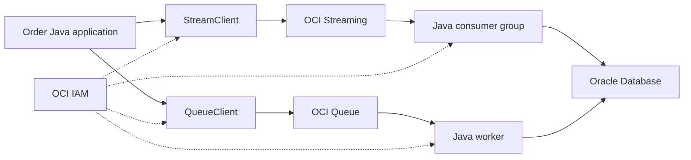

# Connecting to Streaming and Queue from Java

## 1. Objectives and Scope

In the **Streaming and Queue** chapter of the **CLOUD_PROVIDERS_ORACLE** module, this lesson guides Java applications connecting to both OCI services using the **OCI SDK for Java**. The steps cover preparing IAM and networking, retrieving the right endpoints, building clients, publishing data, consuming data, and acknowledging progress only after processing succeeds.

The running scenario is an order application:

- Publishing order events to Streaming so independent consumer groups can read the data.
- Sending background processing requests to Queue so a worker executes the job.
- Persisting business results to Oracle Database in a real application.

After this lesson, learners should be able to explain why both use `GetMessages` yet Streaming uses cursors while Queue uses receipts and visibility timeouts, and know how to implement consumers that handle redelivery safely.

This lesson focuses on **serverless OCI Streaming and OCI Queue via native APIs**. Streaming also offers a Kafka connection path; Kafka SASL/auth token configs and bootstrap servers are not used by the native clients below. Queue also supports other protocols, while the examples here use the Java SDK over HTTPS APIs. See [Developer Guide to Streaming](https://docs.oracle.com/en-us/iaas/Content/Streaming/Tasks/developing.htm) and [Overview of Queue](https://docs.oracle.com/en-us/iaas/Content/queue/overview.htm).

The code snippets are learning examples and were not compiled or executed against a live tenancy while authoring this lesson. The illustrative handler only validates data and logs output; it does not execute database transactions yet.

## 2. Distinguish the Two Processing Contracts Before Writing Code

| Aspect | Native Streaming | Queue in the Work-Queue Model Used Here |
| --- | --- | --- |
| Target identifier | Stream OCID | Queue OCID |
| Message client | `StreamClient` | `QueueClient` |
| Sent data | Key/value of type `byte[]` | Content of type `String` |
| Read progress | Per-partition cursor and offset; with consumer groups | Message received with a receipt and visibility timeout |
| Completion ack | Commit progress of the consumer group | Delete message using a valid receipt |
| After acknowledgment | Record remains subject to stream retention | Deleted message no longer waits in the work queue |
| When consumer fails | Can re-read from committed progress | Undeleted message can be redelivered |
| Ordering to note | Ordering within a partition | Do not build business logic assuming global FIFO across the queue |

These are two independent examples of service usage. Publishing to Streaming does not automatically create a message in Queue.



For example, `OrderAccepted` is an event that has occurred, suited for multiple groups reading for distinct purposes. `GenerateInvoice` is a request to execute a job, suited for a pool of workers competing for work. Service selection starts from processing needs before picking the Java API.

## 3. Preparing Resources, IAM, and Networking

### 3.1. Required Values

Pre-create a lab stream and queue in an appropriate compartment. Wait for resources to reach active state before running the application. Record each value separately:

| Environment Variable Used in Examples | Meaning |
| --- | --- |
| `OCI_STREAM_ID` | OCID of the stream |
| `OCI_STREAM_MESSAGES_ENDPOINT` | HTTPS messages endpoint of the stream |
| `OCI_STREAM_GROUP` | Consumer group name, e.g., `orders-java-lab` |
| `OCI_STREAM_INSTANCE` | Unique name for a running consumer instance |
| `OCI_QUEUE_ID` | OCID of the queue |
| `OCI_QUEUE_MESSAGES_ENDPOINT` | HTTPS messages endpoint of the queue |
| `OCI_LAB_FAIL` | Optional flag to simulate handler failure |

A stream OCID differs from a stream pool OCID. Native `PutMessagesRequest.streamId(...)` takes the **stream OCID**. A queue ID also cannot substitute for a stream ID even though both classes have similarly named methods.

### 3.2. Producer and Consumer Permissions

Example policies for groups in the `Default` identity domain, with a lab compartment named `messaging-lab`:

```text
Allow group Default/JavaStreamProducers to use stream-push in compartment messaging-lab
Allow group Default/JavaStreamConsumers to use stream-pull in compartment messaging-lab

Allow group Default/JavaQueueProducers to use queue-push in compartment messaging-lab
Allow group Default/JavaQueueConsumers to use queue-pull in compartment messaging-lab
```

Streaming permissions split across `stream-push` and `stream-pull` resource types. Queue permissions likewise have `queue-push` and `queue-pull`; receiving, updating visibility, and deleting messages belong to consume permissions. Reference [Details for the Streaming Service](https://docs.oracle.com/en-us/iaas/Content/Identity/Reference/streamingpolicyreference.htm) and [Queue Policies](https://docs.oracle.com/en-us/iaas/Content/queue/policy-reference.htm).

A single lab account running both producers and consumers needs both sets of permissions. In production deployments, separate producer and consumer identities by responsibility.

The policies above do not automatically permit the application to call `GetStream` or `GetQueue` to read metadata. If discovering endpoints dynamically at startup, add metadata read permissions such as `read streams` or `read queues` in the target compartment. If your deployment pipeline supplies endpoints directly, the runtime may only need message-handling permissions.

### 3.3. Networking and Transport Security

The native APIs in this lesson use HTTPS endpoints, typically over port 443. From wherever the JVM actually runs, verify DNS, routing, firewalls, proxies, and TLS truststores. For Streaming with a private endpoint, the application also needs network routing and DNS to the endpoint inside the VCN.

You can check the TCP layer on Windows with:

```powershell
Test-NetConnection -ComputerName "<MESSAGES_ENDPOINT_HOST>" -Port 443
```

Replace the host with the domain name portion only, omitting `https://` and any path. TCP success verifies only part of the network path; invoke the SDK to validate request signing, IAM, and resources.

Keep TLS certificate verification enabled. If your organization uses a proxy or internal CA, configure proxy/truststore settings for your environment rather than disabling certificate verification.

## 4. Java Project Setup and SDK Dependencies

The examples use Java 17, Maven, and SDK 3.x. Use the BOM to keep OCI modules on matching versions; SDK 3.x apps must explicitly choose an HTTP transport. This lesson uses Jersey 3 per the [OCI Java SDK Getting Started Guide](https://docs.oracle.com/en-us/iaas/Content/API/SDKDocs/javasdkgettingstarted.htm).

Version `3.94.0` below is pinned for the examples and exists in [Oracle's source repository at tag v3.94.0](https://github.com/oracle/oci-java-sdk/tree/v3.94.0). This is not a claim about the latest release or a dependency matrix verified for every application.

Create a dedicated lab project with `pom.xml`:

```xml
<project xmlns="http://maven.apache.org/POM/4.0.0"
         xmlns:xsi="http://www.w3.org/2001/XMLSchema-instance"
         xsi:schemaLocation="http://maven.apache.org/POM/4.0.0 https://maven.apache.org/xsd/maven-4.0.0.xsd">
    <modelVersion>4.0.0</modelVersion>

    <groupId>vn.example</groupId>
    <artifactId>oci-messaging-java-lab</artifactId>
    <version>1.0.0</version>

    <properties>
        <maven.compiler.release>17</maven.compiler.release>
        <project.build.sourceEncoding>UTF-8</project.build.sourceEncoding>
        <oci.sdk.version>3.94.0</oci.sdk.version>
    </properties>

    <dependencyManagement>
        <dependencies>
            <dependency>
                <groupId>com.oracle.oci.sdk</groupId>
                <artifactId>oci-java-sdk-bom</artifactId>
                <version>${oci.sdk.version}</version>
                <type>pom</type>
                <scope>import</scope>
            </dependency>
        </dependencies>
    </dependencyManagement>

    <dependencies>
        <dependency>
            <groupId>com.oracle.oci.sdk</groupId>
            <artifactId>oci-java-sdk-streaming</artifactId>
        </dependency>
        <dependency>
            <groupId>com.oracle.oci.sdk</groupId>
            <artifactId>oci-java-sdk-queue</artifactId>
        </dependency>
        <dependency>
            <groupId>com.oracle.oci.sdk</groupId>
            <artifactId>oci-java-sdk-common-httpclient-jersey3</artifactId>
        </dependency>
    </dependencies>

    <build>
        <plugins>
            <plugin>
                <groupId>org.apache.maven.plugins</groupId>
                <artifactId>maven-compiler-plugin</artifactId>
                <version>3.13.0</version>
            </plugin>
            <plugin>
                <groupId>org.codehaus.mojo</groupId>
                <artifactId>exec-maven-plugin</artifactId>
                <version>3.5.0</version>
            </plugin>
        </plugins>
    </build>
</project>
```

Place the three classes from the following sections under `src/main/java` with no package declaration so they run directly with the sample commands. All classes share one project.

Do not wildcard-import both `streaming.requests.*` and `queue.requests.*` together: both define `GetMessagesRequest` and `PutMessagesRequest`. Explicit imports prevent calling the wrong API or ambiguous class-name errors.

## 5. Java Authentication and Shared Configuration

### 5.1. Running from a Development Machine with an API Signing Key

Configure the `DEFAULT` profile in the user's OCI config file:

```ini
[DEFAULT]
user=ocid1.user.oc1..<USER_ID>
fingerprint=<PUBLIC_KEY_FINGERPRINT>
tenancy=ocid1.tenancy.oc1..<TENANCY_ID>
region=<REGION_ID>
key_file=C:/Users/<WINDOWS_USER>/.oci/oci_api_key.pem
```

On Windows, the config file typically lives inside `.oci` under the user profile directory. Point to the real path of the private PEM key; the matching public key must be uploaded for that exact user. Fields are documented in [SDK and CLI Configuration File](https://docs.oracle.com/en-us/iaas/Content/API/Concepts/sdkconfig.htm).

This authenticates via signed API requests. An OCI auth token used as a Kafka password does not replace the key file for `ConfigFileAuthenticationDetailsProvider`.

### 5.2. Shared Helper Class for the Examples

Create `OciJavaLabSupport.java`:

```java
import java.io.IOException;

import com.oracle.bmc.ClientConfiguration;
import com.oracle.bmc.ConfigFileReader;
import com.oracle.bmc.auth.AuthenticationDetailsProvider;
import com.oracle.bmc.auth.ConfigFileAuthenticationDetailsProvider;

public final class OciJavaLabSupport {
    static final String EVENT_ID = "evt-order-1042-v1";

    static final String BODY = """
        {
          "eventId": "evt-order-1042-v1",
          "schemaVersion": 1,
          "eventType": "OrderAccepted",
          "orderId": "ORD-1042",
          "occurredAt": "2026-11-20T02:00:00Z"
        }
        """;

    private OciJavaLabSupport() {}

    static AuthenticationDetailsProvider auth() throws IOException {
        var config = ConfigFileReader.parseDefault();
        return new ConfigFileAuthenticationDetailsProvider(config);
    }

    static ClientConfiguration httpConfig() {
        return ClientConfiguration.builder()
                .connectionTimeoutMillis(10_000)
                .readTimeoutMillis(65_000)
                .build();
    }

    static String requiredEnv(String name) {
        String value = System.getenv(name);
        if (value == null || value.isBlank()) {
            throw new IllegalArgumentException("Missing environment variable: " + name);
        }
        return value;
    }

    static void handleForLab(String content) {
        if (content == null || content.isBlank()) {
            throw new IllegalArgumentException("Empty message content");
        }
        if ("true".equalsIgnoreCase(System.getenv("OCI_LAB_FAIL"))) {
            throw new IllegalStateException("Simulated business failure");
        }
        System.out.println("LAB handler completed");
    }
}
```

`handleForLab` is intentionally just a handler placeholder. In a real application, this is where you parse JSON, validate the schema, extract `eventId`, execute business logic, and ensure state is durably persisted before returning success.

The fixed payload helps you observe the same event appearing multiple times. For new events, the application must generate a new ID when recording the business event; when resending an older event, keep the original ID.

The 65-second read timeout here provides headroom for the 20-second Queue long polling in the example. It is not a limit on business processing duration or total time across all retries.

### 5.3. Running on OCI Compute with Instance Principal

On OCI Compute, you can replace:

```java
var auth = OciJavaLabSupport.auth();
```

with:

```java
var auth = com.oracle.bmc.auth.InstancePrincipalsAuthenticationDetailsProvider
        .builder()
        .build();
```

The instance must belong to a dynamic group and that dynamic group must be granted appropriate policies. Use the producer/consumer resource types from the IAM section with `dynamic-group` principals instead of user groups. Provider setup is described in [Configuring the SDK, CLI, or Terraform](https://docs.oracle.com/en-us/iaas/Content/Identity/callresources/Configuring_the_SDK_CLI_or_Terraform.htm).

Do not pick instance principal for a JVM running on a laptop just because a region is set. Other runtimes like Functions or OKE have their own workload identity mechanisms; select the provider matching the actual runtime.

## 6. Retrieving the Exact Messages Endpoint

Both Streaming and Queue separate resource administration APIs from message-processing APIs. The service assigns each resource's messages endpoint; never construct the domain name manually from the region.

### 6.1. Streaming

With an authenticated admin client configured for the right region, you can read:

```java
var stream = streamAdminClient.getStream(
        com.oracle.bmc.streaming.requests.GetStreamRequest.builder()
                .streamId(streamId)
                .build()
).getStream();

String messagesEndpoint = stream.getMessagesEndpoint();
```

`streamAdminClient` is a `StreamAdminClient` initialized in the bootstrap layer. `messagesEndpoint` is passed to `StreamClient`; this workflow is covered in [Streaming Clients](https://docs.oracle.com/en-us/iaas/Content/Streaming/Tasks/developing.htm).

### 6.2. Queue

Similarly with a region-configured `QueueAdminClient`:

```java
var queue = queueAdminClient.getQueue(
        com.oracle.bmc.queue.requests.GetQueueRequest.builder()
                .queueId(queueId)
                .build()
).getQueue();

String messagesEndpoint = queue.getMessagesEndpoint();
```

The two snippets above illustrate metadata discovery and are not standalone executable classes. In the lab below, copy the messages endpoint from the Console and pass it via environment variables so the running app does not need metadata read permissions.

Different queues can have different messages endpoints. Put, get, update, and delete message calls must target the right endpoint; see [Message Management](https://docs.oracle.com/en-us/iaas/Content/queue/messages.htm).

Kafka endpoints like `host:9092`, topic names, and stream pool OCIDs are not the connection parameters used by these native examples.

## 7. Streaming: Publishing and Consuming Data from Java

### 7.1. Producer and Consumer-Group Reader Class

Create `StreamingJavaLab.java`:

```java
import java.nio.charset.StandardCharsets;
import java.util.List;

import com.oracle.bmc.streaming.StreamClient;
import com.oracle.bmc.streaming.model.CreateGroupCursorDetails;
import com.oracle.bmc.streaming.model.Message;
import com.oracle.bmc.streaming.model.PutMessagesDetails;
import com.oracle.bmc.streaming.model.PutMessagesDetailsEntry;
import com.oracle.bmc.streaming.requests.CreateGroupCursorRequest;
import com.oracle.bmc.streaming.requests.GetMessagesRequest;
import com.oracle.bmc.streaming.requests.PutMessagesRequest;

public final class StreamingJavaLab {
    public static void main(String[] args) throws Exception {
        if (args.length != 1
                || (!args[0].equals("send") && !args[0].equals("read"))) {
            throw new IllegalArgumentException("Use: send | read");
        }

        String streamId = OciJavaLabSupport.requiredEnv("OCI_STREAM_ID");
        String endpoint = OciJavaLabSupport.requiredEnv(
                "OCI_STREAM_MESSAGES_ENDPOINT");
        var auth = OciJavaLabSupport.auth();

        try (StreamClient client = StreamClient.builder()
                .endpoint(endpoint)
                .configuration(OciJavaLabSupport.httpConfig())
                .build(auth)) {
            if (args[0].equals("send")) {
                send(client, streamId);
            } else {
                read(client, streamId);
            }
        }
    }

    private static void send(StreamClient client, String streamId) {
        var record = PutMessagesDetailsEntry.builder()
                .key("ORD-1042".getBytes(StandardCharsets.UTF_8))
                .value(OciJavaLabSupport.BODY.getBytes(StandardCharsets.UTF_8))
                .build();

        var response = client.putMessages(
                PutMessagesRequest.builder()
                        .streamId(streamId)
                        .putMessagesDetails(PutMessagesDetails.builder()
                                .messages(List.of(record))
                                .build())
                        .build());

        var results = response.getPutMessagesResult().getEntries();
        if (results.size() != 1) {
            throw new IllegalStateException("Unexpected Streaming result count");
        }

        var result = results.get(0);
        if (result.getError() != null && !result.getError().isBlank()) {
            throw new IllegalStateException(
                    "Streaming publish failed: " + result.getError());
        }

        System.out.printf(
                "eventId=%s partition=%s offset=%s requestId=%s%n",
                OciJavaLabSupport.EVENT_ID,
                result.getPartition(),
                result.getOffset(),
                response.getOpcRequestId());
    }

    private static void read(StreamClient client, String streamId)
            throws InterruptedException {
        String group = OciJavaLabSupport.requiredEnv("OCI_STREAM_GROUP");
        String instance = OciJavaLabSupport.requiredEnv("OCI_STREAM_INSTANCE");

        var details = CreateGroupCursorDetails.builder()
                .groupName(group)
                .instanceName(instance)
                .type(CreateGroupCursorDetails.Type.TrimHorizon)
                .commitOnGet(true)
                .build();

        String cursor = client.createGroupCursor(
                CreateGroupCursorRequest.builder()
                        .streamId(streamId)
                        .createGroupCursorDetails(details)
                        .build())
                .getCursor()
                .getValue();

        while (!Thread.currentThread().isInterrupted()) {
            var batch = client.getMessages(
                    GetMessagesRequest.builder()
                            .streamId(streamId)
                            .cursor(cursor)
                            .limit(25)
                            .build());

            for (Message message : batch.getItems()) {
                String content = new String(
                        message.getValue(), StandardCharsets.UTF_8);

                OciJavaLabSupport.handleForLab(content);

                System.out.printf(
                        "handled partition=%s offset=%s%n",
                        message.getPartition(), message.getOffset());
            }

            // Only advance after every handler in the batch succeeds.
            cursor = batch.getOpcNextCursor();

            // Small lab pacing delay; tune polling for real throughput.
            Thread.sleep(1_000);
        }
    }
}
```

Model names and request builders follow the [SDK for Java Streaming Quickstart](https://docs.oracle.com/en-us/iaas/Content/Streaming/Tasks/streaming-quickstart-oci-sdk-for-java.htm). The example handles errors with the Java standard library without requiring extra utility libraries.

### 7.2. Key Producer Concepts to Understand

**Keys and values are byte arrays.** The Java SDK takes binary data and handles wire encoding. Do not Base64-encode a JSON string before passing it to `value(...)` if consumers expect UTF-8 JSON; doing so alters the business payload.

**Batch results must be inspected per entry.** With Streaming, one request can return a mix of succeeded and failed entries. The single-entry example checks that entry directly. When scaling to multiple entries, maintain a mapping between inputs and results, resending only failed entries once state is clear. Never assume no exception means every record was persisted.

**Keys do not create stream-wide ordering.** Pick keys by entity, such as `orderId`, when related events must stay in the same partition. You must still handle multiple producers emitting for the same entity or business logic receiving late events.

**Offsets are service metadata.** They do not replace your order system's `eventId`. In particular, resending the same event can create a new record at a different offset.

### 7.3. Cursors, Consumer Groups, and Commit Timing

Consumers use cursors to mark read positions. After each `GetMessages`, use `getOpcNextCursor()` for the next read, even when the returned message list is empty. Never add to offsets to synthesize a cursor.

With `commitOnGet(true)`, the next `GetMessages` call commits the previous fetch's progress. Thus, the loop order must be:

```text
Receive batch A
→ Finish processing all of A
→ Use next cursor to call GetMessages
→ Progress for A is committed while receiving batch B
```

If the handler throws mid-batch, the class above exits the loop. It does not make the next fetch call and skip over the failure. When recovering from committed progress, previously succeeded messages from that uncommitted batch can appear again.

Never issue the next `GetMessages` immediately after submitting a batch to an executor while tasks are still running. Doing so can commit ahead of durable business writes. Keep a clear completion barrier for the batch or implement explicit manual commits.

Per [Using Consumer Groups](https://docs.oracle.com/en-us/iaas/Content/Streaming/Tasks/using_consumer_groups.htm), an existing group resumes from its committed offsets; passing `TrimHorizon` in the request does not automatically rewind that group. Each running instance in the same group needs a distinct name. Groups also have inactivity lifetimes and cursors expire; never persist a cursor as a permanent checkpoint.

### 7.4. Long Processing, Recovery, and Shutdown

The example assumes a fast handler. If batch processing exceeds the instance's partition lease window, the service can reassign partitions to another instance. For longer jobs, shrink batch sizes, speed up processing, or manage `ConsumerHeartbeat` properly across the lifecycle.

When you need to commit immediately after finishing a batch, use `commitOnGet(false)` with `ConsumerCommit`. The commit API returns an updated cursor and refreshes the lease on associated partitions. See [Manually Committing an Offset](https://docs.oracle.com/en-us/iaas/Content/Streaming/Tasks/commit-consumer-group.htm). Coordinate cursor, heartbeats, and partition ownership carefully; never invoke ad-hoc commits from multiple threads concurrently.

On shutdown, stop fetching new batches, wait for in-flight work up to your shutdown budget, and close the client. Under commit-on-get mode, the final batch may remain uncommitted when the process stops; design handlers to reprocess safely. Handle expired cursors or membership errors by rejoining the group with the same identity rather than changing the group name to bypass errors.

## 8. Queue: Sending, Receiving, and Deleting Messages from Java

### 8.1. Producer and Worker Class

Create `QueueJavaLab.java`:

```java
import java.util.List;

import com.oracle.bmc.queue.QueueClient;
import com.oracle.bmc.queue.model.GetMessage;
import com.oracle.bmc.queue.model.PutMessagesDetails;
import com.oracle.bmc.queue.model.PutMessagesDetailsEntry;
import com.oracle.bmc.queue.requests.DeleteMessageRequest;
import com.oracle.bmc.queue.requests.GetMessagesRequest;
import com.oracle.bmc.queue.requests.PutMessagesRequest;

public final class QueueJavaLab {
    public static void main(String[] args) throws Exception {
        if (args.length != 1
                || (!args[0].equals("send") && !args[0].equals("work"))) {
            throw new IllegalArgumentException("Use: send | work");
        }

        String queueId = OciJavaLabSupport.requiredEnv("OCI_QUEUE_ID");
        String endpoint = OciJavaLabSupport.requiredEnv(
                "OCI_QUEUE_MESSAGES_ENDPOINT");
        var auth = OciJavaLabSupport.auth();

        try (QueueClient client = QueueClient.builder()
                .endpoint(endpoint)
                .configuration(OciJavaLabSupport.httpConfig())
                .build(auth)) {
            if (args[0].equals("send")) {
                send(client, queueId);
            } else {
                work(client, queueId);
            }
        }
    }

    private static void send(QueueClient client, String queueId) {
        var response = client.putMessages(
                PutMessagesRequest.builder()
                        .queueId(queueId)
                        .putMessagesDetails(PutMessagesDetails.builder()
                                .messages(List.of(
                                        PutMessagesDetailsEntry.builder()
                                                .content(OciJavaLabSupport.BODY)
                                                .build()))
                                .build())
                        .build());

        var published = response.getPutMessages().getMessages();
        if (published.size() != 1) {
            throw new IllegalStateException("Unexpected Queue result count");
        }

        System.out.printf(
                "eventId=%s queueMessageId=%s requestId=%s%n",
                OciJavaLabSupport.EVENT_ID,
                published.get(0).getId(),
                response.getOpcRequestId());
    }

    private static void work(QueueClient client, String queueId) {
        while (!Thread.currentThread().isInterrupted()) {
            var response = client.getMessages(
                    GetMessagesRequest.builder()
                            .queueId(queueId)
                            .limit(1)
                            .timeoutInSeconds(20)
                            .visibilityInSeconds(60)
                            .build());

            for (GetMessage message : response.getGetMessages().getMessages()) {
                try {
                    OciJavaLabSupport.handleForLab(message.getContent());

                    client.deleteMessage(
                            DeleteMessageRequest.builder()
                                    .queueId(queueId)
                                    .messageReceipt(message.getReceipt())
                                    .build());

                    System.out.printf(
                            "completed queueMessageId=%s deliveryCount=%s%n",
                            message.getId(), message.getDeliveryCount());
                } catch (RuntimeException error) {
                    System.err.printf(
                            "not confirmed queueMessageId=%s errorType=%s%n",
                            message.getId(), error.getClass().getSimpleName());
                    // No delete on failure: the message may be delivered again.
                }
            }
        }
    }
}
```

The Queue class uses string content. The publish result returns a list of published messages with Queue-assigned IDs; it does not use Streaming's `getPutMessagesResult().getEntries()`. This structure is documented in [Queue PutMessages](https://docs.oracle.com/en-us/iaas/tools/java/latest/com/oracle/bmc/queue/model/PutMessages.html) and [PutMessage](https://docs.oracle.com/en-us/iaas/tools/java/latest/com/oracle/bmc/queue/model/PutMessage.html).

The payload reuses the event fixture to make API comparisons easy. When building a real invoice worker, define a command message like `GenerateInvoice` with an explicit schema and job ID.

### 8.2. Long Polling vs. Visibility Timeout

The two parameters on the receive request serve distinct purposes:

| Parameter | Meaning in the Example |
| --- | --- |
| `timeoutInSeconds(20)` | When no message is available, the service can wait up to 20 seconds before responding |
| `visibilityInSeconds(60)` | Received message is hidden from other consumers during this processing window |
| `limit(1)` | Requests at most one message per receive, simplifying execution-time management |

Long polling can return early as soon as data arrives. An empty response after the wait window is normal. No tight retry loop is needed when the queue is empty.

Queue supports polling timeouts from 0 to 30 seconds and returns at most 20 messages per response per [Consuming Messages](https://docs.oracle.com/en-us/iaas/Content/queue/consume-messages.htm). The example uses a small batch for clarity; increasing batch size requires factoring in how long a message waits behind earlier messages in the same batch.

The HTTP read timeout must exceed the long-polling timeout plus headroom. Conversely, increasing the HTTP read timeout does not extend a message's visibility timeout.

### 8.3. Receipt Grants Authority for a Specific Delivery

Queue returns a `receipt` upon delivery. Use a valid receipt for deleting or updating visibility on that delivery. `messageId` is an identifier for observation; it does not replace the receipt in `DeleteMessageRequest`.

Once visibility expires and the message is redelivered, the prior consumer must not assume the old receipt still works. Workers must track processing deadlines and use metadata from the current delivery. Never print receipts in general logs or use them as business IDs. Delete parameters are documented in [DeleteMessageRequest.Builder](https://docs.oracle.com/en-us/iaas/tools/java/latest/com/oracle/bmc/queue/requests/DeleteMessageRequest.Builder.html).

Processing sequence:

```text
Receive message and receipt
→ Validate data contract
→ Execute and durably persist business outcome
→ DeleteMessage using receipt
```

Never put `deleteMessage` inside a `finally` block. Deleting a message even when the handler fails destroys the ability to retry that job.

In the example, both handler errors and delete errors are logged as unconfirmed. If delete fails after business state was saved successfully, the message can be redelivered; hence deduplication remains mandatory.

### 8.4. Extending Visibility When Work Takes Longer

The snippet below applies while the worker still holds the message, before visibility expires:

```java
client.updateMessage(
        com.oracle.bmc.queue.requests.UpdateMessageRequest.builder()
                .queueId(queueId)
                .messageReceipt(message.getReceipt())
                .updateMessageDetails(
                        com.oracle.bmc.queue.model.UpdateMessageDetails.builder()
                                .visibilityInSeconds(120)
                                .build())
                .build());
```

`client`, `queueId`, and `message` are variables from the active worker. This is not a standalone program or automatic scheduler.

Setting 120 seconds establishes a new visibility deadline relative to when the server receives the request, per [UpdateMessageDetails.Builder](https://docs.oracle.com/en-us/iaas/tools/java/latest/com/oracle/bmc/queue/model/UpdateMessageDetails.Builder.html). It does not add 120 seconds onto the old deadline.

If using an extension scheduler, stop it when the job finishes, fails, or loses ownership. Handle extension errors explicitly, because another worker can pick up the same job after expiration. Never extend a wedged task indefinitely.

Repeatedly failing messages should be isolated via dead-letter queue configuration and an investigation workflow. Never delete failing messages just to make pending queue counts look clean.

## 9. Deduplication and Transaction Boundaries with Oracle Database

### 9.1. Why Service Acknowledgments Are Not Enough

Two common scenarios:

| Sequence of Events | Consequence to Handle |
| --- | --- |
| Producer succeeds on server but response is lost | Producer is unsure of outcome; resending can create duplicates |
| Consumer commits DB successfully before stream commit or queue delete | After failure, already-processed data can be redelivered |
| Consumer acknowledges before committing DB | If process crashes, the job may never be retried properly |
| Two workers process the same event concurrently | In-memory duplicate checks cannot protect shared data |

There is no local Java transaction that automatically combines an Oracle Database commit with a Streaming commit or Queue delete into a single atomic action.

Designs should favor safe reprocessing: if the DB commits and service acknowledgment fails, the consumer can receive the message again and recognize the business effect is already complete.

### 9.2. Inbox with a Durable Business Key

Illustrative table in Oracle Database:

```sql
CREATE TABLE consumed_event (
    consumer_name VARCHAR2(100 CHAR) NOT NULL,
    event_id      VARCHAR2(200 CHAR) NOT NULL,
    processed_at  TIMESTAMP WITH TIME ZONE DEFAULT SYSTIMESTAMP NOT NULL,
    CONSTRAINT pk_consumed_event PRIMARY KEY (consumer_name, event_id)
);
```

The key includes `consumer_name` so independent handlers can still process the same event for their own purposes. For example, `invoice-worker` and `analytics-projector` must not accidentally block each other just because they share `eventId`.

Flow inside **one DB transaction**:

1. Parse and validate the message, extracting `eventId`.
2. Insert key `(consumer_name, event_id)` into the inbox.
3. Apply the business change, such as creating the invoice.
4. Commit both the inbox row and business changes.
5. Only afterward allow committing Streaming progress or deleting the Queue message.

If the inbox key already exists from a previously committed run, verify it is a valid prior record and treat the event as already processed. Catch only the expected key-violation error; other DB errors must still fail the run.

Do not do a plain `SELECT` to check absence before creating an invoice without a unique constraint. Two workers can both pass the check concurrently. Data constraints and transactions are what enforce correctness under concurrency.

### 9.3. External Side Effects and Outbox

An inbox does not automatically deduplicate external side effects. If a handler calls a payment gateway or sends email, design idempotency keys, task states, or reconciliation for the target system.

On the producer side, if the application both updates an order and must send a message, consider a transactional outbox:

```text
DB transaction:
    save order + save outbox record with same eventId

Java relay:
    read pending outbox records
    → send message
    → verify result
    → mark as sent
```

The relay may resend if it crashes after sending but before marking sent. Keep the same `eventId` so consumers deduplicate. An outbox narrows the gap between saving business state and publishing events; it still requires duplicate handling.

These inbox/outbox patterns are application design recommendations for the order scenario, not features enabled automatically by instantiating `StreamClient` or `QueueClient`.

## 10. Retries, Exceptions, and Client Lifecycle

### 10.1. Classify Errors Before Retrying

| Symptom | What to Check |
| --- | --- |
| `UnknownHostException` or connection failure | Endpoint, DNS, routing, proxy, VCN |
| `SSLHandshakeException` | Certificate chain, truststore, CA/proxy, system clock |
| HTTP 401 | Provider, key/fingerprint/user, token if any, clock skew |
| HTTP 403 or `NotAuthorizedOrNotFound` | IAM, compartment, OCID, region, or non-existent resource |
| HTTP 400 | Request, payload/batch limits, invalid cursor or receipt |
| HTTP 429 | Throttling; reduce pressure, back off, and check limits |
| 5xx errors or timeouts | Transient issue or ambiguous publish outcome; evaluate retries per operation |
| Handler fails repeatedly on one payload | Schema, business data, version compatibility; consider DLQ/quarantine |

Do not fix permission errors by increasing timeouts. Do not loop endlessly on an invalid-parameter request. For state-dependent errors like expired cursors or receipts, simply replaying the old request may not recover.

At the SDK call site, you can extract metadata from `BmcException` for logging:

```java
catch (com.oracle.bmc.model.BmcException error) {
    System.err.printf(
            "status=%d serviceCode=%s requestId=%s%n",
            error.getStatusCode(),
            error.getServiceCode(),
            error.getOpcRequestId());
    throw error;
}
```

This is a `catch` block to pair with a `try` around an API call, not a standalone class. Avoid logging private keys, receipts, credentials, or sensitive payload contents.

### 10.2. Coordinating SDK Retries and Application Retries

The OCI Java SDK provides retry and circuit-breaker configuration. Default behavior depends on the operation and version; check the exact APIs in use. Client mechanisms and lifecycles are covered in [Java SDK Concepts](https://docs.oracle.com/en-us/iaas/Content/API/SDKDocs/javasdkconcepts.htm).

When adding application-level retries:

- Set a max attempt count or overall deadline.
- Use backoff with jitter for transient errors and throttling.
- Keep `eventId` intact across attempts.
- For Streaming batches with partial results, separate failed entries from succeeded entries.
- On timeouts with unknown outcomes, record uncertainty and rely on deduplication.
- Account for SDK-level retries as well to avoid multiplying call volume unexpectedly.

Do not assume setting the same `opcRequestId` causes the service to deduplicate every retried publish. Request IDs support tracing; business idempotency is a separate contract.

### 10.3. Reuse Clients and Bound In-Flight Work

Initialize clients once for the lifetime of the application or component using them; avoid creating a new TLS connection pool per message. Complete endpoint configuration before sharing a client across threads, and close clients on shutdown.

In Java web applications, move synchronous calls onto suitable worker threads or use async clients per your application architecture. Never let an infinite consumer loop block request-serving threads.

For Streaming, preserve completion/commit boundaries when increasing concurrency. For Queue, bound concurrent in-flight messages to worker capacity and visibility duration. An unbounded thread pool easily lets messages expire while still queued in memory.

## 11. Running the Lab and Observing Results

### 11.1. PowerShell Environment Setup

Replace all placeholders with real resource values:

```powershell
$env:OCI_STREAM_ID = "<STREAM_OCID>"
$env:OCI_STREAM_MESSAGES_ENDPOINT = "<STREAM_MESSAGES_ENDPOINT_HTTPS>"
$env:OCI_STREAM_GROUP = "orders-java-lab"
$env:OCI_STREAM_INSTANCE = "orders-java-lab-worker-1"

$env:OCI_QUEUE_ID = "<QUEUE_OCID>"
$env:OCI_QUEUE_MESSAGES_ENDPOINT = "<QUEUE_MESSAGES_ENDPOINT_HTTPS>"
$env:OCI_LAB_FAIL = "false"
```

In the lab project, run the Streaming producer:

```powershell
mvn compile exec:java "-Dexec.mainClass=StreamingJavaLab" "-Dexec.args=send"
```

Then run the consumer:

```powershell
mvn compile exec:java "-Dexec.mainClass=StreamingJavaLab" "-Dexec.args=read"
```

Creating the group for the first time uses `TrimHorizon`, so it can read messages sent earlier if still within retention. Reusing the group resumes from its committed position. To compare two independent reader groups, pick a second lab group name; to add instances in the same group, keep the group name and change the instance name.

Run the Queue producer and then worker:

```powershell
mvn compile exec:java "-Dexec.mainClass=QueueJavaLab" "-Dexec.args=send"
mvn compile exec:java "-Dexec.mainClass=QueueJavaLab" "-Dexec.args=work"
```

The consumer commands run continuously. Stop the process once observation is complete. Environment variables are inherited when the JVM starts; changing variables in another PowerShell window does not update an already running JVM.

### 11.2. Signals to Observe

| Step | Expected Observation |
| --- | --- |
| Streaming send | Partition, offset, and request ID printed, with no entry errors |
| Streaming read | Handler runs and logs partition/offset |
| Queue send | Queue message ID and request ID printed |
| Queue work success | Handler runs before delete; completed logged after delete succeeds |
| Empty Queue | Long polling returns empty list; worker keeps waiting |
| Resend fixture | Same eventId can appear across multiple service records/messages |

The `LAB handler completed` log only confirms the sample handler returned. It does not prove an invoice was written to Oracle Database.

### 11.3. Fault Injection to Understand Redelivery

**Streaming:** stop the consumer, set `OCI_LAB_FAIL=true`, and run again with the same group. If uncommitted data exists, the handler throws and the consumer stops. Then reset the flag to `false` and restart to observe data replaying from committed progress. Publish new messages if the group already caught up.

**Queue:** on the test queue, send a message, set the failure flag, and run the worker. The message is not deleted when the handler fails. After the visibility timeout, it can be redelivered with an incremented delivery count. Stop the worker, reset the flag, and restart to observe successful processing. Avoid letting failures loop too long if you only want to observe one redelivery, as the message can move to the DLQ per queue configuration.

**Post-DB-commit window:** once the handler is replaced with real business logic, simulate stopping after DB commit and before service acknowledgment. Redelivery must produce no extra business side effect thanks to the inbox or idempotency key.

Queue Console polling can also affect deliveries and delivery counts. While testing workers, avoid letting an unmonitored Console session pull messages concurrently.

## 12. Moving Java Connectivity to Production Operations

### 12.1. Monitor What Matters to the Business

Track three layers simultaneously:

| Layer | Signals to Observe |
| --- | --- |
| Connectivity and SDK | Latency, timeouts, auth/permission errors, throttling, retries, request IDs |
| Processing pipeline | Send/receive rates, handler errors, blocked duplicates, processing time |
| Business outcomes | Orders missing invoices, wait times, backlog size, and job age |

For Streaming, measure processing lag by event timestamp or publish timestamp alongside group progress. Offsets are not guaranteed contiguous, so simple offset subtraction does not always equal remaining records.

For Queue, track waiting messages, in-flight messages, delivery counts, DLQ counts, and processing duration against visibility timeout. Zero visible messages does not prove all jobs finished; messages may still be in-flight.

### 12.2. Availability and Cost

Run multiple instances for fault tolerance while enforcing idempotency in shared data stores. Streaming consumers in the same group split partitions; adding instances beyond partition count creates no extra read parallelism for that group. Queue workers scale with workload pressure and downstream system capacity.

Set retention and replay strategies according to recovery requirements. When deploying across multiple regions, endpoints, OCIDs, IAM, and data state must be managed under an explicit plan; a Java client does not create cross-region replication by itself.

Use appropriate batching and long polling to cut down empty requests. Alert on unusual retry spikes, since retries both increase load and amplify duplicate traffic. After the lab, stop workers, clean up test resources per your environment's process, and protect any key files still in use.

Connectivity is production-ready when the application demonstrates the entire path: proper identity and endpoint, successful publishing, business processing, timely acknowledgment, and clean recovery upon redelivery.
