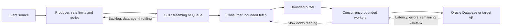

# Backpressure, Throughput, and Processing Latency Monitoring

In the **Streaming and Queue** chapter of the **CLOUD_PROVIDERS_ORACLE** module, this lesson addresses a common operational situation: producers keep publishing successfully while consumers grow slower and slower. Simply increasing read calls or adding workers can overload the downstream database even further.

The goal is designing a processing pipeline on Oracle Cloud Infrastructure with explicit load bounds, measurable real capacity, and early detection of SLA breach risks. Decisions must tie into OCI Streaming or OCI Queue, IAM, networking, Compute/OKE resources, and target services such as Oracle Database or Autonomous Database.

The running example is a system ingesting order events, executing business logic, and durably persisting outcomes to a database. Numbers in the examples are illustrative assumptions for calculation, not OCI performance guarantees.

## 1. Distinguish Three Signals to Observe

### 1.1. Throughput: How Much Work Does the System Complete?

Throughput is the amount of work completed per unit of time. In an asynchronous pipeline, specify which stage is being measured:

| Quantity | Common Unit | Meaning |
| --- | --- | --- |
| Generation rate | Events/second | Business demand produced at the source |
| Service ingress rate | Messages/second, bytes/second | Data accepted by Streaming or Queue |
| Read rate | Messages/second, bytes/second | Data fetched by consumers from the service |
| Useful completion rate | Unique events/second | Business work finished and durably persisted |
| Acknowledgment rate | Messages/second or batches/second | Post-processing delete/commit progress |

For instance, a consumer reads 1,500 messages/second yet completes only 900 new events per second because the rest are retries or prefetched work. Looking solely at GET rate can mislead operations into thinking the system keeps up with a 1,200 events/second input rate.

Measure bytes/second as well. When average message size grows from 2 KB to 8 KB, holding the message-per-second rate constant still increases network traffic and read/write volume roughly fourfold.

### 1.2. Latency: How Long Does One Job Take to Finish?

Latency is the duration of a specific job or operation. Define its start and end points clearly:

| Measurement | Start → End | What It Reveals |
| --- | --- | --- |
| Publish API latency | Start API call → receive response | Service communication latency |
| Source-to-consumer time | Event created → consumer receives | Delays at source, transport, or backlog |
| Local wait time | Consumer receives → worker starts | Bottlenecks in local buffers or worker pools |
| Processing latency | Worker starts → result durably written | Slow CPU, database, or downstream APIs |
| Confirmation latency | Business complete → delete/commit acked | Delays in recording progress |
| End-to-end latency | Event created → business complete | How long users wait for the outcome |

A fast Publish API response does not prove events are processed quickly. Conversely, long GET durations under long polling can be normal behavior when the queue is nearly empty.

### 1.3. Backpressure: How Does the System React When Falling Behind?

Backpressure is the mechanism for propagating capacity shortage signals upstream to regulate incoming work intake.

A consumer whose buffer is full can throttle or pause fetching messages. If service backlog still grows past an acceptable threshold, the system can slow down producers, rate-limit certain sources, or return busy signals to callers.

Backpressure requires a concrete policy: bounded waiting, throttling, durable staging, or explicit rejection. An unbounded memory buffer merely delays when overload hits.

## 2. Backlog and Catch-Up Time Model

### 2.1. Comparing Input Rate to Completion Capacity

Let:

```text
λ = incoming new event rate, events/second
μ = useful completion rate, events/second
B = number of remaining events to process
```

In a simple model with no expired, skipped, or error-routed data:

```text
Backlog change per second ≈ λ - μ
```

- If `λ < μ`, the system has spare capacity to drain the backlog.
- If `λ = μ`, the system keeps up with new input but has zero headroom to shrink existing backlog.
- If `λ > μ`, the backlog continues to grow.

Use the same data scope and measurement window. With multiple independent Streaming consumer groups, each group's backlog is a separate concern; never sum reads across groups as one workload's completion capacity.

### 2.2. Example of a 10-Minute Traffic Spike

Suppose the system has:

```text
Input rate during peak:   1,200 events/second
Completion capacity:        900 events/second
Peak duration:              600 seconds

Added backlog = (1,200 - 900) × 600
              = 180,000 events
```

Afterward, input drops to 600 events/second while completion capacity stays at 900:

```text
Backlog drain rate = 900 - 600
                   = 300 events/second

Catch-up time ≈ 180,000 / 300
              = 600 seconds
              = 10 minutes
```

Calculating `180,000 / 900 = 200 seconds` ignores new work continuing to arrive. That division applies only if new input drops to zero while processing speed remains unchanged.

Real-world models must also factor in retries, poison data, message-size variance, and downstream dependencies. Use formulas to form hypotheses, then validate against measured telemetry.

### 2.3. Backlog Count and Data Age Complement Each Other

A large backlog of brand-new messages may be a brief burst that still meets SLAs. A tiny backlog containing one message stuck for hours can still breach business requirements.

Track all of these together:

- Count of incomplete jobs.
- Rate of backlog growth or drain.
- Age of the oldest incomplete job.
- Latency distribution of completed jobs.
- Counts of errors, retries, and quarantined jobs.

Do not convert offset differences into exact message counts. OCI Streaming documentation notes offsets increase monotonically but may contain gaps; see [offset characteristics](https://docs.oracle.com/en-us/iaas/Content/Streaming/Tasks/using_a_single_consumer.htm).

## 3. Designing the Backpressure Feedback Path



### 3.1. Bound Both Message Count and Byte Volume

A sample configuration might set:

```text
Max 1,000 messages held in application memory
Max 64 concurrent business tasks
Pause-reading threshold: 800 messages
Resume-reading threshold: 300 messages
Buffer byte limit: sized to memory budget
```

Two distinct thresholds provide hysteresis, preventing read loops from flapping immediately whenever a single slot frees up.

Bounds must count both in-flight messages and queued messages inside the application. A bounded internal queue alongside thousands of unawaited async tasks spawned outside it can still exhaust memory.

Measure sizes after decoding and object allocation. A 16 KB payload does not occupy just 16 KB on the heap; parsers, metadata, and copies increase real memory footprint.

### 3.2. Reserve Capacity Before Reading

The sequence should be:

1. Determine remaining free slots in the processing budget.
2. Pre-reserve slots for the batch about to be fetched.
3. Request a batch no larger than that reserved capacity.
4. Release any reserved slots left unused.
5. Free slots once work moves into controlled processing completion.

Fetching a large batch first and waiting for a free worker afterward means data already sits inside the application. For Queue, visibility time is already ticking; for Streaming, consumers can hit lease and partition-ownership issues.

Any wait must have a deadline and shutdown handling. Session-maintenance work, heartbeats, or lease extensions must be isolated so they do not stall behind workers waiting on the database.

### 3.3. Propagating Signals Upstream to Producers

When downstream systems stay slow for extended periods, you can apply:

| Situation | Recommended Response |
| --- | --- |
| Short burst, spare retention and capacity | Let the service buffer the backlog; bound local buffers |
| One customer generating disproportionate load | Rate-limit per customer |
| Target API failing continuously | Open circuit breaker; throttle intake of new work |
| Unable to finish within business SLA | Return busy or reject before accepting responsibility |
| Job accepted yet cannot publish immediately | Track via outbox or appropriate durable staging |

Throttling producers must be paired with handling pending requests. For example, if an API already acknowledged an order, never silently drop the event just because a local publish buffer is full.

## 4. Applying to OCI Streaming

### 4.1. Separate Service Capacity from Consumer Capacity

Streaming write limits are per partition; current documentation states 1 MB/s per partition and 5 GET/s per partition per consumer group. Stream retention and partition count cannot change after creation. See [Streaming Resource Limits](https://docs.oracle.com/en-us/iaas/Content/Streaming/Concepts/streamingoverview_topic-Limits_on_Streaming_Resources.htm).

If producers hit throttling because one partition carries too much load, adding business-processing workers will not lift that write limit.

Within a consumer group, each partition is assigned to one member at a time; scaling instances beyond partition count creates no extra partitions to read. Skewed keys can also bottleneck just one slice of the system. See [Partition Design](https://docs.oracle.com/en-us/iaas/Content/Streaming/Concepts/partitioningastream.htm).

When analyzing throughput, separate at least three cases:

- **Producer constrained:** data struggles to enter the stream.
- **Consumer read constrained:** fetch rate cannot keep up.
- **Business processing constrained:** data was read yet cannot finish writing to target systems.

Only the matching bottleneck is relieved by adding more consumers.

### 4.2. Slow Down Reads While Keeping Commit Timing Accurate

With native Streaming consumer groups and `commitOnGet=true`, the next GET request commits progress from the previously received batch. Handing a batch off to async workers and immediately calling GET again can commit progress before business work finishes. See [Consumer Group Commit Mechanics](https://docs.oracle.com/en-us/iaas/Content/Streaming/Tasks/using_consumer_groups.htm).

A sequential loop is easier to control:

```text
Read a batch within processing capacity
→ process and durably persist the entire batch
→ only on success proceed to the next GET call
```

If an async pipeline is needed, design explicit commit tracking using `commitOnGet=false`, cursors, and completion ordering. This is not a change solved by simply dropping in an executor.

For example, a partition delivers three messages in order: A, B, C. Workers finish A and C, but B fails. You must not advance progress past B as if all three succeeded.

Commit APIs operate on cursors and consumer-group state; use cursors per their semantics rather than assuming you can submit an arbitrary calculated offset. See [Manual Commit](https://docs.oracle.com/en-us/iaas/Content/Streaming/Tasks/commit-consumer-group.htm).

### 4.3. Waiting Too Long Can Lose Partition Ownership

When batch processing or paused reading drags on, a consumer can exceed member activity timeouts and trigger a rebalance. OCI provides `ConsumerHeartbeat` to maintain active membership. See [Sending Heartbeats](https://docs.oracle.com/en-us/iaas/Content/Streaming/Tasks/send-heartbeat-consumer-group.htm).

Never run the heartbeat thread on the same executor saturated by business tasks. On rebalance or commit failure, stop assuming partition ownership, manage cursors per client semantics, and expect redelivery.

If using a Kafka client against OCI Streaming, polling, heartbeats, pause/resume, and commits follow Kafka client rules. Do not copy native API configs verbatim onto a Kafka client.

### 4.4. Retention Bounds Recovery Time

Slowing down reads protects downstream targets, yet data in the stream keeps aging. Messages past retention may disappear before catch-up reaches them.

Monitor the age of unprocessed data and estimate recovery time before allowing backlogs to accumulate for long. If replay is needed beyond that window, maintain a separate archive store and recovery workflow.

## 5. Applying to OCI Queue

The examples in this section use competing consumers on a single queue. If enabling consumer groups or channels, scope statistics and completion tracking accordingly.

### 5.1. Visible, In-Flight, and Completed Are Distinct States

A message can be ready for receipt, held by a consumer without deletion, or finished and deleted. Visibility timeout controls how long a delivered message stays hidden from other consumers. See [OCI Queue Overview](https://docs.oracle.com/en-us/iaas/Content/queue/overview.htm).

If visible count drops while in-flight rises rapidly, consumers may be pulling data into memory faster than they process it. That is not proof the business backlog is shrinking.

Queue's visible and in-flight statistics are approximate. Track trends over time rather than demanding exact point-in-time matches; see [Queue Statistics](https://docs.oracle.com/en-us/iaas/Content/queue/queue-statistics.htm).

### 5.2. Visibility Must Cover Local Queueing Time Too

Suppose a received message sits waiting in local app queues for 20 seconds and then takes 15 seconds to process. With a 30-second visibility timeout, the message can be redelivered before the first worker finishes.

The visibility budget must cover:

```text
Wait time inside the application
+ processing time
+ delete acknowledgment time
+ safety margin
```

This is a planned budget, not a guarantee tasks always finish on time. For long tasks, perform controlled visibility extensions and monitor extension errors. OCI lets you set visibility on receive or update it afterward; failing to delete or extend in time lets the message become visible for redelivery. See [Consuming Messages](https://docs.oracle.com/en-us/iaas/Content/queue/consume-messages.htm).

Do not try to solve everything with huge visibility timeouts. If a worker genuinely crashes, waiting a long time before redelivery increases recovery latency.

### 5.3. Delete Only After Business Results Are Durable

Sample sequence:

```text
Receive message
→ check deduplication identifier
→ execute business transaction
→ persist outcome and processed marker
→ delete message with corresponding receipt
```

If the application crashes after database commit yet before message deletion, the event can be redelivered. Consumers therefore need idempotency or protection against applying business logic twice.

For example, insert `eventId` with a unique constraint inside the same transaction that updates the order. Upon receiving a previously completed event again, verify state and perform the needed queue delete without repeating inventory deductions.

Transaction details depend on your data model; never treat an API call and a database update as a single atomic transaction.

### 5.4. Capacity-Bounded Consumer Pseudocode

Below is load-control pseudocode, not OCI SDK method names:

```text
while running:
    if downstreamCircuitIsOpen():
        waitUntilProbeOrShutdown()
        continue

    reserved = reserveAvailableSlots(upTo = configuredBatchLimit)
    if reserved == 0:
        waitForCapacityOrShutdown()
        continue

    try:
        messages = receiveQueueMessages(limit = reserved)
    catch receiveError:
        releaseSlots(reserved)
        recordFailureAndApplyBoundedBackoff()
        continue

    releaseSlots(reserved - size(messages))

    for message in messages:
        submitToBoundedWorker(message):
            try:
                keepVisibilityValidWhileOwned(message)
                persistBusinessResultIdempotently(message)
                deleteUsingReceipt(message)
                recordConfirmedCompletion(message)
            catch processingOrConfirmationError:
                recordFailureAndRetryState(message)
                doNotDeleteAsIfProcessingSucceeded()
            finally:
                stopVisibilityRenewalForThisAttempt()
                releaseSlots(1)
```

`submitToBoundedWorker` must also handle submission errors, shutdown, and rejected tasks. If unable to hand off to a worker, the application must still account for received messages and release capacity properly.

The pseudocode only illustrates bounding message counts inside the application. A complete implementation also needs deadlines, byte limits, receipt handling, lease-renewal lifecycles, and retry policies. When the database stays down for long periods, a circuit breaker stops pulling more messages and piling up in-flight work.

### 5.5. DLQ Does Not Prove the System Finished Processing

OCI Queue moves messages to the dead-letter queue once they exceed configured failed delivery attempts. Receiving increments delivery count; DLQs isolate failing data for investigation. See [Dead Letter Queues](https://docs.oracle.com/en-us/iaas/Content/queue/deadletterqueues.htm).

If the main queue shrinks while the DLQ grows, the system may simply be shifting unfinished work elsewhere. Dashboards must display DLQ growth rather than reporting the main queue as clean.

When replaying from a DLQ, rate-limit replay, keep event identifiers, and confirm the root cause has been resolved.

## 6. Batches, Concurrency, and Retries Share the Same Load Budget

### 6.1. Large Batches Have Trade-Offs

Batching reduces per-message overhead yet can increase batch-collection wait time, memory footprint, and full-batch processing duration.

For latency-sensitive producers, combine both:

- Maximum message count or byte size per batch.
- Maximum linger wait before flushing a partial batch.

For consumers, pick batches small enough to finish within your processing budget and maintain ownership state. Huge batches can worsen p99 latency even when average throughput improves.

### 6.2. Increasing Concurrency Can Lower Throughput

Suppose a consumer runs 64 workers while the database connection pool allocates only 20 connections to this service. Scaling workers to 256 may merely pile up threads waiting on connections and stretch message hold times.

Measure effective completion capacity after accounting for:

- CPU, memory, and garbage-collection pauses.
- Connection pools, row locks, and commit times.
- Downstream API rate limits.
- Contention on the same order or account.
- Network link latency and errors.

If a task averages 50 ms across 20 truly independent execution slots, ideal throughput is `20 / 0.05 = 400 tasks/second`. This is only a baseline estimate; lock contention and tail latency can pull useful capacity lower.

### 6.3. Retries Also Consume Capacity

If 1,000 new events/second average 0.2 retries per event, the processing tier must absorb roughly 1,200 attempts/second.

Retry design needs:

- Classification of transient, data, and configuration errors.
- Bounded backoff with jitter so clients do not retry in lockstep.
- Caps on total duration and attempt count.
- Accounting for retries within the same concurrency and rate budget.
- Preserving event identifiers across retries.

Never aggressively retry missing IAM permissions, wrong endpoints, or invalid payloads. Those require fixing config or data.

With OCI Streaming, a request can return HTTP 200 while carrying per-entry errors; full-request throttling can return 429. Inspect per-entry results before deciding to resend. See [Streaming Errors and Throttling](https://docs.oracle.com/en-us/iaas/Content/Streaming/Reference/troubleshootingstreaming.htm).

Publish timeouts can also leave outcomes uncertain from the client's perspective. Keep the business identifier and rely on deduplication rather than assuming every timeout means the service never received the data.

## 7. Measuring Processing Latency in the Application

### 7.1. Recording Timestamps with Clear Semantics

Sample application-designed envelope:

```json
{
  "eventId": "evt-order-2048-paid",
  "eventType": "OrderPaid",
  "occurredAt": "2026-11-20T03:15:00Z",
  "publishedAt": "2026-11-20T03:15:01Z",
  "schemaVersion": 1,
  "orderId": "ORD-2048"
}
```

Consumers add observation timestamps:

```text
receivedAt  : application received the message
startedAt   : worker began processing
completedAt : business outcome durably persisted
confirmedAt : delete or commit acknowledged
```

`publishedAt` here marks when the application began sending, not a service-certified timestamp. Never stamp a time before sending and treat it as service acceptance time.

Derived measurements:

```text
Local wait       = startedAt - receivedAt
Processing       = completedAt - startedAt
Business E2E     = completedAt - occurredAt
Confirmation gap = confirmedAt - completedAt
```

Use monotonic clocks for durations measured within one process. When subtracting timestamps across hosts, enforce clock sync and handle skewed/negative deltas cleanly.

An event sent late from the source can show high Business E2E even when consumers are completely healthy. Splitting source delay, delivery delay, and processing duration pinpoints where intervention is needed.

### 7.2. Tracking Distributions and Incomplete Tails

A sample service objective might be:

```text
Over a 15-minute window:
95% of valid events complete within 30 seconds of occurredAt.
```

This is an illustrative target set by the e-commerce system. Agree on how late-arriving events, failed events, and replayed jobs are counted.

Observe p50, p95, and p99 alongside sample counts. Never average p95 values across instances and call that system-wide p95. Aggregating distributions requires histogram buckets or mergeable sketch telemetry.

Crucially, histograms of completed events omit events currently stuck. When consumers stop completely, dashboards may stop receiving fresh latency samples; pair them with oldest-unprocessed age and application heartbeats.

### 7.3. Separating Metrics, Logs, and Traces

A recommended set of application metrics:

| Suggested Name | Type | Purpose |
| --- | --- | --- |
| `business_completed_total` | Counter | Unique business events completed |
| `processing_duration_seconds` | Histogram | Processing duration distribution |
| `business_e2e_duration_seconds` | Histogram | End-to-end business latency |
| `local_buffer_messages` | Gauge | Messages currently buffered in app memory |
| `local_buffer_bytes` | Gauge | Data memory budget usage |
| `oldest_uncompleted_age_seconds` | Gauge | Detect stalled work |
| `retry_attempts_total` | Counter | Extra load generated by retries |

These are names suggested by this lesson, not built-in OCI metrics. Instrument and export them to your chosen observability backend.

Use low-cardinality dimensions such as environment, app, and outcome type. Keep `eventId`, `orderId`, and per-event diagnostic details in logs or traces rather than creating a metric series per order.

## 8. Combining OCI Metrics with Application Metrics

### 8.1. OCI Streaming

Namespace: `oci_streaming`.

| Metric | Purpose When Reading |
| --- | --- |
| `PutMessagesThroughput.Bytes` | Byte throughput written to the stream |
| `GetMessagesThroughput.Bytes` | Byte throughput read |
| `PutMessagesThrottling.Count` | Detect throttled write messages |
| `GetMessagesThrottling.Count` | Detect throttled read requests |
| `PutMessagesLatency.Time` | Write operation latency (documented in ms) |
| `GetMessagesLatency.Time` | Read operation latency (documented in seconds) |

Filter by `resourceId` and region; verify units before setting alarm thresholds. See [Streaming Metrics Reference](https://docs.oracle.com/en-us/iaas/Content/Streaming/Reference/metric-ref.htm).

These metrics do not replace business completion measurements. For example, rising GET bytes/s can reflect a replay; it does not prove more new orders finished processing.

### 8.2. OCI Queue

Namespace: `oci_queue`.

| Metric | Unit and Meaning |
| --- | --- |
| `ConsumerLag` | Minutes; age of the oldest message in the queue per docs |
| `MessagesInQueueCount` | Message count; supports `isVisible` dimension |
| `QueueSize` | Bytes in queue |
| `MessagesCount` | Messages transferred, split by `operation` |
| `RequestsLatency` | ms; request latency by `operation` |
| `RequestsThroughput` | Bytes transferred by `operation` |

See [Queue Metrics](https://docs.oracle.com/en-us/iaas/Content/queue/metrics.htm). `ConsumerLag` is not the end-to-end p95 of completed events.

When reading Queue charts, verify dimensions and aggregations. Never double-count series representing overlapping slices, and never equate GET throughput with unique completed jobs.

### 8.3. Gauges and Counters Need Different Aggregations

For a gauge like age, taking the maximum over the window surfaces worst-case stalls. For an interval count series, summing values tells how often events occurred during the window.

Do not assume every metric ending in `Count` is a monotonically cumulative counter since startup. Check metric definitions and emission intervals before converting to per-second rates.

Also, do not infer business processing p95 from pre-aggregated API call latency metrics. Those two measurements cover different scopes.

## 9. Querying Monitoring and Reading Stats via CLI

### 9.1. MQL Examples

For the `oci_queue` namespace, query the maximum message age observed in each one-minute window:

```text
ConsumerLag[1m]{resourceId="REPLACE_WITH_QUEUE_OCID"}.max()
```

An illustrative threshold expression:

```text
ConsumerLag[1m]{resourceId="REPLACE_WITH_QUEUE_OCID"}.max() > 2
```

Here, threshold `2` means **2 minutes** per the metric unit. Adjust thresholds to match business SLAs.

For the `oci_streaming` namespace, check for write throttling:

```text
PutMessagesThrottling.Count[1m]{resourceId="REPLACE_WITH_STREAM_OCID"}.sum() > 0
```

MQL lets you specify intervals, dimensions, statistics, and predicates; see [MQL Reference](https://docs.oracle.com/en-us/iaas/Content/Monitoring/Reference/mql.htm).

Metric emission frequency must match your interval and alarm conditions. Configure pending durations to tell brief bursts from sustained failures; add missing-data alarms where needed, since no data does not mean no error.

### 9.2. Querying Queue Metric Data

The commands below are **Bash**, intended for OCI Cloud Shell or an environment with OCI CLI configured and GNU-compatible `date`. You need IAM permissions to read metrics and resource info in the target compartment.

```bash
set -euo pipefail

export OCI_CLI_REGION="ap-singapore-1"
COMPARTMENT_ID="ocid1.compartment.oc1..REPLACE_ME"
QUEUE_ID="ocid1.queue.oc1..REPLACE_ME"

START_TIME="$(date -u -d '30 minutes ago' +%Y-%m-%dT%H:%M:%SZ)"
END_TIME="$(date -u +%Y-%m-%dT%H:%M:%SZ)"
QUEUE_QUERY="$(printf 'ConsumerLag[1m]{resourceId="%s"}.max()' "$QUEUE_ID")"

oci monitoring metric-data summarize-metrics-data --compartment-id "$COMPARTMENT_ID" --namespace oci_queue --query-text "$QUEUE_QUERY" --start-time "$START_TIME" --end-time "$END_TIME"
```

Parameters and timestamp formats are documented in [CLI summarize-metrics-data](https://docs.oracle.com/en-us/iaas/tools/oci-cli/latest/oci_cli_docs/cmdref/monitoring/metric-data/summarize-metrics-data.html).

If results are empty, verify region, compartment, OCID, time range, IAM rights, and whether samples were emitted. Never interpret an empty result as zero lag.

### 9.3. Reading Visible, In-Flight, and DLQ Stats

Retrieve the endpoint from the queue itself:

```bash
oci queue queue-admin queue get --queue-id "$QUEUE_ID"

QUEUE_ENDPOINT="$(oci queue queue-admin queue get --queue-id "$QUEUE_ID" --query 'data."messages-endpoint"' --raw-output)"

oci queue messages get-stats --queue-id "$QUEUE_ID" --endpoint "$QUEUE_ENDPOINT"
```

`GetStats` uses the messages endpoint and returns stats for both the queue and its DLQ. See [CLI get-stats](https://docs.oracle.com/en-us/iaas/tools/oci-cli/latest/oci_cli_docs/cmdref/queue/messages/get-stats.html).

These commands read metadata and statistics passively. Using GET messages or Console polling just to "peek" can alter delivery counts and visibility; never use receive operations as a passive monitoring tool. See [Queue Polling Behavior](https://docs.oracle.com/en-us/iaas/Content/queue/consume-messages-queue.htm).

## 10. Autoscaling by Useful Capacity and Recovery Time

### 10.1. Estimating Required Workers

Let:

```text
B = backlog to drain
T = target catch-up duration, seconds
λ = incoming new event rate, events/second
r = measured useful completion rate per worker

μ_required = λ + B / T

Worker_required ≈ ceil(μ_required / r)
```

Example:

```text
B = 180,000 events
T = 300 seconds
λ = 600 events/second
r = 100 events/second/worker

μ_required = 600 + 180,000 / 300
           = 1,200 events/second

Worker_required ≈ 12
```

This assumes workers scale roughly linearly and downstream targets tolerate the load. Re-measure as you add workers instead of extrapolating endlessly from light-load single-worker numbers.

"Worker" here is a compute processing unit in the math model, not automatically one pod or consumer instance. For Streaming, active instances receiving partitions are still bounded by stream partition count.

### 10.2. Capping Scale by Downstream Dependencies

A scaling policy on Compute or OKE should consider:

- Data age and backlog trend.
- Available partitions in Streaming.
- CPU, memory, and buffer capacity.
- Database connection pools, latency, and error rates.
- Resource limits and instance/pod startup times.
- Acceptable cost ceiling during incident recovery.

Never scale up continuously merely because backlog grows while the database is already saturated. At that point, protect dependencies and throttle ingress.

Scale-down must also be orderly: stop receiving new work, finish or hand off in-flight work, commit/delete progress cleanly, and then terminate. Killing instances holding many messages without graceful shutdown triggers waves of reprocessing.

### 10.3. Factoring Retries and Recovery into Cost

Higher concurrency increases application compute usage and can amplify downstream load. Aggressive polling, unbounded retries, and broad replays also drive higher service usage.

Before automating, document max worker caps, replay rate limits, and allowed high-scale windows. Tag resources and track costs by environment to check efficiency: higher spend should yield higher useful completion rates or better recovery posture.

## 11. Hands-On Controlled Load Testing

This exercise requires a test pipeline with producer, consumer, and result store already wired. Use mock data only in a rate-limited lab environment; do not treat the numbers below as production defaults.

### 11.1. Preparing Measurements

Before generating load, configure:

1. Event identifiers and timestamps with unambiguous semantics.
2. Counters for new inputs and useful completions.
3. Histograms for processing and end-to-end latency.
4. Gauges for local buffers, active tasks, and oldest incomplete job age.
5. Dashboards for service metrics, downstream errors, and retry volumes.
6. Input rate caps, worker caps, and test abort criteria.

Keep proper delete/commit semantics intact throughout the test. Speeding things up by acknowledging early renders throughput numbers meaningless.

### 11.2. Running Phases and Recording Observations

| Phase | Adjustment | What to Observe |
| --- | --- | --- |
| Steady baseline | Input below consumer capacity | Stable buffers, baseline latency and retries |
| Burst | Raise input for a bounded interval | Backlog grows controllably without unbounded memory growth |
| Slow downstream | Inject artificial delay at target write | Read rate drops once local capacity fills |
| Recovery | Restore normal processing speed | Useful throughput exceeds input and backlog drains |
| Consumer failure | Stop one instance mid-run | Work reprocesses without duplicating business effects |

Change one variable at a time so root causes remain clear. Changing batch size, worker count, message size, and input load all at once makes results hard to interpret.

For Streaming, also observe rebalances and commits when consumers slow down. For Queue, observe in-flight counts, visibility timing, delivery counts, and DLQ counts.

### 11.3. Assessing Controllability

Results meeting design goals should show:

- In-memory message counts and bytes stay within configured budgets.
- When downstream slows, fetch intake throttles back.
- Accepted work retains explicit tracking without silent drops.
- Progress is acknowledged only after durable result persistence.
- Upon recovery, backlog genuinely shrinks and catch-up time aligns with math.
- Latency is tracked for both completed work and stuck items.

If targets are missed, document the exact bottleneck and limit hit. Never report a single peak messages/second figure as proof the system is operationally ready.

## 12. Diagnosing Issues from Signal Combinations

| Observed Signals | Hypothesis to Check | Next Action |
| --- | --- | --- |
| Low publish latency, rising data age | Consumers or downstream falling behind | Compare input rate vs. useful completion rate |
| High GET throughput, low completions | Excessive prefetching, replays, or retries | Check buffers, duplicate IDs, and processing time |
| Visible drops, in-flight rises | Work pulled into consumers without finishing | Reduce prefetch and inspect visibility budget |
| Backlog grows, low CPU | Waiting on DB, network, locks, or connections | Inspect dependency latency and pool wait times |
| Backlog grows, throttling rises | Hitting service limits or skewed load | Check traffic volume and limit scope |
| Adding instances brings no gain | Too few partitions or saturated downstream | Evaluate partitioning and dependency capacity |
| Retries and DLQ rise together | Bad data or mis-sized visibility | Classify root causes before replaying |
| Clean p95 yet old data remains | Measuring only completed jobs | Add incomplete-age gauge and check missing signals |
| Frequent consumer rebalances | Slow batches or misconfigured session maintenance | Shrink batches, inspect heartbeats and commits |
| Queue drains yet business results missing | Early acks, expirations, or error-path routing | Reconcile by IDs and final business state |

During an incident, prioritize protecting downstream systems, accounting for already-accepted work, and preserving recoverability. Only afterward scale capacity or replay at a controlled rate.

Your operational design spec should explicitly document completion definitions, throughput units, latency milestones, buffer budgets, concurrency limits, delete/commit timing, retry policies, and intervention thresholds. Those values should appear in deployment configs and dashboards so operations teams can verify behavior as load shifts.
