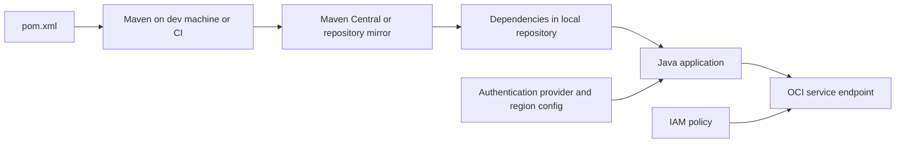

# Installing the OCI Java SDK and Managing Dependencies with Maven

## 1. Objectives and Scope

In the **OCI SDK and REST API with Java** chapter, the first step is to build a Java application with a consistent set of OCI libraries that compiles cleanly and loads the right HTTP client at runtime. Installing the SDK in this lesson means declaring dependencies for the application; you do not need to install an SDK service on a tenancy or place the SDK onto every OCI server you manage.

The OCI Java SDK provides strongly typed Java clients, requests, and responses for calling Oracle Cloud Infrastructure APIs. The application still has to authenticate with OCI and remains subject to IAM, networking, and region controls just like when calling the REST API directly. The SDK does not grant additional permissions to resources. [Source: SDK for Java](https://docs.oracle.com/en-us/iaas/Content/API/SDKDocs/javasdk.htm).

After this lesson, you will be able to:

- Prepare the JDK and Maven for an application using OCI Java SDK 3.x.
- Import the BOM to manage SDK module versions in one place.
- Choose an appropriate HTTP implementation instead of relying on whichever dependency happens to appear.
- Distinguish between compile-time dependencies, runtime dependencies, and build plugins.
- Run a local classpath check, then call a read-only API to verify the connectivity configuration.
- Investigate dependency conflicts and keep the build configuration reusable in CI.

The main example uses Object Storage because it requires only one service module and provides a namespace read API to test the path from Java to OCI. Once you understand this structure, you can add modules for Compute, VCN, Monitoring, or database service management as needed by your infrastructure application.

## 2. Preparing the JDK, Maven, and Two Distinct Connection Paths

### 2.1. Lab Configuration

This lesson uses the following specific choices for reproducibility:

| Component | Choice in Example | Purpose |
| --- | --- | --- |
| JDK | JDK 17 | Compile and run the application at the same Java level |
| Build tool | Maven 3.9.x | Manage dependencies and execute goals |
| OCI Java SDK | `3.102.0` | Fixed version, synchronized via a single property |
| HTTP implementation | `oci-java-sdk-common-httpclient-jersey3` | Provides the Jersey 3 transport for the SDK |
| Demonstration service | `oci-java-sdk-objectstorage` | Calls `GetNamespace` |

`3.102.0` is an officially released Oracle version chosen as the baseline for the sample configuration; do not use `LATEST` or assume this number will remain the newest version indefinitely. When upgrading versions, check the release notes for the target version. [Source: OCI Java SDK release 3.102.0](https://github.com/oracle/oci-java-sdk/releases/tag/v3.102.0).

Verify the tools using the following commands in your terminal:

```text
java -version
javac -version
mvn -version
```

Check both the Java path and the Java version reported by `mvn -version`. If your IDE uses JDK 17 while Maven uses a different JDK, results in the IDE and terminal may differ. The JDK running Maven, the compiler `release` level, and the JDK running the application are three settings that must align.

For example, the error `release version 17 not supported` usually appears when the actual compiler is too old. The fix is to check which JDK Maven is using before modifying OCI dependencies.

### 2.2. Distinguishing Library Downloads from API Calls



There are two separate connection paths to verify:

1. **Build path:** Maven accesses the repository to fetch POMs, JARs, and plugins. This path is governed by proxy, mirror, certificate, and repository credential settings.
2. **Application path:** Java calls the OCI endpoint over the SDK's HTTP transport. This path is governed by OCI identity configuration, DNS, TLS, routing, region, and IAM.

Maven downloading dependencies successfully does not prove the application has permission to read a bucket. Conversely, being able to open the OCI Console does not prove Maven can download JARs through a corporate proxy.

## 3. Understanding OCI Java SDK Dependency Structure

### 3.1. Service Modules and Shared Libraries

There is no need to pull in the entire SDK for an application that only uses one or two services. Common artifacts share the `groupId` `com.oracle.oci.sdk`:

| Artifact | Role | Example Usage |
| --- | --- | --- |
| `oci-java-sdk-bom` | Manages versions of SDK artifacts | Imported in `dependencyManagement` |
| `oci-java-sdk-common` | Shared types and authentication providers | Reading profiles, configuring clients |
| `oci-java-sdk-common-httpclient` | HTTP transport abstractions | Referencing `HttpProvider` in the local example |
| `oci-java-sdk-common-httpclient-jersey` | Jersey 2 HTTP implementation | Corresponding JAX-RS ecosystem |
| `oci-java-sdk-common-httpclient-jersey3` | Jersey 3 HTTP implementation | Transport selected in this lesson |
| `oci-java-sdk-objectstorage` | Object Storage client and models | Namespace, bucket, object |
| `oci-java-sdk-core` | Compute, Networking, and core resource APIs | Instance, VCN, volume |
| `oci-java-sdk-database` | Database service management APIs | Managing database resources on OCI |
| `oci-java-sdk-monitoring` | Monitoring APIs | Working with metrics |

The name `core` does not mean it replaces all service modules. For example, to use `ObjectStorageClient`, you must declare the Object Storage module. Likewise, the database management SDK does not replace the JDBC driver when an application needs to run SQL directly inside an Oracle Database.

### 3.2. Direct Dependencies and Transitive Dependencies

When an application adds the Object Storage module, Maven resolves transitive dependencies from that module's POM. However, if your application source code directly imports a shared API, you should declare the corresponding dependency explicitly.

The example in this lesson directly uses:

- `ConfigFileAuthenticationDetailsProvider` from the common module.
- `HttpProvider` from the common HTTP client module.
- `ObjectStorageClient` and request/response classes from the Object Storage module.

Therefore, the POM lists these modules. Declaring them explicitly clarifies the application's requirements and reduces reliance on a transitive branch that might change during an SDK upgrade.

### 3.3. The BOM Manages Versions, Not Library Inclusion

A BOM is a POM imported inside `dependencyManagement` to provide dependency management metadata. You still need to declare the modules you want to use under `dependencies`. Maven also applies specific resolution rules when multiple dependency paths pull in the same artifact; do not assume the highest version is always chosen. [Source: Maven Dependency Mechanism](https://maven.apache.org/guides/introduction/introduction-to-dependency-mechanism.html).

Think of the two sections of the POM as follows:

```text
dependencyManagement:
    If the application needs artifact X, the managed configuration determines its version.

dependencies:
    The application actually requires artifact X on the appropriate classpath.
```

The OCI `3.102.0` BOM lists the common modules, HTTP implementations, and service modules at the same SDK version. [Source: OCI SDK BOM 3.102.0](https://github.com/oracle/oci-java-sdk/blob/v3.102.0/bmc-bom/pom.xml).

Specifying a separate version on a service module can override the intended synchronization. For example, if the BOM manages `3.102.0` but the application pins one module to a different version, it creates a configuration that needs investigation rather than being automatically corrected by the BOM.

## 4. Choosing an HTTP Implementation Before Running

OCI Java SDK 3.x allows swapping the HTTP client and **does not automatically select a default implementation** for the application. You must add either `oci-java-sdk-common-httpclient-jersey` or `oci-java-sdk-common-httpclient-jersey3`. Adding only the abstraction `oci-java-sdk-common-httpclient` is not enough to send requests. [Source: OCI SDK 3.x README](https://github.com/oracle/oci-java-sdk/blob/v3.102.0/README.md).

| Option | Related API Ecosystem | What to Check During Integration |
| --- | --- | --- |
| Jersey 2 | JAX-RS branch using the `javax.ws.rs` namespace | Compatibility with your existing stack |
| Jersey 3 | JAX-RS branch using the `jakarta.ws.rs` namespace | Consistency across Jersey/Jakarta libraries |

Do not pick Jersey 3 merely because `3` is greater than `2`. For projects using a framework or application server, check which APIs and libraries the runtime already provides. The standalone application in this lesson chooses Jersey 3 for a consistent configuration from the start.

The POM for the Jersey 3 HTTP implementation includes dependency management for the related Jersey and Jakarta libraries. This lesson's sample imports both the SDK BOM and the HTTP implementation's management POM, following Oracle's official Jersey 3 example structure. [Source: Jersey 3 example POM](https://github.com/oracle/oci-java-sdk/blob/v3.102.0/bmc-other-examples/bmc-jersey3-examples/pom.xml).

The two declarations with the same artifact name in the POM below serve different purposes:

- In `dependencyManagement`, `type=pom` and `scope=import` bring dependency management rules into the project.
- In `dependencies`, the HTTP client artifact puts the actual implementation onto the classpath.

Importing only the management POM does not make an HTTP provider available at runtime. Also, do not add both implementations to fix a missing provider error; pick one implementation and verify the classpath.

## 5. Creating a Maven Project with a Complete POM

### 5.1. Sample Project Structure

In a dedicated lab directory, create the following structure:

```text
oci-sdk-maven-demo/
├── pom.xml
└── src/
    └── main/
        └── java/
            └── vn/
                └── example/
                    └── oci/
                        └── SdkCheck.java
```

The paths and files in this lab section are components you create while following the lesson. You do not need to install the OCI CLI for Maven to use the OCI Java SDK; the CLI is simply an independent tool that can share the same identity configuration file format where appropriate.

### 5.2. Contents of `pom.xml`

```xml
<?xml version="1.0" encoding="UTF-8"?>
<project xmlns="http://maven.apache.org/POM/4.0.0"
         xmlns:xsi="http://www.w3.org/2001/XMLSchema-instance"
         xsi:schemaLocation="http://maven.apache.org/POM/4.0.0 https://maven.apache.org/xsd/maven-4.0.0.xsd">
    <modelVersion>4.0.0</modelVersion>

    <groupId>vn.example</groupId>
    <artifactId>oci-sdk-maven-demo</artifactId>
    <version>1.0.0-SNAPSHOT</version>

    <properties>
        <project.build.sourceEncoding>UTF-8</project.build.sourceEncoding>
        <maven.compiler.release>17</maven.compiler.release>
        <oci.sdk.version>3.102.0</oci.sdk.version>
        <exec.mainClass>vn.example.oci.SdkCheck</exec.mainClass>
    </properties>

    <dependencyManagement>
        <dependencies>
            <dependency>
                <groupId>com.oracle.oci.sdk</groupId>
                <artifactId>oci-java-sdk-bom</artifactId>
                <version>${oci.sdk.version}</version>
                <type>pom</type>
                <scope>import</scope>
            </dependency>
            <dependency>
                <groupId>com.oracle.oci.sdk</groupId>
                <artifactId>oci-java-sdk-common-httpclient-jersey3</artifactId>
                <version>${oci.sdk.version}</version>
                <type>pom</type>
                <scope>import</scope>
            </dependency>
        </dependencies>
    </dependencyManagement>

    <dependencies>
        <dependency>
            <groupId>com.oracle.oci.sdk</groupId>
            <artifactId>oci-java-sdk-common</artifactId>
        </dependency>
        <dependency>
            <groupId>com.oracle.oci.sdk</groupId>
            <artifactId>oci-java-sdk-common-httpclient</artifactId>
        </dependency>
        <dependency>
            <groupId>com.oracle.oci.sdk</groupId>
            <artifactId>oci-java-sdk-objectstorage</artifactId>
        </dependency>
        <dependency>
            <groupId>com.oracle.oci.sdk</groupId>
            <artifactId>oci-java-sdk-common-httpclient-jersey3</artifactId>
            <scope>runtime</scope>
        </dependency>
    </dependencies>

    <build>
        <plugins>
            <plugin>
                <groupId>org.apache.maven.plugins</groupId>
                <artifactId>maven-compiler-plugin</artifactId>
                <version>3.14.1</version>
            </plugin>
            <plugin>
                <groupId>org.apache.maven.plugins</groupId>
                <artifactId>maven-dependency-plugin</artifactId>
                <version>3.11.0</version>
            </plugin>
            <plugin>
                <groupId>org.apache.maven.plugins</groupId>
                <artifactId>maven-help-plugin</artifactId>
                <version>3.6.0</version>
            </plugin>
            <plugin>
                <groupId>org.codehaus.mojo</groupId>
                <artifactId>exec-maven-plugin</artifactId>
                <version>3.7.0</version>
            </plugin>
        </plugins>
    </build>
</project>
```

The plugin versions are pinned so the verification commands in this lesson have a deterministic configuration; plugin versions do not need to match the SDK version number. Do not add `<repositories>` if Maven Central or your existing mirror already supplies all required artifacts.

`maven.compiler.release=17` tells the compiler to generate bytecode targeting Java 17 and restricts the platform APIs accordingly. It does not install a JDK and does not change the JDK running Maven. [Source: Maven Guide to Targeting a Java Version](https://maven.apache.org/guides/mini/guide-java-target.html).

### 5.3. Why Does the HTTP Implementation Use `runtime` Scope?

The Java code in the example only directly uses the `HttpProvider` interface and does not import a Jersey 3 implementation class. Thus, the abstraction is present on the compile classpath, while the implementation is placed on the runtime classpath.

If an application directly imports a Jersey 3-specific configurator, you must declare the module providing that class with a scope that allows compilation, rather than mechanically keeping every transport dependency at `runtime`.

| Scope | Primary Effect | Usage in an OCI Application |
| --- | --- | --- |
| `compile` or omitted | Available at compile time and runtime | Service modules, common APIs imported directly |
| `runtime` | Available at runtime, not for compile-time imports | HTTP implementation loaded via provider |
| `test` | Only for test code | Testing or mocking libraries |
| `provided` | Available at compile time, runtime must supply it | Only when the runtime environment actually provides the dependency |
| `import` | Imports dependency management from a POM | BOMs, not a scope for application JARs |

Do not set the HTTP implementation to `test` just because the program runs in an IDE that happens to include test dependencies on the classpath. Likewise, do not use `provided` if the container image or application server does not provide the corresponding libraries.

## 6. Verifying the Classpath and Calling an API with One Program

### 6.1. Contents of `SdkCheck.java`

The program has two modes: `--local` only loads the HTTP provider, whereas `--oci` reads the profile and calls the namespace API. Local mode helps separate dependency errors from account configuration errors.

```java
package vn.example.oci;

import com.oracle.bmc.ClientConfiguration;
import com.oracle.bmc.auth.ConfigFileAuthenticationDetailsProvider;
import com.oracle.bmc.http.client.HttpProvider;
import com.oracle.bmc.model.BmcException;
import com.oracle.bmc.objectstorage.ObjectStorageClient;
import com.oracle.bmc.objectstorage.requests.GetNamespaceRequest;
import com.oracle.bmc.objectstorage.responses.GetNamespaceResponse;

public final class SdkCheck {
    private SdkCheck() {}

    public static void main(String[] args) throws Exception {
        if (args.length != 1
                || !("--local".equals(args[0]) || "--oci".equals(args[0]))) {
            throw new IllegalArgumentException(
                    "Use one argument: --local or --oci");
        }

        HttpProvider httpProvider = HttpProvider.getDefault();
        System.out.println("HTTP provider: "
                + httpProvider.getClass().getName());

        if ("--local".equals(args[0])) {
            System.out.println("Classpath local: OK");
            return;
        }

        String profile = System.getenv("OCI_SDK_PROFILE");
        if (profile == null || profile.isBlank()) {
            profile = "DEFAULT";
        }

        ConfigFileAuthenticationDetailsProvider auth =
                new ConfigFileAuthenticationDetailsProvider(profile);

        if (auth.getRegion() == null) {
            throw new IllegalStateException("Profile does not have a valid region");
        }

        ClientConfiguration configuration = ClientConfiguration.builder()
                .connectionTimeoutMillis(5000)
                .readTimeoutMillis(30000)
                .build();

        try (ObjectStorageClient client = ObjectStorageClient.builder()
                .configuration(configuration)
                .build(auth)) {
            client.setRegion(auth.getRegion());

            GetNamespaceResponse response = client.getNamespace(
                    GetNamespaceRequest.builder().build());

            System.out.println("Object Storage namespace: "
                    + response.getValue());
        } catch (BmcException error) {
            System.err.println("OCI request failed; requestId="
                    + error.getOpcRequestId());
            throw error;
        }
    }
}
```

The SDK discovers the HTTP provider via `ServiceLoader`. Therefore, the provider JAR and its service metadata must remain on the runtime classpath. The `--local` check does not read the profile and does not actively call any OCI API. [Source: HttpProvider in SDK 3.102.0](https://github.com/oracle/oci-java-sdk/blob/v3.102.0/bmc-common-httpclient/src/main/java/com/oracle/bmc/http/client/HttpProvider.java).

`ConfigFileAuthenticationDetailsProvider(profile)` reads the profile from the default configuration location. If a custom config file is needed, the SDK also provides a constructor accepting both a file path and a profile name. [Source: ConfigFileAuthenticationDetailsProvider](https://docs.oracle.com/en-us/iaas/tools/java/latest/com/oracle/bmc/auth/ConfigFileAuthenticationDetailsProvider.html).

### 6.2. Compiling and Running the Local Check

From the directory containing the POM, run:

```text
mvn compile
mvn exec:java -Dexec.args=--local
```

The expected output is the HTTP provider class name belonging to the Jersey 3 implementation and the line `Classpath local: OK`. The exact class name may vary across versions; the goal is confirming that the provider loads successfully from the selected transport.

`exec:java` runs the main class with the project's dependencies; you do not need to assemble a long classpath string manually. [Source: Exec Maven Plugin](https://www.mojohaus.org/exec-maven-plugin/java-mojo.html).

`--local` does not prove that the entire transport works over the network, that certificates are valid, or that IAM is configured properly. It confirms one critical part: the code compiles and the provider can be loaded under the current launch method.

## 7. Minimal Configuration to Call OCI from a Development Machine

### 7.1. Keeping the Profile Outside Source Code

For local API signing key authentication, prepare the user OCID, tenancy OCID, fingerprint, region, and path to the private key. The corresponding public key must be registered for the user in OCI. An API signing key is a dedicated key pair for API authentication, not by default an SSH key for Compute access. [Source: Required Keys and OCIDs](https://docs.oracle.com/en-us/iaas/Content/API/Concepts/apisigningkey.htm).

Illustrative configuration example:

```ini
[DEFAULT]
user=ocid1.user.oc1..<user_unique_id>
tenancy=ocid1.tenancy.oc1..<tenancy_unique_id>
fingerprint=<public_key_fingerprint>
key_file=C:/Users/YourName/.oci/oci_api_key.pem
region=ap-singapore-1
```

Replace all placeholders with real values. On Linux/macOS, replace `key_file` with an appropriate path such as `/home/yourname/.oci/oci_api_key.pem`. The region must be a valid region your application intends to use; you do not need to keep the example region.

The standard config location is `~/.oci/config`; on Windows this corresponds to the `.oci` directory under your user profile. This is an OCI identity file, distinct from `.m2/settings.xml` used by Maven. [Source: SDK and CLI Configuration File](https://docs.oracle.com/en-us/iaas/Content/API/Concepts/sdkconfig.htm).

Never place private keys or config files containing account credentials into `src/main/resources`, the POM, container images, or Git. When moving workloads onto OCI, choose an appropriate authentication provider such as instance principal or resource principal instead of copying a developer workstation key.

### 7.2. Running the OCI Connectivity Mode

With the `DEFAULT` profile:

```text
mvn exec:java -Dexec.args=--oci
```

If using a profile named `LEARNING`, the program in this lesson reads the profile name from an environment variable **defined by the program itself**: `OCI_SDK_PROFILE`.

PowerShell:

```powershell
$env:OCI_SDK_PROFILE = 'LEARNING'
mvn exec:java '-Dexec.args=--oci'
```

Bash:

```bash
export OCI_SDK_PROFILE=LEARNING
mvn exec:java -Dexec.args=--oci
```

`OCI_SDK_PROFILE` in the example is not presented as an automatic mechanism across all OCI clients. If another application does not read this variable, setting it will not select a profile for that application.

The expected output is the Object Storage namespace string of the current tenancy. Calling `GetNamespace` without passing `compartmentId` returns the caller's namespace and does not require granting additional permissions for this operation; using the optional parameter to retrieve another tenancy's namespace requires separate permissions. This lesson does not pass that parameter. [Source: Object Storage Policy Reference](https://docs.oracle.com/en-us/iaas/Content/Identity/Reference/objectstoragepolicyreference.htm).

Therefore, successfully retrieving the namespace verifies a specific authentication and connectivity path, but does not prove the user has permission to list buckets, read objects, manage Compute, or manage databases. When expanding to those APIs, grant permissions for the exact compartments and actions required.

## 8. Reading the Dependency Tree and Effective POM

### 8.1. Seeing What Maven Actually Selects

Run the following commands once the POM is in place:

```text
mvn dependency:tree
mvn dependency:tree "-Dincludes=com.oracle.oci.sdk:*" -Dverbose
```

The `dependency:tree` goal displays the project's dependency graph and supports filtering by artifact. Verbose mode is useful when you need to inspect branches omitted from the final selection. [Source: Maven Dependency Plugin — tree](https://maven.apache.org/plugins/maven-dependency-plugin/tree-mojo.html).

In the output, verify that:

- All `com.oracle.oci.sdk` modules used by the application are aligned on the chosen version.
- The Jersey 3 implementation is present on the runtime classpath.
- No Jersey 2 implementation or legacy SDK module was accidentally pulled in by another library.
- Required service modules appear under the appropriate scope.

Markers such as `omitted for conflict` or `omitted for duplicate` describe graph resolution; they do not by themselves indicate a broken application. Check which artifact won and whether runtime uses the intended version.

Abbreviated schematic example, not a full copy of an actual build output:

```text
oci-sdk-maven-demo
├── oci-java-sdk-common:3.102.0
├── oci-java-sdk-common-httpclient:3.102.0
├── oci-java-sdk-objectstorage:3.102.0
└── oci-java-sdk-common-httpclient-jersey3:3.102.0 [runtime]
    └── related HTTP/Jersey/Jakarta libraries
```

### 8.2. Viewing Configuration After Inheritance and Imports

The POM you write may be only part of the effective configuration, especially when an application uses a corporate or framework parent POM. To view the combined result:

```text
mvn help:effective-pom -Dverbose
```

This goal displays the effective POM after applying project configuration and active profiles; verbose mode can include the origin of each configuration element. [Source: Maven Help Plugin — effective-pom](https://maven.apache.org/plugins/maven-help-plugin/effective-pom-mojo.html).

If a dependency does not receive the expected version, trace through these checks:

1. Does the project declare a direct version on that dependency?
2. Does the parent POM manage the same artifact?
3. Does another BOM or active profile alter the configuration?
4. Does the command override a property via `-D`?
5. Has the IDE re-synchronized the Maven project after editing the POM?

Do not resolve conflicts by repeatedly reordering BOM imports and relying solely on a successful compile. Read the effective configuration and document the version management decision clearly in the project.

### 8.3. When to Inspect Libraries Outside OCI

If errors involve Jackson, Jersey, Jakarta/JAX-RS, or logging, filter those groups as well:

```text
mvn dependency:tree "-Dincludes=com.fasterxml.jackson.core:*,com.fasterxml.jackson.datatype:*" -Dverbose
mvn dependency:tree "-Dincludes=org.glassfish.jersey.core:*,org.glassfish.jersey.inject:*,jakarta.ws.rs:*,javax.ws.rs:*" -Dverbose
mvn dependency:tree "-Dincludes=org.slf4j:*" -Dverbose
```

The OCI BOM primarily synchronizes SDK artifacts; do not assume it governs every transitive library across the entire application. A framework parent or separate dependency management block can still affect Jackson, logging, or HTTP libraries.

When source code directly imports a non-OCI API, manage that dependency according to the library's own contract and project policy. Do not copy the entire list of transitive JARs into direct dependencies just to flatten the tree.

## 9. Classifying and Troubleshooting Setup Errors

### 9.1. Diagnosing by Failure Phase

| Symptom | Common Root Cause Category | What to Check First |
| --- | --- | --- |
| Artifact not found or POM cannot be downloaded | Wrong coordinates, version, mirror, proxy, repository | Artifact/version and build path to the repository |
| `package com.oracle.bmc... does not exist` | Missing module or wrong scope | Dependency containing the imported class |
| HTTP provider not found | Missing implementation at runtime | Selected Jersey runtime dependency |
| `ClassNotFoundException` / `NoClassDefFoundError` | Missing class at runtime or faulty packaging | Runtime classpath and contents of the deployed artifact |
| `NoSuchMethodError` / `AbstractMethodError` | Incompatible compile and runtime versions | Dependency tree and actual class loaded |
| `UnsupportedClassVersionError` | Runtime JDK is older than the required bytecode level | JDK on the host/container running the application |
| Cannot read config or private key | Wrong path, profile, or file permissions | Process user and corresponding config file |
| TLS, DNS, or connect timeout error | Networking or trust configuration | Endpoint, runtime proxy, DNS, and certificates |
| OCI returns authentication or authorization error | Identity, signature, region/resource, IAM | Service error code, request ID, and account config |

These categories can overlap; read the root exception and cause chain before making changes. Not every `ClassNotFoundException` means a missing dependency, and not every failed request is caused by the POM.

`BmcException` provides the request ID, timeout details, client-side errors, and service error codes when a corresponding response is received. The request ID is useful when correlating logs or working with support; for client-side errors or timeouts, do not interpret a status code as a confirmed HTTP response received from the service. [Source: BmcException Java API](https://docs.oracle.com/en-us/iaas/tools/java/latest/com/oracle/bmc/model/BmcException.html).

### 9.2. Missing HTTP Provider or Mixing Two Implementations

If `--local` fails due to a missing provider, verify these exact two points:

1. The HTTP implementation dependency is inside `dependencies`, not only inside `dependencyManagement`.
2. That dependency is included in the current launch method, not only on the test classpath or developer machine.

If another library pulls in the Jersey 2 implementation while the application selects Jersey 3, identify which branch brings it in. You can apply a narrowly scoped exclusion on the dependency introducing that branch, after confirming the library still works with your chosen transport configuration.

An exclusion only removes a transitive dependency; it does not add a replacement implementation and does not prove binary compatibility. Do not broadly exclude Jersey, Jakarta, or Jackson just to make duplicate errors disappear.

### 9.3. Logging Warnings Do Not Mean OCI Connectivity Is Broken

The sample POM does not choose a logging backend for the entire application. Depending on the dependency graph, the SDK may emit an SLF4J warning about a missing binding/provider and fall back to a no-op logger. Distinguish this from an HTTP provider loading failure. Choose a backend compatible with the active SLF4J API version and avoid having multiple backends at once. [Source: SLF4J Manual](https://slf4j.org/manual.html).

In framework-based applications, you should generally use the logging system managed by the framework. Do not add an arbitrary version of `slf4j-simple` just to silence warnings while skipping dependency tree inspection.

### 9.4. Maven Cannot Download Through a Corporate Network

Maven lets you configure the local repository, mirrors, proxies, and repository credentials in `settings.xml`. This is build environment configuration and should be kept separate from the shared project POM. [Source: Maven Settings Reference](https://maven.apache.org/settings.html).

An appropriate investigation workflow:

1. Verify the artifact coordinates and released version.
2. Check whether the repository mirror has synchronized that artifact.
3. Inspect proxy, repository authentication, or truststore error messages.
4. Compare the JDK and Maven settings between the developer machine and CI.
5. After fixing the root cause, rerun the build according to your team's repository policy.

Do not add random HTTP repositories or disable TLS verification as a substitute for fixing proxy or certificate issues. An OCI signing key is not used to log in to Maven Central; the two credential systems serve different purposes.

## 10. Runtime Classpath and Deployment Packaging

### 10.1. Successful Compilation Is Not Yet a Complete Deployment Package

With standard JAR packaging, `mvn package` builds the application JAR; it does not by default embed every dependency inside that JAR. The `compile`, `test`, `package`, and `verify` phases are also distinct steps in the lifecycle. [Source: Maven Build Lifecycle](https://maven.apache.org/guides/introduction/introduction-to-the-lifecycle.html).

The sample POM does not configure an executable fat JAR or a main manifest for running directly with `java -jar`. In this lesson, you can use `exec:java`, or build a runtime dependencies directory and launch with an explicit classpath.

### 10.2. Running Java Outside Maven with a Dependencies Directory

From the project directory, run:

```text
mvn compile dependency:copy-dependencies -DincludeScope=runtime -DoutputDirectory=target/dependency
```

`dependency:copy-dependencies` copies resolved artifacts into the specified directory. `includeScope=runtime` collects dependencies required at runtime, including compile-scoped dependencies used when running. The example specifies the target directory explicitly so the subsequent commands remain consistent. [Source: Maven Dependency Plugin — copy-dependencies](https://maven.apache.org/plugins/maven-dependency-plugin/copy-dependencies-mojo.html).

PowerShell on Windows:

```powershell
java -cp 'target/classes;target/dependency/*' vn.example.oci.SdkCheck --local
```

Bash on Linux/macOS:

```bash
java -cp 'target/classes:target/dependency/*' vn.example.oci.SdkCheck --local
```

Windows uses `;` to separate classpath entries; Linux/macOS uses `:`. Once `--local` works both through Maven and via the direct Java command, switch to `--oci` if you want to verify identity configuration in that exact runtime environment.

After upgrading dependencies, rebuild the runtime directory from a clean build to avoid keeping both old and new JARs on a wildcard classpath. For containers, copy the exact built artifacts rather than relying on a local repository sitting on a laptop.

### 10.3. When a Fat JAR or Shaded Artifact Is Needed

If merging multiple JARs into a single JAR, duplicate metadata files must be handled properly. In particular, `META-INF/services` used by `ServiceLoader` must be preserved and merged; Maven Shade Plugin provides `ServicesResourceTransformer` for this type of resource. Dropping metadata can make providers disappear even though `.class` files remain in the archive. [Source: Maven Shade Resource Transformers](https://maven.apache.org/plugins/maven-shade-plugin/examples/resource-transformers.html).

Framework executable JAR packaging, using the Shade Plugin yourself, and using the `oci-java-sdk-shaded-full` artifact are different approaches. The full shaded artifact can help isolate certain dependencies via relocation, but it has a large footprint and requires reading its dedicated guidance; do not add it alongside individual service modules just to try your luck. [Source: OCI Java SDK Getting Started](https://docs.oracle.com/en-us/iaas/Content/API/SDKDocs/javasdkgettingstarted.htm).

This lesson prefers per-service modules so dependency needs stay explicit and the application bundle only carries the services it uses. When choosing a packaging strategy, always test the actual artifact by running it under conditions close to the deployment environment.

## 11. Managing Dependencies as the Project Grows

### 11.1. Adding Modules by Feature

Suppose the application needs to read Compute information and emit metrics after already using Object Storage. Add the following dependencies under `dependencies`, keeping the existing version property and BOM intact:

```xml
<dependency>
    <groupId>com.oracle.oci.sdk</groupId>
    <artifactId>oci-java-sdk-core</artifactId>
</dependency>
<dependency>
    <groupId>com.oracle.oci.sdk</groupId>
    <artifactId>oci-java-sdk-monitoring</artifactId>
</dependency>
```

Do not pin an individual version on each entry. After adding them, recheck the dependency tree and IAM permissions for the new APIs. Having a module on the classpath does not by itself create OCI resources; service costs relate to the operations and resources the application actually uses.

For the database SDK, continue distinguishing between **database infrastructure management APIs** and **SQL connections via JDBC**. They use different libraries, endpoints, and authorization mechanisms; adding `oci-java-sdk-database` does not automatically supply a JDBC driver or SQL account.

### 11.2. Parent POM and Application Modules

In a multi-module system, you can place `oci.sdk.version` and the BOM imports in a parent POM inherited by the actual application modules. Each child module declares the service dependencies it needs. The transport decision should belong to the final runnable application rather than a shared library forcing every application onto the same HTTP implementation.

Recommended division of responsibilities:

```text
parent-pom
    manages the SDK version and shared plugin versions

cloud-storage-library
    depends on the Object Storage APIs the library directly uses

inventory-application
    depends on the internal library and selects the HTTP implementation for runtime
```

Project aggregation and POM inheritance are two different concepts. Merely listing a module in a reactor does not mean that module automatically inherits dependency management from the aggregator. The Maven reactor is responsible for collecting and ordering module builds. [Source: Maven Multiple Modules Guide](https://maven.apache.org/guides/mini/guide-multiple-modules.html).

### 11.3. Detecting Conflicts Early

In real-world application CI, you can use Maven Enforcer with the `dependencyConvergence` rule to catch dependency paths requesting different versions of the same artifact. This rule helps govern the graph; it does not prove that every API is behaviorally compatible. [Source: Maven Enforcer Dependency Convergence](https://maven.apache.org/enforcer/enforcer-rules/dependencyConvergence.html).

Different checks serve different purposes:

| Check | What It Detects | What It Cannot Conclude |
| --- | --- | --- |
| Dependency tree / effective POM | Selected versions and scopes | Service API behavior after an upgrade |
| Compile | Source code matches APIs on the compile classpath | Whether runtime packaging includes all dependencies |
| `--local` | Provider loads with the current launch method | Authentication, IAM, and OCI networking |
| `GetNamespace` | One read-only API succeeds with the current identity | Access permissions across all resources |
| Running the deployed artifact | Actual classpath and entry point work | Correctness of all application business logic |

## 12. Upgrading Versions and Operating Builds in CI

### 12.1. Treating an SDK Upgrade as a Scoped Change

Recommended workflow for an application:

1. Read the release notes, especially breaking changes and dependency changes.
2. Update `oci.sdk.version` in one place so imported POMs and SDK modules move together.
3. Review the dependency tree, including libraries outside `com.oracle.oci.sdk`.
4. Compile and run local checks with the exact JDK intended for deployment.
5. Run read-only integration checks in a limited-permission environment, then verify the service features the application actually uses.
6. Verify the final artifact/container; retain the ability to roll back to the previous artifact set if errors occur.

Do not change just one module's version to fix a runtime error without checking the rest of the SDK modules. Likewise, do not independently bump every transitive dependency to the highest number, as that can break the compatible library set the application relies on.

If a non-OCI library requires a separate update, document the reason, impact scope, and compatibility testing approach. A BOM aids synchronization, but it does not replace evaluating a version change.

### 12.2. Separating Builds from OCI Credentials

A practical pipeline can be split into three stages:

- **Cloud-free build:** download dependencies, compile, run code checks, and package. This stage does not need an OCI API signing key just to compile.
- **Local runtime check:** run a mode similar to `--local` on the packaged artifact to catch provider or classpath issues.
- **Scoped-identity integration:** call required APIs in a test tenancy/compartment using the identity mechanism appropriate for the CI environment.

Pinning JDK/Maven versions or using Maven Wrapper by team convention reduces drift between developer workstations and CI. Caching the local repository speeds up downloads, but a cache does not replace accurate dependency declarations and must not mask artifacts missing from the team's repository.

Pulling in the entire SDK, adding multiple transports, or keeping unused JARs in an image increases size and maintenance overhead. In OCI infrastructure automation applications, lean and consistent dependencies reduce deployment startup time and lower the risk of classpath failures during system recovery.

## 13. Lab Sequence and Completion Criteria

Perform the following steps in the lab project you created:

| Step | Action | Expected Observation |
| --- | --- | --- |
| 1 | Check `java`, `javac`, `mvn` | Maven runs on the selected JDK |
| 2 | Create the POM and `SdkCheck.java` per the lesson | Service module and transport are explicitly declared |
| 3 | Run `mvn compile` | Source code compiles cleanly |
| 4 | Run `mvn dependency:tree` | OCI modules are synchronized and only the intended transport is selected |
| 5 | Run `--local` via Maven | HTTP provider loads without needing an OCI config |
| 6 | Prepare the profile and run `--oci` | Retrieves the namespace of the current tenancy |
| 7 | Copy runtime dependencies and run `java -cp` | Same program works outside the Maven launcher |
| 8 | Inspect the effective POM | Able to explain the source of version management and scopes |

You have met the setup objective when you can identify **which module provides the imported APIs, which BOM manages the versions, and which implementation serves HTTP at runtime**. The namespace result is only an initial connectivity check; before automating Compute, VCN, storage, or databases on OCI, continue by identifying IAM permissions and endpoints for each specific API.
