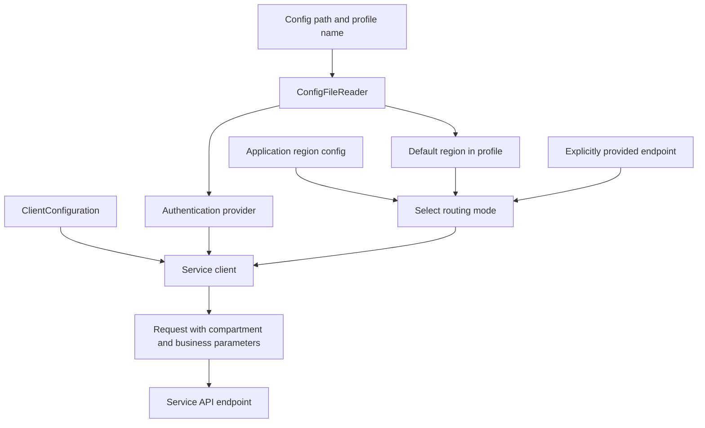

# Configuring Clients, Regions, Endpoints, and Profiles

## 1. Context and Objectives

In the **OCI SDK and REST API with Java** chapter of the **CLOUD_PROVIDERS_ORACLE** module, client configuration is the step that connects your OCI identity, deployment location, and API calls in a Java program. Code can compile cleanly and still hit the wrong tenancy, wrong region, or wrong endpoint if those decisions are conflated.

The running scenario is a Java application that lists buckets to verify OCI connectivity. A developer runs it with a development profile on a local workstation; when deploying onto OCI Compute, the application can switch to the instance's identity while keeping client configuration clean and explicit. The same principles apply when managing Compute, VCN, or database services, though each service requires its own client and endpoint.

After this lesson, you will be able to:

- Distinguish between a profile, authentication provider, service client, region, and endpoint.
- Read the right profile, understand the inheritance mechanism, and avoid targeting the wrong environment.
- Initialize clients via builders with an appropriate HTTP configuration.
- Choose between SDK-resolved regional endpoints and explicitly specified endpoints.
- Reuse clients, manage their lifecycle, and diagnose errors layer by layer.
- Practice verifying configuration with read-only calls without creating resources.

The Java examples use JDK 17 and OCI Java SDK 3.x. The dependency section pins a specific version so learners have a concrete starting point; do not treat that version number as a guarantee of being the latest release.

## 2. Five Concepts to Keep Distinct

| Concept | Question It Answers | Example |
| --- | --- | --- |
| Profile | Which set of configuration values should be read? | `DEV`, `DR`, `PROD` |
| Authentication provider | Which identity signs or authenticates the request? | API signing key from config, instance principal |
| Service client | Which service's APIs are being called? | `ObjectStorageClient`, `ComputeClient` |
| Region | Which service location is used when routing by region? | `ap-singapore-1` |
| Endpoint | Where is the HTTP request actually sent? | Base URL of the service API |

In the OCI Java SDK, authentication details are encapsulated in authentication providers, while HTTP options are configured via `ClientConfiguration`. These are two separate parts of client initialization. [Oracle: Configuring the SDK for Java](https://docs.oracle.com/en-us/iaas/Content/API/SDKDocs/javasdkgettingstarted.htm)

Do not conflate the concepts in the table:

- A profile named `PROD` does not by itself grant administrative privileges.
- Changing the region does not change the user or tenancy in the credentials.
- Changing the endpoint does not automatically move resources elsewhere.
- Successfully building a client does not prove the API is authenticated or authorized.
- An Object Storage client does not become a Compute client by changing its URL.

A compartment is the organizational and authorization boundary for resources. It is typically passed in the relevant API request rather than configured as a client region setting. For `ListBuckets`, the request takes `namespaceName` and `compartmentId` to define the listing scope. [Oracle: ListBucketsRequest.Builder](https://docs.oracle.com/en-us/iaas/tools/java/latest/com/oracle/bmc/objectstorage/requests/ListBucketsRequest.Builder.html)



## 3. Configuring Profiles for the Development Environment

### 3.1. OCI Config File Structure

With API signing key authentication, the config file contains values such as user OCID, tenancy OCID, fingerprint, private key path, and region. The standard location is `~/.oci/config`; on Windows, interpret that location relative to the home directory of the user running the JVM. The private key uses PEM format. [Oracle: SDK and CLI Configuration File](https://docs.oracle.com/en-us/iaas/Content/API/Concepts/sdkconfig.htm)

Illustrative example—every value inside `<...>` must be replaced with a valid value from your lab environment:

```ini
[DEFAULT]
user=<dev-user-ocid>
tenancy=<dev-tenancy-ocid>
fingerprint=<dev-key-fingerprint>
key_file=C:/Users/YourName/.oci/dev_api_key.pem
region=ap-singapore-1

[DEV]
region=ap-singapore-1

[DR]
region=ap-tokyo-1

[PROD]
user=<prod-user-ocid>
tenancy=<prod-tenancy-ocid>
fingerprint=<prod-key-fingerprint>
key_file=C:/Users/YourName/.oci/prod_api_key.pem
region=ap-singapore-1
```

The example keeps a `DEFAULT` profile and spells out all identity fields for `PROD` so learners can clearly see environment boundaries. Having a `PROD` profile listed is not a reason to use production keys for practice.

In Java paths on Windows, you can use `/` as shown in the example to reduce confusion with escaped string characters. Paths inside an INI file are not Java string literals; if you embed backslash paths into Java source code, you must follow Java escaping rules.

Do not assume shell environment variables are interpolated in every config field. To keep the lab reproducible, prefer valid absolute paths rather than relying on the current working directory or shell-specific syntax.

### 3.2. Inheriting from DEFAULT

In `ConfigFileReader.ConfigFile`, when looking up a key, the SDK checks the selected profile first; if that profile does not define the key, the SDK falls back to `DEFAULT`; if neither defines it, it returns `null`. [Oracle: ConfigFile.get](https://docs.oracle.com/en-us/iaas/tools/java/latest/com/oracle/bmc/ConfigFileReader.ConfigFile.html)

With the sample file:

| Selected Profile | Effective Identity | Region from Config |
| --- | --- | --- |
| `DEFAULT` | Development user and tenancy | Singapore |
| `DEV` | Inherits development identity | Singapore |
| `DR` | Inherits development identity | Tokyo |
| `PROD` | Dedicated production fields | Singapore |

A common pitfall lies in profile naming. `DR` in the example only changes the region and still uses the development identity; it does not create a complete disaster-recovery environment. Similarly, if you add `[PROD]` with only a region line, any omitted identity fields will continue to inherit from `DEFAULT`.

If stricter environment separation is needed, you can use separate config files per environment and pass the explicit path to the application. That is a configuration organization choice, not an automatic behavior inferred from the profile name.

### 3.3. Selecting a Profile Explicitly in Java

```java
import com.oracle.bmc.ConfigFileReader;
import com.oracle.bmc.auth.ConfigFileAuthenticationDetailsProvider;

ConfigFileReader.ConfigFile config =
        ConfigFileReader.parse(
                "C:/Users/YourName/.oci/config",
                "DEV"
        );

ConfigFileAuthenticationDetailsProvider provider =
        new ConfigFileAuthenticationDetailsProvider(config);
```

`ConfigFileReader` provides overloads to read either a specified path or the default location. In this example, both the file path and profile name are passed explicitly. [Oracle: ConfigFileReader](https://docs.oracle.com/en-us/iaas/tools/java/latest/com/oracle/bmc/ConfigFileReader.html)

`ConfigFileAuthenticationDetailsProvider` has a constructor taking `ConfigFile` and supplies both authentication credentials and the region read from configuration. [Oracle: ConfigFileAuthenticationDetailsProvider](https://docs.oracle.com/en-us/iaas/tools/java/latest/com/oracle/bmc/auth/ConfigFileAuthenticationDetailsProvider.html)

The profile name must match the configuration. In the SDK version used in this example, specifying a nonexistent profile raises an error rather than silently falling back to another profile. Key inheritance does not mean arbitrary profile names are accepted. [Oracle: ConfigFileReader 3.99.0 source](https://github.com/oracle/oci-java-sdk/blob/v3.99.0/bmc-common/src/main/java/com/oracle/bmc/ConfigFileReader.java)

Do not treat OCI CLI success as proof that your Java program is using the same file and profile. The two processes may run under different OS accounts or receive different arguments.

## 4. What Does a Region Decide?

### 4.1. Routing the Client by Service Location

The SDK provides the `Region` class to represent known regions; regional client builders support selecting by a `Region` object or a region ID string. Not every service is available in every region. [Oracle: Region](https://docs.oracle.com/en-us/iaas/tools/java/latest/com/oracle/bmc/Region.html), [Oracle: RegionalClientBuilder](https://docs.oracle.com/en-us/iaas/tools/java/latest/com/oracle/bmc/common/RegionalClientBuilder.html)

Example:

```java
import com.oracle.bmc.Region;
import com.oracle.bmc.objectstorage.ObjectStorageClient;

ObjectStorageClient client =
        ObjectStorageClient.builder()
                .region(Region.fromRegionId("ap-singapore-1"))
                .build(provider);
```

In this snippet, `provider` is the authentication object created earlier. The builder is instructed to select the Object Storage endpoint for the Singapore region.

A region ID such as `ap-singapore-1` is different from:

- A human-readable display name.
- An availability domain name.
- A fault domain name.
- A compartment OCID.
- A user-chosen profile name.

Do not pass any of those values in place of a region ID.

### 4.2. Profile Region vs. Application Region

There are two valid needs:

1. The application runs in the region declared in the profile.
2. The application uses the same identity but intentionally targets a different region.

To avoid configuration guesswork, this lesson uses a policy defined by **the application itself**:

```text
When no explicit endpoint is specified:
  app.oci.region has a value → use that region
  otherwise                  → use the region in the profile
  both are missing           → fail with a configuration error
```

This is a rule of the lab's sample code, not a universal precedence chain across all OCI SDKs, CLIs, and frameworks.

An access key can be used to sign requests to multiple eligible regions. Whether an API call is permitted still depends on IAM, the service, the tenancy, and the target region. You do not need to create a new key solely because you switched regions.

### 4.3. Changing Region Is Not a Data Failover Mechanism

Suppose a bucket exists only in Singapore. Building a client targeting Tokyo does not make that bucket appear in Tokyo.

For an application to operate in a standby region, the relevant prerequisites must be prepared separately:

- Services and access permissions in the target region.
- Resources or data replicated according to the service's replication strategy.
- OCIDs, resource names, and request parameters valid for the target.
- Networking, application configuration, and failover procedures.

Likewise, connecting to Database service management via the SDK does not replace a JDBC connection to the database itself. The REST endpoint for resource management and the application database connection address are two different layers.

## 5. The Endpoint Is the Actual HTTP Destination

### 5.1. Using Region Routing When No Override Is Needed

In typical cases, letting the SDK derive the service endpoint from the region avoids hardcoding hostnames. Clients also expose an API to set an endpoint directly when a specific destination is needed. [Oracle: ObjectStorageClient](https://docs.oracle.com/en-us/iaas/tools/java/latest/com/oracle/bmc/objectstorage/ObjectStorageClient.html)

Example showing the two ways to construct a client:

```java
// Option A: let the SDK select the endpoint from the region.
ObjectStorageClient regionalClient =
        ObjectStorageClient.builder()
                .region(Region.fromRegionId("ap-singapore-1"))
                .build(provider);

// Option B: use an explicitly defined endpoint for the exact service.
ObjectStorageClient explicitEndpointClient =
        ObjectStorageClient.builder()
                .endpoint("https://<valid-object-storage-hostname>")
                .build(provider);
```

Option B is a template with a placeholder, not an as-is runnable URL. Both clients must be closed when finished; in a real application, you typically construct only the client matching your chosen routing approach.

The base endpoint is not the URL of a specific resource. For Object Storage, the namespace, bucket name, and object name belong in the request; do not append them to the base endpoint and then call SDK APIs as usual.

### 5.2. Do Not Mix Endpoint Layers

Some services have separate control-plane (management) and data-plane endpoints. For example, OCI Queue provides a `messagesEndpoint` bound to a queue; an application can retrieve it via `GetQueue` to send and receive messages. [Oracle: Messages Endpoint](https://docs.oracle.com/en-us/iaas/Content/queue/messages.htm)

Therefore, before setting an endpoint, verify:

| Question | Significance |
| --- | --- |
| Which service is this? | Selects the right client type |
| Is the endpoint for management or data operations? | Selects the right operation group |
| Which region or realm does the endpoint belong to? | Avoids using a hostname pattern for the wrong environment |
| Where did the endpoint come from? | From docs, Console, or the service's discovery API |
| Can the current network reach the endpoint? | Checks DNS, routing, and TLS |
| What is the target resource? | Checks OCID, namespace, and request parameters |

Do not deduce every endpoint simply by substituting a region name inside a URL string. For other realms, private endpoints, or service-discovered endpoints, guessing hostnames can be invalid.

### 5.3. Region and Endpoint Require One Clear Decision

APIs such as `setRegion` or `setEndpoint` can change a client's destination. They should not be called back and forth per request on a shared client.

In this lesson's design:

```text
app.oci.endpoint is present:
  take the explicit endpoint branch
  the profile's region remains reference configuration only

app.oci.endpoint is absent:
  take the region branch
  the SDK resolves the service endpoint
```

The code does not rely on the call order of multiple setters to implicitly decide where requests go. After building, inspect `getEndpoint()` to observe the client's actual resolved endpoint.

If an explicit endpoint points to Tokyo while the profile says Singapore, checking only the profile's region will lead to the wrong conclusion. During troubleshooting, record both the routing mode and the resolved endpoint.

## 6. HTTP Configuration and Client Lifecycle

### 6.1. Timeouts Must Match the Workload

```java
import com.oracle.bmc.ClientConfiguration;

ClientConfiguration httpConfig =
        ClientConfiguration.builder()
                .connectionTimeoutMillis(5_000)
                .readTimeoutMillis(30_000)
                .build();
```

`ClientConfiguration` provides connection timeout, read timeout, and retry-related options. The values above are illustrative choices. [Oracle: ClientConfiguration](https://docs.oracle.com/en-us/iaas/tools/java/latest/com/oracle/bmc/ClientConfiguration.html)

Keep these boundaries in mind when budgeting timeouts:

- Connection timeout bounds the connection establishment phase according to the HTTP transport's mechanism.
- Read timeout does not mean the entire business operation must finish within that exact interval.
- Retries can cause total call duration to exceed a single attempt's timeout.
- Resource creation APIs may return before the resource reaches the desired state; waiting on lifecycle status is a separate concern.

For instance, an unreachable endpoint should not leave a health-check thread waiting indefinitely. Conversely, setting too short a timeout on an API with normally high latency causes unnecessary errors and retries.

### 6.2. Reusing Clients After Initialization

Oracle documents that clients can be used concurrently once initialized and configured with an endpoint; they can be reused across many requests. The threading guarantees described in the docs are tied to the default Jersey implementation, so alternative transports should be evaluated separately. [Oracle: Java SDK Threading Model](https://docs.oracle.com/en-us/iaas/Content/API/SDKDocs/javasdkconcepts.htm)

In long-running Java services:

- Create the client at startup or when a new target configuration is required.
- Finalize region or endpoint selection before sharing the client.
- Inject the client into business classes rather than recreating it on every request.
- Close the client during application shutdown after in-flight work completes.
- If configuration changes, build a new client and transition traffic in a controlled manner.

Do not share one client and toggle it back and forth between Singapore and Tokyo across multiple threads. Requests may be sent to an unintended destination.

One clean way to organize clients is to key them by configuration tuple:

```text
service + identity + routing mode + destination + transport configuration
```

For multi-tenancy applications, identity must be part of client isolation. A region name alone is not sufficient as a cache or lookup key.

## 7. Lab: Verifying Configuration with the Object Storage Client

### 7.1. Lab Preparation and Scope

The example performs two read operations:

1. Retrieve the Object Storage namespace for the current identity.
2. Read at most one page of 5 buckets in the specified compartment.

You need JDK 17, Maven, a valid OCI config file, a corresponding registered key, and IAM permissions for the APIs called. The compartment must be within the scope accessible to the identity. The network must allow DNS resolution and TLS connectivity to the service endpoint.

This sample uses an API signing key read from config. If the key has a passphrase, configure a runtime passphrase supplier supported by the SDK; never place real passphrases in source code or logs.

The `pom.xml` and Java snippets below are meant to be created in your own lab project. Verifying configuration does not require permissions to create buckets, Compute instances, or databases.

### 7.2. Synchronizing Dependencies by Version

Use the BOM to align OCI modules while declaring the Jersey 3 HTTP transport. Oracle's official sample shows the structure for importing the SDK BOM and the transport's dependency-management POM. [Oracle: Jersey 3 Maven example at tag 3.99.0](https://github.com/oracle/oci-java-sdk/blob/v3.99.0/bmc-other-examples/bmc-jersey3-examples/pom.xml)

```xml
<project xmlns="http://maven.apache.org/POM/4.0.0"
         xmlns:xsi="http://www.w3.org/2001/XMLSchema-instance"
         xsi:schemaLocation="
           http://maven.apache.org/POM/4.0.0
           https://maven.apache.org/xsd/maven-4.0.0.xsd">
    <modelVersion>4.0.0</modelVersion>

    <groupId>example.oci</groupId>
    <artifactId>oci-client-config-demo</artifactId>
    <version>1.0.0</version>

    <properties>
        <maven.compiler.release>17</maven.compiler.release>
        <project.build.sourceEncoding>UTF-8</project.build.sourceEncoding>
        <oci.sdk.version>3.99.0</oci.sdk.version>
    </properties>

    <dependencyManagement>
        <dependencies>
            <dependency>
                <groupId>com.oracle.oci.sdk</groupId>
                <artifactId>oci-java-sdk-bom</artifactId>
                <version>${oci.sdk.version}</version>
                <type>pom</type>
                <scope>import</scope>
            </dependency>
            <dependency>
                <groupId>com.oracle.oci.sdk</groupId>
                <artifactId>oci-java-sdk-common-httpclient-jersey3</artifactId>
                <version>${oci.sdk.version}</version>
                <type>pom</type>
                <scope>import</scope>
            </dependency>
        </dependencies>
    </dependencyManagement>

    <dependencies>
        <dependency>
            <groupId>com.oracle.oci.sdk</groupId>
            <artifactId>oci-java-sdk-objectstorage</artifactId>
        </dependency>
        <dependency>
            <groupId>com.oracle.oci.sdk</groupId>
            <artifactId>oci-java-sdk-common-httpclient-jersey3</artifactId>
        </dependency>
    </dependencies>

    <build>
        <plugins>
            <plugin>
                <groupId>org.apache.maven.plugins</groupId>
                <artifactId>maven-compiler-plugin</artifactId>
                <version>3.13.0</version>
            </plugin>
            <plugin>
                <groupId>org.apache.maven.plugins</groupId>
                <artifactId>maven-dependency-plugin</artifactId>
                <version>3.7.1</version>
            </plugin>
        </plugins>
    </build>
</project>
```

Version 3.99.0 is a real release chosen for this example. When changing versions in a project, update related modules together and consult the release notes. [Oracle: SDK 3.99.0 release](https://github.com/oracle/oci-java-sdk/releases/tag/v3.99.0)

In SDK 3.x, an HTTP client implementation must be declared; missing the transport can fail at runtime even though the service client classes are on the classpath. Avoid adding both Jersey 2 and Jersey 3 families to a project just to work around dependency errors. [Oracle: OCI Java SDK repository](https://github.com/oracle/oci-java-sdk)

### 7.3. Program Configuration Rules

The program uses Java system properties defined by this lesson:

| Property | Default Value | Meaning |
| --- | --- | --- |
| `app.oci.config` | `user.home/.oci/config` | Config file to read |
| `app.oci.profile` | `DEV` | Selected profile |
| `app.oci.region` | Region in profile | Region when running in regional mode |
| `app.oci.endpoint` | None | Selects explicit endpoint mode |
| `app.oci.compartment` | None, required | Scope for the bucket listing request |

The `app.oci.*` names are not standard variables automatically searched by the OCI SDK. The Java code reads them explicitly with `System.getProperty`. Because the program passes a specific config path to `ConfigFileReader.parse`, file selection does not rely on the SDK's default location search order.

For `app.oci.config`, pass a concrete path if specifying externally; the program does not expand `~` inside that property value. When omitted, the path is built from the JVM's `user.home`.

### 7.4. Complete Java Code

Place the following class in `src/main/java/OciClientConfigDemo.java` of your lab project:

```java
import com.oracle.bmc.ClientConfiguration;
import com.oracle.bmc.ConfigFileReader;
import com.oracle.bmc.Region;
import com.oracle.bmc.auth.ConfigFileAuthenticationDetailsProvider;
import com.oracle.bmc.model.BmcException;
import com.oracle.bmc.objectstorage.ObjectStorageClient;
import com.oracle.bmc.objectstorage.requests.GetNamespaceRequest;
import com.oracle.bmc.objectstorage.requests.ListBucketsRequest;

import java.net.URI;
import java.nio.file.Files;
import java.nio.file.Path;
import java.util.UUID;

public final class OciClientConfigDemo {

    public static void main(String[] args) throws Exception {
        Path defaultConfig = Path.of(
                System.getProperty("user.home"), ".oci", "config"
        );

        String explicitConfig = optionalProperty("app.oci.config");
        Path configPath = explicitConfig == null
                ? defaultConfig
                : Path.of(explicitConfig);
        configPath = configPath.toAbsolutePath().normalize();

        if (!Files.isRegularFile(configPath)
                || !Files.isReadable(configPath)) {
            throw new IllegalArgumentException(
                    "OCI config must be a readable regular file"
            );
        }

        String profile = optionalProperty("app.oci.profile");
        if (profile == null) {
            profile = "DEV";
        }

        String compartmentId = requiredProperty("app.oci.compartment");

        ConfigFileReader.ConfigFile config =
                ConfigFileReader.parse(configPath.toString(), profile);

        ConfigFileAuthenticationDetailsProvider provider =
                new ConfigFileAuthenticationDetailsProvider(config);

        String regionHint = optionalProperty("app.oci.region");
        if (regionHint == null) {
            regionHint = config.get("region");
        }

        String endpointOverride = optionalProperty("app.oci.endpoint");

        ClientConfiguration httpConfig =
                ClientConfiguration.builder()
                        .connectionTimeoutMillis(5_000)
                        .readTimeoutMillis(30_000)
                        .build();

        ObjectStorageClient.Builder builder =
                ObjectStorageClient.builder()
                        .configuration(httpConfig);

        final String routingMode;
        if (endpointOverride != null) {
            builder.endpoint(validateObjectStorageBaseEndpoint(
                    endpointOverride
            ));
            routingMode = "EXPLICIT_ENDPOINT";
        } else {
            if (regionHint == null || regionHint.isBlank()) {
                throw new IllegalArgumentException(
                        "A region is required in regional routing mode"
                );
            }
            builder.region(Region.fromRegionId(regionHint.trim()));
            routingMode = "REGION";
        }

        try (ObjectStorageClient client = builder.build(provider)) {
            System.out.printf(
                    "profile=%s routing=%s regionHint=%s endpoint=%s%n",
                    profile,
                    routingMode,
                    regionHint,
                    client.getEndpoint()
            );

            String namespace = client.getNamespace(
                    GetNamespaceRequest.builder().build()
            ).getValue();

            var response = client.listBuckets(
                    ListBucketsRequest.builder()
                            .namespaceName(namespace)
                            .compartmentId(compartmentId)
                            .limit(5)
                            .opcClientRequestId(UUID.randomUUID().toString())
                            .build()
            );

            System.out.printf(
                    "itemsInPage=%d hasNextPage=%s opcRequestId=%s%n",
                    response.getItems().size(),
                    response.getOpcNextPage() != null,
                    response.getOpcRequestId()
            );
        } catch (BmcException error) {
            System.err.printf(
                    "status=%d serviceCode=%s opcRequestId=%s%n",
                    error.getStatusCode(),
                    error.getServiceCode(),
                    error.getOpcRequestId()
            );
            throw error;
        }
    }

    private static String optionalProperty(String name) {
        String value = System.getProperty(name);
        return value == null || value.isBlank() ? null : value.trim();
    }

    private static String requiredProperty(String name) {
        String value = optionalProperty(name);
        if (value == null) {
            throw new IllegalArgumentException(
                    "Missing Java system property: " + name
            );
        }
        return value;
    }

    private static String validateObjectStorageBaseEndpoint(
            String value
    ) {
        URI uri = URI.create(value);
        String path = uri.getPath();

        if (!"https".equalsIgnoreCase(uri.getScheme())
                || uri.getHost() == null
                || uri.getUserInfo() != null
                || uri.getQuery() != null
                || uri.getFragment() != null
                || (path != null
                    && !path.isEmpty()
                    && !"/".equals(path))) {
            throw new IllegalArgumentException(
                    "Expected an HTTPS Object Storage base endpoint"
            );
        }

        return uri.toString();
    }
}
```

The endpoint validation helper only checks that the URL shape matches a base endpoint for the Object Storage example. It does not prove the hostname belongs to Oracle, that the service is reachable, or that the identity has permissions. Real endpoints must come from trusted deployment configuration or the appropriate service discovery mechanism; never take them directly from an external HTTP request parameter.

`regionHint` in the log is reference configuration information. When `routing=EXPLICIT_ENDPOINT`, the destination to check is the `endpoint` value, not inferred from `regionHint`.

The `ListBuckets` response contains the list of items, request ID, and next-page token. The sample reads only one page, so `itemsInPage` is not the total number of buckets in the compartment. [Oracle: ListBucketsResponse](https://docs.oracle.com/en-us/iaas/tools/java/latest/com/oracle/bmc/objectstorage/responses/ListBucketsResponse.html)

`BmcException` provides the HTTP status, service code, and request ID for diagnostics. Errors occurring before reaching the service may not have a server-side request ID. [Oracle: BmcException](https://docs.oracle.com/en-us/iaas/tools/java/latest/com/oracle/bmc/model/BmcException.html)

### 7.5. Compiling and Running

The following commands are for **your own lab project**. Maven only prepares the code and dependencies; service calls happen when running the Java class.

```bash
mvn -q compile dependency:copy-dependencies
```

On Bash, use `:` to separate classpath entries:

```bash
java \
  -cp "target/classes:target/dependency/*" \
  -Dapp.oci.profile=DEV \
  -Dapp.oci.region=ap-singapore-1 \
  -Dapp.oci.compartment=<lab-compartment-ocid> \
  OciClientConfigDemo
```

Before running the Bash command, replace `<lab-compartment-ocid>` completely with a real OCID; do not keep the `<` and `>` characters, as the shell may interpret them as redirection operators.

On Windows PowerShell, use `;` in the classpath and you can run it on one line:

```powershell
java -cp "target/classes;target/dependency/*" "-Dapp.oci.profile=DEV" "-Dapp.oci.region=ap-singapore-1" "-Dapp.oci.compartment=<lab-compartment-ocid>" OciClientConfigDemo
```

If your config file is in a custom location, add this property before the class name:

```text
-Dapp.oci.config=C:/Users/YourName/.oci/config
```

Illustrative output, not captured from a run against a specific tenancy:

```text
profile=DEV routing=REGION regionHint=ap-singapore-1 endpoint=<resolved-endpoint>
itemsInPage=2 hasNextPage=false opcRequestId=<request-id>
```

Messages from the logging framework may appear if the project has not configured a logging binding. Distinguish logging notices from transport or API errors; when integrating into a real application, use the application's unified logging setup.

### 7.6. Configuration Experiments to Observe

Perform these against an accessible resource, changing one factor at a time:

| Change | Expected Observation |
| --- | --- |
| Omit `app.oci.region` | The program uses the region from the profile |
| Select profile `DR` without passing a region override | Still uses the dev identity; targets `DR`'s region |
| Pass a region override different from the profile | Log shows the application-chosen region and new endpoint |
| Pass a valid Object Storage endpoint | Switches to `EXPLICIT_ENDPOINT` |
| Pass a nonexistent profile | Configuration error before the API call sequence runs |
| Pass a compartment without read permission | May fail on the list API even though the client built |
| Use a valid compartment with no buckets in that region | Can succeed with an empty page of results |

To observe the explicit endpoint branch without changing the destination, first run with regional routing, copy the resolved endpoint from that same client, and pass that endpoint on the next run. This separates testing the configuration branch from switching resources or environments.

An empty list does not prove the entire configuration matches business intent. Always cross-check the profile, region or endpoint, compartment, and expected sample resources.

## 8. From Development Machine to Running on OCI

### 8.1. Separating Identity Selection from Destination Selection

On a developer machine, an API signing key in a profile is a convenient practice option. On OCI Compute, an application can use instance principal to avoid distributing user keys onto the host running the application.

Example replacing provider creation when running in a supported environment:

```java
import com.oracle.bmc.auth.InstancePrincipalsAuthenticationDetailsProvider;

var instanceProvider =
        InstancePrincipalsAuthenticationDetailsProvider.builder()
                .build();

try (ObjectStorageClient client =
             ObjectStorageClient.builder()
                     .configuration(httpConfig)
                     .region(Region.fromRegionId("ap-singapore-1"))
                     .build(instanceProvider)) {
    // Invoke an API permitted by IAM.
}
```

This is a replacement snippet assuming `httpConfig` already exists, not a standalone program. Instance principal requires appropriate resource identity configuration and IAM policies; it does not inherently have permission to read every resource. Oracle describes the various Java OCI authentication options in the SDK documentation. [Oracle: Java SDK Authentication and Client Concepts](https://docs.oracle.com/en-us/iaas/Content/API/SDKDocs/javasdkconcepts.htm)

Separating these into two decisions makes switching environments clean without tangling routing:

```text
Identity:
  dev workstation → provider from config
  Compute         → instance principal provider

Destination:
  region or endpoint configured for the environment
```

Do not automatically fall back to a broad-privilege profile when instance principal fails. If the environment's identity cannot be initialized, the application should fail clearly so operators can fix the configuration.

### 8.2. Which Layer Should Own Which Responsibility?

| Class or Component | Responsibility |
| --- | --- |
| Application configuration reader | Reads profile, region, endpoint, timeouts, and environment parameters |
| Authentication provider factory | Selects the environment's authentication mechanism |
| Factory or dependency injection config | Creates the client for the right service and destination |
| Business layer | Builds requests with compartment, OCID, and business data |
| Application lifecycle manager | Closes clients after stopping incoming work |

When expanding to Compute or Database, apply the same separation of concerns using the corresponding service modules and clients. Do not build a single Object Storage client and let the business layer swap its endpoint by service name.

In a multi-region application, you can maintain separate clients per fixed configuration. If you need to switch to a new target, create a new client, verify it with an appropriate read operation, shift traffic, and close the old client once no tasks are using it.

## 9. Diagnosing in Order: Configuration, Network, and API

### 9.1. Symptoms Across Different Layers

| Symptom | Possibilities to Check | Appropriate Action |
| --- | --- | --- |
| Cannot read config | Wrong path, JVM running under another user, or missing file permissions | Check effective path and process account |
| Profile not found | Name mismatch or wrong file used | Verify the passed profile name |
| Cannot read private key | Wrong `key_file`, file permissions, or invalid format | Check key source and key-reading mechanism |
| Cannot resolve region | Typo in region ID or SDK does not yet know that region | Verify the ID and SDK support |
| HTTP provider not found error | Missing transport module at runtime | Check dependencies and classpath |
| `ClassNotFoundException` or `NoSuchMethodError` | Mismatched module versions or dependency conflict | Inspect BOM and dependency tree |
| Cannot resolve hostname | Wrong endpoint or DNS configuration issue | Check the resolved hostname from the client |
| Connection timeout or TLS error | Network routing, proxy, firewall, or trust store | Investigate connectivity layer before editing IAM |
| API returns authentication error | Key, fingerprint, user, signature, or system clock | Cross-check identity and error details |
| API does not show resource | Wrong destination, OCID, compartment, or IAM permissions | Inspect error code together with effective configuration |

Do not infer "the resource does not exist" solely from an access error. Depending on the API, the response may not distinguish a nonexistent resource from one you are not permitted to see.

Do not increase timeouts or add retries as a first reaction to a wrong profile, wrong endpoint, or missing permissions. Those changes usually only prolong the failure.

### 9.2. What Information to Log

At startup or when a call fails, capture enough facts to identify the destination without exposing secrets:

- Service name and application version.
- Profile name or authentication provider type.
- Routing mode: regional or explicit endpoint.
- Configured region and actual resolved endpoint.
- API operation, elapsed time, and outcome.
- Request ID and service code if a service response was received.

Never log private keys, passphrases, security tokens, or the entire config file. Do not even use `ConfigFile.toString()` as a shortcut to print configuration, as it may emit values that should not be exposed.

For compartments or OCIDs in logs, choose the level of detail according to operational needs and system policies. Diagnostic output should be enough to pinpoint a misconfiguration without copying every request parameter.

## 10. Connection to Operations, Availability, and Cost

Client configuration determines which environment a program acts upon. When a program has permission to create Compute instances, volumes, or databases, a wrong profile or region can provision unintended resources even though the API returns success.

A controllable deployment pattern includes:

1. Separating development, testing, and production configurations.
2. Choosing an identity with least-privilege permissions for the task.
3. Fixing the region or endpoint before sharing the client.
4. Logging the resolved routing configuration at startup.
5. Verifying with an appropriate read operation before enabling resource creation or mutation flows.
6. Monitoring errors, latency, and retries by service and destination.

Reusing clients avoids repeatedly initializing HTTP resources per request. Budgeted timeouts and retries bound wait times and excessive requests, though they are no substitute for fixing misconfiguration.

A standby region is only useful when data, permissions, networking, and resources have been prepared there. Changing a region string in Java configuration is a routing action; application resilience still depends on the infrastructure and data architecture behind that endpoint.
