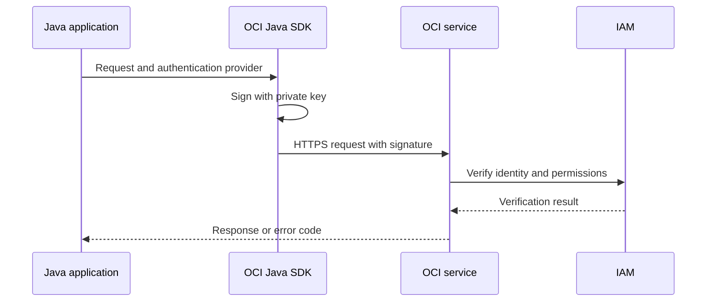

# Authenticating the Java SDK with API Signing Keys and Session Tokens

## 1. Objectives and Context

A Java application that wants to list OCI Compute instances, create a VCN, or interact with storage services must prove its calling identity before OCI evaluates access permissions. Choosing the right authentication mechanism keeps development, operations, and infrastructure automation controllable.

This lesson belongs to the **OCI SDK and REST API with Java** chapter in the **CLOUD_PROVIDERS_ORACLE** module. It focuses on two user-identity authentication methods: **API signing key** and **session token**. The example uses a read-only Compute operation inside a dedicated lab compartment, aligning with OCI deployment goals around IAM, monitoring, and cost control.

After this lesson, you will be able to:

- Explain the roles of the private key, public key, fingerprint, OCID, and session token.
- Prepare separate OCI profiles for each authentication method.
- Choose the right Java SDK authentication provider.
- Test calling a resource read API without creating a Compute instance.
- Distinguish authentication errors, authorization errors, and connectivity errors.
- Manage credential lifecycles, token refresh, and proper closing of Java resources.

Authenticating OCI service management APIs is different from logging into an Oracle Database over SQL via JDBC. An API signing key does not replace database accounts, wallets, or data-level authentication mechanisms required by the database service.

## 2. Authentication and Authorization Are Two Separate Steps

Every request must pass at least three verification stages:

| Verification Stage | Question | Example |
| --- | --- | --- |
| Connectivity and endpoint | Does it reach the right service and region over HTTPS? | DNS, proxy, TLS, and Compute endpoint |
| Authentication | Is the request signed by a valid identity? | Matching key pair, valid token, accurate system clock |
| Authorization | Which operations is that identity allowed to perform on which resources? | IAM policy allowing `read instances` in the lab compartment |

Successfully logging into the Console does not mean every API is permitted. Likewise, successfully constructing an authentication provider in Java does not prove the actual request will be accepted by the service.

With both mechanisms in this lesson, operational permissions still depend on the user and associated IAM policies. Switching from an API signing key to a session token does not automatically grant additional administrative privileges. See [OCI SDK Authentication Methods](https://docs.oracle.com/en-us/iaas/Content/API/Concepts/sdk_authentication_methods.htm).

Identifiers to keep distinct:

- **Tenancy OCID** identifies the identity's tenancy.
- **User OCID** identifies the user associated with an API signing key.
- **Compartment OCID** defines the resource scope of the example request.
- **Region** specifies where the service is called; it is not an IAM permission.
- **Fingerprint** identifies a registered public key; it is not the private key.

Do not pass a tenancy OCID in place of a compartment OCID just because both strings start with `ocid1`.

## 3. Two Request-Signing Methods

### 3.1. API Signing Key

An API signing key is an asymmetric key pair. The public key is registered for the OCI user; the private key is kept on the machine or runtime environment running the application. The SDK uses the private key to generate the request signature, and OCI verifies the signature against the corresponding public key.

Oracle requires an RSA key pair in PEM format with at least 2048 bits. Do not reuse a Compute SSH login key directly as an API signing key. See [Security Credentials](https://docs.oracle.com/en-us/iaas/Content/General/Concepts/credentials.htm).



The private key is never sent to OCI to authenticate each request. Only the public key is registered, and the signature is sent per the protocol.

An API signing key is not a static "API key" string sent like a password in a header. Nor is the fingerprint placed into a `Bearer` header.

### 3.2. Session Token

A session token represents a temporary user authentication session. In a browser-based flow, the OCI CLI opens a login flow; the user completes authentication per the tenancy and identity provider configuration, and the CLI writes session data locally.

The Java SDK reads the token alongside the session's corresponding private key and still signs each request. Having only the token file without the matching private key is insufficient for this mechanism.

```text
Log in via OCI CLI
        |
        v
Profile + session security_token_file + key_file
        |
        v
SessionTokenAuthenticationDetailsProvider
        |
        v
OCI request signed with session credentials
```

Do not confuse a session token with an **OCI auth token** used for certain other protocols or services. Never replace `security_token_file` with an auth token string copied from credential management. Oracle describes credential types in [Managing User Credentials](https://docs.oracle.com/en-us/iaas/Content/Identity/Tasks/managingcredentials.htm).

### 3.3. Choosing Based on the Environment

| Criterion | API Signing Key | Session Token |
| --- | --- | --- |
| Primary provider in this lesson | `ConfigFileAuthenticationDetailsProvider` | `SessionTokenAuthenticationDetailsProvider` |
| Critical local artifacts | Private key and profile identifying the key | Token, session private key, and profile |
| Lifecycle | Requires key rotation and revocation policies | Requires tracking expiration and session renewal limits |
| Suitable scenarios | Tools requiring user identity managed via keys | Interactive development and session-based operations |
| Operational concerns | Distributing and protecting long-lived keys | Token expiration, refresh, and re-login requirements |
| Resource permissions | Governed by the user's IAM policies | Governed by the user's IAM policies |

This is a design guideline, not a rule requiring the same method in every environment. For long-running workloads on Compute, Functions, or platforms supporting workload identities, evaluate instance principal or resource principal instead of relying on personal login sessions.

## 4. Preparing IAM and the Lab Environment

The example in this lesson calls `ListInstances` scoped to a compartment and region. You do not need to create a new instance to verify authentication; an empty list is still a valid result.

Prerequisites:

1. An OCI user permitted to manage their own credentials under tenancy policy.
2. A lab compartment with an existing OCID.
3. An IAM group containing the user and an appropriate policy for Compute read operations.
4. Compatible JDK and OCI Java SDK; the dependency snippet below uses SDK 3.x.
5. OCI CLI if practicing the session token flow.
6. HTTPS access to the relevant endpoints; system clock synchronized.

Example compartment-scoped policy:

```text
Allow group JavaSdkReaders to read instances in compartment JavaSdkLab
```

Replace the group and compartment names with your actual identifiers. In tenancies using identity domains, group references must follow your environment's domain/group naming rules.

Choose `read instances` because the Core Services policy reference specifies `INSTANCE_READ` for `ListInstances`; `inspect instances` alone is insufficient for this operation. See [Details for the Core Services](https://docs.oracle.com/en-us/iaas/Content/Identity/Reference/corepolicyreference.htm).

Read permission on instances can expose instance metadata. Keep the lab scope small and free of sensitive data. When expanding to VCN, Object Storage, or database management APIs, verify permissions per operation rather than granting `manage all-resources` to mask errors.

## 5. Declaring Dependencies for the Java SDK

SDK 3.x requires choosing an HTTP client implementation. The example below uses Jersey 3 and aligns module versions via the BOM, following Oracle's [Java SDK Getting Started guide](https://docs.oracle.com/en-us/iaas/Content/API/SDKDocs/javasdkgettingstarted.htm).

This is a Maven configuration snippet to integrate into your lab Java project, not a mandate to alter existing projects. Version `3.98.0` serves as a concrete baseline for the example; when choosing another version, keep modules synchronized and verify the APIs of that release.

```xml
<properties>
    <oci.sdk.version>3.98.0</oci.sdk.version>
</properties>

<dependencyManagement>
    <dependencies>
        <dependency>
            <groupId>com.oracle.oci.sdk</groupId>
            <artifactId>oci-java-sdk-bom</artifactId>
            <version>${oci.sdk.version}</version>
            <type>pom</type>
            <scope>import</scope>
        </dependency>
    </dependencies>
</dependencyManagement>

<dependencies>
    <dependency>
        <groupId>com.oracle.oci.sdk</groupId>
        <artifactId>oci-java-sdk-core</artifactId>
    </dependency>
    <dependency>
        <groupId>com.oracle.oci.sdk</groupId>
        <artifactId>oci-java-sdk-common-httpclient-jersey3</artifactId>
    </dependency>
</dependencies>
```

Do not arbitrarily mix versions of `oci-java-sdk-common`, service modules, and the HTTP client. If a project intentionally uses Jersey 2 or a specific dependency setup, maintain compatible dependencies rather than adding Jersey 3 alongside it.

## 6. Preparing the API Signing Key and Profile

### 6.1. Generating the Key Pair and Registering the Public Key

A standard lab workflow:

1. Generate the key pair in the Console or with a supported tool following Oracle's instructions.
2. Store the private key outside any repository and restrict file read permissions.
3. Register the **public key** for the appropriate user.
4. Copy the fingerprint and OCIDs from the resulting configuration.
5. Verify that the private key in use actually matches the registered public key.

If using OpenSSL, the following example creates a passphrase-protected private key and exports the public key:

```text
openssl genrsa -aes128 -out dev_api_key.pem 2048
openssl rsa -pubout -in dev_api_key.pem -out dev_api_key_public.pem
```

Enter the passphrase at the tool's prompt. Never paste the private key into the public key upload field. Steps and formats are documented in [Required Keys and OCIDs](https://docs.oracle.com/en-us/iaas/Content/API/Concepts/apisigningkey.htm).

The filenames above are illustrative. When practicing, choose a dedicated user credential directory and avoid generating keys inside source directories or publicly synced folders.

### 6.2. API Key Profile

Example section inside the user's private OCI configuration file:

```ini
[DEV_API_KEY]
user=ocid1.user.oc1..REPLACE_WITH_USER_OCID
fingerprint=REPLACE_WITH_PUBLIC_KEY_FINGERPRINT
tenancy=ocid1.tenancy.oc1..REPLACE_WITH_TENANCY_OCID
region=ap-singapore-1
key_file=C:/Users/<windows-user>/.oci/keys/dev_api_key.pem
```

Adjust the region to your subscribed region and target Compute location. On Linux or macOS, use the actual path for your system. In Java, use an absolute path or the `~` convention supported by the SDK; do not assume strings like `$env:USERPROFILE` or `%USERPROFILE%` inside an INI file will be expanded by Java like a shell.

Field meanings:

| Field | Role |
| --- | --- |
| `user` | User who registered the public key |
| `fingerprint` | Identifies which of the user's public keys is used |
| `tenancy` | Identity's tenancy |
| `region` | Default region for the client |
| `key_file` | Path to the private key, not the public key |
| `security_token_file` | Not needed for this API signing key profile |

In a shared config file with multiple profiles, inheritance from `DEFAULT` can cause missing values to be pulled from another profile. Select the profile explicitly and inspect the full credential set rather than relying only on the section header. See [SDK and CLI Configuration File](https://docs.oracle.com/en-us/iaas/Content/API/Concepts/sdkconfig.htm).

### 6.3. Private Key Passphrase

If the private key is encrypted, the provider needs the passphrase to decrypt it. The configuration above intentionally omits any passphrase. Oracle marks the `pass_phrase` config file field as deprecated and recommends supplying secrets at runtime; never place real passphrases in example configs or source code.

For passphrase-protected keys, you can construct `SimpleAuthenticationDetailsProvider` instead of the file-only provider. This illustrative snippet takes a parsed `config` and a `char[]` `passphrase` retrieved from user input or the application's secret store:

```java
AuthenticationDetailsProvider provider =
        SimpleAuthenticationDetailsProvider.builder()
                .tenantId(config.get("tenancy"))
                .userId(config.get("user"))
                .fingerprint(config.get("fingerprint"))
                .privateKeySupplier(
                        new SimplePrivateKeySupplier(config.get("key_file")))
                .passphraseCharacters(passphrase)
                .build();
```

All classes belong to `com.oracle.bmc.auth`. This provider still authenticates using an API signing key; changing how the passphrase is supplied does not change the IAM identity. See [SimpleAuthenticationDetailsProvider builder](https://docs.oracle.com/en-us/iaas/tools/java/latest/com/oracle/bmc/auth/SimpleAuthenticationDetailsProvider.SimpleAuthenticationDetailsProviderBuilder.html).

Do not wipe the passphrase array while the client still needs it to sign requests. Scope secret retention in memory to the lifecycle of the provider and application. If using `System.console().readPassword()`, handle cases where no console exists in an IDE or automated runner.

## 7. Creating a Session Token with the OCI CLI

### 7.1. Browser-Based Login

Example PowerShell commands using a dedicated profile:

```powershell
$ociConfig = Join-Path $env:USERPROFILE '.oci\config'
oci session authenticate --config-file "$ociConfig" --region ap-singapore-1 --profile-name DEV_SESSION
```

Complete login in the browser, including MFA or any IdP step required by your environment. The CLI creates or updates the session files and profile according to your selections.

Running this command is a manual learner step; a Java application does not automatically launch a browser simply by instantiating the session token provider.

The flow and options are documented in [CLI session authenticate](https://docs.oracle.com/en-us/iaas/tools/oci-cli/latest/oci_cli_docs/cmdref/session/authenticate.html).

### 7.2. Identifying the Session Profile

Illustrative structure:

```ini
[DEV_SESSION]
tenancy=ocid1.tenancy.oc1..REPLACE_WITH_TENANCY_OCID
region=ap-singapore-1
key_file=C:/Users/<windows-user>/.oci/sessions/DEV_SESSION/oci_api_key.pem
security_token_file=C:/Users/<windows-user>/.oci/sessions/DEV_SESSION/token
```

Keep the paths and artifacts actually generated by the CLI. Do not paste the token directly into the INI file or replace the session private key with an arbitrary API private key. Actual directories and filenames may differ from the example depending on CLI options.

The token and private key form a credential pair that must be managed together. The config file mainly points to them; copying only the INI section to another machine does not guarantee the required authentication data is present.

### 7.3. Validating the Session via CLI

```powershell
oci session validate --config-file "$ociConfig" --profile DEV_SESSION --auth security_token
```

The CLI requires `--auth security_token` to use this authentication type for relevant commands. That flag does not control provider selection in Java; Java code must still instantiate `SessionTokenAuthenticationDetailsProvider`.

Validating a session and calling a resource API are two distinct checks. A valid session may still lack permission to read instances. See [Token-based Authentication for the CLI](https://docs.oracle.com/en-us/iaas/Content/API/SDKDocs/clitoken.htm).

## 8. Java Example with Explicit Provider Selection

The following example runs the same read operation for both authentication methods. The illustrative class name is `OciAuthenticationProbe`; integrate the code into the lab Java project configured with dependencies in the earlier section.

The program accepts four arguments:

```text
<api-key|session-token> <config-file> <profile> <compartment-ocid>
```

Usage requirements:

- `api-key`: profile containing API signing key credentials. For encrypted private keys, replace the provider-creation branch with the runtime passphrase approach from Section 6.3.
- `session-token`: CLI-created profile with an active token and matching private key.
- Compartment OCID is a lab compartment with IAM read permission.
- The example reads only one page of results; it is not a full-tenancy inventory tool.

```java
import com.oracle.bmc.ClientConfiguration;
import com.oracle.bmc.ConfigFileReader;
import com.oracle.bmc.auth.AuthenticationDetailsProvider;
import com.oracle.bmc.auth.ConfigFileAuthenticationDetailsProvider;
import com.oracle.bmc.auth.SessionTokenAuthenticationDetailsProvider;
import com.oracle.bmc.core.ComputeClient;
import com.oracle.bmc.core.requests.ListInstancesRequest;
import com.oracle.bmc.core.responses.ListInstancesResponse;
import com.oracle.bmc.model.BmcException;

public final class OciAuthenticationProbe {
    private OciAuthenticationProbe() {
    }

    public static void main(String[] args) throws Exception {
        if (args.length != 4) {
            throw new IllegalArgumentException(
                    "Usage: <api-key|session-token> "
                            + "<config-file> <profile> <compartment-ocid>");
        }

        String mode = args[0];
        String configPath = args[1];
        String profileName = args[2];
        String compartmentId = args[3];

        ConfigFileReader.ConfigFile config =
                ConfigFileReader.parse(configPath, profileName);

        String regionId = config.get("region");
        if (regionId == null || regionId.isEmpty()) {
            throw new IllegalArgumentException("Profile must define region");
        }

        AuthenticationDetailsProvider provider;
        SessionTokenAuthenticationDetailsProvider sessionProvider = null;

        if ("api-key".equals(mode)) {
            provider = new ConfigFileAuthenticationDetailsProvider(config);
        } else if ("session-token".equals(mode)) {
            sessionProvider =
                    new SessionTokenAuthenticationDetailsProvider(config);
            provider = sessionProvider;
        } else {
            throw new IllegalArgumentException("Unsupported auth mode");
        }

        boolean success;
        try {
            success = readOnePage(provider, regionId, compartmentId);
        } finally {
            if (sessionProvider != null) {
                sessionProvider.close();
            }
        }

        if (!success) {
            System.exit(2);
        }
    }

    private static boolean readOnePage(
            AuthenticationDetailsProvider provider,
            String regionId,
            String compartmentId) throws Exception {

        ClientConfiguration clientConfig = ClientConfiguration.builder()
                .connectionTimeoutMillis(5000)
                .readTimeoutMillis(30000)
                .build();

        try (ComputeClient client = ComputeClient.builder()
                .configuration(clientConfig)
                .build(provider)) {

            client.setRegion(regionId);

            ListInstancesResponse response = client.listInstances(
                    ListInstancesRequest.builder()
                            .compartmentId(compartmentId)
                            .limit(5)
                            .build());

            System.out.printf(
                    "OCI request succeeded: count=%d, requestId=%s, hasNextPage=%s%n",
                    response.getItems().size(),
                    response.getOpcRequestId(),
                    response.getOpcNextPage() != null);

            return true;
        } catch (BmcException exception) {
            System.err.printf(
                    "OCI request failed: status=%d, code=%s, requestId=%s%n",
                    exception.getStatusCode(),
                    exception.getServiceCode(),
                    exception.getOpcRequestId());

            return false;
        }
    }
}
```

Both providers accept `ConfigFileReader.ConfigFile`, yet they authenticate differently. The API key provider uses the user's key details; the session provider handles the session token. Do not choose a provider based on the incidental existence of a file on disk.

Compare the constructors in [ConfigFileAuthenticationDetailsProvider](https://docs.oracle.com/en-us/iaas/tools/java/latest/com/oracle/bmc/auth/ConfigFileAuthenticationDetailsProvider.html) and [SessionTokenAuthenticationDetailsProvider](https://docs.oracle.com/en-us/iaas/tools/java/latest/com/oracle/bmc/auth/SessionTokenAuthenticationDetailsProvider.html).

### 8.1. Setting Arguments When Running from an IDE

Configure program arguments, for example:

```text
api-key "C:/Users/<windows-user>/.oci/config" DEV_API_KEY ocid1.compartment.oc1..REPLACE_WITH_LAB_OCID
```

To switch to the login session:

```text
session-token "C:/Users/<windows-user>/.oci/config" DEV_SESSION ocid1.compartment.oc1..REPLACE_WITH_LAB_OCID
```

Strings such as `<windows-user>` and `REPLACE_WITH_...` are placeholders that must be replaced before running. Never pass a raw private key or token via program arguments.

The config path in the example is passed explicitly to avoid depending on the IDE working directory, the OS account running the JVM, or differing default locations across machines.

### 8.2. Interpreting Results

Example output:

```text
OCI request succeeded: count=0, requestId=<oracle-request-id>, hasNextPage=false
```

This result indicates the specific read request was accepted by the service. `count=0` may simply mean the selected compartment and region contain no matching instances; you do not need to launch an instance to make the count non-zero.

If `hasNextPage=true`, this is only the first page. When building inventory tools, use pagination or the SDK's paginators. In this lesson, a single page is enough to verify the authentication path and permissions for the sample operation.

`opc-request-id` helps correlate a single call with logs and technical support. Response fields are documented at [ListInstancesResponse](https://docs.oracle.com/en-us/iaas/tools/java/latest/com/oracle/bmc/core/responses/ListInstancesResponse.html).

The program does not print the provider, private key, token, or full response. There is no need to log instance metadata to prove authentication succeeded.

## 9. Session Tokens: Expiration, Reloading, and Renewal

### 9.1. Tokens Have Lifetimes, Sessions Have Separate Limits

Per CLI documentation, tokens expire after one hour by default; sessions created via a browser flow can be refreshed while valid up to a documented total limit of 24 hours. The `--no-browser` flow has its own constraints and should not be assumed equivalent to a browser session. See [CLI Session Token Lifecycle](https://docs.oracle.com/en-us/iaas/Content/API/SDKDocs/clitoken.htm).

Accordingly, three milestones must be kept distinct:

| Milestone | Implication for the Application |
| --- | --- |
| Current token expiration | The token must still be valid when the service authenticates the request |
| Session renewal limit | Refreshing cannot continue indefinitely to avoid re-login |
| Provider lifecycle in the JVM | The provider holds token state and may run background tasks |

Choosing a short lifetime does not mean file protection can be ignored. While valid, session credentials still permit actions allowed for that identity.

Do not build a multi-day production service on the assumption that a developer will always log back in on time.

### 9.2. Refreshing in the Java SDK

In SDK `3.98.0` used as the baseline here, the standard `SessionTokenAuthenticationDetailsProvider` constructor schedules a background refresh: starting immediately, then repeating every 55 minutes by default, and stopping after 24 hours. This is behavior of that specific implementation, not a guarantee that every session can be renewed successfully. See [provider source at tag v3.98.0](https://github.com/oracle/oci-java-sdk/blob/v3.98.0/bmc-common/src/main/java/com/oracle/bmc/auth/SessionTokenAuthenticationDetailsProvider.java).

Key design points:

- The provider cannot complete an interactive user login.
- Refresh may fail because the session is no longer valid or the auth service is unreachable.
- A client successfully calling Compute once does not prove the refresh endpoint is always reachable.
- Do not instantiate a new provider per request: doing so complicates credential management and background tasks.
- Monitor refresh errors alongside API call errors rather than waiting for the first business request to fail.

Oracle's official example covers both refresh scheduling configuration and closing the provider after use: [SessionTokenExample.java](https://github.com/oracle/oci-java-sdk/blob/master/bmc-examples/src/main/java/SessionTokenExample.java).

### 9.3. Distinguishing Operations Named "Refresh"

| Operation | Primary Action |
| --- | --- |
| `oci session refresh` | CLI requests a session refresh using the selected credentials and profile |
| `provider.refresh()` | Provider reloads the token from the configured file |
| `provider.refreshSessionToken()` | Provider calls the Identity service to request a new token |
| Re-authenticating via `oci session authenticate` | Recreates a session through the user authentication flow |

CLI example:

```powershell
oci session refresh --config-file "$ociConfig" --profile DEV_SESSION --auth security_token
oci session validate --config-file "$ociConfig" --profile DEV_SESSION --auth security_token
```

Reloading the same unmodified file does not make an expired token valid. Nor should you assume a Java process already holding a token in memory automatically reloads the file after every CLI token write.

The semantics of both provider methods are documented in the [Java SDK session token provider API](https://docs.oracle.com/en-us/iaas/tools/java/latest/com/oracle/bmc/auth/SessionTokenAuthenticationDetailsProvider.html). When an application manages its own refresh mechanism, assign clear ownership to avoid multiple processes modifying the same session file concurrently.

If re-authentication produces both a new key and a new token, rebuild the provider and client with the new credential pair. Do not swap only the token file while the JVM continues using a different private key.

### 9.4. Closing the Provider and HTTP Client

The service client and session provider are two resources with separate lifecycles:

```text
Initialize provider
    -> initialize client
    -> execute requests
    -> close client
    -> close session provider
```

In the example, `ComputeClient` is closed via try-with-resources, while `sessionProvider.close()` sits in `finally`. Ensure the provider is closed even when API calls fail.

`close()` stops the provider's refresh scheduler; it does not revoke the session server-side. Deleting local files also does not guarantee that copies of credentials elsewhere have been invalidated.

## 10. Passphrase-Protected Private Keys and Example Limitations

Encrypting a key with a passphrase reduces impact if only the key file leaks, but requires the application to obtain the passphrase when signing. For API signing keys, Section 6.3 demonstrates a provider accepting a runtime passphrase. For session tokens, the provider and CLI also require appropriate configuration if the session private key is encrypted.

The `api-key` branch of the sample program uses the file-based provider to highlight mechanism selection. It does not prompt for a passphrase or read from a secret store. Therefore:

- For unencrypted keys, protect the file with appropriate OS permissions and use it within an approved lab scope.
- For encrypted keys, integrate a runtime passphrase source before using the sample code.
- Never fix errors by committing passphrases to a repository or removing encryption from existing keys.
- Never apply an API key's passphrase to a separate session key just because both files happen to be named `oci_api_key.pem`.

Supplying passphrases is part of an application's security architecture. When integrating into a Java framework or deployment platform, clearly define the secret source, load timing, and retention lifecycle.

## 11. Troubleshooting Errors in Order

### 11.1. Before Sending a Request

Check sequentially:

1. The right mode and profile are selected.
2. The config path exists and is readable by the account running the JVM.
3. `key_file` points to a private key in the proper format.
4. If using a session token, the token file exists and belongs to the matching credential pair.
5. If the private key is encrypted, the correct passphrase is supplied.
6. The region and compartment belong to the intended environment.
7. System clock, proxy, DNS, and TLS are functioning properly.

Inspect only the necessary file metadata. Never print private key or token contents to confirm they exist.

### 11.2. Classifying Common Errors

| Symptom | What to Check |
| --- | --- |
| Cannot read file or profile | Path, profile name, JVM user, and read permissions |
| Error parsing or decrypting private key | PEM format, key type, passphrase, and file integrity |
| `401 NotAuthenticated` | Credentials, signature, token validity, and system clock |
| `404 NotAuthorizedOrNotFound` | IAM policy, compartment, resource, and region |
| `403` | Inspect the service error code; may be an operation or region restriction |
| TLS, DNS, or connection timeout | Network path, proxy, and trust store before changing credentials |
| CLI works but Java fails | Which provider, profile, config path, and key/token pair Java uses |
| Works initially then fails | Session lifetime, refresh failure, replaced credential files, or permission changes |

Oracle defines `401 NotAuthenticated` as missing or invalid authentication information, while `404 NotAuthorizedOrNotFound` can mask both missing permissions and nonexistent resources. Do not treat every `404` as proof a resource was deleted. See [OCI API Errors](https://docs.oracle.com/en-us/iaas/Content/API/References/apierrors.htm).

For request signatures, Oracle notes that clock skew exceeding five minutes can cause `401`. Synchronize system time instead of repeatedly regenerating keys. See [Request Signatures](https://docs.oracle.com/en-us/iaas/Content/API/Concepts/signingrequests.htm).

### 11.3. Do Not Fix Errors by Arbitrarily Escalating Permissions

If a request uses the wrong user, adding policies to the expected group will not fix the signing identity. If a token has expired, granting extra permissions will not revive it. If an endpoint is unreachable, changing the fingerprint will not repair the network path.

A logical troubleshooting sequence:

```text
Identify the actual credential in use
    -> verify the request is authenticated
    -> cross-check the operation and IAM permission
    -> verify compartment, region, and resource
    -> check service-specific requirements
```

After IAM changes, account for policy propagation delay and retest with a narrowly scoped operation. Never enable tenancy-wide admin privileges just to hide a configuration mistake.

## 12. Protecting Credentials and Rotating Keys

### 12.1. What Must Be Protected

- Private keys, token files, and passphrases are secrets.
- Config files may not embed private keys directly, yet still hold identities, credential paths, and other sensitive details.
- Never package credential directories into JARs, container images, build artifacts, or project archives.
- On Windows, verify file and directory ACLs; running `chmod` in another environment does not prove Windows ACLs are correct.
- Never push a file to Git and merely add it to `.gitignore` afterward: that does not purge credentials from history or distributed clones.

If credential exposure is suspected, execute the appropriate revocation or session termination procedure, then reissue and audit related activity. Deleting a file on a developer workstation removes only one copy.

### 12.2. Controlled API Signing Key Rotation

A design workflow for applications using API keys:

1. Generate a new key pair and register the new public key for the right identity.
2. Store the new private key in the chosen secret distribution mechanism.
3. Update `key_file` and the profile's fingerprint in sync.
4. Reload the provider/client or redeploy according to application design.
5. Verify a read request using the new key.
6. Revoke the old public key once all consumers have migrated.
7. Confirm no workloads still depend on the old key.

Keep the overlap window long enough to avoid disruption, with a clear end time. Do not assume a running provider automatically reloads a new private key and fingerprint the moment the config file changes.

### 12.3. Operating Multiple Environments

Use separate profiles such as `DEV_API_KEY`, `DEV_SESSION`, and production profiles with dedicated deployment mechanisms. Profile names are only configuration labels; verify the actual identity and tenancy inside them.

Every application should record sufficient operational context for auditing: authentication type, environment name, operation, latency, error code, and request ID. Never log raw tokens, signatures, or full `Authorization` headers.

For workloads requiring high availability, credentials must have a lifecycle suited to continuous runtime and a clear recovery mechanism. This is why workload identities should be evaluated when moving from interactive tools to continuously running services.

## 13. Practicing Along a Narrowly Scoped Test Path

The following lab separates configuration errors from resource permissions:

1. Prepare a lab compartment and a policy to read instances.
2. Create or select an API signing key approved for lab use.
3. Configure an API key profile, including a passphrase source if the key is encrypted.
4. Run the program in `api-key` mode; record the output and request ID.
5. Create a session profile with the CLI and verify the session is valid.
6. Run the same program in `session-token` mode against the same compartment.
7. Compare the two call results; if they differ, compare the user, region, and effective permissions.
8. Observe that the provider closes and the process exits cleanly after the operation.
9. Monitor or test the expiration/refresh flow according to session duration without altering token contents.
10. Conclude the lab following your environment's credential management procedures.

Scenarios to verify yourself in the lab:

| Scenario | Key Takeaway |
| --- | --- |
| Compartment has no instances | A successful request can still return an empty list |
| Profile does not exist | Configuration error occurs before calling the resource |
| API key profile points to a public key file by mistake | The provider cannot use it as a private key to sign requests |
| Token expired | Must handle session lifecycle, not merely retry business calls |
| Identity lacks read permission on target compartment | Inspect IAM and resource scope |
| CLI uses `--auth security_token` while Java uses the API key provider | CLI flags do not control the Java provider |
| Key and token come from two different sessions | Credential pair is no longer consistent |

These are lab instructions, not observed test results. Verification in this lesson uses a read operation to avoid creating billable resources solely to test credentials.

## 14. Deployment Takeaways

A complete design must answer: which identity the application uses, where credentials come from, how requests are signed, which compartments are authorized, and what happens when credentials become invalid.

API signing keys require key management and rotation. Session tokens require managing session lifetimes, refreshes, and re-authentication. In both cases, the Java SDK handles request signing; the application remains responsible for choosing the provider, protecting secrets, scoping IAM permissions, and observing runtime errors.
