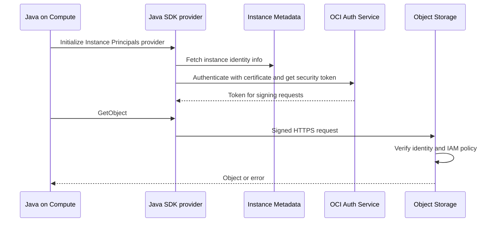
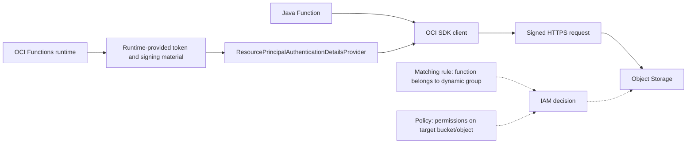

# Authenticating Applications with Instance Principals and Resource Principals

## 1. Objectives and Use Case

In the **OCI SDK and REST API with Java** chapter of the **CLOUD_PROVIDERS_ORACLE** module, this lesson guides applications to use an OCI resource's own identity to call APIs instead of distributing a user's API signing key to every workload.

The running scenario involves two applications reading the same configuration object:

- A Java process running on OCI Compute using **Instance Principals**.
- A Java function running on OCI Functions using **Resource Principals**.

Both applications are only permitted to read a test object in a private bucket. You will configure dynamic groups, grant IAM permissions scoped to the exact target resource, construct authentication providers, and call Object Storage via the Java SDK.

After this lesson, you should be able to separate three questions:

1. Which identity is the workload proving?
2. Which policy allows that identity to perform the specific operation?
3. Does the runtime have network reachability to the required endpoints?

Successfully building an authentication provider is not enough to conclude the application is authorized to read data. The examples and lab exercises below were not compiled or run against a live tenancy during lesson authoring.

## 2. Foundational Concepts

### 2.1. Principal, Authentication, and Authorization

A **principal** is the entity sending a request to OCI. A principal can be an IAM user, a Compute instance, or a resource supported by the resource principal mechanism.

**Authentication** proves which principal a request originates from. In the Java SDK, an authentication provider supplies the material the SDK uses to sign requests under the corresponding mechanism.

**Authorization** determines what actions a principal is allowed to perform on which resources. In this example, an IAM policy for a dynamic group governs Object Storage read permissions.

| Component | Question It Resolves | Example |
| --- | --- | --- |
| Authentication provider | Where does the SDK get request-signing material? | Instance metadata or the Functions runtime environment |
| Dynamic group matching rule | Which resources belong to the principal group? | A Compute instance with a specific OCID |
| IAM policy | Which operations can that group perform? | Reading objects in a specified bucket |
| Region and endpoint | Where is the request sent? | Object Storage in the bucket's region |
| VCN, DNS, route, TLS | Can the runtime establish the connection? | HTTPS connection to the service endpoint |

These layers must be verified independently. For example, establishing a TCP connection does not prove the IAM policy is correct; receiving a permission error does not by itself prove the provider is using the identity the deployer intended.

### 2.2. Instance Principals

Each OCI Compute instance has its own identity. OCI issues and rotates certificates for this mechanism. The SDK uses the instance's identity details to obtain a security token and sign service requests. The application does not need to carry a long-lived IAM user API key.

The corresponding Java provider is:

```java
var provider =
        com.oracle.bmc.auth.InstancePrincipalsAuthenticationDetailsProvider
                .builder()
                .build();
```

The mechanism, dynamic groups, and policies are described in [Calling Services from an Instance](https://docs.oracle.com/en-us/iaas/Content/Identity/Tasks/callingservicesfrominstances.htm).

The unit granted permissions here is the **instance**. Two applications running on the same VM that can both reach the VM's identity endpoint share that instance's permissions. This mechanism does not automatically create separate identities per JVM, Linux user, or container on the host.

### 2.3. Resource Principals

Resource Principals allow supported OCI resources to use their own identity to call other services. This lesson uses OCI Functions as the concrete example: the function uses a resource principal session token, commonly abbreviated **RPST**, along with signing material provided by the runtime.

The Java provider is:

```java
var provider =
        com.oracle.bmc.auth.ResourcePrincipalAuthenticationDetailsProvider
                .builder()
                .build();
```

For Functions, you must place the function in a dynamic group and grant policies to that group. Usage is described in [Accessing Other Oracle Cloud Infrastructure Resources from Running Functions](https://docs.oracle.com/en-us/iaas/Content/Functions/Tasks/functionsaccessingociresources.htm).

Not every Java program running on OCI has a Resource Principals environment available. Verify that the service and runtime type support it, and select the provider matching that runtime's contract.

### 2.4. Identity Types Commonly Confused

| Scenario | Appropriate Choice |
| --- | --- |
| Java on OCI Compute, using the VM's permissions | Instance Principals |
| Java in OCI Functions, using the function's permissions | Resource Principals |
| Java on a laptop | User authentication mechanism for separate dev/test use |
| Pod on OKE needing per-workload permissions | Evaluate OKE workload identity |
| End user making HTTP calls into an application | Authenticate the user at the application or gateway layer |
| Application logging into Oracle Database over JDBC | Supported DB authentication mechanism and in-DB privileges |

OKE workload identity has its own provider and policies scoped by cluster, namespace, and service account. [Granting Workloads Access to OCI Resources](https://docs.oracle.com/en-us/iaas/Content/ContEng/Tasks/contenggrantingworkloadaccesstoresources.htm) describes its prerequisites and configuration. Do not let every pod rely on the worker node's instance principal when per-application permission isolation is needed.

Nor does a function's identity automatically become the caller's identity. If API Gateway authenticates a user and invokes a function, an Object Storage call made using resource principal still uses the function's permissions; business-level user authorization must be enforced in the application layer.

## 3. Authentication Flows and Where IAM Applies

### 3.1. Instance Principals Flow



This is a conceptual diagram. The SDK handles certificate exchange, session keys, tokens, and refreshes; the application does not implement the federation protocol itself.

There are at least two distinct connection paths: the path to obtain identity material and the path to call the target service. A VM that can reach Object Storage but cannot reach the authentication endpoint can still fail when creating or refreshing the provider.

### 3.2. Resource Principals Flow in Functions



The runtime supplies authentication material, while the IAM policy grants permissions on the target resource. Putting a dynamic group name into a function environment variable does not make the function a member of that group.

### 3.3. Tokens Do Not Replace Policies or Networking

Short-lived tokens reduce the need to distribute long-lived user keys. They do not grant tenancy admin rights, create network routes, or open database access.

For example, a Java service might be permitted to read a secret from Vault yet still need database login credentials and SQL privileges inside Oracle Database. OCI permissions to manage database resources and SQL privileges inside the database are separate contracts configured independently.

## 4. Designing the Lab and Permission Scope

### 4.1. Resources Used in the Lab

Prepare the following test resources:

| Resource | Role |
| --- | --- |
| Compartment `app-runtime` | Holds the VM and function running the applications |
| Compartment `app-data` | Holds the data bucket |
| Test Compute instance | First principal |
| Test Java Function | Second principal |
| Private bucket `principal-lab-input` | Authorized read target |
| Small object `auth-probe.txt` | Test payload containing no sensitive information |
| Dynamic group `principal-lab-vms` | Contains the selected VM |
| Dynamic group `principal-lab-functions` | Contains the selected function |

Names are illustrative and should be adapted to your real environment. Every `<...>` placeholder must be filled with a real value before use.

For a basic lab, choose a Standard-tier object with Oracle-managed encryption to keep the focus on principals and IAM. If using customer-managed keys or additional security constraints, configure the required extra permissions per service documentation.

The bucket must be private, and do not use a pre-authenticated request URL in this lesson. If the resource is public, a successful read test would not prove that the principal policy under test is working.

### 4.2. Separating Principal Compartment from Target Compartment

```text
app-runtime:
    Compute instance / Function
    → Matching rule checks source resource identity

app-data:
    Bucket principal-lab-input / object auth-probe.txt
    → IAM policy grants permissions on target resource
```

In the matching rule, the source compartment determines which resources belong to the group. In the policy `in compartment app-data`, the target compartment restricts where read permissions apply.

Placing both resources in the same compartment does not automatically let them call one another. Placing them in separate compartments does not prevent valid authorization either, provided the policy is placed at an appropriate administrative scope.

## 5. Creating Dynamic Groups with Clear Matching Rules

### 5.1. Group for a Compute Instance

For the lab, use a rule targeting a specific OCID:

```text
instance.id = '<COMPUTE_INSTANCE_OCID>'
```

If you want to combine both instance and compartment:

```text
ALL {
    instance.id = '<COMPUTE_INSTANCE_OCID>',
    instance.compartment.id = '<RUNTIME_COMPARTMENT_OCID>'
}
```

`ALL` requires every condition to hold simultaneously. If the VM is moved out of the specified compartment, re-evaluate membership and deployment policy.

If using `instance.compartment.id` alone, any matching instance in that compartment can become a member, including instances created later. Control who is allowed to create or move instances into that compartment.

### 5.2. Group for a Function

For Functions, use the resource OCID of the **function**:

```text
ALL {
    resource.type = 'fnfunc',
    resource.id = '<FUNCTION_OCID>'
}
```

Do not put the application OCID in place of the function OCID. An application and a function are two distinct resources.

When you need to include every function in a dedicated compartment, you can use:

```text
ALL {
    resource.type = 'fnfunc',
    resource.compartment.id = '<RUNTIME_COMPARTMENT_OCID>'
}
```

Choose only the rule suited to your intent. Do not add a broad rule alongside a narrow rule and assume the narrow rule still restricts overall membership.

### 5.3. Rules Based on Defined Tags

For a group of instances that changes across deployments, an illustrative rule might use:

```text
ALL {
    instance.compartment.id = '<RUNTIME_COMPARTMENT_OCID>',
    tag.workload.role.value = 'principal-lab-reader'
}
```

Here `workload` and `role` are an already created defined tag namespace and key. Free-form tags cannot substitute for defined tags in this rule.

`ALL`, `ANY`, instance/resource attributes, and tag variables are documented in [Writing Matching Rules to Define Dynamic Groups](https://docs.oracle.com/en-us/iaas/Content/Identity/dynamicgroups/Writing_Matching_Rules_to_Define_Dynamic_Groups.htm).

Tags become part of the authorization condition. Anyone permitted to edit tags or create resources matching the rule can affect group membership, so permissions to manage tags and source resources must also align with your access design.

### 5.4. Notes on Membership Propagation

Dynamic groups do not require the Java application to register itself into the group at startup. Membership is evaluated from rules and resource attributes.

Oracle advises allowing about an hour for matching rule changes to take effect, including the effect of tag changes on membership. See [Managing Dynamic Groups](https://docs.oracle.com/en-us/iaas/Content/Identity/Tasks/managingdynamicgroups.htm).

Do not treat a single failed call immediately after editing a rule as proof the new rule is wrong. Likewise, do not design an emergency revocation workflow assuming membership changes take effect instantaneously.

## 6. Granting IAM Policies for the Exact Operation

### 6.1. Lab Policies by Dynamic Group OCID

Example granting read access to the exact object for each principal:

```text
Allow dynamic-group id <VM_DYNAMIC_GROUP_OCID> to read objects in compartment app-data where all {target.bucket.name = 'principal-lab-input', target.object.name = 'auth-probe.txt', request.permission = 'OBJECT_READ'}

Allow dynamic-group id <FUNCTION_DYNAMIC_GROUP_OCID> to read objects in compartment app-data where all {target.bucket.name = 'principal-lab-input', target.object.name = 'auth-probe.txt', request.permission = 'OBJECT_READ'}
```

The policy uses the dynamic group's OCID, not the OCID of the VM or function. Specifying a dynamic group by OCID also avoids identity domain naming ambiguity; Oracle illustrates this syntax in [the dynamic group and policy guide for OKE](https://docs.oracle.com/en-us/iaas/Content/ContEng/Tasks/contengdynamicgrouppolicyforselfmanagednodes.htm).

The policy must be created at a scope covering the target compartment, such as the tenancy or an appropriate ancestor compartment. Permissions to create or edit dynamic groups and policies belong to deployment administrators and do not need to be granted to the object-reading application's runtime.

### 6.2. Why Does the Example Call GetObject Directly?

In Object Storage, `GetObject` uses the `OBJECT_READ` permission; listing objects uses a different permission. The `target.bucket.name` and `target.object.name` variables allow restricting the target resource. See [Details for Object Storage and Archive Storage](https://docs.oracle.com/en-us/iaas/Content/Identity/Reference/objectstoragepolicyreference.htm).

The code below receives the namespace, bucket, and object name as inputs so it does not need to call `ListBuckets`, `ListObjects`, or `GetNamespace` to discover resources. If the application needs an additional API, identify that API's permission and grant it intentionally.

Do not conclude a principal is broken just because a list command fails when the policy intentionally permits reading only a known object. The authorized business operation itself is the appropriate test.

The conditions above are constraints within a single **allow policy**. To confirm the workload truly only has this scope, inspect all other allow policies and dynamic groups applicable to the same principal. A narrow policy does not revoke permissions granted by another policy.

### 6.3. Granting Permissions for Other Resources

When adapting the example to Streaming, Queue, Vault, or the database control plane, what changes are the service client, request, and target service policy. The authentication provider must still be chosen according to the runtime's identity source.

For example, a principal permitted to read an object is not implicitly permitted to read a secret or call database management APIs. Reusing a provider is convenient in code, but it does not merge permission boundaries.

## 7. Preparing the Java SDK

The example uses Java 17, Maven, and OCI Java SDK 3.x. Use the BOM to keep OCI modules on the same version and explicitly select the HTTP transport. SDK 3.x requires applications to declare a transport per [Getting Started with OCI SDK for Java](https://docs.oracle.com/en-us/iaas/Content/API/SDKDocs/javasdkgettingstarted.htm).

`pom.xml` configuration for the lab project:

```xml
<project xmlns="http://maven.apache.org/POM/4.0.0"
         xmlns:xsi="http://www.w3.org/2001/XMLSchema-instance"
         xsi:schemaLocation="http://maven.apache.org/POM/4.0.0 https://maven.apache.org/xsd/maven-4.0.0.xsd">
    <modelVersion>4.0.0</modelVersion>

    <groupId>vn.example</groupId>
    <artifactId>oci-principal-auth-lab</artifactId>
    <version>1.0.0</version>

    <properties>
        <maven.compiler.release>17</maven.compiler.release>
        <project.build.sourceEncoding>UTF-8</project.build.sourceEncoding>
        <oci.sdk.version>3.94.0</oci.sdk.version>
    </properties>

    <dependencyManagement>
        <dependencies>
            <dependency>
                <groupId>com.oracle.oci.sdk</groupId>
                <artifactId>oci-java-sdk-bom</artifactId>
                <version>${oci.sdk.version}</version>
                <type>pom</type>
                <scope>import</scope>
            </dependency>
        </dependencies>
    </dependencyManagement>

    <dependencies>
        <dependency>
            <groupId>com.oracle.oci.sdk</groupId>
            <artifactId>oci-java-sdk-objectstorage</artifactId>
        </dependency>
        <dependency>
            <groupId>com.oracle.oci.sdk</groupId>
            <artifactId>oci-java-sdk-common-httpclient-jersey3</artifactId>
        </dependency>
    </dependencies>

    <build>
        <plugins>
            <plugin>
                <groupId>org.apache.maven.plugins</groupId>
                <artifactId>maven-compiler-plugin</artifactId>
                <version>3.13.0</version>
            </plugin>
            <plugin>
                <groupId>org.codehaus.mojo</groupId>
                <artifactId>exec-maven-plugin</artifactId>
                <version>3.5.0</version>
            </plugin>
        </plugins>
    </build>
</project>
```

Version `3.94.0` is pinned so the example specifies an exact SDK release; you can reference [Oracle's source at tag v3.94.0](https://github.com/oracle/oci-java-sdk/tree/v3.94.0). This is not a claim of being the latest version or a pre-validated library set for every application.

Place the classes below in `src/main/java` of the lab project without a package declaration so they run directly with the sample command. When integrating into a real project, add packages and your framework's lifecycle management.

## 8. Creating Explicit Providers in Java

### 8.1. Factory for the Lesson's Two Runtimes

Create `OciPrincipalProviders.java`:

```java
import java.util.Locale;

import com.oracle.bmc.auth.BasicAuthenticationDetailsProvider;
import com.oracle.bmc.auth.InstancePrincipalsAuthenticationDetailsProvider;
import com.oracle.bmc.auth.ResourcePrincipalAuthenticationDetailsProvider;

public final class OciPrincipalProviders {
    private OciPrincipalProviders() {}

    public static BasicAuthenticationDetailsProvider fromEnvironment() {
        String mode = requiredEnv("APP_AUTH_MODE")
                .trim()
                .toUpperCase(Locale.ROOT);

        return switch (mode) {
            case "INSTANCE" ->
                    InstancePrincipalsAuthenticationDetailsProvider
                            .builder()
                            .build();
            case "RESOURCE" ->
                    ResourcePrincipalAuthenticationDetailsProvider
                            .builder()
                            .build();
            default -> throw new IllegalArgumentException(
                    "APP_AUTH_MODE must be INSTANCE or RESOURCE");
        };
    }

    public static String requiredEnv(String name) {
        String value = System.getenv(name);
        if (value == null || value.isBlank()) {
            throw new IllegalArgumentException(
                    "Missing environment variable: " + name);
        }
        return value;
    }
}
```

Both providers implement `BasicAuthenticationDetailsProvider`, suitable for passing into SDK client builders. See the API docs for [InstancePrincipalsAuthenticationDetailsProvider](https://docs.oracle.com/en-us/iaas/tools/java/latest/com/oracle/bmc/auth/InstancePrincipalsAuthenticationDetailsProvider.html) and [ResourcePrincipalAuthenticationDetailsProvider](https://docs.oracle.com/en-us/iaas/tools/java/latest/com/oracle/bmc/auth/ResourcePrincipalAuthenticationDetailsProvider.html).

`APP_AUTH_MODE` is an application-defined setting to pick a branch. Setting this variable does not give a laptop an instance identity, nor does it grant an RPST to an arbitrary container.

The factory intentionally does not catch provider errors and fall back to a user config file. In a deployed environment, misconfiguration must be caught using the intended identity itself. Silently falling back to a more privileged user's API key could make a test pass while the application runs with the wrong permissions.

### 8.2. Local Development Is a Separate Configuration

On a laptop, use a provider suited to the development workflow approved by your organization, such as an API signing key profile or session-based authentication. That flow verifies the developer identity's permissions, not the VM's or function's permissions.

Unit tests for business logic can abstract SDK calls behind an interface so no real principal is needed. Integration tests for Instance Principals must run in an appropriate Compute environment; integration tests for Functions Resource Principals must run inside a function runtime supplying authentication material.

Never copy an RPST or temporary private key from a live environment to a laptop to mimic a production runtime locally.

## 9. Calling Object Storage with the Selected Provider

### 9.1. Shared Object Reader Class

Create `PrincipalObjectReader.java`:

```java
import java.io.IOException;
import java.io.InputStream;
import java.io.OutputStream;

import com.oracle.bmc.ClientConfiguration;
import com.oracle.bmc.Region;
import com.oracle.bmc.auth.BasicAuthenticationDetailsProvider;
import com.oracle.bmc.objectstorage.ObjectStorageClient;
import com.oracle.bmc.objectstorage.requests.GetObjectRequest;

public final class PrincipalObjectReader implements AutoCloseable {
    private final ObjectStorageClient client;

    public PrincipalObjectReader(
            BasicAuthenticationDetailsProvider provider,
            String regionId) {
        client = ObjectStorageClient.builder()
                .region(Region.fromRegionId(regionId))
                .configuration(ClientConfiguration.builder()
                        .connectionTimeoutMillis(10_000)
                        .readTimeoutMillis(30_000)
                        .build())
                .build(provider);
    }

    public ProbeResult readProbe(
            String namespace,
            String bucketName,
            String objectName) throws IOException {
        var response = client.getObject(
                GetObjectRequest.builder()
                        .namespaceName(namespace)
                        .bucketName(bucketName)
                        .objectName(objectName)
                        .build());

        long bytes;
        try (InputStream body = response.getInputStream()) {
            bytes = body.transferTo(OutputStream.nullOutputStream());
        }

        return new ProbeResult(
                bytes,
                response.getETag(),
                response.getOpcRequestId());
    }

    @Override
    public void close() {
        client.close();
    }

    public record ProbeResult(
            long bytes,
            String etag,
            String requestId) {}
}
```

This class streams the entire object and discards the bytes, returning only metadata for the probe. It neither writes data to disk nor logs object contents. Use only a small object in the lab so test duration and traffic remain easy to observe.

The request takes namespace, bucket name, and object name—not a bucket OCID in place of the bucket name. Request/response details are in [GetObjectRequest.Builder](https://docs.oracle.com/en-us/iaas/tools/java/latest/com/oracle/bmc/objectstorage/requests/GetObjectRequest.Builder.html) and [GetObjectResponse](https://docs.oracle.com/en-us/iaas/tools/java/latest/com/oracle/bmc/objectstorage/responses/GetObjectResponse.html).

The region in the constructor is the target service's region that the application wants to call. It does not create or change the principal. In environments using special endpoints, another realm, or service-specific private endpoints, configure the endpoint per your environment's documentation instead of constructing hostnames manually.

The timeout values are a starting point for the lab. They apply to the service client here; do not assume they impose an overall deadline covering provider initialization, token retrieval, and all retries combined.

### 9.2. Program Running on Compute

Create `PrincipalReadProbe.java`:

```java
import com.oracle.bmc.model.BmcException;

public final class PrincipalReadProbe {
    public static void main(String[] args) throws Exception {
        String region = OciPrincipalProviders.requiredEnv("APP_OCI_REGION");
        String namespace = OciPrincipalProviders.requiredEnv(
                "APP_OBJECT_NAMESPACE");
        String bucket = OciPrincipalProviders.requiredEnv("APP_OBJECT_BUCKET");
        String object = OciPrincipalProviders.requiredEnv("APP_OBJECT_NAME");

        var provider = OciPrincipalProviders.fromEnvironment();

        try (var reader = new PrincipalObjectReader(provider, region)) {
            var result = reader.readProbe(namespace, bucket, object);

            System.out.printf(
                    "authMode=%s readBytes=%d etag=%s requestId=%s%n",
                    OciPrincipalProviders.requiredEnv("APP_AUTH_MODE"),
                    result.bytes(),
                    result.etag(),
                    result.requestId());
        } catch (BmcException error) {
            System.err.printf(
                    "status=%d serviceCode=%s requestId=%s%n",
                    error.getStatusCode(),
                    error.getServiceCode(),
                    error.getOpcRequestId());
            throw error;
        }
    }
}
```

The provider is constructed once for the run, and the client uses it to sign `GetObject`. A provider initialization error occurring before the Object Storage request should be classified separately from errors returned by Object Storage.

Example environment variables on an **OCI Compute instance running Windows PowerShell**:

```powershell
$env:APP_AUTH_MODE = "INSTANCE"
$env:APP_OCI_REGION = "<BUCKET_REGION_ID>"
$env:APP_OBJECT_NAMESPACE = "<OBJECT_STORAGE_NAMESPACE>"
$env:APP_OBJECT_BUCKET = "principal-lab-input"
$env:APP_OBJECT_NAME = "auth-probe.txt"

mvn compile exec:java "-Dexec.mainClass=PrincipalReadProbe"
```

If the VM runs Linux, configure the equivalent variables via your shell or process manager. Run the JVM under the exact OS account and environment of the workload being tested.

The expected output is the fixture byte count, ETag, and request ID. Succeeding on a laptop with a different configuration is not a substitute for this result.

### 9.3. Integrating into a Java Function

In a Java project created from an OCI Functions template, keep that project's FDK configuration and build/deploy workflow, and add the OCI dependency and the classes above. Illustrative handler:

```java
import com.oracle.bmc.auth.ResourcePrincipalAuthenticationDetailsProvider;

public final class PrincipalProbeFunction {
    private final PrincipalObjectReader reader;

    public PrincipalProbeFunction() {
        var provider = ResourcePrincipalAuthenticationDetailsProvider
                .builder()
                .build();

        reader = new PrincipalObjectReader(
                provider,
                OciPrincipalProviders.requiredEnv("APP_OCI_REGION"));
    }

    public String handleRequest(String ignored) throws Exception {
        var result = reader.readProbe(
                OciPrincipalProviders.requiredEnv("APP_OBJECT_NAMESPACE"),
                OciPrincipalProviders.requiredEnv("APP_OBJECT_BUCKET"),
                OciPrincipalProviders.requiredEnv("APP_OBJECT_NAME"));

        return "readBytes=" + result.bytes()
                + "; requestId=" + result.requestId();
    }
}
```

The handler selects Resource Principals directly. Configure the Java FDK command/handler to `PrincipalProbeFunction::handleRequest`; if placed in a package, use the fully qualified class name.

Set `APP_OCI_REGION`, `APP_OBJECT_NAMESPACE`, `APP_OBJECT_BUCKET`, and `APP_OBJECT_NAME` in the function's application configuration. `APP_AUTH_MODE` is unnecessary for this handler because the provider is chosen explicitly in the constructor.

Once the function is deployed and matched by its dynamic group, invoke it with an appropriate tool, such as:

```bash
fn invoke <FUNCTIONS_APPLICATION_NAME> <FUNCTION_NAME>
```

The caller's identity must have permission to invoke the function. Permission to invoke the function and permission for the function to read Object Storage are two independent authorization relationships.

The class holds the client for the handler's lifecycle. In applications or frameworks with a shutdown hook, tie closing the client into that lifecycle; do not close a shared client after each invocation and then try to reuse it.

The Maven snippet in the earlier section supports the lab Java program. To run the handler on Functions, you still need the Java FDK project, container image, application, function, and deployment setup per the template; running `mvn exec:java` on a laptop alone does not create a Resource Principals environment.

## 10. Tokens, Refresh, and Provider Lifecycle

### 10.1. Instance Principals: Keep the Provider Rather Than Snapshotting Tokens

The Instance Principals provider manages certificate- and token-based authentication state. Its API supports refreshing; applications should use the provider through the SDK rather than extracting a token string and caching it in a global variable.

In long-running Java services, initialize the provider and client according to component lifecycle and reuse them across requests. Re-creating the provider per operation increases metadata/auth calls, latency, and load on those endpoints.

If configuring custom refresh or retry behavior, verify the behavior of your exact SDK version. Do not refresh endlessly on authorization errors: refreshing a token will not add a missing IAM policy.

### 10.2. Resource Principals: Relying on the Runtime Contract

In Functions' Resource Principals 2.2 model, the runtime typically supplies these variables:

| Runtime-Provided Variable | Role |
| --- | --- |
| `OCI_RESOURCE_PRINCIPAL_VERSION` | Selects the resource principal protocol/version |
| `OCI_RESOURCE_PRINCIPAL_REGION` | Corresponding region information |
| `OCI_RESOURCE_PRINCIPAL_RPST` | Value or path containing the session token per the contract |
| `OCI_RESOURCE_PRINCIPAL_PRIVATE_PEM` | Value or path containing the signing key per the contract |

This table describes the provider's inputs, not instructions to manually craft or export tokens. Oracle provides a Java example specifically for the Functions runtime in [FunctionsEphemeralResourcePrincipalAuthenticationDetailsProviderExample](https://github.com/oracle/oci-java-sdk/blob/master/bmc-examples/src/main/java/FunctionsEphemeralResourcePrincipalAuthenticationDetailsProviderExample.java).

In 2.2 mode, the provider can read tokens from a file updated by the runtime. If a raw RPST is passed directly via an environment variable, the provider docs note that such a token cannot be refreshed via this file-reading mechanism. Never assume a statically copied token will remain valid indefinitely for a long-running Java service. Details are in [ResourcePrincipalAuthenticationDetailsProvider](https://docs.oracle.com/en-us/iaas/tools/java/latest/com/oracle/bmc/auth/ResourcePrincipalAuthenticationDetailsProvider.html).

Applications should not read the token file contents once at startup and reuse them forever. Let the provider and runtime coordinate credential rotation through the supported mechanism.

Do not hardcode a resource principal version just to silence an environment error. If the SDK does not understand the version supplied by the runtime, resolve the SDK/runtime compatibility mismatch.

### 10.3. IAM Changes May Not Take Effect Immediately

Functions documentation notes that tokens are cached for 15 minutes, so policy or dynamic group changes may require waiting before taking effect. This is documented specifically for Functions in [Accessing Other Oracle Cloud Infrastructure Resources from Running Functions](https://docs.oracle.com/en-us/iaas/Content/Functions/Tasks/functionsaccessingociresources.htm), not as a universal TTL across all principal types.

Distinguish runtime token caching from matching-rule propagation delay. Timelines mentioned across those two docs do not constitute a guarantee that every change takes effect at a specific second.

When testing permission revocation, record the timestamp of the rule/policy edit, the active runtime, the retry timestamp, and the observed result. Restarting the application helps observe initialization, but does not guarantee bypassing all caches or service-side propagation delays.

## 11. Verifying Network Paths and Runtime Environment

### 11.1. Compute: Verifying Metadata from the Exact Runtime

On the Compute instance itself, you can inspect a non-credential metadata field with PowerShell:

```powershell
$metadataHeaders = @{ Authorization = "Bearer Oracle" }

Invoke-RestMethod -Uri "http://169.254.169.254/opc/v2/instance/id" -Headers $metadataHeaders -TimeoutSec 5
```

The output lets you match the instance OCID against your matching rule. Running this command from a laptop does not test the VM's metadata.

IMDSv2 uses the `/opc/v2` endpoint and requires the `Authorization: Bearer Oracle` header. This header is a metadata access convention, not an OAuth access token for calling Object Storage. Details are in [Getting Instance Metadata](https://docs.oracle.com/en-us/iaas/Content/Compute/Tasks/gettingmetadata.htm).

Real-world failure modes include:

- A proxy attempting to forward the link-local address instead of connecting directly.
- Host firewall or container isolation blocking access to metadata.
- Legacy code using IMDSv1 when the instance enforces IMDSv2 only.
- SDK or HTTP transport incompatible with the runtime setup.
- Transient metadata or auth service errors causing token creation/refresh to fail.

Query only the field needed for verification. Never dump endpoints containing credentials or signing material into logs during troubleshooting.

### 11.2. Functions: Verifying Platform-Provided Environment

If Resource Principals is chosen while the runtime does not provide the required inputs, the provider can fail immediately on initialization. Confirm the application is actually running inside OCI Functions or a compatible supported runtime.

Never print the entire environment to debug errors. Log only the presence/absence of required variables or non-sensitive version values when needed. Avoid writing tokens, private PEMs, auth file contents, or HTTP authorization headers to function output.

Runtime material is injected at execution time, not baked into the built container image. Packaging classes successfully does not prove the image can construct a resource principal provider outside that runtime.

### 11.3. Private Subnets, DNS, and Service Endpoints

The application needs connectivity to endpoints for authentication/token refresh as well as the target service endpoint. In a private subnet, verify routes, DNS, egress rules, gateways, or proxies according to your architecture.

A service gateway only serves supported services and destinations in its configuration. Do not assume having a service gateway makes every OCI endpoint reachable. Evaluate the destinations used by both the provider and the service client separately.

Keep TLS verification enabled. If an internal CA or corporate proxy is present, configure the appropriate truststore and proxy settings. Escalating IAM permissions will not fix DNS, truststore, or routing failures.

System clocks must also be synchronized. Tokens and signatures carry timestamps; clock skew can trigger authentication errors even when matching rules and policies are correct.

## 12. Validating the Right Identity and Scope

### 12.1. Successful Check on Compute

1. Confirm the VM OCID in the matching rule matches the live runtime.
2. Verify the private bucket and fixture object exist in the selected region.
3. Set application variables with `APP_AUTH_MODE=INSTANCE`.
4. Run `PrincipalReadProbe` from the VM.
5. Verify the fixture byte count and save the request ID for tracing.

Never embed a user's API signing key into an image just to make a lab pass. The factory in this lesson must use the Instance Principals branch.

### 12.2. Successful Check on Functions

1. Use the deployed function's OCID in the matching rule.
2. Grant policy to the function's dynamic group for the target resource.
3. Set the four target configuration variables required by the handler.
4. Invoke the function and verify the fixture read output.
5. Check whether the caller has separate invoke permissions if failures happen before the handler runs.

Function invocation failures and Object Storage call failures inside the handler occur at two different stages. Check whether the function started executing before modifying object read policies.

### 12.3. Testing Out-of-Scope Cases

Perform these against private fixtures using test resources only:

| Test Case | Expected Result When Principal Only Has Lab Policy |
| --- | --- |
| Read `principal-lab-input/auth-probe.txt` | Succeeds |
| Read another existing object in the same bucket | Denied due to object name condition |
| Read an object in a different private bucket | Denied due to bucket condition |
| Attempt an unpermitted create/modify/delete API | Denied |
| Run the app on a VM/function outside the rule | Not granted read access by the lab dynamic group |

For this test, you do not need to actually delete data to demonstrate least privilege. You can inspect policies and use a safely designed test operation in the lab environment.

Ensure out-of-scope fixtures genuinely exist and are not public. A "not found or not authorized" error on a misspelled object name is not enough to prove the security rule works as intended.

If an out-of-scope test still succeeds, review all effective permissions: other groups, other rules, policies in ancestor compartments, public bucket settings, or an access path not using the principal under test.

### 12.4. Testing Beyond a Single Invocation Lifecycle

One successful cold start only tests the initialization path at that moment. For long-running services or reused functions, observe API calls after idle periods and after authentication material rotates.

Track provider creation latency, service call latency, authentication error counts, and recovery behavior separately. For Functions, keep checks within normal invocation lifecycles and container management; do not artificially stall an invocation just to wait for token expiration.

## 13. Troubleshooting Stage by Stage

| Stage | Symptom | What to Investigate |
| --- | --- | --- |
| Provider selection | Invalid mode configuration | `APP_AUTH_MODE` value, deployment runtime |
| Instance Principals init | Timeout or error fetching metadata/certificate/token | Running on Compute?, IMDS, proxy, auth network path |
| Resource Principals init | Missing variable/file or unsupported version | Runtime, material mount/injection, SDK version |
| Service connection | DNS, connect timeout, TLS handshake | Endpoint, region, routes, truststore |
| API call returns 401 | Invalid token or signature | Refresh, system clock, credential source, request altered after signing |
| API call returns 403 or `NotAuthorizedOrNotFound` | Permission or resource mismatch | Principal, rule, policy, target compartment, namespace/bucket/object |
| API call returns 404 | Resource or request path issue | Resource name, region, endpoint; also consider service permission masking |
| Error appears only after running awhile | Refresh or credential source no longer usable | Refresh network path, runtime-managed token/key files, caching |
| 429 or 5xx errors | Throttling or transient failure | Bounded retries, backoff, rate of provider/client creation |

HTTP status and service code are clues, not a one-to-one mapping. Always record whether the error occurred at the provider stage or the service API stage.

Do not widen permissions to `manage all-resources in tenancy` to debug arbitrary errors. Start from the expected principal, exact operation, and actual resource, then verify the required policy.

### 13.1. Recommended Inspection Order

```text
Confirm runtime
→ Confirm provider branch
→ Confirm provider initializes
→ Confirm region and target parameters
→ Confirm network path
→ Verify matching rule and API permissions
→ Account for caching and propagation delay
→ Inspect request ID and appropriate logs
```

If the provider cannot be created, editing Object Storage policies is unlikely to help. If the provider initializes but `GetObject` is denied, successfully reading metadata does not prove group membership and authorization are correct.

### 13.2. Retrying the Right Error Types

Use bounded retries with appropriate backoff for transient errors. Do not retry rapidly in an infinite loop when an environment variable is missing, the wrong provider is selected, or permissions are absent.

In systems having both SDK retries and application retries, govern the total deadline and call count. Repeatedly refreshing tokens cannot compensate for a missing policy.

The example in this lesson only reads an object. When using the same providers for write or resource-creation APIs, design idempotency per API and business logic before adding retries. Short-lived identities do not automatically make operations idempotent.

## 14. Logging, Observability, and Security Boundaries

### 14.1. What to Log

Record enough data for diagnosis:

- Selected auth mode and application/SDK versions.
- Runtime or resource OCID from trusted deployment configuration where appropriate.
- Region, operation name, timestamp, and latency.
- HTTP status, service error code, and request ID.
- Provider initialization error type, without credentials.

Never log private keys, certificate key material, RPSTs, full JWT tokens, auth file contents, or authorization headers. Hashes or other metadata fields should also be evaluated against real data sensitivity; lab fixtures should contain no sensitive content.

### 14.2. Choosing Audit vs. Service Logs

Audit only records supported APIs and event types. Notably, [Overview of Audit](https://docs.oracle.com/en-us/iaas/Content/Audit/Concepts/auditoverview.htm) distinguishes Object Storage bucket events from object events; do not expect every `GetObject` call to appear in Audit.

To observe the lab's object read operations, enable **Read Access Events** on the bucket via OCI Logging and correlate with application logs/request IDs where available. Log types and delivery characteristics are described in [Logging details for Object Storage](https://docs.oracle.com/en-us/iaas/Content/Logging/Reference/details_for_object_storage.htm).

Not seeing an object read in Audit is insufficient to conclude the request never happened. Verify the right log category, region, compartment, time window, and enabled log state; keep in mind the distributed nature of service logs described in the docs.

### 14.3. Instance Principals and OS-Level Privileges

Instance principals grant identity to the instance; host hardening, SSH access, metadata reachability, and co-located processes directly affect the security of those permissions.

Restrict metadata access per your environment design and test IMDSv2 before removing IMDSv1 dependencies. Oracle covers metadata protections in [Securing Compute](https://docs.oracle.com/en-us/iaas/Content/Security/Reference/compute_security.htm).

An application vulnerable to SSRF or able to run untrusted code on the host increases risk to the workload identity. Limit principal privileges and isolate workloads by trust level. If two applications require different permission scopes, consider separating runtimes/identities rather than merely running under different process names.

### 14.4. Resource Principals and the Deployment Chain

Permission to update a function's code or image carries security impact: newly deployed code inherits that function's resource principal permissions. Invoke, deploy, config-edit, and IAM-edit permissions should be separated by responsibility.

Never allow an untrusted incoming request to arbitrarily choose the auth mode, token file, auth endpoint, or out-of-scope target resources. Provider configuration should be controlled by the deployment system.

In multi-tenant SaaS applications, a single broad shared principal does not enforce customer data isolation. The business layer must bind the exact tenant, target resource, and operation before invoking the SDK.

## 15. Applying This to a Production Java Service

When turning the lab into a real service:

1. Initialize the right provider during the environment bootstrap phase.
2. Create the service client once and finalize region/endpoint before sharing across threads.
3. Reuse the client over the component's lifecycle; close response streams after each read.
4. Keep policies scoped to the APIs and resources actually needed.
5. Monitor initialization, refresh, and API failures; keep logs free of credentials.
6. Re-verify permissions whenever changing VMs, functions, compartments, tags, or deployment pipelines.

The OCI Java SDK documents client reuse and Jersey threading models in [Java SDK Concepts](https://docs.oracle.com/en-us/iaas/Content/API/SDKDocs/javasdkconcepts.htm). Using dependency injection or singletons must pair with proper lifecycle management; never mutate the region/endpoint of a shared client across concurrent requests.

If you need to call REST APIs outside prebuilt SDK models, an authentication provider does not automatically turn `java.net.http.HttpClient` into an OCI request-signing client. Integrate proper request signing handling signed headers and payloads per [Request Signatures](https://docs.oracle.com/en-us/iaas/Content/API/Concepts/signingrequests.htm), or use a raw-request mechanism supported by the SDK for that case. Never extract an RPST and send it as an arbitrary bearer token to a target API.

Instance Principals and Resource Principals reduce manual user-credential management for workloads. Correctness still depends on selecting the right runtime identity, defining group membership accurately, scoping IAM to target resources, and maintaining the authentication lifecycle while the application runs.
