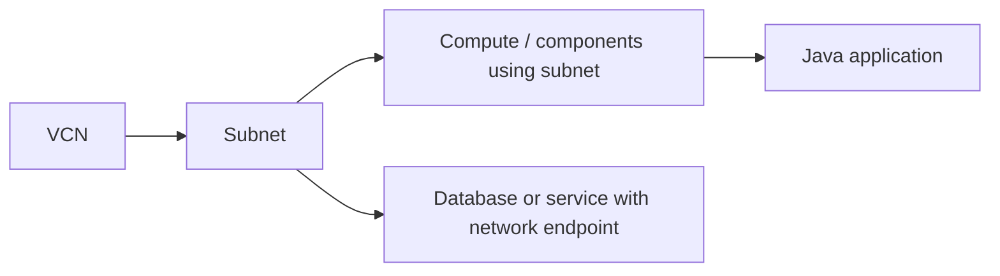

# Reading, Creating, and Managing OCI Resources with the Java SDK

The Oracle Cloud Infrastructure (OCI) Java SDK lets a Java program call infrastructure management APIs using strongly typed request, response, and model classes. Rather than manually constructing every HTTP request and signature, the application configures an identity, selects a service client, and invokes the appropriate operation.

Within the **OCI SDK and REST API with Java** chapter, this lesson focuses on the resource lifecycle: finding resources in the right scope, reading details, creating resources, waiting for readiness, updating safely, and cleaning up created resources. The running example is a lab VCN inside a dedicated compartment; the same organizational pattern extends to Compute, storage, and Oracle database services.

The goal is not merely being able to call `create...`. An infrastructure management program should be able to explain which identity it is using, which region and compartment it targets, how it can be safely rerun, and what evidence confirms a change has completed.

## 1. From Management Requirements to SDK Calls

Suppose the development team wants to automate creating a Java lab environment:

1. List existing networks in the lab compartment.
2. Create a VCN for a lab run.
3. Save the OCID of the newly created VCN.
4. Poll status until the resource is usable.
5. Update the name and tags to record progress.
6. When finished, delete that exact VCN after checking dependencies.

In the SDK, the flow typically takes this shape:

```text
Authentication provider
    -> Service client with configured region/endpoint
    -> Request with OCID, parameters, and Details model if needed
    -> Response containing model, request ID, and metadata
    -> Re-read / waiter / work request to verify outcome
```

| Component | Role in Example |
| --- | --- |
| Authentication provider | Supplies identity and material to sign requests |
| `VirtualNetworkClient` | Calls Networking APIs to manage VCNs |
| `ListVcnsRequest`, `GetVcnRequest` | Scopes the listing or selects a specific VCN |
| `CreateVcnDetails` | Describes the VCN to create |
| `CreateVcnRequest` | Wraps creation details and retry token |
| Response | Contains the returned VCN along with call metadata |

A valid identity does not imply permissions across every compartment. The right region does not imply an arbitrary OCID lies within the scope the program is permitted to modify.

## 2. Defining Scope Before Acting

### 2.1. Distinguishing Tenancy, Compartment, Region, and OCID

| Concept | Usage in the Program |
| --- | --- |
| Tenancy | Organizational and OCI identity context |
| Compartment | Logical scope containing resources and policy attachment |
| Region | Where the client sends calls to the corresponding service |
| Resource OCID | Specific resource identifier in get/update/delete operations |
| Display name | Human-readable label; never use in place of an OCID |

For a VCN, maintain a configuration tuple containing the region, compartment OCID, VCN OCID, and lab run ID. Reading details by OCID and verifying the actual compartment is far clearer than searching by name and picking the first match.

VCN display names can be duplicated. A program that "finds by name and deletes the first match" can affect the wrong resource when multiple runs or learners share an environment.

### 2.2. Minimal IAM for the Lab Scope

Suppose a learner belongs to the `JavaSdkLearners` group in the default identity domain, with a lab compartment named `JavaSdkLab`:

```text
Allow group default/JavaSdkLearners to manage virtual-network-family in compartment JavaSdkLab
```

This policy is convenient for a networking lab because it covers Networking components inside the compartment. In real applications, separate read, create, update, and delete permissions by role; never widen permissions to the entire tenancy just to bypass an access error. Domain syntax and compartment paths must match the live environment. [Oracle: Policy Syntax](https://docs.oracle.com/en-us/iaas/Content/Identity/Concepts/policysyntax.htm).

When running on Compute with instance principal, policies apply to the dynamic group containing the instance rather than a user group. Changing the authentication provider does not automatically create dynamic group membership or IAM permissions.

### 2.3. IAM and Network Connectivity Are Separate Prerequisites

The application needs both API authorization and an HTTPS path to the service endpoint. If running in a private subnet, verify DNS, routing, proxies, or service access mechanisms matching your network architecture.

Connection timeouts are not solved by granting more administrative privileges. Conversely, a successful TLS handshake does not prove permission to create a VCN in the target compartment.

## 3. Preparing Dependencies and Identity

### 3.1. Choosing One Consistent SDK Version

The examples in this lesson use Java 17 and pin the OCI Java SDK to `3.102.0`, an officially released version. This serves as the example baseline, not a requirement to use this exact version forever. [Oracle: Release 3.102.0](https://github.com/oracle/oci-java-sdk/releases/tag/v3.102.0).

In a Maven project configured with a Java 17 compiler, add the following dependency blocks to `pom.xml`:

```xml
<properties>
    <oci.sdk.version>3.102.0</oci.sdk.version>
</properties>

<dependencyManagement>
    <dependencies>
        <dependency>
            <groupId>com.oracle.oci.sdk</groupId>
            <artifactId>oci-java-sdk-bom</artifactId>
            <version>${oci.sdk.version}</version>
            <type>pom</type>
            <scope>import</scope>
        </dependency>
    </dependencies>
</dependencyManagement>

<dependencies>
    <dependency>
        <groupId>com.oracle.oci.sdk</groupId>
        <artifactId>oci-java-sdk-common-httpclient-jersey3</artifactId>
    </dependency>
    <dependency>
        <groupId>com.oracle.oci.sdk</groupId>
        <artifactId>oci-java-sdk-core</artifactId>
    </dependency>
</dependencies>
```

The BOM aligns module versions. With SDK 3.x, you must explicitly choose an HTTP client such as Jersey 2 or Jersey 3; the SDK does not pick one automatically for your application. The example uses Jersey 3 and the Core module for Networking. [Oracle: Getting Started with Java SDK](https://docs.oracle.com/en-us/iaas/Content/API/SDKDocs/javasdkgettingstarted.htm).

Do not add both HTTP clients just to try fixing a classpath error. When using a framework that already includes Jakarta/Jersey, inspect the dependency tree and select the compatible variant. This is a dependency configuration snippet, not a full Maven project file.

### 3.2. Developer Machine: OCI Config Profile

Illustrative profile at the default OCI config location:

```ini
[DEFAULT]
user=ocid1.user...
tenancy=ocid1.tenancy...
fingerprint=AA:BB:...
key_file=/path-to-key/oci_api_key.pem
region=ap-singapore-1
```

Replace the placeholders with your environment's values. The corresponding public key must be registered for the identity in use; keep the private key in a protected location, never in source code or logs.

A provider reading the default profile can be created as follows:

```java
var auth = new ConfigFileAuthenticationDetailsProvider("DEFAULT");
```

The constructor taking a profile name uses the config file at the default location; the SDK also offers constructors taking an explicit file path and profile name. [Oracle: ConfigFileAuthenticationDetailsProvider](https://docs.oracle.com/en-us/iaas/tools/java/latest/com/oracle/bmc/auth/ConfigFileAuthenticationDetailsProvider.html).

### 3.3. Workload on OCI: Instance Principal

For workloads running on OCI Compute with an appropriately configured dynamic group and policy:

```java
var auth = InstancePrincipalsAuthenticationDetailsProvider.builder()
        .build();
```

This provider uses the instance's identity to authenticate without embedding a developer's API private key in the program. It depends on the Compute environment and is not a drop-in option for arbitrary laptops. [Oracle: InstancePrincipalsAuthenticationDetailsProvider](https://docs.oracle.com/en-us/iaas/tools/java/latest/com/oracle/bmc/auth/InstancePrincipalsAuthenticationDetailsProvider.html).

The main example below uses a config profile for ease of lab execution. When swapping the provider, still keep the region, compartment, and resource scope exact.

## 4. Reading Resources: Listing vs. Getting Details

### 4.1. Listing Must Handle All Pages

A single list call does not necessarily return every resource. In `ListVcnsResponse`, `getOpcNextPage()` provides the token to fetch the next page; `getItems()` holds the current page's data. [Oracle: ListVcnsResponse](https://docs.oracle.com/en-us/iaas/tools/java/latest/com/oracle/bmc/core/responses/ListVcnsResponse.html).

Looping rule:

```text
Call List with compartment and current page
    -> process items
    -> retrieve next-page token
    -> continue while token exists
```

Do not calculate page counts by dividing total resources by `limit`. Do not assume data is exhausted just because a page contains fewer items than expected while the response still includes a continuation token.

Listing in one compartment is not an automatic full-tenancy inventory. If you need multiple compartments or regions, the program must maintain an explicit list of scopes, corresponding permissions, and dedicated orchestration.

### 4.2. Getting Details to Read the Exact Resource and ETag

`GetVcn` takes a VCN OCID and returns the model along with its ETag. The ETag is used for optimistic concurrency control on updates, not as a substitute identifier for the VCN. [Oracle: GetVcnResponse](https://docs.oracle.com/en-us/iaas/tools/java/latest/com/oracle/bmc/core/responses/GetVcnResponse.html).

A pre-update read should capture:

- Actual OCID and compartment.
- Lifecycle state.
- Existing attributes, including tags if tags will be modified.
- ETag of the version just read.
- Request ID for tracing the call.

Listing can serve display or candidate discovery; mutation operations should re-read the exact OCID before proceeding.

## 5. Java Example Managing a Lab VCN Lifecycle

Below is a Java class supporting `list`, `get`, `create`, `update`, and `delete` modes. Run each mode via `main` arguments in your IDE or project run configuration using the dependencies shown earlier.

The sample uses the synchronous SDK, assumes a dedicated VCN without user-added subnets/gateways, and only updates or deletes when both the compartment and this lab run's ownership tags match. Those tags act as an application-level safety guard in the example; IAM remains the actual authorization boundary.

```java
import com.oracle.bmc.ClientConfiguration;
import com.oracle.bmc.Region;
import com.oracle.bmc.auth.ConfigFileAuthenticationDetailsProvider;
import com.oracle.bmc.core.VirtualNetworkClient;
import com.oracle.bmc.core.model.CreateVcnDetails;
import com.oracle.bmc.core.model.UpdateVcnDetails;
import com.oracle.bmc.core.model.Vcn;
import com.oracle.bmc.core.requests.*;
import com.oracle.bmc.core.responses.*;
import com.oracle.bmc.model.BmcException;
import com.oracle.bmc.waiter.FixedTimeDelayStrategy;
import com.oracle.bmc.waiter.MaxTimeTerminationStrategy;

import java.util.HashMap;
import java.util.List;
import java.util.Map;

public class VcnCrudLab {
    private static final String MANAGED_BY = "java-sdk-lesson";

    public static void main(String[] args) throws Exception {
        String action = args.length == 0 ? "list" : args[0];
        String compartmentId = requiredEnv("OCI_COMPARTMENT_ID");
        String regionId = requiredEnv("OCI_REGION");
        String profile = System.getenv().getOrDefault("OCI_PROFILE", "DEFAULT");

        var auth = new ConfigFileAuthenticationDetailsProvider(profile);
        var configuration = ClientConfiguration.builder()
                .connectionTimeoutMillis(10_000)
                .readTimeoutMillis(60_000)
                .build();

        try (var client = VirtualNetworkClient.builder()
                .configuration(configuration)
                .build(auth)) {
            client.setRegion(Region.fromRegionId(regionId));

            switch (action) {
                case "list" -> listAll(client, compartmentId);
                case "get" -> {
                    var response = readScoped(
                            client, compartmentId, requiredEnv("OCI_VCN_ID"));
                    printVcn(response.getVcn());
                    System.out.println("requestId=" + response.getOpcRequestId());
                }
                case "create" -> create(
                        client,
                        compartmentId,
                        requiredEnv("OCI_LAB_RUN_ID"),
                        requiredEnv("OCI_CREATE_RETRY_TOKEN"));
                case "update" -> update(
                        client,
                        compartmentId,
                        requiredEnv("OCI_VCN_ID"),
                        requiredEnv("OCI_LAB_RUN_ID"));
                case "delete" -> delete(
                        client,
                        compartmentId,
                        requiredEnv("OCI_VCN_ID"),
                        requiredEnv("OCI_LAB_RUN_ID"));
                default -> throw new IllegalArgumentException(
                        "Action: list | get | create | update | delete");
            }
        } catch (BmcException error) {
            System.err.printf(
                    "status=%d serviceCode=%s timeout=%s requestId=%s%n",
                    error.getStatusCode(),
                    error.getServiceCode(),
                    error.isTimeout(),
                    error.getOpcRequestId());
            throw error;
        }
    }

    private static void listAll(
            VirtualNetworkClient client, String compartmentId) {
        String page = null;
        do {
            var response = client.listVcns(ListVcnsRequest.builder()
                    .compartmentId(compartmentId)
                    .limit(50)
                    .page(page)
                    .build());
            response.getItems().forEach(VcnCrudLab::printVcn);
            page = response.getOpcNextPage();
        } while (page != null && !page.isBlank());
    }

    private static GetVcnResponse readScoped(
            VirtualNetworkClient client,
            String compartmentId,
            String vcnId) {
        var response = client.getVcn(GetVcnRequest.builder()
                .vcnId(vcnId)
                .build());
        if (!compartmentId.equals(response.getVcn().getCompartmentId())) {
            throw new IllegalStateException("VCN is outside the lab compartment");
        }
        return response;
    }

    private static GetVcnResponse readOwned(
            VirtualNetworkClient client,
            String compartmentId,
            String vcnId,
            String runId) {
        var response = readScoped(client, compartmentId, vcnId);
        Map<String, String> tags = response.getVcn().getFreeformTags();
        if (tags == null
                || !MANAGED_BY.equals(tags.get("managed-by"))
                || !runId.equals(tags.get("run-id"))) {
            throw new IllegalStateException("VCN ownership does not match this run");
        }
        return response;
    }

    private static void create(
            VirtualNetworkClient client,
            String compartmentId,
            String runId,
            String retryToken) throws Exception {
        var details = CreateVcnDetails.builder()
                .compartmentId(compartmentId)
                .displayName("sdk-vcn-" + runId)
                .cidrBlocks(List.of("10.42.0.0/16"))
                .freeformTags(Map.of(
                        "managed-by", MANAGED_BY,
                        "run-id", runId))
                .build();

        var response = client.createVcn(CreateVcnRequest.builder()
                .createVcnDetails(details)
                .opcRetryToken(retryToken)
                .build());

        String vcnId = response.getVcn().getId();
        System.out.printf(
                "createdVcnId=%s requestId=%s%n",
                vcnId, response.getOpcRequestId());

        var ready = client.getWaiters().forVcn(
                GetVcnRequest.builder().vcnId(vcnId).build(),
                Vcn.LifecycleState.Available,
                new MaxTimeTerminationStrategy(120_000L),
                new FixedTimeDelayStrategy(2_000L))
                .execute();

        printVcn(ready.getVcn());
    }

    private static void update(
            VirtualNetworkClient client,
            String compartmentId,
            String vcnId,
            String runId) {
        var before = readOwned(client, compartmentId, vcnId, runId);
        Map<String, String> tags =
                new HashMap<>(before.getVcn().getFreeformTags());
        tags.put("lab-stage", "updated");

        var response = client.updateVcn(UpdateVcnRequest.builder()
                .vcnId(vcnId)
                .ifMatch(before.getEtag())
                .updateVcnDetails(UpdateVcnDetails.builder()
                        .displayName("sdk-vcn-updated-" + runId)
                        .freeformTags(tags)
                        .build())
                .build());

        System.out.println("updateRequestId=" + response.getOpcRequestId());
        printVcn(readScoped(client, compartmentId, vcnId).getVcn());
    }

    private static void delete(
            VirtualNetworkClient client,
            String compartmentId,
            String vcnId,
            String runId) {
        var before = readOwned(client, compartmentId, vcnId, runId);
        var response = client.deleteVcn(DeleteVcnRequest.builder()
                .vcnId(vcnId)
                .ifMatch(before.getEtag())
                .build());

        System.out.printf(
                "deleteRequestedFor=%s requestId=%s%n",
                vcnId, response.getOpcRequestId());
    }

    private static void printVcn(Vcn vcn) {
        System.out.printf(
                "id=%s name=%s state=%s%n",
                vcn.getId(), vcn.getDisplayName(), vcn.getLifecycleState());
    }

    private static String requiredEnv(String name) {
        String value = System.getenv(name);
        if (value == null || value.isBlank()) {
            throw new IllegalArgumentException("Missing environment variable: " + name);
        }
        return value.trim();
    }
}
```

These operations map directly to `VirtualNetworkClient` APIs. The client is built via its builder and closed with try-with-resources when the program finishes. [Oracle: VirtualNetworkClient](https://docs.oracle.com/en-us/iaas/tools/java/latest/com/oracle/bmc/core/VirtualNetworkClient.html).

The CIDR in the example is lab data and should be adjusted to your environment's addressing plan. Use `cidrBlocks(...)`; the older `cidrBlock(...)` property is marked deprecated in the VCN creation model. Creating a VCN via the API does not automatically provision subnets, gateways, and internet egress like a networking wizard. [Oracle: CreateVcnDetails](https://docs.oracle.com/en-us/iaas/tools/java/latest/com/oracle/bmc/core/model/CreateVcnDetails.Builder.html), [Oracle: Creating a VCN](https://docs.oracle.com/en-us/iaas/Content/Network/Tasks/create_vcn.htm).

### 5.1. Setting Environment Variables for a Run

PowerShell example:

```powershell
$env:OCI_PROFILE = 'DEFAULT'
$env:OCI_REGION = 'ap-singapore-1'
$env:OCI_COMPARTMENT_ID = 'ocid1.compartment...'
$env:OCI_LAB_RUN_ID = 'sdk-lab-20261120-a'
$env:OCI_CREATE_RETRY_TOKEN = [guid]::NewGuid().ToString()
```

Replace the region and OCID with your lab target. The lab run ID is an application-defined identifier; it does not grant permissions or create a new compartment.

Generate the retry token **once per creation intent**. If you need to retry that exact creation after a timeout, keep the same token and payload rather than re-running the GUID generator. For a different new VCN, generate a new token.

After `create` prints `createdVcnId`, store it for subsequent commands:

```powershell
$env:OCI_VCN_ID = 'ocid1.vcn...'
```

In production deployment tools, persist these values in a durable state store rather than relying on terminal scrollback.

### 5.2. Running Each Operation Intentionally

| `main` Argument | Effect | Evidence to Inspect |
| --- | --- | --- |
| `list` | Reads all pages in the compartment | VCN OCIDs, names, states |
| `get` | Reads the exact `OCI_VCN_ID` | Actual compartment and state |
| `create` | Creates the lab VCN and waits for `Available` | Created OCID and waiter outcome |
| `update` | Renames and adds a lab stage tag | Re-read data and request ID |
| `delete` | Sends a delete request for the verified VCN | Request ID and subsequent completion check |

The example does not automatically call `delete` in a `finally` block. If creation succeeded on OCI but the waiter timed out, the printed OCID still needs to be investigated or cleaned up later; a client-side error does not prove the resource was not created.

## 6. Creation: Retry Tokens and Rerunnability

### 6.1. A Timeout Does Not Prove Creation Failed

A common scenario:

```text
Java sends CreateVcn
    -> OCI creates the resource
    -> response does not return in time
    -> Java receives a timeout
```

If the program immediately sends a new request with a fresh token, it may provision a duplicate resource even though only one VCN was intended.

`CreateVcnRequest` supports `opcRetryToken` to retry the same creation request after a timeout or server error without repeating the creation. The token has a validity window and can be invalidated early by conflicting operations; it is not a permanent application-level deduplication lock. [Oracle: CreateVcnRequest](https://docs.oracle.com/en-us/iaas/tools/java/latest/com/oracle/bmc/core/requests/CreateVcnRequest.Builder.html).

### 6.2. Retry Tokens Differ from Deployment Run IDs

| Value | Responsibility |
| --- | --- |
| Retry token | Links retry attempts of a single API request that supports it |
| Run ID | Links resources and logs belonging to one deployment run |
| Resource OCID | Identifies the exact created resource |
| ETag | Protects updates against the specific version already read |

A multi-resource deployment run typically involves multiple create operations, so do not reuse one token across different request types. For each step, record the intent, token, result, and resulting OCID.

After an interruption exceeding the token protection window, reconcile current state before re-creating. Searching by name or tag only finds candidates; inspect attributes and scope before adopting an existing resource as that run's output.

### 6.3. Separating Technical Retries from Reconciliation

A technical retry resends the same operation under conditions supported by the API. **Reconciliation** reads the current state and decides whether new operations are needed to reach the desired state.

For instance, if a VCN already exists with the right OCID and CIDR but is missing a tag, reconciliation can update the tag. It does not need to create another VCN merely because an earlier Java process exited with an error.

## 7. Waiting on Resources and Tracking Long-Running Tasks

### 7.1. Synchronous Clients Do Not Mean Instant Resource Readiness

A synchronous SDK call waits for the HTTP request's response. Provisioning work on OCI's side may continue after that response returns.

The VCN creation sample prints the OCID before waiting. Thus, if the wait step is interrupted, you already have the identifier to re-read state instead of guessing whether the resource was created.

A service client's waiter accepts a `Get...Request`, a target lifecycle state, and termination/polling delay strategies. It is a status-polling mechanism, not a distributed transaction locking the deployment. [Oracle: VirtualNetwork waiters](https://docs.oracle.com/en-us/iaas/tools/java/latest/com/oracle/bmc/core/VirtualNetworkWaiters.html).

In the example:

- `120_000L` is an illustrative wait limit in milliseconds.
- `2_000L` is an illustrative polling interval in milliseconds.
- A waiter timeout ends client-side waiting; it does not roll back or delete the VCN in OCI.

Both strategies measure time in milliseconds. Tune these values to match the resource type and operational targets. [Oracle: MaxTimeTerminationStrategy](https://docs.oracle.com/en-us/iaas/tools/java/latest/com/oracle/bmc/waiter/MaxTimeTerminationStrategy.html), [Oracle: FixedTimeDelayStrategy](https://docs.oracle.com/en-us/iaas/tools/java/latest/com/oracle/bmc/waiter/FixedTimeDelayStrategy.html).

### 7.2. Work Requests Must Be Handled Per Service

Some long-running operations return a work request ID to track progress. When an API provides one, store the ID, call the corresponding status API, and inspect errors or logs if the task fails. Work request structures and states vary across services. [Oracle: Asynchronous Work Requests](https://docs.oracle.com/en-us/iaas/Content/API/Concepts/workrequests.htm).

Do not assume every resource-creation response includes the same work request field or that every service shares one tracking client. For the VCN in this example, the program checks status directly via `GetVcn`.

### 7.3. Infrastructure Status Differs from Application Readiness

A running Compute instance does not prove the Java application has finished starting. A database marked available at the control plane does not prove the application schema has been migrated.

When expanding a deployment tool, separate postconditions:

```text
API accepts request
    -> resource reaches desired lifecycle state
    -> data connectivity works
    -> application configuration completes
    -> minimal functional verification passes
```

Each stage requires its own verification method and explicit timeout budget.

## 8. Updating with ETags to Prevent Overwriting Concurrent Changes

### 8.1. The Read-Modify-Write Problem with Multiple Operators

Suppose a program reads a VCN with tags A and B. An operator adds tag C. If the program uses its stale copy and sends back a map containing only A, B, and D, it can wipe out the newly added change.

In the sample, the program:

1. Reads the VCN and current ETag.
2. Verifies the compartment and ownership tags.
3. Copies existing tags and adds `lab-stage`.
4. Sends `ifMatch` with the ETag just read.

`UpdateVcnRequest.ifMatch(...)` allows the update only if the supplied ETag matches the resource's current version. [Oracle: UpdateVcnRequest](https://docs.oracle.com/en-us/iaas/tools/java/latest/com/oracle/bmc/core/requests/UpdateVcnRequest.Builder.html).

### 8.2. Do Not Turn Concurrency Conflicts into Blind Retries

On an ETag mismatch error, re-read the resource and evaluate the new state. Do not simply fetch the new ETag and resend the stale payload, as that would still overwrite someone else's intent.

For map or list fields, check the API's update contract: does sending a value append, replace, or remove entries? Never assume every update operation behaves as a merge patch.

The example modifies only display name and freeform tags supported by `UpdateVcnDetails`. Changing CIDRs or network relationships requires operations dedicated to those properties; not every creation field appears in the update model. [Oracle: UpdateVcnDetails](https://docs.oracle.com/en-us/iaas/tools/java/latest/com/oracle/bmc/core/model/UpdateVcnDetails.Builder.html).

For networking resources, even a technically valid change can disrupt live workloads. Tools should validate desired state and impact on dependent resources before applying updates.

## 9. Deleting Resources and Handling Dependencies

### 9.1. Deleting with the Right Identifier and Scope

The sample's `delete` mode verifies the compartment, `managed-by`, and `run-id`, then sends both the OCID and ETag. `DeleteVcnRequest` supports `ifMatch` for concurrency control. [Oracle: DeleteVcnRequest](https://docs.oracle.com/en-us/iaas/tools/java/latest/com/oracle/bmc/core/requests/DeleteVcnRequest.Builder.html).

Tags can be altered by authorized users, so tag checks supplement—rather than replace—IAM and resource ownership tracking. In deployment manifests, store the resource type, OCID, region, compartment, and creation lineage.

Never write a loop that deletes every resource starting with `sdk-` across an entire tenancy. Names aid human identification; manifests and scope guards make cleanup auditable.

### 9.2. DeleteVcn Is Not Equivalent to Console "Delete All"

The `DeleteVcn` API does not automatically scan and tear down all attached resources like the Console's Delete All workflow. Remaining subnets with workloads, gateways, or network attachments can block VCN deletion. [Oracle: Deleting a VCN](https://docs.oracle.com/en-us/iaas/Content/Network/Tasks/delete_vcn.htm).

Accordingly, the example uses a standalone lab VCN with no extra attached resources. If subnets, Compute instances, load balancers, or other components were created, inspect actual dependencies and delete them in order rather than escalating permissions or retrying delete blindly.

A multi-resource workflow can model dependencies as a graph:



This diagram illustrates deployment relationships, not an exhaustive list of OCI resources. When tearing down an environment, remove dependent components before underlying infrastructure, checking data retention and shared resources at every step.

### 9.3. Sending a Delete Request Is Not Confirmation of Deletion

The sample prints `deleteRequestedFor`, not "deleted successfully." Re-read the resource state or use the API's tracking mechanism to confirm completion.

If re-reading returns `NotAuthorizedOrNotFound`, do not conclude solely from that code that the resource no longer exists. Cross-check identity, region, OCID, permissions, and delete request history.

In rerunnable jobs, "resource already deleted in a prior run" can be a valid terminal state. Establish that via context and evidence rather than swallowing all 404 errors.

## 10. Handling Errors, Timeouts, and API Limits

### 10.1. Capturing Sufficient Context from BmcException

`BmcException` provides HTTP status, service code, timeout flag, request ID, and indicators for client-side errors. Not every error includes a full HTTP response or server-side request ID. [Oracle: BmcException](https://docs.oracle.com/en-us/iaas/tools/java/latest/com/oracle/bmc/model/BmcException.html).

Per-operation logs should correlate:

```text
runId, stepId, operation
region, compartmentId, resourceId if known
opcRequestId, workRequestId if provided by API
start time, duration, outcome
retryAttempt and error category
```

Never log private keys, passphrases, or full authentication configurations. In centralized logging, limit logged payloads and tags since they may contain unexpected data.

### 10.2. Classifying Errors by Both Status and Service Code

| Symptom | Initial Handling Direction |
| --- | --- |
| `400 InvalidParameter` | Fix input data or request structure |
| `401 NotAuthenticated` | Check identity, key, signature, and system clock |
| `404 NotAuthorizedOrNotFound` | Cross-check permissions, OCID, and region |
| `409` | Inspect service code; `Conflict` differs from `IncorrectState` |
| `412 NoEtagMatch` | Re-read and evaluate concurrent modifications |
| `429`, retryable server errors | Bounded backoff per the API contract |

Do not classify retries using HTTP status ranges alone; OCI service codes carry distinct semantics. [Oracle: API Errors](https://docs.oracle.com/en-us/iaas/Content/API/References/apierrors.htm).

### 10.3. Retrying at the Right Layer

The Java SDK includes built-in retries for specific operations and errors, configurable at the client or request level. Check operation documentation for default behavior; do not assume every API retries identically. [Oracle: Java SDK Concepts — Retries](https://docs.oracle.com/en-us/iaas/Content/API/SDKDocs/javasdkconcepts.htm#javasdkconcepts_topic_Retries).

At the application layer, define a total budget covering:

- Connection and read time per attempt.
- Number of retries and wait intervals.
- Waiter or work request polling time.
- Overall deadline for the deployment step.

In the sample, the 10-second connect timeout and 60-second read timeout are illustrative per-call settings. They do not enforce a 60-second deadline across the entire program.

If the job runner, SDK, and HTTP library each retry independently, total wait time and request volume can multiply. On creation calls, retries must preserve request identity; on ETag-protected updates, re-evaluate state instead of resending stale payloads.

### 10.4. Managing Clients and Concurrency

Instantiate clients to match the application or task lifecycle rather than creating a new client per item in a list. Close clients when done to release HTTP resources.

When sharing a client across tasks, fix its region/endpoint before concurrent use. Never let two threads toggle the region on a shared client. If managing multiple regions, maintain separate clients per configuration and bound concurrency.

Do not spin up unbounded threads to speed up an inventory sweep. Account for throttling and API load in the design via pagination, concurrency limits, backoff, and checkpointing completed operations.

## 11. From Lab Script to Infrastructure Management Tool

### 11.1. Separating Desired State from API Calls

A clean application architecture may look like:

```text
CLI / job / internal API
    -> validate inputs and scope
    -> diff desired state against current state
    -> generate change plan
    -> executor using OCI SDK
    -> verify postconditions and persist results
```

This is a recommended application structure. The OCI SDK supplies service calls; it does not act as a deployment state store for your program.

Illustrative desired-state definition:

```yaml
kind: Vcn
region: ap-singapore-1
compartmentId: ocid1.compartment...
runId: sdk-lab-20261120-a
desired:
  displayName: sdk-vcn-sdk-lab-20261120-a
  cidrBlocks:
    - 10.42.0.0/16
  tags:
    managed-by: java-sdk-lesson
    run-id: sdk-lab-20261120-a
```

This is an illustrative tool schema, not a standard request format natively parsed by the Java SDK.

### 11.2. Persisting Deployment State Durably

| Data to Persist | Reason |
| --- | --- |
| Step intent and inputs | Explains the intended operation |
| Creation retry token | Resumes the same request within the API's supported window |
| OCID after creation | Avoids looking up by name later |
| Region and compartment | Reads and cleans up in the exact scope |
| Step status | Distinguishes unsent, submitted, ready, and failed |
| Request / work request ID | Investigates failures and progress |
| Dependency relationships | Resumes or cleans up partial deployments |

If VCN creation succeeds but subnet creation fails, do not assume the entire deployment rolled back. Decide whether to resume, preserve for investigation, or compensate newly created resources according to tool policy.

Compensation is not an atomic transaction across OCI services. Some changes are not trivially reversible, and generated data may need preservation before cleanup.

### 11.3. Expanding to Other Services

| Domain | Typical Client | What Must Be Added to the Workflow |
| --- | --- | --- |
| Networking | `VirtualNetworkClient` | CIDRs, subnets, routes, dependency ordering |
| Compute | `ComputeClient` | Shapes, images, placement, boot volumes, and app readiness |
| Object Storage | `ObjectStorageClient` | Namespace, buckets/objects, write preconditions, data lifecycle |
| Database | `DatabaseClient` | DB service type, networking, provisioning config, long-running tasks |

These clients do not share a single `createResource` method. Select modules, models, and operations tailored to each resource.

Managing a database service with the OCI SDK differs from querying application tables over JDBC. Provisioning or configuring a DB does not create application schemas or execute your Java program's SQL statements.

When expanding to Compute or Database, include resource sizing, capacity, backups, and retention duration in cost planning. Tags help trace and organize resources; they do not cap spending. Creating multiple resources also does not automatically yield high availability; you still must design placement, recovery, and application testing.

## 12. Lab Walkthrough: Verifying the Resource Lifecycle

These are instructions for learners to execute in an appropriately authorized lab environment. The examples do not imply OCI resources were created during authoring.

### 12.1. Read-Only Checks First

1. Select the right config profile, region, and lab compartment.
2. Run `list` mode.
3. Cross-check the output in the Console for the same scope.
4. Pick a readable OCID and run `get`.
5. Verify the region, compartment, and lifecycle state.

To observe pagination, lower `limit` in the lab code and verify all pages are traversed. There is no need to create many resources just to lengthen the list.

### 12.2. Create and Wait

1. Choose a new Run ID.
2. Generate and save a retry token for this creation operation.
3. Run `create`.
4. Save the OCID printed before the waiter step.
5. Verify the `Available` state, CIDR, and expected tags.
6. Confirm no unintended extra VCNs were created.

If the wait step times out, use the saved OCID to re-read state. Issue a new operation only after reconciling current state.

### 12.3. Update and Observe ETags

1. Set `OCI_VCN_ID` to the newly created VCN.
2. Keep the matching Run ID.
3. Run `update`.
4. Re-read to verify the new name, new tag, and preserved ownership tags.
5. In a controlled concurrency test, hold an older ETag and modify the resource from another session.
6. Submit an update with the stale ETag and observe the mismatch error rather than an overwrite.

After a concurrency conflict, re-read, compare state, and decide how to merge changes. Never disable `ifMatch` just to make a test appear to succeed.

### 12.4. Delete and Verify

1. Verify the VCN belongs to the lab and matching Run ID.
2. Confirm no workloads or dependencies needing retention are attached.
3. Run `delete` and record the request ID.
4. Monitor status / re-read results within the same scope.
5. Cross-check the list output and Console once the service completes deletion.
6. Update the lab run's state record.

If extra dependent resources were created outside the example, identify and clean them up in actual dependency order before proceeding. A delete error must be retained for resolution; never mark a job complete merely because the delete request was sent.

### 12.5. Evidence to Keep After the Lab

| Verification | Required Outcome |
| --- | --- |
| Scope | Correct identity/profile, region, and compartment |
| Read | Complete pagination and `get` on exact OCID |
| Create | Token tied to one intent, OCID saved, target state reached |
| Update | Preserved existing attributes with ETag concurrency check |
| Errors | Status/service code/request ID captured with proper handling |
| Delete | Exact resource removed, dependencies handled, completion verified |
| Cost | Inventory of any retained resources and cleanup deadline |

Keep secret-free configuration, the lab run ID, OCIDs, and request IDs needed to trace the full lifecycle. For automation tooling, the ability to re-read state and resume after failures is an essential part of resource management.
