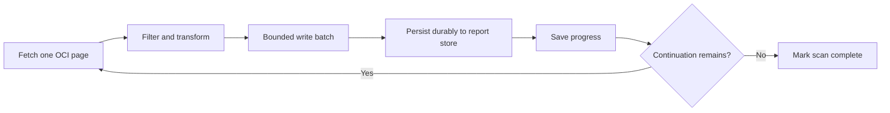

# Pagination, Filtering, and Handling Large Result Sets

In the **OCI SDK and REST API with Java** chapter of the **CLOUD_PROVIDERS_ORACLE** module, this lesson teaches how to read OCI data incrementally, filter within the proper scope, and process large lists without holding the entire result set in memory.

The running example is an infrastructure inventory task: listing Compute instances by compartment and region, selecting the instances to report, and cataloging objects in a bucket. Results might be written to Oracle Database, Autonomous Database, or a reporting store. The task needs appropriate authorization, measurable progress, resumability after failures, and controlled API call volume.

## 1. Objectives and Three Foundational Decisions

After this lesson, you will be able to:

- Read all pages of an API response instead of fetching only the first page.
- Distinguish the page token of most List APIs from Object Storage `ListObjects`'s dedicated mechanism.
- Combine server-side filters with local filtering conditions in Java.
- Use SDK paginators when appropriate and manage pages manually when checkpoints are needed.
- Write data in batches, bound concurrency, and avoid accumulating the full result set.
- Distinguish a complete scan, a partial result, and a failed scan.

Three decisions to keep separate:

| Decision | Question to Answer |
| --- | --- |
| Scope | Which resources are being read, in which region and compartment, and under which identity? |
| Selection criteria | What filtering does the service support, and what extra filtering must the app perform? |
| Consumption model | Process record by record, page by page, or collect everything? |

Reading every page in one compartment is not equivalent to inventorying the entire tenancy. Likewise, an empty list does not prove no resources exist if the request targets the wrong region or misses the assigned scope.

## 2. Understanding OCI's Pagination Contract

### 2.1. Most List APIs Use a Continuation Token

For many OCI List APIs:

1. The first request omits `page`.
2. The response may return an `opc-next-page` header.
3. The next request passes that exact value into `page`.
4. Continue until no next-page token is returned.

`limit` is the maximum number of items per page, not the total number of items allowed across the entire scan. A page can contain fewer items than `limit`, or even be empty, while still returning a token to continue reading. See [REST API List Pagination rules](https://docs.oracle.com/en-us/iaas/Content/API/Concepts/usingapi.htm).

Protocol illustration:

```http
GET /20160918/instances?compartmentId=ENCODED_COMPARTMENT_OCID&limit=100
Host: iaas.REGION.oraclecloud.com

HTTP/1.1 200 OK
opc-next-page: TOKEN_A
opc-request-id: REQUEST_ID_A

[ ... ]
```

Next page:

```http
GET /20160918/instances?compartmentId=ENCODED_COMPARTMENT_OCID&limit=100&page=ENCODED_TOKEN_A
Host: iaas.REGION.oraclecloud.com
```

The example omits authentication headers and unrelated fields. When calling REST directly, properly URL-encode query parameters and sign the actual request, including the current request target; never reuse a previous page's signature after changing the URL. See [Request Signatures](https://docs.oracle.com/en-us/iaas/Content/API/Concepts/signingrequests.htm).

### 2.2. Tokens Are Not Page Numbers or Offsets

Never replace `page` with `1`, `2`, `3`. Nor should you decode, truncate, trim, or alter the token by guesswork.

Treat the token as a service-managed opaque value bound to the active query. Across a pagination sequence, keep constant:

- Region and endpoint.
- Compartment or corresponding resource scope.
- Filters and sort order.
- Parameters shaping the response.
- Selected page size for the request sequence.

If you change filters, start a new query. Never combine a token from an old result set with new conditions.

### 2.3. Do Not Stop Just Because of an Empty or Short Page

Suppose you observe:

| Page | Items Returned by Service | Next Token |
| --- | ---: | --- |
| 1 | 100 | Yes |
| 2 | 0 | Yes |
| 3 | 17 | No |

Stopping at page 2 would miss the 17 items on page 3. For `ListInstances`, the response contract indicates more pages remain whenever `opc-next-page` is present; see [ListInstancesResponse](https://docs.oracle.com/en-us/iaas/tools/java/latest/com/oracle/bmc/core/responses/ListInstancesResponse.html).

Likewise, do not stop simply because local filtering leaves zero items on the current page. That only describes the contents seen in that single page.

Final termination rules must follow the specific operation's documentation. Do not build a single helper imposing one termination rule across every service merely because operation names all begin with `List`.

## 3. Filtering: Where to Filter and Under What Semantics?

### 3.1. Prefer Criteria Actually Supported by the Service

Server-side filtering reduces returned payload size and application-side work. However, each operation has its own set of parameters.

For Compute `ListInstances`, the request supports parameters such as compartment, availability domain, lifecycle state, and display name. Notably, `displayName` is an exact match filter, not a glob or prefix search. See [ListInstancesRequest](https://docs.oracle.com/en-us/iaas/tools/java/latest/com/oracle/bmc/core/requests/ListInstancesRequest.html).

Example requirements:

| Requirement | Approach |
| --- | --- |
| `RUNNING` instances in compartment A | Set compartment and lifecycle state in the request |
| Instance with display name equal to `app-api-01` | Use the API's display name filter |
| Display name starting with `app-` | Filter locally if the operation lacks a prefix parameter |
| Business condition combining multiple attributes | Filter supported parts server-side, remaining parts in Java |
| Searching across multiple resource types by indexed attributes | Consider OCI Resource Search |

Do not pass `displayName("app-*")` expecting the service to treat it as all names starting with `app-`.

### 3.2. Local Filtering Does Not Reduce Downloaded Volume

Suppose a scan reads 50,000 instance summaries, yet only 2% match the application rule. The final output is 1,000 records, while the application still has to receive and inspect all 50,000 records if that filter cannot be pushed down to the service.

Track these metrics separately:

```text
received : number of records returned by the service
matched  : number of records passing local filters
written  : number of records persisted successfully
```

A very low `matched / received` ratio is a signal to revisit scan scope or data organization. It does not by itself prove the Java filter logic has a bug.

### 3.3. Resource Search Has Its Own Contract

OCI Resource Search lets you query across supported resource types and attributes using structured conditions. It is a separate API, not an SQL parameter you can attach to arbitrary List requests. See [Search Query Language](https://docs.oracle.com/en-us/iaas/Content/Search/Concepts/querysyntax.htm).

Search results carry their own attribute set and support scope. When full details are required for decisions, you may still need to call the owning service's API. See [Search Overview](https://docs.oracle.com/en-us/iaas/Content/Search/Concepts/queryoverview.htm).

Never widen IAM permissions to the entire tenancy solely to make one request return fewer filtered results. Design query scope and access permissions together.

## 4. Java: Managing Pages Manually with Compute ListInstances

### 4.1. Prerequisites to Run the Example

The example uses these OCI Java SDK types:

- `com.oracle.bmc.core.Compute`.
- `ListInstancesRequest`, `ListInstancesResponse`.
- `com.oracle.bmc.core.model.Instance`.

The project needs the Core SDK module and an HTTP client matching your SDK version. OCI SDK dependencies should be managed at compatible versions.

The `Compute` client passed to the method must already have authentication, region, and timeouts configured. The caller owns the client lifecycle and closes the client after the entire job finishes. The example does not modify any OCI resources.

### 4.2. Sequential Scan, Per-Record Filtering, and Streaming to a Sink

```java
import com.oracle.bmc.core.Compute;
import com.oracle.bmc.core.model.Instance;
import com.oracle.bmc.core.requests.ListInstancesRequest;
import com.oracle.bmc.core.responses.ListInstancesResponse;

import java.util.Objects;
import java.util.function.Consumer;

public final class ComputeInventoryScan {

    private ComputeInventoryScan() {
    }

    public static long scanRunningApplicationInstances(
            Compute compute,
            String compartmentId,
            String requiredNamePrefix,
            int maxPages,
            Consumer<Instance> sink) {

        Objects.requireNonNull(compute, "compute");
        Objects.requireNonNull(compartmentId, "compartmentId");
        Objects.requireNonNull(requiredNamePrefix, "requiredNamePrefix");
        Objects.requireNonNull(sink, "sink");

        if (maxPages < 1) {
            throw new IllegalArgumentException("maxPages must be positive");
        }

        ListInstancesRequest base = ListInstancesRequest.builder()
                .compartmentId(compartmentId)
                .lifecycleState(Instance.LifecycleState.Running)
                .limit(100)
                .build();

        String pageToken = null;
        int pageCount = 0;
        long matchedCount = 0;

        do {
            if (pageCount >= maxPages) {
                throw new IllegalStateException(
                        "Scan stopped at maxPages; result is incomplete");
            }

            ListInstancesRequest request = base.toBuilder()
                    .page(pageToken)
                    .build();

            ListInstancesResponse response = compute.listInstances(request);
            pageCount++;

            for (Instance instance : response.getItems()) {
                String displayName = instance.getDisplayName();

                if (displayName != null
                        && displayName.startsWith(requiredNamePrefix)) {
                    sink.accept(instance);
                    matchedCount++;
                }
            }

            String next = response.getOpcNextPage();

            if (next != null && next.equals(pageToken)) {
                throw new IllegalStateException(
                        "Pagination did not advance");
            }

            pageToken = next;
        } while (pageToken != null && !pageToken.isEmpty());

        return matchedCount;
    }
}
```

The request builder and token-reading methods align with [ListInstancesRequest.Builder](https://docs.oracle.com/en-us/iaas/tools/java/latest/com/oracle/bmc/core/requests/ListInstancesRequest.Builder.html) and [ListInstancesResponse](https://docs.oracle.com/en-us/iaas/tools/java/latest/com/oracle/bmc/core/responses/ListInstancesResponse.html).

Key points in the example:

- `limit(100)` bounds each page.
- Lifecycle state is filtered server-side.
- Name prefix is filtered application-side.
- Empty pages still advance if a token remains.
- Each item is passed to `sink` instead of accumulating all items in a list.
- API or sink exceptions propagate; the method does not return a count that hides an incomplete failure.

The `maxPages` cap is a safety guard set by the example. Hitting that cap must be treated as an incomplete scan, not as having read all resources. Checking for a repeated token catches direct non-advancement; a page cap further guards against longer loops.

This method does not yet implement checkpointing, sink retries, or an overall job deadline. Those belong in the design when promoting it to an operational job.

### 4.3. The Sink Determines Whether Memory Usage Actually Stays Bounded

Calls like this still grow memory in proportion to the entire result set:

```java
// Not suitable for result sets without a clear bound.
List<Instance> all = new ArrayList<>();

ComputeInventoryScan.scanRunningApplicationInstances(
        compute, compartmentId, "app-", 10_000, all::add);
```

Even though the pagination loop holds only one page at a time, `all::add` retains every matched instance. For large sets, use a sink that writes directly to storage or buffers a small bounded batch before flushing.

The count returned in the example is the number of items accepted by `sink`. If `sink` only enqueues into an internal buffer, that count may not equal records durably persisted. Define the sink's contract explicitly.

## 5. Java SDK Paginators: Less Boilerplate, Still Needs Control

The Compute client exposes paginators for `ListInstances` in two forms:

- `listInstancesRecordIterator`: iterates over individual `Instance` records.
- `listInstancesResponseIterator`: iterates over each operation response.

The iterable fetches additional pages from the server as needed. See [ComputePaginators](https://docs.oracle.com/en-us/iaas/tools/java/latest/com/oracle/bmc/core/ComputePaginators.html).

### 5.1. Record Iterator

```java
ListInstancesRequest request = ListInstancesRequest.builder()
        .compartmentId(compartmentId)
        .lifecycleState(Instance.LifecycleState.Running)
        .limit(100)
        .build();

Iterable<Instance> instances = compute.getPaginators()
        .listInstancesRecordIterator(request);

for (Instance instance : instances) {
    String name = instance.getDisplayName();

    if (name != null && name.startsWith("app-")) {
        sink.accept(instance);
    }
}
```

This snippet reuses the Compute request and model imports from the previous example. It fits cases where you want to stream items sequentially without managing page tokens manually.

Creating the iterable does not mean the whole traversal has succeeded. Network errors can occur while advancing to subsequent pages; exception handling must wrap the entire loop consuming the iterable.

If stopping early due to a work cap or deadline, record the incomplete state explicitly. Breaking out of the loop after 100 items is no longer a full-list scan.

### 5.2. Response Iterator

```java
Iterable<ListInstancesResponse> pages = compute.getPaginators()
        .listInstancesResponseIterator(request);

long received = 0;

for (ListInstancesResponse page : pages) {
    received += page.getItems().size();

    // You can log page statistics and opc-request-id here.
    // Finish processing the page data before continuing.
    for (Instance instance : page.getItems()) {
        sink.accept(instance);
    }
}
```

The response iterator is useful when measuring per-page latency, items per response, or `opc-request-id` for debugging. Manual pagination loops are typically clearer when persisting checkpoints and resuming after process restarts.

Do not blindly turn an iterable into a Java parallel stream for speed. A continuation-token sequence is sequential by dependency, and iterating a paginator does not enable fetching arbitrary pages in parallel.

## 6. Object Storage ListObjects Is a Different Case

### 6.1. Using nextStartWith with start

Object Storage `ListObjects` returns a `nextStartWith` value in the response body. Fetch the next page by passing that value into `start`; do not look for `opc-next-page` as in the Compute example. See [ListObjects](https://docs.oracle.com/en-us/iaas/tools/java/latest/com/oracle/bmc/objectstorage/model/ListObjects.html).

Each parameter has distinct semantics:

| Parameter | Meaning |
| --- | --- |
| `prefix` | Selects objects whose names start with the specified string |
| `start` | Selects names lexicographically greater than or equal to the marker |
| `startAfter` | Selects names strictly greater than the marker |
| `end` | Selects names less than the ending marker |
| `delimiter` | Groups results by prefix instead of listing every object flat |
| `fields` | Selects extra summary fields to include in the response |

By default, object listings include only the object name; if you need size or ETag, request them via `fields`. See [ListObjectsRequest](https://docs.oracle.com/en-us/iaas/tools/java/latest/com/oracle/bmc/objectstorage/requests/ListObjectsRequest.html).

Never replace `start(nextStartWith)` with `startAfter(nextStartWith)` by intuition. `nextStartWith` is the inclusive starting boundary of the next page; using it exclusively can skip objects you need to read.

### 6.2. Flat Prefix Scan with Bounded Memory

The following example uses the Object Storage module from the same OCI Java SDK:

```java
import com.oracle.bmc.objectstorage.ObjectStorage;
import com.oracle.bmc.objectstorage.model.ListObjects;
import com.oracle.bmc.objectstorage.model.ObjectSummary;
import com.oracle.bmc.objectstorage.requests.ListObjectsRequest;

import java.util.Objects;
import java.util.function.Consumer;

public final class ObjectInventoryScan {

    private ObjectInventoryScan() {
    }

    public static long scanPrefix(
            ObjectStorage storage,
            String namespace,
            String bucket,
            String prefix,
            int maxPages,
            Consumer<ObjectSummary> sink) {

        Objects.requireNonNull(storage, "storage");
        Objects.requireNonNull(namespace, "namespace");
        Objects.requireNonNull(bucket, "bucket");
        Objects.requireNonNull(prefix, "prefix");
        Objects.requireNonNull(sink, "sink");

        if (maxPages < 1) {
            throw new IllegalArgumentException("maxPages must be positive");
        }

        ListObjectsRequest base = ListObjectsRequest.builder()
                .namespaceName(namespace)
                .bucketName(bucket)
                .prefix(prefix)
                .fields("name,size,etag,timeCreated")
                .limit(500)
                .build();

        String start = null;
        int pages = 0;
        long count = 0;

        do {
            if (pages >= maxPages) {
                throw new IllegalStateException(
                        "Object scan stopped before completion");
            }

            ListObjects result = storage.listObjects(
                    base.toBuilder().start(start).build())
                    .getListObjects();

            pages++;

            for (ObjectSummary object : result.getObjects()) {
                sink.accept(object);
                count++;
            }

            String next = result.getNextStartWith();

            if (next != null && next.equals(start)) {
                throw new IllegalStateException(
                        "Object pagination did not advance");
            }

            start = next;
        } while (start != null && !start.isEmpty());

        return count;
    }
}
```

The example omits `delimiter` because the goal is a flat traversal of objects matching the prefix. If `delimiter` is set, the response can return grouped prefixes; reading only `getObjects()` will not traverse objects nested under those prefixes. See [ListObjectsRequest.Builder](https://docs.oracle.com/en-us/iaas/tools/java/latest/com/oracle/bmc/objectstorage/requests/ListObjectsRequest.Builder.html).

`ObjectSummary.getSize()` represents byte size as a `Long`; unrequested or null fields must be handled safely rather than defaulted to valid measurements. See [ObjectSummary](https://docs.oracle.com/en-us/iaas/tools/java/latest/com/oracle/bmc/objectstorage/model/ObjectSummary.html).

### 6.3. Naming Structure Enables Early Filtering

Suppose a bucket uses the convention:

```text
orders/2026/11/20/part-0001.json
orders/2026/11/20/part-0002.json
orders/2026/11/21/part-0001.json
audit/2026/11/20/part-0001.json
```

The prefix `orders/2026/11/20/` narrows the scan directly to the target subset. If timestamps exist only inside the JSON body, listing names cannot evaluate that business filter.

Listing metadata differs from downloading object contents. If you only need names and sizes, do not call `GetObject` for every item just to retrieve fields already available in the summary.

## 7. Processing Large Sets Without Turning Pagination into Full Loading

### 7.1. Estimating Memory by Retained Data

Suppose there are 250,000 records, each estimated at 4 KB before accounting for Java object overhead:

```text
Collect all ≈ 250,000 × 4 KB
            ≈ 1 GB of data
```

If processed one page of 100 records at a time:

```text
One page ≈ 100 × 4 KB
         ≈ 400 KB
```

Actual heap usage also includes objects, strings, decoding buffers, write batches, and in-flight tasks. Model retained memory as:

```text
Retained memory
≈ current page data
+ sink batch
+ in-flight or queued work
+ caches and reconciliation structures
```

A `Set` storing every OCID for deduplication or a map holding every result also grows linearly with the full dataset. For large-scale deduplication, consider unique constraints or a state table in the target store.

### 7.2. Batch Writes and Backpressure Toward the Reader



In a sequential implementation, a slow sink naturally stalls the next read. This is a simple way to avoid reading faster than writing capacity.

If separating reader and writer threads:

- Use a queue bounded by both item count and byte size.
- Limit the number of concurrent in-flight batches.
- Block or throttle when the sink reaches capacity.
- Collect worker errors before confirming a page is complete.
- Never advance a checkpoint past data that has not been durably persisted.

Simply calling `newFixedThreadPool` does not bound the backing task queue in all configurations. Inspect the queue holding pending work as well.

### 7.3. Avoiding the N+1 Request Pattern

If you read 50,000 summaries and then call a `Get` API for each item unnecessarily, total API volume explodes.

Before enriching each resource individually, check:

1. Is the needed field already present in the List response?
2. Is there a field-selection parameter or a more suitable API?
3. Can items be filtered out before calling `Get`?
4. Are full details needed for all items, or only a small subset?
5. Are enrichment calls bounded in concurrency and retries?

Fewer requests typically reduce duration, throttling risk, and retained application resources. Do not assume all List/Get APIs share identical billing behavior; costs also depend on the service and resulting work.

### 7.4. Streaming Aggregations Where Possible

Counts, sums, or groupings over a finite set of keys can usually be updated incrementally. You do not need to keep every record in memory just to count instances per lifecycle state.

Conversely, sorting each page and concatenating pages does not yield a global sort order. If a globally sorted report is needed, you can:

- Use an API-supported sort order and understand its exact scope guarantees.
- Write to a reporting store and run sorted queries there.
- Use a bounded-memory top-K algorithm if only the top K elements are needed.

Never infer tenancy-wide ordering from separate per-compartment or per-region listings.

## 8. Checkpoints and Resumability After Failure

### 8.1. Checkpoints Must Be Bound to the Query Definition

An application-designed task state might look like:

```json
{
  "jobId": "inventory-2026-11-20-001",
  "operation": "ListInstances",
  "region": "ap-singapore-1",
  "scopeId": "ocid1.compartment.oc1..example",
  "queryFingerprint": "hash-of-scope-filters-and-sort",
  "nextPageToken": "opaque-service-value",
  "completed": false,
  "pagesCommitted": 12,
  "recordsWritten": 845
}
```

This is an illustrative application schema, not a built-in OCI SDK checkpoint format. For `ListObjects`, store the continuation marker and parameters matching that operation.

Never save only the token while omitting region, bucket, compartment, or filters. On restart, validate the stored task state against the intended run configuration.

Distinguish a `null` token from not-started vs. completed states. A `completed` flag prevents an already finished scan from being misinterpreted as needing to restart from the beginning.

### 8.2. Persist Results First, Progress Second

Basic sequence:

```text
Read page with token P
→ process and write all retained page results
→ confirm data is durable
→ save next page token and progress state
```

If the process crashes after writing data but before saving the checkpoint, that page may be reprocessed. The sink should support idempotent upserts or deduplication by an appropriate key.

For example, a per-scan inventory table can key on `(job_id, resource_id)`. For objects, the key should reflect namespace, bucket, and object name, plus version ID if tracking object versions.

Never save the next page token before confirming the current page's data is persisted. Crashing in between could cause the next run to skip unrecorded data.

### 8.3. Do Not Assume Page Tokens Are Permanent Checkpoints

Tokens are issued for an active query traversal; do not assume a token stays valid across arbitrary delays or altered parameters.

If a token is rejected by the service, the job needs an explicit policy: halt for investigation, start a fresh scan, or re-scan the scope with an idempotent sink. Never silently discard the token and report the old run as complete.

Checkpoints enable progress recovery. They do not turn a multi-page scan into a point-in-time consistent snapshot of OCI resources.

## 9. Data Can Change During Pagination

While scanning, instances may change state, new objects may arrive, or resources may be deleted. Never assume a sequence of List calls forms a point-in-time consistent read transaction.

Recommended design practices:

- Record `scanStartedAt` and `scanFinishedAt` for the overall job.
- Attach `observedAt` to observed records when reconciliation requires it.
- Track completion state per region and compartment.
- Upsert by stable identifiers rather than arrival order.
- Re-run reconciliation when reporting requires higher completeness.

For example, an inventory scan estimating potential cost should distinguish observed state during the scan window from official billing figures. Never derive an invoice total from a resource listing alone.

If a job modifies or deletes resources after listing, re-verify required state at mutation time and apply the API's concurrency controls. Previously read summary data may already be stale.

## 10. Retries, Timeouts, and Parallel Scope Execution

### 10.1. A Page Error Does Not Mean End of Data

A timeout, HTTP 429, or server error on a subsequent page request is not a signal that the list has ended.

The OCI Java SDK supports retry configuration at both client and request levels; check exact behavior against your operation and SDK version. See [Java SDK Concepts and Retries](https://docs.oracle.com/en-us/iaas/Content/API/SDKDocs/javasdkconcepts.htm).

For transient errors:

1. Keep the token of the incomplete request intact.
2. Retry with bounded attempts and appropriate backoff.
3. Do not advance the checkpoint to the next page without a valid response.
4. Mark the job failed or paused when the retry budget is exhausted.

Do not wrap SDK calls in an unbounded outer retry loop without accounting for inner retries. API retries and sink write retries are separate concerns.

### 10.2. Set an Overall Job Deadline

Per-request timeouts do not bound total scan duration. A job spanning thousands of pages can still run for a very long time even when every individual request finishes within its timeout.

Define explicit budgets for:

- Connect and response read timeouts.
- Per-request retry budget.
- Maximum pages or records per job run.
- Overall job deadline.
- Terminal status when stopping before exhausting data.

Safety limits must produce `PARTIAL`, `FAILED`, or an equivalent application state. Never label a truncated scan `COMPLETE`.

### 10.3. Parallelizing Across Independent Scopes

Within a single continuation-token chain, you must receive one response before learning the next page's token. You cannot fabricate page tokens for unread pages.

You can partition work across predefined independent scopes, such as region–compartment pairs or non-overlapping object prefixes. Each partition maintains its own checkpoint and status.

Bound total concurrent requests, open connections, and sink write capacity. Never share mutable request builders or token variables across multiple worker threads.

Prefix partitioning is only valid when prefixes genuinely do not overlap. Scanning `orders/` and `orders/2026/` concurrently and summing the counts double-counts everything under `orders/2026/`.

## 11. Building Application APIs on Top of OCI Data

### 11.1. Application Pages Differ from OCI Pages

Suppose your application API must return 20 items matching a business filter. One OCI page returns 100 items, of which only 3 match. Returning 3 items can be valid if the API contract permits short pages, but do not assume no more items exist.

If the application must fill a 20-item page, it may have to read multiple OCI pages. Enforce a time budget and maximum OCI page reads per user request.

Conversely, if one OCI page yields 30 matching items while the API returns 20, 10 items remain undelivered. Handing only OCI's next-page token to the client skips those remaining 10 items.

Solve this with an application cursor tracking leftover items, buffering intermediate results, or paginating over a materialized inventory table. Never treat an OCI token as if it describes an offset inside the application's filtered list.

### 11.2. Application Cursors Must Bind to Access Controls

If exposing a cursor to clients, bind it to the caller or authorized scope, query criteria, and session expiration. Re-verify authorization on every subsequent request.

Never allow a client to change the compartment or filters while reusing the same cursor without re-scoping. Nor should a cursor become a way to bypass resource permission checks.

When users require exact total counts or arbitrary jumps to page N, evaluate materializing results in a reporting store. Continuation-token APIs do not natively provide those capabilities.

## 12. Observability and Lab Practice

### 12.1. Recommended Logs and Metrics

Every scan should record:

| Signal | Purpose |
| --- | --- |
| Operation, region, scope, job ID | Identifies task scope |
| Pages read | Tracks progress and limits |
| Received, matched, written | Separates download, filter, and persistence volume |
| API latency and sink latency | Pinpoints bottlenecks |
| Retries and throttling | Tunes request pacing |
| Buffer depth and active batches | Controls memory usage |
| Last checkpoint timestamp | Estimates potential replay work |
| Final status per scope | Distinguishes complete runs from partial results |

Use `opc-request-id` from responses to investigate specific calls. Never log full authentication details or tokens just to count pages.

A `written < matched` count after a completed scan requires a clear explanation, such as key-based deduplication or pre-existing records. Never let sink failures silently turn into missing records without a failure status.

### 12.2. Compute Lab Exercise

In a test compartment where you have list permissions:

1. Initialize a `Compute` client in a chosen region.
2. Pick a small page size, such as 2, to observe multiple requests when enough resources exist.
3. Run the manual pagination loop with a fixed lifecycle state filter.
4. Log item count per page, token presence, and request ID.
5. Add a name-prefix filter in Java.
6. Compare `received` against `matched`.
7. Run the record iterator over the same scope and compare consumption behavior.

If the compartment has too few resources, only one page may appear. Do not conclude the pagination code is broken simply because a lab run had one page.

### 12.3. Object Storage Lab Exercise

With a lab bucket containing multiple objects under distinct prefixes:

1. Choose a narrow prefix and a small page size.
2. Explicitly request the summary fields needed.
3. Observe `nextStartWith` and pass it into `start`.
4. Write each page's metadata to a bounded sink.
5. Compare results without `delimiter` against results with `delimiter`.
6. Confirm that a list of grouped prefixes is not a full listing of objects underneath them.

The code examples in this lesson are reference implementations for your lab project. Live execution requires matching dependencies, authentication, region, and IAM permissions in your environment.

### 12.4. Scenarios to Verify Before Deployment

| Scenario | Expected Behavior |
| --- | --- |
| Page has fewer items than `limit` but token exists | Continues reading |
| Empty page with continuation token per operation contract | Does not stop prematurely |
| Local filtering leaves zero items on a page | Still checks service continuation |
| API error mid-scan | Does not report completion |
| Sink fails partway through a page | Does not checkpoint past persisted data; safe to replay |
| Hits `maxPages` or deadline | Reports incomplete status |
| Resumes from checkpoint | Preserves exact scope and query criteria |
| Process crashes before saving checkpoint | Replays the page without corrupt duplicate records |
| Multiple scopes run concurrently | Bounds concurrency and tracks per-scope status |

A complete design must prove two things independently: it traverses the entire result set per the API contract, and it persists results accurately within memory, time, and authorization bounds. Progress metrics and terminal statuses must reflect both.
