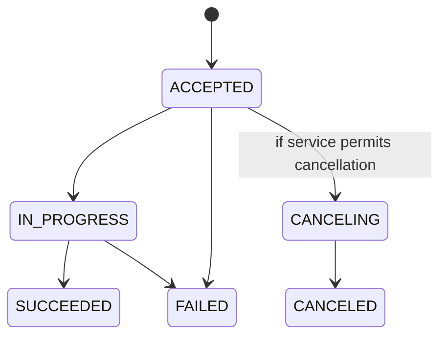
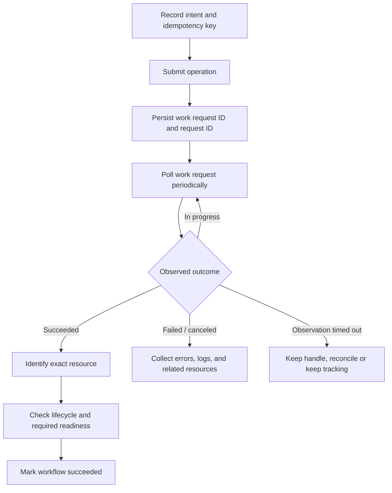

# Work Requests, Waiters, and Asynchronous Operations

## 1. Objectives and Context

A Java tool that sends a request to create an OCI resource may receive an HTTP response within seconds while the service still needs several minutes to complete provisioning. If the tool immediately runs a dependent step or reports deployment success, the outcome may be wrong even though the initial HTTP request succeeded.

This lesson belongs to the **OCI SDK and REST API with Java** chapter in the **CLOUD_PROVIDERS_ORACLE** module. It explains how to track long-running operations via work requests, use SDK waiters, and build automation flows that can recover after interruptions. Design decisions are framed within an OCI context featuring tenancies, compartments, IAM, monitoring, availability, and cost control.

The Java examples use Kubernetes Engine (OKE) to keep client and model names consistent. The same outcome-tracking principles apply when working with Compute, storage, or Oracle database services, though you must cross-check the specific APIs and states of each service.

After this lesson, you will be able to:

- Distinguish HTTP request completion from infrastructure operation completion.
- Persist and properly use the work request ID, resource OCID, and request ID.
- Choose between work-request waiters and resource-lifecycle waiters.
- Handle errors, timeouts, retries, cancellations, and process recovery.
- Design bounded polling alongside durable tracking state.

## 2. Three "Asynchronous" Concepts to Keep Separate

| Concept | Where It Happens | What the Completion Signal Means |
| --- | --- | --- |
| OCI asynchronous operation | Service side | Resource-management work finished per the service contract |
| Java SDK async call | Application and HTTP client side | The specific API request received a response or error |
| Waiter | SDK-side observation mechanism | The wait condition was observed or waiting terminated with an error |

Calling `createCluster` with a synchronous client can still start a long-running server-side operation in OCI. Conversely, calling a read API with an asynchronous client does not trigger infrastructure provisioning work.

Therefore:

```text
Receiving an HTTP response
    differs from the work request having succeeded
    differs from the resource meeting the application's readiness criteria
```

For example, a Compute instance reaching its management state does not prove `cloud-init` has finished. Similarly, a provisioned database still needs the right network path, credentials, and connectivity checks required by the application.

Per [Overview of Work Requests](https://docs.oracle.com/en-us/iaas/Content/General/Concepts/workrequestoverview.htm), a work request provides visibility into long-running operations, associated resources, logs, and errors. It is not a Java thread or a client-side `Future`.

## 3. Work Request: The Handle for Tracking an Operation

### 3.1. Three Types of Identifiers

| Identifier | Example Source | What It Is Used For |
| --- | --- | --- |
| Work request ID | `opc-work-request-id` header | Tracking an asynchronous operation |
| Resource OCID | Resource response or work request's resources list | Calling resource read/update APIs |
| Request ID | `opc-request-id` header | Tracing a single API call and troubleshooting support |

One resource can undergo multiple operations and work requests over time. A single work request can also involve multiple resources. Never pass a work request ID as the cluster OCID when calling `GetCluster`.

In Java, the cluster-creation response clearly separates `getOpcWorkRequestId()` and `getOpcRequestId()`. See [CreateClusterResponse](https://docs.oracle.com/en-us/iaas/tools/java/latest/com/oracle/bmc/containerengine/responses/CreateClusterResponse.html).

Also persist the region and service name alongside the ID. A tracker that stores only an OCID string without knowing which API owns it will struggle to reconstruct the right client and endpoint.

### 3.2. Not Every Service Uses the Same Work Requests API

OCI has both a shared Work Requests API and service-specific work request APIs. Do not assume every ID can be queried using `com.oracle.bmc.workrequests.WorkRequestClient`.

For example:

| Case | Client/Model to Choose |
| --- | --- |
| Operations documented as using the shared Work Requests API | `com.oracle.bmc.workrequests.WorkRequestClient` and models in the same service package |
| OKE work requests in this lesson | `ContainerEngineClient`, models in `com.oracle.bmc.containerengine.model` |

Having the same `GetWorkRequest` method name does not make endpoints and models interchangeable. See [Asynchronous Work Requests](https://docs.oracle.com/en-us/iaas/Content/API/Concepts/workrequests.htm) and [WorkRequestClient](https://docs.oracle.com/en-us/iaas/tools/java/latest/com/oracle/bmc/workrequests/WorkRequestClient.html).

### 3.3. A Terminal State Is Not Always Success

For OKE, the statuses include:

| REST Value | Java Enum | Interpretation |
| --- | --- | --- |
| `ACCEPTED` | `Accepted` | Accepted; not yet conclusive that execution finished |
| `IN_PROGRESS` | `InProgress` | Processing in progress |
| `SUCCEEDED` | `Succeeded` | Operation succeeded |
| `FAILED` | `Failed` | Operation failed |
| `CANCELING` | `Canceling` | Cancellation request in progress |
| `CANCELED` | `Canceled` | Canceled |

Cross-check [OKE WorkRequestStatus](https://docs.oracle.com/en-us/iaas/tools/java/latest/com/oracle/bmc/containerengine/model/WorkRequestStatus.html). The SDK also includes `UnknownEnumValue` when a returned value is unrecognized by that SDK version.

Conceptual model:



This diagram only illustrates state categorization; it is not a guarantee that every service permits all transitions. Some services define extra states or different names. Rely on the enum and documentation of the API you are calling rather than writing one global state table and applying it indiscriminately.

Applications must distinguish:

- **Succeeded:** confirmed success status for the exact operation.
- **Failed or canceled:** reached a terminal status without meeting the goal.
- **Unknown:** observation timed out, connectivity dropped, missing read permission, or unrecognized SDK enum status.

"Unknown" must never be silently converted into "failed" or "succeeded."

## 4. Observing the REST Flow

In the cluster-creation example, Oracle documents the initial response as HTTP `202` accompanied by a work request ID. Subsequent `GET` calls may return HTTP `200` even while the work is still unfinished. See [Asynchronous Request/Response Flow](https://docs.oracle.com/en-us/iaas/Content/API/Concepts/workrequests.htm).

Abbreviated illustration:

```http
HTTP/1.1 202 Accepted
opc-work-request-id: <work-request-ocid>
opc-request-id: <submission-request-id>
```

Next, call the work request endpoint for the exact service and region:

```http
GET /20180222/workRequests/<work-request-ocid> HTTP/1.1
Host: containerengine.<region>.oraclecloud.com
Authorization: <signature generated by OCI signer>
```

An observed response might look like:

```json
{
  "id": "<work-request-ocid>",
  "operationType": "CLUSTER_CREATE",
  "status": "IN_PROGRESS",
  "compartmentId": "<compartment-ocid>",
  "timeAccepted": "2026-11-20T03:00:00Z",
  "timeStarted": "2026-11-20T03:00:03Z",
  "timeFinished": null,
  "resources": []
}
```

This is illustrative data, not output from an actual deployment. Full headers, bodies, and signatures must follow the live API contract.

HTTP `200` on `GetWorkRequest` means the work request record was read successfully. The outcome of the work itself sits in the response body, such as `status`.

Not every create/update API uses the same status code, response body, or work request header. Always read the operation's docs before deciding whether to track by work request or resource lifecycle.

## 5. A Recoverable Automation Workflow

The following design is recommended at the application layer:



Persist the handle durably before confirming to the caller that the request has entered the application's tracking pipeline. If IDs live only in Java variables and the process crashes, the application can lose track of an OCI operation that is still running.

A tracking record might include:

```json
{
  "operationId": "deploy-846",
  "service": "containerengine",
  "region": "ap-singapore-1",
  "compartmentId": "<compartment-ocid>",
  "operationType": "CREATE_CLUSTER",
  "retryToken": "<stable-token-for-this-logical-operation>",
  "workRequestId": "<work-request-ocid>",
  "submissionRequestId": "<opc-request-id>",
  "remoteStatus": "IN_PROGRESS",
  "localStatus": "OBSERVING",
  "nextCheckAt": "2026-11-20T03:01:00Z",
  "observationDeadline": "2026-11-20T03:30:00Z",
  "version": 3
}
```

Fields such as `operationId`, `localStatus`, deadline, and `version` here are application-defined, not built-in OCI fields.

If the response is lost right when submitting the operation, the application may not yet have a work request ID. That is the "submission outcome unknown" branch; use the operation's idempotency and reconciliation mechanisms rather than assuming the service never received the request.

## 6. Java: Waiting on a Work Request and Verifying the Outcome

### 6.1. Prerequisites and Example Scope

The project needs `oci-java-sdk-containerengine`, matching common dependencies at the same version, and an HTTP client implementation compatible with SDK 3.x. Authentication provider, region, compartment, and IAM permissions must be configured before calling the helpers below.

The example uses an already initialized `ContainerEngineClient` and an existing work request ID. The wait helper only observes; it does not create a cluster. SDK version `3.98.0` is referenced when explaining waiter implementation details; when using another version, verify the matching Javadoc.

### 6.2. A Waiter Does Not Imply "Require Success"

```java
import com.oracle.bmc.containerengine.ContainerEngineClient;
import com.oracle.bmc.containerengine.model.WorkRequest;
import com.oracle.bmc.containerengine.model.WorkRequestStatus;
import com.oracle.bmc.containerengine.requests.GetWorkRequestRequest;
import com.oracle.bmc.containerengine.responses.GetWorkRequestResponse;
import com.oracle.bmc.waiter.FixedTimeDelayStrategy;
import com.oracle.bmc.waiter.MaxTimeTerminationStrategy;

import java.time.Duration;

public final class OkeWorkRequestWaiter {
    private OkeWorkRequestWaiter() {
    }

    public static WorkRequest waitForSuccess(
            ContainerEngineClient client,
            String workRequestId) throws Exception {

        GetWorkRequestRequest request = GetWorkRequestRequest.builder()
                .workRequestId(workRequestId)
                .build();

        GetWorkRequestResponse response = client.getWaiters()
                .forWorkRequest(
                        request,
                        new MaxTimeTerminationStrategy(
                                Duration.ofMinutes(20).toMillis()),
                        new FixedTimeDelayStrategy(
                                Duration.ofSeconds(10).toMillis()))
                .execute();

        WorkRequest work = response.getWorkRequest();

        if (work.getStatus() != WorkRequestStatus.Succeeded) {
            throw new IllegalStateException(
                    "Work request did not succeed: id="
                            + workRequestId + ", status=" + work.getStatus());
        }

        return work;
    }
}
```

In the OKE waiter implementation at the referenced SDK version, the termination condition is `timeFinished != null`. Therefore, `execute()` returning normally must still be followed by an explicit check for `Succeeded`. See [ContainerEngineWaiters at tag v3.98.0](https://github.com/oracle/oci-java-sdk/blob/v3.98.0/bmc-containerengine/src/main/java/com/oracle/bmc/containerengine/ContainerEngineWaiters.java).

The timing values in the example are illustrative application choices, not Oracle SLAs. `MaxTimeTerminationStrategy` and `FixedTimeDelayStrategy` accept durations in milliseconds. See [termination strategy](https://docs.oracle.com/en-us/iaas/tools/java/latest/com/oracle/bmc/waiter/MaxTimeTerminationStrategy.html) and [delay strategy](https://docs.oracle.com/en-us/iaas/tools/java/latest/com/oracle/bmc/waiter/FixedTimeDelayStrategy.html).

The method declares `throws Exception` so waiter failures are not masked. The workflow layer must distinguish observation errors, wait budget exhaustion, and remote outcomes rather than catching every exception and reporting "cluster creation failed."

### 6.3. Capturing the Work Request ID from a Create Call

The integration snippet below assumes `details` is properly prepared and cluster creation is permitted in your lab scope:

```java
CreateClusterResponse submitted = client.createCluster(
        CreateClusterRequest.builder()
                .createClusterDetails(details)
                .opcRetryToken(stableRetryToken)
                .build());

String workRequestId = submitted.getOpcWorkRequestId();
String submissionRequestId = submitted.getOpcRequestId();

// Persist both IDs along with operationId and region into the workflow state store.
// Only then let the worker continue tracking the work request.
```

`CreateClusterRequest` belongs to `com.oracle.bmc.containerengine.requests`; the response belongs to `com.oracle.bmc.containerengine.responses`.

If an operation expected to return a work request ID omits the header, log the anomalous response for reconciliation. Do not report success, substitute the request ID, or blindly resubmit the operation.

## 7. Diagnosing Outcomes and Selecting the Exact Resource

### 7.1. Reading Work Request Errors

When the remote status is `Failed`, read the work request's dedicated errors instead of keeping only a generic "wait failed" message.

OKE example:

```java
ListWorkRequestErrorsResponse errors = client.listWorkRequestErrors(
        ListWorkRequestErrorsRequest.builder()
                .compartmentId(compartmentId)
                .workRequestId(workRequestId)
                .build());

for (WorkRequestError error : errors.getItems()) {
    System.err.printf(
            "workRequestId=%s, code=%s, time=%s%n",
            workRequestId,
            error.getCode(),
            error.getTimestamp());

    // Route detailed message to a controlled diagnostic channel after inspecting data.
}
```

The request, response, and model classes belong to the corresponding `containerengine` packages. `WorkRequestError` supplies `code`, `message`, and `timestamp`; see [OKE WorkRequestError](https://docs.oracle.com/en-us/iaas/tools/java/latest/com/oracle/bmc/containerengine/model/WorkRequestError.html).

Preserve the remote failure state even if an auxiliary error/log lookup fails. Lacking permission to read logs does not turn a failed operation into a success, nor does it replace the original root cause.

APIs for reading logs, errors, and pagination vary across services. Do not force `opc-next-page` or a `page` parameter onto every API just because another list API supports it.

### 7.2. Do Not Blindly Grab resources[0]

After success, `work.getResources()` can help identify affected resources. An OKE resource entry contains fields such as `entityType`, `actionType`, and `identifier`. See [WorkRequestResource](https://docs.oracle.com/en-us/iaas/tools/java/latest/com/oracle/bmc/containerengine/model/WorkRequestResource.html).

Selection logic should match the operation type and expected resource:

```text
Create cluster
    -> find entry whose entityType matches cluster
    -> match actionType with the create operation
    -> verify identifier is the target resource to track
    -> handle explicitly if missing or if multiple indistinguishable matches exist
```

Never rely on list index position as an undocumented contract. On update operations, the resource may already exist beforehand; "pick the first new resource" no longer makes sense.

## 8. Resource-Lifecycle Waiters

A work request answers "how did this operation finish?" A resource waiter answers "what state is the resource currently in?" Both observations may be needed, and they are not interchangeable across all workflows.

Example waiting for a cluster to reach `Active`, while also stopping if `Failed` is observed:

```java
GetClusterResponse observed = client.getWaiters()
        .forCluster(
                GetClusterRequest.builder()
                        .clusterId(clusterId)
                        .build(),
                new MaxTimeTerminationStrategy(
                        Duration.ofMinutes(10).toMillis()),
                new FixedTimeDelayStrategy(
                        Duration.ofSeconds(10).toMillis()),
                ClusterLifecycleState.Active,
                ClusterLifecycleState.Failed)
        .execute();

if (observed.getCluster().getLifecycleState()
        != ClusterLifecycleState.Active) {
    throw new IllegalStateException("Cluster did not become Active");
}
```

Also import `GetClusterRequest`, `GetClusterResponse`, and `ClusterLifecycleState` from the corresponding OKE packages. The `forCluster` overload accepts multiple target states; the waiter returns when any of them is observed. See [ContainerEngineWaiters](https://docs.oracle.com/en-us/iaas/tools/java/latest/com/oracle/bmc/containerengine/ContainerEngineWaiters.html).

If you wait only for `Active`, a resource entering a failed state can keep the tool polling until timeout. Including failure states distinguishes early failure from still-in-progress work.

For update operations, reading `Active` immediately after submitting the request does not prove the new update finished: it may simply be the pre-update state. Prefer tracking the operation's work request when the API provides one, then verify the resource and expected attributes.

For deletes, read the waiter/API rules on deleted states and missing-resource responses. Never apply a blanket rule that "every HTTP 404 means deletion succeeded," as 404 can also stem from permissions, endpoints, or wrong IDs.

After the lifecycle waiter, application readiness checks may include:

- Compute: OS initialization and application services have finished starting.
- Database: network path and connectivity using valid credentials succeed.
- OKE: components required for workloads genuinely meet deployment readiness.
- Storage: operation results can be read the way the application will consume them.

Mark the workflow successful only when all conditions defined for the exact use case pass.

## 9. Java SDK Async Clients and Callbacks

### 9.1. The Create Call's Future Is Not the Infrastructure's Future

The following integration snippet assumes `asyncClient` and `createRequest` are prepared. `createRequest` must carry the operation's stable retry token if using that mechanism.

```java
Future<CreateClusterResponse> httpFuture = asyncClient.createCluster(
        createRequest,
        new AsyncHandler<CreateClusterRequest, CreateClusterResponse>() {
            @Override
            public void onSuccess(
                    CreateClusterRequest request,
                    CreateClusterResponse response) {
                System.out.println(
                        "Submission response received; workRequestId="
                                + response.getOpcWorkRequestId());
            }

            @Override
            public void onError(
                    CreateClusterRequest request,
                    Throwable error) {
                System.err.println(
                        "Submission response failed; reconcile outcome");
            }
        });

CreateClusterResponse submission =
        httpFuture.get(30, TimeUnit.SECONDS);

String workRequestId = submission.getOpcWorkRequestId();

// Persist the handle durably, then hand off to the operation-tracking component.
// Do not mark the resource ready simply because httpFuture completed.
```

`Future` and `TimeUnit` come from `java.util.concurrent`; `AsyncHandler` comes from `com.oracle.bmc.responses`. The asynchronous client is `ContainerEngineAsyncClient`. See [ContainerEngineAsync](https://docs.oracle.com/en-us/iaas/tools/java/latest/com/oracle/bmc/containerengine/ContainerEngineAsync.html).

`onSuccess` here reports success of the create API submission, not that the work request reached `Succeeded`. If `get(30, ...)` times out, the remote operation may still have been accepted.

Do not place the client in a try-with-resources block and exit that block immediately after launching an async request. The client and its dependencies must stay alive long enough for the request and callbacks to complete.

### 9.2. Waiters Also Have an Asynchronous Execution Form

The `Waiter` interface supports two execution styles:

| Invocation | Behavior |
| --- | --- |
| `execute()` | Blocks the calling thread until the waiter finishes or throws an error |
| `execute(asyncHandler)` | Returns `Future<Void>`; response or error is delivered to the handler |

Cross-check [Waiter API](https://docs.oracle.com/en-us/iaas/tools/java/latest/com/oracle/bmc/waiter/Waiter.html).

The waiter's `Future<Void>` does not directly hold the work request response. The handler must still verify the remote status under the same rules as blocking execution.

Using callbacks does not make a workflow durable. If the JVM stops, in-memory callbacks and `Future` instances vanish. Recovery state must live in a durable state store.

In web applications, avoid tying up HTTP request threads for minutes waiting on provisioning. A common design returns an internal operation ID immediately, lets background workers track progress, and exposes a status endpoint for clients.

## 10. Polling, Retries, and Time Budgets

### 10.1. Polling Differs from Retrying

- **Polling:** the previous read succeeded, but the job is not finished yet; the app waits and reads status again.
- **Retry:** an API call failed with a retryable error; the app retries within bounds.
- **Resubmitting the operation:** can introduce duplicate side effects if idempotency is not enforced.

These three loops must not nest without bounds. For example, 20 polls each triggering multiple HTTP retries plus sleep delays can far exceed the timeout the author originally expected.

### 10.2. Three Time Horizons

| Time Horizon | Scope |
| --- | --- |
| Connection/read timeout | A single HTTP exchange |
| Observation budget | Total time spent polling and retrying by a worker in one tracking pass |
| Business deadline | Point at which the workflow must conclude or escalate per policy |

`MaxTimeTerminationStrategy` bounds the waiter's polling loop per its check mechanism. It should not be viewed as a hard preemption timer that aborts every active HTTP call at the exact millisecond. An in-flight request, HTTP retries, and delays must all be accounted for in overall timing design.

Example application settings:

```text
Connection timeout: 5 seconds
Read timeout:       30 seconds
Polling delay:      about 10 to 30 seconds
Observation pass:   20 minutes
Business deadline and follow-up tracking: configured separately
```

Values must reflect actual operation duration, operational requirements, and service limits. Do not apply a tiny timeout uniformly to long-running resource creation tasks.

### 10.3. Designing Bounded Polling

When a built-in waiter matches your conditions, use it to reduce orchestration code. When you need per-read checkpoints, durable poll schedules, or custom state logic, build a dedicated poller.

Pseudocode:

```text
load persisted handle

within observation budget:
    if thread shutdown is requested:
        save resumable state
        exit

    call GetWorkRequest with bounded timeout and retries

    if read succeeded:
        save remoteStatus, observation timestamp, and request ID
        if succeeded:
            verify downstream workflow steps
            end observation pass
        if failed or canceled:
            save outcome, collect diagnostics
            end observation pass
        if status is unknown:
            record case for reconciliation, do not treat as success

    if error is retryable:
        increase backoff within remaining budget
    if error is config or permission issue:
        record observation error and escalate appropriately

    sleep delay with jitter and repeat

budget exhausted:
    save OBSERVATION_TIMED_OUT
    keep workRequestId for continued reconciliation
```

Use a monotonic clock like `System.nanoTime()` for elapsed intervals within a single process. For deadlines spanning restarts, store UTC timestamps and compute remaining budget when the worker starts.

If `InterruptedException` occurs, respect the shutdown signal; if catching without rethrowing, restore the interrupt flag via `Thread.currentThread().interrupt()`. Never swallow interrupts and keep polling forever.

### 10.4. Avoiding Thundering Herds of API Calls

If 600 operations each poll every 10 seconds, status reads alone generate roughly 60 requests/sec on average. Log/error reads and retries raise load further. This is an illustrative calculation, not a default OCI quota.

Design mitigations:

- Add jitter so workers do not wake up in lockstep.
- Increase intervals for long-running operations within a bounded policy.
- Respect service retry directives if returned in responses.
- Cap total concurrent polls.
- Share observed status across UI views rather than letting each view spawn its own poller.

An async callback can still use background threads to wait; thus, "async API" alone does not mean an application supports unlimited concurrent operations.

## 11. Retrying Operations and Idempotency

### 11.1. Losing the Response After Submission

A typical failure scenario:

```text
Application sends CreateCluster
OCI accepts and creates work request
Connection drops before application receives response
Application does not yet know the work request ID
```

Resubmitting as a new intent risks spawning unintended operations or duplicate resources.

`CreateClusterRequest` supports `opcRetryToken` to identify retried requests. The same logical operation must use a stable token, request body, and context within the API contract. See [CreateClusterRequest.Builder](https://docs.oracle.com/en-us/iaas/tools/java/latest/com/oracle/bmc/containerengine/requests/CreateClusterRequest.Builder.html).

Example structure:

```text
generate retry token once
persist token alongside provisioning intent
send request
if retrying that exact request:
    reuse the persisted token
    do not generate a new UUID on every retry loop
```

Retry tokens have an expiration window and API-specific rules; they are not permanent idempotency guarantees. Once expired or if request contents change, reconcile existing resources and original intent before choosing a new action.

### 11.2. Observation Timeouts Do Not Authorize Re-Creation

Once you have a work request ID, continuing to observe that exact ID is the primary recovery path. Do not create a second cluster just because a 20-minute waiter expired.

Similarly, when OCI reports a `Failed` work request, the next step is reading the errors and inspecting partially created resources. Do not assume everything rolled back cleanly, nor assume the entire sequence can be re-run without conflict checks.

For updates, also factor in concurrency controls such as ETags or versions when supported. Retrying a change against data modified concurrently may require a different business decision.

### 11.3. Classifying Observation Errors

Per [OCI API Errors](https://docs.oracle.com/en-us/iaas/Content/API/References/apierrors.htm), error codes carry different meanings and retryability. In a poller, classify them:

| Error While Reading Status | Application Action |
| --- | --- |
| `429 TooManyRequests` or eligible transient server error | Backoff, jitter, stay within total budget |
| Invalid authentication | Fix or refresh credentials per the chosen mechanism |
| Missing permissions or wrong compartment/region | Check IAM and routing |
| `404 NotAuthorizedOrNotFound` | Cross-check ID, permissions, endpoint, and data lifecycle |
| Unstable network | Bounded retries; keep handle |
| Unrecognized SDK status value | Record and check SDK/API compatibility |

A `GetWorkRequest` error describes an observation failure; it does not by itself prove the remote job failed. Track those two facts separately in logs and state storage.

## 12. Recovering After a JVM or Worker Stops

A highly available system must recover from durable state, not merely restart a thread pool.

When a worker restarts:

1. Query internal operations lacking a terminal outcome.
2. Load service, region, work request ID, and resource ID if known.
3. Construct the right client with an authorized identity.
4. Read current status from OCI.
5. Persist the outcome or schedule the next check.
6. Execute dependent steps only after success is confirmed.

To prevent multiple workers from racing on the same operation, use leases, transactional locks, or version-checked conditional updates. When a lease expires, the new worker re-reads state from OCI; never treat a previous owner losing connectivity as proof a new resource must be created.

Dependent steps also need idempotency. If a worker configured the next step and crashed before marking it complete, resuming the workflow must not cause duplicate configuration or data loss.

Work requests are service observation records, not an infinite audit archive under your application's full control. Check service retention periods and persist critical outcomes, error codes, and timestamps needed for operations before observation data expires.

## 13. Canceling Waits, Futures, and Operations

| Action | What Can Be Concluded |
| --- | --- |
| Stopping polling | The client stops observing |
| Waiter timeout | The condition was not confirmed within that wait pass |
| `Future.cancel(...)` | Requests local execution cancellation per `Future` and implementation semantics |
| Service work-request cancel API | Requested the service to cancel as far as the operation supports |
| Observing `Canceled` status | The service reports the job was canceled |

Never assume an OCI operation stopped simply because a Java thread was interrupted, a `Future` was canceled, or an HTTP client was closed.

Cancellation support is API-specific. For example, OKE's `deleteWorkRequest` API is documented to cancel a work request that has not yet started; it is not a universal kill switch for running operations. See [ContainerEngineAsync](https://docs.oracle.com/en-us/iaas/tools/java/latest/com/oracle/bmc/containerengine/ContainerEngineAsync.html).

Even after successful cancellation, inspect resources and side effects per the service contract. "Canceled" does not guarantee rollback of a multi-step workflow.

If created resources must be cleaned up, that is a separate administrative workflow with its own permissions, preconditions, and tracked outcomes. A timeout never grants permission to delete shared resources.

## 14. IAM, Monitoring, and Cost Control

### 14.1. Scoping Permissions Across Steps

Verify permissions for the original operation, reading work requests, viewing errors/logs, and reading the target resource. Permission mappings across these calls vary by service.

For OKE, check [Details for Kubernetes Engine](https://docs.oracle.com/en-us/iaas/Content/Identity/policyreference/contengpolicyreference.htm). Do not copy a work-request policy from another service and assume identical behavior.

Store the work request's exact compartment; do not substitute the resource's current compartment if operations can move resources and the docs specify otherwise.

Worker credentials must outlast workflow execution. A user session expiring mid-poll breaks observability even while the OCI operation continues. For workloads running on OCI, choose an identity mechanism suited to the deployment environment.

### 14.2. What to Record

Useful logs should correlate:

```text
internal operationId
service and region
workRequestId
resourceId if identified
submission and observation requestIds
remoteStatus
localStatus
submission time, last observation time, and deadline
poll count, retry count, and latest error code
```

Limit sensitive data in logs; never log tokens, private keys, or signature headers.

Application metrics to track:

- Elapsed time from submission to remote completion.
- Elapsed time from remote completion to true application readiness.
- Number of active tracked operations and deadline breaches.
- Observation error rate, throttling rate, and credential expiration rate.
- Count of workflows needing reconciliation or leaving leftover resources.

Alerts for operations exceeding thresholds should include the tracking handle for investigation. Never alert only "timeout" while omitting the work request ID.

### 14.3. Cost and Availability

Stopping a waiter does not stop resource billing. A cluster, instance, volume, or database that was already created continues its own lifecycle.

Attach labels or tags per project conventions to trace workflow-owned resources. Track partial creations and plan ownership-based cleanup so retries do not leave orphaned billable resources behind.

Tune poll intervals and worker counts to real load. Polling too aggressively increases throttling and operational overhead without speeding up OCI provisioning.

## 15. Lab: Tracking an Existing Operation

To focus purely on the observation mechanism, you can use the work request of a lab operation created through a separate flow. There is no need to provision a brand-new cluster solely to run the waiter function.

Prerequisites:

- An OKE work request ID, region, and matching compartment.
- An authenticated Java client with the required read permissions.
- A lab state store so you can test resuming after stopping the process.
- The resource OCID if known from an earlier operation.

Steps:

1. Read the work request once; record status, timestamps, and request ID.
2. Run the waiter with configured timeout and delay.
3. Explicitly check for success status after the waiter returns.
4. If failed, read errors and associated resources.
5. If succeeded, verify the exact resource and downstream readiness conditions.
6. If unfinished within the observation pass, save the handle to continue.
7. Stop and restart the program to verify it reloads the handle and resumes reading status.

Scenarios to observe:

| Scenario | Expected Design Outcome |
| --- | --- |
| Work request is in progress | Keeps observing within limits |
| Work request already succeeded earlier | Concludes after a clean read without resubmitting the operation |
| Work request failed | Skips dependent steps; preserves diagnostic errors |
| Waiter returns with canceled status | Does not report deployment success |
| Very short observation deadline | Keeps handle; does not conclude remote work stopped |
| Credentials expire | Classifies observation error and refreshes/fixes identity |
| Resource stays `Active` while a new update runs | Does not treat that as proof the new update finished |
| Multiple resource entries returned | Selects per the operation contract, not index 0 |
| JVM stops after OCI accepted the request | Recovers via saved handle or idempotency/reconciliation |

These are lab instructions, not confirmation that requests were executed. Use only scoped lab resources and clean up any resources actually created during practice per your environment's procedures.

## 16. Completion Criteria for an Asynchronous Flow

A production-ready workflow design must answer:

1. Does the operation return a resource directly or a work request ID, and which API owns that handle?
2. Which statuses indicate success, failure, cancellation, or unknown outcome?
3. Where is the ID persisted so tracking can resume after a worker stops?
4. Under what conditions does the waiter exit, and is remote status verified afterward?
5. How do HTTP timeouts, observation budgets, and business deadlines relate?
6. On dropped responses or retries, what mechanism prevents duplicate side effects?
7. How are resource readiness and permissions for downstream steps verified?
8. Who is responsible for reconciling leftover resources, failures, and costs after an interruption?

An asynchronous OCI operation is well managed when the application retains the tracking handle, interprets outcomes accurately, recovers across interruptions, and triggers dependent steps only on verified evidence of success.
