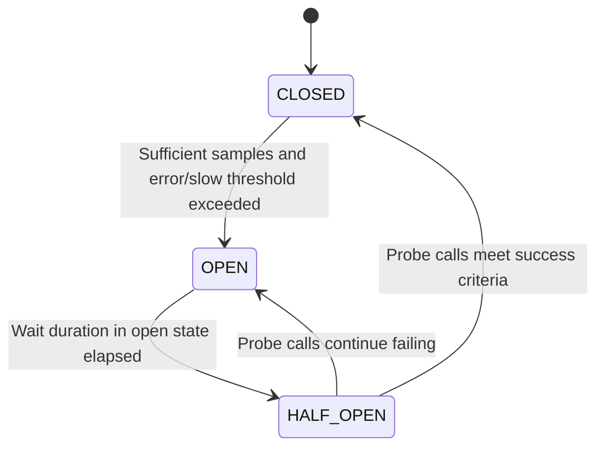

# Retries, Timeouts, Circuit Breakers, and Connection Pooling

## 1. Context and Objectives

In the **OCI SDK and REST API with Java** chapter of the **CLOUD_PROVIDERS_ORACLE** module, a reliable API call requires more than valid credentials and the right region. An application must also decide how long to wait, when to retry, when to stop calling a failing service temporarily, and how to reuse HTTP connections.

The running scenario is a Java service running on OCI Compute that reads metadata from Object Storage and downloads files for business processing. The application may also call Compute or database management APIs. As traffic grows, network latency and transient errors can exhaust threads or connections even when CPU usage remains low.

After this lesson, you will be able to:

- Distinguish connect timeout, read timeout, connection-pool acquisition timeout, and business deadlines.
- Configure bounded retries with backoff and jitter using the OCI Java SDK.
- Identify operations that require idempotency before retrying.
- Explain circuit breaker states and choose an appropriate protection scope.
- Configure an HTTP connection pool and close response streams properly.
- Observe and verify behavior when a service is slow, overloaded, or connections are held too long.

The examples use **JDK 17, OCI Java SDK 3.99.0, and the Jersey 3 HTTP transport with the Apache Connector**. Versions are pinned to explain exact APIs, not to imply they are the latest release. Timeout, pool size, and error threshold numbers in this lesson are illustrative settings to tune with real measurements.

## 2. Four Mechanisms Solving Four Different Problems

| Mechanism | Primary Problem | Decision It Makes | What It Cannot Replace |
| --- | --- | --- | --- |
| Timeout | A single stage waits too long | When to stop waiting on that stage | Idempotency and total deadline |
| Retry | A single attempt fails transiently | Whether, when, and how many times to retry | Fixing IAM permissions or invalid payloads |
| Circuit breaker | Service fails continuously | Temporarily reject new calls to relieve pressure | Aborting in-flight requests or fixing the service itself |
| Connection pooling | Repeatedly opening connections and managing concurrency | Reuse connections and bound connection count | Bounding total business workload |

An integrated flow example:

1. The application has an available execution slot.
2. One attempt tries to borrow a connection from the pool.
3. If no connection is free, it waits only within the pool-acquisition budget.
4. If a new connection is needed, the connect timeout applies.
5. While waiting for data, the transport's read timeout applies.
6. If a failure is retryable, attempts remain, and budget allows, wait for backoff and retry.
7. If the circuit breaker is open, calls can be rejected early without sending more requests to the service.

These steps serve as an analytical model for resources and time. The exact wrapping order among retrier, breaker, and HTTP transport depends on the SDK's implementation.

Distinguish two units of measurement:

- **Logical call:** one business action intending to list buckets or read an object.
- **Attempt:** one execution try inside that call's retry mechanism.

A logical call that succeeds on its third attempt still generates different load from one that succeeds on the first try. Measuring only final success rate can hide rising retry pressure.

## 3. Timeouts and Deadlines: Where You Wait and Where You Expire

### 3.1. Types of Durations

| Type | What Is Being Waited On? | Where Configured in Example |
| --- | --- | --- |
| Pool acquisition timeout | Borrowing a connection from the connection manager | Apache `RequestConfig` |
| Connect timeout | Establishing a connection to the target per transport | `ClientConfiguration` and Apache `RequestConfig` |
| Read/socket timeout | Waiting for data on the connection | `ClientConfiguration` and Apache `RequestConfig` |
| Backoff delay | Waiting before the next attempt | `RetryConfiguration` |
| Business deadline | Entire operation must return within budget | Application orchestration layer |
| Lifecycle wait time | OCI resource reaching desired state | Waiter or state-tracking mechanism |

The SDK's `ClientConfiguration` has `connectionTimeoutMillis` and `readTimeoutMillis`. Configuring async thread counts does not configure the Apache Connector's HTTP pool size. [Oracle: ClientConfiguration in SDK 3.99.0](https://github.com/oracle/oci-java-sdk/blob/v3.99.0/bmc-common/src/main/java/com/oracle/bmc/ClientConfiguration.java)

In Apache HttpClient 4.x, `connectionRequestTimeout` is the wait to borrow a connection from the manager; `socketTimeout` governs waiting for data packets, not a total transfer cap for the entire response. [Apache: RequestConfig](https://hc.apache.org/httpcomponents-client-4.5.x/current/httpclient/apidocs/org/apache/http/client/config/RequestConfig.html)

Accordingly, setting a 2-second connect timeout does not directly resolve 50 threads waiting on a pool with only a few free connections.

### 3.2. One Timeout Does Not Cover the Entire Call

Budget model:

```text
Total duration of one logical call
  = application wait time
  + sum of attempt durations
  + sum of backoff delays between attempts
  + required response processing time
  + related overhead
```

Each attempt can incur pool wait, DNS lookup, TCP handshake, TLS handshake, server response wait, and payload read time. Never treat a single timeout value as an absolute cap across all those stages combined.

Hypothetical measurement example:

```text
Attempt 1:     2.0 seconds then transient error
Backoff 1:     0.7 seconds
Attempt 2:     2.0 seconds then transient error
Backoff 2:     1.3 seconds
Attempt 3:     0.4 seconds and succeeds
Measured total: 6.4 seconds, excluding overhead outside the sequence above
```

If the application's API must respond within 5 seconds, "each attempt has a 2-second timeout" still fails the requirement.

When sizing parameters, start from the caller-acceptable deadline, reserve margin for internal processing and response handling, and then allocate across attempts. With tight deadlines, one or two attempts may be better than many retries.

### 3.3. Read Timeout Is Not Maximum File Download Time

A response stream can keep delivering chunks incrementally. As long as each chunk arrives before the socket timeout elapses, total download time can far exceed the read timeout value.

The application must decide separately:

- Whether to enforce an overall download deadline.
- Expected payload sizes and minimum operationally acceptable throughput.
- How to cancel and close the stream when the caller no longer needs the result.
- How to handle partially written data when a download fails mid-stream.

Do not treat `Future.get(timeout)` or a framework timer as proof that all underlying I/O stopped. Cancellation, thread interruption, HTTP abort, and stream cleanup must be verified against the active transport.

## 4. Retries Must Be Conditional, Bounded, and Safe

### 4.1. Classify Errors Before Retrying

| Situation | Typical Handling Direction |
| --- | --- |
| HTTP 429 due to sending too fast | Backoff, reduce rate or concurrency |
| HTTP 500, 502, 503, 504 | Consider bounded retries if the operation is safe |
| HTTP 409 with transient service code like `IncorrectState` | Follow API guidance and resource state |
| Invalid payload or missing parameters | Fix the request before calling again |
| Unauthorized or misconfigured authentication | Fix IAM or identity configuration |
| Timeout after sending a write operation | Treat outcome as unknown; check idempotency and reconcile |
| Connection pool acquisition timeout | Investigate load or connection leaks; avoid aggressive retries |
| Circuit breaker rejects the call | Relieve pressure, return error, or run designed fallback |

OCI distinguishes retryable errors using both HTTP status and service code. Never apply a blanket rule like "all 409s" or "retry every error." [Oracle: API Error Reference](https://docs.oracle.com/en-us/iaas/Content/API/References/apierrors.htm)

`DefaultRetryCondition` in 3.99.0 recognizes statuses such as 429, 500, 502, 503, 504, certain client-side exceptions, and the 409/`IncorrectState` pair. It also distinguishes circuit-breaker-blocked errors. [Oracle: DefaultRetryCondition 3.99.0](https://github.com/oracle/oci-java-sdk/blob/v3.99.0/bmc-common/src/main/java/com/oracle/bmc/retrier/DefaultRetryCondition.java)

The SDK treating an error as retryable does not prove that your entire business operation is safe to repeat.

### 4.2. Attempts Include the Initial Call

```java
import com.oracle.bmc.retrier.DefaultRetryCondition;
import com.oracle.bmc.retrier.RetryConfiguration;
import com.oracle.bmc.waiter.ExponentialBackoffDelayStrategyWithJitter;
import com.oracle.bmc.waiter.MaxAttemptsTerminationStrategy;

RetryConfiguration retryConfig =
        RetryConfiguration.builder()
                .terminationStrategy(
                        new MaxAttemptsTerminationStrategy(3)
                )
                .delayStrategy(
                        new ExponentialBackoffDelayStrategyWithJitter(2_000)
                )
                .retryCondition(new DefaultRetryCondition())
                .build();
```

`MaxAttemptsTerminationStrategy(3)` allows at most 3 attempts at this retry layer: the initial attempt plus up to 2 retries. It does not mean 3 extra retries after the first call. [Oracle: MaxAttemptsTerminationStrategy](https://docs.oracle.com/en-us/iaas/tools/java/latest/com/oracle/bmc/waiter/MaxAttemptsTerminationStrategy.html)

Backoff increases the wait between tries; jitter spreads clients out in time, reducing synchronized retry storms.

There is an important detail in the 3.99.0 source: `ExponentialBackoffDelayStrategyWithJitter` adds up to roughly 1,000 ms of jitter on top of the base delay. Thus, the `2_000` ms parameter in the example is not a hard 2,000 ms ceiling for the entire wait. [Oracle: jitter strategy source](https://github.com/oracle/oci-java-sdk/blob/v3.99.0/bmc-common/src/main/java/com/oracle/bmc/waiter/ExponentialBackoffDelayStrategyWithJitter.java)

To explain the principle, write the general formula as:

```text
wait duration = bounded backoff + random component
```

If a system requires a strict upper bound on wait duration, verify the exact algorithm and real budget rather than inferring from constructor names.

### 4.3. Configure Retries at the Right Scope

Retries can be configured SDK-wide, per client, or per request. In the version used in this lesson, request config takes precedence over client config, which takes precedence over application-set defaults. When omitted, environment and operation specs can also influence default behavior. [Oracle: Retriers 3.99.0](https://github.com/oracle/oci-java-sdk/blob/v3.99.0/bmc-common/src/main/java/com/oracle/bmc/retrier/Retriers.java)

A controllable approach:

- Set a general policy per API group on the client.
- Override on the request when a specific operation has different requirements.
- Avoid mutating JVM-wide defaults inside a shared library.

Example of a request executing only one attempt at the SDK retry layer:

```java
var request =
        ListBucketsRequest.builder()
                .namespaceName(namespace)
                .compartmentId(compartmentId)
                .limit(5)
                .retryConfiguration(
                        RetryConfiguration.NO_RETRY_CONFIGURATION
                )
                .build();
```

This snippet requires the corresponding variables and imports in your program. It does not disable retries in frameworks, the transport layer, or authentication infrastructure.

Keep these three configurations distinct:

| Configuration | Meaning to Understand |
| --- | --- |
| Omitting retry configuration | Allows operation and SDK defaults to apply |
| `RetryConfiguration.builder().build()` in 3.99.0 | Default builder config allows only one attempt |
| `NO_RETRY_CONFIGURATION` | Explicit way to express no retries at the SDK layer |

The `RetryConfiguration` source separates a bare builder's single-attempt config from the SDK's multi-attempt default configuration. Thus, constructing an empty config object behaves differently from omitting retry configuration. [Oracle: RetryConfiguration 3.99.0](https://github.com/oracle/oci-java-sdk/blob/v3.99.0/bmc-common/src/main/java/com/oracle/bmc/retrier/RetryConfiguration.java)

### 4.4. Avoid Multiplying Retries Across Layers

Suppose:

```text
Business layer: up to 3 logical calls
SDK:            up to 3 attempts per call
Transport:      may have its own retry policy
```

Just the first two layers can produce 9 attempts. If a worker re-queues jobs as well, total executions multiply further by queue redeliveries.

Assign clear retry ownership per failure type. If an outer framework orchestrates end-to-end retries, reduce SDK retries or vice versa. Count actual attempts rather than reading only one config block.

In the sample code later in this lesson, the Apache retry handler is explicitly configured with 0 retries so API retries stay managed by the SDK. Apache distinguishes `retryCount` from the initial attempt; 0 here means no automatic retries at the transport layer. [Apache: DefaultHttpRequestRetryHandler](https://hc.apache.org/httpcomponents-client-4.5.x/current/httpclient/apidocs/org/apache/http/impl/client/DefaultHttpRequestRetryHandler.html)

### 4.5. Retrying Write Operations and Unknown Outcomes

Consider a request to launch a Compute instance:

```text
Application sends launch request
  → OCI receives and executes it
  → response is lost in transit
  → application receives a timeout
```

A client-side timeout does not prove the request was not executed. Creating a new request with a fresh business ID or retry token may trigger a second unintended action.

Some APIs support `opcRetryToken`; for instance, `LaunchInstanceRequest.Builder` exposes this field to support retrying the same operation within the API's validity window. [Oracle: LaunchInstanceRequest.Builder](https://docs.oracle.com/en-us/iaas/tools/java/latest/com/oracle/bmc/core/requests/LaunchInstanceRequest.Builder.html)

Application rules:

- Keep the token stable for the same intent when the API supports it.
- Never attach `opcRetryToken` to an API lacking that contract.
- Distinguish the request ID used for tracing from the retry token used for deduplication.
- Persist request state and reconcile when the outcome is unknown.
- Handle streaming request bodies according to their replayability.

A partially read upload stream cannot automatically be rewound from the beginning. The SDK provides stream-replay support in certain paths, yet applications must still account for data sources, memory, and operation contracts. [Oracle: Retriers and Stream Handling](https://docs.oracle.com/en-us/iaas/tools/java/latest/com/oracle/bmc/retrier/Retriers.html)

## 5. Circuit Breakers: Pausing Calls During Sustained Failures

### 5.1. Three States



| State | Behavior to Understand |
| --- | --- |
| CLOSED | Allows calls and records outcomes |
| OPEN | Rejects new calls protected by the breaker |
| HALF_OPEN | Permits a limited number of probe calls to test recovery |

A circuit breaker helps clients shed load once failures cross a threshold. OCI docs describe configuring failure rate, minimum calls, and open-state wait duration; defaults also vary by client and synchronous vs. asynchronous client types. [Oracle: Circuit Breakers in the Java SDK](https://docs.oracle.com/en-us/iaas/Content/API/SDKDocs/javasdkconcepts.htm)

In this lesson, examples use a synchronous client with an explicit breaker configuration. Do not assume all async clients share identical defaults.

### 5.2. Minimum Sample Count Matters as Much as Percentage

Suppose the configuration is:

```text
Observation window:         60 seconds
Minimum number of calls:    10
Failure rate threshold:     50%
Wait duration in OPEN:      20 seconds
HALF_OPEN probe calls:      2
```

In this model:

- A single failure is not enough to declare 100% failure and trip the breaker.
- Once enough samples accumulate, failure rate is evaluated over the corresponding window.
- While the breaker is open, rejected calls do not represent new HTTP errors from OCI.
- Waiting 20 seconds does not guarantee the service recovered; probe calls are still required.

In the 3.99.0 implementation, the breaker uses a time-based window, so `slidingWindowSize(60)` in this example means 60 seconds. Do not generalize this interpretation to every other circuit breaker library. [Oracle: OciCircuitBreakerImpl 3.99.0](https://github.com/oracle/oci-java-sdk/blob/v3.99.0/bmc-circuitbreaker/src/main/java/com/oracle/bmc/circuitbreaker/internal/resilience4j/OciCircuitBreakerImpl.java)

### 5.3. Configuring Failure and Slow-Call Thresholds

```java
import com.oracle.bmc.circuitbreaker.CircuitBreakerConfiguration;
import java.time.Duration;

CircuitBreakerConfiguration breakerConfig =
        CircuitBreakerConfiguration.builder()
                .failureRateThreshold(50)
                .minimumNumberOfCalls(10)
                .slidingWindowSize(60)
                .waitDurationInOpenState(Duration.ofSeconds(20))
                .permittedNumberOfCallsInHalfOpenState(2)
                .slowCallDurationThreshold(Duration.ofSeconds(4))
                .slowCallRateThreshold(90)
                .build();
```

The SDK exposes separate thresholds for failure rate, slow-call rate, and slow-call duration. [Oracle: CircuitBreakerConfiguration builder](https://docs.oracle.com/en-us/iaas/tools/java/latest/com/oracle/bmc/circuitbreaker/CircuitBreakerConfiguration.CircuitBreakerConfigurationBuilder.html)

A call can succeed yet still take longer than 4 seconds. With the illustrative configuration, a high rate of slow calls can also open the breaker once thresholds are met. That is an explicit choice of the example, not just tracking HTTP failures.

Coordinate the slow-call threshold with timeouts. If every call is aborted before reaching the slow threshold, slow-call evaluation will never behave as intended. Furthermore, for streaming APIs, the duration observed by the breaker may not cover the entire time the application spends consuming the stream.

### 5.4. Breaker Scope Must Match Failure Scope

Do not lump every OCI service behind one application-created breaker. If Object Storage experiences errors and that breaker also blocks healthy Compute API calls, the application widens the blast radius.

Scopes that may need separation include:

- Service.
- Region or endpoint.
- Operation groups with different characteristics and access permissions.
- Identity or environment if required by application architecture.

The SDK can construct a breaker from configuration; an application can also construct an `OciCircuitBreaker` via `CircuitBreakerFactory` and pass it into client configuration. [Oracle: CircuitBreakerFactory 3.99.0](https://github.com/oracle/oci-java-sdk/blob/v3.99.0/bmc-circuitbreaker/src/main/java/com/oracle/bmc/circuitbreaker/CircuitBreakerFactory.java)

If the same breaker instance is shared across multiple clients, its state is shared across them as well. Decide explicitly whether that matches the protected destinations.

Creating a new client and breaker per request is also flawed: observation history is fragmented or constantly reset, undermining protection. Reuse them according to application lifecycle and fixed destination configs.

### 5.5. When the Breaker Opens, the Application Must Respond Cleanly

Errors blocked by the breaker must be distinguished from server errors:

- Return a clear transient error to the caller when no fallback exists.
- Serve cached data if business requirements permit stale reads.
- Defer asynchronous work if the system has durable queuing.
- Never return a synthetic success when a resource-creation operation was not confirmed.

Retrying "call blocked because breaker is open" in a tight loop ties up threads and inflates wait times without improving success odds. The example policy uses `DefaultRetryCondition`; do not force breaker-blocked exceptions to be treated as retryable.

A breaker does not automatically reroute requests to another region. Regional failover requires prepared resources, replicated data, permissions, and explicit routing workflows.

## 6. Connection Pooling: Capacity, Hold Time, and Ownership

### 6.1. Pools Reuse HTTP Connections

With the Apache Connector, pooling reuses connections instead of opening a new connection per request. Limits include total pool connections and connections per route, where a route typically binds to a destination and path properties such as a proxy. [Apache: PoolingHttpClientConnectionManager](https://hc.apache.org/httpcomponents-client-4.5.x/current/httpclient/apidocs/org/apache/http/impl/conn/PoolingHttpClientConnectionManager.html)

Example:

```text
Total pool:                max 24 connections
Per route:                 max 12 connections
Concurrent HTTP tasks:     bounded at the application layer as needed
```

If all requests target a single route, the per-route limit of 12 becomes the effective ceiling even when total pool capacity remains unused. Raising total max to 200 while leaving per-route at 12 will not allow 200 connections to that same target.

The SDK's HTTP connection pool is unrelated to JDBC connection pools used for Oracle Database access. `HikariCP` or UCP does not configure the HTTP pool of `DatabaseClient` or `ObjectStorageClient`.

### 6.2. Estimating Pool Size from Connection Hold Time

Steady-state approximation:

```text
Average in-use connections
  ≈ HTTP attempts per second × average connection hold time
```

Lesson example:

```text
100 attempts/sec × 0.08 seconds ≈ 8 connections in use
```

With the same traffic, if each response stream is held for 2 seconds, average demand rises to roughly 200 connections. Speeding up CPU processing may not help when stream hold time is the bottleneck.

This formula is a rough estimate, not a sizing guarantee. Account for traffic bursts, latency distributions, retries, multiple routes, replica count, and service limits.

### 6.3. Pool Acquisition Must Have Its Own Timeout

```java
import org.apache.http.client.config.RequestConfig;

RequestConfig apacheRequestConfig =
        RequestConfig.custom()
                .setConnectionRequestTimeout(500)
                .setConnectTimeout(2_000)
                .setSocketTimeout(5_000)
                .setContentCompressionEnabled(false)
                .setExpectContinueEnabled(false)
                .build();
```

The example budgets at most 500 ms to borrow a connection; connect and socket timeouts match the SDK settings in the full program. The last two options preserve disabled compression and expect-continue when overriding the transport's request config object.

Transport configuration must use properties from the matching library family. OCI Java SDK 3.x lets you choose the HTTP implementation and its specific properties; do not use Jersey 2 imports in a program configured for Jersey 3. [Oracle: Customizing HTTP Configuration in SDK 3](https://docs.oracle.com/en-us/iaas/Content/API/SDKDocs/javasdk3.htm)

The Jersey 3 properties in this example cover the connection manager, request config, retry handler, and connection manager lifecycle flag. [Oracle: ApacheClientProperties for Jersey 3](https://github.com/oracle/oci-java-sdk/blob/v3.99.0/bmc-common-httpclient-choices/bmc-common-httpclient-jersey3/src/main/java/com/oracle/bmc/http/client/jersey3/ApacheClientProperties.java)

Pool acquisition timeouts usually signal insufficient client capacity or connections held too long. Measure before increasing pool size; immediate retries may only add more waiters.

### 6.4. Response Streams Hold Connections Until Released

With `GetObject`, receiving the response object does not return the connection to the pool. If the application fails to drain or close the stream, subsequent calls can stall waiting for a connection. Oracle documents this as a common cause of hangs when using the Apache Connector. [Oracle: Troubleshooting Stream-Related Hangs](https://docs.oracle.com/en-us/iaas/Content/API/SDKDocs/javasdktroubleshooting.htm)

Usage inside a download method where `client`, `request`, and `stagingPath` are already prepared:

```java
var response = client.getObject(request);

try (var input = response.getInputStream();
     var output = java.nio.file.Files.newOutputStream(stagingPath)) {
    input.transferTo(output);
}

// Publish the final file only after the application's data verification step.
```

Resource declaration order ensures `input` closes even if opening `output` fails. If only part of a response is read, still close `input` upon leaving scope.

Never blindly append retried bytes onto a partial file. When a download fails midway, implement a policy to restart from scratch or perform controlled range-based resumption verified against object version and preconditions.

Also distinguish when failures occur:

```text
Error while calling getObject to obtain response:
  may be covered by the API retry chain

Error while the application reads the input stream after the API returned:
  requires application-level download recovery logic
```

Do not assume errors thrown inside `input.transferTo` will be automatically re-downloaded and repaired by the SDK.

### 6.5. Who Closes the Pool?

There are two primary ownership patterns:

| Pattern | Pool Owner | Lifecycle Requirement |
| --- | --- | --- |
| Dedicated pool managed by HTTP client | Client | Close the client when no tasks remain |
| Pool supplied and managed by application | Application | Close after all clients and streams using it have finished |

In the next example, `CONNECTION_MANAGER_SHARED=true` tells the HTTP client not to shut down the manager itself. The application closes the pool in an outer resource scope. This flag does not require sharing across multiple clients; the sample attaches the pool to one client.

If configuring a custom TLS context or truststore, ensure the custom connection manager uses the compatible TLS setup. Supplying a custom connection manager also shifts additional configuration responsibility onto the application.

## 7. Combined Configuration Example for a Synchronous Client

### 7.1. Dependencies and Example Scope

The program uses an existing profile, sets an explicit region, calls `GetNamespace`, and then calls `ListBuckets`. It does not create or delete resources. You need an identity permitted to run those read operations, a valid compartment, and network reachability to OCI.

SDK 3.x requires an explicitly declared HTTP implementation. The dependencies below align on the same SDK version; Apache HttpClient is declared directly because the sample code constructs the connection manager and request config.

A `pom.xml` for your standalone lab project:

```xml
<project xmlns="http://maven.apache.org/POM/4.0.0"
         xmlns:xsi="http://www.w3.org/2001/XMLSchema-instance"
         xsi:schemaLocation="
           http://maven.apache.org/POM/4.0.0
           https://maven.apache.org/xsd/maven-4.0.0.xsd">
    <modelVersion>4.0.0</modelVersion>

    <groupId>example.oci</groupId>
    <artifactId>oci-resilience-demo</artifactId>
    <version>1.0.0</version>

    <properties>
        <maven.compiler.release>17</maven.compiler.release>
        <project.build.sourceEncoding>UTF-8</project.build.sourceEncoding>
        <oci.sdk.version>3.99.0</oci.sdk.version>
    </properties>

    <dependencyManagement>
        <dependencies>
            <dependency>
                <groupId>com.oracle.oci.sdk</groupId>
                <artifactId>oci-java-sdk-bom</artifactId>
                <version>${oci.sdk.version}</version>
                <type>pom</type>
                <scope>import</scope>
            </dependency>
            <dependency>
                <groupId>com.oracle.oci.sdk</groupId>
                <artifactId>oci-java-sdk-common-httpclient-jersey3</artifactId>
                <version>${oci.sdk.version}</version>
                <type>pom</type>
                <scope>import</scope>
            </dependency>
        </dependencies>
    </dependencyManagement>

    <dependencies>
        <dependency>
            <groupId>com.oracle.oci.sdk</groupId>
            <artifactId>oci-java-sdk-objectstorage</artifactId>
        </dependency>
        <dependency>
            <groupId>com.oracle.oci.sdk</groupId>
            <artifactId>oci-java-sdk-circuitbreaker</artifactId>
        </dependency>
        <dependency>
            <groupId>com.oracle.oci.sdk</groupId>
            <artifactId>oci-java-sdk-common-httpclient-jersey3</artifactId>
        </dependency>
        <dependency>
            <groupId>org.apache.httpcomponents</groupId>
            <artifactId>httpclient</artifactId>
        </dependency>
    </dependencies>

    <build>
        <plugins>
            <plugin>
                <groupId>org.apache.maven.plugins</groupId>
                <artifactId>maven-compiler-plugin</artifactId>
                <version>3.13.0</version>
            </plugin>
            <plugin>
                <groupId>org.apache.maven.plugins</groupId>
                <artifactId>maven-dependency-plugin</artifactId>
                <version>3.7.1</version>
            </plugin>
        </plugins>
    </build>
</project>
```

The BOM import structure and Jersey 3 selection can be cross-checked against the official example at the same SDK tag. [Oracle: Jersey 3 example dependencies](https://github.com/oracle/oci-java-sdk/blob/v3.99.0/bmc-other-examples/bmc-jersey3-examples/pom.xml)

Do not arbitrarily mix SDK 2.x, SDK 3.x, Jersey 2, and Jersey 3 modules. When changing versions, consult release notes and transport support rather than tweaking imports just until compilation succeeds.

### 7.2. Java Code

Place the following code in `src/main/java/OciResilienceDemo.java` of your lab project:

```java
import com.oracle.bmc.ClientConfiguration;
import com.oracle.bmc.ConfigFileReader;
import com.oracle.bmc.Region;
import com.oracle.bmc.auth.ConfigFileAuthenticationDetailsProvider;
import com.oracle.bmc.circuitbreaker.CircuitBreakerConfiguration;
import com.oracle.bmc.circuitbreaker.CircuitBreakerFactory;
import com.oracle.bmc.circuitbreaker.OciCircuitBreaker;
import com.oracle.bmc.http.client.StandardClientProperties;
import com.oracle.bmc.http.client.jersey3.ApacheClientProperties;
import com.oracle.bmc.http.client.jersey3.Jersey3ClientProperties;
import com.oracle.bmc.model.BmcException;
import com.oracle.bmc.objectstorage.ObjectStorageClient;
import com.oracle.bmc.objectstorage.requests.GetNamespaceRequest;
import com.oracle.bmc.objectstorage.requests.ListBucketsRequest;
import com.oracle.bmc.retrier.DefaultRetryCondition;
import com.oracle.bmc.retrier.RetryConfiguration;
import com.oracle.bmc.waiter.ExponentialBackoffDelayStrategyWithJitter;
import com.oracle.bmc.waiter.MaxAttemptsTerminationStrategy;

import org.apache.http.client.config.RequestConfig;
import org.apache.http.impl.client.DefaultHttpRequestRetryHandler;
import org.apache.http.impl.conn.PoolingHttpClientConnectionManager;

import java.time.Duration;
import java.util.UUID;
import java.util.concurrent.TimeUnit;

public final class OciResilienceDemo {

    public static void main(String[] args) throws Exception {
        if (args.length != 4) {
            throw new IllegalArgumentException(
                    "Usage: OciResilienceDemo "
                    + "<configPath> <profile> <regionId> <compartmentId>"
            );
        }

        var config = ConfigFileReader.parse(args[0], args[1]);
        var provider = new ConfigFileAuthenticationDetailsProvider(config);
        Region region = Region.fromRegionId(args[2]);
        String compartmentId = args[3];

        RetryConfiguration retryConfig =
                RetryConfiguration.builder()
                        .terminationStrategy(
                                new MaxAttemptsTerminationStrategy(3)
                        )
                        .delayStrategy(
                                new ExponentialBackoffDelayStrategyWithJitter(
                                        2_000
                                )
                        )
                        .retryCondition(new DefaultRetryCondition())
                        .build();

        CircuitBreakerConfiguration breakerConfig =
                CircuitBreakerConfiguration.builder()
                        .failureRateThreshold(50)
                        .minimumNumberOfCalls(10)
                        .slidingWindowSize(60)
                        .waitDurationInOpenState(Duration.ofSeconds(20))
                        .permittedNumberOfCallsInHalfOpenState(2)
                        .slowCallDurationThreshold(Duration.ofSeconds(4))
                        .slowCallRateThreshold(90)
                        .build();

        OciCircuitBreaker breaker =
                CircuitBreakerFactory.build(breakerConfig);

        ClientConfiguration sdkConfig =
                ClientConfiguration.builder()
                        .connectionTimeoutMillis(2_000)
                        .readTimeoutMillis(5_000)
                        .retryConfiguration(retryConfig)
                        .circuitBreaker(breaker)
                        .build();

        RequestConfig apacheConfig =
                RequestConfig.custom()
                        .setConnectionRequestTimeout(500)
                        .setConnectTimeout(2_000)
                        .setSocketTimeout(5_000)
                        .setContentCompressionEnabled(false)
                        .setExpectContinueEnabled(false)
                        .build();

        // The application owns the pool and closes it after the client.
        try (var pool = new PoolingHttpClientConnectionManager(
                2, TimeUnit.MINUTES
        )) {
            pool.setMaxTotal(24);
            pool.setDefaultMaxPerRoute(12);
            pool.setValidateAfterInactivity(1_000);

            try (ObjectStorageClient client =
                         ObjectStorageClient.builder()
                                 .region(region)
                                 .configuration(sdkConfig)
                                 .additionalClientConfigurator(http -> {
                                     http.property(
                                             Jersey3ClientProperties
                                                     .USE_APACHE_CONNECTOR,
                                             true
                                     );
                                     http.property(
                                             StandardClientProperties
                                                     .BUFFER_REQUEST,
                                             false
                                     );
                                     http.property(
                                             ApacheClientProperties
                                                     .CONNECTION_MANAGER,
                                             pool
                                     );
                                     http.property(
                                             ApacheClientProperties
                                                     .CONNECTION_MANAGER_SHARED,
                                             true
                                     );
                                     http.property(
                                             ApacheClientProperties
                                                     .REQUEST_CONFIG,
                                             apacheConfig
                                     );
                                     http.property(
                                             ApacheClientProperties
                                                     .RETRY_HANDLER,
                                             new DefaultHttpRequestRetryHandler(
                                                     0, false
                                             )
                                     );
                                 })
                                 .build(provider)) {

                System.out.printf(
                        "region=%s endpoint=%s%n",
                        args[2], client.getEndpoint()
                );

                long startedNanos = System.nanoTime();

                String namespace = client.getNamespace(
                        GetNamespaceRequest.builder().build()
                ).getValue();

                var response = client.listBuckets(
                        ListBucketsRequest.builder()
                                .namespaceName(namespace)
                                .compartmentId(compartmentId)
                                .limit(5)
                                .opcClientRequestId(
                                        UUID.randomUUID().toString()
                                )
                                .build()
                );

                long elapsedMillis = TimeUnit.NANOSECONDS.toMillis(
                        System.nanoTime() - startedNanos
                );

                System.out.printf(
                        "itemsInPage=%d sequenceElapsedMs=%d "
                        + "breakerState=%s opcRequestId=%s%n",
                        response.getItems().size(),
                        elapsedMillis,
                        breaker.getState(),
                        response.getOpcRequestId()
                );

                printPoolStats(pool);
            } catch (BmcException error) {
                System.err.printf(
                        "status=%d serviceCode=%s "
                        + "timeout=%s clientSide=%s "
                        + "breakerState=%s opcRequestId=%s%n",
                        error.getStatusCode(),
                        error.getServiceCode(),
                        error.isTimeout(),
                        error.isClientSide(),
                        breaker.getState(),
                        error.getOpcRequestId()
                );
                printPoolStats(pool);
                throw error;
            }
        }
    }

    private static void printPoolStats(
            PoolingHttpClientConnectionManager pool
    ) {
        var stats = pool.getTotalStats();
        System.out.printf(
                "poolLeased=%d poolPending=%d "
                + "poolAvailable=%d poolMax=%d%n",
                stats.getLeased(),
                stats.getPending(),
                stats.getAvailable(),
                stats.getMax()
        );
    }
}
```

Key points to read alongside the code:

- `additionalClientConfigurator` applies transport-level configuration during client construction.
- `Jersey3ClientProperties.USE_APACHE_CONNECTOR` selects the connector needed for this lesson's Apache setup. [Oracle: Jersey3ClientProperties](https://github.com/oracle/oci-java-sdk/blob/v3.99.0/bmc-common-httpclient-choices/bmc-common-httpclient-jersey3/src/main/java/com/oracle/bmc/http/client/jersey3/Jersey3ClientProperties.java)
- Apache handler retries are explicitly disabled; the SDK performs up to 3 attempts per API call in the example.
- `GetNamespace` and `ListBuckets` are two separate logical calls; they do not share a single 3-attempt counter.
- `sequenceElapsedMs` measures the two-API sequence combined, not `ListBuckets` alone.
- The breaker is one instance created for this client; do not share that instance with another service in the sample.
- The client closes before the pool. If client building fails, the outer resource scope still closes the pool.
- The program does not yet implement an overall deadline, concurrency limits, or business-level retry logic.

The connection manager's 2-minute lifetime is a connection TTL, not a request deadline. Validating connections after inactivity also does not replace read timeouts or pool acquisition timeouts.

The sample reads only one page of buckets. `itemsInPage` is not the tenancy's total bucket count, and an empty result does not prove you picked the intended compartment.

### 7.3. Running on Your Lab Project

In your own project directory:

```bash
mvn -q compile dependency:copy-dependencies
```

On Bash:

```bash
java -cp "target/classes:target/dependency/*" \
  OciResilienceDemo \
  "$HOME/.oci/config" \
  DEV \
  ap-singapore-1 \
  "REPLACE_WITH_COMPARTMENT_OCID"
```

On Windows PowerShell:

```powershell
java -cp "target/classes;target/dependency/*" OciResilienceDemo "$env:USERPROFILE/.oci/config" DEV ap-singapore-1 "REPLACE_WITH_COMPARTMENT_OCID"
```

Replace `REPLACE_WITH_COMPARTMENT_OCID` with a real OCID. If your config file or profile differs, pass your lab environment's values. The program uses an API signing key from config; key and passphrase handling must match your active authentication setup.

These commands do not create OCI resources. They still require IAM permissions and network connectivity for the read calls to succeed.

## 8. A Connection Pool Does Not Bound Total Load

Suppose an application receives 1,000 concurrent requests while the pool serves only 12 connections to one route. Without application-level limits, many threads can pile up waiting on the pool, time out, and then retry.

You can add a **bulkhead** to limit concurrent tasks sharing a resource group. The abbreviated snippet below bounds active calls to 8 and waits at most 100 ms for admission:

```java
private final java.util.concurrent.Semaphore permits =
        new java.util.concurrent.Semaphore(8);

public Object executeBounded(
        java.util.concurrent.Callable<Object> action
) throws Exception {
    boolean acquired = permits.tryAcquire(
            100, java.util.concurrent.TimeUnit.MILLISECONDS
    );

    if (!acquired) {
        throw new java.util.concurrent.RejectedExecutionException(
                "OCI operation capacity is exhausted"
        );
    }

    try {
        return action.call();
    } finally {
        permits.release();
    }
}
```

This is illustrative application code, not an OCI API. If `action` returns a response holding an open stream consumed elsewhere, releasing the permit immediately when `action.call()` returns may be premature. The permit scope should cover the work actually holding the protected resource.

For synchronous clients, a permit wrapping the logical call also spans backoff waits. That can help cap concurrent retrying operations, but must be factored into throughput capacity.

In applications using executors, you also need bounded queues and clear rejection or deferral policies. Virtual threads likewise do not create extra connections or raise OCI service limits.

If running 10 replicas each allowing 8 tasks, total concurrency can reach 80. Size across the whole fleet, not a single JVM.

## 9. Verifying Each Mechanism in a Lab Environment

Do not treat "client builds cleanly" as proof that resilience mechanisms work. Create observable conditions and isolate one variable at a time. The scenarios below are designed for test resources, HTTP stubs, or controlled fault injection in your lab project.

### 9.1. Normal Flow

Run the example with a valid profile and compartment:

- Read APIs succeed.
- The breaker does not open merely because a client was constructed.
- After processing the response, connections are no longer leased by completed work.
- The pool may keep idle connections for reuse; that is not a leak.
- One page's item count is not evidence of total resources.

Illustrative output:

```text
region=ap-singapore-1 endpoint=<service-endpoint>
itemsInPage=3 sequenceElapsedMs=280 breakerState=CLOSED opcRequestId=<request-id>
poolLeased=0 poolPending=0 poolAvailable=1 poolMax=24
```

Numbers only illustrate how to read the log, not output from a live tenancy run.

### 9.2. Retrying a Transient Error

In a harness using a read operation, simulate two 503 responses followed by one success:

1. Keep the same client and one logical call.
2. Count attempts observed at the HTTP or retrier layer.
3. Measure intervals between attempts.
4. Inspect the final result and total duration.

Expected behavior under a 3-attempt policy: succeeds on the third attempt if other constraints allow. Jittered wait intervals need not match exactly across runs.

In this isolated observation, keep the breaker from tripping or configure it separately from the variable under test. Never add an outer application retry loop and mistake observed request counts for SDK attempts.

### 9.3. Errors Not Fixed by Retrying

Use a test request with invalid parameters or missing permissions, and observe:

- Error code and service code.
- Actual attempt count.
- Whether increasing retry count fixes the failure.

The key takeaway is that such errors require fixing configuration or the request. Never turn an authorization error into dozens of repeated identical calls.

### 9.4. Pool Exhaustion from Unclosed Response Streams

In a harness reading a test object large enough to observe streaming:

1. Set a small per-route pool limit, such as 2.
2. Obtain two response streams and temporarily hold them unconsumed and open.
3. Issue a third operation to the same route.
4. Observe `leased`, `pending`, and pool acquisition timeout errors.
5. Close all streams in `finally`.
6. Retry once connections return to the pool.

To measure pool acquisition timeout in isolation, configure the request with no SDK retries and ensure the harness does not retry at another layer. With the full program's 3-attempt config, total failure time can include multiple pool waits and backoffs, not just 500 ms.

Keep lab threads bounded and release resources immediately after observing. Raising pool size before fixing unclosed streams only masks symptoms temporarily without fixing the leak.

### 9.5. Opening and Recovering the Circuit Breaker

The harness must reuse the same client and breaker across multiple calls; do not restart the JVM between requests.

Procedure:

1. Trigger controlled transient errors for the operation, such as 503.
2. Use single-attempt requests to separate logical calls from retries cleanly.
3. Log breaker state and sample count until the breaker opens.
4. Observe rejected calls generating no new requests to the stub.
5. Wait for the configured OPEN duration.
6. Switch the stub back to healthy and observe probe calls.
7. Verify when the breaker transitions back to healthy.

Do not expect "exactly 10 business calls must open it." The sample count recorded by the breaker depends on integration placement and actual attempts. Observing sent requests, blocked requests, and state transitions confirms proper behavior.

### 9.6. Distinguishing Slow Responses from Slow Stream Reads

Use two distinct test cases:

| Scenario | Expected Observation |
| --- | --- |
| Service sends no bytes for an extended period | Read timeout can trigger |
| Bytes trickle in steadily for a large payload | Total time can exceed read timeout without any gap long enough to trigger it |

Measure both when the API returns the response and when stream reading finishes. Measuring only until the SDK method returns misses most of the connection hold time.

## 10. Monitoring and Diagnostics in Operations

### 10.1. Measuring Final Success Separately from Extra Work

| Application Metric | Question It Answers |
| --- | --- |
| Logical call count and final outcomes | Did business operations succeed? |
| Observed SDK or HTTP attempts | How many tries does one logical call generate? |
| Retry count and total backoff duration | How much time is spent waiting to retry? |
| Logical call p50, p95, p99 latency | How long does the caller actually wait? |
| Timeout rate by stage | Stalling at pool, connect, or read? |
| Breaker state and blocked call count | Is the client shedding load or still hitting the service? |
| Pool leased, pending, available | Are connections leaked/held or simply undersized? |
| Response stream hold duration | Which jobs hold connections longest? |
| Bulkhead rejections | Has the app hit admission capacity? |

These are metrics your application or telemetry stack should collect, not built-in OCI metric names.

A useful ratio:

```text
Attempt factor
  = total measured attempts / corresponding logical calls
```

If 1,000 logical calls produce 1,800 attempts, an attempt factor of 1.8 shows execution volume far above original intent. Final success rate may still look healthy while resource cost and latency climb.

Keep numerator and denominator in the same scope. Never divide total HTTP calls across auth and multiple APIs by one operation's request count and call it that operation's retry factor.

### 10.2. Logging Enough to Distinguish Error Sources

An error log entry should help identify:

- Service, region or endpoint, and operation.
- HTTP status, service code, timeout flag, and root cause chain.
- Request ID if a service response was received.
- Total call duration and attempt info if measured.
- Breaker state and pool stats at the time of failure.

When the breaker blocks a call or pool acquisition fails, OCI will not have issued a request ID for that attempt. Never fabricate a request ID or treat its absence as a logging bug.

Put request IDs or business correlation IDs in logs and traces. For metrics, prefer low-cardinality labels like service, operation, and region; avoid creating a separate metric time series per request ID.

Never log private keys, tokens, request signatures, or sensitive payloads when enabling transport diagnostics.

### 10.3. Root Cause Lookup Table

| Symptom | Cause to Investigate | First Action |
| --- | --- | --- |
| Rising threads, low CPU, high pool pending | Tasks holding connections or excessive concurrency | Measure hold times and check stream closing |
| Leased hits max and does not drop when load ends | Unreleased response streams or stuck tasks | Find stream owners and exception paths |
| Total pool has room yet requests to one target wait | Per-route limit reached | Check per-route statistics |
| Failure duration exceeds connect timeout | Pool wait, read timeout, retries, or backoff | Break down duration by stage |
| 429 errors spike after scaling up replicas | Fleet request rate exceeds allowed capacity | Lower concurrency or rate before adding retries |
| Breaker OPEN while CPU is normal | Service errors or latency crossed threshold | Inspect trip cause and probe calls |
| Success rate steady while p99 climbs | Succeeding only via multiple retries | Track attempt factor and backoff duration |
| `Connection pool shutdown` | Pool or client closed while still in use | Fix ownership and shutdown ordering |
| Download fails after API returned response | Failure during stream reading | Handle partial files and download recovery policy |
| Unintended duplicate resources created after timeout | Retrying write without stable intent tracking | Reconcile state and fix idempotency |

A pool timeout does not by itself prove OCI is failing. An open circuit breaker also does not prove the fault lies outside the application: overly tight timeouts, application networking, or resource leaks must all be investigated.

## 11. Selecting Policies by Workload Type

| Workload Type | Timeout and Retry Direction | Extra Safeguards Needed |
| --- | --- | --- |
| Synchronous user-facing API | Tight budget, few attempts, clear error on expiry | End-to-end deadline and admission limits |
| Background worker | Can wait longer, still bounded | Job state, idempotency, and safe redelivery |
| Large object downloads | Read timeout tailored to streaming, separate total cap | Stream closing, partial-file handling, concurrency cap |
| Infrastructure create or modify | Factor in retry tokens and resource state | Reconcile unknown outcomes to avoid duplicates |
| Resource status polling | Separate HTTP call timeout from inter-poll interval | Total tracking duration and polling rate |

In OCI, raising attempt counts, pool sizes, and replica counts together can amplify API load, open connections, and application resources without improving completion rates. When write operations repeat unintentionally, extra infrastructure resources and unplanned costs can also accrue.

A disciplined tuning order is: define deadlines, classify errors and retry safety, measure connection hold times, enforce concurrency limits, and tune circuit breakers per failure domain. After every change, compare final outcomes, p99 latency, attempt factor, and pool metrics to verify resilience actually improved.
