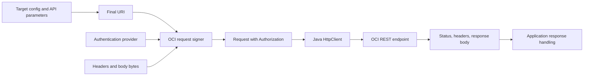

# Calling OCI REST APIs and Understanding Request Signing

## 1. Objectives and Scope

In the **OCI SDK and REST API with Java** chapter of the **CLOUD_PROVIDERS_ORACLE** module, this lesson explains how a Java application builds a REST request to OCI, signs the request, and reads the response.

The lab scenario is a program that lists up to ten objects in a private test bucket. The program explicitly builds the URI and uses `java.net.http.HttpClient` to send HTTP requests, delegating signing to the OCI Java SDK's signer. This separation makes the boundaries between request construction, authentication, authorization, and response handling clearly visible.

After this lesson, you should be able to:

- Identify the exact endpoint, method, path, query, and body of an API.
- Explain the signing string and the `Authorization: Signature ...` header.
- Distinguish body hashes, RSA signatures, and Base64 encoding.
- Preserve the URI, signed headers, and body bytes verbatim when sending.
- Diagnose request-signing errors before editing IAM policies or increasing retries.

The examples focus on native OCI APIs over HTTPS. Protocols such as Kafka, S3 compatibility, or pre-authenticated request URLs have their own authentication contracts. Do not apply a single signing pattern across every interface merely because they are hosted on OCI.

The code and lab exercises below were not compiled or run against a live tenancy during lesson authoring.

## 2. How Calling REST Directly Differs from Using an SDK Service Client

| Calling Approach | What the Application Manages Directly |
| --- | --- |
| Service client, e.g., `ObjectStorageClient` | Selecting provider, configuring client, and building request models |
| Custom HTTP client with OCI signer | URI, headers, body, HTTP transport, error parsing, pagination, and retries |
| Manual signing with Java Cryptography Architecture | All of the above, plus request canonicalization and key handling |

SDK service clients still call the service's REST APIs under the hood. When switching to a custom HTTP client, the application takes over responsibilities the service client normally handles.

In this lesson's example, the OCI signer produces the authentication headers. It does not send the request, parse JSON responses, or make arbitrary network errors safe to retry.



When an API already has a suitable service client, using the service client usually reduces integration code to maintain. Calling REST directly is useful when inspecting raw requests, integrating a custom HTTP stack, or calling APIs not yet modeled in your current SDK version.

## 3. Reading the API Contract Before Signing

### 3.1. Components That Must Be Identified

Before each call, gather details from the exact service's API documentation:

| Component | What You Need to Know |
| --- | --- |
| Endpoint | Host for the service's region, realm, and endpoint configuration |
| Method | `GET`, `POST`, `PUT`, `PATCH`, `DELETE`, or supported method |
| Path | Resource path and path parameters |
| Query | Parameter names, values, pagination style, and defaults |
| Headers | API, authentication, conditional request, or idempotency headers if applicable |
| Body | Schema, content type, and byte encoding |
| Response | Success status, body, request ID, and error format |
| IAM | Permissions required for the operation on the target resource |

Do not blindly prepend `/20160918` to every URL. Some services include an API version in the path; Object Storage uses its own path structure.

[REST APIs](https://docs.oracle.com/en-us/iaas/Content/API/Concepts/usingapi.htm) covers the shared protocol, while exact schemas and endpoints must follow [API Reference and Endpoints](https://docs.oracle.com/en-us/iaas/api/).

### 3.2. Request Used in This Lesson

Illustrative format of a `ListObjects` call:

```http
GET /n/<NAMESPACE>/b/<BUCKET_NAME>/o?limit=10&prefix=reports%2F2026%2011%2F HTTP/1.1
Host: <OBJECT_STORAGE_HOST>
Accept: application/json
Date: <HTTP_DATE>
Authorization: Signature ...
```

- Namespace is the Object Storage namespace, not the tenancy display name.
- Bucket is the bucket name, not the bucket OCID.
- `prefix` filters object names starting with the specified string.
- `limit=10` caps the result page in the example.
- This is a listing request; it does not download object contents.

These parameters are documented in [ListObjectsRequest](https://docs.oracle.com/en-us/iaas/tools/java/latest/com/oracle/bmc/objectstorage/requests/ListObjectsRequest.html). You can cross-check the operation in [Listing Object Storage Objects in a Bucket](https://docs.oracle.com/en-us/iaas/Content/Object/Tasks/managingobjects_topic-To_list_objects_in_a_bucket.htm).

## 4. Credentials, Signatures, and IAM Are Three Distinct Parts

### 4.1. IAM User API Signing Key

For an API signing key, the core inputs include:

| Value | Role |
| --- | --- |
| Tenancy OCID | Identifies the tenancy |
| User OCID | Identifies the IAM user |
| Public key fingerprint | Identifies the public key registered for the user |
| Private key | Signs requests on the client side |
| Region/endpoint | Chooses where requests go, independent of user permissions |

The RSA API signing key pair must be in the right format, with the public key registered to the exact user. Oracle requires at least 2048-bit RSA; this is not an SSH key used to log into VMs. See [Required Keys and OCIDs](https://docs.oracle.com/en-us/iaas/Content/API/Concepts/apisigningkey.htm).

The private key is never sent in the HTTP request. The server uses the key identifier and registered public key to verify the signature.

### 4.2. Key Identifier

For a user API key, `keyId` has the form:

```text
<TENANCY_OCID>/<USER_OCID>/<PUBLIC_KEY_FINGERPRINT>
```

This is a key identifier, not a secret token that can substitute for the private key. Knowing `keyId` alone is insufficient to produce a valid signature.

Instance Principals, Resource Principals, and session token flows supply identity and keys differently. When using them, let the authentication provider and signer generate the proper credentials rather than manually assembling a `keyId` in the user API key format.

### 4.3. Policy for the Lab Operation

For a lab group in the `Default` identity domain, for example:

```text
Allow group Default/JavaRestReaders to inspect objects in compartment api-lab where target.bucket.name = 'rest-signing-lab'
```

The IAM user in the lesson must belong to the appropriate group. `ListObjects` requires `OBJECT_INSPECT`; reading object contents and managing buckets require separate permissions. See [Details for Object Storage and Archive Storage](https://docs.oracle.com/en-us/iaas/Content/Identity/Reference/objectstoragepolicyreference.htm).

The application is given the namespace and bucket directly so it does not need to list buckets to locate resources. The bucket should be private, contain test data, and not use a PAR URL so the test reflects the authentication mechanism under study.

A valid signature only proves who sent the request. IAM policies can still deny the operation after the request is authenticated.

## 5. Request Signing Version 1

### 5.1. What Does the Server Verify?

The process can be viewed as:

```text
Final request
→ Select components to sign
→ Assemble the signing string
→ Sign with the private key
→ Base64-encode the binary signature
→ Place signature and metadata in Authorization
```

The server reconstructs the signing string from the received request, retrieves the matching public key or identity material, and verifies the signature. If any signed component was altered in transit or mismatched, verification fails.

For signature version 1 described in [Request Signatures](https://docs.oracle.com/en-us/iaas/Content/API/Concepts/signingrequests.htm), OCI uses the `Signature` scheme, the `rsa-sha256` algorithm, and signature metadata inside `Authorization`.

Never send `Authorization: Bearer <API_PRIVATE_KEY>`. An API signing key is not an OAuth bearer token.

### 5.2. Three Distinct Data Elements

| Element | How It Is Produced | Purpose |
| --- | --- | --- |
| Body digest | SHA-256 over body bytes | Represents the body content inside the signed request |
| Signature | RSA-SHA256 over the signing string | Binds the request to the principal's private key |
| Base64 | Encodes binary bytes as text | Embeds digest and signature inside HTTP headers |

Base64 does not encrypt or protect data. A body hash also does not replace a signature: anyone with the body can compute its hash, but cannot produce the principal's signature without the signing key.

Request signing protects the signed components. HTTPS/TLS is still mandatory to encrypt the transport and verify the endpoint; request signatures do not encrypt payloads or automatically sign responses.

### 5.3. Headers to Sign

For GET/DELETE requests without a body, the minimal set includes:

```text
(request-target)
host
date or x-date
```

For standard PUT/POST requests carrying content, add the body header group:

```text
x-content-sha256
content-type
content-length
```

Even with an empty body, required headers must follow the method/API contract. The standard SDK also handles PATCH and HEAD; per-method configurations can be inspected in [Constants in OCI Java SDK](https://github.com/oracle/oci-java-sdk/blob/v3.94.0/bmc-common/src/main/java/com/oracle/bmc/http/signing/internal/Constants.java).

Special exceptions exist for Object Storage `PutObject` and `UploadPart`. When applying an exception, follow the Object Storage section of the signing docs strictly; never treat it as a general rule to omit body hashes on every PUT API.

### 5.4. Concrete Signing String for GET

Suppose a request has the following illustrative host and date:

```text
(request-target): get /n/labnamespace/b/rest-signing-lab/o?limit=10&prefix=reports%2F2026%2011%2F
host: objectstorage.ap-singapore-1.oraclecloud.com
date: Fri, 20 Nov 2026 02:00:00 GMT
```

The three lines are joined by LF `\n`, with no trailing blank line. Component names in the signing string are lowercase. The method in `(request-target)` is `get`, even though the HTTP request line uses `GET`.

`(request-target)` is a synthetic component for signing, not a header sent over the wire. It contains the method plus raw path and raw query; it omits `https://`, host, and `#...` fragments.

If the order in the signing string is `(request-target)`, `host`, `date`, the `headers` parameter must list them in that exact same order. Wire HTTP headers do not need to appear in the exact order shown in the signing string.

The header string and pseudo-header construction follow [draft-cavage-http-signatures-08](https://datatracker.ietf.org/doc/html/draft-cavage-http-signatures-08) along with OCI-specific rules. This describes OCI's format, not an instruction to substitute another HTTP message signing standard.

The date in the example is fixed to illustrate structure. In real calls, use the client's synchronized current time.

### 5.5. Authorization Header

The corresponding header has the form:

```http
Authorization: Signature version="1",keyId="<TENANCY_OCID>/<USER_OCID>/<FINGERPRINT>",algorithm="rsa-sha256",headers="(request-target) host date",signature="<BASE64_SIGNATURE>"
```

`headers` lists the signed components, while `signature` is the Base64-encoded binary signature. The example string above contains placeholders, not usable credentials.

The SDK may choose a different header order and remain valid as long as the signing string and `headers` list match. Do not compare two signatures simply by checking whether `Authorization` fields look superficially similar.

Using JCA directly, given a `PrivateKey privateKey` and signing string, the core signing step looks like:

```java
var rsa = java.security.Signature.getInstance("SHA256withRSA");
rsa.initSign(privateKey);
rsa.update(signingString.getBytes(java.nio.charset.StandardCharsets.UTF_8));
String signatureBase64 =
        java.util.Base64.getEncoder().encodeToString(rsa.sign());
```

This is an explanatory snippet; it omits PEM loading, passphrase handling, header selection, and request construction. The Java API is documented in [Signature](https://docs.oracle.com/en/java/javase/17/docs/api/java.base/java/security/Signature.html); OCI/JVM algorithm mappings can be checked in [Algorithm in OCI Java SDK](https://github.com/oracle/oci-java-sdk/blob/v3.94.0/bmc-common/src/main/java/com/oracle/bmc/http/signing/internal/Algorithm.java).

## 6. URI and Body Must Be Finalized Before Signing

### 6.1. Sign the Exact URL Being Sent

A request with query:

```text
?limit=10&prefix=reports%2F2026%2011%2F
```

and a request with:

```text
?prefix=reports%2F2026%2011%2F&limit=10
```

may mean the same thing to the API filter, yet have different raw request targets. If you sign the first URL and the HTTP layer sends the second, the signature no longer matches the request.

The following changes also break matching:

- Turning `%20` into `+`.
- Decoding `%2F` and reassembling it differently.
- Double-encoding `%2F` into `%252F`.
- Adding or removing a trailing `/` on the path.
- Changing the host, adding a port, or altering the endpoint after signing.

Never re-normalize a URI after signing. In Java, `getRawPath()` and `getRawQuery()` preserve escaped forms, unlike decoded accessors; see [java.net.URI](https://docs.oracle.com/en/java/javase/17/docs/api/java.base/java/net/URI.html).

### 6.2. Component-Level Percent-Encoding

In the example, the business input is the prefix string:

```text
reports/2026 11/
```

The query value is encoded as:

```text
reports%2F2026%2011%2F
```

Encode each path parameter or query value individually; keep structural delimiters like `/`, `?`, `&`, and `=` in the URL builder layer.

Per [RFC 3986](https://www.rfc-editor.org/rfc/rfc3986), unreserved characters are letters, digits, and `-._~`. The helper function in the Java section keeps those unreserved characters verbatim and percent-encodes all other UTF-8 bytes. Its input is the unencoded string.

Do not apply HTML form-encoding blindly as a universal rule for all URIs. In particular, space encoding must match between the signed request-target and what goes on the wire.

### 6.3. The Body Is a Byte Sequence

These two JSON payloads are equivalent once parsed:

```json
{"displayName":"lab"}
```

```json
{ "displayName": "lab" }
```

Yet they do not share the same byte sequence. The body hash must be computed over the exact byte sequence sent, not from parsed JSON re-serialized under a different setting.

A safe pattern is to serialize once to `byte[]`, compute the hash and length from that array, and pass that exact array to the body publisher.

With Vietnamese or non-ASCII text, `String.length()` is not the UTF-8 byte count. `content-length` must reflect the payload's byte length.

```java
byte[] bodyBytes = json.getBytes(java.nio.charset.StandardCharsets.UTF_8);

String contentSha256 = java.util.Base64.getEncoder().encodeToString(
        java.security.MessageDigest.getInstance("SHA-256")
                .digest(bodyBytes));

String contentLength = Integer.toString(bodyBytes.length);
```

This snippet illustrates digest and length calculation; it does not call a resource creation API. `MessageDigest` is documented in [Java MessageDigest](https://docs.oracle.com/en/java/javase/17/docs/api/java.base/java/security/MessageDigest.html).

For an empty PUT/POST body, the SHA-256 of an empty byte array is still a deterministic value; do not skip the hash or length if the API requires them. For streaming or chunked uploads, follow a strategy supported by both the API and transport rather than assuming small-body examples apply unchanged.

## 7. Preparing a Java Project for REST Requests

The example uses Java 17 and Maven. It depends only on the OCI SDK common module and an HTTP transport; no Object Storage service client is needed because requests are sent via Java `HttpClient`.

```xml
<project xmlns="http://maven.apache.org/POM/4.0.0"
         xmlns:xsi="http://www.w3.org/2001/XMLSchema-instance"
         xsi:schemaLocation="http://maven.apache.org/POM/4.0.0 https://maven.apache.org/xsd/maven-4.0.0.xsd">
    <modelVersion>4.0.0</modelVersion>

    <groupId>vn.example</groupId>
    <artifactId>oci-rest-signing-lab</artifactId>
    <version>1.0.0</version>

    <properties>
        <maven.compiler.release>17</maven.compiler.release>
        <project.build.sourceEncoding>UTF-8</project.build.sourceEncoding>
        <oci.sdk.version>3.94.0</oci.sdk.version>
    </properties>

    <dependencyManagement>
        <dependencies>
            <dependency>
                <groupId>com.oracle.oci.sdk</groupId>
                <artifactId>oci-java-sdk-bom</artifactId>
                <version>${oci.sdk.version}</version>
                <type>pom</type>
                <scope>import</scope>
            </dependency>
        </dependencies>
    </dependencyManagement>

    <dependencies>
        <dependency>
            <groupId>com.oracle.oci.sdk</groupId>
            <artifactId>oci-java-sdk-common</artifactId>
        </dependency>
        <dependency>
            <groupId>com.oracle.oci.sdk</groupId>
            <artifactId>oci-java-sdk-common-httpclient-jersey3</artifactId>
        </dependency>
    </dependencies>

    <build>
        <plugins>
            <plugin>
                <groupId>org.apache.maven.plugins</groupId>
                <artifactId>maven-compiler-plugin</artifactId>
                <version>3.13.0</version>
            </plugin>
            <plugin>
                <groupId>org.codehaus.mojo</groupId>
                <artifactId>exec-maven-plugin</artifactId>
                <version>3.5.0</version>
            </plugin>
        </plugins>
    </build>
</project>
```

The BOM and transport follow SDK 3.x setup in [Getting Started](https://docs.oracle.com/en-us/iaas/Content/API/SDKDocs/javasdkgettingstarted.htm). Version `3.94.0` is pinned for a deterministic dependency set; this is not a claim of being the latest release or a live-environment test report.

The Jersey transport dependency satisfies SDK components that require an HTTP provider. The example's REST request itself is still sent by `java.net.http.HttpClient`.

`DefaultRequestSigner` is a helper Oracle provides for direct REST calls, though its source is marked `@InternalSdk` and warns it may change. The example pins the SDK version for this reason; applications must verify compatibility on upgrades. See [DefaultRequestSigner](https://github.com/oracle/oci-java-sdk/blob/v3.94.0/bmc-common/src/main/java/com/oracle/bmc/http/signing/DefaultRequestSigner.java). When an API already has a service client, consider using the service client to reduce reliance on this internal helper.

## 8. Configuring Credentials for the Example

The example reads the `DEFAULT` profile from the OCI config file belonging to the user running the JVM:

```ini
[DEFAULT]
user=ocid1.user.oc1..<USER_ID>
fingerprint=<PUBLIC_KEY_FINGERPRINT>
tenancy=ocid1.tenancy.oc1..<TENANCY_ID>
region=<REGION_ID>
key_file=C:/Users/<WINDOWS_USER>/.oci/oci_api_key.pem
```

Replace placeholders with real values; the private key file must belong to the user whose public key is registered. On Windows, the config typically sits in `.oci` under the user profile. Fields and locations are documented in [SDK and CLI Configuration File](https://docs.oracle.com/en-us/iaas/Content/API/Concepts/sdkconfig.htm).

Keep private keys out of source code, repositories, and shared images. If the key is passphrase-encrypted, choose a passphrase mechanism appropriate to your provider and deployment environment.

The target endpoint is supplied separately via `APP_OCI_REST_ENDPOINT`. In a direct HTTP program, the config's `region` field does not automatically build URIs for the application.

## 9. Java: Building URIs Without Altering Encoded Data

Place the two classes in this section and the next inside `src/main/java` of your lab project without a package declaration so they run directly with the sample command.

Create `OciRestUris.java`:

```java
import java.net.URI;
import java.nio.charset.StandardCharsets;
import java.util.Locale;

public final class OciRestUris {
    private static final char[] HEX = "0123456789ABCDEF".toCharArray();

    private OciRestUris() {}

    public static URI listObjects(
            String endpoint,
            String namespace,
            String bucket,
            String prefix) {
        URI base = URI.create(endpoint);
        String host = base.getHost();
        String path = base.getRawPath();

        if (!"https".equals(base.getScheme())
                || host == null
                || !host.equals(host.toLowerCase(Locale.ROOT))
                || base.getPort() != -1
                || base.getRawUserInfo() != null
                || base.getRawQuery() != null
                || base.getRawFragment() != null
                || !(path.isEmpty() || path.equals("/"))) {
            throw new IllegalArgumentException(
                    "Use an HTTPS root endpoint with lowercase host and no port");
        }

        String resourcePath = "/n/" + encodeComponent(namespace)
                + "/b/" + encodeComponent(bucket)
                + "/o";

        String query = "limit=10&prefix=" + encodeComponent(prefix);

        return URI.create("https://" + host + resourcePath + "?" + query);
    }

    public static String encodeComponent(String value) {
        byte[] bytes = value.getBytes(StandardCharsets.UTF_8);
        StringBuilder result = new StringBuilder();

        for (byte raw : bytes) {
            int ch = raw & 0xff;
            boolean unreserved =
                    (ch >= 'a' && ch <= 'z')
                    || (ch >= 'A' && ch <= 'Z')
                    || (ch >= '0' && ch <= '9')
                    || ch == '-'
                    || ch == '.'
                    || ch == '_'
                    || ch == '~';

            if (unreserved) {
                result.append((char) ch);
            } else {
                result.append('%');
                result.append(HEX[ch >>> 4]);
                result.append(HEX[ch & 0x0f]);
            }
        }

        return result.toString();
    }
}
```

The method takes unencoded namespace, bucket, and prefix strings and builds the URI once. Slashes `/` inside `prefix` are query data and get encoded, while structural `/` delimiters added by the method remain intact.

The example rejects endpoints containing a port, user-info, query, or existing path. That constraint keeps Host comparison between the signer and Java `HttpClient` unambiguous in the lab; it does not mean OCI never supports other endpoint forms.

Endpoints must come from trusted deployment configuration for the right service and region. In user-facing applications, never let an incoming request choose an arbitrary URL for your program to sign and call with its own credentials.

## 10. Java: Signing and Sending GET with HttpClient

Create `OciSignedRestGet.java`:

```java
import java.io.IOException;
import java.net.URI;
import java.net.http.HttpClient;
import java.net.http.HttpRequest;
import java.net.http.HttpResponse;
import java.nio.charset.StandardCharsets;
import java.time.Duration;
import java.util.List;
import java.util.Map;
import java.util.TreeMap;
import java.util.UUID;

import com.oracle.bmc.ConfigFileReader;
import com.oracle.bmc.auth.ConfigFileAuthenticationDetailsProvider;
import com.oracle.bmc.http.signing.DefaultRequestSigner;
import com.oracle.bmc.http.signing.RequestSigner;

public final class OciSignedRestGet {
    public static void main(String[] args) throws Exception {
        URI uri = OciRestUris.listObjects(
                requiredEnv("APP_OCI_REST_ENDPOINT"),
                requiredEnv("APP_OBJECT_NAMESPACE"),
                requiredEnv("APP_OBJECT_BUCKET"),
                requiredEnv("APP_OBJECT_PREFIX"));

        var provider = new ConfigFileAuthenticationDetailsProvider(
                ConfigFileReader.parseDefault());

        RequestSigner signer =
                DefaultRequestSigner.createRequestSigner(provider);

        HttpClient http = HttpClient.newBuilder()
                .version(HttpClient.Version.HTTP_1_1)
                .connectTimeout(Duration.ofSeconds(10))
                .followRedirects(HttpClient.Redirect.NEVER)
                .build();

        HttpResponse<String> response = sendOnce(http, signer, uri);

        String requestId = response.headers()
                .firstValue("opc-request-id")
                .orElse("<not-present>");

        System.out.printf(
                "status=%d requestId=%s responseBytes=%d%n",
                response.statusCode(),
                requestId,
                response.body().getBytes(StandardCharsets.UTF_8).length);

        if (response.statusCode() != 200) {
            throw new IOException(
                    "OCI ListObjects failed; status=" + response.statusCode()
                            + "; requestId=" + requestId);
        }

        // Display only fixture names from the private lab bucket.
        System.out.println(response.body());
    }

    private static HttpResponse<String> sendOnce(
            HttpClient http,
            RequestSigner signer,
            URI uri) throws IOException, InterruptedException {
        Map<String, List<String>> originalHeaders = Map.of(
                "accept", List.of("application/json"),
                "opc-client-request-id", List.of(UUID.randomUUID().toString()));

        Map<String, String> signedHeaders =
                signer.signRequest(uri, "GET", originalHeaders, null);

        Map<String, String> outgoing =
                new TreeMap<>(String.CASE_INSENSITIVE_ORDER);

        originalHeaders.forEach((name, values) ->
                outgoing.put(name, values.get(0)));
        outgoing.putAll(signedHeaders);

        HttpRequest.Builder request = HttpRequest.newBuilder(uri)
                .version(HttpClient.Version.HTTP_1_1)
                .timeout(Duration.ofSeconds(30))
                .GET();

        for (var header : outgoing.entrySet()) {
            if (header.getKey().equalsIgnoreCase("host")) {
                if (!header.getValue().equals(uri.getRawAuthority())) {
                    throw new IllegalStateException(
                            "Signed host differs from request authority");
                }
                // Java HttpClient generates Host from this same URI.
                continue;
            }
            request.header(header.getKey(), header.getValue());
        }

        return http.send(
                request.build(),
                HttpResponse.BodyHandlers.ofString(StandardCharsets.UTF_8));
    }

    private static String requiredEnv(String name) {
        String value = System.getenv(name);
        if (value == null || value.isBlank()) {
            throw new IllegalArgumentException(
                    "Missing environment variable: " + name);
        }
        return value;
    }
}
```

### 10.1. What the Signer Handles

`signRequest(...)` takes the URI, method, headers, and body. Its return value contains `Authorization` along with any headers the signer requires when sending.

The application must preserve every returned value verbatim. Copying `Authorization` while omitting the signer-generated `date` header is an integration bug. This contract is described in [RequestSigner](https://docs.oracle.com/en-us/iaas/tools/java/latest/com/oracle/bmc/http/signing/RequestSigner.html).

The example passes `null` for the body because GET has no request body. It does not pass an empty JSON string or a Java object needing serialization.

The SDK signer handles retrieving signing material from the authentication provider. The program does not parse PEM files, compute fingerprints, or print authentication headers itself.

### 10.2. Why Not Set Host via request.header?

Java `HttpClient` manages certain restricted headers and rejects attempts to set them manually. This mechanism is documented in [HttpRequest.Builder](https://docs.oracle.com/en/java/javase/17/docs/api/java.net.http/java/net/http/HttpRequest.Builder.html).

The example restricts URIs to HTTPS root endpoints with lowercase hosts and no explicit port. When the signer returns `host`, the code verifies it matches the URI authority and lets Java `HttpClient` derive `Host` from that exact URI.

This is an explicit conditional check for a transport-managed header, not a rule to drop arbitrary signed headers. If switching to another transport or URI shape, re-verify the actual `Host` header value.

The example uses HTTP/1.1 to keep inspecting the request line and `Host` simple. Signatures still depend on logical request components rather than TCP framing order.

### 10.3. Why Disable Redirects?

A signature for the original host and path does not automatically authenticate a redirected host and path. Following redirects automatically can also leak authentication headers to an unintended destination depending on client behavior.

On a 3xx response, verify the endpoint and API contract. If you genuinely need to call a new URI, validate the destination URI and construct and sign a new request. Never carry an already signed request over to a different address.

Redirect options and client reuse are documented in [Java HttpClient](https://docs.oracle.com/en/java/javase/17/docs/api/java.net.http/java/net/http/HttpClient.html).

### 10.4. What This Example Does Not Implement Yet

This is a single-page `ListObjects` call. The program lacks pagination loops, application retries, JSON error parsing, or full inventory logic.

HTTP errors do not automatically become `BmcException` when using Java `HttpClient`. The application must inspect the status and body of `HttpResponse`. Pre-send signing failures also differ from HTTP 401 responses returned by OCI.

Every `sendOnce` call asks the signer to generate headers for that transmission. Never cache an `HttpRequest` with an old signature and reuse it for hours.

## 11. Running the Example and Reading Output

### 11.1. Preparing Fixtures

In a private lab bucket, create a few small test objects with names such as:

```text
reports/2026 11/a.txt
reports/2026 11/b.txt
notes/readme.txt
```

You can also add names containing Vietnamese characters to observe UTF-8 query encoding. Never use production data or sensitive object names in illustrative JSON output.

Confirm the user has `ListObjects` permission, the config points to the right private key, and the endpoint is the Object Storage endpoint for the bucket's region.

### 11.2. Setting PowerShell Environment Variables

```powershell
$env:APP_OCI_REST_ENDPOINT = "<OBJECT_STORAGE_ROOT_ENDPOINT_HTTPS>"
$env:APP_OBJECT_NAMESPACE = "<OBJECT_STORAGE_NAMESPACE>"
$env:APP_OBJECT_BUCKET = "rest-signing-lab"
$env:APP_OBJECT_PREFIX = "reports/2026 11/"

mvn compile exec:java "-Dexec.mainClass=OciSignedRestGet"
```

Replace the endpoint placeholder with the real endpoint from service docs or configuration. Do not leave `<...>` characters around values when running.

Expected output:

- Status 200.
- A request ID for tracing when the service returns that header.
- JSON containing only objects matching the prefix on the current page.
- No private keys or `Authorization` headers in the output.

An empty result page is valid if no object names match the prefix. Do not mistake zero objects for a signing failure.

### 11.3. Understanding the Scope of the Test

Success in this example proves that a specific GET request was sent and accepted under the current identity and permissions. It does not prove POST APIs, streaming uploads, pagination, or all OCI endpoints are integrated correctly.

To test URI encoding, replace the prefix with strings containing spaces, `+`, Vietnamese characters, or `/`. Compare the pre-signed URL against the intended query value; never edit the URI after signing just to "beautify" logs.

## 12. Extending to APIs with a Request Body

### 12.1. Fixing One Payload Representation

Before sending JSON:

```text
Business object
→ Serialize once
→ UTF-8 byte[]
→ Compute content-length and x-content-sha256
→ Build signing string and Authorization
→ Send the exact same byte[]
```

Never let a signer hash a Java object using serializer A while the transport re-serializes that object using serializer B. Differences in field order, whitespace, newlines, or escaping produce different body bytes.

When using the OCI signer for small bodies, check which body representations that SDK version's signer supports and how the transport sends bytes. How the SDK version used here reads bodies and computes headers can be seen in [RequestSignerImpl](https://github.com/oracle/oci-java-sdk/blob/v3.94.0/bmc-common/src/main/java/com/oracle/bmc/http/signing/internal/RequestSignerImpl.java).

The Java GET example above is not a general POST/PUT sender. Extending it requires adding method handling, a body publisher, content type, content length, and per-API signing rules.

### 12.2. Content-Length and Transport

JDK `HttpClient` manages `Content-Length` automatically from the body publisher. Do not omit a required header from signing simply because the builder forbids setting it manually.

For small payloads, choose a fixed-length publisher and confirm the transport-sent length matches the signed length. For instance, `BodyPublishers.ofByteArray(bodyBytes)` builds a publisher over the exact finalized byte array. If the library switches to chunked transfer or transforms the body, resolve that discrepancy before sending.

Do not enable flags allowing arbitrary restricted headers just to silence an unexplained error. The goal is ensuring actual wire headers match the signing contract, not forcing the builder to accept arbitrary strings.

### 12.3. Object Storage PUT Exceptions

Certain Object Storage upload operations have special signing rules to support upload workflows. That does not mean you can freely drop body headers across all Object Storage calls or all HTTP PUTs.

For large files, multipart uploads, non-replayable streams, or unknown-length content, use the appropriate service client/upload API or design transport handling per the operation docs. Never hash an entire stream and forget the stream was already consumed before sending.

If a library offers a strategy to exclude the body from the signature, select it only when the specific API supports it. Never use it as a blanket workaround for body serialization bugs.

## 13. Reading Responses Per the API Contract

### 13.1. Status, Body, and Request ID

Every response must be evaluated against the exact API:

| Component | Meaning |
| --- | --- |
| HTTP status | Outcome of the current HTTP call |
| Error JSON | Service code and error description when present |
| `opc-request-id` | Identifier for tracing the call |
| ETag | Resource representation version per the resource contract |
| Pagination header/body | Signal that additional data remains |
| Work request ID | Tracks asynchronous operations when used by the API |

In the lab code, any status other than 200 fails the program. That is a rule for the `ListObjects` example, not a claim that every successful API returns 200.

A properly signed request can still be rejected due to IAM, invalid inputs, wrong-region resources, or state conflicts. Diagnostics must combine status, service code, request ID, and the operation invoked.

If writing a JSON error parser, retain useful diagnostic fields without assuming the entire error body is safe to log. Bodies can contain resource names or parameter values.

### 13.2. Pagination: Every Page Is a New Request

Many OCI List APIs return `opc-next-page` and accept `page` in the query string. Do not apply that pattern mechanically to every service.

Object Storage `ListObjects` returns `nextStartWith` in the body when more data exists; pass that value in the `start` parameter of the next call. This mechanism is documented in [Get-OCIObjectstorageObjectsList](https://docs.oracle.com/en-us/iaas/tools/powershell/latest/articles/Get-OCIObjectstorageObjectsList.html).

The pagination loop for the example can be structured as:

```text
start = unset

Loop:
    build URI from namespace, bucket, prefix, limit, and start
    sign new URI with current headers
    send GET
    check status and parse response
    process objects
    read nextStartWith
    if nextStartWith is absent: stop
    start = nextStartWith
```

Keep business filters consistent across pages. Encode the continuation/start token as a query value; never append raw unencoded strings to the URL.

Never reuse page one's `Authorization` header for page two because the query string changed. Nor should you assume "done" simply because a page returned few items; rely on the API's termination condition.

### 13.3. Asynchronous Operations

APIs initiating infrastructure changes may return before the resource is ready. When an API returns `opc-work-request-id`, track it using the service's corresponding work request API.

An accepted response does not substitute for confirming the final state of a Compute instance, VCN, or database. Each status poll is still a request that must be signed properly.

Services may use the shared Work Requests API or a service-specific API; see [Asynchronous Work Requests](https://docs.oracle.com/en-us/iaas/Content/API/Concepts/workrequests.htm). Pick the right endpoint, permissions, and terminal states rather than hardcoding one universal rule across all resources.

## 14. Retries and Fresh Signatures

### 14.1. Re-Sign on Every Transmission

For application retries:

1. Preserve operation semantics, payload, and idempotency token if supported by the API.
2. Regenerate timestamp headers for the new attempt.
3. Re-sign the exact URI and body bytes of that attempt.
4. Send the request and record the attempt's outcome.

Reusing an old signature after a long delay can push the request past the allowed time window. Client clock skew exceeding five minutes can trigger 401 per [Maximum Allowed Client Clock Skew](https://docs.oracle.com/en-us/iaas/Content/API/Concepts/usingapi.htm#clock).

Never update `date` in a request while keeping the old `Authorization` header: the timestamp is part of the signed data. If both `date` and `x-date` appear, handle them consistently per OCI rules; the lesson example lets the signer generate `date`.

### 14.2. Signatures Differ from Idempotency

Re-signing authenticates a new transmission. It does not guarantee a resource-creation operation executes only once.

| Value | Purpose |
| --- | --- |
| Signature | Authenticates the request with valid credentials |
| `opc-request-id` | Traces the request received by the service |
| `opc-client-request-id` when supported | Client-supplied tracing identifier |
| `opc-retry-token` when supported | Retry/idempotency mechanism per the API contract |
| Business operation ID | Identifies the application's business task |

In the GET example, a new trace ID neither creates nor deduplicates data. When moving to VCN or database creation APIs, study retry tokens, expiration windows, and token invalidation rules carefully.

Never change the idempotency token merely because a timeout occurred before knowing whether the server executed the operation. Handle unknown states according to the API contract and your reconciliation plan.

### 14.3. Which Errors Need Backoff?

Transient errors such as throttling or certain 5xx failures may warrant bounded retries. Use backoff, jitter, and an overall deadline to avoid retry storms.

Schema errors, wrong key fingerprints, URI-mismatch signatures, or missing IAM permissions are not fixed by rapidly repeating the same request.

An application using its own HTTP client must implement retries explicitly. Calling a signer helper does not bring along an OCI service client's built-in retrier or circuit breaker.

## 15. Evidence-Based Signing Troubleshooting

### 15.1. Separating Error Categories

| Symptom | What to Check |
| --- | --- |
| Failure before sending HTTP | Config file, private key, passphrase, provider, invalid URI |
| DNS / connect timeout | Endpoint, DNS, proxy, routes, firewall |
| TLS handshake failure | CA/truststore, hostname, TLS proxy, clock |
| 401 `NotAuthenticated` | Key, fingerprint, `keyId`, clock, headers, and signing string |
| 403 or 404 related to permissions | Policy, principal, compartment, region, and resource |
| 400 | Schema, path/query, body, and business headers |
| 405 | HTTP method unsupported by the API |
| 412 | ETag precondition no longer matches |
| 429 or transient error | Backoff and load control after classifying |

OCI can return 404 `NotAuthorizedOrNotFound` for both nonexistent resources and missing permissions. Do not assume all permission errors return 403. Error codes are documented in [API Errors](https://docs.oracle.com/en-us/iaas/Content/API/References/apierrors.htm).

### 15.2. Checklist When Encountering 401

```text
Right provider/key?
→ Public key registered to the right user?
→ Fingerprint and keyId accurate?
→ System clock / date header accurate?
→ Method, raw path, and raw query accurate?
→ Actual Host matches signed host?
→ Were signed header values altered?
→ Do body digest and byte length match sent body?
→ Does signing string order match the headers parameter?
```

Do not start by granting tenancy-wide admin permissions. Broader permissions will never make an invalid signature valid.

When using the SDK signer, compare the **signer's inputs** against the **request actually transmitted by the HTTP layer**. If inputs are right yet interceptors, middleware, or proxies alter a signed component, inspect that layer.

### 15.3. Subtle Mismatches Hard to Spot by Eye

| Discrepancy | Why It Breaks Authentication |
| --- | --- |
| LF turned into CRLF in a manual signing string | Signed byte sequence differs |
| Trailing newline appended to signing string | Alters signed input data |
| `%20` turned into `+` | Raw query differs |
| Query parameters sorted after signing | Request-target differs |
| `:443` added on only one side | Signed host and sent `Host` may differ |
| UTF-8 body with length counted in characters | Content length and byte payload mismatch |
| JSON re-serialized after hashing | Digest no longer matches the new body |
| Signed `Content-Type` modified | Header value no longer matches |
| Copying only `Authorization` from signer output | Missing headers referenced by the signature |

HTTP header names are case-insensitive on the wire, whereas the signing string canonicalizes header names specifically. Never lowercase header **values** because of that, especially byte-sensitive or case-sensitive values.

When learning by constructing signatures manually, test against public test vectors in Oracle's documentation and verify with the matching public key. Locally verifying a signature only proves your local key pair and signing string agree; it does not prove the HTTP request reaching OCI matches that signing string.

## 16. Different Principals Still Share the Same HTTP Contract

The example uses an API key to make user/tenancy/fingerprint components explicit. On OCI Compute or Functions, you can select the matching provider before creating the signer:

```java
var provider =
        com.oracle.bmc.auth.InstancePrincipalsAuthenticationDetailsProvider
                .builder()
                .build();

var signer = DefaultRequestSigner.createRequestSigner(provider);
```

Or in a runtime supporting Resource Principals:

```java
var provider =
        com.oracle.bmc.auth.ResourcePrincipalAuthenticationDetailsProvider
                .builder()
                .build();

var signer = DefaultRequestSigner.createRequestSigner(provider);
```

These two snippets are alternatives, not meant to be declared together in the same scope. The runtime must provide the identity and the principal must hold appropriate IAM policies. Never force these providers' `keyId` into a user API key format.

Pay close attention to token lifecycles: a signer paired with Java `HttpClient` does not automatically inherit all of a service client's refresh-on-error machinery. Check your provider/SDK behavior, handle 401s with bounded refresh through supported mechanisms, and never cache tokens or key material as static immutable copies in the application.

## 17. Operating a Maintainable REST Integration

### 17.1. Keeping Requests Consistent Across Layers

Structure code in this order:

```text
Trusted target configuration
→ Build final URI and body
→ Build business headers
→ Sign
→ Send immediately via a transport that does not mutate signed data
→ Read status/headers/body
→ Decide pagination, retry, or business state
```

Any interceptor modifying the URI or body must run before the signer. If a layer must alter a signed component, re-sign the request after that change.

Scope the HTTP client and provider to an appropriate lifecycle to leverage connection pooling and credential management. Never share a mutable request builder across threads; each transmission should own its request state.

### 17.2. Log Enough to Investigate Without Leaking Credentials

Log the method, operation name, validated region/host, HTTP status, service code, latency, and request ID. For URLs, query strings, or response bodies, evaluate data sensitivity before logging.

Never log private keys, passphrases, session tokens, or full `Authorization` headers. Even a manually built signing string can contain sensitive paths or query values; inspect it only under controlled conditions with fixtures.

Never enable wire/debug logging containing credentials and ship all of it into a shared log system. During production troubleshooting, collect the minimal data needed to pinpoint which layer altered the request.

### 17.3. Governing Library Upgrades

When upgrading the SDK or JDK, re-verify the boundary between signer and transport: SDK-returned headers, JDK-managed headers, raw URIs, body publishers, and redirect/retry behavior.

Separate URI building, provider selection, and HTTP transport so verification stays straightforward. For APIs already stable in the SDK, consider migrating to a service client rather than expanding custom REST glue for too many edge cases.

An integration is sound when the application signs the exact request transmitted on the wire, uses the right identity and IAM policies, respects the response contract, and preserves those invariants across pagination, retries, and credential rotation.
