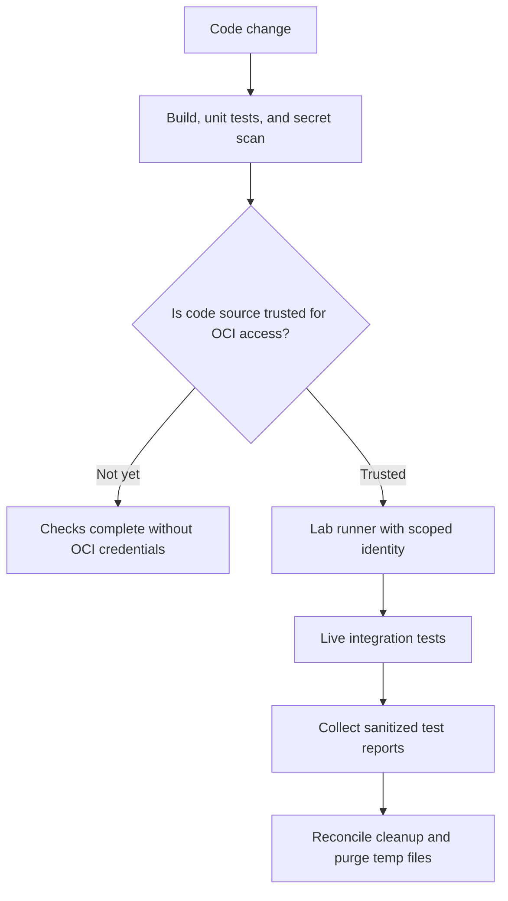

# SDK Integration Testing and Protecting Credentials in Source Code

In the **OCI SDK and REST API with Java** chapter of the **CLOUD_PROVIDERS_ORACLE** module, this lesson covers testing Java applications against live OCI services while managing credentials so secrets never enter source code, logs, or build artifacts.

The running example is a Java application using the OCI Java SDK to read bucket metadata, write a test object, read it back, and clean up resources. The same approach applies to Compute, database, and other OCI service integrations, though each service requires its own scenarios and IAM permissions.

Test outcomes must answer two questions: does the application behave properly with OCI in the assigned environment, and does it use the intended identity, permission scope, and credential delivery mechanism?

## 1. Distinguishing Testing Layers

### 1.1. Unit Tests, Adapter Tests, and Live Integration Tests

| Testing Layer | Real Components | Primary Value | Limitations |
| --- | --- | --- | --- |
| Unit tests | Java business logic | Verifies rules, data transforms, error branches | Does not prove OCI calls work |
| Adapter tests with fakes or mocks | App integration code, fake dependencies | Verifies request building and response mapping | Does not verify signatures, IAM, or live networking |
| OCI integration tests | SDK, HTTP client, auth, and live services | Verifies API path and authorized behavior | Depends on environment, resources, and cost |
| End-to-end application tests | Multiple deployed components together | Verifies end-to-end business outcomes | Harder to isolate root causes |

Mocking a client to return sample responses cannot check whether a private key matches a registered public key. Conversely, succeeding against OCI alone does not prove the application handles errors or missing fields cleanly.

Place an application-owned adapter between business logic and the SDK. Unit tests focus on application logic; a small integration test suite verifies the assumptions that must be tested against live OCI.

### 1.2. Choosing Assertions for the Behavior Under Test

A meaningful assertion ties to a specific requirement:

- Reads metadata of the exact bucket in the expected compartment.
- Read-back payload matches the written bytes.
- A read-only identity cannot write to the prepared resource.
- Integration code handles paginated responses properly for the operation used.
- Test resources are cleaned up or tracked for follow-up handling.

Merely asserting a response is non-null is rarely enough. Similarly, printing "connected" after one API call does not prove permissions exist for all operations the application needs.

## 2. Identifying Credential Types and Protection Boundaries

### 2.1. Do Not Treat All Configuration Values as Identical to Secrets

| Component | Nature | How to Handle |
| --- | --- | --- |
| API signing private key | Secret used to generate signatures | Never commit; restrict read access to authorized users/processes |
| Public key and fingerprint | Public-key metadata | Cannot replace the private key; still govern metadata per internal policy |
| User OCID, tenancy OCID, compartment OCID | Resource or identity identifiers | Do not grant permissions themselves; avoid unnecessary public exposure |
| Auth token or session token | Credentials for their respective mechanisms | Never log or place in public fixtures |
| Customer secret key | Credentials for corresponding supported interfaces | Never use in place of an API signing private key |
| Config file | Configuration bundle, may reference key paths or sensitive info | Keep real config files outside repositories |
| Region, lab bucket name, test flags | Operational configuration | Can use sample values; keep separate from secrets |

OCI provides multiple credential types for different access patterns. Protect each according to its role and lifecycle; see [Protecting IAM Credentials](https://docs.oracle.com/en-us/iaas/Content/Security/Reference/iam_security_topic-IAM_Credentials.htm).

Base64-encoding a private key does not make it safe to commit. Encrypting a key with a passphrase is also no excuse to distribute real keys inside a repository.

### 2.2. Secrets Can Leak Outside Java Source Files

Common places to audit include:

- `src/main/resources` and `src/test/resources`.
- IDE configuration files and launch configurations.
- Test scripts, Dockerfiles, and CI pipeline configs.
- HTTP logs, stack traces carrying custom data, environment dumps.
- Test reports, failure attachments, and CI artifacts.
- Container image contents, old layers, and build caches.
- Git history, old branches, and repository forks/clones.

In particular, files in resources can be packaged into JARs or test JARs. A key placed only in a test directory can still be distributed unintentionally.

## 3. Choosing Identities for Each Test Environment

### 3.1. Local Development

You can use a profile in a config file stored outside the repository. The config supplies details such as user, tenancy, fingerprint, private key path, and region per the chosen authentication method. See [SDK and CLI Configuration File](https://docs.oracle.com/en-us/iaas/Content/API/Concepts/sdkconfig.htm).

Illustrative example containing placeholders only:

```ini
[SDK_IT]
user=REPLACE_WITH_TEST_USER_OCID
fingerprint=REPLACE_WITH_PUBLIC_KEY_FINGERPRINT
tenancy=REPLACE_WITH_TEST_TENANCY_OCID
region=ap-singapore-1
key_file=/absolute/path/outside-repository/oci_api_key.pem
```

Never embed a private key inside a Java string or copy a real file into resources for "test convenience." If the key is passphrase-protected, supply the passphrase at runtime in a way supported by the provider; never place real passphrases in sample configs.

### 3.2. Runners on OCI Compute

Instance principal allows workloads on Compute to call OCI using the instance's identity via dynamic groups and IAM policies, instead of distributing user API keys to runners. See [Calling Services from an Instance](https://docs.oracle.com/en-us/iaas/Content/Identity/Tasks/callingservicesfrominstances.htm).

That runner is still a privileged execution environment. Code running on the runner can exercise the granted identity, so control which code sources are permitted to run there.

### 3.3. Environments Supporting Resource Principals or Workload Identity

Resource principals only work in environments providing the matching authentication contract. Never assume an arbitrary container or a CI runner outside OCI automatically has a resource principal.

In environments providing resource principals, the Java SDK includes a provider reading runtime material per the supported contract. See [ResourcePrincipalAuthenticationDetailsProvider](https://docs.oracle.com/en-us/iaas/tools/java/latest/com/oracle/bmc/auth/ResourcePrincipalAuthenticationDetailsProvider.html).

If a platform supports workload identity or identity federation, pick the matching provider and configure trust for that environment. Naming an auth mechanism does not replace configuring IAM.

### 3.4. CI Outside OCI

If an API signing key must be used:

1. Store credentials in the CI platform's secret manager or chosen vault.
2. Expose them only to jobs that run OCI tests.
3. Materialize temporary config and key files outside any packaged directory.
4. Restrict read permissions to the job runner account.
5. Delete temporary files when the job finishes and ensure runner cleanup.
6. Never include secrets in caches or build artifacts.

Environment variables are a runtime transport mechanism, not a complete secret store. Never dump the full environment to debug failures, and do not assume log masking catches every transformed representation of a secret.

## 4. Designing the Lab Environment and IAM Permissions

### 4.1. Small, Owned, Easy-to-Clean Resources

The Object Storage example in this lesson uses:

- A dedicated lab compartment.
- A pre-provisioned test bucket.
- An explicit namespace and region.
- Object prefix `sdk-it/`.
- Per-run unique object names containing a UUID.
- Small payloads containing no real data.

The lab bucket for write/delete tests must be prepared per test procedures, without retention rules blocking cleanup and without versioning enabled for this simple scenario. If you need to test versioning, track and delete exact versions rather than using the simple script below unchanged.

For tests creating Compute or database services, enforce shape limits, lifetime caps, and resource budgets. Never use an expensive resource creation call as a default smoke test.

### 4.2. Per-Operation Permissions Scoped to the Lab Bucket

Example policy for an existing user group in a compartment named `SdkIntegrationLab`:

```text
Allow group SdkIntegrationTests to read buckets in compartment SdkIntegrationLab where target.bucket.name = 'sdk-it-bucket'

Allow group SdkIntegrationTests to manage objects in compartment SdkIntegrationLab where target.bucket.name = 'sdk-it-bucket'
```

The first statement covers reading bucket metadata; the second allows writing, reading, and deleting objects inside the scoped bucket. `manage objects` is still broad over objects in that bucket, so dedicate the bucket solely to the lab.

If using instance principals, target the corresponding dynamic group instead of a user group. Check verbs, operations, and condition variables in [Object Storage policy reference](https://docs.oracle.com/en-us/iaas/Content/Identity/Reference/objectstoragepolicyreference.htm).

Never grant `manage all-resources in tenancy` just to quickly bypass a permission error in a test. Identify the failing operation and its required permission.

### 4.3. Fail Fast on Misconfiguration

Before any test that writes data, verify at minimum:

- The integration test opt-in flag is enabled.
- Region, namespace, and bucket are non-blank.
- The bucket actually belongs to the expected lab compartment.
- The write-test opt-in flag is set when running write/delete rounds.
- The identity matches the explicitly selected authentication mode.

Code-level flags only reduce accidental runs; true security boundaries remain IAM and provisioned resources. If the entire configuration is switched to production at once, a check comparing against that same wrong config cannot protect the environment by itself.

## 5. Separating Test Suites with Maven and JUnit

### 5.1. Organizational Convention

Recommended layout:

```text
src/main/java/.../OciObjectStore.java
src/test/java/.../OciObjectStoreTest.java
src/test/java/.../OciObjectStorageIT.java
src/test/java/.../OciTestClients.java
src/test/resources/fixtures/sample-object.txt
```

Fixtures contain only dummy data. Credentials are supplied at runtime and never live inside this directory tree.

Maven Surefire handles unit tests; Failsafe handles integration tests and checks results in the `verify` phase. Run `mvn verify` to execute the full relevant lifecycle. See [Maven Failsafe](https://maven.apache.org/surefire/maven-failsafe-plugin/index.html).

### 5.2. Dependencies for the Example

The XML snippets below fit into a Java 17 Maven project already configured with an appropriate compiler. Versions are pinned for clarity; when integrating into your project, align them with your project's dependency set.

```xml
<properties>
    <oci.sdk.version>3.102.0</oci.sdk.version>
    <junit.version>5.11.4</junit.version>
    <test.plugin.version>3.6.1</test.plugin.version>
</properties>

<dependencyManagement>
    <dependencies>
        <dependency>
            <groupId>com.oracle.oci.sdk</groupId>
            <artifactId>oci-java-sdk-bom</artifactId>
            <version>${oci.sdk.version}</version>
            <type>pom</type>
            <scope>import</scope>
        </dependency>
    </dependencies>
</dependencyManagement>

<dependencies>
    <dependency>
        <groupId>com.oracle.oci.sdk</groupId>
        <artifactId>oci-java-sdk-objectstorage</artifactId>
    </dependency>
    <dependency>
        <groupId>com.oracle.oci.sdk</groupId>
        <artifactId>oci-java-sdk-common-httpclient-jersey3</artifactId>
    </dependency>
    <dependency>
        <groupId>org.junit.jupiter</groupId>
        <artifactId>junit-jupiter</artifactId>
        <version>${junit.version}</version>
        <scope>test</scope>
    </dependency>
</dependencies>
```

The OCI Java SDK requires choosing an HTTP client; do not assume declaring a service module automatically brings an HTTP client for the application. See [Configuring the Java SDK](https://docs.oracle.com/en-us/iaas/Content/API/SDKDocs/javasdkgettingstarted.htm).

### 5.3. Activating Failsafe Only in the OCI Profile

```xml
<build>
    <plugins>
        <plugin>
            <groupId>org.apache.maven.plugins</groupId>
            <artifactId>maven-surefire-plugin</artifactId>
            <version>${test.plugin.version}</version>
            <configuration>
                <excludes>
                    <exclude>**/*IT.java</exclude>
                </excludes>
            </configuration>
        </plugin>
    </plugins>
</build>

<profiles>
    <profile>
        <id>oci-it</id>
        <build>
            <plugins>
                <plugin>
                    <groupId>org.apache.maven.plugins</groupId>
                    <artifactId>maven-failsafe-plugin</artifactId>
                    <version>${test.plugin.version}</version>
                    <configuration>
                        <includes>
                            <include>**/*IT.java</include>
                        </includes>
                        <failIfNoTests>true</failIfNoTests>
                    </configuration>
                    <executions>
                        <execution>
                            <goals>
                                <goal>integration-test</goal>
                                <goal>verify</goal>
                            </goals>
                        </execution>
                    </executions>
                </plugin>
            </plugins>
        </build>
    </profile>
</profiles>
```

Failsafe naming conventions and include configuration are documented in [failsafe:integration-test](https://maven.apache.org/surefire/maven-failsafe-plugin/integration-test-mojo.html).

Two execution paths:

```bash
mvn test
mvn -Poci-it verify
```

The second command runs live tests only when the test class's runtime condition is also enabled. `failIfNoTests` does not replace checking whether tests were disabled or skipped.

## 6. Creating Clients Without Hardcoding Credentials

### 6.1. Environment Variable Contract for the Example

| Variable | Role |
| --- | --- |
| `OCI_RUN_LIVE_TESTS` | Set to `true` to allow the live test class to run |
| `OCI_IT_ALLOW_WRITE` | Set to `true` to allow write/delete tests |
| `OCI_IT_AUTH` | One of `config`, `instance`, `resource` |
| `OCI_IT_REGION` | Region used for tests |
| `OCI_IT_NAMESPACE` | Object Storage namespace |
| `OCI_IT_BUCKET` | Lab bucket |
| `OCI_IT_COMPARTMENT_ID` | Expected lab compartment |
| `OCI_IT_CONFIG_PATH` | Config path outside the repo, used in `config` mode |
| `OCI_IT_PROFILE` | Profile used in `config` mode |

The `OCI_IT_*` names are a contract defined by this example. The Java SDK does not automatically interpret these variables; the code below reads and passes them explicitly.

### 6.2. Factory Placed in Test Sources

```java
import com.oracle.bmc.ClientConfiguration;
import com.oracle.bmc.Region;
import com.oracle.bmc.auth.AbstractAuthenticationDetailsProvider;
import com.oracle.bmc.auth.ConfigFileAuthenticationDetailsProvider;
import com.oracle.bmc.auth.InstancePrincipalsAuthenticationDetailsProvider;
import com.oracle.bmc.auth.ResourcePrincipalAuthenticationDetailsProvider;
import com.oracle.bmc.objectstorage.ObjectStorageClient;

import java.io.IOException;

final class OciTestClients {

    private OciTestClients() {
    }

    static ObjectStorageClient create() throws IOException {
        String mode = required("OCI_IT_AUTH");
        Region region = Region.fromRegionId(required("OCI_IT_REGION"));

        AbstractAuthenticationDetailsProvider provider = switch (mode) {
            case "config" ->
                    new ConfigFileAuthenticationDetailsProvider(
                            required("OCI_IT_CONFIG_PATH"),
                            required("OCI_IT_PROFILE"));
            case "instance" ->
                    InstancePrincipalsAuthenticationDetailsProvider
                            .builder().build();
            case "resource" ->
                    ResourcePrincipalAuthenticationDetailsProvider
                            .builder().build();
            default -> throw new IllegalArgumentException(
                    "Unsupported OCI_IT_AUTH mode");
        };

        ClientConfiguration configuration = ClientConfiguration.builder()
                .connectionTimeoutMillis(3_000)
                .readTimeoutMillis(15_000)
                .build();

        return ObjectStorageClient.builder()
                .region(region)
                .configuration(configuration)
                .build(provider);
    }

    static String required(String name) {
        String value = System.getenv(name);

        if (value == null || value.isBlank()) {
            throw new IllegalStateException(
                    "Missing required configuration: " + name);
        }

        return value;
    }
}
```

The config-reading constructor is documented in [ConfigFileAuthenticationDetailsProvider](https://docs.oracle.com/en-us/iaas/tools/java/latest/com/oracle/bmc/auth/ConfigFileAuthenticationDetailsProvider.html); instance principal has its matching provider in the [Java SDK](https://docs.oracle.com/en-us/iaas/tools/java/latest/com/oracle/bmc/auth/InstancePrincipalsAuthenticationDetailsProvider.html).

The factory picks an explicit mode. It does not silently fall back from a failed instance principal to a developer's API key, as falling back could run tests under an unintended identity.

Per-request timeouts do not bound total suite duration when the SDK retries or across many operations. CI jobs also need an overall deadline and managed retry policies.

## 7. Live Integration Test Example with Object Storage

### 7.1. Prerequisites for the Example

Both Java classes in this lesson belong in the same package in test sources. The example uses the prepared lab bucket, a small payload, and unique object names.

The test class contains a read-only smoke test and a write/delete round-trip test. JUnit conditions keep test activation explicit. See [JUnit environment variable conditions](https://junit.org/junit5/docs/current/user-guide/junit-user-guide-5.11.4.pdf).

```java
import com.oracle.bmc.objectstorage.ObjectStorageClient;
import com.oracle.bmc.objectstorage.requests.DeleteObjectRequest;
import com.oracle.bmc.objectstorage.requests.GetBucketRequest;
import com.oracle.bmc.objectstorage.requests.GetObjectRequest;
import com.oracle.bmc.objectstorage.requests.PutObjectRequest;

import org.junit.jupiter.api.AfterAll;
import org.junit.jupiter.api.BeforeAll;
import org.junit.jupiter.api.Tag;
import org.junit.jupiter.api.Test;
import org.junit.jupiter.api.condition.EnabledIfEnvironmentVariable;

import java.io.ByteArrayInputStream;
import java.io.InputStream;
import java.nio.charset.StandardCharsets;
import java.util.UUID;

import static org.junit.jupiter.api.Assertions.assertArrayEquals;
import static org.junit.jupiter.api.Assertions.assertEquals;
import static org.junit.jupiter.api.Assertions.assertFalse;
import static org.junit.jupiter.api.Assertions.assertNotNull;

@Tag("oci-integration")
@EnabledIfEnvironmentVariable(
        named = "OCI_RUN_LIVE_TESTS", matches = "true")
class OciObjectStorageIT {

    private static ObjectStorageClient client;
    private static String namespace;
    private static String bucket;

    @BeforeAll
    static void setUp() throws Exception {
        namespace = OciTestClients.required("OCI_IT_NAMESPACE");
        bucket = OciTestClients.required("OCI_IT_BUCKET");

        String expectedCompartment =
                OciTestClients.required("OCI_IT_COMPARTMENT_ID");

        client = OciTestClients.create();

        var response = client.getBucket(GetBucketRequest.builder()
                .namespaceName(namespace)
                .bucketName(bucket)
                .build());

        assertEquals(expectedCompartment,
                response.getBucket().getCompartmentId(),
                "Bucket must belong to the configured lab compartment");
    }

    @AfterAll
    static void closeClient() throws Exception {
        if (client != null) {
            client.close();
        }
    }

    @Test
    void canReadConfiguredBucket() {
        var response = client.getBucket(GetBucketRequest.builder()
                .namespaceName(namespace)
                .bucketName(bucket)
                .build());

        assertEquals(bucket, response.getBucket().getName());
        assertNotNull(response.getOpcRequestId());
        assertFalse(response.getOpcRequestId().isBlank());
    }

    @Test
    @EnabledIfEnvironmentVariable(
            named = "OCI_IT_ALLOW_WRITE", matches = "true")
    void canWriteAndReadOwnTestObject() throws Exception {
        String objectName = "sdk-it/" + UUID.randomUUID() + "/probe.txt";
        byte[] expected = "oci-sdk-integration-test"
                .getBytes(StandardCharsets.UTF_8);

        boolean uploadConfirmed = false;
        Throwable primaryFailure = null;

        try {
            client.putObject(PutObjectRequest.builder()
                    .namespaceName(namespace)
                    .bucketName(bucket)
                    .objectName(objectName)
                    .ifNoneMatch("*")
                    .contentType("text/plain; charset=utf-8")
                    .contentLength((long) expected.length)
                    .putObjectBody(new ByteArrayInputStream(expected))
                    .build());

            uploadConfirmed = true;

            var response = client.getObject(GetObjectRequest.builder()
                    .namespaceName(namespace)
                    .bucketName(bucket)
                    .objectName(objectName)
                    .build());

            try (InputStream body = response.getInputStream()) {
                byte[] actual = body.readNBytes(expected.length + 1);
                assertArrayEquals(expected, actual);
            }
        } catch (Exception | AssertionError failure) {
            primaryFailure = failure;
            throw failure;
        } finally {
            if (uploadConfirmed) {
                try {
                    client.deleteObject(DeleteObjectRequest.builder()
                            .namespaceName(namespace)
                            .bucketName(bucket)
                            .objectName(objectName)
                            .build());
                } catch (RuntimeException cleanupFailure) {
                    if (primaryFailure != null) {
                        primaryFailure.addSuppressed(cleanupFailure);
                    } else {
                        throw cleanupFailure;
                    }
                }
            }
        }
    }
}
```

Bucket metadata is fetched with [GetBucketRequest](https://docs.oracle.com/en-us/iaas/tools/java/latest/com/oracle/bmc/objectstorage/requests/GetBucketRequest.Builder.html). For `PutObject`, `ifNoneMatch("*")` requires the operation to fail if the object already exists; see [PutObjectRequest.Builder](https://docs.oracle.com/en-us/iaas/tools/java/latest/com/oracle/bmc/objectstorage/requests/PutObjectRequest.Builder.html).

### 7.2. What Does the Example Verify?

The smoke test verifies reading the intended bucket and receiving a request ID for tracing. The round-trip test verifies the write/read cycle with a known payload plus cleanup once the upload is confirmed.

Deliberate design choices:

- UUID prevents collisions across concurrent or repeated runs.
- A dedicated prefix identifies test-owned data.
- Small dummy payloads cap data volume and cost.
- Reading at most expected length plus one byte detects mismatched content without unbounded downloads.
- `InputStream` is closed after reading.
- Cleanup failures do not mask the original exception or assertion failure.
- If the test body succeeded but cleanup failed, the test still fails.

The example does not claim the application has permissions across all buckets, compartments, or OCI services. It proves only the tested operations under the active identity and configuration.

### 7.3. Cleanup Limitations Must Remain Visible

If an upload times out, the client may not know whether the service persisted the object. In that case `uploadConfirmed` stays false and the example does not delete blindly assuming upload succeeded.

A complete CI implementation should record the object name and run ID before attempting writes, paired with a run-resource reconciliation sweep. This is a controlled operational manifest containing no credentials.

Moreover, `finally` is not guaranteed to run if a runner is abruptly terminated or a process is killed. Schedule an ownership- and age-based cleanup sweep scoped strictly to the designated lab bucket and prefix.

In buckets with versioning enabled, deleting by name alone may not remove every created version. `DeleteObject` supports `versionId`; versioning tests must track version IDs and clean up accordingly. See [DeleteObjectRequest.Builder](https://docs.oracle.com/en-us/iaas/tools/java/latest/com/oracle/bmc/objectstorage/requests/DeleteObjectRequest.Builder.html).

## 8. Running Locally and Integrating into CI

### 8.1. Local Bash Run Example

The paths and identifiers below are placeholders. Real config files and private keys must be prepared outside the repository:

```bash
export OCI_RUN_LIVE_TESTS=true
export OCI_IT_AUTH=config
export OCI_IT_REGION=ap-singapore-1
export OCI_IT_NAMESPACE=REPLACE_WITH_TEST_NAMESPACE
export OCI_IT_BUCKET=sdk-it-bucket
export OCI_IT_COMPARTMENT_ID=REPLACE_WITH_LAB_COMPARTMENT_OCID
export OCI_IT_CONFIG_PATH=/absolute/path/outside-repository/oci-config
export OCI_IT_PROFILE=SDK_IT

mvn -Poci-it verify
```

The run above enables read tests only. Once the lab environment is ready for write/delete testing:

```bash
export OCI_IT_ALLOW_WRITE=true
mvn -Poci-it verify
```

These are instructional commands for you to run in your own environment, not output from a pre-executed OCI run.

Never pass private keys or passphrases as Maven command-line arguments. Some systems capture command lines into shell history, logs, or process listings.

### 8.2. Separating Pipelines by Code Trust Level



Jobs running code from untrusted sources must never receive credentials with OCI permissions. This holds equally true when a runner uses instance principals instead of file-based secrets: code executing on that runner can exercise the runner's identity.

Depending on your CI platform, restrict which branches, event types, and environments may run privileged jobs. Do not rely solely on avoiding printing an environment variable to stdout.

### 8.3. Skipped Tests Differ from Passed Tests

In the example, omitting `OCI_RUN_LIVE_TESTS=true` disables the test class. Omitting the write flag disables the round-trip test. This is intentional so local runs do not call OCI automatically.

For CI jobs tasked with verifying live integration, check:

- Required flags were set before invoking Maven.
- Number of tests discovered vs. actually executed.
- Counts of failures, errors, and skipped tests.
- Cleanup outcomes and any leftover resources.
- Whether the suite ran with the right identity, region, and lab scope.

Once live tests are explicitly enabled, missing configuration must fail setup rather than turning into an assumption that skips the whole suite. Reporting a "green build" when zero live tests ran fails the integration goal.

## 9. Testing Errors and Denied Permissions

### 9.1. Negative Testing with Known Fixtures

To verify missing permissions, prepare a lab resource known by admins to exist alongside an identity denied the target operation.

Examples:

| Scenario | What to Prove |
| --- | --- |
| Read-only identity attempts `PutObject` | Write permission is denied |
| Wrong region or endpoint | Application classifies environment errors properly |
| Object does not exist | Adapter maps not-found errors per contract |
| Returned payload lacks optional fields | Business logic handles nulls without unexpected crashes |
| Transient error or timeout | Retries and uncertain outcomes are handled cleanly |

Do not query a random bucket name and conclude a 404 proves IAM denied access properly. Depending on the operation and resource-existence masking, not-found vs. unauthorized errors must be interpreted in context.

Failures like deterministic timeouts at an exact instant or controlled 429 sequences are usually tested more reliably at the adapter layer with controlled dependencies. Live tests should focus on behaviors reproducible in a real environment with clear verification value.

### 9.2. Retries Must Not Mask Configuration Errors

Missing permissions, invalid config, or bad private keys must be classified separately from transient service errors.

Never retry infinitely hoping a test turns green. Bound retries per operation, enforce suite deadlines, and log request IDs when available. On timed-out writes, evaluate whether the write may have succeeded before replaying or cleaning up.

Never disable TLS verification to get a failing connectivity test passing. Inspect the test environment's truststore, certificates, proxy, DNS, routing, and endpoint.

## 10. Keeping Credentials Out of Repositories and Artifacts

### 10.1. Keeping Real Configs Outside the Source Tree

Recommended `.gitignore` entries for local directories at the repository root:

```gitignore
/.oci/
/.secrets/
/.env
/.env.*
!/.env.example
/target/
```

`.env.example` should contain only variable names and placeholders—never copy real values expecting someone else to scrub them later.

Ignore rules only help prevent untracked files from being staged. They do not purge already tracked files or erase commit history; see [gitignore documentation](https://git-scm.com/docs/gitignore).

Never treat renaming a key file to `.txt` or moving it into `fixtures` as protection. Content and usability of the credential are what must be controlled.

### 10.2. Auditing Packaging Layers

Before releasing, verify which files enter:

- Application JARs and test JARs.
- Container images and intermediate layers.
- CI artifacts and reports.
- Dependency or workspace caches.
- Diagnostic files, heap dumps, and environment snapshots.

If a secret file was copied into an image layer and deleted in a later layer, it can still remain inside layer history. Deliver secrets at runtime or use your build system's scoped secret mounts when truly necessary.

Never upload the entire CI workspace as a build artifact for debugging convenience. Collect only curated, sanitized reports.

### 10.3. Secret Scanning at Multiple Checkpoints

Recommended workflow:

1. Scan staged changes before committing.
2. Scan commits or pull requests in CI.
3. Scan history and code stores per tool capabilities.
4. Route alerts to clear owners.
5. Restrict allowlist exceptions strictly to genuinely fake, documented fixtures.

Tools should detect private keys and relevant tokens while avoiding echoing raw secrets in scan logs. Never treat a clean scan as absolute proof no credentials leaked.

Code hosting platforms often provide secret scanning and alerts. For example, GitHub documents secret detection and remediation in [Secret scanning](https://docs.github.com/en/code-security/concepts/secret-security/secret-scanning).

### 10.4. Logging Only an Allowlisted Set of Fields

A helpful test failure log might contain:

```text
test=objectRoundTrip
operation=GetObject
region=ap-singapore-1
runId=ci-run-example
httpStatus=RESPONSE_STATUS
serviceCode=SERVICE_ERROR_CODE
opcRequestId=SERVICE_REQUEST_ID
```

Never log:

- Private keys, passphrases, or tokens.
- Entire auth provider or config objects.
- All environment variables.
- `Authorization` headers.
- Sensitive request/response bodies merely because `DEBUG` logging is turned on.

If logging object names or OCIDs for troubleshooting, evaluate that metadata against your environment's policy. Also check assertion failures, since test runners may write expected and actual values into XML reports.

## 11. When Credentials Have Appeared in a Commit

Deleting a secret in a newer commit does not invalidate the old credentials. Both credential validity and leaked copies must be addressed.

Recommended incident response sequence:

1. Identify the credential type, owner, and affected permission scope.
2. Revoke or rotate the exposed credentials urgently.
3. Deliver replacements to legitimate workloads via managed runtime channels.
4. Audit related activity in service logs and Audit logs.
5. Purge copies from Git history, artifacts, caches, or container images through a coordinated procedure.
6. Verify workloads run on the new credentials and the old credentials no longer work.

For an OCI user's API signing key, deleting the registered API key in IAM immediately invalidates requests signed by it; deleting only the local private key file on a workstation does not revoke copies elsewhere. See [Deleting an API Signing Key](https://docs.oracle.com/en-us/iaas/Content/Identity/access/to_delete_an_API_signing_key.htm).

If credentials are actively being abused, revoke first rather than waiting for Git history rewriting to finish. Rewriting history requires coordination since it impacts everyone who cloned the repo; GitHub's guidance similarly prioritizes revoking or rotating secrets before scrubbing history. See [Removing sensitive data from a repository](https://docs.github.com/en/authentication/keeping-your-account-and-data-secure/removing-sensitive-data-from-a-repository).

After the incident, add controls addressing the root cause: runtime credential delivery, overly broad IAM policies, excessive artifact capture, or missing secret checks. Never add one `.gitignore` line and consider the incident closed.

## 12. Evaluating Test Suite Quality

| Criterion | Indicator of Readiness |
| --- | --- |
| Clear scope | Clear separation between mocked tests and live OCI calls |
| Right identity | Explicit authentication mode with no silent fallback |
| Least privilege | Operates strictly within required lab resources |
| Meaningful assertions | Verifies metadata and business data under test |
| Reproducibility | Dependencies, fixtures, and runtime prerequisites documented |
| Controlled cost | Small payloads, bounded resources, explicit deadlines |
| Observable cleanup | Cleanup failures fail the run or surface per contract |
| Transparent skips | Distinguishes passed, skipped, failed, and not run |
| Protected credentials | Absent from source, logs, and release artifacts |
| Recoverability | Handles uncertain write outcomes and leftover resources |

When adopting this lab into a real Java project, document the identity type, lab scope, tested operations, configuration delivery, and cleanup ownership. A valuable integration suite provides evidence of how the application behaves against OCI while keeping credentials and access strictly within their intended boundaries.
