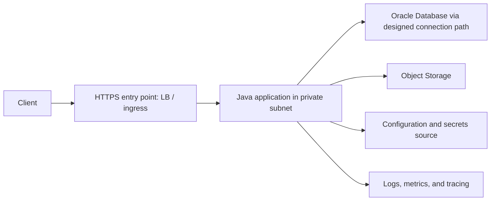

# Choosing Compute, OKE, Container Instances, and Functions for Java

A Java application can run on multiple OCI services, but each option creates a different deployment, scaling, and operational model. Getting a JAR or container to run is only the starting condition; the decision also depends on process lifecycle, data state, latency, resilience, and team capability.

This opening lesson of the **Java and Spring Boot Deployment** chapter focuses on four options in Oracle Cloud Infrastructure: **Compute**, **Oracle Kubernetes Engine (OKE)**, **Container Instances**, and **Functions**. You will tie the decision to tenancy, compartment, IAM, VCN, Oracle Database, storage, monitoring, and cost control.

A single system can use multiple platforms: a Spring Boot API running on OKE, a legacy tool running on Compute, a container job running on Container Instances, and an event-driven task running on Functions. Choose per workload first, then evaluate the operational cost of the entire system.

## 1. Describing the Workload Before Choosing a Service

Suppose an order-management system has four components:

| Java Component | Characteristics to Preserve During Deployment |
| --- | --- |
| Spring Boot ordering API | Long-lived HTTP server, JDBC connection pool, requires stable latency |
| Invoice generation worker | Asynchronous job intake, retries, requires duplicate prevention |
| Reconciliation job | Finite scheduled execution, duration depends on data volume |
| New object processing task | Event-driven reaction, clearly defined input and completion |

Do not just write "high-traffic Java application." A useful workload profile should answer:

1. **Lifecycle:** is it a continuously serving process, or does each invocation handle a finite unit of work?
2. **Load:** steady, time-based, spiky, or frequently idle?
3. **Latency:** measured by average or p95/p99; does the first request after an idle period matter?
4. **State:** where do sessions, files, job progress, and business data reside?
5. **Dependencies:** how does it need to connect to the DB, Vault, Object Storage, queues, or external systems?
6. **Operations:** who patches the OS, updates the runtime, handles errors, rolls back, and is on call for incidents?
7. **Recovery:** if a process, a node, or a fault domain is lost, how long can service disruption be tolerated?

Example input for comparison:

```text
Workload: Spring Boot ordering API
Model: Long-lived HTTP, stateless at the application tier
Data: Oracle Database and Object Storage
Latency target: p95 below the threshold set by the business team
Deployment: requires version updates while maintaining availability
Team: familiar with containers, no Kubernetes operational process yet
Metrics to measure: JVM RAM, startup time, DB pool, peak-hour load
```

Workload requirements and measurements must come before platform decisions.

## 2. Understanding the Four Execution Models

| Criterion | Compute | OKE | Container Instances | Functions |
| --- | --- | --- | --- | --- |
| Primary deployment unit | VM or bare metal, process or container managed by the team | Kubernetes workloads such as Deployment and Job | A container instance containing one or more containers | Function called under an invocation model |
| How Java typically runs | JAR with JVM, application server, or container | Container running the Java application | Container running the Java application | Handler compatible with the runtime/FDK |
| Suitable lifecycle | Long-lived process or job | Orchestrated long-lived services and jobs | Container services or jobs without needing Kubernetes | Finite work per invocation |
| OS-level control | High | Depends on node type; application follows Kubernetes model | No host management for running containers | No host management for invocations |
| Orchestration to design | Supervisor, instance pool, rollout, health check | Manifest, controller, scheduling, rollout | Instance lifecycle, health, replication, and updates | Trigger, timeout, concurrency, and invocation results |
| When to consider early | Need OS control or migrating legacy apps to the cloud | Need Kubernetes orchestration and have operational capability | Have an image and want to reduce server management | Event-driven, on-demand, or scheduled tasks |
| Easily underestimated aspects | Host patching, configuration drift, replacing failed VMs | Cluster, node, and add-on operational overhead | How failed instances are replaced and traffic distributed | Cold start, execution limits, and load on target systems |

This is a design-orientation table. Specific capabilities must be verified against the documentation for the service, region, and resource types to be used.

Two labels need to be understood accurately:

- **Container** is a way to package and run an application; it does not automatically provide Kubernetes, autoscaling, or high availability.
- **Serverless** describes reducing execution infrastructure management; the application still requires designing IAM, networking, data, resource limits, and recovery.

## 3. Compute: Controlling the Execution Environment

OCI Compute provides VMs and bare metal to deploy according to compute requirements. For Java, a VM is often the starting point when a team wants full control over the OS, JDK, agents, and how processes run. [Oracle: Compute Overview](https://docs.oracle.com/en-us/iaas/Content/Compute/Concepts/computeoverview.htm).

### 3.1. When Is It Suitable?

Compute is worth considering when:

- Lifting and shifting an existing JAR or application server onto OCI with minimal changes to the runtime model.
- Requiring native libraries, OS packages, host configuration, or specialized diagnostic tools.
- Running long-lived processes, administrative tasks, or components not yet suited for container packaging.
- The team already has processes for managing Linux/Windows, patches, images, and VM deployments.

Illustrative command for a packaged application:

```bash
java -XX:MaxRAMPercentage=65 -jar /opt/orders/app.jar
```

This command only shows how to start the JVM. To serve reliably, you must add a process supervisor, restart configuration, logging, health checks, privilege limits, and an update workflow. The 65% value is an initial baseline for measurement, not a universal memory setting for every application.

### 3.2. Responsibilities to Factor Into the Decision

If the JDK is installed directly on the VM, the team must manage both the JDK and the operating system. If running containers on a VM, the team still manages the host, container runtime, and application image lifecycle.

Specific questions:

| Issue | Required Design |
| --- | --- |
| Java crashes | Supervisor detects and restarts with limits |
| VM fails | Recreate from image/configuration and return to service |
| Version change | Shift traffic, verify health, and have a rollback path |
| Configuration drift | Declarative configuration, image management, and automation |
| Data stored on the machine | Separate persistent data from temporary data |

A running VM does not prove the API is working. After provisioning, verify the process, application port, health endpoint, and a minimal transaction.

### 3.3. When Scaling Is Needed

Instance pools allow managing multiple instances from an instance configuration and integrating with a load balancer. OCI supports metric-based or schedule-based autoscaling for instance pools. [Oracle: Instance Pools](https://docs.oracle.com/en-us/iaas/Content/Compute/Concepts/instance-pools.htm), [Oracle: Compute Autoscaling](https://docs.oracle.com/en-us/iaas/Content/Compute/Tasks/autoscalinginstancepools.htm).

This still requires the application to boot cleanly from declarative configuration. A VM that has been manually tweaked repeatedly will be hard to clone and unsafe to replace under load.

If important sessions or files reside only on individual VMs, handle them before expecting scale-out or instance replacement without user impact.

## 4. OKE: Kubernetes Orchestration for Java Applications

OKE fits when you need the Kubernetes model: declarative workloads, replica orchestration, controlled rollouts, service discovery, and Kubernetes ecosystem integration. Suitability depends on both the application and the team's platform-management capability. [Oracle: OKE Overview](https://docs.oracle.com/en-us/iaas/Content/ContEng/Concepts/contengoverview.htm).

### 4.1. When Orchestration Benefits Are Significant Enough

OKE is worth considering when the team operates multiple services, needs standardized deployment practices, and has the capability to run Kubernetes or use a managed internal platform.

Examples:

- Multiple Spring Boot APIs needing unified rollouts, probes, and configuration.
- Workloads with varying resource needs requiring scheduling.
- Managing APIs, workers, and jobs separately within a single declarative model.
- Wanting to use controllers, operators, or tools built on the Kubernetes API.

Microservice count is not the sole criterion. A single workload with special requirements might warrant Kubernetes; conversely, a few simple APIs may not justify a dedicated cluster.

### 4.2. Managed Nodes and Virtual Nodes Differ in Responsibility

Managed nodes run on Compute inside your tenancy with shared operational responsibility. Virtual nodes reduce node-infrastructure management, but come with differences and feature limitations that must be checked before choosing them for a workload. [Oracle: Managed Nodes](https://docs.oracle.com/en-us/iaas/Content/ContEng/Tasks/contengworkingwithmanagednodes.htm), [Oracle: Comparing Node Types](https://docs.oracle.com/en-us/iaas/Content/ContEng/Tasks/contengcomparingvirtualwithmanagednodes_topic.htm).

"Use OKE" is not enough to describe an architecture. The design document must specify node type, upgrade method, log storage location, ingress component, metric source, and who handles failing nodes or pods.

With managed nodes, the team is still involved in updating, monitoring, and replacing unhealthy nodes. A managed control plane does not eliminate responsibility for workloads and the data plane. [Oracle: Shared Responsibilities](https://docs.oracle.com/en-us/iaas/Content/ContEng/Concepts/contengsupportsharedresponsibilities.htm).

### 4.3. Distinguishing Pod Scaling from Node Scaling

Horizontal Pod Autoscaler adjusts replicas based on configuration and metric sources. Cluster Autoscaler adjusts the number of nodes in supported node pools; it does not create additional pods. [Oracle: HPA](https://docs.oracle.com/en-us/iaas/Content/ContEng/Tasks/contengusinghorizontalpodautoscaler.htm), [Oracle: Cluster Autoscaler](https://docs.oracle.com/en-us/iaas/Content/ContEng/Tasks/contengusingclusterautoscaler.htm).

For example, HPA may scale an API from two to six replicas, yet new pods remain unscheduled if the cluster lacks RAM. There must be sufficient node capacity or an appropriate provisioning mechanism, along with well-founded requests/limits.

Do not copy autoscaler configurations meant for managed nodes onto virtual nodes without verifying support. Node type selection directly impacts scaling behavior and observability tooling.

## 5. Container Instances: Running Containers Without Managing Hosts

OCI Container Instances lets you run one or more containers and choose compute resources, networking, and lifecycle options without managing underlying servers. The service suits containerized workloads that do not require an orchestration platform like Kubernetes. [Oracle: Container Instances Overview](https://docs.oracle.com/en-us/iaas/Content/container-instances/overview-of-container-instances.htm).

### 5.1. What Needs Does It Fit?

Container Instances is a candidate when:

- You already have a working Java image and want to deploy an API or worker.
- You have finite container jobs, dev/test environments, or automation tools.
- You want to reduce OS management effort without needing the Kubernetes API and controllers.
- The application scope is simple enough to manage container instance lifecycles directly.

A Spring Boot API can keep its HTTP server model inside the container. It still requires configuring ports, bind address, resources, DB access, and readiness checks.

### 5.2. A Container Instance Is Not a Kubernetes Cluster

You must explicitly design for:

| Need | What Needs Clarification |
| --- | --- |
| Multiple API replicas | How many container instances are created and where are they placed? |
| Traffic distribution | Which backends are registered, health-checked, and removed from service? |
| Deploying a new image | How are instances replaced, traffic shifted, and rollbacks performed? |
| Unrecoverable instance | Which component detects and recreates it? |
| Load increases | Based on which metrics, and who adjusts instance count and resources? |

Do not assume Kubernetes-style controllers exist just because a service runs containers. If this choice requires writing too much custom orchestration logic, compare that cost against a well-managed OKE setup.

Placing multiple containers in the same container instance can work well for an application and its companion sidecar. That is not equivalent to multiple independent replicas across different fault domains.

### 5.3. Restart Policy Must Match Job Lifecycle

Container Instances offers restart options such as `Always`, `Never`, and `On failure`. A web server typically needs to run continuously; a job that finishes successfully may need to stop. The registry must be reachable from the subnet, with an appropriate permission method to pull images. [Oracle: Creating a Container Instance](https://docs.oracle.com/en-us/iaas/Content/container-instances/creating-a-container-instance.htm).

If a job succeeds while configured to always restart, it may re-run work unintentionally. If an API exits without a recovery policy, the endpoint may stop serving.

Separate three verification milestones: the container instance is created, the image is pulled/running, and the application is ready. An active infrastructure state alone does not prove the business endpoint is usable.

## 6. Functions: Per-Invocation Work

OCI Functions fits functionality with clear inputs and completion, invoked directly or via configured integrations. The starting point is an invocation contract and handler rather than a continuously running HTTP server managed by the application. [Oracle: Functions Overview](https://docs.oracle.com/en-us/iaas/Content/Functions/Concepts/functionsoverview.htm).

### 6.1. Typical Candidates

Consider Functions for:

- Processing metadata when a new object arrives.
- Transforming or validating a payload.
- Cloud automation tasks with clear scope and execution duration.
- A finite step in an asynchronous processing workflow.

Event sources, invocation rules, identities, and permissions must be configured. Creating a function does not automatically make it receive every Object Storage event or turn it into a persistent queue consumer.

With queues, you must identify the component invoking the function, batch size, completion acknowledgment, retries, and duplicate handling. If the design requires a continuously polling process with no termination point, evaluate Compute, OKE, or Container Instances for that role.

### 6.2. Two Available Java Packaging Models

Functions supports both image-based and code-only models. Oracle announced code-only support for Java alongside other runtimes on September 24, 2026. Therefore, current evaluations should not consider only image-based deployments. [Oracle: Code-only Functions Release](https://docs.oracle.com/en-us/iaas/releasenotes/functions/functions-code-only-functions.htm).

| Model | Artifact | Responsibilities to Consider |
| --- | --- | --- |
| Image-based | Container image compatible with Functions execution | Base image, runtime, dependencies, and image build pipeline |
| Code-only | Properly structured Java archive and supported runtime | Packaging code/dependencies, handler, configuration, and runtime testing |

For code-only Java, Oracle requires an uber/fat JAR or a ZIP containing a single uber/fat JAR at the root, along with a valid handler. Verify archive structure and dependencies rather than simply renaming file extensions. [Oracle: Java Code-only Functions](https://docs.oracle.com/en-us/iaas/Content/Functions/Tasks/functions-codeonly-java.htm).

Example handler value:

```text
com.example.ObjectMetadataFunction::handleRequest
```

The selected runtime must be compatible with the bytecode and bundled libraries. Check the list of supported runtimes and availability scope for the target deployment environment. [Oracle: Languages Supported by Functions](https://docs.oracle.com/en-us/iaas/Content/Functions/Tasks/languagessupportedbyfunctions.htm).

A Spring Boot executable JAR has its own packaging structure and bootstrap mechanism. It does not automatically become a valid function just because it is also a large JAR with dependencies. To reuse Spring logic, design a compatible handler, context initialization, and packaging; startup overhead must also be measured.

### 6.3. Cold Start, Memory, and Concurrency

The first invocation after an idle period without a warm environment may incur extra time for infrastructure preparation and application initialization. For Java, this includes class loading, dependency injection, connections, and startup work.

OCI provides provisioned concurrency to reduce initial latency by pre-warming capacity for a set number of concurrent invocations. Include this setting in both latency measurements and cost calculations. [Oracle: Provisioned Concurrency](https://docs.oracle.com/en-us/iaas/Content/Functions/Tasks/functionsusingprovisionedconcurrency.htm).

Do not commit to an SLO based solely on consecutive warm invocations. Measure at least the first call after idle, behavior under rising concurrency, and when downstream dependencies are slow.

Increased concurrency can also open more Oracle Database connections. Just because the platform scales does not mean the database can withstand arbitrary parallelism.

### 6.4. Synchronous and Detached Timeouts Are Not the Same

Current OCI configuration documentation states a maximum synchronous execution timeout of 300 seconds and a maximum detached timeout of 3,600 seconds. Detached mode allows an asynchronous invocation style with longer execution time; it is still bounded work. [Oracle: Function Timeout Settings](https://docs.oracle.com/en-us/iaas/Content/Functions/Tasks/functionscustomizing.htm).

Client wait time, gateway timeouts, and allowed function execution time must be evaluated separately. Choosing detached mode changes how results are received and tracked, not merely increasing a timeout number. [Oracle: Invoking Functions](https://docs.oracle.com/en-us/iaas/Content/Functions/Tasks/functionsinvokingfunctions.htm).

A job that routinely runs for several hours requires another option or splitting into checkpointed steps. Do not rely on background threads continuing after the handler has returned.

## 7. Preparing a Spring Boot Application for Fair Comparison

To compare Compute, OKE, and Container Instances, keep the same application version, HTTP contract, and data-access pattern. Change only the runtime platform and necessary integration glue.

### 7.1. Containerizing With an Explicit Runtime

The illustrative Dockerfile below uses a Java runtime image selected by the team. `JAVA_RUNTIME_IMAGE` is a required build argument; supply an image compatible with the Java version, CPU architecture, and pinned by version or digest.

```dockerfile
ARG JAVA_RUNTIME_IMAGE
FROM ${JAVA_RUNTIME_IMAGE}

WORKDIR /app
COPY --chown=10001:10001 app.jar /app/app.jar

USER 10001:10001
EXPOSE 8080
ENTRYPOINT ["java", "-jar", "/app/app.jar"]
```

This is a packaging template for a Java HTTP server, not a complete function image. The `app.jar` file must be the built artifact for the application.

An image running on x86 is not guaranteed to run on Arm if native libraries are involved. Verify image architecture, JDK, and dependencies on the exact target shape. Using a mutable tag like `latest` makes comparing results and rolling back harder; preserve the digest of verified artifacts.

### 7.2. Separating Configuration and Data From the Artifact

| Data Type | Required Handling |
| --- | --- |
| URLs and environment names | Environment-specific configuration; do not rebuild code just to change targets |
| Passwords, tokens, keys | Secret-delivery mechanism aligned with the platform and IAM |
| PDFs, images, customer files | Durable store such as Object Storage or an appropriate solution |
| Sessions | Stateless or shared session store if required by business logic |
| Temporary files | Capacity-bounded and acceptable to lose when processes are replaced |
| Job progress | Durable checkpointing with locks to prevent duplicate processing |

Even on Compute with persistent volumes, storing everything on the same machine hurts cloning and replacement. For containers or functions, never rely on ephemeral filesystems as the sole proof that critical work completed.

### 7.3. Liveness, Readiness, and Graceful Shutdown

Applications with Spring Boot Actuator can configure health probes on the application port:

```yaml
server:
  port: 8080
  shutdown: graceful

spring:
  lifecycle:
    timeout-per-shutdown-phase: 30s

management:
  endpoints:
    web:
      exposure:
        include: health
  endpoint:
    health:
      show-details: never
      probes:
        enabled: true
```

Two commonly used paths are `/actuator/health/liveness` and `/actuator/health/readiness`. Liveness reflects process vitality; readiness governs traffic routing decisions. Do not include shared DB status in liveness, which would cause every replica to restart during a DB outage. [Spring: Health Probes](https://docs.spring.io/spring-boot/reference/actuator/endpoints.html#actuator.endpoints.kubernetes-probes).

Ensure the Actuator dependency is installed and security rules permit the health checker to reach it. Expose only necessary endpoints along the designed network path.

Default health does not prove all business behavior is ready. If adding dependency checks to readiness, evaluate what happens when all replicas turn unready simultaneously and how the system returns errors or degrades gracefully.

Graceful shutdown allows completing in-flight requests within the configured window. The platform must send the proper stop signal and allow enough time before force-killing the process. `timeout-per-shutdown-phase` is a per-phase limit, not a guarantee that the entire shutdown always finishes in exactly 30 seconds. [Spring: Graceful Shutdown](https://docs.spring.io/spring-boot/reference/web/graceful-shutdown.html).

### 7.4. A Sample OKE Manifest to Illustrate Orchestration

This is a minimal Deployment sample for HTTP on OKE using managed nodes. Replace the image placeholder and ensure registry authorization, namespace, networking, and configured Actuator are in place. Resource and timing values are lab assumptions.

```yaml
apiVersion: apps/v1
kind: Deployment
metadata:
  name: orders-api
spec:
  replicas: 2
  selector:
    matchLabels:
      app: orders-api
  strategy:
    type: RollingUpdate
    rollingUpdate:
      maxUnavailable: 0
      maxSurge: 1
  template:
    metadata:
      labels:
        app: orders-api
    spec:
      terminationGracePeriodSeconds: 45
      containers:
        - name: orders-api
          image: "<registry>/<team>/orders@sha256:<digest>"
          ports:
            - name: http
              containerPort: 8080
          resources:
            requests:
              cpu: "500m"
              memory: "1Gi"
            limits:
              cpu: "1"
              memory: "1Gi"
          startupProbe:
            httpGet:
              path: /actuator/health/liveness
              port: http
            periodSeconds: 5
            failureThreshold: 30
          readinessProbe:
            httpGet:
              path: /actuator/health/readiness
              port: http
            periodSeconds: 5
          livenessProbe:
            httpGet:
              path: /actuator/health/liveness
              port: http
            periodSeconds: 10
---
apiVersion: v1
kind: Service
metadata:
  name: orders-api
spec:
  type: ClusterIP
  selector:
    app: orders-api
  ports:
    - port: 80
      targetPort: http
```

The startup probe protects the startup phase before liveness/readiness take effect per probe lifecycle rules. Readiness and liveness have distinct consequences; do not replace both with an arbitrary identical check. [Kubernetes: Probes](https://kubernetes.io/docs/tasks/configure-pod-container/configure-liveness-readiness-startup-probes/).

The Service here is ClusterIP. External access requires a dedicated ingress/load balancer and TLS design. The sample does not yet depict replica distribution across nodes/fault domains, autoscaling, or full workload protections.

Two replicas and `maxUnavailable: 0` do not guarantee zero downtime by themselves. Rollouts also require capacity for new pods, readiness time, connection draining, and sufficient DB capacity. The termination grace budget must cover both connection draining and actual shutdown phases.

## 8. Designing Networking, Identity, and Data Across All Four Options

An illustrative path for a Spring Boot API:



This is a logical diagram; it does not imply every service shown uses the same endpoint type or routing mechanism. For Functions, the entry point may be an invocation or event integration instead of a continuously running HTTP server.

### 8.1. Four Connection Paths to Verify

1. **Fetching artifacts:** registry or Object Storage holding images/archives.
2. **Receiving requests:** from load balancer, ingress, client, or function invoker.
3. **Accessing data:** DB, queues, Object Storage, and external services.
4. **Operations:** logs, metrics, configuration, and secret retrieval.

Applications placed in a private subnet still need valid routes for those connections. Do not confuse a service gateway with general Internet access; select routes based on actual endpoints.

### 8.2. Separating Deployment Permissions From Runtime Permissions

Users or pipelines creating resources may need permissions to manage Compute/OKE/Container Instances/Functions. The application itself only needs appropriate data-plane permissions, such as reading objects within a specific scope.

Choose an SDK identity mechanism supported by the platform and validate it with the actual workload. Permissions to pull images, read secrets, and write data are distinct; succeeding at one step does not prove the others are granted properly.

With Oracle Database, OCI IAM service-management permissions do not automatically replace application credentials and SQL privileges. You must design JDBC connectivity, TLS/wallet if required by configuration, and proper schema privileges.

## 9. JVM Resources, Scaling, and High Availability

### 9.1. Heap Is Only Part of Memory

Memory estimation for Java must account for:

```text
Java process RAM
    ≈ heap
    + metaspace and code cache
    + thread stacks
    + direct buffers
    + native libraries and other JVM overhead
```

If heap is set equal to the entire memory limit, the process can still be killed due to off-heap usage. When using sidecars or multiple containers sharing a resource unit, include their memory and required headroom.

Measure under realistic load: RSS, post-GC heap, GC frequency/duration, thread count, direct memory, and CPU usage. Do not extrapolate production sizing solely from a freshly booted application.

### 9.2. Application Scaling Must Align With Database Budget

Suppose each Spring Boot replica has a max pool of 10 connections:

```text
12 replicas × 10 connections = up to 120 connections from the app tier
```

This is only part of the budget. Include workers, migrations, operational tools, other services, and temporary spikes during rollouts.

If the platform scales replicas or invocations faster than DB capacity, errors may rise even while application CPU remains low. Set limits on replicas, concurrency, pools, and timeouts according to end-to-end chain capacity.

### 9.3. Two Replicas Must Span Protected Fault Domains

| Platform | Verification Needed for Resilience |
| --- | --- |
| Compute | Multiple instances, proper distribution, health checks, and replacement mechanism |
| OKE | Spread replica scheduling, sufficient nodes/capacity, proper probes and rollouts |
| Container Instances | Independent instances, proper placement, health/traffic/replacement handling |
| Functions | Concurrency/limits, retry paths, durable state, and resilient dependencies |

Distribution across availability domains and fault domains must match the region and service capabilities. Do not assume every region has the same number of availability domains.

Multiple application replicas can still share a single DB or faulty configuration. Availability must be evaluated end-to-end, including data, ingress paths, and recovery procedures.

For workers or functions that may be re-invoked, use business keys and durable result recording to prevent duplicate side effects. Restarts or retries only resume execution; they do not automatically guarantee exactly-once business processing.

## 10. Comparing Costs Under Equal Conditions

No single option is always cheapest for every Java application. Cost depends on active runtime, resources, replica count, traffic shape, and supporting services.

| Option | Components to Include in Estimates |
| --- | --- |
| Compute | CPU/RAM, volumes, redundant replicas, LB, and host management effort |
| OKE | Cluster/node type, workload and system resources, storage, LB, add-ons, and operations |
| Container Instances | Provisioned instance resources, run duration, replicas, networking, and extra orchestration |
| Functions | Invocations, execution resources/duration, provisioned concurrency if enabled, caller services, and output storage |

Use current price lists, accurate resource units, and environment terms when calculating. CPU measured in OCPU, vCPU, or Kubernetes requests must be converted carefully by architecture; do not compare differently named numbers as if they were equal. [Oracle: OCI Price List](https://www.oracle.com/cloud/price-list/).

### 10.1. Keep Comparison Assumptions Consistent

A fair calculation should share the same:

- Average traffic, peak load, and idle-time distribution.
- Latency SLO and disruption tolerance.
- Measured RAM/CPU for the workload.
- Replica count and recovery strategy.
- Equivalent data, logging, networking, and ingress paths.
- Deployment frequency, rollbacks, and operational effort.

Comparing a single VM against a redundant cluster and concluding OKE is more expensive compares two different service levels. Similarly, benchmarking Functions using only warm invocations fails to reflect post-idle latency requirements.

### 10.2. Serverless Does Not Mean Paying Strictly Per Request

Container Instances allocates resources for the lifecycle of the instance. An API receiving zero requests while remaining running must be costed according to its resource model. For Functions, if provisioned concurrency is enabled, include pre-warmed capacity in the cost.

Stopping part of compute does not necessarily stop all charges: volumes, load balancers, registries, logs, and storage have independent lifecycles. Do not infer remaining costs solely from the state of a Java process.

For sparse workloads, an invocation model may be worth testing. For steady load where the JVM must stay warm continuously, compare total execution and operational cost instead of assuming functions are cheaper by default.

## 11. Applying to Concrete Scenarios

The choices below are reasoned from each scenario's assumptions and must be validated with measurements.

### 11.1. Legacy Java Application Needing Specific OS Packages

**Assumptions:** existing JAR/application server running on a VM, requiring native libraries and specialized diagnostic agents.

**Initial candidate:** Compute. The team retains environment control while rebuilding image, configuration, and recovery workflows.

**Re-evaluation triggers:** application is containerized, host dependencies are eliminated, or the team adopts a suitable container platform. There is no need to adopt Kubernetes just to change how a JAR starts.

### 11.2. Two Spring Boot APIs With Images, Team Not Operating Kubernetes Yet

**Assumptions:** stateless APIs requiring DB and Object Storage, moderate replica count, team wants reduced host management.

**Initial candidate:** Container Instances; also compare Compute if the team already has strong VM automation.

**Verification points:** health, version replacement, backend registration, handling failed instances, and continuous-running cost. If orchestration requirements grow sharply, re-evaluate OKE.

### 11.3. Multiple Services, Team Already Operates a Kubernetes Platform

**Assumptions:** existing ingress, centralized observability, secret management, pipelines, and cluster upgrade procedures.

**Initial candidate:** OKE. Benefits come from sharing the deployment model and existing platform capabilities.

**Verification points:** node type, requests/limits, scheduling capacity during rollouts, autoscaling, and DB connection budget. "Already using Kubernetes" does not automatically prove the current configuration fits a new workload.

### 11.4. Event-Driven Object Processing With Finite Duration

**Assumptions:** independent units of work, idempotent logic, irregular load, fits within execution limits.

**Initial candidate:** Functions, choosing image-based or code-only depending on dependencies and runtime.

**Verification points:** cold start, parallel load, timeouts across the entire call path, object read permissions, result persistence, and retries. If individual tasks exceed limits or require long-running processes, evaluate container jobs or splitting the workflow.

### 11.5. Java Reconciliation Running Several Hours

**Assumptions:** execution duration may exceed function limits, requires checkpointing and reading large data volumes.

**Initial candidate:** container job on Container Instances, Kubernetes Job if OKE is already in place, or Compute aligned with operational practices.

**Verification points:** DB load limits, checkpointing, mid-run restarts, and preventing two scheduled runs from overlapping. Platform choice does not replace business progress management.

## 12. Hands-On Validation to Finalize the Decision

There is no need to deploy fully across all four platforms just to compare service names. Select one primary candidate and one alternative based on requirements, then run a bounded experiment in a lab compartment.

### 12.1. Preparing the Same Application Contract

For a Spring Boot API:

1. Select a pinned artifact and externalized configuration.
2. Include a minimal business endpoint and appropriate health checks.
3. Use identical mock data, schema, and DB access path.
4. Pick a compatible CPU architecture.
5. Set resource limits sufficient for observation without unintended scaling.
6. Document ingress and monitoring components clearly.

For Functions, pick a business-equivalent finite capability; do not treat replacing an entire HTTP server with a handler as a zero-cost conversion.

### 12.2. Measuring Scenarios That Can Change the Decision

| Test | What to Record |
| --- | --- |
| Cold boot | Time until valid requests are served |
| Steady load | Throughput, p95/p99, CPU/RAM, and errors |
| Post-idle | First-request latency, especially for invocations |
| Load surge | Time to add capacity and DB reaction |
| Kill one replica | Recovery time, failed requests, and reassigned work |
| New version rollout | Rollout duration, in-flight connections, and rollback |
| Slow dependency | Timeouts, pool behavior, backpressure, and error rates |
| Environment cleanup | Remaining resources and data to retain |

A passing health check is not enough. Keep evidence of a business outcome—such as an order recorded exactly once or an output file saved under the expected object key.

### 12.3. Writing the Decision Record

```text
Workload:
  Spring Boot ordering API, long-lived HTTP, stateless.

Mandatory requirements:
  Connect to Oracle Database over a private path.
  Maintain availability across version updates.
  Provide logs, metrics, resource limits, and a rollback path.

Selection:
  Record the platform and configuration actually planned for use.

Rationale:
  Cite measurements, operational responsibilities, and cost assumptions.

Alternative:
  State conditions that would make the alternative more suitable.

Re-evaluation triggers:
  Changes in load, SLO, service count, team capability, or dependencies.
```

Decisions must be revisited when conditions change. An option suitable for a lab or early phase is not automatically the long-term production configuration.

At the end of the lab, stop load generators and workloads, verify any data to retain, and clean up dedicated resources created for the test: compute/containers, cluster resources per lab scope, functions, LBs, volumes, images/archives, and logs if appropriate for the chosen lifecycle. Retain the decision record and measurements to justify the choice.
