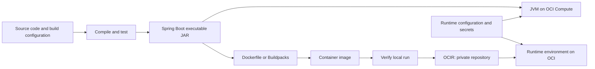

# Packaging Spring Boot as a JAR and Container Image

In the **Java and Spring Boot Deployment** chapter of the **CLOUD_PROVIDERS_ORACLE** module, packaging is the step that turns source code into an artifact that can be tested, delivered, and run on Oracle Cloud Infrastructure. An application can be run as a JAR on OCI Compute or packaged into a container image to push to OCIR and run in an appropriate container environment.

This lesson progresses from a small HTTP application to an executable JAR, a JVM-based container image, and an image stored in Oracle Cloud Infrastructure Registry. IAM, compartments, machine architecture, configuration, observability, and cost are examined within the scope that directly affects the artifact; creating a VCN, an OKE cluster, or deploying a database are separate tasks.

## 1. Objectives and Packaging Flow

After this lesson, you will be able to:

- Distinguish a plain JAR, a Spring Boot executable JAR, a container image, and a running container.
- Build a JAR using the Spring Boot Maven Plugin, run it standalone, and test endpoints.
- Build an image using a Dockerfile or Cloud Native Buildpacks and explain the choice.
- Run the image as a non-root user, pass runtime configuration at startup, and set resource limits.
- Choose an image matching the OCI Compute architecture, push to OCIR with proper authorization, and record the digest for deployment.



In container documentation, an **OCI image** means an image conforming to the **Open Container Initiative** standard. In cloud documentation, **OCI** also stands for **Oracle Cloud Infrastructure**. An Open Container Initiative image is not tied to Oracle Cloud; OCIR is Oracle's registry service for storing and distributing images.

## 2. Distinguishing Artifact Types

| Concept | What It Contains | What It Needs to Run | Deployment Implication |
| --- | --- | --- | --- |
| Plain JAR | Classes and resources of one module; dependencies may be external | JVM and proper classpath | Not guaranteed to run via `java -jar` |
| Spring Boot executable JAR | Application code, Java dependencies, and Boot loader; web starter includes embedded server | Compatible JVM | Suitable when managing the Java process directly on a VM |
| Container image | Filesystem layers, Java runtime, application, and startup metadata | Container runtime, compatible OS/CPU | Packages the entire userspace needed by the process |
| Container | A running instance of an image with specific resources, networking, and configuration | Host/container platform | Has its own lifecycle, logs, state, and limits |

A Boot JAR **does not bundle a JVM**. A container image includes a JRE with a JVM, but a Linux container shares the kernel with its host machine. Therefore, you cannot assume a Linux image runs natively on every operating system or every CPU.

The JAR remains useful even when the final target is a container: it is the Java build output you can verify before adding the OS packaging layer. For a tested artifact, promote the exact same artifact across environments and supply configuration at runtime to reduce drift between tested and released builds.

## 3. Preparing a Unified Example

### 3.1. Toolchain

The example uses **Java 21**, **Maven 3.9.x**, **Spring Boot 3.5.16**, and Docker running **Linux containers**. Spring Boot is pinned to a specific version so the example can be reproduced consistently, not to imply it is the latest version or the default choice for every project. Java 21 falls within the compatibility range of this documentation branch. Before adopting for a real system, choose an organization-supported version and track patches. See [Spring Boot 3.5 System Requirements](https://docs.spring.io/spring-boot/3.5/system-requirements.html).

Verify tools in the lab environment:

```bash
java -version
mvn -version
docker version
docker buildx version
```

Pay attention to the Java version Maven uses in the `mvn -version` output; it may differ from what your IDE uses. The Docker CLI must be able to reach the daemon. Windows development machines can use Docker Desktop in Linux containers mode.

The multi-line commands below use **Bash**, suitable for Linux or WSL. In PowerShell, do not use `\` for line continuation; you can write commands on a single line. If the project includes a Git-tracked Maven Wrapper, replace `mvn` with `./mvnw` on Linux or `.\mvnw.cmd` in PowerShell.

### 3.2. Application Structure

Create a standalone project with the following structure:

```text
oracle-demo/
├── pom.xml
├── Dockerfile
├── .dockerignore
└── src/
    └── main/
        ├── java/com/example/oracledemo/
        │   ├── OracleDemoApplication.java
        │   └── ApiController.java
        └── resources/
            └── application.yml
```

The sample application does not include database-access dependencies yet. This keeps packaging checks isolated so Oracle Database connectivity issues do not mask artifact errors.

File `pom.xml`:

```xml
<?xml version="1.0" encoding="UTF-8"?>
<project xmlns="http://maven.apache.org/POM/4.0.0"
         xmlns:xsi="http://www.w3.org/2001/XMLSchema-instance"
         xsi:schemaLocation="http://maven.apache.org/POM/4.0.0 https://maven.apache.org/xsd/maven-4.0.0.xsd">
    <modelVersion>4.0.0</modelVersion>

    <parent>
        <groupId>org.springframework.boot</groupId>
        <artifactId>spring-boot-starter-parent</artifactId>
        <version>3.5.16</version>
        <relativePath/>
    </parent>

    <groupId>com.example</groupId>
    <artifactId>oracle-demo</artifactId>
    <version>1.0.0</version>
    <packaging>jar</packaging>

    <properties>
        <java.version>21</java.version>
    </properties>

    <dependencies>
        <dependency>
            <groupId>org.springframework.boot</groupId>
            <artifactId>spring-boot-starter-web</artifactId>
        </dependency>
        <dependency>
            <groupId>org.springframework.boot</groupId>
            <artifactId>spring-boot-starter-actuator</artifactId>
        </dependency>
    </dependencies>

    <build>
        <finalName>oracle-demo</finalName>
        <plugins>
            <plugin>
                <groupId>org.springframework.boot</groupId>
                <artifactId>spring-boot-maven-plugin</artifactId>
            </plugin>
        </plugins>
    </build>
</project>
```

`spring-boot-starter-parent` manages dependency versions and related build configuration. `finalName` keeps the output filename stable: `target/oracle-demo.jar`; it does not change the project's Maven version `1.0.0`. Pair this convenient filename with a version, checksum, or digest in your release pipeline.

File `OracleDemoApplication.java`:

```java
package com.example.oracledemo;

import org.springframework.boot.SpringApplication;
import org.springframework.boot.autoconfigure.SpringBootApplication;

@SpringBootApplication
public class OracleDemoApplication {
    public static void main(String[] args) {
        SpringApplication.run(OracleDemoApplication.class, args);
    }
}
```

File `ApiController.java`:

```java
package com.example.oracledemo;

import java.util.Map;
import org.springframework.beans.factory.annotation.Value;
import org.springframework.web.bind.annotation.GetMapping;
import org.springframework.web.bind.annotation.RestController;

@RestController
public class ApiController {
    private final String environment;

    public ApiController(@Value("${app.environment:local}") String environment) {
        this.environment = environment;
    }

    @GetMapping("/api/hello")
    public Map<String, String> hello() {
        return Map.of(
            "service", "oracle-demo",
            "environment", environment,
            "message", "Hello from Spring Boot"
        );
    }
}
```

File `src/main/resources/application.yml`:

```yaml
spring:
  application:
    name: oracle-demo
  lifecycle:
    timeout-per-shutdown-phase: 25s

server:
  port: 8080
  shutdown: graceful

app:
  environment: local

management:
  endpoints:
    web:
      exposure:
        include: health
  endpoint:
    health:
      show-details: never
      probes:
        enabled: true
```

The example exposes only the `health` Actuator endpoint, not all management endpoints. The application has no authentication configured for the sample API, so local test steps bind the server port only to loopback. When deploying to a shared network, add appropriate access controls for APIs and monitoring endpoints.

## 4. Building and Testing an Executable JAR

### 4.1. Building With Maven

From the directory containing `pom.xml`:

```bash
mvn clean verify
jar tf target/oracle-demo.jar
```

`verify` runs preceding phases, including compile, test, and package. Since the minimal project above has no tests yet, a passing build does not prove endpoints work; the HTTP step below verifies the basic runtime path. Real projects must have dedicated tests for business behavior.

Maven produces a standard JAR, then the Spring Boot Plugin uses the `repackage` goal to create an executable archive. When using the Boot parent as shown, declaring the plugin is sufficient because the `repackage` execution is inherited from the parent. If using an internal parent, importing only the dependency management BOM does not automatically add this execution; you must configure the build plugin execution explicitly. See [Packaging Executable Archives](https://docs.spring.io/spring-boot/3.5/maven-plugin/packaging.html).

For projects using a different parent, the plugin declaration needs an execution like the following, with the plugin version explicitly managed:

```xml
<plugin>
    <groupId>org.springframework.boot</groupId>
    <artifactId>spring-boot-maven-plugin</artifactId>
    <version>3.5.16</version>
    <executions>
        <execution>
            <goals>
                <goal>repackage</goal>
            </goals>
        </execution>
    </executions>
</plugin>
```

Do not add a duplicate plugin declaration to the sample POM; this snippet illustrates a different configuration scenario.

In the `jar tf` output, you can identify key locations:

```text
META-INF/MANIFEST.MF
org/springframework/boot/loader/...
BOOT-INF/classes/com/example/oracledemo/OracleDemoApplication.class
BOOT-INF/classes/application.yml
BOOT-INF/lib/...
BOOT-INF/layers.idx
```

`BOOT-INF/classes` holds application classes and resources; `BOOT-INF/lib` holds dependencies. The Boot loader supports nested dependencies inside the JAR. If a `.jar.original` file appears, that is the pre-repackage artifact under default settings; do not pick it as the executable JAR for deployment.

### 4.2. Running Outside the IDE

```bash
java -Xms128m -Xmx256m -jar target/oracle-demo.jar --server.address=127.0.0.1
```

Keep this terminal open. From a second terminal, once the logs report the application has started:

```bash
curl -fsS http://127.0.0.1:8080/api/hello
curl -fsS http://127.0.0.1:8080/actuator/health
```

The expected business response has equivalent content; JSON field ordering may vary:

```json
{
  "service": "oracle-demo",
  "environment": "local",
  "message": "Hello from Spring Boot"
}
```

Health is expected to contain `"status":"UP"`; other fields depend on Actuator settings. Stop the process with `Ctrl+C` after checking to free port 8080.

In the `java` command, JVM options like `-Xmx256m` must precede `-jar`. Spring Boot arguments like `--server.port=8081` follow the JAR path. `spring-boot:run` is useful during development, but is no substitute for testing the packaged JAR itself.

Record the checksum to verify the file during handoff:

```bash
sha256sum target/oracle-demo.jar
```

In PowerShell you can use:

```powershell
Get-FileHash -Algorithm SHA256 -LiteralPath .\target\oracle-demo.jar
```

The JAR checksum and the container image digest are two different values: they describe two different artifacts.

### 4.3. If the Project Uses Gradle

In a Gradle project configured with the Spring Boot Plugin and Java Plugin, the task that builds the Boot executable JAR is `bootJar`; do not confuse it with the plain JAR if the build produces both. Consult [Gradle Packaging Guide](https://docs.spring.io/spring-boot/3.5/gradle-plugin/packaging.html) and pick the exact task output. The rest of this lab uses Maven to keep one consistent artifact name.

## 5. Separating Environment Configuration From the Artifact

A single image should serve multiple environments without embedding passwords, database wallets, or production-only endpoints. Spring Boot supports configuration from files, environment variables, JVM system properties, and command-line arguments. Among common sources, command-line arguments can override system properties, system properties can override environment variables, and environment variables can override config data. See [Externalized Configuration](https://docs.spring.io/spring-boot/3.5/reference/features/external-config.html).

Re-run the same JAR with different configuration:

```bash
APP_ENVIRONMENT=oci-dev java -jar target/oracle-demo.jar \
  --server.address=127.0.0.1 --server.port=8081
```

Call `http://127.0.0.1:8081/api/hello` to see `environment` change to `oci-dev`. Stop the process after testing.

| Spring Property | Common Environment Variable | Purpose |
| --- | --- | --- |
| `app.environment` | `APP_ENVIRONMENT` | Distinguishes the example environment |
| `server.port` | `SERVER_PORT` | Changes listening port |
| `spring.profiles.active` | `SPRING_PROFILES_ACTIVE` | Selects configuration profiles |
| `spring.datasource.url` | `SPRING_DATASOURCE_URL` | JDBC URL when the app already has a datasource |
| `spring.datasource.username` | `SPRING_DATASOURCE_USERNAME` | Database username |
| `spring.datasource.password` | `SPRING_DATASOURCE_PASSWORD` | Password injected at runtime |

The last three datasource variables only illustrate an application that already includes JDBC dependencies and database configuration. Adding environment variables does not automatically turn the current HTTP app into an Oracle Database client.

For Oracle Database or Autonomous Database, the required driver is an application dependency, while connection details and authentication materials must be supplied per environment. If the connection approach uses a wallet, place the wallet outside the image and mount it with appropriate read permissions. If using OCI Vault, you need a mechanism to fetch and supply secrets with corresponding IAM permissions; merely naming variables does not integrate an app with Vault.

Environment variables can be inspected by anyone with container management permissions. Sensitive secrets should be managed through the runtime's secret mechanism or protected mounted files; do not treat environment variables as a secret store.

## 6. Building an Image With a Dockerfile

### 6.1. Choosing a Java Runtime

The example uses `eclipse-temurin:21-jre-jammy`, a Java 21 JRE variant of the [Eclipse Temurin Docker Official Image](https://hub.docker.com/_/eclipse-temurin). An application image does not have to use Oracle Linux merely because it runs on Oracle Cloud. The base image must satisfy Java, OS, native library, architecture, and operations-team support policies.

A JDK is needed for compilation and development tools; a JRE suffices for running this JVM example. If diagnostic tools like `jcmd` are needed, proactively choose a diagnostic approach or a runtime containing those tools. Do not assume every JRE image includes a shell, curl, or the full JDK toolset.

Base image tags can change contents across releases. To lock release inputs, record and pin an approved digest, while maintaining a schedule to update digests when patches arrive. Pinning a digest does not automatically solve security patching.

### 6.2. Basic Dockerfile

Create `Dockerfile` in the lab project:

```dockerfile
FROM eclipse-temurin:21-jre-jammy

WORKDIR /opt/oracle-demo

COPY --chown=10001:10001 target/oracle-demo.jar service.jar

USER 10001:10001

EXPOSE 8080

ENTRYPOINT ["java", "-jar", "/opt/oracle-demo/service.jar"]
```

Design choices in this example:

- Copy only the exact output JAR to avoid accidentally picking `.original`, test JARs, or multiple wildcard-matched JARs.
- `USER 10001:10001` runs the process with a non-root UID/GID; the application directory and file must be readable by that account.
- Exec-form `ENTRYPOINT` invokes Java directly so stop signals reach the process properly instead of being mishandled by an intermediate shell.
- `EXPOSE` documents the image's intended port; you must still configure port publishing and private networking at runtime.

Detailed semantics of `COPY`, `USER`, `ENTRYPOINT`, and `EXPOSE` are covered in the [Dockerfile reference](https://docs.docker.com/reference/dockerfile/).

Create `.dockerignore` to allow only the required artifact into the build context:

```dockerignore
**
!target/
target/*
!target/oracle-demo.jar
!Dockerfile
!.dockerignore
```

This approach is for the workflow that **builds the JAR outside Docker and copies it into the image**. If switching to a Dockerfile that compiles from source, redesign the build context. Do not use this pattern and expect `COPY src/` to work.

Do not use `COPY . .` to pull the entire working directory into the runtime image. Secrets committed to a layer can still be extracted even if deleted in a subsequent layer. For credentials needed during build time, use proper secret mounts rather than `ARG` or `ENV` in the Dockerfile. See [Docker Build secrets](https://docs.docker.com/build/building/secrets/).

### 6.3. Building and Inspecting the Image

Once the JAR is built:

```bash
docker build -t oracle-demo:1.0.0-local .
docker image inspect oracle-demo:1.0.0-local \
  --format '{{.Os}}/{{.Architecture}} user={{.Config.User}}'
docker image ls oracle-demo
```

The name `1.0.0-local` is a lab tag, not a guarantee of immutable content. Inspect output should show Linux and the configured UID/GID. The default architecture normally matches the builder host; note it before picking a target OCI machine.

The flow above builds an image from the exact tested JAR. If choosing a multi-stage build to compile inside Docker, the build stage can use JDK/Maven while the final stage holds only the runtime and packaged artifact. Multi-stage describes the number of build stages; it does not mean the image supports multiple architectures.

## 7. Running the Image and Verifying Behavior

### 7.1. Running With Explicit Limits

Ensure no other process is using port 8080, then run:

```bash
docker run -d --name oracle-demo-lab \
  -p 127.0.0.1:8080:8080 \
  --memory=512m --cpus=1 \
  --read-only \
  --tmpfs /tmp:rw,nosuid,size=64m \
  --cap-drop=ALL \
  --security-opt=no-new-privileges=true \
  --stop-timeout=45 \
  --log-opt max-size=10m --log-opt max-file=3 \
  -e APP_ENVIRONMENT=oci-dev \
  -e JAVA_TOOL_OPTIONS='-XX:MaxRAMPercentage=60' \
  oracle-demo:1.0.0-local
```

`127.0.0.1:8080:8080` restricts port publishing to the Docker host's loopback interface. Inside the container, the application still needs to listen on an interface reachable by the container network; do not pass `server.address=127.0.0.1` used for the local JAR into this container configuration.

`--read-only` makes the root filesystem read-only. Mounting `/tmp` provides scratch space for the JVM and embedded server. Applications that need to write uploads or other data require a dedicated volume or storage service; do not rely on temporary container filesystems as durable storage. These privilege-restriction flags suit the sample HTTP app; re-verify if adding native libraries or file-writing features.

Inspect logs, endpoints, and resources:

```bash
docker logs oracle-demo-lab
curl -fsS http://127.0.0.1:8080/api/hello
curl -fsS http://127.0.0.1:8080/actuator/health/liveness
curl -fsS http://127.0.0.1:8080/actuator/health/readiness
docker stats --no-stream oracle-demo-lab
```

Wait for startup logs to finish before calling HTTP. A container in `Up` state only means the process has not exited—it does not prove the application is ready to accept requests.

### 7.2. Accounting for Whole-Process Memory

`--memory=512m` sets the container RAM limit; `MaxRAMPercentage=60` tells the JVM to calculate max heap from container memory visible to the JVM. With proper JVM/container support and no separate `-Xmx`, the theoretical heap is around 307 MiB. This is a lab starting point, not a guarantee that the app will fit in 512 MiB.

A useful budgeting model:

```text
Java process RAM
  ≈ Java heap
  + metaspace and code cache
  + thread stacks
  + direct/native buffers
  + native libraries and other components
```

Besides the Java process, files on tmpfs can also consume memory billed to the container. Setting heap equal to total container RAM risks running out of memory in off-heap regions. CPU throttling can also prolong startup and affect timeouts. See [Docker resource constraints](https://docs.docker.com/engine/containers/resource_constraints/).

When memory failures occur, distinguish between the JVM throwing `OutOfMemoryError` and the runtime/kernel killing the process for exceeding limits. Exit code 137 indicates `SIGKILL`, but on its own it does not confirm OOM as the cause.

### 7.3. Health and Graceful Stopping

In this sample, `probes.enabled=true` enables liveness/readiness endpoints even when running locally in Docker. Liveness indicates whether the process can stay alive; readiness indicates whether it can accept traffic. Default readiness does not automatically include external systems such as databases in its checks. See [Actuator endpoints and probes](https://docs.spring.io/spring-boot/3.5/reference/actuator/endpoints.html).

Avoid letting a shared database outage cause every replica to restart via liveness. Whether to include the database in readiness depends on whether the API can still serve any business functionality while the database is disrupted.

The sample Dockerfile does not declare `HEALTHCHECK`; HTTP endpoints do not automatically populate health status in `docker ps`. The deployment environment must configure separate probes or add an appropriate health check. Avoid writing a health command using `curl` if the image lacks that tool.

Test stopping and inspect logs before removing the container:

```bash
docker stop --time 45 oracle-demo-lab
docker logs --tail 40 oracle-demo-lab
docker rm oracle-demo-lab
```

Spring Boot is configured for graceful shutdown with a 25-second timeout per shutdown phase; the container stop timeout must cover the entire resource-closing chain. Roughly 45 seconds is a lab value and must be re-measured when adding background tasks or multiple lifecycle phases. The platform and load balancer must also stop routing new requests to a terminating instance. See [Graceful Shutdown](https://docs.spring.io/spring-boot/3.5/reference/web/graceful-shutdown.html).

## 8. Optimizing Layers as the Application Grows

The basic Dockerfile puts the whole JAR in one layer. When a single class changes, the JAR layer changes even though most dependencies remain identical. A layered JAR provides grouping metadata to separate less-frequently and more-frequently changing parts into distinct Docker layers.

Common groups include `dependencies`, `spring-boot-loader`, `snapshot-dependencies`, and `application`. Having `layers.idx` inside the JAR does not make a single `COPY` instruction in a Dockerfile split into multiple layers; you must use layer extraction during image build.

For a JAR packaged under default settings of the Spring Boot branch used here, inspect the layer groups:

```bash
java -Djarmode=tools -jar target/oracle-demo.jar list-layers
```

An alternative to the basic Dockerfile is `Dockerfile.layers` below, created only in your lab project:

```dockerfile
FROM eclipse-temurin:21-jre-jammy AS unpack
WORKDIR /work
COPY target/oracle-demo.jar input.jar
RUN java -Djarmode=tools -jar input.jar extract --layers --destination parts

FROM eclipse-temurin:21-jre-jammy
WORKDIR /opt/oracle-demo
COPY --from=unpack --chown=10001:10001 /work/parts/dependencies/ ./
COPY --from=unpack --chown=10001:10001 /work/parts/spring-boot-loader/ ./
COPY --from=unpack --chown=10001:10001 /work/parts/snapshot-dependencies/ ./
COPY --from=unpack --chown=10001:10001 /work/parts/application/ ./
USER 10001:10001
EXPOSE 8080
ENTRYPOINT ["java", "-jar", "/opt/oracle-demo/input.jar"]
```

In the layout produced by `tools extract`, the extracted startup JAR references the separated dependencies rather than the original uber JAR. The name `input.jar` matches the archive copied into the `unpack` stage. Always use commands and layouts matching your Boot version; do not arbitrarily mix legacy `layertools` examples with the newer `tools` mode. See [Spring Boot Dockerfiles](https://docs.spring.io/spring-boot/3.5/reference/packaging/container-images/dockerfiles.html).

Since `.dockerignore` above only allows `Dockerfile`, add `!Dockerfile.layers` to the end of that file when practicing this approach. Build with:

```bash
docker build -f Dockerfile.layers -t oracle-demo:1.0.0-layered .
```

Re-run HTTP checks against the new image before using it. Layer separation improves cache reuse and reduces transfer volume on updates, though it does not inherently shrink total runtime filesystem size much. Stable dependency layers are normally placed before the application layer for better caching.

## 9. Cloud Native Buildpacks Option

Cloud Native Buildpacks creates an image from an application without requiring the application team to write a Dockerfile. The Spring Boot Maven Plugin provides the `spring-boot:build-image` goal; it requires access to a Docker daemon and ensures the package step has run. The generated image is configured to run as a non-root user. See [Packaging OCI Images](https://docs.spring.io/spring-boot/3.5/maven-plugin/build-image.html).

To request Java 21 for the buildpack, add the following `configuration` inside the **existing Spring Boot plugin** in the sample POM:

```xml
<configuration>
    <image>
        <env>
            <BP_JVM_VERSION>21</BP_JVM_VERSION>
        </env>
    </image>
</configuration>
```

Then build the image with a distinct name:

```bash
mvn spring-boot:build-image \
  -Dspring-boot.build-image.imageName=oracle-demo:1.0.0-buildpacks
```

`BP_JVM_VERSION` configures the corresponding Java buildpack at build time; it does not replace selecting the compilation JDK. Record the builder, run image, and actual versions used by the build. Arm/x86 build support depends on the builder, buildpacks, and environment—never infer it solely from the goal name.

| Criterion | Dockerfile | Buildpacks |
| --- | --- | --- |
| OS and system package control | Explicitly chosen and maintained by the team | Governed by builder/run image and platform extensions |
| Standardizing many Java apps | Requires maintaining shared Dockerfile templates | Can standardize builders and policies |
| Layers and Java runtime | Designed manually | Generated according to buildpack rules |
| Patch handling | Update base image, rebuild, and re-test | Update buildpack/run image inputs via the corresponding workflow |
| Image troubleshooting | Based on authored instructions | Requires understanding lifecycle and buildpack components |

Buildpacks-generated images include their own launcher and memory calculator. When switching to this image, check the buildpack's JVM configuration before copying `JAVA_TOOL_OPTIONS` verbatim from a Dockerfile to avoid conflicts with the memory calculator. You must still test endpoints and verify environment configuration on the final image.

Both approaches produce the same output type: a container image; a team only needs to select one fitting release workflow and keep it consistent.

## 10. Choosing the Right Architecture for OCI

OCI Compute offers both x86 and Arm shapes. For example, Ampere A1 is Arm; images built by default on an x86 machine are typically `linux/amd64`. Do not wait until instance creation to discover that the Java runtime or native libraries in the image lack a matching build. See [Oracle Arm-Based Compute](https://docs.oracle.com/en-us/iaas/Content/Compute/References/arm.htm).

| Target Runtime | Image Platform to Check | Common Pitfall |
| --- | --- | --- |
| Linux x86-64 on Intel/AMD | `linux/amd64` | `amd64` is the architecture name, not restricted to AMD CPUs |
| Linux Arm 64-bit, such as Ampere A1 | `linux/arm64` | Target machine may report `aarch64` via `uname -m` |
| Mixed fleet with both architectures | Manifest/index containing both platforms | Every variant must have the right Java runtime and native dependencies |

Pure Java bytecode is normally independent of x86/Arm if a compatible JVM is present, whereas the JVM, JNI libraries, and OS utilities in the image are architecture-dependent. Check drivers, agents, and native libraries whenever adding dependencies.

You can build a dedicated Arm image:

```bash
docker buildx build --platform linux/arm64 \
  -t oracle-demo:1.0.0-arm64 --load .
```

`--load` imports the result into the local image store where supported; it does not let an x86 host natively execute Arm code. Running a platform different from the host may require emulation. For Dockerfiles with `RUN` steps, the builder needs either a native node or appropriate emulation, and the base image must provide that platform.

Multi-architecture builds via Buildx can use native builders or emulation, but each variant still needs testing on the target architecture. See [Docker multi-platform builds](https://docs.docker.com/build/building/multi-platform/).

## 11. Preparing the OCIR Repository and Access Permissions

### 11.1. Identifying the Right Image Location

OCIR is an image storage and distribution service, not an application runtime environment. A successful push does not create a container or user-facing endpoint. The registry supports multi-architecture images and manifests. See [Overview of Container Registry](https://docs.oracle.com/en-us/iaas/Content/Registry/Concepts/registryoverview.htm).

For the lab, pre-create a **private standard repository** named `java/oracle-demo` in the application's compartment within the target deployment region. This example assumes **top-level capability is disabled**, making `java/oracle-demo` the full repository name with a `/`. A pull-through cache repository is not a destination for client pushes. See [Creating a Repository](https://docs.oracle.com/en-us/iaas/Content/Registry/Tasks/registrycreatingarepository.htm).

Image references follow this format:

```text
<registry-domain>/<tenancy-namespace>/<repository>:<tag>
```

A compartment is a management and authorization scope, not a mandatory segment inserted into the image path. The tenancy namespace is neither the tenancy OCID nor the compartment name.

### 11.2. Distinguishing Authentication and Authorization

Authentication establishes identity; IAM authorization determines which repositories that identity may push to or pull from. A successful Docker login does not imply push permission. For an existing repository, pushing requires `REPOSITORY_READ` and `REPOSITORY_UPDATE`. See [Policies to Control Repository Access](https://docs.oracle.com/en-us/iaas/Content/Registry/Concepts/registrypolicyrepoaccess.htm).

Example policy scoping a release group to that exact repository and those two permissions:

```text
Allow group 'Default'/'java-image-pushers' to manage repos in compartment app-dev where all {target.repo.name = 'java/oracle-demo', any {request.permission = 'REPOSITORY_READ', request.permission = 'REPOSITORY_UPDATE'}}
```

This is a sample policy for a group in the `Default` identity domain; substitute domain, group, and compartment for your tenancy. An IAM administrator applies the policy at the appropriate scope. Because the repository is pre-created, the push account does not need permissions to create or delete repositories just to complete this lesson. Pull-only identities should receive read permissions scoped as needed.

## 12. Logging In, Pushing, and Recording the Digest

### 12.1. Logging In With an Auth Token

Docker commands use an OCI **auth token** for this login example. Do not enter your Console login password or API signing key instead of an auth token. The username includes the namespace; some identity/federation setups also include the domain. Obtain the exact format for your identity per [Pushing Images Using the Docker CLI](https://docs.oracle.com/en-us/iaas/Content/Registry/Tasks/registrypushingimagesusingthedockercli.htm).

In Bash, replace all illustrative values below with your tenancy details. `iad.ocir.io` is the Ashburn endpoint example; if using another region, use that region's endpoint.

```bash
REGISTRY='iad.ocir.io'
NAMESPACE='replace_with_actual_namespace'
REPOSITORY='java/oracle-demo'
RELEASE_TAG='1.0.0-demo'
REMOTE_IMAGE="$REGISTRY/$NAMESPACE/$REPOSITORY:$RELEASE_TAG"

docker login "$REGISTRY"
```

Enter the username in your user's format, such as `<namespace>/<username>`; if the identity requires a domain component, use `<namespace>/<domain>/<username>`. When prompted for a password, enter the auth token. Angle brackets `<...>` in explanations denote placeholders—do not type them literally into credentials.

For CI, retrieve the token from a secret store, pass it via stdin, and disable echo/tracing that could expose credentials:

```bash
printf '%s' "$OCIR_AUTH_TOKEN" | docker login "$REGISTRY" \
  --username "$OCIR_USERNAME" --password-stdin
```

Both credential variables must be supplied by the CI system; never store their values in Git, a Dockerfile, or image contents. Configure a credential helper or store appropriate for the build machine.

### 12.2. Tagging and Pushing the Verified Image

Continuing from the basic Dockerfile flow:

```bash
docker tag oracle-demo:1.0.0-local "$REMOTE_IMAGE"
docker push "$REMOTE_IMAGE"
docker buildx imagetools inspect "$REMOTE_IMAGE"
```

Record the repository, tag, and digest returned by the registry. Also verify the image appears in the right repository/region in the OCI Console. `docker tag` only adds a new reference to an existing image; it does not recompile source code.

For real releases, use clear tagging conventions, such as combining the application version and commit hash. Avoid using `latest` alone as a deployment identifier: it is only a tag and can be repointed to different content.

### 12.3. Deploying by Digest

A digest uniquely identifies a manifest or image index; references typically look like `repository@sha256:...`. Docker supports pulling by digest to pin the artifact. See [docker image pull](https://docs.docker.com/reference/cli/docker/image/pull/).

After replacing the placeholder with the actual digest returned by the registry:

```bash
IMAGE_BY_DIGEST="$REGISTRY/$NAMESPACE/$REPOSITORY@sha256:REPLACE_WITH_64_ACTUAL_HEX_CHARS"
docker pull "$IMAGE_BY_DIGEST"
```

Do not confuse the registry digest with the local image ID or JAR checksum. For multi-platform images, the index digest differs from each per-platform manifest digest. Specify which digest type is used along with the target platform; when pulling an index, the runtime selects the variant matching the target host.

In CI/CD, preserve the link between commit, test results, JAR checksum, image build inputs, and registry digest. A digest pins content but does not itself verify who authored it; combine registry permissions with your organization's artifact provenance verification workflow.

## 13. Building and Pushing Images for Both x86 and Arm

This section continues in the Bash session where `REGISTRY`, `NAMESPACE`, and `REPOSITORY` are set and logged in above. Use a separate tag so you do not overwrite the previous push:

```bash
MULTI_IMAGE="$REGISTRY/$NAMESPACE/$REPOSITORY:1.0.0-demo-multi"

docker buildx create --name oracle-java-builder \
  --driver docker-container --use

docker buildx inspect --bootstrap

docker buildx build \
  --platform linux/amd64,linux/arm64 \
  --tag "$MULTI_IMAGE" \
  --push .

docker buildx imagetools inspect "$MULTI_IMAGE"
```

The builder name must not already be in use; if that builder already exists, select it with `docker buildx use oracle-java-builder` instead of recreating it. The builder must have registry access and support for the selected platforms.

`--push` sends output to the registry; there is not automatically a multi-architecture image in the local image store afterward. Verify the manifest list contains both `linux/amd64` and `linux/arm64`. Then run HTTP tests on hosts of each architecture or suitable test infrastructure. Seeing both manifests listed does not prove native dependencies work.

The basic Dockerfile can reuse the same JAR across both architectures when the application is pure Java and the runtime provides both variants. When replacing a JAR with a GraalVM native executable, the output is architecture-bound and the build workflow differs; the JVM-based container image in this lesson is not a native image.

## 14. Handing Off Artifacts to OCI Runtime Environments

Two output types lead to different operational responsibilities:

| Artifact Choice | What to Prepare in the Runtime Environment |
| --- | --- |
| Executable JAR on Compute | Compatible JVM, OS user, configuration directories, process manager such as systemd, logging, and runtime updates |
| Image from OCIR | Compatible runtime/platform, pull permissions, runtime configuration, networking, resource limits, health probes, and container replacement mechanism |

A practical handoff package should include:

- Release identifier, commit hash, JDK/Boot versions used to build, and test results executed.
- JAR checksum or image reference by digest; for images, list supported platforms.
- Application port, health endpoints, required configuration, and secret-delivery mechanism.
- Initial CPU/RAM budget, measured startup/shutdown times, and writable storage requirements.
- Previous release artifact and safe rollback conditions.

### 14.1. Permissions and Connectivity

A pipeline's push permission does not automatically grant pull permission to target hosts or platforms. Grant permissions and configure authentication per runtime environment; do not assume `docker login` on a laptop configured credentials for OCI instances or OKE nodes.

A private subnet can be designed to reach OCIR in the same region via a service gateway with appropriate routes and rules. That does not automatically allow pulling arbitrary public base images outside OCI. Distinguish the network path from the **build machine** fetching dependencies/base images from the network path of the **runtime host** pulling the application. See [Overview of Container Registry](https://docs.oracle.com/en-us/iaas/Content/Registry/Concepts/registryoverview.htm).

A container listening on port 8080 is not enough to receive traffic across OCI. In real deployments, align port mapping/platform ports, load balancer configuration, NSGs or security lists, and OS firewalls with the VCN design. Open only the paths required by the chosen architecture.

### 14.2. Logging, Data, and High Availability

The sample app logs to the console. The container runtime captures stdout/stderr, while forwarding logs to OCI Logging requires an agent or platform integration. Configure retention/rotation so logs do not fill the disk; never log tokens, passwords, or wallet contents.

An image does not replace a storage design. Durable uploads can be stored in Object Storage; transactional data in a database; temporary files in ephemeral scratch space. Specific choices depend on access patterns and application consistency needs.

A well-built image does not create high availability on its own. You still need sufficient replicas, resource distribution, health checks, load balancing, and an appropriate update strategy. Smaller images and layer reuse can reduce pull times, but do not replace measuring JVM startup and application readiness times.

Rolling back to a prior image digest is only safe while configuration and data remain compatible. If a backward-incompatible database schema migration has already run, reverting the image alone may not restore the service.

### 14.3. Controlling Packaging-Related Costs

Track image size, retained tag count, logs, build caches, and CI machine resources. Prune old artifacts according to retention policies while keeping versions needed for rollback. Do not run prune or bulk-delete commands in shared environments just to wrap up a lab.

Sizing CPU/RAM from measurements keeps Compute shapes or container resources aligned with demand. When comparing OCI shapes and container CPU limits, check how OCPU/vCPU counts map for that exact shape instead of assuming all machine types share the same ratio. Do not infer discounts or pricing solely from whether an image runs on Ampere.

## 15. Troubleshooting Common Issues

| Symptom | Where to Check | Appropriate Fix |
| --- | --- | --- |
| `no main manifest attribute` | Was a plain JAR chosen or the repackage step skipped? | Check plugin configuration, executable JAR, and deployed file |
| `UnsupportedClassVersionError` | Is the Java runtime older than the compiled bytecode? | Align Java compilation target with the VM/image Java runtime |
| `Unable to access jarfile` | Does the ENTRYPOINT path match COPY? | Check filename, workdir, read permissions, and build output |
| Build reports multiple source files for COPY | Did a wildcard match multiple JARs? | Specify a single, clearly named artifact |
| `exec format error` | Do the image OS/CPU and target host match? | Build/pull the right platform; check scripts and native binaries |
| `no matching manifest` | Does the tag/base image have a variant for the required platform? | Pick a supported variant or publish a complete manifest list |
| Container `Up` but curl fails | Has startup finished, is the port right, and is bind address right? | Inspect logs, port publishing, readiness, and networking |
| HTTP 404 at `/actuator/health` | Is actuator included, base path correct, and endpoint exposed? | Check dependencies and config; do not expose all endpoints as a quick fix |
| `Read-only file system` or `/tmp` write error | Where does the app write under read-only mode? | Provide minimal writable space via tmpfs/volume with proper permissions |
| Container killed or JVM out of memory | How much do heap, native memory, threads, and tmpfs use? | Inspect OOM state, logs, and metrics, then adjust budgets based on data |
| OCIR login reports `unauthorized` | Are endpoint, namespace, username/domain, and auth token correct? | Fix credentials; do not substitute the Console password |
| OCIR push denied despite successful login | Is the repository in the right region/compartment with read/update rights? | Verify IAM policies for the push identity and pre-created repository |
| Build/pull times out | Are DNS, proxy, routes, and egress working on that specific host? | Separate Internet egress paths from OCI service paths |
| Docker says container name already exists | Is an old container still present in the list? | Inspect the specific container before stopping/removing or pick a new name |

Useful inspection commands while the sample container still exists:

```bash
docker ps -a --filter name=oracle-demo-lab
docker logs --tail 100 oracle-demo-lab
docker inspect oracle-demo-lab \
  --format 'exit={{.State.ExitCode}} oom={{.State.OOMKilled}} error={{.State.Error}}'
```

Collect logs and state before removing the container. A single error line is no substitute for identifying the actual artifact, configuration, and runtime environment.

## 16. End-to-End Practice and Completion Criteria

Perform sequentially with the sample application:

1. Build the JAR with `mvn clean verify`, inspect its structure, and record its checksum.
2. Run the JAR directly, call `/api/hello` and `/actuator/health`, then stop the process.
3. Build the basic Dockerfile, inspect the image platform and user.
4. Run the image with resource limits, change `APP_ENVIRONMENT`, and verify business and probe endpoints.
5. Stop the container via a standard signal, inspect shutdown logs, and remove the lab container.
6. Prepare a private standard repository in the proper compartment using an identity granted appropriate push permissions.
7. Tag and push the verified image to OCIR, inspect the manifest, and record the digest.
8. If both x86 and Arm support are needed, create a separate multi-platform tag and verify each platform.

| Required Evidence | Expected Outcome |
| --- | --- |
| JAR file and checksum | Identifiable artifact that runs standalone outside an IDE |
| Responses from JAR and container | Correct service response; `environment` reflects runtime value |
| Image metadata | Appropriate Java runtime, non-root user, target-matching platform |
| Resource and log observations | Within lab budget during testing; no secrets in logs |
| Registry reference | Correct region/namespace/repository with recorded digest |
| Handoff details | Deployers know ports, health checks, config, secrets, and rollback artifact |

The HTTP check here is a smoke test for the packaging pipeline. It does not prove load capacity, Oracle Database integration, high availability, or production security posture. Those requirements must be validated against the actual deployment design.
