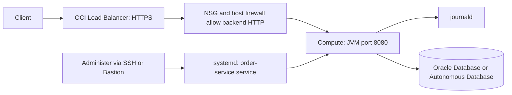

# Deploying Java on Compute Using systemd

## 1. Objectives and Deployment Model

In the **Java and Spring Boot Deployment** chapter, getting `java -jar` to run over SSH is only the initial check. An application on Oracle Cloud Infrastructure (OCI) Compute needs a way to boot with the host, stop cleanly, write logs, enforce resource limits, and recover when the process fails. This lesson uses **systemd** to manage a Java process running directly on a Linux host.

After this lesson, you will be able to:

- Prepare a Compute instance and organize the JAR, configuration, and data by role.
- Run the application under an unprivileged system account.
- Write a unit file so systemd manages the JVM and its restart policy.
- Distinguish a running process from an application that is ready to serve.
- Read logs, investigate startup failures, and diagnose OCI network access errors.
- Update or roll back a release without overwriting the currently running JAR.

The reference environment is **Oracle Linux 9, Java 21, and a Spring Boot executable JAR**. Shell commands in this lesson run in Bash on the Compute instance unless explicitly noted as build or artifact-transfer steps. If using another image or systemd version, verify supported directives using the tools on the target machine itself.

The sample application is named `order-service` on HTTP port `8080`. Expected access model:



The Load Balancer is optional when practicing on a single host. For services requiring availability, it distributes traffic across multiple backends; systemd only manages processes on each individual host and does not replace fault tolerance when an entire instance stops working.

## 2. Preparing Compute, Networking, and the Artifact

### 2.1. OCI Prerequisites

Prepare an Oracle Linux 9 instance with an SSH admin account having `sudo`, an appropriate administrative access path, and sufficient resources for the application. Memory examples in this lesson assume the host has at least around 4 GiB of RAM; re-measure under actual workload conditions.

| Component | What to Determine |
| --- | --- |
| Compartment | Where the instance lives and the IAM scope for deployers |
| VCN/subnet | Private addressing, routing, and host administration path |
| NSG/security list | Which sources may access SSH and the backend port |
| Host firewall | Permits the same traffic paths allowed by OCI networking |
| Machine architecture | `x86_64` or `aarch64`, especially when using JNI or native libraries |
| Memory and disk | Capacity for the JVM, OS, agents, logs, and releases |
| Database or external services | Corresponding DNS, TLS, routing, and authentication mechanisms |

NSGs/security lists and the host firewall are separate layers. Opening a port in OCI does not automatically modify the OS firewall. There is no need to open `8080` to the entire Internet just so the Load Balancer can reach the backend. [Source: Securing Compute](https://docs.oracle.com/en-us/iaas/Content/Security/Reference/compute_security.htm).

In a Load Balancer setup, use the instance's private IP as the backend when the topology fits, along with the actual application port. If the application only binds to `127.0.0.1`, a Load Balancer on another host cannot connect to that listener. [Source: Backend Servers for Load Balancers](https://docs.oracle.com/en-us/iaas/Content/Balance/Tasks/managingbackendservers.htm).

### 2.2. Installing the Runtime and Checking Tools

On Oracle Linux 9 with the appropriate AppStream repository enabled, install OpenJDK headless and HTTP tools:

```bash
sudo dnf install -y java-21-openjdk-headless curl
java -version
readlink -f /usr/bin/java
systemctl --version
uname -m
free -h
df -h / /var /opt
```

Oracle Linux 9 provides the `java-21-openjdk-headless` package in AppStream. If the image's repository lacks the package, check the repository configuration or your team's approved JDK provisioning workflow. [Source: Oracle Linux AppStream — OpenJDK 21 headless](https://yum.oracle.com/repowatch/oraclelinux9.x86_64/ol9_appstream/ac6c1ea10ff38ee1ee57963fa68e401ad01380dc95125016c95371e5412e262a).

The sample unit invokes `/usr/bin/java`, so `java -version` must show the chosen runtime. If the host has multiple JDKs, manage alternatives or use an explicitly managed, stable Java path. Simply setting `JAVA_HOME` does not switch the binary when `ExecStart` specifies `/usr/bin/java`.

The runtime must support the bytecode level and APIs used by the application. For example, a JAR compiled for Java 21 cannot run on Java 17; that error cannot be fixed by elevating the service's privileges.

### 2.3. Preparing the Executable JAR on the Build Host or CI

Build the application before transferring the artifact to Compute. For a Spring Boot project configured with Maven Wrapper and the Spring Boot Maven Plugin to produce an executable JAR, on a Bash build machine:

```bash
./mvnw clean package
sha256sum target/order-service-1.0.0.jar
```

On a Windows build machine, use `mvnw.cmd` instead. Select the exact executable JAR—do not mistakenly grab a plain JAR or `.original` file. Compute does not need Maven installed just to run a pre-built artifact.

To use the health endpoints later, the application needs Actuator, such as a dependency whose version is managed by the project's Spring Boot configuration:

```xml
<dependency>
    <groupId>org.springframework.boot</groupId>
    <artifactId>spring-boot-starter-actuator</artifactId>
</dependency>
```

Transfer the JAR through your team's administrative channel or artifact repository. For example, once a suitable SSH path is available:

```bash
scp target/order-service-1.0.0.jar opc@<ssh-host>:/tmp/order-service-20261120-001.jar
```

If the instance only has a private IP, use SSH/Bastion according to the environment's access setup. On the target host, compute the checksum and compare it against the value from the trusted build before installing:

```bash
sha256sum /tmp/order-service-20261120-001.jar
```

Computing the checksum on the target machine without comparing it to a trusted source does not verify that the artifact arrived intact.

## 3. Creating the Service User and Directory Structure

### 3.1. Separating Operational Privileges From Application Privileges

Deployers may use `sudo` to install releases and edit unit files. The JVM runs as the `orderapp` user, not as `root` or a personal SSH account.

During initial setup, create the user if it does not already exist:

```bash
sudo useradd --system --user-group \
  --home-dir /var/lib/order-service \
  --no-create-home \
  --shell /sbin/nologin orderapp

id orderapp
```

Do not recreate the user when deploying subsequent releases. This account needs no login shell because systemd executes Java directly.

Directory layout used throughout this lesson:

```text
/opt/order-service/
├── releases/
│   └── 20261120-001/
│       └── app.jar
└── current -> releases/20261120-001

/etc/order-service/
├── service.env
└── application-prod.properties

/var/lib/order-service/
    working data the application is permitted to write

/etc/systemd/system/order-service.service
```

| Path | Expected Owner/Permissions | Role |
| --- | --- | --- |
| `/opt/order-service/releases` | Root-managed, read-only to app | Immutable release artifacts |
| `/opt/order-service/current` | Root-managed | Points to the release selected for the next run |
| `/etc/order-service` | Root-managed, app group reads needed config | Environment-specific configuration |
| `/var/lib/order-service` | Writable by app user | Local state, exported files, or working data |
| Journal | System-managed | Process stdout/stderr logs |

The application must not overwrite its JAR or unit file. Data that must persist across restarts should not be placed inside a release directory or a temporary directory.

### 3.2. Installing the First Release

After verifying the checksum:

```bash
sudo install -d -o root -g root -m 0755 /opt/order-service
sudo install -d -o root -g root -m 0755 /opt/order-service/releases
sudo install -d -o root -g root -m 0755 /opt/order-service/releases/20261120-001
sudo install -d -o root -g orderapp -m 0750 /etc/order-service

sudo install -o root -g root -m 0644 \
  /tmp/order-service-20261120-001.jar \
  /opt/order-service/releases/20261120-001/app.jar

sudo ln -s releases/20261120-001 /opt/order-service/current
```

The command creating `current` above is for the initial install when the symlink does not yet exist. Subsequent updates use the release-switching procedure in the update section rather than copying a new JAR over an old release.

The `/var/lib/order-service` directory will be created and granted permissions by systemd via `StateDirectory` in the unit. This state directory persists when the service stops, unlike temporary runtime directories. [Source: systemd.exec — Directory Management](https://www.freedesktop.org/software/systemd/man/latest/systemd.exec.html#StateDirectory=).

## 4. Separating Spring Boot Configuration From the JAR

### 4.1. Non-Secret Environment File

Create the file with an administrative editor:

```bash
sudoedit /etc/order-service/service.env
```

Contents:

```ini
SPRING_PROFILES_ACTIVE=prod
SPRING_CONFIG_ADDITIONAL_LOCATION=file:/etc/order-service/
```

After saving, set ownership and permissions:

```bash
sudo chown root:root /etc/order-service/service.env
sudo chmod 0600 /etc/order-service/service.env
```

The system service manager reads the environment file before launching the JVM. This file is not a shell script: do not write `export`, and do not expect `$(...)` to execute or `$OTHER_VARIABLE` to expand automatically. Variables from an SSH shell also do not automatically appear in the system service environment.

`SPRING_CONFIG_ADDITIONAL_LOCATION` adds a config location rather than replacing all default locations. The trailing `/` indicates a directory; the `prod` profile causes the application to load `application-prod.properties` from there. [Source: Spring Boot Externalized Configuration](https://docs.spring.io/spring-boot/3.5/reference/features/external-config.html).

### 4.2. Application Configuration File

```bash
sudoedit /etc/order-service/application-prod.properties
```

Sample contents:

```properties
spring.application.name=order-service

server.address=0.0.0.0
server.port=8080
server.shutdown=graceful
spring.lifecycle.timeout-per-shutdown-phase=30s

management.endpoints.web.exposure.include=health
management.endpoint.health.show-details=never
management.endpoint.health.probes.enabled=true

logging.level.root=INFO
```

Set permissions so the JVM can read configuration without being able to modify it:

```bash
sudo chown root:orderapp /etc/order-service/application-prod.properties
sudo chmod 0640 /etc/order-service/application-prod.properties
```

Binding `0.0.0.0` suits a backend protected by NSGs/firewalls. If practicing only over an SSH tunnel or a reverse proxy on the same host, you can choose `127.0.0.1` and adjust the access path accordingly.

Actuator provides health groups for liveness/readiness when probes are enabled. HTTP exposure and endpoint authorization are separate settings; if the project uses Spring Security, configure exact access rules for required health endpoints rather than disabling security across the whole application. [Source: Spring Boot Actuator Endpoints](https://docs.spring.io/spring-boot/3.5/reference/actuator/endpoints.html).

### 4.3. Passwords, Wallets, and OCI API Permissions

The sample above does not configure a database password. When adding a database or a service requiring secrets, use an appropriate secret-delivery mechanism, such as protected files, systemd credentials paired with application configuration, or OCI Vault integration. Environment variables are not a trustworthy secret store merely because `service.env` has mode `0600`.

Never embed private keys, passwords, or wallets in the JAR or command-line arguments. For applications using the OCI Java SDK on Compute, instance principals paired with dynamic groups and IAM policies eliminate placing personal API keys on the host. This provides an identity for calling OCI APIs; it does not automatically provide SQL accounts for a database. [Source: Calling Services from an Instance](https://docs.oracle.com/en-us/iaas/Content/Identity/Tasks/callingservicesfrominstances.htm).

When using `ProtectHome=true` as in the unit below, files placed inside `/home/opc` are inaccessible to the service. Move actual runtime resources to explicitly managed paths with proper permissions; never point production applications at a deployer's personal home directory.

## 5. The Unit File Managing the JVM

### 5.1. Service Definition

Create the unit:

```bash
sudoedit /etc/systemd/system/order-service.service
```

Contents for the sample environment:

```ini
[Unit]
Description=Order Service - Spring Boot on OCI Compute
Wants=network-online.target
After=network-online.target
StartLimitIntervalSec=60
StartLimitBurst=5

[Service]
Type=exec
User=orderapp
Group=orderapp
WorkingDirectory=/var/lib/order-service
StateDirectory=order-service
StateDirectoryMode=0750
UMask=0027

EnvironmentFile=/etc/order-service/service.env
ExecStart=/usr/bin/java -Xms256m -Xmx768m -XX:+ExitOnOutOfMemoryError -jar /opt/order-service/current/app.jar

Restart=on-failure
RestartSec=5s
SuccessExitStatus=143
KillSignal=SIGTERM
KillMode=control-group
TimeoutStopSec=75s

StandardOutput=journal
StandardError=journal
SyslogIdentifier=order-service

NoNewPrivileges=true
PrivateTmp=true
ProtectSystem=strict
ProtectHome=true

MemoryAccounting=true
MemoryHigh=1280M
MemoryMax=1536M
TasksMax=512

[Install]
WantedBy=multi-user.target
```

After saving:

```bash
sudo chown root:root /etc/systemd/system/order-service.service
sudo chmod 0644 /etc/systemd/system/order-service.service
```

### 5.2. The JVM Is the Main Process

`ExecStart` runs Java directly in the foreground. Do not add `nohup`, `&`, `screen`, login shells, or custom PID-file scripts to this template.

`Type=exec` confirms the binary has executed before systemd considers the startup step successful. It still does not wait for Spring to finish initializing or for the HTTP port to become ready. Do not switch to `Type=notify` unless the application genuinely sends readiness notifications following the systemd protocol. [Source: systemd.service — Service Types](https://www.freedesktop.org/software/systemd/man/latest/systemd.service.html#Type=).

The unit has no `ExecStop=kill -9 ...`. Systemd already tracks the PID/cgroup to send stop signals; using a forceful kill as the first step bypasses JVM shutdown hooks.

### 5.3. Do Not Treat `ExecStart` as a Bash Line

Systemd has its own command parsing rules. Do not place pipelines, redirects, or `&&` chains inside `ExecStart` expecting shell behavior. Stdout/stderr handling already uses dedicated directives to route logs to the journal.

The template also does not declare `JAVA_OPTS` expecting Java to read it automatically. To change JVM flags, modify `ExecStart` explicitly via the unit or a drop-in; JVM flags precede `-jar`, while application arguments follow the JAR path.

## 6. Understanding Privilege, Memory, and Lifecycle Limits

### 6.1. Write Restrictions and Process Privileges

The protection directives in the template serve specific purposes:

| Directive | Design Impact |
| --- | --- |
| `User`, `Group` | JVM runs without administrative privileges |
| `NoNewPrivileges` | Prevents the process and its children from gaining extra privileges via mechanisms like setuid |
| `ProtectSystem=strict` | Exposes most of the filesystem as read-only to the service |
| `StateDirectory` | Provisions a writable state area for the service despite filesystem protection |
| `ProtectHome` | Prevents the service from relying on data in personal user home directories |
| `PrivateTmp` | Isolates the service's `/tmp` and `/var/tmp` from other processes |
| `UMask` | Restricts default permissions of new files created by the application |

If the application needs uploads or file exports, configure paths under `/var/lib/order-service` or add an explicitly designed writable area. Changing the working directory alone does not ensure every library's relative paths match application requirements.

Do not mechanically add memory-execution restriction directives: the JVM uses a JIT compiler and may load native libraries. Every hardening change must be tested against the real runtime and workload.

### 6.2. Heap Is Not Total JVM Memory

`-Xmx768m` caps the Java heap in this example. The process also uses metaspace, code cache, thread stacks, direct buffers, native libraries, and other regions. Therefore, never set `MemoryMax=768M` equal to the maximum heap.

`MemoryHigh` sets a throttling pressure threshold; `MemoryMax` is the hard cgroup limit and can trigger an OOM kill if usage cannot be kept below it. Values are also constrained by parent slices and system limits. [Source: systemd.resource-control — Memory Controls](https://www.freedesktop.org/software/systemd/man/latest/systemd.resource-control.html#MemoryMax=).

The `1280M/1536M` example is not a universal sizing rule for every Spring Boot app. Reserve memory for the OS, OCI agents, and other processes, then measure actual RSS/cgroup usage, heap, thread counts, and concurrent load. `TasksMax=512` is likewise a limit to verify against actual task/thread counts.

`-XX:+ExitOnOutOfMemoryError` lets the JVM exit when it hits a JVM-handled OOM so the restart policy can take effect. It does not prevent kernel/cgroup OOM kills and is no substitute for diagnosing memory leaks or insufficient allocation.

### 6.3. Network Target Is Not a Health Check

`Wants=network-online.target` and `After=network-online.target` request and order startup after the network target according to the OS wait-online mechanism. They do not verify that the database is reachable, external service DNS works, or Vault is accessible. [Source: systemd.special — network-online.target](https://www.freedesktop.org/software/systemd/man/latest/systemd.special.html#network-online.target).

The application still needs timeouts, bounded retries, and appropriate dependency readiness handling. A transient database blip should not automatically turn into mass JVM restarts across every backend.
