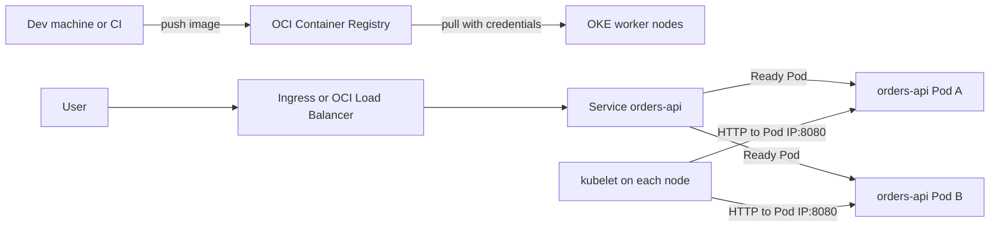

# Deploying Spring Boot on OKE With Health Probes and Resource Limits

## 1. Objectives and Scope

A Spring Boot container showing `Running` only tells you that the process is alive. When deploying to Oracle Kubernetes Engine (OKE), operators also need to define when the application should receive traffic, when it should be restarted, and how many resources each replica is allowed to consume.

In the **Java and Spring Boot Deployment** chapter of the **CLOUD_PROVIDERS_ORACLE** module, this lesson deploys an HTTP service `orders-api` onto an existing OKE cluster. The focus is connecting application configuration to how Kubernetes operates Pods on OCI infrastructure:

- Exposing application status with Spring Boot Actuator.
- Distinguishing startup, readiness, and liveness probes.
- Setting CPU/memory requests, limits, and the JVM memory budget.
- Deploying via Deployment and Service, reading operational evidence, updating, and rolling back.
- Connecting decisions to OCI IAM, compartments, VCN, monitoring, availability, and cost.

The example uses Java 21, a Spring Boot web application packaged as an executable JAR, and an **OKE managed node pool running Linux**. Resource numbers in this lesson are lab starting points that must be re-measured for real applications. Oracle Database is not deployed inside a Pod in this example; Oracle Database connectivity is discussed only when deciding what health checks should cover.

## 2. Paths for Images, Traffic, and Probes



OKE provides the Kubernetes environment; OCIR stores images. The Deployment manages application replicas, while the Service creates a stable access point for Pods matching its selector.

**kubelet health probes and OCI Load Balancer health checks are two separate mechanisms.** Probes in this lesson go directly to the Pod without traversing public DNS or a load balancer. Thus, a passing probe does not prove the path from external users works.

In OCI, distinguish three scopes:

| Scope | Example in This Lesson | Meaning |
| --- | --- | --- |
| Tenancy and compartment | Compartment hosting cluster, node pool, and networking resources | Administration, OCI policy, and cost-allocation boundary |
| Kubernetes namespace | `java-apps` | Kubernetes object scope for this lesson |
| OCIR tenancy namespace | String used in the tenancy's image path | Repository identifier component, not a Kubernetes namespace |

Having a kubeconfig does not imply permission to deploy everything. OKE access must be considered alongside IAM and Kubernetes/RBAC permissions. Deployment accounts should only hold permissions needed within their assigned scope. See [Oracle: OKE Access Control](https://docs.oracle.com/en-us/iaas/Content/ContEng/Concepts/contengaboutaccesscontrol.htm).

## 3. Pre-Deployment Preparation

You need:

1. An active OKE cluster with `Ready` worker nodes and sufficient allocatable CPU/memory.
2. A workstation with OCI CLI, `kubectl`, Docker, and a JDK/build tool matching the project.
3. A kubeconfig generated for the deployer's own identity.
4. Permission to create a Namespace or an existing namespace provisioned by an administrator; permissions to manage Deployments, Services, ConfigMaps, and Secrets in that namespace.
5. An OCIR repository along with credentials authorized for push/pull.
6. Connectivity from the admin workstation to the Kubernetes API endpoint, and from worker nodes to OCIR, DNS, and dependent application systems.

If the API endpoint is private, use an established access path such as a bastion, VPN, or admin host on the appropriate network. Generate kubeconfig using the command provided in the OCI Console for the exact cluster and endpoint type. Refer to [Oracle: Setting Up Cluster Access](https://docs.oracle.com/en-us/iaas/Content/ContEng/Tasks/contengdownloadkubeconfigfile.htm).

Verify the context before modifying resources:

```bash
kubectl config current-context
kubectl cluster-info
kubectl get nodes -o wide
kubectl get nodes -L kubernetes.io/arch
```

Listing nodes may require broader permissions than deploying inside a namespace; if denied, ask an administrator to confirm details rather than escalating permissions.

OCI provides shapes with different CPU architectures. The image must have a variant matching `amd64` or `arm64` of the node running the Pod. The manifest example below targets `amd64` nodes; if using an Arm pool, update both the image build and the node selector.

For VCN networking, verify the actual path from nodes/subnets to the registry: DNS, routes, gateways, or the OCI service-access mechanism designed for that environment. An image pull failure can be caused by networking, not just tokens.

## 4. Preparing the Application and Actuator Configuration

### 4.1. Minimal HTTP Application

Use a Spring Boot project with `spring-boot-starter-web`, an executable JAR packaging plugin, and a Spring Boot version compatible with Java 21. Add Actuator, letting the project's dependency management control the version:

```xml
<dependency>
    <groupId>org.springframework.boot</groupId>
    <artifactId>spring-boot-starter-actuator</artifactId>
</dependency>
```

To provide a simple business endpoint for verification, you can use the following application class:

```java
package vn.example.orders;

import java.util.Map;
import org.springframework.boot.SpringApplication;
import org.springframework.boot.autoconfigure.SpringBootApplication;
import org.springframework.web.bind.annotation.GetMapping;
import org.springframework.web.bind.annotation.RestController;

@SpringBootApplication
@RestController
public class OrdersApplication {
    public static void main(String[] args) {
        SpringApplication.run(OrdersApplication.class, args);
    }

    @GetMapping("/api/orders/status")
    public Map<String, String> status() {
        return Map.of("service", "orders-api", "status", "ok");
    }
}
```

This is a stateless service for the lab. It does not store orders in local memory and requires no volumes or database passwords.

### 4.2. Configuration for the OKE Profile

The following content will be placed in a ConfigMap during deployment:

```yaml
server:
  port: 8080
  shutdown: graceful

spring:
  lifecycle:
    timeout-per-shutdown-phase: 25s

management:
  endpoints:
    web:
      exposure:
        include: health
  endpoint:
    health:
      show-details: never
      probes:
        enabled: true
        add-additional-paths: true
```

Actuator exposes health groups at `/actuator/health/liveness` and `/actuator/health/readiness`. With additional paths enabled, this lesson uses `/livez` and `/readyz` on application port 8080 so probes pass through the same web server as business APIs. See [Spring Boot: Kubernetes Probes](https://docs.spring.io/spring-boot/reference/actuator/endpoints.html#actuator.endpoints.kubernetes-probes).

There is no need to separate `management.server.port` in this example. Using a separate management port can mask a blocked business server port with healthy management responses.

If the project uses Spring Security or auth filters, permit kubelet to call the exact health paths without redirecting to a login page. Keep authentication intact for business APIs and limit exposed management info; `show-details: never` avoids leaking health internals to callers.

## 5. Packaging and Pushing the Image to OCIR

### 5.1. Container Running as an Unprivileged User

Package the application using the project's build workflow. In the illustrative commands below, the executable JAR has been built or copied to `target/orders-api.jar`.

Illustrative Dockerfile:

```dockerfile
FROM eclipse-temurin:21-jre
WORKDIR /app
COPY --chown=10001:10001 target/orders-api.jar /app/app.jar
USER 10001:10001
EXPOSE 8080
ENTRYPOINT ["java", "-jar", "/app/app.jar"]
```

Exec-form `ENTRYPOINT` lets Java receive stop signals directly. The JRE does not need `curl` to serve HTTP probes: kubelet sends HTTP requests from the node.

For real releases, pin base and application images by audited digests, scan for vulnerabilities, and preserve build results. Readable tags remain useful, but should never be reused to point to different contents.

### 5.2. Building, Logging In, and Pushing

Multi-line commands in this lesson use **Bash**, suitable for Linux or WSL terminals. For PowerShell, adapt variable syntax to the shell. Replace all `<...>` placeholders before running:

```bash
REGISTRY="<ocir-registry-host>"
TENANCY_NAMESPACE="<tenancy-namespace>"
OCIR_USERNAME="<tenancy-namespace>/<oci-username-or-domain-user>"
IMAGE="$REGISTRY/$TENANCY_NAMESPACE/java/orders-api:1.0.0"

docker build --platform linux/amd64 -t "$IMAGE" .
docker login "$REGISTRY" --username "$OCIR_USERNAME"
docker push "$IMAGE"
```

Enter your **OCI auth token** at the password prompt, not your Console login password. The registry host must match the region and the host referenced in the manifest. Federated/identity-domain usernames must follow the tenancy's exact format.

Record the digest from push output to use for pinned releases. Image push steps and login formats are documented in [Oracle: Pushing Images Using the Docker CLI](https://docs.oracle.com/en-us/iaas/Content/Registry/Tasks/registrypushingimagesusingthedockercli.htm).

### 5.3. Granting OKE Permission to Pull Private Images

Create the namespace if the deployer has permission:

```bash
kubectl create namespace java-apps
```

If a namespace is already provisioned, use it and align all manifests consistently. One lab option is creating a Secret from the Docker config of a dedicated pull account:

```bash
kubectl -n java-apps create secret generic ocir-pull --from-file=.dockerconfigjson="$HOME/.docker/config.json" --type=kubernetes.io/dockerconfigjson
```

Use this method only when the Docker config actually holds credentials for the target registry. If Docker uses a credential helper, the file may lack transferable credentials for Kubernetes. In that case, provision the registry Secret using your organization's approved secret workflow.

Do not copy a Docker config containing credentials for unrelated registries. In pipelines, inject secrets through an approved secret store or deployment mechanism—never commit tokens to Git. Base64-encoded Kubernetes Secrets do not keep content hidden from anyone authorized to read Secrets. Refer to [Kubernetes: Pull an Image from a Private Registry](https://kubernetes.io/docs/tasks/configure-pod-container/pull-image-private-registry/).

The `ocir-pull` Secret must live in the **same namespace as the Pod**. The Deployment references the Secret via `imagePullSecrets`; CI push credentials and runtime pull credentials can be two separate identities with different permissions. See [Oracle: Pulling Images from OCIR During Deployment](https://docs.oracle.com/en-us/iaas/Content/ContEng/Tasks/contengpullingimagesfromocir.htm).

## 6. Choosing the Right Semantics for Each Probe

| Probe | Question Answered | When Failures Reach Threshold | Usage in This Lesson |
| --- | --- | --- | --- |
| Startup | Has the application finished starting up? | Kubelet terminates the container; restart follows restart policy | Calls `/livez`, reserving a dedicated startup budget |
| Readiness | Should this replica receive new traffic? | Container is marked unready; excluded from ready Service backends | Calls `/readyz` |
| Liveness | Does this replica need to be restarted? | Kubelet terminates the container; restart follows restart policy | Calls `/livez` periodically |

When a startup probe is configured, readiness and liveness probes do not run until the startup probe succeeds. The startup probe is not a comprehensive business test: liveness can pass before the app is fully ready, while readiness continues blocking traffic during that window. See [Kubernetes: Probe Lifecycle](https://kubernetes.io/docs/concepts/workloads/pods/probes/).

### 6.1. Do Not Use the Database as a Liveness Condition

Suppose every Pod connects to one Oracle Autonomous Database. If the database undergoes maintenance and liveness checks the database, both Pods can enter a restart loop even though the JVMs are healthy. That loop does not fix the database and can worsen reconnect storms.

Liveness should reflect internal replica failures that a restart can recover from. Readiness may inspect an essential dependency, but base that decision on business behavior: when a shared dependency fails, removing all Pods from the Service can take down APIs that could otherwise still serve requests.

The sample keeps Spring Boot's default availability groups without adding the database to probes. Do not use the aggregate `/actuator/health` for liveness just because it exists. If you later add a health indicator to readiness, ensure short timeouts and low check overhead.

### 6.2. Understanding Time Budgets

The example Deployment uses:

| Parameter | Startup | Readiness | Liveness |
| --- | --- | --- | --- |
| `periodSeconds` | 5 | 5 | 10 |
| `timeoutSeconds` | 2 | 2 | 2 |
| `failureThreshold` | 36 | 3 | 3 |
| `successThreshold` | 1 | 1 | 1 |

The nominal startup budget is roughly `36 × 5 = 180 seconds`. Liveness has a periodic detection window of around 30 seconds; readiness around 15 seconds. These are design estimates rather than exact timing guarantees: probe scheduling and request durations affect observed times.

Choose the startup budget based on startup times measured under CPU throttling, load, and initialization tasks. Use a startup probe instead of blindly raising liveness `initialDelaySeconds`. Parameter details are in [Kubernetes: Configure Liveness, Readiness and Startup Probes](https://kubernetes.io/docs/tasks/configure-pod-container/configure-liveness-readiness-startup-probes/).

## 7. Requests, Limits, and JVM Memory Budgets

### 7.1. Four Values With Four Roles

| Per-Container Setting | Sample Value | Interpretation |
| --- | --- | --- |
| CPU request | `250m` | Scheduler accounts for 0.25 CPU demand when placing the Pod |
| CPU limit | `1000m` | CPU capped at 1 CPU; heavy load may incur throttling |
| Memory request | `512Mi` | Scheduler accounts for 512 MiB memory demand |
| Memory limit | `1Gi` | Exceeding limit can trigger an OOM kill |

A request is not a usage ceiling. A Pod may use more than its request if node resources allow, whereas a limit enforces an upper bound. CPU limits typically slow execution via throttling; memory limits can kill the process. Do not use the `m` suffix for memory when intending MiB. See [Kubernetes: Resource Management for Pods and Containers](https://kubernetes.io/docs/concepts/configuration/manage-resources-containers/).

### 7.2. Heap Is Only Part of Memory

The 1 GiB limit must accommodate heap, metaspace, code cache, thread stacks, direct buffers, and other native allocations. Never set `-Xmx1g` when the container only has `memory: 1Gi`.

The example uses:

```text
JAVA_TOOL_OPTIONS=-XX:MaxRAMPercentage=60.0 -XX:+ExitOnOutOfMemoryError
```

With a 1 GiB limit and the JVM properly detecting the container limit, the maximum heap budget is roughly 614 MiB before JVM ergonomics adjustments; the remainder is not a guarantee that all native memory will fit.

`ExitOnOutOfMemoryError` lets the process exit when the JVM throws an OutOfMemoryError; it does not prevent kernel OOM kills. Pick the ratio by observing heap, RSS, thread count, direct memory, and real load. See [Java 21: JVM Memory Options](https://docs.oracle.com/en/java/javase/21/docs/specs/man/java.html).

Diagnostic example: if heap sits at 430 MiB while the Pod nears its 1 GiB limit, merely increasing heap can worsen things. Inspect thread count, native libraries, TLS, buffers, and off-heap memory instead.

### 7.3. Accounting for Resources During Rollouts

With two replicas in the sample:

- Steady-state total requests: `500m CPU + 1Gi memory`.
- Adding one Pod per `maxSurge: 1`: at least `750m CPU + 1.5Gi memory` requested across three Pods.
- If all three approach their memory limit simultaneously: demand can near 3 GiB, excluding other workloads and system components.

Terminating Pods can still hold resources; leave extra headroom during transitions. Use per-node **allocatable** capacity and Pod placement to check schedulability, not cluster-wide sums. Two nodes with 600 MiB combined free memory—300 MiB each—still cannot schedule one Pod requesting 512 MiB.

## 8. Complete Deployment Manifest

Save the following illustrative manifest as `orders-api-oke.yaml` in your lab environment. Before applying, replace the image placeholder with your pushed path; for releases, prefer `<registry>/<tenancy-namespace>/java/orders-api@sha256:<digest>`.

```yaml
apiVersion: v1
kind: ConfigMap
metadata:
  name: orders-api-config-v1
  namespace: java-apps
immutable: true
data:
  application-oke.yaml: |
    server:
      port: 8080
      shutdown: graceful
    spring:
      lifecycle:
        timeout-per-shutdown-phase: 25s
    management:
      endpoints:
        web:
          exposure:
            include: health
      endpoint:
        health:
          show-details: never
          probes:
            enabled: true
            add-additional-paths: true
---
apiVersion: apps/v1
kind: Deployment
metadata:
  name: orders-api
  namespace: java-apps
  labels:
    app.kubernetes.io/name: orders-api
spec:
  replicas: 2
  revisionHistoryLimit: 3
  minReadySeconds: 10
  progressDeadlineSeconds: 600
  strategy:
    type: RollingUpdate
    rollingUpdate:
      maxSurge: 1
      maxUnavailable: 0
  selector:
    matchLabels:
      app.kubernetes.io/name: orders-api
  template:
    metadata:
      labels:
        app.kubernetes.io/name: orders-api
    spec:
      automountServiceAccountToken: false
      terminationGracePeriodSeconds: 45
      nodeSelector:
        kubernetes.io/os: linux
        kubernetes.io/arch: amd64
      imagePullSecrets:
        - name: ocir-pull
      securityContext:
        runAsNonRoot: true
        runAsUser: 10001
        runAsGroup: 10001
        fsGroup: 10001
        seccompProfile:
          type: RuntimeDefault
      topologySpreadConstraints:
        - maxSkew: 1
          topologyKey: kubernetes.io/hostname
          whenUnsatisfiable: ScheduleAnyway
          labelSelector:
            matchLabels:
              app.kubernetes.io/name: orders-api
      containers:
        - name: orders-api
          image: "<ocir-registry-host>/<tenancy-namespace>/java/orders-api:1.0.0"
          imagePullPolicy: IfNotPresent
          ports:
            - name: http
              containerPort: 8080
          env:
            - name: SPRING_PROFILES_ACTIVE
              value: oke
            - name: SPRING_CONFIG_ADDITIONAL_LOCATION
              value: file:/etc/orders/
            - name: JAVA_TOOL_OPTIONS
              value: "-XX:MaxRAMPercentage=60.0 -XX:+ExitOnOutOfMemoryError"
          resources:
            requests:
              cpu: 250m
              memory: 512Mi
            limits:
              cpu: 1000m
              memory: 1Gi
          startupProbe:
            httpGet:
              path: /livez
              port: http
            periodSeconds: 5
            timeoutSeconds: 2
            failureThreshold: 36
            successThreshold: 1
          readinessProbe:
            httpGet:
              path: /readyz
              port: http
            periodSeconds: 5
            timeoutSeconds: 2
            failureThreshold: 3
            successThreshold: 1
          livenessProbe:
            httpGet:
              path: /livez
              port: http
            periodSeconds: 10
            timeoutSeconds: 2
            failureThreshold: 3
            successThreshold: 1
          securityContext:
            allowPrivilegeEscalation: false
            readOnlyRootFilesystem: true
            capabilities:
              drop:
                - ALL
          volumeMounts:
            - name: app-config
              mountPath: /etc/orders
              readOnly: true
            - name: temp
              mountPath: /tmp
      volumes:
        - name: app-config
          configMap:
            name: orders-api-config-v1
        - name: temp
          emptyDir:
            sizeLimit: 256Mi
---
apiVersion: v1
kind: Service
metadata:
  name: orders-api
  namespace: java-apps
spec:
  type: ClusterIP
  selector:
    app.kubernetes.io/name: orders-api
  ports:
    - name: http
      port: 80
      targetPort: http
---
apiVersion: policy/v1
kind: PodDisruptionBudget
metadata:
  name: orders-api
  namespace: java-apps
spec:
  minAvailable: 1
  selector:
    matchLabels:
      app.kubernetes.io/name: orders-api
```

Notable choices:

- Naming the ConfigMap `v1` and marking it immutable preserves each revision's configuration. When changing config, create a `v2` ConfigMap and update the reference in the Pod template; retain `v1` during the rollback window.
- `SPRING_CONFIG_ADDITIONAL_LOCATION` adds an external config directory; the `oke` profile loads `application-oke.yaml`. Never store passwords inside ConfigMaps.
- Root filesystem is read-only; `/tmp` uses a dedicated volume for scratch writes. If libraries write to other directories, explicitly design writable paths and volumes.
- `ScheduleAnyway` encourages spreading Pods across nodes without blocking scheduling under tight capacity. Enforcing strict separation trades off against Pods staying Pending.
- The Service is `ClusterIP`, so this baseline step does not create an OCI Load Balancer yet. This suffices to verify the application before exposing an external entry point.
- The sample application does not call the Kubernetes API, so automatic service account token mounting is disabled.

A PodDisruptionBudget provides partial protection against voluntary disruptions through the Eviction API, such as node drains. It does not prevent node failures, block direct Pod deletions, or govern Deployment rolling updates. See [Kubernetes: Disruptions and PDB](https://kubernetes.io/docs/concepts/workloads/pods/disruptions/).

## 9. Applying and Verifying Deployment Evidence

### 9.1. Validating the Manifest and Rollout

Once the namespace, Secret, and image are ready:

```bash
kubectl apply --dry-run=server -f orders-api-oke.yaml
kubectl apply -f orders-api-oke.yaml
kubectl -n java-apps rollout status deployment/orders-api --timeout=10m
kubectl -n java-apps get deployment orders-api
kubectl -n java-apps get pods -l app.kubernetes.io/name=orders-api -o wide
```

Server dry run checks schema and active admission rules at that time; it does not prove the image exists, the JVM starts, or probes will pass.

The expected steady state is a Deployment with two available replicas, each Pod showing `READY 1/1`, running the intended release image, and zero recurring restarts. `Running` alongside `READY 0/1` signals a condition to investigate.

### 9.2. Testing the HTTP Path

Open one terminal:

```bash
kubectl -n java-apps port-forward service/orders-api 8080:80
```

In a second terminal:

```bash
curl -i http://localhost:8080/livez
curl -i http://localhost:8080/readyz
curl -i http://localhost:8080/api/orders/status
```

Both health endpoints should return HTTP 200 when Pods are healthy and ready; the business endpoint returns JSON containing `"service":"orders-api"`.

Port-forwarding to a Service picks one matching Pod to tunnel to. It is handy for smoke testing, but does not fully validate the Service dataplane, distribution across all replicas, or the path through an OCI Load Balancer. When needed, test HTTP from an in-cluster workload and test external endpoints separately.

### 9.3. Confirming Readiness Reflects in Backends

```bash
kubectl -n java-apps get endpointslices -l kubernetes.io/service-name=orders-api -o yaml
kubectl -n java-apps describe deployment orders-api
kubectl -n java-apps get events --sort-by=.metadata.creationTimestamp
```

Compare Pod IPs with endpoints and `conditions.ready`. Having an endpoint IP listed alone is not enough to conclude it is actively serving as a ready backend.

## 10. Graceful Shutdown, Updates, and Rollbacks

### 10.1. Allowing Enough Time to Stop

In the example, Spring has a 25-second timeout per shutdown phase; the Pod has a 45-second termination grace period. Do not interpret these two numbers as a guarantee that all tasks always finish cleanly.

Java must receive SIGTERM to close the application. On stop, the web server stops accepting new requests per its shutdown behavior and waits to finish in-flight requests. Long requests, background consumers, or multiple shutdown phases may require a larger budget. See [Spring Boot: Graceful Shutdown](https://docs.spring.io/spring-boot/reference/web/graceful-shutdown.html).

Kubernetes updates endpoint states and terminates containers asynchronously; active connections and proxy propagation delays still apply. If the system needs a drain delay or `preStop` hook, measure actual propagation latency. `preStop` shares the termination grace period budget—it does not add extra time beyond 45 seconds. See [Kubernetes: Pod Termination](https://kubernetes.io/docs/concepts/workloads/pods/pod-lifecycle/#pod-termination).

Do not blindly insert a long sleep just to make graphs look clean: it delays shutdown and slows rollouts without properly solving traffic draining.

### 10.2. Updating a Release

Push a new image with a new digest, then update the declaration tracked in Git/pipeline. To practice the imperative operation directly:

```bash
NEW_IMAGE="<ocir-registry-host>/<tenancy-namespace>/java/orders-api@sha256:<new-digest>"
kubectl -n java-apps set image deployment/orders-api orders-api="$NEW_IMAGE"
kubectl -n java-apps rollout status deployment/orders-api --timeout=10m
kubectl -n java-apps rollout history deployment/orders-api
```

`maxUnavailable: 0` and `maxSurge: 1` allow spinning up a new Pod before terminating an old one when capacity permits. `minReadySeconds: 10` requires new Pods to stay ready for a period before counting as available. Exceeding `progressDeadlineSeconds` marks the Deployment as stalled; Kubernetes does not automatically roll back just because the deadline elapsed. See [Kubernetes: Deployments](https://kubernetes.io/docs/concepts/workloads/controllers/deployment/).

Since the example ConfigMap is versioned, if releasing an image alongside configuration changes, update both the image and ConfigMap reference in the same Pod template change.

### 10.3. Deliberate Rollback

```bash
kubectl -n java-apps rollout history deployment/orders-api
kubectl -n java-apps rollout undo deployment/orders-api --to-revision=<known-good-revision>
kubectl -n java-apps rollout status deployment/orders-api --timeout=10m
```

Rolling back a Deployment restores the Pod template of the selected revision. It does not revert database migrations or external system changes. Both the old ConfigMap and old image must still exist; if every revision points to a single ConfigMap edited in place, rolling back the template will not restore prior configuration.

After a direct imperative test, synchronize declarations back to your source of truth so the next apply does not accidentally revert the system to different settings.

## 11. Troubleshooting by Symptom

Substitute the actual Pod name for `<pod-name>`:

```bash
kubectl -n java-apps describe pod <pod-name>
kubectl -n java-apps logs <pod-name> -c orders-api --tail=200
kubectl -n java-apps logs <pod-name> -c orders-api --previous --tail=200
kubectl -n java-apps get pod <pod-name> -o yaml
```

`--previous` helps when a container has restarted and current logs lack the prior run's error. Correlate container state, last state, events, and logs along the same timeline; see [Kubernetes: Debug Pods](https://kubernetes.io/docs/tasks/debug/debug-application/debug-pods/).

| Symptom | First Places to Check | Resolution Direction |
| --- | --- | --- |
| `ImagePullBackOff` | Image pull events, registry host, repository, Secret in same namespace, network to OCIR | Fix image/credentials or network path before tweaking probes |
| `exec format error` | Image and node architectures | Build matching variant, update selector, or use multi-arch image |
| Pod `Pending` | Scheduling events, requests, quotas, selectors | Add capacity or fix invalid constraints |
| `Running` but `0/1 Ready` | URL, port, health response, startup logs | Fix readiness or why the app is not ready |
| Probe returns 401/403 | Security chain and filters | Permit exact health paths under appropriate policy |
| Probe returns 404 | Profile, ConfigMap mount, Actuator, context path | Align actual URLs with the manifest |
| Startup probe fails | Startup logs, CPU throttling, config errors | Fix root cause; raise budget based on measurements |
| `OOMKilled` | Last state, memory limit, usage before termination | Analyze total memory, reduce demand, or adjust limit |
| `CrashLoopBackOff` | Exit code, previous logs, and events | Separate application, JVM, probe, and OS signal errors |
| Pod ready but users see errors | DNS, Service, selectors, proxy/LB, NSGs, and routes | Trace the data path outside the probe |

Exit code 137 is commonly associated with SIGKILL, but alone is insufficient to conclude OOM. Look for `OOMKilled` reason and supporting evidence. If all Pods restart simultaneously during a database outage, revisit liveness design before scaling replicas.

Specifically for Java, tight CPU limits can slow down JIT, GC, or startup. If you only observe probe timeouts and keep raising timeouts blindly, underlying CPU starvation or abnormal startup work remains unfixed.

## 12. Observability, Scaling, and Cost Control

### 12.1. Reading Metrics at the Right Layer

When the cluster has an active Metrics Server:

```bash
kubectl -n java-apps top pods --containers
kubectl top nodes
```

`kubectl top` provides near-current resource readings; it requires Metrics Server and does not replace historical data or alerting. If the metrics API is unavailable, that is not evidence the application is broken. See [Kubernetes: kubectl top](https://kubernetes.io/docs/reference/kubectl/generated/kubectl_top/).

In operations, correlate signals across layers:

| Layer | Signals to Track | Operational Question |
| --- | --- | --- |
| Application | Request rate, errors, p95/p99 latency, heap, and GC | Are users getting correct results within acceptable latency? |
| Container/Pod | CPU, throttling, memory, restarts, and readiness | Are resource limits or probes eroding capacity? |
| Node/OKE | Allocatable capacity, pressure, Pending Pods, replica spread | Does the cluster have room to run and survive losing a node? |
| OCI | Network paths, load balancers, resources, and cost per compartment | Are bottlenecks or costs coming from infrastructure outside the app? |

Collect application logs from stdout/stderr via your established log pipeline, such as OCI Logging integration or your organization's observability stack. If Prometheus metrics are required, add a Micrometer registry and govern the scrape path separately; the current manifest exposes only health.

### 12.2. HPA Does Not Replace Setting Requests

CPU HPA computes utilization relative to CPU requests. For example, 175m usage against a 250m request is 70%, not 70% of the 1000m limit. HPA requires an appropriate metrics source and properly configured requests. See [Kubernetes: Horizontal Pod Autoscaling](https://kubernetes.io/docs/concepts/workloads/autoscaling/horizontal-pod-autoscale/).

HPA adds Pods, but does not automatically provision nodes. If the node pool runs out of room, new Pods remain Pending. Also check total connections to Oracle Database or downstream services: scaling replicas multiplies connection pools without automatically scaling database capacity.

When enabling HPA, avoid having deployment automation repeatedly reapply a static replica count that fights the autoscaler's decisions.

### 12.3. Distinguishing Resource Efficiency From Bill Reduction

Lowering CPU/memory requests can improve Pod bin-packing, but does not automatically reduce charges for existing nodes. Costs only change when actual billable resources are adjusted or released per operational design.

Decision example: if lowering requests leaves the node pool with the same node count and shapes, the immediate effect is extra spare capacity. If reducing node count at the same time, re-verify rollout capacity, PDBs, replica distribution, and fault tolerance.

Do not treat a large memory limit as guaranteed reserved memory. When multiple Pods grow their memory usage together, a node can experience memory pressure even though all Pods fit by requests earlier.

## 13. Routing Traffic Through an OCI Load Balancer

Once the internal path is stable, you can integrate an existing Ingress or use a Service of `type: LoadBalancer`. For an OCI Load Balancer, the annotation specifying LB type is:

```yaml
metadata:
  annotations:
    oci.oraclecloud.com/load-balancer-type: "lb"
spec:
  type: LoadBalancer
```

This is a snippet to merge into an existing Service, not a standalone complete manifest. Before switching, determine public vs. private LB, subnets/NSGs, TLS, controller permissions, and backend health-check settings. Provisioning an LB creates billable OCI resources. See [Oracle: Provisioning OCI Load Balancers for Kubernetes Services](https://docs.oracle.com/en-us/iaas/Content/ContEng/Tasks/contengcreatingloadbalancers-subtopic.htm).

Do not rely on port-forward smoke tests to conclude an LB is healthy. Independently test DNS, TLS, listeners, backend health, and requests from the user's network. Restrict public exposure to required APIs; kubelet health paths do not need to be open to the Internet.

Availability also depends on placement: two replicas on the same node can still be lost together if that node fails. On OKE, coordinate node pools, region-appropriate fault domains/availability domains, and Kubernetes constraints; do not infer fault tolerance solely from `replicas: 2`.

## 14. Expected Outcomes After Practice

A practice session is complete when you have the following evidence:

- An image matching the release and architecture pulled from OCIR; no tokens committed to manifests or Git.
- Deployment showing two available Pods; labels, Service selector, and EndpointSlice matching.
- Startup probe allowing app initialization; readiness gating traffic; liveness independent of shared Oracle Database state.
- Every container configured with requests and limits; heap sized within the total memory budget, not pressed against the container ceiling.
- Smoke tests returning valid responses from health endpoints and the business API; limitations of port-forward testing clearly understood.
- Observable rollout and rollback; images and ConfigMaps for target rollback revisions retained.
- Metrics collected to explain restarts, timeouts, OOMs, or Pending states before changing settings.
- Lab resources audited and cleaned up once no longer needed, especially any dedicated OCI LBs or capacity provisioned for the lab.

Commands in this lesson guide you through practicing in an authorized environment. Sample resource numbers become suitable operational settings only after validating against your own service's load, startup time, latency, and availability requirements.
