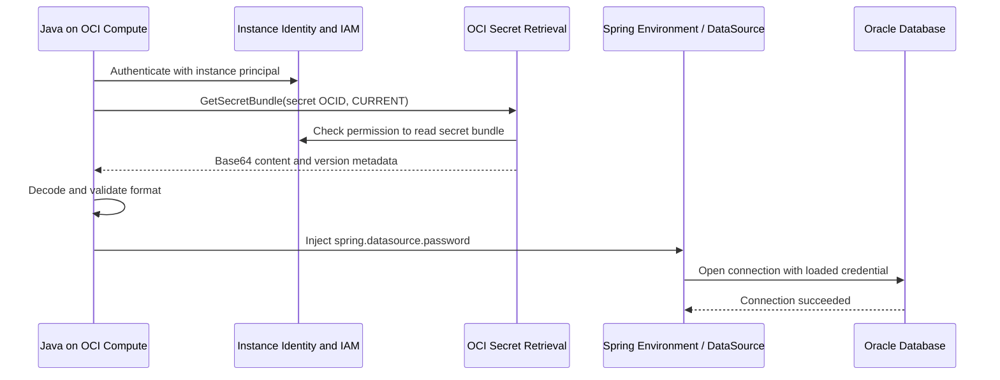

# Managing Application Configuration With OCI Vault

In the **Java and Spring Boot Deployment** chapter of the `CLOUD_PROVIDERS_ORACLE` module, this lesson covers separating sensitive data from source code, storing it with OCI Secret Management in Vault, and injecting it into Spring Boot configuration at startup. The focus is a Java application running on OCI Compute with IAM policies scoping secret-read access, network paths to the service, and redeployment practices when database credentials change.

OCI Vault participates in an operational chain spanning tenancy, compartment, workload identity, VCN networking, and the target service. Simply storing a password is only part of the problem: the application also needs to read the right version, avoid leaking its contents, and continue serving under the chosen availability strategy.

## 1. Objectives and Deployment Scenario

Suppose `orders-service` is a Spring Boot application connecting to Oracle Database via JDBC. The release artifact contains application code, while the deployment environment determines the database address, account, and secret used.

After this lesson, you will be able to:

- Distinguish regular configuration, secrets, and encryption keys protecting secrets.
- Design dynamic groups and IAM policies scoped to reading a specific secret.
- Retrieve a secret with the OCI Java SDK, Base64-decode it, and add it to Spring's `Environment` before dependent beans are created.
- Choose between reading directly via the SDK and supplying configuration via mounted files.
- Establish rotation, redeployment, monitoring, and recovery workflows suited to database capabilities.

Code examples use Java 17 and a Spring Boot 3.x application already configured with the JDBC starter, Oracle driver, and executable JAR packaging. The SDK is pinned to a specific version so you know the exact dependency set in use; do not assume it is the latest release. Bash snippets below target OCI Linux hosts and serve as hands-on guidance.

## 2. Separating Configuration by Sensitivity

Do not put the entire `application.yml` into Vault. First classify your data and identify the proper management location.

| Data | Example | Recommended Storage in This Lesson |
| --- | --- | --- |
| Application defaults | Service name, default pool size | `application.yml` in the project |
| Deployment configuration | Profile, region, credential-free JDBC URL | Environment variables or per-environment config files |
| Secret reference | Secret OCID for the password | Controlled deployment configuration |
| Sensitive values | JDBC password, client secrets, external service tokens | OCI Secret Management |
| Encryption key | Master encryption key protecting the secret | OCI Key Management |

An OCID is a resource identifier, not a credential replacing a password. Knowing an OCID does not grant read access to its contents; IAM governs that access. Even so, avoid exposing internal resource identifiers in error pages or customer-facing logs.

Example non-secret application configuration:

```yaml
spring:
  application:
    name: orders-service
  datasource:
    url: ${DB_JDBC_URL}
    username: ${DB_USERNAME}
    hikari:
      maximum-pool-size: 10
      connection-timeout: 10000
```

In this lesson's SDK approach, `spring.datasource.password` is injected from Vault. Do not add a default fallback password that lets the app keep starting when secret retrieval fails. The JDBC URL in the example must contain no password; protecting the password does not replace encrypting the JDBC transport itself.

## 3. Understanding OCI Vault Components

Four concepts must be kept distinct:

| Component | Role |
| --- | --- |
| Vault | Management container for keys and associated secrets |
| Master encryption key | Key protecting secret payload data; not the application's password |
| Secret | Resource with an OCID, metadata, and content versions |
| Secret bundle | Retrieved data for a version, containing payload content and version metadata |

When creating a secret, select a matching symmetric encryption key in the vault. The Console can accept text and Base64-encode it before calling the service. **Base64 is a data representation encoding, not a security encryption algorithm.** After reading the bundle, the application must decode the Base64 payload into the bytes or text it consumes. See [Oracle's guide to creating secrets](https://docs.oracle.com/en-us/iaas/Content/secret-management/Tasks/create-secret.htm) and [Base64 content details in the Java SDK](https://docs.oracle.com/en-us/iaas/tools/java/latest/com/oracle/bmc/secrets/model/Base64SecretBundleContentDetails.html).

Database passwords and encryption keys have independent lifecycles. Rotating a master key version does not change an Oracle Database user's password. Conversely, creating a new secret version does not execute a password-change statement inside the database unless an integrated rotation workflow is configured to do so.

The application only needs the final secret value via the Secret Retrieval API. It does not need to call the KMS `Decrypt` API directly for bundle contents, nor does it need vault administration permissions just to read a password.

## 4. Reference Architecture and Startup Order



In this model, the credential is read once per application process. Subsequent business requests reuse the connection pool; they do not call Vault to re-fetch the password.

The critical design point is when configuration is loaded. Waiting until `ApplicationRunner`, `CommandLineRunner`, or a `@PostConstruct` bean may be too late because `DataSource` may already be initialized. Adding a password at that stage is not guaranteed to reconfigure an existing pool.

The example fetches the secret before `SpringApplication.run(...)`, then uses an `ApplicationContextInitializer` to register a property source before context refresh and bean creation. This integration pattern serves bean properties like `DataSource`. If a secret must influence settings processed earlier in bootstrap, integrate at the corresponding earlier configuration phase instead of assuming this initializer fits every property. Spring documents this in [SpringApplication startup and initializers](https://docs.spring.io/spring-boot/api/java/org/springframework/boot/SpringApplication.html).

## 5. Preparing Resources and Identities

### 5.1. Scoping Compartments and Names

The example uses the following conventional names; replace them with real resources in your tenancy:

| Resource | Conventional Name or Value |
| --- | --- |
| Compartment hosting the app | `AppProd` |
| Compartment hosting the secret | `SecurityProd` |
| Dynamic group | `OrdersProdInstances` |
| Secret | `orders-prod-db-password` |
| Region | `ap-singapore-1` |

The Compute host and the secret can reside in different compartments. The policy must target the secret's compartment rather than assuming it sits in the Compute instance's compartment.

For practice, an administrator prepares the vault, encryption key, and a secret holding the UTF-8 password of a dedicated application database account. Never place real credentials in names, descriptions, tags, or screenshots. Accounts that create and rotate secrets require appropriate administrative permissions, separate from the application's read-only access.

### 5.2. Dynamic Group for the Compute Instance

To scope the lab to a single host, use a matching rule targeting the instance OCID:

```text
ALL {instance.id = '<COMPUTE_INSTANCE_OCID>'}
```

When using an instance pool, you can design rules around a compartment and strictly controlled defined tags. Anyone permitted to create instances or alter membership tags can also influence which privileges are granted. Expanding a matching rule is therefore an IAM security decision, not just an autoscaling convenience. Rule syntax is covered in [Writing Matching Rules to Define Dynamic Groups](https://docs.oracle.com/en-us/iaas/Content/Identity/dynamicgroups/Writing_Matching_Rules_to_Define_Dynamic_Groups.htm).

Instance principals let workloads on Compute authenticate without distributing user private keys into images or application config files. This identity belongs to the instance: control which users and processes can access the machine, and do not treat it as an isolated identity per app sharing that host. See [Calling Services from an Instance](https://docs.oracle.com/en-us/iaas/Content/Identity/Tasks/callingservicesfrominstances.htm).

### 5.3. Policy to Read Only the Intended Secret

The sample policy below uses a dynamic group in the default identity domain. For other domains, qualify the principal per your tenancy's IAM configuration.

```text
Allow dynamic-group OrdersProdInstances to read secret-bundles in compartment SecurityProd where target.secret.id = '<DB_PASSWORD_SECRET_OCID>'
```

Replace the placeholder with the real OCID and attach the policy at a compartment level covering the target scope. This grants permission to retrieve secret contents, distinct from reading `secrets` resource metadata. That distinction is detailed in [Vault, Key Management, and Secret Management Policy Reference](https://docs.oracle.com/en-us/iaas/Content/Identity/Reference/keypolicyreference.htm). Oracle also provides an [example policy scoping a dynamic group by secret OCID](https://docs.oracle.com/en-us/iaas/Content/APIGateway/Tasks/apigatewaytroubleshooting_topic-gateway_create_or_update_fails.htm).

Never grant `manage secret-family` to an application to work around a missing read permission. Creating, editing, rotating, or deleting secrets belongs to a separate role. With OCID-scoped policies, each additional secret must be authorized explicitly.

## 6. Connecting From a Private Subnet

Having valid IAM without a network path still prevents the application from reading secrets. Identify the regional Secret Retrieval endpoint, ensure DNS resolves, and allow outbound HTTPS per your network design.

From a private subnet, consider a Service Gateway to supported Oracle Services Network endpoints in the same region, paired with matching routes and NSG/security list rules. If routing to public endpoints via a NAT Gateway, verify egress paths and policies. A Service Gateway applies only to services within its supported scope; it does not automatically replace all outbound internet paths. Refer to [Access to Oracle Services: Service Gateway](https://docs.oracle.com/en-us/iaas/Content/Network/Tasks/servicegateway.htm).

Separate troubleshooting into three layers:

1. Can the host obtain an instance principal and required identity material?
2. Can the host reach the regional service endpoint?
3. Does IAM authorize that principal to read the requested secret bundle?

Do not attach a public IP or widen policies tenancy-wide just to get past a timeout error. First determine whether the failure is network, authentication, or authorization.

## 7. Integrating the Java SDK Into Spring Boot

### 7.1. Maven Dependencies

Add the following to an existing Spring Boot `pom.xml`. You do not need the entire OCI SDK just to use Secret Retrieval.

```xml
<properties>
    <java.version>17</java.version>
    <oci.sdk.version>3.100.0</oci.sdk.version>
</properties>

<dependencyManagement>
    <dependencies>
        <dependency>
            <groupId>com.oracle.oci.sdk</groupId>
            <artifactId>oci-java-sdk-bom</artifactId>
            <version>${oci.sdk.version}</version>
            <type>pom</type>
            <scope>import</scope>
        </dependency>
    </dependencies>
</dependencyManagement>

<dependencies>
    <dependency>
        <groupId>com.oracle.oci.sdk</groupId>
        <artifactId>oci-java-sdk-secrets</artifactId>
    </dependency>
    <dependency>
        <groupId>com.oracle.oci.sdk</groupId>
        <artifactId>oci-java-sdk-common-httpclient-jersey3</artifactId>
    </dependency>
</dependencies>
```

Merge these entries into existing blocks—do not create duplicate blocks with the same role in the POM. SDK v3 requires selecting an HTTP client; this example uses Jersey 3. Keep OCI modules on the same version BOM and check dependency compatibility when upgrading Spring Boot. See [Getting Started with the Java SDK](https://docs.oracle.com/en-us/iaas/Content/API/SDKDocs/javasdkgettingstarted.htm), [SDK v3 changes](https://docs.oracle.com/en-us/iaas/Content/API/SDKDocs/javasdk3.htm), and [release 3.100.0](https://github.com/oracle/oci-java-sdk/releases/tag/v3.100.0).

### 7.2. Bootstrap Configuration Without Secret Values

On the Compute host, the Java process expects the following environment variables:

```bash
export OCI_REGION="ap-singapore-1"
export OCI_DB_PASSWORD_SECRET_OCID="<DB_PASSWORD_SECRET_OCID>"
export SPRING_PROFILES_ACTIVE="prod"
export DB_JDBC_URL="jdbc:oracle:thin:@//db.internal.example:1521/ORDERS"
export DB_USERNAME="ORDERS_APP"

java -jar orders-service.jar
```

These are illustrative values; hostnames, service names, and JDBC settings must match your actual database. For Autonomous Database or connections requiring TCPS/wallets, prepare the driver, truststore, and wallet according to that service's authentication requirements. Reading a password from Vault does not automatically configure TLS or grant database privileges.

In this example, the code reads `System.getenv(...)` directly before Spring starts. Consequently, `OCI_REGION` and `OCI_DB_PASSWORD_SECRET_OCID` must exist in the process environment; placing them solely in `application-prod.yml` will not satisfy this bootstrap step. With systemd or containers, declare those references in the deployment unit configuration.

### 7.3. Fetching the Password Before Creating the DataSource

```java
package example.orders;

import com.oracle.bmc.ClientConfiguration;
import com.oracle.bmc.Region;
import com.oracle.bmc.auth.InstancePrincipalsAuthenticationDetailsProvider;
import com.oracle.bmc.model.BmcException;
import com.oracle.bmc.retrier.RetryConfiguration;
import com.oracle.bmc.secrets.SecretsClient;
import com.oracle.bmc.secrets.model.Base64SecretBundleContentDetails;
import com.oracle.bmc.secrets.requests.GetSecretBundleRequest;
import com.oracle.bmc.secrets.responses.GetSecretBundleResponse;
import org.springframework.boot.SpringApplication;
import org.springframework.boot.autoconfigure.SpringBootApplication;
import org.springframework.core.env.MapPropertySource;

import java.nio.charset.StandardCharsets;
import java.util.Arrays;
import java.util.Base64;
import java.util.Map;

@SpringBootApplication
public class OrdersApplication {

    public static void main(String[] args) throws Exception {
        String secretId = requiredEnv("OCI_DB_PASSWORD_SECRET_OCID");
        Region region = Region.fromRegionId(requiredEnv("OCI_REGION"));
        String password = loadCurrentPassword(secretId, region);

        Map<String, Object> vaultProperties = Map.of(
                "spring.datasource.password", password
        );

        SpringApplication application =
                new SpringApplication(OrdersApplication.class);
        application.addInitializers(context ->
                context.getEnvironment().getPropertySources().addFirst(
                        new MapPropertySource(
                                "oci-vault-startup", vaultProperties
                        )
                )
        );
        application.run(args);
    }

    private static String loadCurrentPassword(
            String secretId, Region region) throws Exception {
        var provider = InstancePrincipalsAuthenticationDetailsProvider
                .builder()
                .build();

        ClientConfiguration clientConfiguration = ClientConfiguration
                .builder()
                .connectionTimeoutMillis(3000)
                .readTimeoutMillis(5000)
                .retryConfiguration(RetryConfiguration.NO_RETRY_CONFIGURATION)
                .build();

        try (SecretsClient client = SecretsClient.builder()
                .region(region)
                .configuration(clientConfiguration)
                .build(provider)) {

            GetSecretBundleResponse response = client.getSecretBundle(
                    GetSecretBundleRequest.builder()
                            .secretId(secretId)
                            .stage(GetSecretBundleRequest.Stage.Current)
                            .build()
            );

            var bundleContent = response.getSecretBundle()
                    .getSecretBundleContent();
            if (!(bundleContent instanceof
                    Base64SecretBundleContentDetails content)) {
                throw new IllegalStateException(
                        "Secret does not use a supported Base64 format"
                );
            }
            if (content.getContent() == null) {
                throw new IllegalStateException("Secret has no content");
            }

            byte[] decoded;
            try {
                decoded = Base64.getDecoder().decode(content.getContent());
            } catch (IllegalArgumentException invalidBase64) {
                throw new IllegalStateException("Invalid Base64 content");
            }

            try {
                if (decoded.length == 0) {
                    throw new IllegalStateException("Password inside secret is empty");
                }
                return new String(decoded, StandardCharsets.UTF_8);
            } finally {
                Arrays.fill(decoded, (byte) 0);
            }
        } catch (BmcException error) {
            throw new IllegalStateException(
                    "Failed to read OCI secret; HTTP="
                            + error.getStatusCode()
                            + ", code=" + error.getServiceCode()
            );
        }
    }

    private static String requiredEnv(String name) {
        String value = System.getenv(name);
        if (value == null || value.isBlank()) {
            throw new IllegalStateException(
                    "Missing required environment variable: " + name
            );
        }
        return value;
    }
}
```

The request selects only the `CURRENT` stage. Selecting by version number or version name are alternative options; do not pass conflicting selectors simultaneously. Request parameters are documented in [GetSecretBundleRequest](https://docs.oracle.com/en-us/iaas/tools/java/latest/com/oracle/bmc/secrets/requests/GetSecretBundleRequest.html).

Design choices in this example carry specific intent:

- **Fail startup if the secret is missing:** never initialize `DataSource` with an empty password or a hidden fallback credential in code.
- **Add to the highest-precedence property source:** `spring.datasource.password` from Vault takes precedence over existing sources at registration time, including environment variables or command-line arguments. This is intentional; as the app grows, manage any sources added later as well. Precedence mechanics are documented in [MutablePropertySources.addFirst](https://docs.spring.io/spring-framework/docs/current/javadoc-api/org/springframework/core/env/MutablePropertySources.html).
- **Do not trim the password:** leading/trailing spaces or newlines may be significant data. If an accidental newline was added when entering the secret, fix the secret payload per contract rather than silently stripping characters in the client.
- **Never print the response or Map:** response objects and property sources hold sensitive data. Log only error codes, fetch duration, and permitted metadata.
- **Close the client after loading:** this application does not reuse the Secrets client while serving business requests.

The sample only accepts UTF-8 plain-text password secrets. If a secret stores JSON, parse and validate its schema before mapping individual properties; never pass an entire JSON string as the JDBC password.

The decoded byte array is zeroed out after constructing the `String`, though that does not erase `String` copies retained inside the SDK, Spring, or JDBC. Minimizing secret lifetime and controlling heap dumps, core dumps, and debug access remain operational requirements.

### 7.4. Timeouts and Retries in the Example

To keep the lab flow predictable, the secret client disables automatic retries, using a 3-second connect timeout and a 5-second read timeout. This does not guarantee the entire bootstrap completes within 8 seconds: creating an instance principal, DNS resolution, and auth steps have their own timeouts. The Java SDK provides [ClientConfiguration](https://docs.oracle.com/en-us/iaas/tools/java/latest/com/oracle/bmc/ClientConfiguration.ClientConfigurationBuilder.html) and [RetryConfiguration](https://docs.oracle.com/en-us/iaas/tools/java/latest/com/oracle/bmc/retrier/RetryConfiguration.html) for tuning these settings.

In production, set an overall startup time budget. Retry only boundedly on likely transient errors such as throttling or certain service errors; apply backoff with jitter and fail once the budget expires. Never retry policy errors, invalid secret IDs, or malformed payloads indefinitely. Avoid stacking SDK retries, application loops, and platform restart policies into an unpredictable wait cascade.

### 7.5. Running on Developer Workstations and Other Platforms

The code above targets OCI Compute. On a laptop, instance principals have no local metadata identity environment. You can build a separate development mode using `ConfigFileAuthenticationDetailsProvider` with a developer OCI config profile and minimal policies; never copy that private key file into production images. Provider setup is documented in [Java SDK Getting Started](https://docs.oracle.com/en-us/iaas/Content/API/SDKDocs/javasdkgettingstarted.htm).

For OCI Functions, OKE, or other platforms, choose the workload identity mechanism supported by that platform. Specifically, do not rely on a worker node's instance principal as a per-pod identity in OKE. The remaining Java code can be structured to accept an appropriate authentication provider, while identity provisioning and policies must fit the target deployment environment.

## 8. Supplying Secrets via Mounted Configuration Files

Using the SDK inside the app works well when developers want direct bootstrap control. An alternative is letting the deployment platform hold Vault read permissions and project a file to the application. That platform component handles OCI auth, secret retrieval, file permissions, updates, and lifecycle.

Example read-only mounted directory:

```text
/run/secrets/orders/
└── spring.datasource.password
```

With the file-based approach, remove the SDK bootstrap code and declare:

```yaml
spring:
  config:
    import: "configtree:/run/secrets/orders/"
```

Spring Boot treats each filename as a property key and its contents as the value. Omit `optional:` if a missing directory should halt startup. Note that missing a required file inside an existing directory still needs configuration validation—do not infer from the import alone that all properties were verified. Refer to [Externalized Configuration: configuration trees](https://docs.spring.io/spring-boot/reference/features/external-config.html).

Remember that `configtree:` reads files; it does not contact OCI Vault on its own. Nor does Spring Boot natively understand a location like `oci-vault:` unless an integration library or custom resolver/loader is supplied.

| Criterion | SDK Inside the Java Process | Deployment Platform Supplying Files |
| --- | --- | --- |
| Where OCI logic lives | Application bootstrap | Agent, init job, or deployment tool |
| Where Vault read permission lives | Workload identity running the app | Secret-fetching component's identity |
| Filesystem copy | No plaintext file created on disk | Must manage files and mounts |
| When values change | Example reloads on process startup | Depends on file update mechanism and app reload behavior |
| Operational responsibility | SDK, timeouts, and error handling in app | Secure file delivery, access permissions, and data sync |

Do not run both mechanisms simultaneously without intent. If both mounting files and calling `addFirst` from the SDK, know clearly which source wins and when values are read. For files, prefer appropriate memory-backed/ephemeral storage, minimal read permissions, and avoid baking contents into images, artifacts, or uncontrolled backups.

## 9. Secret Versions and Rotation Strategy

### 9.1. Picking the Right Stage

| Stage | Meaning When Selecting a Version |
| --- | --- |
| `CURRENT` | Version marked as actively in use |
| `PENDING` | Staged version not yet promoted to active use |
| `LATEST` | Most recently uploaded version |
| `PREVIOUS` | Version that was current immediately before the latest rotation |
| `DEPRECATED` | Version no longer holding current, pending, or previous status |

A single version can carry multiple labels; for example, the first version can be both `CURRENT` and `LATEST`. Because a newly uploaded version may still be `PENDING`, selecting `LATEST` does not guarantee retrieving the credential accepted by the target system. See [Managing Secrets](https://docs.oracle.com/en-us/iaas/Content/secret-management/Concepts/manage-secrets.htm).

For typical applications, reading `CURRENT` decouples creating a new version from promoting it into service. For releases needing strict version pinning, you can read by explicit version number and track that credential until the end of its window. Either way, replicas must expose enough metadata for operators to tell which version each one loaded.

### 9.2. Three States That Must Stay Synchronized

A successful rotation must keep three places aligned:

1. The secret version marked `CURRENT` in Vault.
2. The credential actually accepted by Oracle Database.
3. The credential currently held by running application processes and connection pools.

In this Java example, switching `CURRENT` in Vault does not update the value inside `MapPropertySource`, nor does it reconfigure HikariCP. You must redeploy processes or build a dedicated refresh mechanism integrated with pool management. A newly updated mounted file likewise does not prove the pool is using the new password.

### 9.3. Workflow When the Target System Supports Overlap

If your database or account-management scheme is verified to allow old and new credentials to remain valid simultaneously during a window, you can follow these steps:

1. Generate a new credential via the proper admin process and store it as a `PENDING` version.
2. Configure the target system to accept the new credential while keeping the old one valid.
3. From a canary, test **new connections** using the pending version.
4. Promote the verified version to `CURRENT`.
5. Roll replicas sequentially; wait for each replica to fetch the secret and connect to the database successfully before admitting traffic.
6. Confirm no processes or background jobs still rely on the old credential, then end the overlap window per database procedure.

This workflow assumes overlap support—never assume every Oracle Database supports dual active passwords by default. Verify the target system's version, configuration, and password-management capabilities before choosing this pattern.

If the system accepts only one password at a time, changing the password can break new connection attempts from older replicas. You will need a maintenance window or a prepared dual-account switchover plan. Never present a simple rolling restart as zero-downtime in that case.

Rollbacks must also stay synchronized on both sides: promoting an older version back to `CURRENT` only works if the database still accepts that credential or has been reverted accordingly. Keeping `PREVIOUS` in Vault does not mean the old credential remains valid in the database.

## 10. Availability, Caching, and Regional Recovery

Fetching secrets at startup creates an explicit dependency: new replicas must reach Vault, whereas running replicas can continue using their loaded value as long as the database still accepts it. During transient secret-service disruptions, avoid mass-restarting healthy running replicas.

In this lesson's design, the in-memory copy acts as the cache for the process lifetime. Never call Vault on every business request or every health check. If adding a TTL-based cache, specify when refresh runs, maximum acceptable staleness, and how clients/pools are replaced after refresh; a TTL alone does not apply new credentials.

You may choose to keep using a known-valid cached credential during transient refresh failures, but only within an explicit policy. Never silently fall back to a default password or an unversioned stale file. If a credential has been revoked, keeping it cached will not restore login capability.

Regional disaster recovery plans must validate secrets, encryption keys, endpoints, identities, policies, deployment config, and databases in the target region. Creating a vault in one region does not automatically provision equivalent resources in other regions. When using supported replication features, verify actual replication state and the exact references used by apps in the standby region. Regional failover drills must include a fresh process reading the secret and opening a new database connection.

## 11. Observability and Cost Control

Signals to emit from the application or deployment platform:

| Signal | Purpose |
| --- | --- |
| Bootstrap secret fetch duration | Distinguish Vault latency from pool creation latency |
| Secret fetch failure count by error class | Identify policy, auth, throttling, or network issues |
| Loaded secret version and load timestamp | Track rotation rollout progress across replicas |
| New database connection result | Detect bad credentials even while existing sessions stay open |
| Unready replica count after rollout | Halt releases before impacting the entire service |

The version number can be obtained from `response.getSecretBundle().getVersionNumber()` in Java. Emit only approved metadata; never serialize the entire response just to log a single field. Use stable metric names and bounded label cardinality.

Protect Actuator endpoints that can expose configuration, such as `env` and `configprops`; never expose them publicly or rely solely on default value masking. Never log plaintext, Base64, password hashes, or connection strings containing credentials. Even low-entropy password hashes can aid guessing attacks and are unsuitable as observability labels.

When investigating via OCI Audit, correlate timeframe, principal, API operation, and request ID if present. Verify which event types the service actually emits before treating Audit as a complete count of every read; application metrics remain essential to see startup impact.

For cost, avoid architectures that call Vault per HTTP request. Track secret counts, versions, chosen vault/key types, and downstream resource usage from networking, logging, monitoring, and replication. Estimate against active tenancy pricing and limits; never assume all Vault options are free or billed in the same units. Clean up lab resources using approved procedures without deleting secrets or keys still used by other workloads.

## 12. End-to-End Practice Walkthrough

### Step 1: Prepare an Isolated Test Environment

Use a test-environment database account and provisioned resource permissions. Verify the application can already connect to the database when supplied valid credentials through current config mechanisms; this isolates JDBC/database-network problems from Vault integration errors.

### Step 2: Create the Secret and Read Policy

Create the secret from test credentials, recording the secret OCID and region. Scope the dynamic group matching rule to the exact Compute instance, then attach the policy allowing bundle reads solely for that secret. After IAM changes, allow for propagation delay; do not widen permissions merely because access does not appear instantaneous.

### Step 3: Verify Bundle Retrieval Without Printing the Password

On the Compute host with OCI CLI installed, test using instance principal and print only the version number:

```bash
oci secrets secret-bundle get \
  --secret-id "$OCI_DB_PASSWORD_SECRET_OCID" \
  --stage CURRENT \
  --region "$OCI_REGION" \
  --auth instance_principal \
  --query 'data."version-number"' \
  --raw-output
```

The command genuinely retrieves the bundle while the output query selects only metadata. Do not enable shell tracing, HTTP debug logging, or print the full output. Succeeding with the CLI validates part of IAM and networking on that machine; you must still verify the Java process runs in the right environment with proper dependencies. Bundle retrieval syntax is documented in [Getting a Secret's Contents](https://docs.oracle.com/en-us/iaas/Content/secret-management/Tasks/get-secrets-contents.htm).

### Step 4: Apply Java Bootstrap and Start the Application

Add the dependencies, implement the startup flow from this lesson, and set required environment variables. Remove old password sources from deployment configuration to prevent confusion. The expected outcome is that the process reads `CURRENT`, initializes the pool, and becomes ready only after relevant readiness checks pass.

Do not rely solely on a log message saying the web server opened its port: a pool may defer opening connections until first use. Verify database connectivity via a health check or controlled test operation without unintended business side effects.

### Step 5: Verify Failure Paths in the Test Environment

Try omitting the OCID variable or pointing to a test secret the instance lacks permission to read. The process must stop before serving requests, and logs must contain no secret contents. Restore valid configuration afterward. If testing policy revocation or matching-rule edits, wait for changes to propagate before drawing conclusions.

### Step 6: Practice Coordinated Rotation

Create a pending version, execute the procedure suited to your database's capabilities, and promote the verified version to `CURRENT`. Redeploy one replica first and confirm it opens **new connections** using the new credential. Proceed through remaining replicas and retire the old credential as planned.

Expected results are password-free artifacts, the intended workload reading the intended secret, bootstrap failures keeping replicas unready, and rotation backed by evidence of successful new connections. These steps guide your hands-on practice; they do not assert that OCI resources have already been created or sample code executed in any specific tenancy.

## 13. Troubleshooting Common Errors

| Symptom | Where to Check |
| --- | --- |
| Cannot obtain instance principal | Is it running on valid Compute; are metadata and auth endpoints blocked? |
| HTTP 401 | Identity, token/certificate, system clock skew, and request signing |
| `NotAuthorizedOrNotFound` or similar | Both permissions and resource existence; verify OCID, region, matching rule, policy, and secret compartment |
| Can read metadata but cannot fetch content | Does the policy grant `read secret-bundles` or only permissions on `secrets`? |
| Timeout calling the service | DNS, endpoint/region, routes, Service Gateway or NAT, egress, and proxy settings |
| HTTP provider not found error | Was the SDK v3 HTTP client declared; are dependencies conflicting or missing from the package? |
| Database rejects password | Was content Base64-decoded exactly once; trailing newline, wrong account, or out of sync with DB? |
| Vault changed `CURRENT` but app still uses old value | Process loaded secret at startup; check redeployment and connection pool lifecycle |
| Works on Compute but fails on local machine | Code selects instance principal; dev machines need an appropriate provider and permissions |
| Works with CLI but Java service fails | Are service environment, OS user, proxy, region, dependencies, and identity mechanism truly identical? |

Never infer that a resource does not exist solely from an error designed to mask authorization status. When sharing diagnostic info, share only approved error codes and request IDs—never share bundle responses.

## 14. Decisions to Document Before Production Adoption

Before adopting this pattern for a service, development and operations teams should agree on:

- Which identities may read each secret and who can modify those authorization conditions.
- Which source is authoritative for sensitive properties, and precedence rules when multiple sources exist.
- Load timing, timeout/retry budgets, and conditions for admitting a replica to traffic.
- How credentials stay synchronized across Vault, database, and connection pools during rotation or rollback.
- Which observability data may be logged, diagnostic access controls, and memory-dump handling.
- Regional recovery requirements and verification that a fresh process can connect to the database in the standby region.

Those decisions turn Vault into an operable part of OCI infrastructure: IAM defines who may read, networking defines the access path, bootstrap defines when it applies, and rotation procedures ensure application secrets always match the target system.
