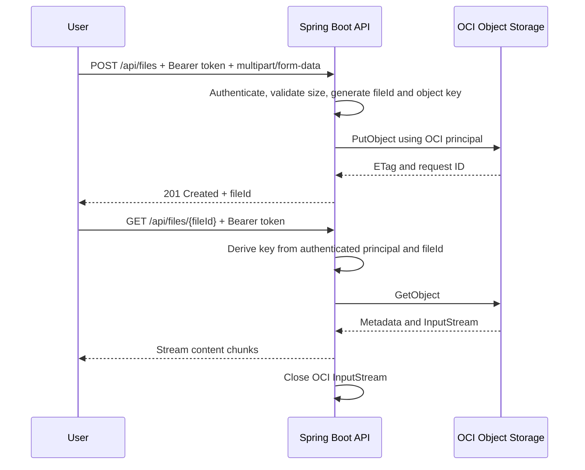

# Uploading and Downloading Files via Object Storage in an Application

In the **Java and Spring Boot Deployment** chapter of the **CLOUD_PROVIDERS_ORACLE** module, this lesson implements file upload and download functionality using OCI Object Storage. The application uses a private bucket, derives object keys itself, and calls OCI using a least-privilege identity.

The practice scenario is an API for users to store personal documents: user A uploads a file and downloads it by file ID; user B must not be able to use that ID to read A's content. Files are stored outside instance disks so the application can replace instances or run multiple replicas while accessing the same data.

After this lesson, you will be able to:

- Distinguish the application user identity from the OCI identity calling Object Storage.
- Configure the OCI Java SDK for developer workstations and OCI Compute.
- Upload files with size limits, stream downloads, and close resources properly.
- Choose among backend-proxied transfer, Pre-Authenticated Requests, and OCI multipart upload.
- Handle errors, monitor operations, and set cost guardrails for file storage features.

## 1. Components to Distinguish

| Component | Meaning in This Lesson |
| --- | --- |
| Tenancy | OCI governance boundary holding related resources and policies |
| Compartment | Where the bucket lives and policy scope applies |
| Namespace | Tenancy's Object Storage identifier; never substitute tenancy OCID or compartment name |
| Region | Region containing the bucket that the SDK connects to |
| Bucket | Container for objects, e.g. `app-private-files` |
| Object key | Full object name inside a bucket, e.g. `users/<owner-hash>/<file-id>` |
| OCI principal | Identity authorized by IAM to call OCI APIs |
| Application principal | User authenticated by Spring Security; used to decide which files may be read |

The `/` character in an object key organizes names by prefix. It does not create an independently permissioned directory as on a filesystem. The backend must still enforce authorization on every operation.

A complete application-level locator requires region, namespace, bucket, and object key. The UUID returned by the API is only a business identifier; the backend combines that UUID with the user's identity to construct the object key. Never ask clients to send namespace, bucket, or object key.

In a system that stores metadata, separate data as follows:

| Data | Appropriate Storage Location |
| --- | --- |
| File contents | Object Storage |
| Owner, scan status, download filename, verified content type | Application database |
| Namespace, bucket, region | Deployment configuration |
| Development API signing key | Protected configuration store outside the repository |
| OCI API rights on Compute | Instance principal paired with dynamic group and IAM policy |

Never use container filesystem paths for durable storage when running multiple replicas. Scratch capacity for processing HTTP multipart payloads still needs separate allocation and monitoring.

## 2. File Transfer Flow Through Spring Boot



Two authorization layers coexist:

1. **Spring Security** identifies the API caller and which resources they are allowed to access.
2. **OCI IAM** authorizes the backend process to operate on the bucket.

OCI sees only the backend identity in this flow. Having `OBJECT_READ` on the backend does not mean every application user may read every object.

Proxying files through the backend fits when you must check authorization on every download, control returned content, or avoid issuing direct access URLs. In return, the backend absorbs network bandwidth, connections, and request hold time.

## 3. Preparing OCI

### 3.1. Bucket and Configuration

Use a **private** Standard-tier bucket for the lab. Record the actual namespace, region, and bucket name from your OCI environment. Examples in this lesson use `app-private-files` and region `ap-singapore-1`; replace them with your own resources.

The bucket is pre-created by an administrator or infrastructure provisioning pipeline. The backend here needs no permissions to create buckets, list buckets, or discover the namespace dynamically.

Keep HTTPS enabled for OCI connections and for your deployed API. Never move private files into a public bucket just to make download URLs work.

### 3.2. Instance Principal and Least Privilege

For applications running on OCI Compute, create a dynamic group `java-file-app` matching only the assigned application instance:

```text
ALL {instance.id = '<APP_INSTANCE_OCID>'}
```

Replace the placeholder with the real OCID. Dynamic group names and identity domain qualification must match your tenancy.

Example policy scoped effectively to compartment `app-data`:

```text
Allow dynamic-group java-file-app to manage objects in compartment app-data where all {target.bucket.name = 'app-private-files', any {request.permission = 'OBJECT_CREATE', request.permission = 'OBJECT_READ'}}
```

This policy grants only the two filtered permissions. The code creates new objects using `ifNoneMatch("*")` and exposes no overwrite or delete APIs.

| Operation | Permission to Consider |
| --- | --- |
| `PutObject` creating a new key | `OBJECT_CREATE` |
| `GetObject` | `OBJECT_READ` |
| Overwriting an existing object | `OBJECT_OVERWRITE` |
| Deleting an object | `OBJECT_DELETE` |

When adding new features, grant corresponding permissions after validating the requirement. Never replace scoped policies with tenancy-wide admin rights. Reference: [OCI Object Storage policy reference](https://docs.oracle.com/en-us/iaas/Content/Identity/Reference/objectstoragepolicyreference.htm).

On a developer workstation, use an API signing key and OCI profile for a user granted equivalent permissions via a group. Never commit private keys, passphrases, or `~/.oci/config` contents to source code, images, or example logs.

Instance principals apply to the corresponding Compute environment. When moving to Functions or OKE, select the workload identity mechanism supported by that platform and configure IAM accordingly. Never assume Compute's provider works everywhere.

### 3.3. Network Path From the Application

The application must resolve DNS and connect to the regional Object Storage endpoint over HTTPS.

If Compute sits in a private subnet, one deployment option is a Service Gateway with routes to the appropriate Oracle Services Network CIDR. Also verify NSG/security list egress rules and the host OS firewall. A Service Gateway does not replace IAM permissions and does not automatically route to arbitrary Internet addresses such as an external identity provider. Reference: [Access to Oracle Services: Service Gateway](https://docs.oracle.com/en-us/iaas/Content/Network/Tasks/servicegateway.htm).

For local development, the workstation needs connectivity to both OCI and the example identity provider. Separate network timeout failures from IAM authorization rejections.

## 4. Configuring the Spring Boot Project

The sample uses **Java 21, Spring Boot 3.5.x, Spring MVC, and OCI Java SDK 3.102.0**. This is the SDK version pinned for the example; when upgrading, align all OCI artifacts via the BOM and verify project dependency compatibility.

Snippets belong to package `example.files` in correspondingly named Java files. Add the Maven entries below to a Spring Boot `pom.xml` whose Spring versions are already managed:

```xml
<properties>
    <java.version>21</java.version>
    <oci-java-sdk.version>3.102.0</oci-java-sdk.version>
</properties>

<dependencyManagement>
    <dependencies>
        <dependency>
            <groupId>com.oracle.oci.sdk</groupId>
            <artifactId>oci-java-sdk-bom</artifactId>
            <version>${oci-java-sdk.version}</version>
            <type>pom</type>
            <scope>import</scope>
        </dependency>
    </dependencies>
</dependencyManagement>

<dependencies>
    <dependency>
        <groupId>org.springframework.boot</groupId>
        <artifactId>spring-boot-starter-web</artifactId>
    </dependency>
    <dependency>
        <groupId>org.springframework.boot</groupId>
        <artifactId>spring-boot-starter-oauth2-resource-server</artifactId>
    </dependency>
    <dependency>
        <groupId>com.oracle.oci.sdk</groupId>
        <artifactId>oci-java-sdk-objectstorage</artifactId>
    </dependency>
    <dependency>
        <groupId>com.oracle.oci.sdk</groupId>
        <artifactId>oci-java-sdk-common-httpclient-jersey3</artifactId>
    </dependency>
</dependencies>
```

OCI SDK 3 requires selecting an HTTP client implementation. The example chooses Jersey 3, matching Spring Boot 3's Jakarta ecosystem. Avoid adding multiple implementations simultaneously unless intentional. Reference: [Getting Started with the Java SDK](https://docs.oracle.com/en-us/iaas/Content/API/SDKDocs/javasdkgettingstarted.htm).

Application configuration:

```yaml
spring:
  servlet:
    multipart:
      max-file-size: 10MB
      max-request-size: 11MB
      file-size-threshold: 0B
  security:
    oauth2:
      resourceserver:
        jwt:
          issuer-uri: ${OIDC_ISSUER_URI}
          audiences:
            - ${OIDC_AUDIENCE}

app:
  oci:
    storage:
      region: ${OCI_REGION}
      namespace: ${OCI_NAMESPACE}
      bucket: ${OCI_BUCKET}
      auth-mode: ${OCI_AUTH_MODE:config-file}
      config-file: ${OCI_CONFIG_FILE:~/.oci/config}
      config-profile: ${OCI_CONFIG_PROFILE:DEFAULT}
```

`max-request-size` exceeds `max-file-size` to allow multipart framing overhead. `file-size-threshold: 0B` sets the threshold for spilling multipart content to temporary disk; it is not a promise that the entire HTTP pipeline is unbuffered. Monitor scratch disk usage, concurrent uploads, and reverse proxy limits. Reference: [Spring Boot MultipartProperties](https://docs.spring.io/spring-boot/3.5/api/java/org/springframework/boot/autoconfigure/web/servlet/MultipartProperties.html).

On Compute, set `OCI_AUTH_MODE=instance-principal`. On a developer workstation, set `OCI_AUTH_MODE=config-file` and prepare an OCI profile outside the repository.

### 4.1. Bootstrapping the App and Creating a Shared Client

```java
package example.files;

import org.springframework.boot.SpringApplication;
import org.springframework.boot.autoconfigure.SpringBootApplication;

@SpringBootApplication
public class FileApplication {
    public static void main(String[] args) {
        SpringApplication.run(FileApplication.class, args);
    }
}
```

```java
package example.files;

import org.springframework.boot.context.properties.ConfigurationProperties;

@ConfigurationProperties(prefix = "app.oci.storage")
public record StorageProperties(
        String region,
        String namespace,
        String bucket,
        String authMode,
        String configFile,
        String configProfile) {
}
```

```java
package example.files;

import com.oracle.bmc.ClientConfiguration;
import com.oracle.bmc.Region;
import com.oracle.bmc.auth.AbstractAuthenticationDetailsProvider;
import com.oracle.bmc.auth.ConfigFileAuthenticationDetailsProvider;
import com.oracle.bmc.auth.InstancePrincipalsAuthenticationDetailsProvider;
import com.oracle.bmc.objectstorage.ObjectStorageClient;
import java.io.IOException;
import java.util.stream.Stream;
import org.springframework.boot.context.properties.EnableConfigurationProperties;
import org.springframework.context.annotation.Bean;
import org.springframework.context.annotation.Configuration;

@Configuration
@EnableConfigurationProperties(StorageProperties.class)
public class OciStorageConfiguration {

    @Bean(destroyMethod = "close")
    ObjectStorageClient objectStorageClient(StorageProperties properties)
            throws IOException {
        if (Stream.of(properties.region(), properties.namespace(),
                properties.bucket(), properties.authMode())
                .anyMatch(value -> value == null || value.isBlank())) {
            throw new IllegalArgumentException("Missing OCI Object Storage configuration");
        }

        AbstractAuthenticationDetailsProvider provider =
                switch (properties.authMode()) {
                    case "instance-principal" ->
                            InstancePrincipalsAuthenticationDetailsProvider
                                    .builder().build();
                    case "config-file" ->
                            new ConfigFileAuthenticationDetailsProvider(
                                    properties.configFile(),
                                    properties.configProfile());
                    default -> throw new IllegalArgumentException(
                            "auth-mode must be config-file or instance-principal");
                };

        ClientConfiguration configuration = ClientConfiguration.builder()
                .connectionTimeoutMillis(3_000)
                .readTimeoutMillis(60_000)
                .build();

        return ObjectStorageClient.builder()
                .region(Region.fromRegionId(properties.region()))
                .configuration(configuration)
                .build(provider);
    }
}
```

Create a single shared client for the application's configured region and close it on Spring shutdown. Never construct a new client per request or mutate the shared client's region while handling requests. These timeouts illustrate SDK connect/read configuration; also enforce overall request time budgets at the application and proxy layers. Reference: [OCI Java SDK overview](https://docs.oracle.com/en-us/iaas/tools/java/latest/index.html).

### 4.2. Protecting the API With Bearer Tokens

```java
package example.files;

import org.springframework.context.annotation.Bean;
import org.springframework.context.annotation.Configuration;
import org.springframework.security.config.Customizer;
import org.springframework.security.config.annotation.web.builders.HttpSecurity;
import org.springframework.security.config.http.SessionCreationPolicy;
import org.springframework.security.web.SecurityFilterChain;

@Configuration
public class ApiSecurityConfiguration {

    @Bean
    SecurityFilterChain securityFilterChain(HttpSecurity http) throws Exception {
        return http
                .csrf(csrf -> csrf.disable())
                .sessionManagement(session -> session
                        .sessionCreationPolicy(SessionCreationPolicy.STATELESS))
                .authorizeHttpRequests(auth -> auth.anyRequest().authenticated())
                .oauth2ResourceServer(oauth -> oauth.jwt(Customizer.withDefaults()))
                .build();
    }
}
```

This sample API uses access tokens in `Authorization: Bearer ...` headers without cookie authentication, so disabling CSRF as above applies strictly to that model. `issuer-uri` and `audiences` must match your API's real issuer and audience. Spring validates the token before the controller receives the principal; never accept a client-supplied `ownerId` to govern file permissions. Reference: [Spring Boot security configuration](https://docs.spring.io/spring-boot/3.5/reference/web/spring-security.html) and [JWT resource server](https://docs.spring.io/spring-security/reference/servlet/oauth2/resource-server/jwt.html).

In this sample, `Principal.getName()` uses the default JWT subject claim from a single configured issuer. If you change principal mapping or accept multiple issuers, adjust owner derivation to stay stable and avoid subject collisions across issuers.

## 5. Upload: Server-Generated Keys and Size Limits

This minimal example does not store original filenames or render content inline in a browser. Every file is stored as `application/octet-stream` and downloaded as an attachment named `<file-id>.bin`. That keeps the focus on data flow and ownership; when preserving original names, add controlled metadata as shown later.

Object keys follow this structure:

```text
users/<SHA-256 of subject>/<server-generated UUID>
```

Hashing avoids placing raw subject strings into object keys; it is neither encryption nor an anonymity guarantee. Ownership enforcement comes from the server always deriving the prefix from the authenticated principal. Hard-to-guess UUIDs do not replace authorization checks.

```java
package example.files;

import com.oracle.bmc.objectstorage.ObjectStorageClient;
import com.oracle.bmc.objectstorage.requests.GetObjectRequest;
import com.oracle.bmc.objectstorage.requests.PutObjectRequest;
import com.oracle.bmc.objectstorage.responses.GetObjectResponse;
import com.oracle.bmc.objectstorage.responses.PutObjectResponse;
import com.oracle.bmc.retrier.RetryConfiguration;
import java.io.IOException;
import java.io.InputStream;
import java.nio.charset.StandardCharsets;
import java.security.MessageDigest;
import java.security.NoSuchAlgorithmException;
import java.util.HexFormat;
import java.util.UUID;
import org.springframework.http.HttpStatus;
import org.springframework.stereotype.Service;
import org.springframework.web.multipart.MultipartFile;
import org.springframework.web.server.ResponseStatusException;

@Service
public class FileStorageService {

    private static final long MAX_FILE_BYTES = 10L * 1024 * 1024;

    private final ObjectStorageClient client;
    private final StorageProperties properties;

    public FileStorageService(ObjectStorageClient client,
                              StorageProperties properties) {
        this.client = client;
        this.properties = properties;
    }

    public UploadReceipt upload(String subject, MultipartFile file)
            throws IOException {
        if (file.isEmpty()) {
            throw new ResponseStatusException(
                    HttpStatus.BAD_REQUEST, "File must not be empty");
        }
        if (file.getSize() > MAX_FILE_BYTES) {
            throw new ResponseStatusException(
                    HttpStatus.PAYLOAD_TOO_LARGE, "File exceeds 10 MiB");
        }

        UUID id = UUID.randomUUID();
        String key = objectKey(subject, id);

        try (InputStream input = file.getInputStream()) {
            PutObjectRequest request = PutObjectRequest.builder()
                    .namespaceName(properties.namespace())
                    .bucketName(properties.bucket())
                    .objectName(key)
                    .contentLength(file.getSize())
                    .contentType("application/octet-stream")
                    .ifNoneMatch("*")
                    .opcClientRequestId(UUID.randomUUID().toString())
                    .retryConfiguration(RetryConfiguration.NO_RETRY_CONFIGURATION)
                    .putObjectBody(input)
                    .build();

            PutObjectResponse result = client.putObject(request);
            return new UploadReceipt(id, file.getSize(), result.getETag());
        }
    }

    // Caller must close the InputStream in the response after use.
    public GetObjectResponse open(String subject, UUID id) {
        return client.getObject(GetObjectRequest.builder()
                .namespaceName(properties.namespace())
                .bucketName(properties.bucket())
                .objectName(objectKey(subject, id))
                .opcClientRequestId(UUID.randomUUID().toString())
                .build());
    }

    private String objectKey(String subject, UUID id) {
        if (subject == null || subject.isBlank()) {
            throw new ResponseStatusException(
                    HttpStatus.UNAUTHORIZED, "Missing user identity");
        }

        try {
            byte[] digest = MessageDigest.getInstance("SHA-256")
                    .digest(subject.getBytes(StandardCharsets.UTF_8));
            String ownerHash = HexFormat.of().formatHex(digest);
            return "users/" + ownerHash + "/" + id;
        } catch (NoSuchAlgorithmException exception) {
            throw new IllegalStateException(
                    "Runtime does not support SHA-256", exception);
        }
    }

    public record UploadReceipt(UUID id, long size, String eTag) {
    }
}
```

Decisions to preserve when adopting for real systems:

- **Do not call `file.getBytes()` or `readAllBytes()`** to load the whole file onto the heap. The stream is closed after the SDK finishes.
- **Pass the exact `contentLength`** from the multipart file accepted by the framework. Never trust an arbitrary client header for byte count.
- **Never use original filenames as object keys.** Two users uploading `report.pdf` must not overwrite each other, and filenames with path separators or control characters must not enter keys.
- **Prevent accidental overwrites.** `ifNoneMatch("*")` fails the request if the key already exists. If object updates are needed later, design explicit overwrite permissions and ETag preconditions.
- **Do not blindly retry a partially read stream.** The sample disables retries on `PutObject` to make this responsibility clear. Enabling retries requires a repeatable data source and a way to determine prior outcomes.

Standard `PutObject` can overwrite existing keys; the create-only condition here is intentional. Reference: [PutObjectRequest.Builder](https://docs.oracle.com/en-us/iaas/tools/java/latest/com/oracle/bmc/objectstorage/requests/PutObjectRequest.Builder.html).

Spring's `MultipartFile` belongs to HTTP `multipart/form-data`. It does not mean the app is using **OCI multipart upload**. Here the backend executes a single `PutObject` per file.

## 6. Download: Check Ownership First, Stream Afterward

The controller accepts only a UUID. The service recomputes the key using the caller's subject. If user B submits user A's UUID, the service looks under B's prefix, never A's.

```java
package example.files;

import com.oracle.bmc.objectstorage.responses.GetObjectResponse;
import jakarta.servlet.http.HttpServletResponse;
import java.io.IOException;
import java.io.InputStream;
import java.net.URI;
import java.security.Principal;
import java.util.UUID;
import org.springframework.http.ContentDisposition;
import org.springframework.http.HttpHeaders;
import org.springframework.http.MediaType;
import org.springframework.http.ResponseEntity;
import org.springframework.web.bind.annotation.GetMapping;
import org.springframework.web.bind.annotation.PathVariable;
import org.springframework.web.bind.annotation.PostMapping;
import org.springframework.web.bind.annotation.RequestMapping;
import org.springframework.web.bind.annotation.RequestPart;
import org.springframework.web.bind.annotation.RestController;
import org.springframework.web.multipart.MultipartFile;

@RestController
@RequestMapping("/api/files")
public class FileController {

    private final FileStorageService storage;

    public FileController(FileStorageService storage) {
        this.storage = storage;
    }

    @PostMapping(consumes = MediaType.MULTIPART_FORM_DATA_VALUE)
    public ResponseEntity<FileStorageService.UploadReceipt> upload(
            @RequestPart("file") MultipartFile file,
            Principal principal) throws IOException {
        FileStorageService.UploadReceipt receipt =
                storage.upload(principal.getName(), file);

        return ResponseEntity
                .created(URI.create("/api/files/" + receipt.id()))
                .body(receipt);
    }

    @GetMapping("/{id}")
    public void download(@PathVariable("id") UUID id,
                         Principal principal,
                         HttpServletResponse response) throws IOException {
        // Call OCI before writing success headers/body to the client.
        GetObjectResponse object = storage.open(principal.getName(), id);

        try (InputStream input = object.getInputStream()) {
            response.setContentType(MediaType.APPLICATION_OCTET_STREAM_VALUE);
            response.setHeader(HttpHeaders.CONTENT_DISPOSITION,
                    ContentDisposition.attachment()
                            .filename(id + ".bin")
                            .build().toString());
            response.setHeader(HttpHeaders.CACHE_CONTROL, "private, no-store");
            response.setHeader("X-Content-Type-Options", "nosniff");

            if (object.getContentLength() != null) {
                response.setContentLengthLong(object.getContentLength());
            }

            input.transferTo(response.getOutputStream());
        }
    }
}
```

`GetObjectResponse` provides the `InputStream` alongside metadata like content length and ETag. The application must close the stream to release the SDK connection; the servlet container manages the HTTP response output stream. Reference: [GetObjectResponse](https://docs.oracle.com/en-us/iaas/tools/java/latest/com/oracle/bmc/objectstorage/responses/GetObjectResponse.html).

Never open a stream inside a `try` block and return that stream after it has already been closed. With `StreamingResponseBody`, close the stream inside the callback execution and also handle unexecuted or canceled tasks. This example uses synchronous MVC so resource lifecycles stay straightforward.

This streaming pattern avoids loading the whole file onto the heap, though it holds a servlet thread for the duration of the download. Concurrent download capacity depends on SDK connection pools, threads, bandwidth, proxy limits, and client receive speeds.

### 6.1. When Preserving Original Names and Content Types

For a complete feature, store metadata keyed by `fileId` in a database:

```text
file_id, owner_id, object_key, original_name, verified_content_type,
size_bytes, sha256, etag, status, created_at
```

Before downloading, query `file_id` together with `owner_id` or granted sharing permissions, verify `status=AVAILABLE`, and only then call OCI.

Original filenames exist purely for display and `Content-Disposition`. Enforce length limits, strip control characters, sanitize path separators, and build headers using safe framework APIs. Never concatenate client-supplied filenames directly into HTTP headers.

`MultipartFile.getContentType()` and file extensions are merely sender-declared hints. If the app only accepts PDFs or images, enforce allowlists, inspect magic bytes/content signatures, and apply business checks before publishing files. If malware scanning is required, use a quarantine state and allow downloads only after verification passes.

### 6.2. Caching, Ranges, and Resumable Content

The sample sends `private, no-store` to prevent caching private documents. If caching or resumable downloads are needed, implement the HTTP contract explicitly:

| Need | Required Work |
| --- | --- |
| Conditional caching | Map ETags to valid HTTP format, evaluate preconditions, and return `304` when appropriate |
| Byte-range download | Validate `Range`, forward valid ranges to OCI, return `206` with `Content-Range` and segment length |
| Invalid range | Return `416` based on object size |
| Resuming when objects may change | Bind to a version or ETag to avoid splicing bytes from two different contents |

OCI supports range parameters and ETag preconditions in its read API. The controller above returns the entire file and does not implement range resumption; never advertise `Accept-Ranges: bytes` without implementing range handling. Reference: [GetObjectRequest.Builder](https://docs.oracle.com/en-us/iaas/tools/java/latest/com/oracle/bmc/objectstorage/requests/GetObjectRequest.Builder.html).

## 7. Error Mapping and Keeping Connections Healthy

An exception from OCI crosses the backend–storage boundary. Never expose raw messages, stack traces, key paths, or credential configs to clients.

```java
package example.files;

import com.oracle.bmc.model.BmcException;
import org.slf4j.Logger;
import org.slf4j.LoggerFactory;
import org.springframework.http.HttpStatus;
import org.springframework.http.ProblemDetail;
import org.springframework.http.ResponseEntity;
import org.springframework.web.bind.annotation.ExceptionHandler;
import org.springframework.web.bind.annotation.RestControllerAdvice;
import org.springframework.web.multipart.MaxUploadSizeExceededException;

@RestControllerAdvice
public class FileApiErrors {

    private static final Logger log =
            LoggerFactory.getLogger(FileApiErrors.class);

    @ExceptionHandler(MaxUploadSizeExceededException.class)
    ResponseEntity<ProblemDetail> fileTooLarge() {
        return problem(HttpStatus.PAYLOAD_TOO_LARGE,
                "Upload request exceeds size limit");
    }

    @ExceptionHandler(BmcException.class)
    ResponseEntity<ProblemDetail> storageFailure(BmcException exception) {
        log.warn("OCI Object Storage failure: status={}, code={}, requestId={}",
                exception.getStatusCode(),
                exception.getServiceCode(),
                exception.getOpcRequestId());

        HttpStatus status = switch (exception.getStatusCode()) {
            case 404 -> HttpStatus.NOT_FOUND;
            case 409, 412 -> HttpStatus.CONFLICT;
            case 429, 500, 502, 503, 504 -> HttpStatus.SERVICE_UNAVAILABLE;
            default -> HttpStatus.BAD_GATEWAY;
        };

        String detail = status == HttpStatus.NOT_FOUND
                ? "Available file not found"
                : "Unable to complete storage operation";

        return problem(status, detail);
    }

    private ResponseEntity<ProblemDetail> problem(
            HttpStatus status, String detail) {
        return ResponseEntity.status(status)
                .body(ProblemDetail.forStatusAndDetail(status, detail));
    }
}
```

This is a minimal mapping. A `404` from OCI can indicate either a missing resource or lack of permission to see it; the API returns a generic message while operations use the request ID to investigate. OCI `401/403` errors typically point to backend identity and IAM policy issues rather than requiring the end user to re-authenticate.

If an error occurs after part of a download body has already been written, you cannot turn the in-flight response into a clean JSON error. Abort the stream appropriately at the container level, close the OCI stream, and record the download as incomplete. Never catch every `IOException` and append JSON onto the end of file bytes.

Avoid retrying a download from byte zero after partial data has already reached the client. Application-level recovery requires range protocols and content version checks.

Authentication failures in Spring Security occur before the controller; the `@RestControllerAdvice` above does not replace security filter chain error handling.

## 8. Hands-On API Testing

Prepare the private bucket, OCI permissions, an identity provider, and an access token matching the configured issuer and audience. The PowerShell examples below assume the app is running at `http://localhost:8080` and `$env:APP_TOKEN` holds a valid token. In real deployments, use an HTTPS API endpoint.

Set environment values for local development using real environment details:

```powershell
$env:OCI_REGION = "ap-singapore-1"
$env:OCI_NAMESPACE = "<tenancy-namespace>"
$env:OCI_BUCKET = "app-private-files"
$env:OCI_AUTH_MODE = "config-file"
$env:OCI_CONFIG_PROFILE = "DEFAULT"
$env:OIDC_ISSUER_URI = "<actual-issuer-uri>"
$env:OIDC_AUDIENCE = "<api-audience>"
```

Environment variables must be present before starting the Java process; changing variables in another terminal does not update a running process.

Upload a file present in the current directory:

```powershell
curl.exe --fail-with-body --show-error `
  -H "Authorization: Bearer $env:APP_TOKEN" `
  -F "file=@.\sample.txt" `
  http://localhost:8080/api/files
```

A successful response returns `201 Created`, a `Location` header, and a body like:

```json
{
  "id": "6cb4e5b1-d59d-4c48-8d35-630f3a67bf51",
  "size": 128,
  "eTag": "<etag-returned-by-oci>"
}
```

The `size` above is illustrative. Use the real `id` from the upload response to download:

```powershell
$fileId = "<id-from-upload-response>"

curl.exe --fail-with-body --show-error `
  -H "Authorization: Bearer $env:APP_TOKEN" `
  -D .\download-headers.txt `
  -o .\downloaded.bin `
  "http://localhost:8080/api/files/$fileId"

if ($LASTEXITCODE -ne 0) {
    throw "Download failed; check HTTP status before using the output file"
}
```

Only after the HTTP download succeeds, compare contents:

```powershell
$sourceHash = (Get-FileHash -LiteralPath .\sample.txt -Algorithm SHA256).Hash
$downloadHash = (Get-FileHash -LiteralPath .\downloaded.bin -Algorithm SHA256).Hash

if ($sourceHash -ne $downloadHash) {
    throw "Downloaded content does not match source file"
}
```

ETag is a service-contract version/content identifier; do not assume it equals a file's SHA-256 or MD5 checksum across all upload methods. If business logic requires a checksum, store the algorithm and digest explicitly; the SHA-256 comparison above checks both files directly.

Test scenarios to observe:

| Scenario | Expected Outcome |
| --- | --- |
| Valid token, file within limit | Upload `201`; download returns exact bytes |
| Missing token | Rejected by security filter before controller |
| Malformed UUID | Request is not processed as an arbitrary object key |
| Empty file | `400` per service validation |
| Oversized file | `413` at application or correspondingly configured proxy layer |
| User B submits User A's ID | Cannot read A's content; sample returns not-found message |
| Two uploads with same original filename | Two distinct IDs; neither overwrites the other |
| Backend lacks OCI permission | Storage error returned; internal log records request ID for investigation |
| Disconnect mid-download | Stream is closed and download is not counted as complete |
| Download from a second replica | Works identically if bucket config and user identity match |

These are hands-on practice instructions, not a claim that the example has already been run in your tenancy.

## 9. Ambiguous Upload Outcomes and Database Consistency

`PutObject` may have been accepted by OCI even though the response never reached the backend due to a network error. You cannot conclude "the object does not exist" solely from a timeout.

The sample generates a new UUID on every upload and has no durable idempotency mechanism. If a client never receives the response and retries, the system may create two objects. If the first response is lost, the client may also lose the ID of the first object.

When building for production, model an upload session in the database:

```text
PENDING -> STORED -> AVAILABLE
    |          |
    +------> FAILED or QUARANTINED
```

A sound workflow:

1. Authenticate the user, check quota, and accept a request idempotency key.
2. Insert a `PENDING` record with `fileId`, owner, deterministic object key, and expected limits.
3. Upload to the recorded key; never generate a fresh key for retries of the same session.
4. On success, record size, ETag, and required checksums, transitioning to `STORED`.
5. Validate content or run policy scans; transition to `AVAILABLE` when eligible.
6. Run a reconciliation job for stuck records and unreferenced orphan objects.

If the upload times out, inspect the same object key via metadata or read back content if needed. Checking mere existence is not enough to prove the object matches the intended file—verify size and checksum recorded for the upload session.

Never wrap long network transfers inside a database transaction expecting a transaction rollback to delete the object. Object Storage and the application database do not share an ACID transaction. Compensation, reconciliation, and data lifecycle rules must be part of the design.

An object cleanup job requires its own identity and policy for delete rights. Never grant `OBJECT_DELETE` to the live backend just because a separate cleanup job needs it. With versioning or retention rules, explicitly define when deletion is allowed and when retention expires.

## 10. When to Use Direct Transfer or OCI Multipart Upload

### 10.1. Pre-Authenticated Request

A PAR generates a URL granting access to a specified resource without requiring callers to hold OCI credentials. Anyone holding the URL can use it within its scope and expiration window. It can be revoked by deleting the PAR. Reference: [Object Storage Pre-Authenticated Requests](https://docs.oracle.com/en-us/iaas/Content/Object/Tasks/usingpreauthenticatedrequests.htm).

Application flow:

```text
Client -> Backend: request upload/download access
Backend: authenticate, check owner/quota, pick key and expiration
Backend -> Client: PAR URL for the exact object and operation
Client -> Object Storage: transfer file directly
Backend: verify outcome before publishing file
```

Create short-lived URLs scoped to the exact object, keeping URLs out of logs and analytics tools. PARs are not single-use by default and do not enforce Spring's 10 MiB limit automatically. For browsers, configure CORS for needed origins/methods/headers; CORS does not replace authorization.

The backend sample above does not grant `PAR_MANAGE`. If adding PARs, design PAR-creation permissions and corresponding data permissions separately; do not assume `OBJECT_CREATE` covers every PAR type.

Choose backend proxying when every request must enforce authorization inline. Choose direct transfer when offloading transfer bandwidth from the backend and time-limited URLs are acceptable. For direct uploads, never mark `AVAILABLE` solely because the client claims the upload finished.

### 10.2. OCI Multipart Upload for Large Files

OCI multipart upload splits an object into parts, uploads each part, and commits them. Failed parts can be retried instead of re-sending the entire file. Uncommitted parts must be aborted or cleaned up by lifecycle rules so they do not keep consuming storage. Reference: [Object Storage Multipart Uploads](https://docs.oracle.com/en-us/iaas/Content/Object/Tasks/usingmultipartuploads.htm).

The OCI Java SDK provides `UploadManager` to choose between single `PutObject` and multipart uploads based on configuration. The data source must support re-reading or part splitting as configured; never assume every `InputStream` supports parallel reads or resuming after a process restart. Reference: [UploadManager source and contract](https://github.com/oracle/oci-java-sdk/blob/master/bmc-objectstorage/bmc-objectstorage-extensions/src/main/java/com/oracle/bmc/objectstorage/transfer/UploadManager.java).

Before scaling past the 10 MiB sample, determine:

- Maximum file size and upload session lifetime.
- Re-readable file source, scratch capacity, and temporary data encryption if needed.
- Part size, part parallelism, and total concurrent uploads.
- How upload IDs, part lists, and commit states persist if recovery across restarts is needed.
- Abort conditions, part cleanup lifecycle, and user quotas.

Policies written for create-only `PutObject` do not automatically suffice for multipart uploads. Verify `OBJECT_CREATE`, `OBJECT_OVERWRITE`, and part-abort/cleanup permissions before switching mechanisms.

Spring's HTTP multipart limits, ingress/load balancer limits, and OCI API limits are three distinct layers. Raising one does not automatically adjust the other two.

## 11. Retries, Monitoring, Cost, and Availability

### 11.1. Bounded Retries With Suitable Data Sources

For GETs, you can retry before streaming body bytes to the client if the error is retryable and budget remains. Once bytes have been sent, retry only via a download resumption protocol.

For uploads, clarify whether the stream supports re-reading, whether the key is deterministic, and whether the prior attempt could already have succeeded. The SDK has its own retry rules and stream requirements; the sample explicitly sets `NO_RETRY_CONFIGURATION` on uploads rather than wrapping them in arbitrary retry loops. Reference: [OCI Java SDK concepts](https://docs.oracle.com/en-us/iaas/Content/API/SDKDocs/javasdkconcepts.htm) and [RetryConfiguration](https://docs.oracle.com/en-us/iaas/tools/java/latest/com/oracle/bmc/retrier/RetryConfiguration.html).

If adding retries for re-readable file sources, enforce max attempts, total time budget, backoff with jitter, and error classification. Never endlessly retry bad credentials, missing permissions, invalid inputs, or failed precondition writes.

### 11.2. Observing Errors at the Right Layer

Add metrics for upload/download successes, failures, bytes transferred, latency, active transfers, and quota rejections. For downloads, record completion only after transferring all bytes; `GetObject` returning response headers does not mean the client received the whole file.

In logs, correlate application requests with `opcClientRequestId` and OCI request IDs. Never use object keys or user IDs as unbounded metric labels, as cardinality can explode. Never log access tokens, full PAR URLs, private keys, or file contents.

Watch specifically for:

| Signal | Where to Check |
| --- | --- |
| OCI connection timeouts | DNS, routes, Service Gateway/NAT per design, egress, and endpoint |
| OCI permission denials | Actual principal, dynamic group, policy, and target bucket |
| Rising heap or GC pauses | Reading full files into memory, buffering, concurrent upload count |
| Scratch disk full | HTTP multipart temp files, uncleaned temp data, scratch disk quota |
| Hung downloads or exhausted pools | Unclosed streams, slow clients, concurrency limits |
| API returns errors yet storage grows | Upload succeeded before timeout, retries creating duplicates, orphan objects |
| Browser fails while curl works | CORS and headers required by browsers in direct-transfer flows |

Configure logging and audit according to enabled service capabilities; never assume every object read/write automatically generates application-grade detail logs.

### 11.3. Tying Cost Controls to Application Behavior

The sample caps single-file size but does not yet cap total storage per user. In deployment, enforce per-user/tenant quotas, request rate limits, and concurrent transfer caps.

Estimate costs across stored object size, old versions if versioning is enabled, uncommitted multipart parts, request counts, egress/transfer paths, and backend compute overhead. Never apply one flat rate across all regions or storage tiers; calculate against the price list for actual resources.

Configure lifecycle rules matching business retention to purge expired data and abandoned uploads. Never move files needed for immediate download to Archive without designing restore times and API status handling during restoration.

Control costs by limiting unnecessary stored data and governing retries, rather than merely picking a cheaper storage tier that cannot meet access patterns.

### 11.4. Running Multiple Instances

Storing bytes in Object Storage lets replicas read the same data source without synchronizing local directories. Still, the file service depends on:

- The identity provider to authenticate requests.
- Network paths and OCI permissions for every instance.
- The metadata database if that layer is added.
- Backend connection pools, threads, and transfer concurrency limits.

If surviving a full region outage is required, separately design data replication, metadata replication, traffic failover, RPO/RTO targets, and recovery drills. Using Object Storage does not automatically create cross-region application recovery.

## 12. Design Decisions to Keep Explicit During Deployment

| Design Question | Choice in Sample | When Scaling Up |
| --- | --- | --- |
| Is the bucket public? | Private | Expose publicly only data explicitly classified as public |
| Who chooses the object key? | Server | Clients receive only server-issued IDs or upload sessions |
| How is ownership determined? | Authenticated principal subject | Database records plus explicit sharing model if needed |
| Are client filenames and MIME types kept? | No; returns binary attachment | Store validated metadata and construct headers safely |
| Per-file limit? | 10 MiB | Total user quotas, concurrency limits, and time budgets |
| Are upload retries enabled? | Disabled on sample upload request | Re-readable source, deterministic key, idempotency, and reconciliation |
| Is metadata durably managed? | Not yet | Upload session and availability state in a database |
| How are large files transferred? | Outside sample scope | OCI multipart or controlled direct transfers |
| Who closes the stream when done? | Backend closes the OCI stream | Preserve clear ownership even on cancellation or mid-stream errors |

The outcome of this practice is an API storing and retrieving exact bytes via OCI Object Storage, with user identity and OCI permissions cleanly separated across two layers. Idempotency, metadata persistence, content inspection, quotas, and recovery must be completed to match system requirements before operating this file feature in production.
