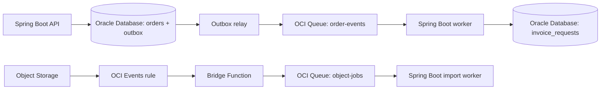

# Integrating Events and Queues Into a Spring Boot Service

## 1. Objectives and OCI Deployment Problem

In the **Java and Spring Boot Deployment** chapter of the **CLOUD_PROVIDERS_ORACLE** module, asynchronous integration lets a Java service keep serving requests when downstream work needs extra time or a dependent system experiences a transient outage. On Oracle Cloud Infrastructure (OCI), this design also involves compartments, IAM, VCN networking, databases, monitoring, and instance compute capacity.

Consider an order intake service: the API records an order and then needs to request invoice generation. If the API executes every step within a single synchronous HTTP chain, response latency and availability depend on every downstream service. With a queue, the API can confirm intake while a Spring Boot worker processes requests according to real capacity. An "accepted" response must remain distinct from "invoice issued."

After this lesson, you will be able to:

- Distinguish business events, OCI resource events, and work-dispatch messages.
- Connect a Spring Boot application to OCI Queue using the OCI Java SDK.
- Design a consumer with database transactions, idempotent deduplication, retries, and a dead letter queue.
- Bridge OCI Events to a Queue using a forwarding Function.
- Operate asynchronous flows with least-privilege authorization, lag observability, and cost control.

Examples use Java 17+, Spring Boot 3.x, Jackson 2, and JDBC with Oracle Database. Code snippets are instructional material to integrate into your project; they have not been compiled or executed against an OCI tenancy in this text. Sample resources use a standard queue without consumer groups enabled and a single business event type.

## 2. Choosing the Right Event Type and Service

### 2.1. Events and Commands Have Different Meanings

An **event** describes something that has already happened, such as `order.accepted.v1`. The publisher does not need to know every party interested in it. A **command** requests an action, such as `invoice.create.v1`, and typically targets a specific responsible handler.

A **message** is the transport unit. Its payload can be an event or a command. Picking a queue does not by itself define the business semantics of the message.

Nor must every event go to the cloud. `ApplicationEventPublisher` works well to coordinate components inside a single Spring application, but by itself it does not provide a durable queue across processes. When the JVM stops, in-memory work lacks the persistence guarantees of a message broker.

### 2.2. Roles in the OCI Architecture

| Component | Role in This Lesson |
| --- | --- |
| Spring application event | In-process communication between components; evaluate execution and durability separately |
| OCI Events | Filters OCI resource state changes to trigger actions |
| OCI Queue | Transfers asynchronous work from producers to workers |
| OCI Functions | Bridge or short-lived handler triggered by Events |
| OCI Notifications | Distributes notifications; suitable as a target for operational alerts |
| OCI Streaming | Option to consider when the problem requires data streams, consumer offsets, and stream-processing semantics |
| Oracle Database | Stores business state, outbox rows, and deduplication markers |

OCI Events receives events emitted by OCI resources, such as Object Storage changes. That is a separate stream from application-defined events like `OrderAccepted`. See [OCI Events Overview](https://docs.oracle.com/en-us/iaas/Content/Events/Concepts/eventsoverview.htm).

OCI Queue is a managed messaging service supporting publish, receive, visibility update, and delete operations. Examples in this lesson use its REST API via the SDK. See [OCI Queue Overview](https://docs.oracle.com/en-us/iaas/Content/queue/overview.htm).

Do not infer from the word "queue" that OCI Queue provides a JMS provider for `@JmsListener`, or that `@KafkaListener` can consume from it. In this example, the message polling loop is implemented explicitly with the SDK. Oracle AQ/Transactional Event Queues inside Oracle Database should also be evaluated separately; never mix their APIs and configurations with OCI Queue.

### 2.3. Two Flows to Distinguish



The first flow carries business events. The second turns OCI resource events into application jobs. Use separate queues when data contracts, permissions, or load profiles differ.

In this example's standard queue, competing workers pull from one shared backlog and split the work. If multiple independent systems must each receive every event, design a dedicated fan-out mechanism or evaluate consumer groups—do not simply add instances and assume each system receives a copy.

## 3. Message Lifecycle and Failure Windows

### 3.1. Receiving a Message Is Not Confirming Completion

Ordered consumer flow:

```text
GetMessages
    -> message temporarily hidden from other consumers
    -> decode and validate contract
    -> open database transaction
    -> record deduplication marker + apply business change
    -> COMMIT
    -> DeleteMessage using receipt from the current receive
```

`GetMessages` returns payload content, transport ID, delivery count, and `receipt`. Deleting or updating visibility requires the receipt, not the business ID inside the JSON. The receipt belongs strictly to the active delivery; never store it as a deduplication key. See [Java SDK GetMessage model](https://docs.oracle.com/en-us/iaas/tools/java/latest/com/oracle/bmc/queue/model/GetMessage.html).

If the consumer fails to delete or extend visibility before the visibility timeout expires, the message may be redelivered. Long polling lets consumers wait for messages instead of spinning when the queue is empty. See [Consuming Messages](https://docs.oracle.com/en-us/iaas/Content/queue/consume-messages.htm).

### 3.2. Scenarios to Design Upfront

| Failure Window | Possible Consequence | Application Handling |
| --- | --- | --- |
| Queue saved message, producer lost response | Producer retries and creates duplicate messages | Keep `eventId` identical on retry |
| Consumer dies before DB commit | Transaction does not complete | Allow message redelivery |
| DB committed, consumer dies before delete | Work finished, yet message reappears | Check deduplication marker in DB |
| Delete succeeded, response lost | Delete outcome uncertain to client | Log error; consumer remains safe on redelivery |
| Processing exceeds visibility timeout | Another worker may receive the same job | Bound runtime, renew early, and deduplicate |
| Delete message before DB write | Message lost even though business state was not saved | Reverse order: commit first, delete after |

Given these failure windows, the application must tolerate redelivery. You cannot infer "exactly-once business processing" from a single successful SDK call. The practical goal is at-least-once delivery where every business effect is recorded safely via transactions and unique constraints.

Similarly, never rely on delivery order to enforce state transitions such as "paid" before "shipped." When business logic requires ordering, add entity versioning, valid-state checks, and concurrency control in the database. Running multiple consumers or retries alone is enough for completion order to diverge from send order.

### 3.3. Retention Differs From Visibility

Retention is how long the service keeps a message before automatically purging it; visibility is how long a received message stays hidden from other consumers. Extending visibility does not keep a message alive forever and cannot exceed retention expiration. Updating visibility requires the active delivery's receipt. See [Updating Messages](https://docs.oracle.com/en-us/iaas/Content/queue/update-messages.htm).

Recommended lab settings, not service defaults:

| Parameter | Lab Value | Rationale |
| --- | --- | --- |
| Retention | 24 hours | Provides incident-handling window during lab work |
| Visibility | 60 seconds | Safely exceeds the short DB work in this example |
| Poll timeout | 20 seconds | Reduces empty polling calls |
| Messages per receive | 1 | Simplifies observing leases and sequential handling |
| Maximum delivery attempts | 5 | Routes repeatedly failing messages to DLQ after threshold |

Choose retention according to recovery time and maximum acceptable backlog. Settings chosen at queue creation carry long-term consequences: OCI docs note retention cannot be changed once a queue is created. See [Creating a Queue](https://docs.oracle.com/en-us/iaas/Content/queue/queue-create.htm).

## 4. Preparing Resources, IAM, and Networking

### 4.1. Queue and Environment Identifiers

In the application's compartment, create a queue named `order-events-dev` and record:

- The queue's OCID.
- The Messages endpoint shown in the queue details.
- Region, compartment, and environment retry/DLQ settings.

A queue has a control-plane endpoint and a messages data-plane endpoint. Producers and consumers here use the **Messages endpoint** obtained from the Console or `GetQueue`; do not construct a hostname manually from the region. See [Messages Endpoint](https://docs.oracle.com/en-us/iaas/Content/queue/messages.htm).

Values for development, staging, and production must come from deployment configuration. Never bake production OCIDs into shared images.

### 4.2. Role-Based Authorization

On Compute, place instances into dynamic groups scoped by OCID or appropriate matching rules. You can separate API/relay groups from worker groups:

```text
Allow dynamic-group OrderEventProducers to use queue-push in compartment AppDev
  where target.queue.id = '<QUEUE_OCID>'

Allow dynamic-group InvoiceWorkers to use queue-pull in compartment AppDev
  where target.queue.id = '<QUEUE_OCID>'
```

Replace placeholders before creating policies. These are two separate statements: `queue-push` covers publishing; `queue-pull` covers receiving, updating visibility, and deleting. If the application calls `GetQueue` itself, grant corresponding read rights; this example injects the endpoint directly to avoid needing that step. See [Queue IAM Policies](https://docs.oracle.com/en-us/iaas/Content/queue/policy-reference.htm).

Use a developer OCI profile locally and instance principals on Compute. Never automatically fall back to an API key if instance principal fails—that behavior can mask broken permissions. On OKE or other platforms, select the matching workload identity mechanism; never assume every container behaves like the Compute instance in this example.

### 4.3. Connecting From a VCN

The application needs DNS resolution, HTTPS connectivity to the Messages endpoint, and database access. Separate network checks from IAM checks: connection timeouts differ from permission denials.

From a private subnet, design service routing based on regional support. A Service Gateway covers only supported services; route tables and security rules must permit the traffic. Do not assume creating a Service Gateway automatically enables all outbound paths. See [Service Gateway](https://docs.oracle.com/en-us/iaas/Content/Network/Tasks/servicegateway.htm).

A managed queue is not a broker process to which the application exposes an inbound port inside the subnet. The SDK worker initiates outbound polls to receive messages; no public HTTP endpoint is needed just for OCI Queue to dispatch jobs.

## 5. Data Contract Between Producer and Consumer

Do not let consumers guess meaning from a queue name. Every message needs a stable business identifier, event type, and schema version.

```json
{
  "eventId": "f6be2a56-f783-4c1a-8f21-968adf7f02d1",
  "eventType": "order.accepted.v1",
  "schemaVersion": 1,
  "occurredAt": "2026-11-21T08:00:00Z",
  "correlationId": "checkout-20261121-001",
  "data": {
    "orderId": "ORD-1001",
    "totalMinor": 125000,
    "currency": "VND"
  }
}
```

This is an application-designed envelope, not a copy of the OCI Events envelope. `totalMinor` uses an integer in the agreed smallest currency unit; never use `double` for money. For VND in the lab, the illustrative amount is 125,000 VND.

Contract conventions:

- `eventId` is generated once when the event originates and remains unchanged across retries, relays, and replays of the same event.
- `correlationId` ties together steps of a request; it does not replace the deduplication key.
- Adding optional fields can remain backward-compatible; changing semantics or dropping required fields requires a versioning strategy.
- Never place passwords, API keys, wallets, or unnecessary personal data in messages.
- If payloads involve large documents, consider sending an Object Storage reference with version/checksum identifiers and separate read authorization.

Never embed URLs whose expiration is shorter than retention and retry windows. A message still sitting in the queue whose document link has already expired causes processing failures.

Lab Java model:

```java
package example.messaging;

import com.fasterxml.jackson.annotation.JsonIgnoreProperties;
import java.time.Instant;

@JsonIgnoreProperties(ignoreUnknown = true)
public record OrderAccepted(
        String eventId,
        String eventType,
        int schemaVersion,
        Instant occurredAt,
        String correlationId,
        Data data) {

    public void validate() {
        if (eventId == null || eventId.isBlank() || eventId.length() > 64
                || !"order.accepted.v1".equals(eventType)
                || schemaVersion != 1 || occurredAt == null
                || correlationId == null || correlationId.isBlank()
                || data == null
                || data.orderId() == null || data.orderId().isBlank()
                || data.orderId().length() > 64
                || data.totalMinor() <= 0
                || !"VND".equals(data.currency())) {
            throw new IllegalArgumentException("Unsupported order event");
        }
    }

    @JsonIgnoreProperties(ignoreUnknown = true)
    public record Data(String orderId, long totalMinor, String currency) {}
}
```

The VND restriction and single event type define the lab scope. When expanding, manage schemas and routing explicitly rather than silently discarding unsupported types.

## 6. Integrating the OCI Java SDK Into Spring Boot

### 6.1. Dependencies and Version Scope

Add the following dependencies to an existing Spring Boot 3.x project. OCI SDK version `3.100.0` is an illustrative pinned baseline for this lesson, not an implication that it is the latest release. Keep all OCI modules aligned under one BOM; when upgrading, re-verify dependencies and APIs.

```xml
<properties>
    <java.version>17</java.version>
    <oci.sdk.version>3.100.0</oci.sdk.version>
</properties>

<dependencyManagement>
    <dependencies>
        <dependency>
            <groupId>com.oracle.oci.sdk</groupId>
            <artifactId>oci-java-sdk-bom</artifactId>
            <version>${oci.sdk.version}</version>
            <type>pom</type>
            <scope>import</scope>
        </dependency>
    </dependencies>
</dependencyManagement>

<dependencies>
    <dependency>
        <groupId>org.springframework.boot</groupId>
        <artifactId>spring-boot-starter-json</artifactId>
    </dependency>
    <dependency>
        <groupId>org.springframework.boot</groupId>
        <artifactId>spring-boot-starter-jdbc</artifactId>
    </dependency>
    <dependency>
        <groupId>org.springframework.boot</groupId>
        <artifactId>spring-boot-starter-validation</artifactId>
    </dependency>
    <dependency>
        <groupId>com.oracle.database.jdbc</groupId>
        <artifactId>ojdbc11</artifactId>
        <scope>runtime</scope>
    </dependency>
    <dependency>
        <groupId>com.oracle.oci.sdk</groupId>
        <artifactId>oci-java-sdk-queue</artifactId>
    </dependency>
    <dependency>
        <groupId>com.oracle.oci.sdk</groupId>
        <artifactId>oci-java-sdk-common-httpclient-jersey3</artifactId>
    </dependency>
</dependencies>
```

The example relies on Spring Boot's dependency management for Spring/JDBC libraries. Do not copy the block verbatim if the project already has equivalent sections; merge into your existing POM. For Autonomous Database using wallets or custom TLS settings, add required drivers/dependencies and connection configuration matching your actual DB.

OCI Java SDK 3 requires selecting an HTTP client; never add only the Queue module assuming a transport is chosen automatically. See [Java SDK Getting Started](https://docs.oracle.com/en-us/iaas/Content/API/SDKDocs/javasdkgettingstarted.htm) and [Oracle's Jersey 3 example](https://github.com/oracle/oci-java-sdk/blob/master/bmc-other-examples/bmc-jersey3-examples/pom.xml).

### 6.2. Application Configuration

```yaml
app:
  oci:
    queue:
      queue-id: ${OCI_QUEUE_ID}
      messages-endpoint: ${OCI_QUEUE_MESSAGES_ENDPOINT}
      auth-mode: ${OCI_AUTH_MODE:local}
      profile: ${OCI_PROFILE:DEFAULT}
      consumer-enabled: ${OCI_QUEUE_CONSUMER_ENABLED:true}
      visibility-seconds: 60
      poll-timeout-seconds: 20
      poll-delay-ms: 1000

spring:
  datasource:
    url: ${DB_URL}
    username: ${DB_USER}
    password: ${DB_PASSWORD}
```

`OCI_QUEUE_MESSAGES_ENDPOINT` must be the exact HTTPS URL of the queue. Locally, the profile references a config file and private key outside the repository. On Compute, set `OCI_AUTH_MODE=instance`. DB variables are placeholders; secret delivery in deployment environments must have proper access control.

```java
package example.messaging;

import jakarta.validation.constraints.Max;
import jakarta.validation.constraints.Min;
import jakarta.validation.constraints.NotBlank;
import org.springframework.boot.context.properties.ConfigurationProperties;
import org.springframework.validation.annotation.Validated;

@Validated
@ConfigurationProperties(prefix = "app.oci.queue")
public record OciQueueProperties(
        @NotBlank String queueId,
        @NotBlank String messagesEndpoint,
        @NotBlank String authMode,
        @NotBlank String profile,
        @Min(1) @Max(43200) int visibilitySeconds,
        @Min(0) @Max(30) int pollTimeoutSeconds) {}
```

```java
package example.messaging;

import com.oracle.bmc.ClientConfiguration;
import com.oracle.bmc.auth.AbstractAuthenticationDetailsProvider;
import com.oracle.bmc.auth.ConfigFileAuthenticationDetailsProvider;
import com.oracle.bmc.auth.InstancePrincipalsAuthenticationDetailsProvider;
import com.oracle.bmc.queue.QueueClient;
import java.io.IOException;
import java.util.Locale;
import org.springframework.boot.context.properties.EnableConfigurationProperties;
import org.springframework.context.annotation.Bean;
import org.springframework.context.annotation.Configuration;
import org.springframework.scheduling.annotation.EnableScheduling;

@Configuration
@EnableScheduling
@EnableConfigurationProperties(OciQueueProperties.class)
public class OciQueueConfiguration {

    @Bean
    AbstractAuthenticationDetailsProvider queueAuth(
            OciQueueProperties properties) throws IOException {
        return switch (properties.authMode().toLowerCase(Locale.ROOT)) {
            case "local" ->
                    new ConfigFileAuthenticationDetailsProvider(
                            properties.profile());
            case "instance" ->
                    InstancePrincipalsAuthenticationDetailsProvider.builder()
                            .build();
            default -> throw new IllegalArgumentException(
                    "OCI_AUTH_MODE must be local or instance");
        };
    }

    @Bean(destroyMethod = "close")
    QueueClient queueClient(
            AbstractAuthenticationDetailsProvider auth,
            OciQueueProperties properties) {
        var configuration = ClientConfiguration.builder()
                .connectionTimeoutMillis(5000)
                .readTimeoutMillis(35000)
                .build();

        var client = QueueClient.builder()
                .configuration(configuration)
                .build(auth);
        client.setEndpoint(properties.messagesEndpoint());
        return client;
    }
}
```

Reuse the Spring-managed client rather than constructing a new client per message. Never call `setRegion` after setting the Messages endpoint, as that can override the selected endpoint.

The read timeout for a single HTTP attempt must exceed the long-poll duration plus network headroom. The 35-second value above fits this configuration's 30-second max poll; total elapsed time across retries can still be longer. Timeout fields are documented in the [SDK ClientConfiguration](https://docs.oracle.com/en-us/iaas/tools/java/latest/com/oracle/bmc/ClientConfiguration.ClientConfigurationBuilder.html).

### 6.3. Message Transport Layer

This class wraps only Queue API calls. It has no knowledge of order transactions or invoice states.

```java
package example.messaging;

import com.fasterxml.jackson.core.JsonProcessingException;
import com.fasterxml.jackson.databind.ObjectMapper;
import com.oracle.bmc.queue.QueueClient;
import com.oracle.bmc.queue.model.GetMessage;
import com.oracle.bmc.queue.model.PutMessagesDetails;
import com.oracle.bmc.queue.model.PutMessagesDetailsEntry;
import com.oracle.bmc.queue.model.UpdateMessageDetails;
import com.oracle.bmc.queue.requests.DeleteMessageRequest;
import com.oracle.bmc.queue.requests.GetMessagesRequest;
import com.oracle.bmc.queue.requests.PutMessagesRequest;
import com.oracle.bmc.queue.requests.UpdateMessageRequest;
import java.util.List;
import org.springframework.stereotype.Component;

@Component
public class OciQueueTransport {
    private final QueueClient client;
    private final OciQueueProperties properties;
    private final ObjectMapper mapper;

    public OciQueueTransport(
            QueueClient client,
            OciQueueProperties properties,
            ObjectMapper mapper) {
        this.client = client;
        this.properties = properties;
        this.mapper = mapper;
    }

    public void publish(OrderAccepted event) {
        event.validate();
        final String content;
        try {
            content = mapper.writeValueAsString(event);
        } catch (JsonProcessingException e) {
            throw new IllegalArgumentException("Cannot serialize event", e);
        }

        var entry = PutMessagesDetailsEntry.builder()
                .content(content)
                .build();
        client.putMessages(PutMessagesRequest.builder()
                .queueId(properties.queueId())
                .putMessagesDetails(PutMessagesDetails.builder()
                        .messages(List.of(entry))
                        .build())
                .build());
    }

    public List<GetMessage> receiveOne() {
        var response = client.getMessages(GetMessagesRequest.builder()
                .queueId(properties.queueId())
                .limit(1)
                .timeoutInSeconds(properties.pollTimeoutSeconds())
                .visibilityInSeconds(properties.visibilitySeconds())
                .build());
        return response.getGetMessages().getMessages();
    }

    public void acknowledge(String receipt) {
        client.deleteMessage(DeleteMessageRequest.builder()
                .queueId(properties.queueId())
                .messageReceipt(receipt)
                .build());
    }

    public void changeVisibility(String receipt, int seconds) {
        client.updateMessage(UpdateMessageRequest.builder()
                .queueId(properties.queueId())
                .messageReceipt(receipt)
                .updateMessageDetails(UpdateMessageDetails.builder()
                        .visibilityInSeconds(seconds)
                        .build())
                .build());
    }
}
```

The name `acknowledge` is an application-layer convention; the underlying OCI operation is `DeleteMessage`. Request patterns follow [PutMessages](https://docs.oracle.com/en-us/iaas/tools/java-sdk-examples/latest/queue/PutMessagesExample.java.html), [GetMessages](https://docs.oracle.com/en-us/iaas/tools/java-sdk-examples/latest/queue/GetMessagesExample.java.html), [DeleteMessage](https://docs.oracle.com/en-us/iaas/tools/java-sdk-examples/latest/queue/DeleteMessageExample.java.html), and [UpdateMessage](https://docs.oracle.com/en-us/iaas/tools/java-sdk-examples/latest/queue/UpdateMessageExample.java.html).

## 7. Business Persistence and Deduplication in Oracle Database

### 7.1. Do Not Rely on JVM Memory for Deduplication

An in-memory `HashSet` of event IDs is insufficient because instances can restart or multiple workers can receive separate copies. The deduplication marker must participate in the same transaction as the business state change.

The schema below supports the lab. `consumer_name` lets each consumer feature maintain independent processing history.

```sql
CREATE TABLE processed_events (
    consumer_name VARCHAR2(80) NOT NULL,
    event_id VARCHAR2(64) NOT NULL,
    processed_at TIMESTAMP WITH TIME ZONE DEFAULT SYSTIMESTAMP NOT NULL,
    CONSTRAINT pk_processed_events PRIMARY KEY (consumer_name, event_id)
);

CREATE TABLE invoice_requests (
    event_id VARCHAR2(64) NOT NULL,
    order_id VARCHAR2(64) NOT NULL,
    total_minor NUMBER(19, 0) NOT NULL,
    currency VARCHAR2(3) NOT NULL,
    state VARCHAR2(20) DEFAULT 'PENDING' NOT NULL,
    CONSTRAINT pk_invoice_requests PRIMARY KEY (event_id)
);
```

This example only persists an invoice request record; it does not call an external invoicing provider inside this transaction.

```java
package example.messaging;

import org.springframework.dao.DuplicateKeyException;
import org.springframework.jdbc.core.JdbcTemplate;
import org.springframework.stereotype.Service;
import org.springframework.transaction.annotation.Transactional;

@Service
public class InvoiceRequestHandler {
    private static final String CONSUMER = "invoice-request-v1";
    private final JdbcTemplate jdbc;

    public InvoiceRequestHandler(JdbcTemplate jdbc) {
        this.jdbc = jdbc;
    }

    @Transactional(timeout = 15)
    public void handle(OrderAccepted event) {
        event.validate();

        try {
            jdbc.update("""
                    INSERT INTO processed_events (consumer_name, event_id)
                    VALUES (?, ?)
                    """, CONSUMER, event.eventId());
        } catch (DuplicateKeyException duplicate) {
            // Oracle: duplicate key on deduplication marker INSERT.
            // This event was already recorded by another transaction.
            return;
        }

        jdbc.update("""
                INSERT INTO invoice_requests
                    (event_id, order_id, total_minor, currency, state)
                VALUES (?, ?, ?, ?, 'PENDING')
                """,
                event.eventId(),
                event.data().orderId(),
                event.data().totalMinor(),
                event.data().currency());
    }
}
```

This mechanism relies on Oracle Database, JDBC, and unique constraints; do not assume identical constraint error behavior across arbitrary database engines without verification. Here, only duplicate key errors on the deduplication insert are caught. Failures on the business insert must propagate out so the transaction rolls back, preventing a "processed" marker from persisting for failed work.

Both inserts share the same `DataSource` and transaction manager. Spring Boot must scan the beans in this package; place `@SpringBootApplication` in a parent package. `handle` must be invoked from another bean so it passes through the transaction proxy.

Once the proxied call to `handle` returns normally, the commit has finished. If commit fails, the exception must propagate back to the worker. Transaction timeouts are not a hard timer capable of interrupting all Java operations; continue configuring timeouts on the DB and external calls.

### 7.2. Limits of Deduplication Markers

The `(consumer_name, event_id)` key blocks re-executing the exact same event. It does not detect two distinct events with different IDs both requesting an invoice for the same order. Business rules require additional constraints—such as one invoice per `(order_id, invoice_type)`—along with clear update semantics.

Never purge deduplication markers too early. Retention must cover queue retention, backlog, DLQ lifetime, and manual replay windows. If event IDs can ever be reused with altered payloads, store a payload hash as well and detect conflicts rather than assuming every duplicate carries identical data.

## 8. Message Polling Loop in Spring Boot

### 8.1. Minimal Consumer

The consumer below handles at most one message per poll cycle, spawns no per-message threads, and does not delete when deserialization or the transaction fails.

```java
package example.messaging;

import com.fasterxml.jackson.databind.ObjectMapper;
import com.oracle.bmc.model.BmcException;
import com.oracle.bmc.queue.model.GetMessage;
import java.util.List;
import org.slf4j.Logger;
import org.slf4j.LoggerFactory;
import org.springframework.boot.autoconfigure.condition.ConditionalOnProperty;
import org.springframework.scheduling.annotation.Scheduled;
import org.springframework.stereotype.Component;

@Component
@ConditionalOnProperty(
        prefix = "app.oci.queue",
        name = "consumer-enabled",
        havingValue = "true")
public class InvoiceQueueWorker {
    private static final Logger log =
            LoggerFactory.getLogger(InvoiceQueueWorker.class);

    private final OciQueueTransport transport;
    private final ObjectMapper mapper;
    private final InvoiceRequestHandler handler;

    public InvoiceQueueWorker(
            OciQueueTransport transport,
            ObjectMapper mapper,
            InvoiceRequestHandler handler) {
        this.transport = transport;
        this.mapper = mapper;
        this.handler = handler;
    }

    @Scheduled(
        fixedDelayString = "${app.oci.queue.poll-delay-ms:1000}")
    public void poll() {
        final List<GetMessage> messages;
        try {
            messages = transport.receiveOne();
        } catch (BmcException e) {
            log.warn("Queue receive failed: status={}, requestId={}",
                    e.getStatusCode(), e.getOpcRequestId());
            return;
        } catch (RuntimeException e) {
            log.warn("Queue receive failed: errorType={}",
                    e.getClass().getSimpleName());
            return;
        }

        for (GetMessage message : messages) {
            try {
                var event = mapper.readValue(
                        message.getContent(), OrderAccepted.class);
                handler.handle(event);
            } catch (Exception e) {
                log.warn(
                    "Message processing failed: messageId={}, delivery={}, errorType={}",
                    message.getId(), message.getDeliveryCount(),
                    e.getClass().getSimpleName());
                // Do not delete: allow redelivery or routing to DLQ.
                continue;
            }

            try {
                transport.acknowledge(message.getReceipt());
                log.info("Message acknowledged: messageId={}",
                        message.getId());
            } catch (RuntimeException e) {
                log.warn(
                    "Message delete uncertain: messageId={}, errorType={}",
                    message.getId(), e.getClass().getSimpleName());
                // DB committed; redelivery must pass through deduplication.
            }
        }
    }
}
```

Never place delete inside a `finally` block: that branch runs even when the handler fails. Never swallow exceptions in the handler and return normally. Lab logs record IDs and error types without logging payloads, receipts, or credentials.

`fixedDelay` inserts a pause after the previous execution finishes. Scheduling requires `@EnableScheduling`; see [Spring Task Scheduling](https://docs.spring.io/spring-framework/reference/integration/scheduling.html). When integrating into an app with other scheduled jobs, dedicate a separate scheduler or executor to polling so a long poll does not delay unrelated tasks.

The lab can run transport, producer, and worker inside one JVM. When splitting the API/relay and worker into separate deployments, set `consumer-enabled=false` on the sender-only side and scope permissions per role. A process playing both roles requires both permission sets.

### 8.2. Bounded Concurrency

Scale concurrency via bounded replica counts or bounded worker threads. Never pull a large batch of messages and queue them into an unbounded executor: visibility starts ticking on receipt even before the handler begins running.

When receiving a batch and processing sequentially, the last message waits behind every earlier one. For a batch of `b` items, wait time can approach `(b - 1) × processing time`. Whenever changing `limit(1)`, recalculate lease duration or dispatch immediately into a suitably sized worker pool.

Match parallelism to:

- DB connection counts and database write/lock capacity.
- Downstream service rate limits.
- Worker memory, CPU, and processing duration.
- Business backlog thresholds and completion SLAs.

Illustrative capacity calculation (design estimate only): if each job averages 0.2 seconds, one sequential worker has an ideal ceiling around 5 jobs/second. If arrival rate is 50 jobs/second, you need more than 10 equivalent workers for headroom; still measure under load because DB, network, and latency variance shift real throughput.

### 8.3. When Jobs Outlast Visibility

For long-running tasks, the worker needs a heartbeat calling `changeVisibility(receipt, seconds)` before the active lease expires. This updates the visibility of the current delivery rather than writing a new retry message.

A heartbeat design needs:

1. A renewal schedule independent of the thread executing the long task.
2. Renewal intervals with enough headroom for network latency.
3. Stopping the heartbeat once processing finishes or lease ownership is lost.
4. A total processing cap; never renew leases indefinitely for wedged jobs.

If a lease is lost, do not assume actions already taken will roll back automatically. For side effects outside the DB, rely on recipient idempotency keys or state-check APIs. Very long jobs can be split into checkpointed steps, each running as a short transaction.

## 9. Retries, Permanent Failures, and Dead Letter Queues

### 9.1. Classifying Before Retrying

| Error Class | Example | Handling Strategy |
| --- | --- | --- |
| Transient | DB temporarily unavailable, HTTP 429, or certain 5xx errors | Bounded retry with backoff |
| Configuration/permission | Wrong endpoint, wrong dynamic group, missing policy | Alert and fix configuration; avoid tight retry loops |
| Invalid data | Malformed JSON, missing order ID, unsupported schema | Preserve diagnostics and route into DLQ/quarantine workflow |
| Business conflict | Two competing requests attempt invalid state transitions | Handle per business rules; do not treat all conflicts as network faults |
| Uncertain outcome | Publish or delete timed out | Allow safe redelivery while keeping IDs stable |

SDK retries and message retries operate at two separate layers. SDK retries repeat a single network call; message retries reprocess after redelivery. If SDK, application, and gateway layers all retry aggressively, total attempts can multiply sharply. Choose an overall bounded policy, track actual attempt counts, and avoid retrying writes without duplicate protection.

The minimal consumer above relies on initial visibility to space redeliveries. In production, you can update visibility after transient failures for backoff, for example:

```text
delay = min(5 × 2^(deliveryCount - 1), 300) seconds
actual delay = delay + bounded jitter
```

This is a suggested formula, not an automatic backoff feature enabled in the code. Clamp it within API limits and remaining message retention. If updating visibility fails, the message retains its prior lease—do not assume backoff took effect. Avoid resetting visibility to 0 repeatedly, which creates hot loops and burns through delivery counts rapidly.

### 9.2. A DLQ Is for Investigation, Not Neglect

OCI provisions a dead letter queue paired with the queue. Messages move there once failed delivery attempts exceed the configured threshold. Messages in the DLQ are still subject to retention and must be handled before expiring. See [Dead Letter Queues](https://docs.oracle.com/en-us/iaas/Content/queue/deadletterqueues.htm).

Recommended operational workflow:

1. Alert whenever the DLQ receives messages or grows abnormally.
2. Gather event IDs, error classes, and the application version that processed them.
3. Determine whether the root cause is schema, permissions, data, or a downstream dependency.
4. Fix the root cause and test against a small sample.
5. Replay under rate limits while monitoring results.
6. Confirm/delete DLQ entries only after handoff succeeds per procedure.

Replaying the exact same event must preserve `eventId`. If issuing a new corrective command with different semantics, generate a new ID and link it to the original event. Never alter a payload while keeping the same ID without explicit conflict-handling rules.

Polling via the Console can also increment delivery counts and temporarily hide messages. Avoid casually "peeking" at production queues assuming it has zero effect on consumers. See [Queue Polling Considerations](https://docs.oracle.com/en-us/iaas/Content/queue/consume-messages-queue.htm).

## 10. Reliable Producers Using the Transactional Outbox

### 10.1. Why Publishing Inside a Transaction Is Not Enough

The pattern below has a consistency gap:

```text
BEGIN DB TRANSACTION
    INSERT order
    call OCI Queue to publish
COMMIT DB TRANSACTION
```

If publish succeeds but the DB rolls back, consumers receive an event for an order that never existed. If reversed—commit first, then publish—the app can crash between the two steps and drop the event.

JDBC `@Transactional` does not wrap OCI Queue HTTPS calls. Post-commit listeners do not add durable storage either: the JVM can crash after DB commit and before or during listener publish. `@TransactionalEventListener` binds a listener to transaction phases; you still need durable persistence and relay when delivery guarantees are required. See [Spring Transaction-Bound Events](https://docs.spring.io/spring-framework/reference/data-access/transaction/event.html).

### 10.2. Writing Orders and Outbox Rows in the Same Transaction

Minimal outbox schema to express the design:

```sql
CREATE TABLE event_outbox (
    event_id VARCHAR2(64) NOT NULL,
    aggregate_id VARCHAR2(64) NOT NULL,
    payload CLOB NOT NULL,
    state VARCHAR2(20) DEFAULT 'NEW' NOT NULL,
    attempt_count NUMBER(10, 0) DEFAULT 0 NOT NULL,
    next_attempt_at TIMESTAMP WITH TIME ZONE DEFAULT SYSTIMESTAMP NOT NULL,
    lock_owner VARCHAR2(80),
    locked_until TIMESTAMP WITH TIME ZONE,
    created_at TIMESTAMP WITH TIME ZONE DEFAULT SYSTIMESTAMP NOT NULL,
    published_at TIMESTAMP WITH TIME ZONE,
    CONSTRAINT pk_event_outbox PRIMARY KEY (event_id)
);
```

Pseudocode for the intake API:

```text
transaction:
    check HTTP request idempotency key
    create order and eventId
    INSERT orders
    INSERT event_outbox with payload containing that eventId
commit

return accepted status with orderId and status lookup location
```

If an HTTP client retries after a timeout, API-tier idempotency is still needed to prevent creating two distinct order/outbox pairs. The outbox protects delivery of events from committed transactions; it does not by itself prevent duplicate HTTP intake.

### 10.3. Relay With Multiple Instances

The relay runs three phases; this is a design algorithm, not a complete class provided in the lab:

```text
Phase 1, short transaction:
    select a batch of due NEW rows or expired LEASED rows
    lock eligible rows, skipping rows locked by another worker
    set state = LEASED, lock_owner, locked_until, increment attempt_count
    commit

Phase 2, outside DB transaction:
    publish stored payload to OCI Queue

Phase 3, short transaction:
    if publish is acknowledged:
        set SENT and published_at
        update only if lock_owner/lease version still matches
    if error:
        schedule retry with backoff or wait for lease expiration
```

On Oracle Database, you can use row locking and `FOR UPDATE SKIP LOCKED` in the claim step. Implement due-time filters, indexes, leases, and fencing consistently—do not simply slap `SKIP LOCKED` onto an arbitrary query and consider the relay finished.

Never hold DB locks across network calls. If publish succeeds before marking `SENT`, the relay may resend; the consumer must deduplicate by `eventId`. Outbox locks/leases limit contention across relay instances, but do not eliminate uncertain publish outcomes.

Separately monitor the age of unsent outbox rows. An empty queue can mask a broken producer if events are stuck before ever reaching the Queue.

## 11. Routing OCI Resource Events Into a Spring Boot Worker

### 11.1. The Events → Function → Queue Flow

Additional example: when an object is created in an ingestion bucket, the app wants to enqueue a file-inspection job.

OCI Events supports actions targeting Functions, Notifications, and Streaming. Consequently, this lesson uses a Function as a bridge to publish to Queue; do not configure Queue as a direct rule action. See [Events Rule Action Types](https://docs.oracle.com/en-us/iaas/Content/Events/Task/create-action-events-rule.htm).

Deployment steps:

1. Provision the bucket, the `object-jobs-dev` queue, and the bridge Function.
2. Enable emitting object events on the bucket per Object Storage settings.
3. Create a rule matching the exact event type and scoping target resources.
4. Select a Functions action pointing to the deployed Function.
5. The Function validates the envelope, maps it to the job contract, and publishes it.
6. A Spring Boot import worker consumes the file-ingestion queue.

Illustrative rule filter:

```json
{
  "eventType": [
    "com.oraclecloud.objectstorage.createobject"
  ],
  "data": {
    "compartmentId": [
      "<SOURCE_COMPARTMENT_OCID>"
    ],
    "additionalDetails": {
      "bucketName": [
        "incoming-orders-dev"
      ]
    }
  }
}
```

Replace placeholders and compare against a real resource sample event before deploying the filter. Event types and payloads depend on the emitting service; see [Events Producers](https://docs.oracle.com/en-us/iaas/Content/Events/Reference/eventsproducers.htm) and [Filtering Events](https://docs.oracle.com/en-us/iaas/Content/Events/Concepts/filterevents.htm).

### 11.2. Deliberate Envelope Translation

The OCI Events envelope uses fields such as `eventID`, `eventType`, `eventTime`, and `data`; field names are case-sensitive. Never assume it is CloudEvents 1.0 with `id` and `type`. Events documentation describes the envelope as version 0.1. See [Event Message Reference](https://docs.oracle.com/en-us/iaas/Content/Events/Reference/eventenvelopereference.htm).

Function pseudocode:

```text
read OCI envelope
validate permitted eventType, compartment, and bucket
job.eventId       = "oci:" + envelope.eventID
job.eventType     = "object.import.requested.v1"
job.schemaVersion = 1
job.occurredAt    = envelope.eventTime
job.data          = object reference extracted from actual payload

publish job to object-jobs
report success only after publish call is acknowledged
if publish fails: fail invocation with an observable error
```

The Function must not generate a fresh random UUID every time the same OCI event is redelivered. The import worker needs its own model and handler; never route `object.import.requested.v1` into the `OrderAccepted` consumer above.

Avoid keeping only an object name that could be overwritten while the job waits in the queue. Depending on your data contract and versioning setup, record version/checksum or re-verify the resource before importing. An "object created" event does not guarantee the object still holds its initial bytes when the worker reads it.

### 11.3. Independent Authorization Hops

Events needs permission to invoke the Function; the Function needs permission to publish to Queue; the worker needs permission to read objects and process messages. Never collapse them into one tenancy-wide admin policy.

Place the Function into an appropriate dynamic group and grant `queue-push` on the target queue. Inside Function code, use the SDK's resource principal provider. The instance principal from the Compute example is not an automatic drop-in for Functions. See [Accessing OCI Resources from Functions](https://docs.oracle.com/en-us/iaas/Content/Functions/Tasks/functionsaccessingociresources.htm).

Each hop can fail independently. Monitor rules/actions, Function invocations, publish outcomes, and Queue backlog. A Queue DLQ only helps messages that reached the Queue hop; it does not capture events that failed prior to publish. For critical pipelines, add source reconciliation or handoff logs to detect uncreated jobs.

## 12. Observing the End-to-End Event Path

### 12.1. Do Not Just Check Whether the Worker Is Running

A worker process can be alive yet produce zero output due to missing permissions, repeated unknown schemas, or DB stalls. Monitor three layers:

- **Before Queue:** unsent outbox row count, oldest row age, and relay errors.
- **Inside Queue:** backlog, in-flight jobs, lag, and DLQ.
- **After Queue:** business processing success rate, commit latency, and invoice request states.

Service metrics in the `oci_queue` namespace can feed dashboards:

| Metric | Meaning to Monitor |
| --- | --- |
| `MessagesInQueueCount` | Message count; inspect the `isVisible` dimension |
| `ConsumerLag` | Age of the oldest message, in minutes |
| `QueueSize` | Data volume stored in the queue |
| `MessagesCount` | Throughput by operation |
| `RequestsLatency` | Request latency, in milliseconds |
| `RequestSuccess` | Request success signal |

Metric names and dimensions are listed in [Queue Metrics](https://docs.oracle.com/en-us/iaas/Content/queue/metrics.htm). For DLQ and in-flight visibility, you can supplement with `GetStats`; statistics are approximate rather than an instantaneous transactional snapshot. See [Queue Statistics](https://docs.oracle.com/en-us/iaas/Content/queue/queue-statistics.htm).

### 12.2. Alerting on Business Responsiveness

Illustrative thresholds to tune for your environment:

- Outbox contains unsent rows older than 2 minutes.
- Consumer lag exceeds 5 minutes across multiple evaluation windows.
- DLQ contains at least one message.
- Processing error rate rises while backlog continues growing.
- Workers record zero completions while publish rate remains positive.

These values are lab policies, not default OCI SLOs. Pick evaluation windows that avoid paging on brief spikes and route alerts to clear owners.

Add application metrics such as `processed`, `duplicate`, `failed`, `delete_failed`, and end-to-end duration from `occurredAt` to completion. Never use `eventId` or `orderId` as metric labels because cardinality grows without bound; keep them in controlled logs.

Logs must correlate a single event across API, relay, and worker using `eventId`/`correlationId`. Record OCI request IDs when diagnosing SDK errors. Never raise log verbosity to the point of printing private keys, tokens, invoice contents, or full receipts.

## 13. Availability, Deployment, and Cost

### 13.1. Multiple Workers and Graceful Shutdown

You can run multiple workers across fault domains or availability domains suited to your deployment architecture. Instances share the deduplication database; scaling out must never introduce isolated per-JVM deduplication state.

During rollouts:

1. Stop accepting new work on the terminating instance.
2. Wait for in-flight jobs to finish within the allowed window.
3. Continue renewing leases during a controlled drain if applicable.
4. Delete messages whose DB commits succeeded.
5. Close the SDK client and connection pool once active work finishes.

If the shutdown window expires, undeleted messages must be handled safely on redelivery. The minimal lab consumer does not yet implement full draining/heartbeating; add proper lifecycle management before running long tasks or production rollouts.

Readiness and liveness serve different goals. Liveness indicates the process is healthy; do not continuously restart every worker just because Queue is temporarily unreachable. Readiness or operational status can reflect that a worker is paused, while backoff and alerts support dependency recovery.

### 13.2. Database and Disaster Recovery

A queue does not eliminate Oracle Database dependencies. If the DB slows down, scaling workers too fast can amplify lock contention and connection timeouts. Cap concurrency by the tightest bottleneck, watching connection pools and commit throughput.

Do not assume a queue in one region automatically provides cross-region application disaster recovery. Recovery plans must define RPO/RTO, replayable data sources, database replicas, infrastructure reprovisioning, and safeguards preventing two active environments from causing duplicate business side effects.

An outbox supports replay only if needed rows remain retained and handoff state can be determined. Region failovers or DB restores can resurface older events; retention of deduplication markers and business keys must match your recovery plan.

### 13.3. Reducing Waste and Controlling Data

Technical choices directly affect resource consumption:

- Long polling cuts empty receive calls compared to tight polling loops.
- Batching can reduce request counts, provided visibility and executor capacity are managed.
- Compact payloads cut transfer costs; large documents belong in Object Storage with scoped read access.
- Backoff on retries avoids traffic spikes when downstream dependencies fail.
- Purge completed outbox rows and diagnostic records per retention policies.
- Monitor log volume, Compute, and DB alongside the Queue service.

Never cut costs by shrinking retention below the window needed for incident recovery. Never treat illustrative pricing assumptions as a fixed budget: check active tenancy pricing, regions, quotas, and actual usage when estimating.

Enforce least privilege at every hop, protect DB network paths, and use your environment's secret store. Service-side encryption at rest does not replace limiting payload size, message read access, or log access.

## 14. Hands-On Walkthrough: Sending, Processing, and Redelivery

This section is meant for practice in a dev environment. Never run intentional fault tests on a queue holding live production work.

### 14.1. Running the Happy Path

1. Create the queue with lab settings and capture its OCID and Messages endpoint.
2. Configure local or Compute identity and apply role-scoped policies.
3. Create both consumer tables in Oracle Database; pass DB configuration.
4. Add the classes to a Spring Boot project with proper component scanning and start the app.
5. Publish the `OrderAccepted` JSON from Section 5 via the Console as a message payload, or invoke `OciQueueTransport.publish` from an application producer.
6. Observe the worker inserting rows and deleting the message after commit.

Verification queries (substitute the ID if using another event):

```sql
SELECT consumer_name, event_id, processed_at
FROM processed_events
WHERE event_id = 'f6be2a56-f783-4c1a-8f21-968adf7f02d1';

SELECT event_id, order_id, total_minor, currency, state
FROM invoice_requests
WHERE event_id = 'f6be2a56-f783-4c1a-8f21-968adf7f02d1';
```

Expect one deduplication row and one `PENDING` invoice request. That status only confirms the request was recorded; it does not prove an external system has issued the invoice.

### 14.2. Sending the Same Event Twice

Re-publish **the exact same JSON with the same event ID**. Workers may receive two separate deliveries, yet no second invoice request is created for that event ID.

```sql
SELECT COUNT(*) AS invoice_request_count
FROM invoice_requests
WHERE event_id = 'f6be2a56-f783-4c1a-8f21-968adf7f02d1';
```

Expected result is `1`. Use a new event ID for independent test runs; never change the amount on an existing event ID expecting it to update the record.

### 14.3. Observing Commit Before Delete

With a fresh event, place a debugger breakpoint right after `handler.handle(event)` and before `acknowledge`. Once the handler returns, kill the JVM to simulate process loss.

After the lease expires, restart the worker. The message may be redelivered; the handler sees the deduplication row and writes no duplicate work. The new worker deletes the message using the new receipt. Correlate logs with DB queries to observe this exact failure window.

### 14.4. Observing Errors and the DLQ

Publish a new message with an unsupported `schemaVersion`. The consumer must reject it and skip delete. Across configured redelivery attempts, the failing message moves to the DLQ workflow; observe delivery count, alerts, and remaining retention.

Next, simulate a brief DB outage in dev. Verify that:

- No deduplication row appears if the business transaction rolls back.
- The message is not deleted when processing fails.
- Once the DB recovers, a valid attempt completes cleanly.
- Scaling workers does not exceed the chosen connection pool ceiling.

These are verification exercises for you to run, not claims of results already executed in this document.

### 14.5. Observing the OCI Events Bridge

For the separate `object-jobs` flow, create a new object in the event-enabled bucket. Trace in sequence: rule/action delivery, Function logs, queued message, and import worker outcome.

If the rule does not match, there is no need to debug worker transactions yet. If the Function ran yet publish failed, check the Function's resource principal and Queue policy. If the Queue holds a message yet the worker reports an unknown schema, inspect that flow's job contract.

At the end of the lab, stop producers/relays/workers, review unfinished work, and clear the DLQ appropriately before deleting dev resources. Never delete a queue or outbox still holding undelivered work just to make a dashboard look empty.

## 15. Troubleshooting Common Issues

| Symptom | Check First | Adjustment Direction |
| --- | --- | --- |
| App fails creating SDK client | HTTP client dependency, BOM alignment, auth mode | Specify transport explicitly; align SDK modules |
| Requests to Queue time out | DNS, routes, HTTPS egress, endpoint, HTTP timeouts | Verify network path and exact Messages endpoint |
| SDK returns permission or not-found error | Effective principal, queue OCID, compartment, policy | Inspect request ID; do not rely solely on group names |
| Queue has backlog but worker receives nothing | Worker enabled flag, in-flight state, channel/filter, environment | Confirm exact queue and leases held by other consumers |
| Same message appears repeatedly | Delete failures, short visibility, producer retries | Preserve idempotency; investigate specific failure window |
| DB reports duplicate yet worker never deletes | Exception caught in wrong place or transaction failure | Treat only deduplication-marker duplicates as complete |
| Only the last message in a batch redelivers | Processing wait exhausts visibility | Reduce batch size or dispatch to concurrent capacity immediately |
| DLQ grows after deployment | Schema change, validation change, new connectivity error | Pause load growth, fix root cause, then replay boundedly |
| Queue is empty yet orders go unprocessed | Outbox, relay, and handoff contract | Check outbox row age and business status |
| External invoices duplicated despite `processed_events` | External side effect outside DB transaction | Use provider idempotency keys and handoff state tracking |

The target state is an auditable pipeline: originated events persist durably, handoffs can retry safely, consumers commit before deleting, and every failure stage can be observed and recovered.
