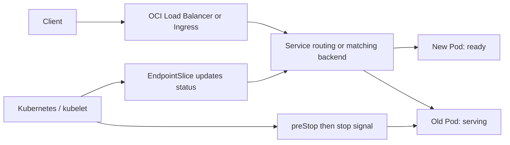
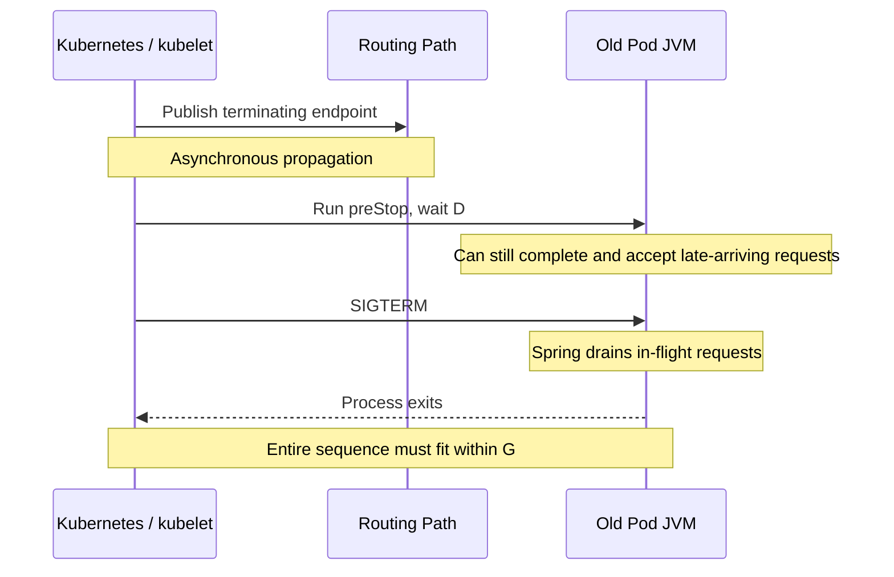

# Graceful Shutdown, Readiness, and Zero-Downtime Deployment

## 1. Objective: Maintaining Service Availability Across Version Updates

In the **Java and Spring Boot Deployment** chapter of the **CLOUD_PROVIDERS_ORACLE** module, zero-downtime deployment is a coordination problem between the application and traffic routing on Oracle Cloud Infrastructure. Running two replicas or enabling rolling updates is not enough: new versions must genuinely be ready to serve, while old versions must have time to finish in-flight work before stopping.

This lesson uses a Spring Boot HTTP service running on **Oracle Kubernetes Engine (OKE)**, with images stored in **OCI Container Registry (OCIR)** and external traffic routed through a configured Ingress or OCI Load Balancer. You need to explain and verify:

- When a Pod becomes eligible to receive new traffic.
- What happens from the moment a Pod deletion is requested until the JVM exits.
- How readiness, graceful shutdown, `preStop`, and rolling updates coordinate.
- How to detect failed requests, connection resets, and capacity shortages during version transitions.
- How to preserve Oracle Database compatibility, perform rollbacks, and control the cost of spare capacity.

The primary scope is a Spring Boot executable JAR application on Java 21, using Spring MVC with embedded Tomcat, running on a Linux managed node pool. For WebFlux, WebSockets, gRPC, or background tasks, add appropriate drain mechanisms covered later.

Here, "zero downtime" must tie to measurable criteria: during a rollout under defined load, there are zero transport errors or unexpected error responses, and latency stays within target. This is an observed outcome, not an inherent property of a YAML snippet.

## 2. Three Distinct Concerns: Readiness, Draining, and App Shutdown

| Mechanism | Question It Solves | What It Does Not Do Automatically |
| --- | --- | --- |
| Readiness | Should this replica be selected for new traffic? | Does not close existing connections |
| Traffic draining | Has the routing path stopped sending new work to this replica? | Does not finish transactions or work inside the JVM |
| Graceful shutdown | Upon receiving a stop signal, does the app finish in-flight work within budget? | Does not guarantee remaining replicas have enough capacity |

For example, Pod A is processing an order-creation request that takes 8 seconds while Pods B and C are already serving new traffic. If Pod A stops in a coordinated manner, the in-flight request can finish before the JVM exits. If the process is killed immediately, the user may receive an error even though the transaction already committed.

Two sides must be solved together: **maintaining serving endpoints** and **preserving in-flight work**. Client-side retries are only a secondary layer; for write operations, retrying without idempotency can create duplicate orders or payments.

### 2.1. Traffic Path on OCI



The actual path depends on architecture: a load balancer can route traffic via worker nodes or directly to Pods in supported configurations. Therefore, never assume a single readiness failure immediately stops every network tier from targeting that Pod.

On OKE, clearly identify load balancer backends, the managing controller, the Service, and the active routing policy. Oracle describes both node-backend and Pod-backend configurations in the [OKE load balancer configuration guide](https://docs.oracle.com/en-us/iaas/Content/ContEng/Tasks/contengconfiguringloadbalancersnetworkloadbalancers-subtopic.htm).

## 3. Lifecycle of a Terminating Pod

When a Deployment scales down an older ReplicaSet's Pods, a typical termination flow includes:

1. The Pod receives a deletion request, gets a deletion timestamp, and enters termination.
2. Kubernetes updates the associated endpoint state; routing components observe the change.
3. Kubelet executes `preStop` if the container defines that hook.
4. Once the hook finishes, the runtime sends the stop signal to the container process—SIGTERM in this example.
5. Spring closes the application context and performs graceful shutdown.
6. The container exits; if it has not stopped when the grace period expires, it may be forcefully killed.

**Routing updates and container termination are not a globally synchronized chain.** There is no single instant at which every proxy, load balancer, and connection transitions state together. See [Kubernetes: Pod Termination](https://kubernetes.io/docs/concepts/workloads/pods/pod-lifecycle/#pod-termination).

In EndpointSlice, the `ready`, `serving`, and `terminating` conditions distinguish serving ability from termination status. Terminating endpoints are normally excluded from new traffic; certain proxy policies may still use an endpoint that is both serving and terminating if all endpoints are terminating. Do not treat `ready=false` as proof that every active connection has been severed. See [Kubernetes: EndpointSlice Conditions](https://kubernetes.io/docs/concepts/services-networking/endpoint-slices/#conditions).

### 3.1. The Race Condition That Commonly Causes Errors

Suppose the JVM stops accepting connections at second 1, while an upstream proxy takes several seconds to update its routes. New requests can still arrive at a Pod that just stopped listening, causing connection resets or gateway errors.

A measured drain delay placed before SIGTERM gives routing paths time to propagate updates while the application still serves late-arriving requests. This delay does not replace properly configuring controllers, health checks, or timeouts.

### 3.2. Readiness Is Not Liveness

Failing readiness temporarily removes a replica from traffic routing. Failing liveness triggers a container restart. Never use liveness to mark "under maintenance" or "draining": that turns an intentional state into an unnecessary restart.

Likewise, during an outage of a shared Oracle Database, mass-restarting JVMs usually does not fix the root cause. Dependency checks in readiness should reflect which APIs can still operate rather than dumping every health indicator into every probe.

## 4. Preparing Spring Boot to Handle Stop Signals Properly

### 4.1. Application Configuration

The project needs the web starter and Actuator. In a Maven project using Spring Boot dependency management, add:

```xml
<dependency>
    <groupId>org.springframework.boot</groupId>
    <artifactId>spring-boot-starter-actuator</artifactId>
</dependency>
```

Configure `application.yaml`:

```yaml
server:
  port: 8080
  shutdown: graceful

spring:
  lifecycle:
    timeout-per-shutdown-phase: 25s

management:
  endpoints:
    web:
      exposure:
        include: health
  endpoint:
    health:
      show-details: never
      probes:
        enabled: true
        add-additional-paths: true
```

Spring Boot runs graceful shutdown when closing the application context; supported web servers allow time for active requests and stop accepting new ones according to each server's implementation. With Tomcat in this example, refusing new requests happens at the network layer. See [Spring Boot: Graceful Shutdown](https://docs.spring.io/spring-boot/reference/web/graceful-shutdown.html).

Actuator provides readiness/liveness health groups. Enabling additional paths exposes them at `/readyz` and `/livez` on the application port. Never use an endpoint that always returns 200 regardless of whether the application has finished initializing. See [Spring Boot: Kubernetes Probes](https://docs.spring.io/spring-boot/reference/actuator/endpoints.html#actuator.endpoints.kubernetes-probes).

If using Spring Security, allow kubelet to reach the exact health paths without 401, 403, or login redirects. Doing so does not require exposing all Actuator endpoints to the Internet. You do not need to enable the management shutdown endpoint for this workflow.

### 4.2. When the Application Becomes Ready

Spring Boot tracks availability state and normally transitions to accepting traffic after application runners finish. If essential warm-up work is pushed onto a background thread and left untracked, readiness may turn true before warm-up completes.

Keep mandatory initialization inside an `ApplicationRunner` or design explicit readiness checks for asynchronous initialization. When an app deliberately stops accepting work, it can publish `ReadinessState.REFUSING_TRAFFIC`; that event alone does not close the HTTP port or finish transactions. Refer to [Spring Boot: Application Availability](https://docs.spring.io/spring-boot/reference/features/spring-application.html#features.spring-application.application-availability).

### 4.3. Java Must Receive SIGTERM

Illustrative Dockerfile:

```dockerfile
FROM eclipse-temurin:21-jre
WORKDIR /app
COPY --chown=10001:10001 target/orders-api.jar /app/app.jar
USER 10001:10001
EXPOSE 8080
ENTRYPOINT ["java", "-jar", "/app/app.jar"]
```

In this example, the project build produced an executable JAR at `target/orders-api.jar`. Exec-form lets Java receive signals directly. If a wrapper script is needed, its final launch line must transfer control via `exec java ...` or the wrapper must forward signals properly.

Clicking Stop in an IDE does not prove a container handles SIGTERM properly. Verify on the actual image and runtime.

## 5. Calculating the Time Budget Before Writing YAML

Let:

- `D`: time to wait for routing paths to drain traffic before sending SIGTERM.
- `S`: time the application needs to finish after SIGTERM.
- `M`: headroom for scheduling, cleanup, and operational variance.
- `G`: the Pod's `terminationGracePeriodSeconds`.

Design rule:

```text
G > D + S + M
```

`preStop` runs **inside** the grace period. For example, if the hook takes 10 seconds inside a 50-second grace period, the application no longer has a full 50 seconds after SIGTERM. See [Kubernetes: Container Lifecycle Hooks](https://kubernetes.io/docs/concepts/containers/container-lifecycle-hooks/).

A starting budget for the lab:

| Component | Illustrative Value | Interpretation |
| --- | --- | --- |
| Pre-SIGTERM drain delay | 10 seconds | Allows time for route updates to propagate |
| Timeout per Spring shutdown phase | 25 seconds | Per-phase budget, not the entire shutdown process |
| Pod termination grace period | 50 seconds | Covers both hooks and application shutdown |
| Longest demo request | 20 seconds | Short enough to observe completion within the sample budget |

For a simple app, 10 seconds for drain, ~25 seconds for shutdown, and 10 seconds of margin total 45 seconds—less than 50 seconds. If the app has multiple shutdown phases or background consumers, `S` can exceed 25 seconds; re-measure and adjust the entire related budget.



Timeouts across the client, Ingress, OCI Load Balancer, and application must align with permitted request durations. A long grace period cannot save a request if a proxy cuts the connection earlier. Load balancer idle timeouts also differ from total request duration; see [Oracle: Timeouts and Connection Reuse](https://docs.oracle.com/en-us/iaas/Content/Balance/Reference/connectionreuse.htm).

Never stretch every timeout indefinitely to hide unbounded work. For tasks lasting minutes, an asynchronous API returning a job ID is far easier to operate than holding an HTTP request open across deployments.

## 6. Sample Deployment for Controlled Rollouts

### 6.1. Environment Prerequisites

Before applying, ensure you have:

- An OKE cluster and the `java-apps` namespace provisioned.
- Kubeconfig for the target cluster, with the admin workstation able to reach the API endpoint via VCN, VPN, or established access path.
- Appropriate Kubernetes permissions in the namespace, plus IAM rights to inspect OCI resources in the compartment.
- An image pushed to OCIR and the `ocir-pull` Secret in the same namespace as the Pods.
- An image matching node architecture, containing Java as well as `/bin/sh` and `sleep` if using the exec hook below.
- A client-to-app path configured independently via Service/Ingress/LB where errors can be observed.

This lesson does not provision an extra load balancer. You can test internally via Service inside the cluster first, then validate via the real user-facing URL.

### 6.2. Manifest

Replace image placeholders with real images, preferably pinned by digest. The environment variables below reapply key operational settings even if the image bundles `application.yaml`.

```yaml
apiVersion: apps/v1
kind: Deployment
metadata:
  name: orders-api
  namespace: java-apps
spec:
  replicas: 3
  revisionHistoryLimit: 5
  minReadySeconds: 10
  progressDeadlineSeconds: 600
  strategy:
    type: RollingUpdate
    rollingUpdate:
      maxSurge: 1
      maxUnavailable: 0
  selector:
    matchLabels:
      app.kubernetes.io/name: orders-api
  template:
    metadata:
      labels:
        app.kubernetes.io/name: orders-api
    spec:
      terminationGracePeriodSeconds: 50
      automountServiceAccountToken: false
      imagePullSecrets:
        - name: ocir-pull
      securityContext:
        runAsNonRoot: true
        runAsUser: 10001
        runAsGroup: 10001
      topologySpreadConstraints:
        - maxSkew: 1
          topologyKey: kubernetes.io/hostname
          whenUnsatisfiable: ScheduleAnyway
          labelSelector:
            matchLabels:
              app.kubernetes.io/name: orders-api
      containers:
        - name: orders-api
          image: "<ocir-host>/<tenancy-namespace>/java/orders-api@sha256:<digest-v1>"
          ports:
            - name: http
              containerPort: 8080
          env:
            - name: SERVER_SHUTDOWN
              value: graceful
            - name: SPRING_LIFECYCLE_TIMEOUT_PER_SHUTDOWN_PHASE
              value: 25s
            - name: MANAGEMENT_ENDPOINT_HEALTH_PROBES_ENABLED
              value: "true"
            - name: MANAGEMENT_ENDPOINT_HEALTH_PROBES_ADD_ADDITIONAL_PATHS
              value: "true"
            - name: MANAGEMENT_ENDPOINTS_WEB_EXPOSURE_INCLUDE
              value: health
            - name: MANAGEMENT_ENDPOINT_HEALTH_SHOW_DETAILS
              value: never
            - name: JAVA_TOOL_OPTIONS
              value: "-XX:MaxRAMPercentage=60.0"
          resources:
            requests:
              cpu: 500m
              memory: 512Mi
            limits:
              cpu: "1"
              memory: 1Gi
          startupProbe:
            httpGet:
              path: /livez
              port: http
            periodSeconds: 5
            timeoutSeconds: 2
            failureThreshold: 36
          readinessProbe:
            httpGet:
              path: /readyz
              port: http
            periodSeconds: 2
            timeoutSeconds: 2
            failureThreshold: 2
            successThreshold: 1
          livenessProbe:
            httpGet:
              path: /livez
              port: http
            periodSeconds: 10
            timeoutSeconds: 2
            failureThreshold: 3
          lifecycle:
            preStop:
              exec:
                command: ["/bin/sh", "-c", "sleep 10"]
          securityContext:
            allowPrivilegeEscalation: false
---
apiVersion: v1
kind: Service
metadata:
  name: orders-api
  namespace: java-apps
spec:
  type: ClusterIP
  selector:
    app.kubernetes.io/name: orders-api
  ports:
    - name: http
      port: 80
      targetPort: http
---
apiVersion: policy/v1
kind: PodDisruptionBudget
metadata:
  name: orders-api
  namespace: java-apps
spec:
  minAvailable: 2
  selector:
    matchLabels:
      app.kubernetes.io/name: orders-api
```

Save this template as `orders-api-graceful.yaml` in your lab environment. Service and Deployment selectors must match. Never enable `publishNotReadyAddresses` for this standard HTTP Service.

### 6.3. What Does Each Setting Contribute?

| Setting | Role During Version Replacement |
| --- | --- |
| `replicas: 3` | Keeps multiple replicas serving simultaneously; still requires proper spread and capacity |
| `maxUnavailable: 0` | Controller avoids intentionally reducing available count under the rollout strategy |
| `maxSurge: 1` | Permits spinning up one extra replica during replacement |
| `minReadySeconds: 10` | Requires new Pods to remain ready briefly before counting as available |
| `progressDeadlineSeconds: 600` | Signals stalled rollouts within the defined budget |
| Readiness probe | Supplies container readiness signals |
| `preStop` | Delays SIGTERM for the chosen drain window |
| 50-second grace period | Time cap for hooks and process exit |

The startup probe protects initialization; readiness still decides when traffic arrives. Never replace readiness with a fixed sleep during startup.

A Deployment marks progress as stalled when exceeding the deadline, but does not auto-rollback purely because the deadline elapsed. Rolling update and available-replica rules are detailed in [Kubernetes: Deployments](https://kubernetes.io/docs/concepts/workloads/controllers/deployment/).

`ScheduleAnyway` only prefers spreading Pods; it does not guarantee each replica lands on a separate node. If surviving a node or fault-domain loss is mandatory, design placement constraints and redundancy accordingly.

### 6.4. Role and Limits of PDB

A PDB with `minAvailable: 2` helps guard against voluntary disruptions via the Eviction API, such as node drains. It does not govern Deployment rolling updates, prevent node crashes, or block direct Pod deletions. See [Kubernetes: Disruptions and PodDisruptionBudget](https://kubernetes.io/docs/concepts/workloads/pods/disruptions/).

If only two healthy Pods exist while the PDB demands two available Pods, a node drain can stall waiting for capacity. Investigate the underlying cause rather than habitually disabling the PDB.

## 7. Capacity Is a Prerequisite for Zero-Downtime Deployment

In the sample, three replicas request `1.5 CPU + 1.5Gi memory` total. With one surge Pod, requested capacity reaches at least `2 CPU + 2Gi memory`, excluding terminating Pods and other workloads.

The scheduler must find nodes with enough resources for each individual Pod. Total cluster-wide free capacity does not guarantee every Pod schedules, especially under architecture, topology, or quota constraints. Requests govern scheduling; memory and CPU limits also affect throughput and shutdown duration. See [Kubernetes: Managing Container Resources](https://kubernetes.io/docs/concepts/configuration/manage-resources-containers/).

Evaluate serving throughput as well, not just memory:

- If each Pod reliably handles 100 requests/second and one Pod leaves, the remaining two must absorb incoming load.
- If Pods sit near CPU limits, in-flight requests may finish slower than the shutdown budget measured while idle.
- If HPA adjusts replica counts during a rollout, account for new, old, and terminating Pods together.
- If each Pod opens an Oracle Database connection pool, surging increases total connections; the database can bottleneck before cluster CPU runs out.

Spare capacity carries real OCI cost. Lowering `maxSurge` to save money without checking available capacity can stall rollouts or degrade serving capacity. Track node pool, LB, and related costs per compartment; lowering requests alone does not shrink charges on existing nodes.

## 8. Hands-On Verification With Timed Requests

### 8.1. Creating an Endpoint With Observable Processing Time

To verify whether requests complete when a Pod terminates, add this controller to **the lab image**. The project already has a `@SpringBootApplication` class and the web starter.

```java
package vn.example.orders;

import java.util.Map;
import java.util.Objects;
import java.util.UUID;
import org.slf4j.Logger;
import org.slf4j.LoggerFactory;
import org.springframework.http.HttpStatus;
import org.springframework.web.bind.annotation.GetMapping;
import org.springframework.web.bind.annotation.RequestParam;
import org.springframework.web.bind.annotation.RestController;
import org.springframework.web.server.ResponseStatusException;

@RestController
public class WorkController {
    private static final Logger log =
            LoggerFactory.getLogger(WorkController.class);

    @GetMapping("/demo/work")
    public Map<String, Object> work(
            @RequestParam(defaultValue = "500") long ms)
            throws InterruptedException {
        if (ms < 0 || ms > 20_000) {
            throw new ResponseStatusException(
                    HttpStatus.BAD_REQUEST, "ms must be in 0..20000");
        }

        String id = UUID.randomUUID().toString();
        String pod = Objects.toString(System.getenv("HOSTNAME"), "local");
        log.info("request_start id={} pod={} workMs={}", id, pod, ms);

        Thread.sleep(ms);

        log.info("request_end id={} pod={}", id, pod);
        return Map.of("requestId", id, "pod", pod, "workMs", ms);
    }
}
```

`Thread.sleep` only simulates synchronous timed work in Spring MVC. It does not faithfully model CPU, I/O, or transactions, and must never be used to block a WebFlux event loop. Remove this load-generating endpoint from public APIs after finishing the lab.

### 8.2. Deploying the Initial Version

Commands below use Bash; replace placeholders and confirm the active context:

```bash
kubectl config current-context
kubectl apply --dry-run=server -f orders-api-graceful.yaml
kubectl apply -f orders-api-graceful.yaml
kubectl -n java-apps rollout status deployment/orders-api --timeout=10m
kubectl -n java-apps get pods -l app.kubernetes.io/name=orders-api -o wide
kubectl -n java-apps get pdb orders-api
```

Begin testing only once enough Pods are available, the real URL is reachable, and readiness is healthy. Record image digests, configuration, replica counts, and start times for comparison.

Port-forwarding helps inspect endpoints, but makes poor primary evidence for rollouts behind an LB: it can pin to one Pod and bypass user traffic paths. Test via the Ingress/LB URL; if testing only the internal Service, document that scope explicitly.

### 8.3. Sending Continuous Requests and Preserving First-Attempt Failures

Set `BASE_URL` without a trailing `/`. If the app requires authentication, supply credentials suited to the lab environment.

```bash
BASE_URL="https://<application-host>"

run_client() {
  worker="$1"
  for i in $(seq 1 100); do
    if result=$(curl -sS --connect-timeout 2 --max-time 30 -o /dev/null -w 'http=%{http_code} seconds=%{time_total}' "$BASE_URL/demo/work?ms=500"); then
      transport=ok
    else
      transport=failed
    fi
    printf '%s worker=%s transport=%s %s\n' "$(date -u +%FT%TZ)" "$worker" "$transport" "$result"
    sleep 0.1
  done
}

run_client A > client-A.log &
run_client B > client-B.log &
run_client C > client-C.log &
wait
```

Keep retries disabled during baseline tests: retries hide first-attempt failures. These three loops constitute a low-load continuity check, not proof of meeting SLOs at peak traffic.

While clients run, in another terminal push v2 to OCIR and update the image:

```bash
NEW_IMAGE="<ocir-host>/<tenancy-namespace>/java/orders-api@sha256:<digest-v2>"
kubectl -n java-apps set image deployment/orders-api orders-api="$NEW_IMAGE"
kubectl -n java-apps rollout status deployment/orders-api --timeout=10m
```

Filter for calls with transport errors or non-2xx HTTP statuses:

```bash
awk '$3 != "transport=ok" || $4 !~ /^http=2[0-9][0-9]$/ { print FILENAME, $0 }' client-A.log client-B.log client-C.log
```

Zero error lines is scoped evidence: valid for that exact URL, load, timing, and configuration. Follow up with realistic concurrency, keep-alive connections, and representative business operations.

### 8.4. Watching State in Parallel

Run each watch command in its own terminal:

```bash
kubectl -n java-apps get pods -l app.kubernetes.io/name=orders-api -w
kubectl -n java-apps get endpointslices -l kubernetes.io/service-name=orders-api -w
```

To inspect endpoint conditions, fetch EndpointSlice YAML; to inspect events and logs:

```bash
kubectl -n java-apps get endpointslices -l kubernetes.io/service-name=orders-api -o yaml
kubectl -n java-apps get events --sort-by=.metadata.creationTimestamp
kubectl -n java-apps logs <pod-name> -c orders-api --timestamps
```

Ship logs to your observability system before Pods vanish if post-test analysis is needed. Reading logs locally after a Pod is deleted may no longer be possible.

### 8.5. Verifying an In-Flight Request During Pod Termination

In a lab with sufficient available replicas:

1. Send `GET /demo/work?ms=15000` over the real application path.
2. Check `request_start` logs to identify which Pod is handling it.
3. While the request is still running, delete that exact Pod normally:
   `kubectl -n java-apps delete pod <pod-from-request-log> --wait=false`.
4. Observe the response, `request_end`, shutdown logs, and replacement Pod.

With a 15-second request, 10-second drain delay, and suitable timing, the request may still be running when SIGTERM arrives. A successful response paired with matching request ID logs demonstrates completion during that observed shutdown.

Direct Pod deletion is not a PDB test; it can bypass Eviction API protections. Never use force-delete or grace-period 0 when verifying graceful shutdown.

## 9. Verifying the OCI Load Balancer Layer

Kubelet probes observe only the node-to-Pod path. OCI Load Balancers run their own health checks and backend connections; the two mechanisms are independent.

During a rollout, confirm:

- Whether LB backends are nodes, Pods, or an Ingress tier.
- Health check path, protocol, port, and success codes match that topology.
- No windows occur with zero healthy backends.
- Gateway errors, timeouts, and connection resets do not spike during transitions.
- Requests originate from real user networks across real DNS and TLS.

A TCP health check may only prove a port is open. An HTTP health check pointing at the wrong path can report unhealthy even while the app serves normally. Oracle documents settings in [Load Balancer Health Check Policies](https://docs.oracle.com/en-us/iaas/Content/Balance/Tasks/load_balancer_health_management.htm).

If the LB is managed by a Kubernetes controller, modify it through declarative config and supported controller mechanisms rather than manual edits that get reconciled back. Options depend on LB type and backend mode; never guess and apply OCI Load Balancer annotations to a Network Load Balancer.

Correlate request logs with LB metrics and logs by timestamp. Monitor at least active connections, backend timeouts, error responses, and response times; see [Oracle: Load Balancer Metrics](https://docs.oracle.com/en-us/iaas/Content/Balance/Reference/loadbalancermetrics.htm).

## 10. Data Compatibility Is a Prerequisite for Rolling Updates

During a rollout, v1 and v2 run concurrently. If v2 changes the Oracle Database schema in a way v1 cannot read or write, readiness may still pass while business requests fail.

An expand-and-contract sequence:

| Phase | Change | Invariant to Maintain |
| --- | --- | --- |
| Expand | Add backward-compatible columns or structures | v1 continues functioning |
| Transition app | Deploy v2 supporting both old and new data | Both versions coexist safely |
| Migrate data | Controlled backfill and verification | Avoid overloading the database or breaking business invariants |
| Contract | Drop legacy structures after the rollback window | No code or job still relies on legacy structures |

Never let every new Pod run an uncoordinated long migration concurrently. Migrations need orchestration, lock/duration tracking, and clear compatibility rules.

For write APIs, use request IDs/idempotency keys and storage-layer constraints to handle cases where clients lose responses after transactions commit. Graceful shutdown reduces process-exit errors; it does not provide system-wide "exactly-once execution."

## 11. Long-Lived Connections, Background Consumers, and Sessions

### 11.1. Long-Lived Connections

WebSockets, streaming responses, and gRPC streams can outlive the grace period. Readiness turning false does not migrate existing connections to another Pod. You need protocol-appropriate close notifications, client reconnect logic, stream duration limits, or checkpoints.

Reconnecting clients must tolerate landing on a different Pod. For sessions kept in a single replica's RAM, subsequent requests lose state even without connection errors. Session/token designs or shared state stores must tolerate replica replacement.

### 11.2. Background Consumers and Tasks

Web server graceful shutdown does not prove message consumers, schedulers, or custom executors have drained. A background worker shutdown sequence normally needs to:

1. Stop pulling new messages or accepting new jobs.
2. Bound and track in-flight tasks.
3. Finish or checkpoint within the shutdown budget.
4. Ack/commit only for durably persisted outcomes.
5. Allow safe retry if the process exits mid-work.

Hook into library and application lifecycles cleanly; never block indefinitely in `@PreDestroy`. When multiple shutdown phases exist, budget for all of them rather than relying solely on the HTTP server timeout.

## 12. Rollbacks and OKE Node Maintenance

### 12.1. Rolling Back When Error Criteria Are Breached

If a new version causes errors or latency breaches, halt the release per runbook and restore the known-good revision:

```bash
kubectl -n java-apps rollout history deployment/orders-api
kubectl -n java-apps rollout undo deployment/orders-api --to-revision=<known-good-revision>
kubectl -n java-apps rollout status deployment/orders-api --timeout=10m
```

Verify live traffic after rollback, not just Deployment status. Rolling back a Pod template does not revert database schemas, in-place edited ConfigMaps, changed Secrets, or written data. Retain required image/config versions through the recovery window and resync declarative manifests after imperative actions.

### 12.2. Distinguishing App Rollouts From Node Drains

During managed node pool maintenance, OKE configures cordon/drain and eviction grace periods. That budget operates at the **node operation** layer, separate from each Pod's `terminationGracePeriodSeconds`.

Overly strict PDBs or insufficient capacity can block drains from completing. Force-action/force-terminate options after the grace period allow infrastructure maintenance to proceed before workloads fully drain; understand their impact on availability. Refer to [Oracle: Cordon and Drain Managed Nodes](https://docs.oracle.com/en-us/iaas/Content/ContEng/Tasks/contengdeletingworkernodes_topic-Notes_on_cordon_and_drain.htm).

This rollout lab does not require rebooting or deleting nodes yourself. When testing infrastructure maintenance, follow a dedicated plan with pre-defined IAM permissions, compartment scope, placement, and node-loss tolerance.

## 13. Evidence-Based Troubleshooting

| Symptom During Deployment | Possibilities to Check | Useful Evidence |
| --- | --- | --- |
| Connection reset as Pod stops | JVM stopped listening before route updates; active connections severed | Deletion timestamp, SIGTERM/shutdown logs, proxy logs |
| HTTP 502 spike | Backend unavailable, reset, or broken backend path | LB error logs, backend health, endpoint conditions |
| HTTP 504 spike | Timeout along backend path or downstream dependency | Request duration, LB timeout, DB/API traces |
| New Pod ready yet API fails | Readiness passed too early or omits required conditions | Warm-up logs, business requests hitting the new Pod |
| New Pod Pending | Insufficient resources, quotas, or placement constraints | Scheduling events, node allocatable, requests |
| Pod killed before `request_end` | Grace period too short or signal missed the main process | Hook duration, shutdown logs, container last state |
| Rollout reports stalled progress | Image pull, startup/readiness failures, quotas, or admission | Deployment conditions, events, Pod logs |
| Node drain blocked | PDB constraints or insufficient healthy replicas | PDB allowed disruptions and OKE work requests |
| Business errors only while two versions run | Incompatible schema, API, or session state | Serving version, Oracle errors, migration changes |

HTTP 502 or 504 alone does not pinpoint a single root cause. Oracle covers correlating backend states and timeout errors in [Troubleshooting Load Balancer Backends](https://docs.oracle.com/en-us/iaas/Content/Balance/Reference/troubleshooting_backend.htm).

Exit code 137 indicates the process may have received SIGKILL, which alone does not confirm grace-period exhaustion; it can also stem from OOM kills or external signals. Inspect last state, reason, and events before changing timeouts.

## 14. Acceptance Criteria for a Deployment

Before treating a configuration as ready for the service, collect evidence across all four categories:

| Category | Evidence to Retain |
| --- | --- |
| Traffic | Request count, transport errors, HTTP statuses, and latency along the real user path |
| Application | Readiness transitions on time, in-flight requests finish, JVM exits within budget |
| Kubernetes/OCI | Sufficient replicas/capacity, no unexpected backend gaps, healthy LB and OKE states |
| Data/recovery | Coexisting versions work, write retries are safe, rollback covers config and schema |

When measuring, record concurrency, connection reuse, request duration, image versions, rollout time, and load conditions. Tests with client retries enabled must distinguish first-attempt errors from post-retry results.

Keep spare capacity needed for rollouts, while cleaning up temporary and lab resources afterward. A successful deployment coordinates accurate readiness, timely route draining, shutdown within budget, and remaining replicas continuing to serve smoothly.
