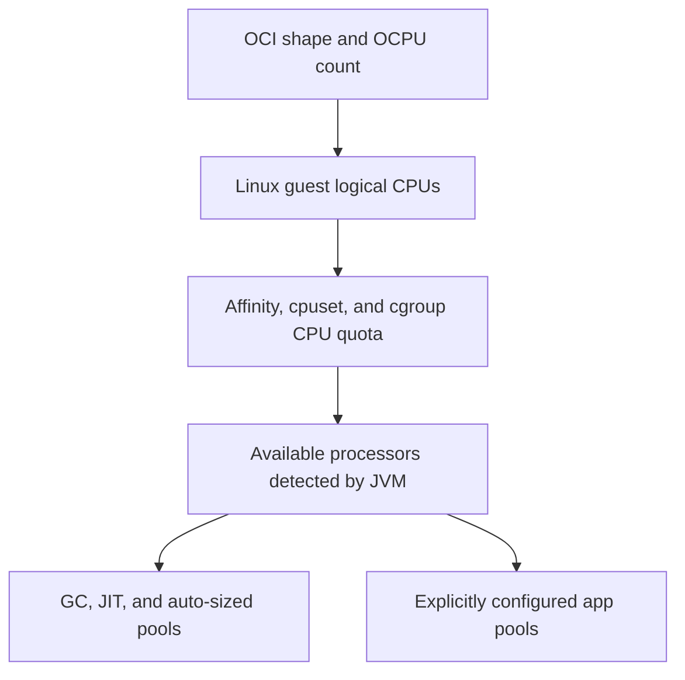

# Tuning the JVM for OCPU, Memory, and Arm Architecture

In the **Java and Spring Boot Deployment** chapter of the `CLOUD_PROVIDERS_ORACLE` module, JVM tuning aligns the application with the resources actually allocated on OCI. You must connect three layers: OCI shape and OCPU allocation, CPU/memory limits enforced by the OS or container, and the budgets and thread pools inside the JVM.

This lesson uses HotSpot JDK 21 on Linux as the baseline for commands and flags. The sample application is Spring Boot using Spring MVC, Tomcat, and JDBC. Configuration figures below are starting points for an illustrative scenario that must be re-measured on real workloads; they are not universal optimal settings for every service.

## 1. Tuning Must Start From Serving Targets

Suppose `orders-service` runs on OCI Compute and can also be containerized for OKE. The team wants to move part of the workload from x86 to Arm to evaluate cost while preserving latency and availability requirements.

Before changing a single JVM flag, define:

- Target load: successful requests per second and request mix.
- SLOs: p95/p99 latency, error rate, timeouts, and post-startup readiness time.
- Resource limits: effective CPU, memory limit, replica count, and disk space for diagnostics.
- Comparison controls: JDK version, artifact, dataset, database, network path, and load generator.
- Acceptance criteria: meeting SLOs at target load with remaining headroom and a rollback path to prior settings.

For instance, a test SLO might be p99 under 300 ms at 200 requests/second with an error rate below 0.1%. This is a hypothetical target for designing measurements, not an observed benchmark or an OCI guarantee.

Low average CPU does not prove an application has enough CPU. A single thread may saturate one logical CPU, or a container may be throttled while the node still has idle CPU. Likewise, free heap space does not prove the process has enough total memory.

## 2. Understanding OCPU, vCPU, and Processor Counts Seen by the JVM

### 2.1. Do Not Apply One Formula Across All Arm Shapes

The OCPU unit in OCI configuration must be read alongside the exact shape name. Per Compute Shapes documentation, CPU allocations differ as follows:

| Machine Family | CPU Allocation Ratio | Example at 2 OCPU, Before Guest/Container Limits |
| --- | --- | --- |
| x86 AMD/Intel, e.g. `VM.Standard.E4.Flex` | 1 OCPU maps to 2 vCPUs | 4 logical CPUs; not 4 independent physical cores |
| Ampere A1, e.g. `VM.Standard.A1.Flex` | 1 OCPU maps to 1 core, 1 vCPU | 2 logical CPUs |
| Ampere A2/A4 | 1 OCPU maps to 2 cores, 2 vCPUs | 4 logical CPUs |

Therefore, "Arm always equals 1 OCPU = 1 vCPU" does not apply to every generation. Always check the [OCI Compute Shapes table](https://docs.oracle.com/en-us/iaas/Content/Compute/References/computeshapes.htm) for the exact machine family in use.

Even when two shapes expose 4 logical CPUs, throughput is not necessarily equal. x86 SMT threads and independent Arm cores behave differently; CPU generation, memory bandwidth, and workload characteristics also affect results.

### 2.2. Host CPU Is Not Process CPU

An application can encounter multiple limit layers:



A container limited to `cpu: "2"` on OKE does not mean it receives 2 node OCPUs. That is a Kubernetes CPU unit limit; compare it against cgroup settings and what the JVM detects. Two containers with identical CPU limits can run on different hardware generations or architectures.

On modern JDKs with container awareness, the JVM can use Linux container CPU and memory limits for ergonomics. Never infer an older JDK's behavior solely from its major version; record vendor, update, and build, then verify inside the actual runtime environment.

## 3. Inventorying Resources Before Changing Configuration

### 3.1. Checking Architecture and the Linux Environment

The commands below guide inspection on the target host or container:

```bash
uname -m
lscpu
java -version
java -XshowSettings:system -version
java -XshowSettings:vm -version
java -Xlog:os+container=trace -version
```

Typically, Linux reports `x86_64` on x86 and `aarch64` on 64-bit Arm. Architecture names in Java or image metadata may appear differently, such as `amd64`, `aarch64`, or `arm64`; map them accurately to the system under inspection.

The `java ... -version` commands spawn a fresh JVM to inspect the environment. If the real application sets its own JVM flags or environment variables, the probe JVM may not reflect the live process's settings. For a live process, use diagnostic tools or log startup metadata.

### 3.2. Observing Directly From the Java Process

You can emit a startup record equivalent to:

```java
Runtime runtime = Runtime.getRuntime();
long mib = 1024L * 1024L;

System.out.printf(
        "java=%s vendor=%s arch=%s processors=%d maxHeapMiB=%d%n",
        System.getProperty("java.runtime.version"),
        System.getProperty("java.vendor"),
        System.getProperty("os.arch"),
        runtime.availableProcessors(),
        runtime.maxMemory() / mib
);
```

`availableProcessors()` is the processor count Java reports as available to the process, not billable OCPUs. `maxMemory()` is the heap ceiling the JVM may attempt to use, not the RSS ceiling or total container memory. Both meanings are defined in the [Java 21 Runtime API](https://docs.oracle.com/en/java/javase/21/docs/api/java.base/java/lang/Runtime.html).

Never dump the entire environment or arguments containing credentials to collect metadata. A tuning inventory needs only permitted resource and configuration attributes.

### 3.3. Reading cgroup v2

Inside a container with cgroup v2 mounted at standard paths, inspect:

```bash
cat /proc/self/cgroup
cat /sys/fs/cgroup/cpu.max
cat /sys/fs/cgroup/cpu.stat
cat /sys/fs/cgroup/cpuset.cpus.effective
cat /sys/fs/cgroup/memory.max
cat /sys/fs/cgroup/memory.current
cat /sys/fs/cgroup/memory.events
```

Actual paths depend on namespaces and mounts; on a host, locate the exact cgroup of the process. Parent cgroups can also impose effective limits. Do not apply these exact paths unchanged to cgroup v1.

For example, `cpu.max` might read:

```text
200000 100000
```

That represents a CPU time budget equivalent to 2 CPUs per period shown; it does not pin two dedicated cores and says nothing about OCPUs. In `memory.max`, numeric values are bytes, while `max` means no limit at that cgroup level.

Compute deltas of `cpu.stat` and `memory.events` across your measurement window to detect throttling or OOM events. Cumulative counters require taking differences—never judge an active incident solely from a large total accumulated since container boot. Refer to the [Linux kernel cgroup v2 documentation](https://docs.kernel.org/admin-guide/cgroup-v2.html).

## 4. Budgeting Memory for the Whole Process

### 4.1. Heap Is Only Part of Total Memory

A practical budgeting model is:

```text
Workload budget
  >= heap
   + metaspace
   + code cache/JIT
   + platform thread stacks
   + direct buffers and native allocations
   + GC/JVM/agent structures
   + other usage charged against the limit
   + headroom
```

This is a budgeting model, not an exact additive identity across RSS, NMT, and cgroup counters. Measurement tools have different scopes and can overlap. Container memory accounting can also include page cache or tmpfs data charged to the cgroup; single-process RSS does not replace that total usage.

Distinguish three metrics:

| Concept | Question It Answers |
| --- | --- |
| Reserved | Which virtual address ranges has the JVM reserved? |
| Committed | Which regions has the JVM backed/committed for use? |
| Resident/cgroup usage | How much memory does the OS report as resident or charged? |

Large reserved memory does not by itself prove equivalent physical RAM is consumed. Conversely, low heap usage can coexist with high RSS due to native allocations, stacks, JVM internals, or third-party libraries.

### 4.2. Example Container With a 4 GiB Limit

Suppose the application container has an exact limit of `4Gi`, or 4096 MiB. The host still needs its own memory for the OS, agents, and other workloads; never budget the entire host RAM for each container.

An initial estimate could look like:

| Item | Illustrative Estimate |
| --- | ---: |
| Maximum heap | 2304 MiB |
| Metaspace | 256 MiB |
| Code cache | 192 MiB |
| Stacks and thread structures | 192 MiB |
| Direct buffers / native I/O | 256 MiB |
| GC, JVM, agents, and other native | 384 MiB |
| Headroom | 512 MiB |
| **Total budget** | **4096 MiB** |

Only the heap in the upcoming example configuration is capped at this figure. Remaining rows are estimates to measure, not self-enforced limits. If observed metaspace or native memory exceeds estimates, reallocate, reduce in-memory load, or raise the memory limit.

Use MiB/GiB explicitly in calculations: `1 GiB = 1024 MiB`. Never mix units across OCI Console, Kubernetes, and OS tools without converting.

### 4.3. Thread Count Is Also a Memory Decision

For platform threads, `thread count × stack size` gives a rough estimate of reserved stack address space, excluding other overhead and not equaling constant resident RAM.

Hundreds of threads can consume substantial off-heap memory. Never blindly slash `-Xss` very low to compensate for unbounded thread pools: deep call stacks can throw `StackOverflowError`, and stack needs vary across JDKs and architectures.

Likewise, `-XX:MaxDirectMemorySize` governs only a specific Java NIO direct-buffer region, not all native memory. JNI, agents, or library allocators can allocate outside that bound. Flag definitions appear in the [JDK 21 java command reference](https://docs.oracle.com/en/java/javase/21/docs/specs/man/java.html).

## 5. Setting Baseline JVM Options, Then Verifying Actual Values

### 5.1. An Illustrative Profile for a 4 GiB Container

Using the budget above, you can start with:

```bash
exec java \
  -Xms1g \
  -Xmx2304m \
  -XX:+UseG1GC \
  '-Xlog:gc*,safepoint:stdout:time,uptime,level,tags' \
  -XX:+HeapDumpOnOutOfMemoryError \
  -XX:HeapDumpPath=/var/lib/orders/dumps \
  -XX:+ExitOnOutOfMemoryError \
  -jar /opt/orders/orders-service.jar
```

The JAR path and dump directory are examples. The dump directory must exist, be writable by the process, and have enough space; configure volumes, access permissions, and retention during deployment. Heap dumps can hold in-memory data and secrets. Avoid writing large dumps into a tmpfs billed against the same constrained memory limit.

This configuration selects G1 explicitly so comparisons use the same collector. `-Xms1g` sets initial heap and `-Xmx2304m` caps heap. They do not grant extra RAM to the container or prevent off-heap allocations.

GC logs go to stdout; the log pipeline must enforce size and retention caps. On VMs logging directly to disk, you can swap the logging flag for:

```text
-Xlog:gc*,safepoint:file=/var/log/orders/gc-%p.log:time,uptime,level,tags:filecount=5,filesize=20M
```

The log directory must exist and be writable. Avoid running multiple uncoordinated log sinks without controlling total disk usage.

### 5.2. When to Use Memory Percentages

If the same image runs under varying memory limits, you can test percentages instead of `-Xms` and `-Xmx`:

```text
-XX:InitialRAMPercentage=25.0
-XX:MaxRAMPercentage=56.25
```

These **replace the two fixed heap flags**, rather than stacking extra memory on top. Under a 4 GiB limit properly detected by the JVM, 56.25% targets roughly 2304 MiB heap before ergonomics/alignment adjustments; verify against actual heap sizing.

This ratio does not guarantee native memory fits in the remainder at every container size. As containers shrink, relatively fixed costs for class metadata, JIT, and agents take up a larger share. Without a proper memory limit, the JVM may size itself against a RAM range differing from your operational budget.

Pick a single owner for heap settings. If buildpacks or an entrypoint script already computes heap flags, inspect effective flags before adding `JAVA_TOOL_OPTIONS` or extra parameters. Overlapping flag mechanisms easily mislead operators about active values.

### 5.3. Should Xms Equal Xmx?

Setting `Xms = Xmx` can reduce variance from heap resizing, but raises early memory commitment. Do not make it a blind default for every container.

If testing `-XX:+AlwaysPreTouch`, pre-touching memory pages shifts page-allocation cost to startup. Re-measure readiness time and peak memory usage; never enable it in tight-limit environments purely hoping to smooth latency.

The goal is a verified trade-off among startup, footprint, and stability, not making idle RSS look artificially small. Oracle discusses related trade-offs in the [G1 tuning guide](https://docs.oracle.com/en/java/javase/21/gctuning/garbage-first-garbage-collector-tuning.html).

## 6. Tuning to Effective Available CPU

### 6.1. ActiveProcessorCount Does Not Create Extra CPU

Prefer letting the JDK detect the environment accurately. Consider overriding only after inspecting cgroups, affinity, and the processor count reported by the app.

```text
-XX:ActiveProcessorCount=2
```

This option changes the processor count the JVM uses for ergonomics calculations. It does not set a CPU quota, pin the process to two cores, or turn 2 x86 OCPUs into 2 logical CPUs.

Nor should you assume every library executor resizes from this flag. Fixed-size pools, pre-initialized pools, or custom sizing logic must be checked independently. See [ActiveProcessorCount in the java command reference](https://docs.oracle.com/en/java/javase/21/docs/specs/man/java.html).

Examples:

| Illustrative Environment | Initial Decision |
| --- | --- |
| A1 with 2 OCPUs, app sees 2 processors, no other limits | No need to override just to "optimize Arm" |
| E4 with 2 OCPUs, app sees 4 processors | Do not force down to 2 merely because Console says 2 OCPU |
| Container has a 2-CPU quota yet app sees full node CPUs | Investigate JDK/cgroup; override can serve as a verified interim measure |
| Container limited to 500m CPU | Measure throttling and latency; integer processor counts cannot fully express half-CPU budgets |

Never hardcode `ParallelGCThreads`, `ConcGCThreads`, and JIT compiler threads from OCPU count using an arbitrary formula. GC, JIT, and request handlers share the same CPU; enlarging every thread group simultaneously can increase contention.

### 6.2. Recognizing CPU Throttling

A quota caps CPU time per period. When multiple runnable threads burn through the period's budget early, they wait until the next period even when the host node is not saturated.

Correlate simultaneously:

- Throughput, p99 latency, and queueing time.
- Process/container CPU alongside the normalization denominator.
- Delta of throttling counters across the exact load window.
- Runnable thread counts, CPU hotspots, and GC/JIT time.

For example, low VM-level average CPU paired with container throttling is not evidence for increasing heap. Better hypotheses include reducing CPU-bound concurrency, raising the CPU quota, or rebalancing workloads.

Kubernetes CPU requests and limits serve distinct roles: requests govern scheduling and CPU shares under contention, while CPU limits can be enforced via throttling. Memory requests do not replace memory limits either. See [Resource Management for Pods and Containers](https://kubernetes.io/docs/concepts/configuration/manage-resources-containers/).

## 7. Tuning Concurrency Alongside the JVM

### 7.1. Separating CPU Work From I/O Waits

Encryption, compression, or heavy computation does not speed up indefinitely when adding threads. Once useful CPU is saturated, adding parallel tasks mostly increases contention, context switches, and wait times.

Requests waiting on databases or external HTTP calls may need concurrency higher than CPU count to utilize resources well. Still, concurrency must align with timeouts, connection pools, and downstream capacity.

An estimate via Little's Law in steady state:

```text
Average requests in the system
    ≈ average throughput × average time in the system

200 requests/second × 0.2 seconds = 40 average requests
```

This is not a formula for setting Tomcat threads to exactly 40. It uses averages rather than p99 and does not account for bursts, queuing, or background work. If database latency rises, concurrent held requests and retained data can rise too.

### 7.2. Sample Spring MVC/Tomcat Configuration

For Spring Boot 3.5.x using platform threads, you might test a profile like:

```yaml
server:
  tomcat:
    threads:
      max: 64
      min-spare: 8
    max-connections: 256
    accept-count: 64

spring:
  datasource:
    hikari:
      maximum-pool-size: 8
      connection-timeout: 2000
```

These numbers illustrate a load test; they are not derived mathematically from 2 OCPUs. `accept-count` applies to the connector's socket backlog when connections cannot be accepted—it is not a universal limit for every queue in the app. Add explicit queuing, timeout, and load-shedding policies where work enters.

Do not apply Tomcat settings to WebFlux/Netty. When enabling virtual threads, several Tomcat worker thread settings no longer behave like the platform-thread model. Check [Spring Boot 3.5 Application Properties](https://docs.spring.io/spring-boot/3.5/appendix/application-properties/index.html).

An 8-connection database pool does not mean the whole system uses 8 connections. Across 6 replicas, those pools alone can demand up to 48 connections, excluding rolling surge pods, batch jobs, and admin tools. Adding replicas to lower per-JVM CPU must align with the Oracle Database connection budget.

Virtual threads organize I/O-bound work with different thread overhead, but do not create CPU capacity or extra database connections. You still need bounded concurrency, timeouts, and backpressure. Never treat virtual threads as an excuse to remove all concurrency limits. See [Virtual Threads in Java 21](https://docs.oracle.com/en/java/javase/21/core/virtual-threads.html).

### 7.3. Controlling Data Retained in Queues

An unbounded queue can swell the heap even while processing throughput stays flat. Queued requests or tasks retain payloads, contexts, and related objects.

When GC activity climbs, inspect queue depth, retry backlogs, batch sizes, and caches before raising `Xmx`. Trimming in-flight queued data can improve both memory and latency without switching collectors.

## 8. Choosing a Collector for SLOs and Budgets

### 8.1. Starting With G1

G1 is a sensible starting point for measurements in this lesson. It runs part of its work concurrently with the application to balance throughput and pause times—a direct CPU trade-off.

`MaxGCPauseMillis` is a soft goal, not a hard ceiling on every pause or on HTTP response times. A slow p99 request may stem from queuing, database locks, or CPU throttling rather than GC. See [JDK 21 G1 Overview](https://docs.oracle.com/en/java/javase/21/gctuning/garbage-first-g1-garbage-collector1.html).

When tuning G1, inspect in order:

1. Does the heap retain enough headroom above post-collection live set?
2. Is allocation rate elevated by payloads, serialization, or repeated object churn?
3. Does GC have enough CPU to complete concurrent phases on time?
4. Are Full GCs, evacuation failures, or humongous allocations appearing?
5. Do long pauses coincide with p99 request latency spikes?

Avoid copying flag sets from legacy tuning guides into new environments. Specifically, forcing young-generation sizing with options like `-Xmn` can hinder G1 from adapting to its pause target. Change one parameter group only when backed by a measurable hypothesis.

### 8.2. When to Benchmark Other Collectors

| Collector | Scenario Worth Testing | Trade-Offs to Weigh |
| --- | --- | --- |
| G1 | Services balancing throughput and latency | Concurrent phases still compete for CPU |
| Parallel GC | Throughput-first batch jobs tolerating longer pauses | Do not pick it merely because of the word "parallel" |
| ZGC | Low-pause workloads with adequate CPU and memory headroom | Measure throughput, footprint, and latency under real load |
| Serial GC | Small, low-CPU workloads with fitting pause tolerances | Not an automatic default for every small container |

For example, testing Generational ZGC on **JDK 21** uses:

```text
-XX:+UseZGC -XX:+ZGenerational
```

Those flags replace G1; never enable two collectors together. ZGC flags and modes vary across JDK generations, so never treat JDK 21 flags as a fixed contract for JDK 17 or newer releases. Refer to [Available Collectors in JDK 21](https://docs.oracle.com/en/java/javase/21/gctuning/available-collectors.html).

Under tight CPU budgets, a concurrent collector does not automatically deliver better p99: request threads and collector threads share the same CPU. Base conclusions on SLO compliance, footprint, and measured cost.

## 9. Moving to Arm: Verifying the Entire Runtime Stack

### 9.1. Java Bytecode Does Not Make Every Dependency Architecture-Independent

A pure-Java JAR can be reused when JDK and APIs match. However, the runtime environment still includes components requiring architecture-matched builds:

| Component | What to Verify on Arm |
| --- | --- |
| JDK/JRE | Supported Linux AArch64 build, vendor, and update |
| Base image | Matching `linux/arm64` variant |
| JNI/JNA and `.so` libraries | Arm binaries, ABI, and compatible system libraries |
| APM/profiler agents | Explicit support for the target JDK and platform |
| Compression, TLS, crypto, image libraries | Available native backends and measured fallback behavior |
| Machine-code artifacts | Native executables or platform-specific archives built for the target |

In particular, never assume every Oracle JDBC mode has identical native requirements. Verify the exact driver, auth mechanism, and libraries actually used by the app. Native dependencies can sit inside JARs or load at runtime; checking JAR filenames alone is insufficient.

OCI supports Java development for Arm; see [Arm-Based Compute](https://docs.oracle.com/en-us/iaas/Content/Compute/References/arm.htm). Platform support does not replace testing your specific agents and libraries.

### 9.2. Container Images Must Include the Target Variant

Inspect a prepared image manifest with:

```bash
docker buildx imagetools inspect "$IMAGE"
```

Look for both `linux/amd64` and `linux/arm64` if deploying the same reference across both node types. A multi-architecture manifest lists separate variants; it does not convert x86 binaries into Arm binaries. At release time, record both the image digest and the actual variant run.

With a build pipeline properly configured for base images and native dependencies, Buildx supports multi-platform output:

```bash
docker buildx build \
  --platform linux/amd64,linux/arm64 \
  --output type=oci,dest=orders-multiarch.tar \
  .
```

This exports a local archive for a build workflow, not a deployment command. The builder must support the target platforms. Never hardcode `FROM --platform=linux/amd64` in the runtime stage and expect native Arm execution.

QEMU can help during builds or compatibility checks, but never use emulated benchmark numbers to judge native Arm performance. Refer to [Docker Multi-platform Builds](https://docs.docker.com/build/building/multi-platform/).

### 9.3. Re-Measuring Startup and Steady State

The JIT compiles machine code for the host CPU architecture. After switching architectures, re-measure:

- Time from startup to readiness and time to reach steady throughput.
- CPU spent on JIT, class loading, and connection pool initialization.
- Performance of code paths involving compression, encryption, vectorization, or native libraries.
- Observed GC behavior, live set, native memory, and thread counts.
- Steady throughput, p99 latency, and burst behavior.

Do not treat identical bytecode as proof of identical performance. Nor should you disable tiered compilation or throttle compilers just to make startup look faster without measuring long-term serving throughput.

Archives or caches holding JVM/machine-dependent state must be generated and tested on the target architecture; never assume x86 caches carry over to AArch64.

## 10. Collecting Evidence Across Three Layers

### 10.1. OCI and Operating System

Use OCI Monitoring to observe host CPU, memory, networking, and I/O; confirm Compute monitoring is enabled and verify which metrics actually report data. [Compute Instance Metrics](https://docs.oracle.com/en-us/iaas/Content/Compute/References/computemetrics.htm) documents available metrics and dimensions.

VM/node-level metrics do not replace container or JVM metrics. If one pod has a low CPU limit, node-wide CPU charts can hide that pod's bottleneck.

Tag results with region, shape, OCPU, memory, architecture, instance/container, image digest, and measurement window. Never stitch metrics from different time ranges or replicas together as a single run.

### 10.2. JVM and Application

A tuning dashboard should correlate:

| Group | Data to Correlate |
| --- | --- |
| Serving | Offered load, successful throughput, p50/p95/p99, timeouts, error rate |
| CPU | Process/container CPU, quota, throttling, runnable threads |
| Heap/GC | Heap used/committed/max, observed live set, allocation rate, pauses, and Full GCs |
| Off-heap | RSS, cgroup usage, metaspace, code cache, direct buffers, platform threads |
| Downstream | Database/HTTP latency, active/pending pool connections, queue depth |
| Lifecycle | Startup, readiness, restarts, and memory peak during warm-up |

If using Actuator/Micrometer, meter names and export behavior also depend on versions and registries. Never assume a single JVM meter captures all native memory or every virtual thread.

### 10.3. Inspecting Processes With jcmd

Use JDK tools matching the target process with appropriate user/group permissions and attachable namespaces. Minimal runtime images may lack `jcmd`; plan your diagnostic tooling before incidents occur.

```bash
jcmd "$JAVA_PID" VM.version
jcmd "$JAVA_PID" VM.flags
jcmd "$JAVA_PID" GC.heap_info
jcmd "$JAVA_PID" Thread.print
```

Set `JAVA_PID` to the live PID in your target environment. Run `jcmd "$JAVA_PID" help` if unsure which commands are supported. Never post thread dumps or captured configuration values to public channels.

Some diagnostic commands impact latency. Never run heap dumps, histograms, or forced Full GCs repeatedly as a health check. Command details and overhead are documented in the [JDK 21 jcmd reference](https://docs.oracle.com/en/java/javase/21/docs/specs/man/jcmd.html).

### 10.4. Native Memory Tracking

To inspect HotSpot native memory, add at startup of the test process:

```text
-XX:NativeMemoryTracking=summary
```

After startup or warm-up, establish a baseline and compare later snapshots:

```bash
jcmd "$JAVA_PID" VM.native_memory summary scale=MB
jcmd "$JAVA_PID" VM.native_memory baseline
jcmd "$JAVA_PID" VM.native_memory summary.diff scale=MB
```

NMT must be enabled at startup and carries overhead. It is not a complete ledger of third-party allocations or every cgroup byte billed to the memory limit. Read it alongside RSS, cgroup usage, and library metrics—do not subtract heap from RSS and blame the entire remainder on one NMT category.

When comparing two configurations, keep instrumentation identical or measure its overhead separately. See [Native Memory Tracking](https://docs.oracle.com/en/java/javase/21/vm/native-memory-tracking.html) and [Troubleshooting Memory Leaks](https://docs.oracle.com/en/java/javase/21/troubleshoot/troubleshooting-memory-leaks.html).

### 10.5. Flight Recorder Across a Representative Load Window

Example bounded-duration recording:

```bash
jcmd "$JAVA_PID" JFR.start \
  name=oci-tuning \
  settings=profile \
  duration=120s \
  filename=/var/lib/orders/recordings/oci-tuning.jfr
```

The directory must exist with adequate space and write permissions. Wait for recording completion, then inspect with a compatible tool:

```bash
jfr summary /var/lib/orders/recordings/oci-tuning.jfr
```

Inspect CPU, allocation, lock, I/O, and GC samples around p99 spikes. Profiling is one evidence source; sampling is not an exact invocation count. Keep recordings access-controlled since they can expose application internals. Refer to the [jfr command reference](https://docs.oracle.com/en/java/javase/21/docs/specs/man/jfr.html).

## 11. Designing an x86 vs. Arm Comparison

### 11.1. Picking the Comparison Question

There are at least three distinct questions:

| Question | How to Hold Comparison Conditions Constant |
| --- | --- |
| How does performance compare under the same app resource budget? | Fix CPU quota and memory limit; record underlying hardware |
| How many resources are needed to meet the same SLO? | Find the smallest configuration meeting SLO plus headroom |
| Which option costs less to serve target load? | Compare total cost of required replicas and supporting infrastructure |

Matching OCPU counts does not mean matching logical CPUs. Matching logical CPUs does not mean matching throughput. State your normalization basis clearly rather than declaring two machines "equal."

### 11.2. Keeping Other Variables Constant

Use the same logical artifact, equivalent JDK versions, dataset, request mix, and database conditions. Never change architecture, JDK major version, collector, heap, and app code at once and attribute all differences to Arm.

Run load generators separately from the measured JVM. Verify the load generator, network, database, and external rate limits are not the bottleneck. For stateful APIs, reset or isolate datasets so earlier runs do not make later runs easier or harder.

Separate measurement phases:

1. **Cold start:** record startup, readiness, CPU, and memory peak.
2. **Warm-up:** observe JIT, caches, and pools reaching steady behavior.
3. **Steady load:** measure at target load over a representative window.
4. **Load step / burst:** locate where queuing, throttling, or errors begin rising.
5. **Soak and recovery:** observe memory trends, backlog clearing, and return to steady state.

Do not pick a warm-up duration by guesswork alone. Workload behavior and metric stabilization dictate how long to measure. Repeat runs to observe variance.

The load generator must report offered load, completed requests, timeouts, and wait time. A slow server pacing down clients can produce deceptively clean latency charts while missing target throughput. Never measure only fast successes while ignoring timed-out requests.

### 11.3. Changing One Hypothesis per Run

| Observation | Grounded Experiment |
| --- | --- |
| Heap fills quickly, high post-GC live set | Audit retention/caches/queues; try reallocating heap if total memory allows |
| CPU saturated inside business code | Optimize hotspots or scale CPU/replicas deliberately |
| Throttling rises alongside p99 | Test different concurrency or CPU quota while keeping heap and load fixed |
| Heap stable yet RSS climbs | Inspect native memory, threads, and libraries before raising heap |
| Long DB pool wait times | Inspect queries and DB capacity; raising pool size requires DB budget |
| Only startup slower after moving to Arm | Profile class loading, JIT, native fallbacks, and startup tasks |

Keep a change only when repeatable measurements support the hypothesis without breaking other limits. If p99 improves while error rates or peak memory exceed bounds, the configuration is not ready.

## 12. Tying Tuning to OCI Cost and Availability

### 12.1. Measuring Cost per SLO-Compliant Work

Per-OCPU unit price alone is not enough to choose an architecture. A cheaper unit shape requiring more replicas may fail to lower total cost.

For steady-state load with a consistent definition of successful requests:

```text
Cost per 1,000 requests
    = hourly cost × 1,000
      / (successful throughput per second × 3,600)
```

Compare only configurations meeting the same SLOs, error rates, and redundancy requirements. This formula does not cover idle-time costs, warm-up, autoscaling, memory, logging, networking, storage, or database charges; include those in your report whenever relevant.

Use current regional/tenancy pricing, quotas, and capacity during planning. Never base production architecture decisions on free-tier allowances or historical rates.

### 12.2. Leaving Headroom for Rollouts and Failures

A single VM with great benchmark results remains a single point of failure. For multi-replica services, spread across fault domains or availability domains matching your architecture, and verify capacity to absorb partial loss.

Budget headroom for:

- New replicas simultaneously booting and JIT-compiling before stabilizing.
- Rollout overlap windows where old and new replicas coexist.
- Extra database connections during overlaps.
- Traffic shifting onto surviving replicas when one replica is lost.
- Node agents, sidecars, and system daemons.

Readiness must reflect true traffic readiness, not merely an open HTTP port. Startup probes and timeouts must match measured boot times to avoid restart loops interrupting warm-up.

Version-control heap, collector, pool, and resource-limit settings alongside deployment manifests. Document rollback triggers if errors, restarts, p99 latency, or memory exceed acceptable limits.

## 13. Step-by-Step Practice Workflow

These steps apply to an isolated test environment. They are hands-on guidance, not claims that benchmarks or diagnostic commands were executed in a specific tenancy.

### Step 1: Record the Baseline

Pick an x86 or A1 shape and record region, shape, OCPU, RAM, JDK vendor/update, image digest, cgroup settings, and effective flags. Verify stable VCN connectivity to the database; network timeouts must not be misattributed to GC.

### Step 2: Build the Application Budget

For a 4 GiB container, start from the lesson's illustrative heap profile and verify total usage. On a non-containerized VM, budget from process-available RAM after subtracting OS, agents, and sibling processes—never let default heap ratios claim the whole machine's RAM.

### Step 3: Collect GC Logs and Metrics Together

Timestamp start, end, and each load step. Capture throughput, percentiles, error rates, CPU/throttling, heap, RSS/cgroup usage, threads, and pools over the exact same window.

### Step 4: Test One Hypothesis-Driven Change

For example, reduce CPU-bound concurrency when heavy throttling appears, or adjust heap within available headroom once live set is confirmed as the cause. Re-run under identical conditions and record outcomes—not just the final flag string.

### Step 5: Compare on Native Arm

Use Arm-compatible JDK, image, and dependencies. Re-run cold start, warm-up, and steady state; never treat emulated runs as representative. If mandatory JDK or library differences exist, document them as comparison caveats.

### Step 6: Validate Soak Behavior and Rollouts

Test memory stability under sustained load, connection pools during replica scaling, and behavior when removing a replica from traffic. In test environments, verify diagnostic capture and restart policies; never induce OOM in production just to test flags.

Your practice deliverables should include the resource inventory, effective configuration, repeatable measurements, bottleneck evidence, and rationale—never just a raw list of JVM flags.

## 14. Distinguishing Memory Errors and Misleading Signals

| Symptom | What to Check |
| --- | --- |
| `OutOfMemoryError: Java heap space` | Live set, retention, queues, allocation rate, and heap ceiling |
| `OutOfMemoryError: Metaspace` | Class loading, classloader leaks, and metadata caps if configured |
| Direct buffer errors | Buffer allocation/retention and related limits, not just heap |
| Unable to create native thread | Thread counts, native memory, PID/thread limits, and OS quotas |
| `OOMKilled` or rising `oom_kill` counter | Memory limit, billed native/tmpfs/page-cache usage, and OS events |
| Exit code 137 | Usually indicates SIGKILL; check additional events before concluding OOM |
| Repeated Full GCs | Live set, missing headroom, retention, allocation rate, and GC CPU |
| RSS does not drop immediately after GC | Committed heap, native allocator retention, and memory-uncommit policy; not proof of a leak |
| `exec format error` or native lib load failure | Image/binary architecture, loader, ABI, and system libraries |
| Low node CPU yet high p99 | CPU quota, single-thread saturation, queues, locks, or downstream I/O |

JVM-thrown `OutOfMemoryError` and kernel process kills are two separate failure paths. `HeapDumpOnOutOfMemoryError` does not guarantee a dump when the kernel sends SIGKILL; `ExitOnOutOfMemoryError` does not replace monitoring and restart policies either. Missing heap dumps after an `OOMKilled` event is normal behavior.

Memory leaks require evidence of uncollected data growth or retained resources over an appropriate window. A warm-up memory peak, a bounded cache, or large reserved virtual address space does not prove a leak.

## 15. Configuration Record to Save After Tuning

Each chosen configuration should retain the following record:

| Group | Details to Record |
| --- | --- |
| OCI resources | Region, shape, OCPU, RAM, replica count, and redundancy scope |
| Process limits | CPU quota/cpuset, memory limit, processor count seen by JVM |
| Runtime | Architecture, JDK vendor/update/build, collector, heap, and effective flags |
| Application | Artifact/image digest, pools, queues, timeouts, and native dependencies |
| Evidence | Request mix, dataset, warm-up/measurement windows, percentiles, errors, GC, memory, and throttling |
| Operational decisions | Selected config, known limits, rollback triggers, and re-test schedule |

Re-measure whenever changing shape, OCPU, memory limit, JDK, agents, native dependencies, or workload significantly. A set of JVM flags is meaningful only together with the resources, measurements, and serving targets against which it was validated.
