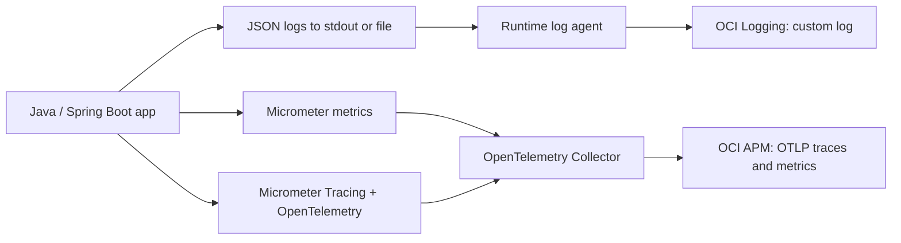

# Collecting Logs, Metrics, and Traces for Java Applications

## 1. Objectives for Observing Applications on OCI

In the **Java and Spring Boot Deployment** chapter of the **CLOUD_PROVIDERS_ORACLE** module, a successful deployment only places the application into a runtime environment. When users report slowness, errors, or missing data, operations teams need evidence to determine whether the fault lies in the JVM, connection pool, VCN networking, Oracle Database, or a downstream dependency.

This lesson implements collection for three signal types:

- **Logs:** contextual events explaining what happened.
- **Metrics:** aggregated measurements over time for trend detection and alerting.
- **Traces:** execution paths of a single request across multiple steps or services for locating latency and errors.

The practical goal is generating these signals in Spring Boot, shipping them to collection backends, and correlating timestamps, service names, environments, and trace IDs to investigate a concrete scenario.

**Example baseline:** Java 21, Spring Boot **3.5.x**, Maven, Micrometer, and OpenTelemetry with versions managed by Spring Boot's parent/BOM. This is an illustrative baseline, not a claim of the latest versions. Pin patch versions and Collector versions in your deployment project; when using Spring Boot 4 or another agent, re-verify property names and auto-configuration behavior.

All configuration files, Java code, and commands below target **your lab project**. Hostnames, OCIDs, paths, and resource names are placeholders to adjust for your real tenancy, compartment, and region.

## 2. Three Signals Answer Different Questions

| Signal | Example | Question It Fits | Limitation |
| --- | --- | --- | --- |
| Log | A failed dependency call with error code and trace ID | What context surrounded a specific failure? | Many log lines alone do not show overall system health |
| Metric | HTTP 5xx rate, requests/second, heap in use | How broad is the impact and when did it start? | Aggregates do not fully explain an individual request |
| Trace | HTTP request containing business spans and downstream spans | Which step spent the time? | Sees only instrumented steps and retained traces |

A trace consists of **spans** with start times, end times, attributes, and contextual parent-child links. Spans from the same execution share a trace ID; span IDs distinguish individual steps. This model is described in [OpenTelemetry — Traces](https://opentelemetry.io/docs/concepts/signals/traces/).

Example request taking 900 ms:

```text
HTTP POST /orders                    900 ms
├─ input validation                   10 ms
├─ call inventory-service            620 ms
└─ write Oracle Database             180 ms
```

These numbers are hypothetical to illustrate reading a trace. Child spans may execute in parallel or overlap, so never sum all span durations to derive request latency. Uninstrumented gaps do not prove zero time was spent there either.

Metrics may show latency climbing at 09:10; a trace reveals the inventory call consumed most of the time; matching logs may record retries or timeout errors. Conclusions hold only when all signals align.

## 3. Collection Architecture and OCI Service Boundaries

### 3.1. Primary Data Flows in This Lesson



The application does not need to hold an APM private data key when sending strictly to an internal Collector. The Collector receives telemetry, processes it through pipelines, and authenticates when forwarding to OCI APM.

JSON logs flow via an agent into **OCI Logging**. Configuring OTLP for traces does not automatically read stdout, create custom logs, or forward Java logs to OCI.

### 3.2. Do Not Confuse Collection Destinations

| Component | Role in Architecture | What Not to Assume |
| --- | --- | --- |
| OCI Logging | Ingests, stores, and searches logs, including custom application logs | Enabling OKE service logs automatically captures pod business logs |
| OCI Logging Analytics | Analyzes logs under its own ingestion and capability model | Sending to OCI Logging automatically copies into Logging Analytics |
| OCI APM | Application monitoring and tracing with OTLP ingestion | Every metric sent to APM appears in a Monitoring custom namespace |
| OCI Monitoring | Metric namespaces, queries, and Monitoring alarms | APM's OTLP endpoint is the `PostMetricData` endpoint |
| OCI Audit | API/resource operation events under Audit scope | Audit replaces application transaction logs |
| OpenTelemetry Collector | Receives, processes, and exports telemetry | Collector is a long-term storage and search UI |

OCI APM exposes OTLP endpoints for supported signal types; see [Configure OpenTelemetry Data Sources](https://docs.oracle.com/en-us/iaas/application-performance-monitoring/doc/configure-opentelemetry.html). This lesson targets APM for OTLP traces and metrics, while custom metrics to OCI Monitoring are covered separately later.

## 4. Standardizing Identity and Time Before Collecting

Pick a consistent identity set:

| Attribute | Example | Usage |
| --- | --- | --- |
| Service name | `orders-service` | Stable across replicas of the same service |
| Environment | `lab`, `staging`, `production` | Separates data across environments |
| Service version | `2026.11.21.1` | Correlates against deployments |
| Service instance ID | Pod UID or JVM identifier | Distinguishes concurrent processes |
| Region | Active OCI region | Scopes investigations and costs |
| Trace ID, span ID | Tracing-generated IDs | Links logs to specific executions |

Never build `service.name` by appending a pod ID to the name. Giving each replica a distinct service name fragments service maps and aggregate queries.

Use UTC or explicit timezone timestamps. Synchronize node/VM clocks and distinguish **when an event occurred** from **when the backend ingested it**. Delayed events can appear later in UIs while actually belonging to an earlier moment.

A trace ID is not an authenticated identity and must never serve as authorization evidence. IDs can originate from incoming request contexts; use them strictly to correlate observability data.

## 5. Choosing One Primary Instrumentation Mechanism

Three patterns are common:

1. **Spring Boot / Micrometer:** uses Spring observations, Micrometer Tracing, and an exporter. Fits teams controlling application code and framework configuration.
2. **OpenTelemetry Java agent:** attached at JVM startup to instrument supported libraries.
3. **OCI APM Java agent:** uses OCI APM's agent capabilities and documentation.

This lesson uses the first approach. Do not attach a Java agent on top of this same configuration assuming there will be no duplicate spans, dual SDKs, or duplicate export paths.

Automatic instrumentation has coverage boundaries under every approach. Having an HTTP server span does not guarantee spans exist for every SQL call, UCP borrow, Redis call, or business method. Add appropriate instrumentation for gaps and inspect actual traces. Spring distinguishes its integration from community agents/starters in [Spring Boot — Observability](https://docs.spring.io/spring-boot/3.5/reference/actuator/observability.html).

An unmeasured business operation can add a custom observation. Avoid adding duplicate observations with the same semantics onto controllers or repositories already instrumented so counts are not doubled.

## 6. Dependencies and Baseline Spring Boot Configuration

### 6.1. Dependencies

In a project already using the Spring Boot 3.5.x parent or BOM:

```xml
<dependencies>
    <dependency>
        <groupId>org.springframework.boot</groupId>
        <artifactId>spring-boot-starter-web</artifactId>
    </dependency>

    <dependency>
        <groupId>org.springframework.boot</groupId>
        <artifactId>spring-boot-starter-actuator</artifactId>
    </dependency>

    <dependency>
        <groupId>io.micrometer</groupId>
        <artifactId>micrometer-tracing-bridge-otel</artifactId>
    </dependency>

    <dependency>
        <groupId>io.opentelemetry</groupId>
        <artifactId>opentelemetry-exporter-otlp</artifactId>
    </dependency>

    <dependency>
        <groupId>io.micrometer</groupId>
        <artifactId>micrometer-registry-otlp</artifactId>
    </dependency>
</dependencies>
```

The last two dependencies serve two separate flows: the OpenTelemetry exporter ships spans, while the Micrometer registry ships metrics. Adding only the tracing bridge creates no metrics export pipeline.

Individual versions are omitted here because the parent/BOM manages them. Before deploying, inspect the dependency tree and avoid mixing multiple SDK versions, exporters, or Brave/OTel bridges without an explicit plan.

### 6.2. Application Configuration

Example `application.yml`:

```yaml
spring:
  application:
    name: orders-service

server:
  port: 8080

logging:
  level:
    root: INFO
    example.orders: INFO
  structured:
    format:
      console: logstash
    json:
      add:
        service_name: ${spring.application.name}
        environment: ${APP_ENV:lab}
        service_version: ${APP_VERSION:local}
        service_instance_id: ${INSTANCE_ID:local-1}

management:
  server:
    port: 8081
    address: 127.0.0.1
  endpoints:
    web:
      exposure:
        include: health,metrics
  endpoint:
    health:
      show-details: never
      probes:
        enabled: true
  tracing:
    sampling:
      probability: ${TRACE_SAMPLING_PROBABILITY:0.1}
  opentelemetry:
    resource-attributes:
      "[service.name]": ${spring.application.name}
      "[service.version]": ${APP_VERSION:local}
      "[service.instance.id]": ${INSTANCE_ID:local-1}
      "[deployment.environment.name]": ${APP_ENV:lab}
  otlp:
    tracing:
      endpoint: ${OTLP_TRACES_ENDPOINT:http://127.0.0.1:4318/v1/traces}
      timeout: 5s
    metrics:
      export:
        enabled: true
        url: ${OTLP_METRICS_ENDPOINT:http://127.0.0.1:4318/v1/metrics}
        step: 30s
        aggregation-temporality: cumulative
  metrics:
    tags:
      application: ${spring.application.name}
      environment: ${APP_ENV:lab}
    distribution:
      slo:
        http.server.requests: 100ms,300ms,1s,3s
```

Port `8080` serves application requests. Management port `8081` binds only to loopback in this lab config, so it cannot be reached from another host or pod without adjusting network design. On OKE, you may need an appropriate bind address for probes/scrapes while restricting access via Services, ingress, and NetworkPolicies per your architecture.

In Spring Boot 3.5, OTLP metrics use `management.otlp.metrics.export.url`; OTLP tracing uses `management.otlp.tracing.*`. Refer to [Spring Boot — Metrics](https://docs.spring.io/spring-boot/3.5/reference/actuator/metrics.html) and [Spring Boot — Tracing](https://docs.spring.io/spring-boot/3.5/reference/actuator/tracing.html) when changing versions.

The endpoints above are **addresses from the Java process's perspective**. `127.0.0.1` applies only when the Collector shares the host/network namespace, such as a pod sidecar. For a gateway Collector in another pod or VM, substitute a reachable internal DNS name.

Do not assume Java agent `OTEL_*` variables all apply to this Micrometer setup. Here, `OTLP_TRACES_ENDPOINT` and `OTLP_METRICS_ENDPOINT` bind explicitly to Spring properties.

## 7. Logs: Structured and Contextual JSON

### 7.1. Log Format

Spring Boot's Logstash JSON format includes MDC keys/values and SLF4J fluent logging fields in JSON. Tracing-supplied trace ID / span ID fields appear whenever a span context is active; see [Spring Boot — Structured Logging](https://docs.spring.io/spring-boot/3.5/reference/features/logging.html).

An abbreviated illustrative event:

```json
{
  "@timestamp": "2026-11-21T02:10:20.123Z",
  "level": "INFO",
  "message": "Lab operation completed",
  "service_name": "orders-service",
  "environment": "lab",
  "service_version": "local",
  "service_instance_id": "local-1",
  "event": "lab.operation.completed",
  "scenario": "slow",
  "traceId": "4bf92f3577b34da6a3ce929d0e0e4736",
  "spanId": "00f067aa0ba902b7"
}
```

The JSON is pretty-printed here for readability, but emitted logs should be **one JSON event per physical line**. Stack traces can be escaped inside a JSON field instead of turning every stack line into a standalone log event.

Never log just `"Failed"` or `"Done"`. Use a stable `event` field for querying, `scenario` or operation type for grouping, and exceptions when explaining errors.

### 7.2. Choosing Levels and Fields to Retain

| Level | Appropriate Usage |
| --- | --- |
| ERROR | Important operation failed and requires action per system policy |
| WARN | Abnormal or degraded condition detected |
| INFO | Valuable business/operational milestones emitted at bounded frequency |
| DEBUG/TRACE | Time-bounded, scope-bounded, volume-bounded diagnostics |

Never log request/response bodies by default, passwords, tokens, authorization headers, wallet contents, or JDBC URLs containing credentials. Select business fields according to access rights and retention; mask data before logging rather than expecting backend cleanup later.

Log full error details only at the boundary responsible for handling them. If every layer logs the same exception and rethrows it, one failure turns into multiple records looking like separate incidents.

Temporary log-level increases during investigations must have an expiration and rollback plan. Leaving DEBUG on application-wide for hours inflates I/O, cost, and data exposure.

## 8. Lab: Generating Logs, Metrics, and Spans for One Operation

### 8.1. Profile-Scoped Lab Endpoint

Place the following class in a Spring Boot component-scanned package. Three scenarios use fixed values to keep metric cardinality low.

```java
package example.orders;

import java.time.Duration;
import java.util.Set;

import io.micrometer.observation.Observation;
import io.micrometer.observation.ObservationRegistry;
import io.micrometer.tracing.Tracer;

import org.slf4j.Logger;
import org.slf4j.LoggerFactory;
import org.springframework.context.annotation.Profile;
import org.springframework.http.HttpStatus;
import org.springframework.web.bind.annotation.GetMapping;
import org.springframework.web.bind.annotation.PathVariable;
import org.springframework.web.bind.annotation.RestController;
import org.springframework.web.server.ResponseStatusException;

@RestController
@Profile("observability-lab")
public class ObservabilityLabController {

    private static final Logger log =
            LoggerFactory.getLogger(ObservabilityLabController.class);

    private static final Set<String> MODES =
            Set.of("ok", "slow", "fail");

    private final ObservationRegistry observations;
    private final Tracer tracer;

    public ObservabilityLabController(
            ObservationRegistry observations, Tracer tracer) {
        this.observations = observations;
        this.tracer = tracer;
    }

    @GetMapping("/lab/observe/{mode}")
    public LabResult observe(@PathVariable String mode) {
        if (!MODES.contains(mode)) {
            throw new ResponseStatusException(
                    HttpStatus.BAD_REQUEST, "Unknown lab scenario");
        }

        return Observation.createNotStarted(
                        "lab.operation", observations)
                .lowCardinalityKeyValue("scenario", mode)
                .observe(() -> executeScenario(mode));
    }

    private LabResult executeScenario(String mode) {
        log.atInfo()
                .addKeyValue("event", "lab.operation.started")
                .addKeyValue("scenario", mode)
                .log("Lab operation started");

        try {
            if ("slow".equals(mode)) {
                pause(Duration.ofMillis(250));
            }

            if ("fail".equals(mode)) {
                throw new ResponseStatusException(
                        HttpStatus.SERVICE_UNAVAILABLE,
                        "Simulated dependency failure");
            }

            var current = tracer.currentSpan();
            String traceId = current == null
                    ? "none" : current.context().traceId();

            log.atInfo()
                    .addKeyValue("event", "lab.operation.completed")
                    .addKeyValue("scenario", mode)
                    .log("Lab operation completed");

            return new LabResult(mode, traceId);

        } catch (RuntimeException ex) {
            log.atWarn()
                    .addKeyValue("event", "lab.operation.failed")
                    .addKeyValue("scenario", mode)
                    .setCause(ex)
                    .log("Lab operation failed");
            throw ex;
        }
    }

    private static void pause(Duration duration) {
        try {
            Thread.sleep(duration.toMillis());
        } catch (InterruptedException ex) {
            Thread.currentThread().interrupt();
            throw new IllegalStateException("Lab interrupted", ex);
        }
    }

    public record LabResult(String scenario, String traceId) {
    }
}
```

This endpoint simulates latency and errors without calling real databases or services. Enable the profile only in lab environments; disabling the profile removes the controller from the application.

The `lab.operation` observation adds a timer and a business span when corresponding handlers are configured. HTTP requests already have their own observation. Do not sum counts across both metrics to estimate total requests, since they describe two distinct layers.

Rethrowing exceptions out of `observe` lets the observation record the error. Catching, logging, and returning normally would cause metrics/spans to diverge from the intended business outcome.

### 8.2. Sending Requests and Inspecting Application Evidence

Example launching the built JAR in PowerShell:

```powershell
$env:APP_ENV = 'lab'
$env:APP_VERSION = 'local'
$env:INSTANCE_ID = 'lab-java-1'
$env:TRACE_SAMPLING_PROBABILITY = '1.0'
$env:OTLP_TRACES_ENDPOINT = 'http://127.0.0.1:4318/v1/traces'
$env:OTLP_METRICS_ENDPOINT = 'http://127.0.0.1:4318/v1/metrics'

java -jar .\target\orders-service.jar --spring.profiles.active=observability-lab
```

The JAR name depends on your project. The Collector must already be listening at the configured address before expecting exports to succeed.

In another terminal:

```powershell
$okResult = Invoke-RestMethod -Uri 'http://127.0.0.1:8080/lab/observe/ok'
$slowResult = Invoke-RestMethod -Uri 'http://127.0.0.1:8080/lab/observe/slow'

try {
    Invoke-RestMethod -Uri 'http://127.0.0.1:8080/lab/observe/fail'
}
catch {
    Write-Output 'The fail scenario is expected to return HTTP 503; check the actual status.'
}

$slowResult | ConvertTo-Json
Invoke-RestMethod -Uri 'http://127.0.0.1:8081/actuator/metrics/lab.operation' |
    ConvertTo-Json -Depth 10
```

The catch message alone does not prove status 503; inspect the HTTP tool's actual status/response. Three requests are not enough for statistically meaningful production histograms or error rates.

Expected evidence:

- `ok` and `slow` return responses containing a trace ID.
- Logs for each execution contain a trace ID matching the response.
- `fail` returns 503 and emits a `lab.operation.failed` event.
- The metrics endpoint exposes `lab.operation` measurements after the observation completes.
- After the export/batch interval, the backend receives the matching traces and metrics.

Seeing a metric on the metrics endpoint only proves the metric exists inside the process. It does not prove the Collector or OCI received it.

## 9. Metrics: Measuring Aggregate Behavior Without Series Explosion

### 9.1. Starting From Signal Groups That Support Decisions

| Group | Useful Measurements | Decision Supported |
| --- | --- | --- |
| HTTP | Request rate, 5xx rate, duration distribution | Whether user experience is degraded |
| JVM | Heap/non-heap, GC pauses, threads, process CPU | Whether memory pressure or JVM bottlenecks exist |
| Connection pool | Borrowed/available, wait time, borrow failures | Whether pools are exhausted or connections held too long |
| Dependencies | Duration, timeouts, retries, errors per dependency type | Whether downstream investigation is needed |
| Business | Operation success/failure counts across fixed types | Real impact on users |
| Telemetry pipeline | Queues, drops, export failures, agent backlog | Whether observability itself is losing data |

Never assume every UCP metric is automatically exposed with Actuator. Check active binders and actual metrics; if missing, register bounded meters from pool APIs with controlled names and tags.

For cumulative counters, compute rates from deltas over time and handle resets when processes restart. Never compare a monotonically growing counter directly against a threshold as if it were a per-minute error count.

`aggregation-temporality: cumulative` in the config illustrates cumulative metrics export. Delta vs. cumulative semantics differ and backends must interpret them properly; see [Micrometer OTLP](https://docs.micrometer.io/micrometer/reference/implementations/otlp.html).

### 9.2. Distinguishing Metric Tags From Diagnostic Context

Tags/dimensions should have small, bounded value sets, such as:

- `method=GET`.
- `uri=/orders/{id}`.
- `status=503`.
- `scenario=slow`.
- `environment=production`.

Never use `traceId`, `orderId`, email addresses, access tokens, raw URLs, or free-form exception messages as metric tags.

A simple estimate:

```text
Number of series combinations
≈ methods × routes × statuses × instances × other dimensions.
```

Adding 100,000 order IDs as a tag multiplies time series by that ID count. A tiny-looking metric in code can create heavy backend load and cost.

Detailed fields can appear in logs or spans when permitted and necessary. Labeling a field high-cardinality does not make it safe with respect to personal data.

### 9.3. Percentiles, Histograms, and Error Rates

Never add or average per-replica p95 values to compute a service-wide p95. Aggregating distributions requires compatible histogram buckets and proper backend queries. Micrometer explains client-side percentiles vs. histograms in [Histograms and Percentiles](https://docs.micrometer.io/micrometer/reference/concepts/histogram-quantiles.html).

The sample's SLO config defines buckets at 100 ms, 300 ms, 1 s, and 3 s for HTTP requests. Verify exporters and backends preserve the exact buckets and units before charting or computing percentages below threshold.

Conceptually, a 5xx rate over a window is:

```text
HTTP 5xx requests in window
--------------------------------
Total HTTP requests in same window
```

Numerator and denominator must share the same service, environment, window, route scope, and aggregation method. Add a minimum-traffic threshold to avoid paging on one error out of one request.

## 10. Traces: Propagating Context Across Boundaries

### 10.1. HTTP Clients Must Be Instrumented

When calling another service with `RestClient`, use the Spring Boot–provided builder:

```java
package example.orders;

import org.springframework.beans.factory.annotation.Value;
import org.springframework.context.annotation.Bean;
import org.springframework.context.annotation.Configuration;
import org.springframework.web.client.RestClient;

@Configuration(proxyBeanMethods = false)
public class DownstreamClientConfiguration {

    @Bean
    RestClient inventoryClient(
            RestClient.Builder builder,
            @Value("${INVENTORY_BASE_URL}") String baseUrl) {
        return builder.baseUrl(baseUrl).build();
    }
}
```

This class is only needed when the application actually calls a downstream service and `INVENTORY_BASE_URL` is set; it is not required to run the lab controller.

The auto-configured builder wires observation integration and trace context propagation. Creating clients from a raw standalone builder can bypass that integration. Never generate fresh trace IDs for child calls when they should belong to the same trace.

On the wire, propagation headers such as W3C `traceparent` carry context. Proxies, gateways, and receiving services must preserve/parse the chosen format. Never substitute arbitrary custom request IDs for structured trace context.

### 10.2. Executors, Async, and Messaging

Thread-bound context does not automatically follow new tasks:

- For executors, use appropriate context propagation / task decorators and restore context afterward.
- For Reactor, use reactive context propagation instead of assuming ThreadLocal always suffices.
- For messaging, producers and consumers must inject/extract context via metadata/headers.
- For scheduled jobs with no parent request, create an explicit bounded observation per execution.

Do not copy MDC alone and assume tracing propagated: MDC serves logging, whereas tracing tracks the current span and parent/child relationships. Conversely, having trace context without printing IDs in the log formatter still makes finding correlated logs hard.

In thread-pooled applications, failing to clear MDC/context properly can also leak a prior request's ID onto subsequent requests' logs.

### 10.3. Sampling and Missing Traces

In the lab, set `TRACE_SAMPLING_PROBABILITY=1.0` for easy verification. Production requires a sampling policy aligned with traffic and budget.

Head sampling decides early; tail sampling decides after collecting candidate spans. Tail sampling cannot recover spans dropped by the SDK upfront, and requires memory/wait buffers plus trace-consistent routing. See [OpenTelemetry — Sampling](https://opentelemetry.io/docs/concepts/sampling/).

A missing trace does not prove a request never happened. It may have been dropped by sampling, lost in export, unpropagated, or outside the query window.

Nor does lowering trace sampling reduce log lines or metrics. Each of the three signals has its own volume controls.

## 11. Collector Receiving OTLP and Exporting to OCI APM

### 11.1. Preparing OCI Resources

In the lab environment:

1. Select a compartment and region for observability resources.
2. Create or use an authorized APM domain.
3. Retrieve the domain's Data Upload Endpoint and private data key.
4. Supply those values to the Collector via your environment's secret mechanism.
5. Verify the Collector has egress, DNS, and TLS trust to the target endpoint.

Keep the private data key in the Collector or a secret store by design. Never expose the key in responses, shared images, or Git. IAM permissions to manage domains/view data and the upload data key are two distinct mechanisms.

OTLP endpoints in this example take the form:

```text
OCI_APM_TRACES_ENDPOINT=
https://<apm-upload-host>/20200101/opentelemetry/private/v1/traces

OCI_APM_METRICS_ENDPOINT=
https://<apm-upload-host>/20200101/opentelemetry/v1/metrics
```

Each actual value is **one complete single-line URL**. Never append `/v1/metrics` onto the traces URL.

`/private/` in the traces path refers to the ingestion API's data-key type; that string alone does not prove the Collector traverses a private VCN endpoint. Verify network paths independently.

### 11.2. Collector Configuration

Example for a Collector on the same host or network namespace as Java:

```yaml
receivers:
  otlp:
    protocols:
      http:
        endpoint: 127.0.0.1:4318

processors:
  memory_limiter:
    check_interval: 1s
    limit_mib: 256
    spike_limit_mib: 64
  batch:
    timeout: 5s
    send_batch_size: 512

exporters:
  otlphttp/oci_apm:
    traces_endpoint: ${env:OCI_APM_TRACES_ENDPOINT}
    metrics_endpoint: ${env:OCI_APM_METRICS_ENDPOINT}
    headers:
      Authorization: "dataKey ${env:OCI_APM_PRIVATE_DATA_KEY}"
    timeout: 10s
    retry_on_failure:
      enabled: true
      initial_interval: 1s
      max_interval: 10s
      max_elapsed_time: 60s
    sending_queue:
      enabled: true
      queue_size: 1000

service:
  pipelines:
    traces:
      receivers: [otlp]
      processors: [memory_limiter, batch]
      exporters: [otlphttp/oci_apm]
    metrics:
      receivers: [otlp]
      processors: [memory_limiter, batch]
      exporters: [otlphttp/oci_apm]
```

Use a Collector distribution/version supporting these components and configuration fields. Declaring a component is not enough: it must be wired into an active pipeline to process data. Structure is covered in [OpenTelemetry Collector — Configuration](https://opentelemetry.io/docs/collector/configuration/).

Here, `traces_endpoint` and `metrics_endpoint` are full URLs to avoid suffix-appending surprises from `endpoint`. The `Authorization` header belongs to the APM upload flow, not an OCI API signing key.

The 256 MiB limit illustrates the processor setting, not the process's entire resource demand. Size the container/JVM memory limits alongside it with headroom for overhead. Never use this small figure blindly as a default across all loads.

If running a gateway Collector, bind an appropriate interface and point apps at the gateway DNS name. Open the receiver only to authorized sources; across trust or network boundaries, add TLS and authentication. Never expose OTLP ports directly through a public ingress just for convenience.

Port `4318` typically serves OTLP/HTTP, while `4317` serves OTLP/gRPC. The two protocols are not interchangeable simply by swapping port numbers.

### 11.3. In Transit Does Not Mean Durably Stored

A Collector accepting an OTLP request does not mean data has landed in APM. It may still sit inside a batch or sending queue.

In-memory queues lose data on Collector restarts; full queues or exhausted retries can also drop data. When higher durability is required, evaluate persistent queues/storage and disk budgets for your environment. These failure modes are covered in [OpenTelemetry Collector — Resiliency](https://opentelemetry.io/docs/collector/resiliency/).

Monitor accepted, refused, exported, failed/dropped counts, and queue occupancy using your Collector version's real metrics. A healthy Collector endpoint returning OK does not prove telemetry is still reaching the backend.

## 12. Sending Application Logs to OCI Logging

### 12.1. Compute: JSON Files and Unified Monitoring Agent

One pattern on Compute Linux is having the app write a JSON file and configuring Unified Monitoring Agent to ship it into a custom log.

Additional configuration for the Compute profile:

```yaml
logging:
  file:
    name: /var/log/orders-service/application.json
  structured:
    format:
      file: logstash
  logback:
    rollingpolicy:
      file-name-pattern: /var/log/orders-service/application.%d{yyyy-MM-dd}.%i.json.gz
      max-file-size: 10MB
      max-history: 7
      total-size-cap: 100MB
```

Merge this into the existing YAML tree without creating two sibling `logging:` keys in the same document. The Java account needs write access to the directory; the agent needs read access.

OCI setup steps:

1. Create a log group and custom log in the selected compartment.
2. Ensure the Custom Logs Monitoring agent/plugin is installed and active on a supported image/OS.
3. Create a dynamic group selecting the target Compute instances.
4. Grant required policies to the dynamic group within the compartment.
5. Create an Agent Configuration selecting host group, input path, parser, and log destination.
6. Verify the agent receives config, reads new files, and new events appear in the backend.

Oracle documents this management model in [Agent Management Overview](https://docs.oracle.com/en-us/iaas/Content/Logging/Concepts/agent_management.htm) and [Creating an Agent Configuration](https://docs.oracle.com/en-us/iaas/Content/Logging/Task/create-logging-agent-configuration.htm).

Example scoped policy—replace names and verify exact permissions:

```text
Allow dynamic-group java-app-hosts to use log-content in compartment app-observability
```

This is not a complete policy for creating resources, managing Agent Configurations, or granting reader permissions. `use log-content` may be broader than write-only; review [Details for Logging](https://docs.oracle.com/en-us/iaas/Content/Identity/policyreference/loggingpolicyreference.htm) and apply suitable conditions before adopting.

Collect only the intentionally chosen path. Collecting both redirected console output and Logback's file can create duplicate copies of every event. Re-reading old rotated files from byte zero after restarts can also duplicate data.

Watch checkpoint/tail positions, read permissions, rotation handling, and buffer space. An agent lacking file permissions or falling behind can lose logs before they reach OCI.

### 12.2. OKE: stdout and Container Runtime Logs

For application pods, JSON on stdout/stderr is typically preferred. The container runtime writes logs on the node; the collection layer must unwrap the runtime's log envelope before parsing inner JSON.

For managed nodes and self-managed nodes, OCI provides guidance on collecting application logs via node-level agent configs; see [Viewing Application Logs on Managed Nodes and Self-Managed Nodes](https://docs.oracle.com/en-us/iaas/Content/ContEng/Tasks/contengviewingworkernodelogs.htm). Do not apply node-agent assumptions blindly across every node type, especially virtual nodes.

Items to verify:

- Actual log paths, mounts, and runtime symlinks on the node.
- Whether the agent has read rights and discovers new pods/containers.
- Whether namespace, pod, container, and node metadata attach accurately.
- Whether JSON strings stay unparsed inside one text field instead of extracting structured fields.
- Whether rotation, size caps, and buffers survive backend interruptions.

Enabling OKE control-plane service logs does not automatically collect application stdout. Those two streams cover different layers of the cluster.

`kubectl logs` is handy for immediate inspection, but does not replace a centralized log store with retention and search. Collect one authoritative stream per application pipeline unless deliberate fan-out/backup is intended.

## 13. When Custom Metrics Are Needed in OCI Monitoring

The OTLP pipeline to APM above does not configure a `PostMetricData` exporter to Monitoring. To trigger alarms on a Monitoring custom namespace, ensure metrics are actually published into that service.

Options include supported agent metric-scraping integrations or a component publishing custom metrics via API/SDK. Oracle documents ingestion endpoints, IAM, and limits in [Publishing Custom Metrics Using the API](https://docs.oracle.com/en-us/iaas/Content/Monitoring/Tasks/publishingcustommetrics.htm).

An illustrative metric contract:

```text
namespace: java_app_observability
name: LabOperationCount
dimensions:
  service: orders-service
  environment: lab
  outcome: success
unit: count
value: operations completed within a defined window
timestamp: end of window
```

Never use reserved `oci_` or `oracle_` prefixes for custom namespaces.

When converting cumulative counters into per-window counts, the converter must handle resets, retries, duplicates, and multiple replicas. Never emit the growing cumulative total every minute and then call `.sum()` as if each datapoint were independent per-minute events.

For IAM, the publisher needs appropriate metric-write rights; dashboard readers and alarm managers need separate permissions. Use supported instance/workload identities at runtime instead of embedding personal API keys.

Before creating alarms, verify in Metrics Explorer:

1. Correct region and compartment.
2. Correct namespace, name, and dimensions.
3. Accurate timestamps and units.
4. Aggregation/interval matching data semantics.
5. Fresh datapoints arriving across multiple intervals.

Never assume seeing Compute CPU in Monitoring means Spring Boot business metrics are already present.

## 14. Impact-Oriented Dashboards and Alerts

### 14.1. A Sufficient Starter Dashboard

Organize by investigation question:

1. **How are users affected:** throughput, error rate, latency by route.
2. **Which resources are saturated:** CPU, heap/GC, threads, and connection pools.
3. **Which dependencies are slow:** databases, downstream HTTP, queues.
4. **What changed recently:** versions, replica counts, rollout timestamps.
5. **Is telemetry still trustworthy:** agent backlog, Collector queues, and export failures.

Do not mix metrics across regions or environments unless clearly separable. Keep identical time ranges and identity filters when pivoting across metrics, traces, and logs.

Some panels require dedicated dashboards per APM or Monitoring; storage locations, metric names, and queries must match actual pipelines.

### 14.2. Illustrative Alert Conditions

| Conceptual Condition | How to Avoid Noisy Alerts |
| --- | --- |
| HTTP 5xx rate exceeds threshold for several minutes | Pair with minimum request volume and clear evaluation window |
| Share of requests breaching latency threshold rises | Use proper histograms; never sum per-replica p95s |
| Pool stays near ceiling while wait times climb | Combine both symptoms rather than alerting on open connections alone |
| Sustained heap/GC degradation | Watch trends and post-GC live set instead of every heap spike |
| Fresh telemetry stops arriving | Distinguish idle apps with zero traffic from broken pipelines |

Tune thresholds from application SLOs and baseline load. Lab numbers are not production thresholds.

For OCI Monitoring alarms, configure pending duration, missing-data handling, and notification targets, then test end-to-end in an authorized environment. A query returning results does not prove notifications reached on-call responders.

Attach runbooks listing service, environment, dashboard, trace/log filter recipes, and first mitigation steps. Never put credentials or sensitive payloads inside notification bodies.

## 15. Investigating a Slow Request Using All Three Signals

Hypothetical scenario: after a rollout, users report the ordering API is slow.

1. **Bracket the metric window:** identify when latency started rising and which route and environment are affected.
2. **Compare errors and throughput:** distinguish traffic surges from identical traffic slowing down.
3. **Select representative traces:** locate slow traces for the exact service/version in that window.
4. **Read the execution path:** identify which downstream/database span holds the time, watching parallel steps and uninstrumented gaps.
5. **Query logs by trace ID:** check for retries, timeouts, error codes, or state transitions.
6. **Correlate resources:** check pools, GC, CPU, locks/queries, and dependency status at the same timestamp.
7. **Conclude from evidence:** apply a verifiable change and observe post-change telemetry.

For instance, rising HTTP latency paired with borrowed connections near max while the DB execution span is short suggests connection-pool wait time. If borrow itself is uninstrumented, the trace alone does not prove it yet; corroborate with pool metrics or an added observation.

If traces show long downstream waits and logs show repeated retries, scaling up caller replicas can overload the downstream further. Telemetry guides the right fix instead of blindly adding compute.

When searching logs in OCI, open one event to inspect the parsed field structure. `traceId` may sit nested inside a JSON payload field. Query the actual observed field path rather than copying field names solely from an app formatter example.

## 16. Pipeline Cost, Volume, and Reliability

### 16.1. Estimating Before Increasing Collection Volume

Hypothetical estimate:

```text
Raw log volume/day
≈ events/second × average size × 86,400

Spans/day
≈ requests/second × spans/request × trace retention rate × 86,400
```

At 100 events/second averaging 1 KB each, raw logs reach roughly 8.64 GB/day (decimal), before metadata, compression, and service billing rules. This is an engineering estimate, not an OCI price sheet.

Trim volume by logging valuable events, setting retention per need, bounding DEBUG usage, capping tag cardinality, and sampling appropriately. Lab verbosity is rarely needed in production.

Measure instrumentation and Collector CPU/memory too. Over-collecting can slow the application and create self-inflicted incidents.

### 16.2. Disruptions and Resilience

Failure modes to design for:

- Backend returns errors or rate limits: apply retries/backoff and bounded queues.
- Collector restarts: understand which unpersisted buffered data can be lost.
- Agent backlog: calculate how long disk caps and rotation preserve logs.
- Pod terminates: allow graceful shutdown time for SDKs/agents to flush.
- Region/backend unreachable: maintain independent pipeline-degradation indicators.

Never make synchronous business requests call remote log/metric APIs per event. Batching and asynchronous export keep telemetry from inflating business latency.

Diagnostic telemetry does not automatically become a financial ledger or immutable audit log. Business audit trails carry separate durability, completeness, and access requirements.

### 16.3. Separating Read and Write Permissions

Separate permissions across:

- Applications emitting telemetry.
- Agents/Collectors shipping data.
- Readers querying logs, traces, and dashboards.
- Administrators managing retention, domains, keys, and alarms.

Logs and traces can contain sensitive operational details even without passwords. Use compartments, policies, and proper authorization workflows; rotate upload keys and test pipelines after rotation.

## 17. Isolating Collection Pipeline Failures

| Symptom | Check First | Resolution Direction |
| --- | --- | --- |
| Logs remain plain text | Active profile, formatter, custom Logback config | Verify structured logging config actually loads |
| Logs lack trace IDs | Active span context, bridge/propagation | Hit an instrumented request and compare with startup logs |
| JSON sits unparsed inside message | Agent parser / runtime envelope | Parse outer runtime wrapper and inner JSON properly |
| OCI Logging shows no new events | Agent, file permissions, host group, IAM, destination | Trace each hop from file/stdout to destination log |
| Only OKE control-plane logs appear | Wrong log source type selected | Configure application logs for the matching runtime |
| Metrics endpoint has data yet APM does not | Registry/export URL, Collector metrics pipeline | Check periodic export, errors, and metrics endpoint |
| OTLP returns 404 | Wrong path/suffix or destination | Distinguish full traces and metrics URLs |
| OTLP returns 401/403 | Data key/header, domain, mechanism permissions | Verify active secret without logging the key |
| Connection refused | Collector not listening on address seen by Java | Check bind address, DNS, Service, and port |
| gRPC/HTTP protocol mismatch | Sending HTTP to gRPC receiver or vice versa | Match exporter and receiver protocols |
| Trace shows only one service | Missing propagation or downstream instrumentation | Check builder/headers and downstream service config |
| Traces appear twice | Duplicate instrumentation or export | Check agents, bridges, SDKs, and fan-out |
| Partial traces missing | Sampling, queue drops, lost async context | Pinpoint cause using pipeline metrics |
| Metrics explode into many series | Raw paths/IDs in tags, per-pod service names | Normalize routes, tags, and resource attributes |
| Collector healthy yet no data arrives | Health check does not reflect export | Inspect pipeline counters, queues, and backend errors |

Never fix TLS errors by disabling certificate verification or exposing receivers publicly to bypass network errors. Fix DNS, truststores, and actual routes while keeping access scopes tight.

## 18. Practice Workflow and Completion Criteria

Run in an authorized lab environment:

1. Provision log/APM resources and configure compartment-scoped permissions.
2. Start the Collector with endpoints and data keys injected via secrets.
3. Start the application with the `observability-lab` profile and 100% sampling.
4. Send `ok`, `slow`, and `fail` requests sequentially, recording trace IDs and timestamps.
5. Read raw JSON logs at the source, then verify matching events reach OCI Logging via the agent.
6. Check `lab.operation` metrics in the JVM and verify metrics arrive at the backend after export.
7. Locate traces containing both HTTP spans and business observations; correlate logs by trace ID.
8. In the lab, briefly stop the Collector to observe export/queue errors and recovery; note potential data loss.
9. If Monitoring alarms are needed, publish a metric via the Monitoring pipeline and test notifications.
10. Disable the lab profile, restore sampling/log levels, and clean up temporary resources per plan.

Completion is not merely seeing data on three screens. Demonstrate one concrete execution with correlated logs and traces, metrics accurately reflecting aggregate operations, pipeline alerts when disrupted, and collection costs staying within budget.

An effective observability system explains how the Java application behaves on OCI, why users are impacted, and what missing data is still needed to prove root cause.
