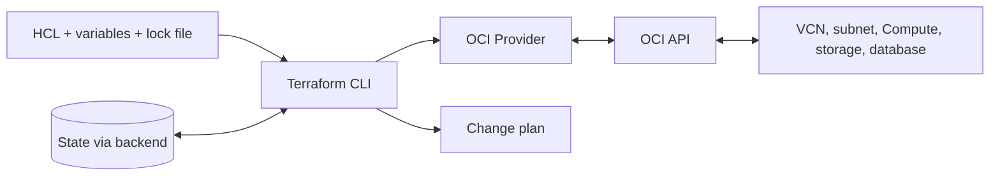

# Terraform OCI Provider and Infrastructure Project Organization

## 1. Objectives and Scope

In the **Infrastructure as Code** chapter of the **CLOUD_PROVIDERS_ORACLE** module, Terraform is used to describe, preview, and deploy Oracle Cloud Infrastructure (OCI) resources according to a version-controlled configuration. Project organization determines not only where HCL files are placed, but also who is permitted to modify infrastructure, which state is affected, and how far a deployment error can spread.

This lesson builds the foundation for OCI infrastructure components such as VCN, Compute, storage, and Oracle databases. The example focuses on one VCN and two private subnets to clarify the provider, module, inputs, outputs, and state. When adding Compute, databases, monitoring, or automation, learners continue applying the same boundaries for permissions, environments, cost, and availability.

After this lesson, learners can:

- Distinguish Terraform CLI, OCI Provider, module, backend, and state.
- Configure the provider with the appropriate identity and region.
- Separate environment-specific deployments from reusable modules.
- Manage provider versions and the dependency lock file.
- Execute the init, validate, plan, review, and apply workflow.
- Explain why splitting files, splitting modules, and splitting state are three distinct decisions.

The code snippets and commands in this lesson are intended for hands-on practice. The article has not executed Terraform, has not created resources in a tenancy, and does not claim that deployment results have been verified.

## 2. What Does Terraform Do When Managing OCI?

### 2.1. Describing the Desired State

Terraform uses declarative configuration. Instead of listing API call steps to create a VCN and then create subnets, the configuration describes the resources and the relationships between them:

```hcl
resource "oci_core_vcn" "learning" {
  compartment_id = var.compartment_ocid
  cidr_blocks    = ["10.30.0.0/16"]
  display_name   = "java-learning-dev"
}
```

The snippet above illustrates only a single resource, not a complete project. `oci_core_vcn` is the resource type provided by the provider; `learning` is the logical name in the configuration. `display_name` is an attribute of the resource on OCI, not Terraform's management address.

A resource can have an address such as `oci_core_vcn.learning`. When placed inside a module, the address can become `module.network.oci_core_vcn.this`. State uses these addresses to link the configuration to real OCI objects.

### 2.2. Components That Cannot Be Used Interchangeably

| Component | Responsibility | Example in This Lesson |
| --- | --- | --- |
| Terraform CLI/Core | Reads HCL, builds the dependency graph, plans, and orchestrates | `terraform plan` command |
| OCI Provider | Provides resource/data source schemas and calls OCI APIs | Provider source `oracle/oci` |
| Root module | Terraform execution entry point combining providers, modules, and environment variables | `environments/dev` |
| Child module | Encapsulates a group of resources with an input/output contract | `modules/network` |
| State | Maps Terraform addresses to managed resources | OCID of the created VCN |
| Backend | Determines where state is stored and related coordination capabilities | Local or OCI Object Storage |
| Lock file | Records selected provider versions and checksums | `.terraform.lock.hcl` |

Both the provider and backend can be named `oci`, but they belong to two different layers. Upgrading the OCI Provider does not automatically upgrade the capabilities of the built-in backend in Terraform CLI.

### 2.3. Relationship Between Configuration, State, and Real Resources



Terraform needs state to know which resources are under the management of the current configuration. Having the same display name is not enough to recognize a VCN that was created manually. Conversely, a VCN can have its display name changed while keeping the same OCID and relationship in state.

A reference such as `vcn_id = oci_core_vcn.this.id` creates a dependency between the subnet and the VCN. Do not add `depends_on` merely to mimic file writing order; use explicit dependencies only when a required relationship cannot be expressed through a value reference.

## 3. Declaring and Authenticating the OCI Provider

### 3.1. Source, Version, and Configuration Are Separate Concepts

In the root module:

```hcl
terraform {
  required_version = ">= 1.12.0, < 2.0.0"

  required_providers {
    oci = {
      source  = "oracle/oci"
      version = "~> 7.22.0"
    }
  }
}
```

This lesson uses the `7.22.x` provider line as a clearly bounded illustrative baseline, not as the latest version or a mandatory choice for new projects. Version `7.22.0` is available in the [provider release repository](https://releases.hashicorp.com/terraform-provider-oci/7.22.0/). When choosing another version, read the documentation for that exact version and review the change plan.

Meaning of each field:

- `required_version` constrains the Terraform CLI version.
- `source` identifies which provider will be downloaded.
- `version` inside `required_providers` constrains the provider version.
- `provider "oci"` provides the region and authentication method for a provider configuration.

`~> 7.22.0` allows patch releases from 7.22.0 up to before 7.23.0. It differs from `~> 7.22`, which allows versions from 7.22 up to before 8.0. Do not let a single-character change in a constraint become an accidental upgrade decision.

The source used in the example is `oracle/oci`. For legacy projects using `hashicorp/oci`, an appropriate state migration workflow is required; do not simply rename the source and ignore managed resources. See [migrating legacy provider sources](https://docs.oracle.com/en-us/iaas/Content/dev/terraform/migrating-legacy.htm).

### 3.2. Running Locally with an OCI Profile

The API key configuration can be placed in the shared OCI SDK/CLI configuration file, typically `~/.oci/config`. On Windows, this path resides under the home directory of the account running Terraform.

The root module only references the profile:

```hcl
provider "oci" {
  region              = var.region
  config_file_profile = var.oci_profile
}
```

The profile requires valid credentials and a reference to a private key outside the repository. Do not put key contents into `providers.tf`, `terraform.tfvars`, outputs, or log screenshots. A user-bound API key remains subject to that user's IAM policies.

The OCI Provider supports reading profiles and other authentication configuration forms; see [configuring the OCI Provider](https://docs.oracle.com/en-us/iaas/Content/dev/terraform/configuring.htm). If the environment already has OCI configuration variables set, verify whether they alter the intended identity or profile.

### 3.3. Running on Compute with Instance Principal

When the Terraform runner is on an OCI Compute instance placed in an appropriate dynamic group, replace the local provider block with:

```hcl
provider "oci" {
  auth   = "InstancePrincipal"
  region = var.region
}
```

This is a replacement for the default provider, not a second default block placed alongside the local block. The dynamic group and policy determine which resources the instance may manage. Instance principal does not grant Terraform tenancy-wide administrator permissions.

For Functions, Resource Manager, or workloads on OKE, choose the identity mechanism supported by the execution environment. Do not assume an arbitrary container can use `InstancePrincipal`, and do not silently fall back to a personal API key when the primary method fails.

### 3.4. Permissions for the Project and Permissions for the Backend

For the network lab, a compartment-scoped policy might look like:

```text
Allow group TerraformNetworkOperators to manage virtual-network-family in compartment LearningDev
```

Substitute the group and compartment according to the actual environment. This is a network management permission for the lab, not a minimal policy for every organization. IAM, Compute, Object Storage, and database resources require separate permissions when added to the project. See [common OCI policy patterns](https://docs.oracle.com/en-us/iaas/Content/Identity/Concepts/commonpolicies.htm).

A runner that reads/writes remote state also needs permissions for the backend bucket/object. Having permission to create a VCN does not mean having permission to write state; having permission to read state also does not mean being allowed to modify every resource described by that state.

## 4. Organizing the Project by Environment and Reusability

### 4.1. Recommended Structure for Practice

```text
oci-infra/
├── .gitignore
├── modules/
│   └── network/
│       ├── versions.tf
│       ├── variables.tf
│       ├── main.tf
│       └── outputs.tf
└── environments/
    ├── dev/
    │   ├── versions.tf
    │   ├── providers.tf
    │   ├── variables.tf
    │   ├── main.tf
    │   ├── outputs.tf
    │   ├── terraform.tfvars.example
    │   └── .terraform.lock.hcl
    └── prod/
        └── ... independent root module when deploying production
```

These HCL filenames are conventions to make reading easier for humans. Terraform reads `.tf` files in the same directory as a single module; it does not execute `01-vcn.tf` before `02-subnet.tf` by numerical prefix. Subdirectories are not automatically imported into the root module. See [Terraform file structure](https://developer.hashicorp.com/terraform/language/files).

The `prod` directory only illustrates how the structure expands; the complete hands-on content below is for `dev`. Do not create a production environment simply by changing a name suffix and re-running commands in the same working directory.

### 4.2. Responsibilities of Each File Group

| Location | Appropriate Content |
| --- | --- |
| `versions.tf` | Terraform and provider requirements |
| `providers.tf` at root | Region, auth, and provider aliases |
| `variables.tf` | Data types, descriptions, validations, and intentional defaults |
| `main.tf` | Resources or module calls |
| `outputs.tf` | Values exposed to operators or calling modules |
| `terraform.tfvars.example` | Sample values and placeholders, containing no secrets |
| `backend.tf` if used | Backend type and backend configuration permitted in code |
| `.terraform.lock.hcl` at root | Selected provider versions and checksums |

The `network` module receives compartment, CIDR, and name; it does not know about personal profiles, credentials, or the environment's state bucket.

### 4.3. Splitting Modules Does Not Automatically Split State

A root module calling multiple child modules still manages them within the same state. Two files `network.tf` and `database.tf` in the same directory also still share the same state.

If a shared network changes slowly while an application deploys daily, you may consider separate roots/states based on ownership scope and lifecycle. However, each new state adds coordination work for outputs, permissions, and deployment ordering.

Boundaries to consider include:

- Environment: dev, staging, prod.
- Owner: network platform team, application team, database team.
- Change frequency and acceptable blast radius.
- Sensitivity level of data stored in state.
- Recovery and change approval workflows.

You do not need one state per resource. Nor should you use a single state for the entire tenancy just because all resources belong to the same provider.

## 5. Building a Network Module with a Clear Contract

The example creates one VCN, one security list with no traffic-allowing rules, and two regional private subnets. It does not create Compute, gateways, or databases. This network is designed for learning Terraform structure; running an application requires designing appropriate routes and traffic rules.

### 5.1. Provider Requirements of the Child Module

Illustrative file `modules/network/versions.tf`:

```hcl
terraform {
  required_version = ">= 1.5.0"

  required_providers {
    oci = {
      source  = "oracle/oci"
      version = ">= 7.22.0"
    }
  }
}
```

A child module declares the providers it needs, but does not contain `provider "oci"` with its own profile/region. The root module selects the specific version constraint for the project and passes the provider configuration down.

Provider requirements are not automatically inherited just because provider configurations are inherited. Declaring `source` in a child module is especially important for providers outside the default HashiCorp namespace. See [providers within modules](https://developer.hashicorp.com/terraform/language/modules/develop/providers).

### 5.2. Module Inputs

Illustrative file `modules/network/variables.tf`:

```hcl
variable "compartment_ocid" {
  description = "Existing compartment that will contain the network resources."
  type        = string

  validation {
    condition     = startswith(var.compartment_ocid, "ocid1.compartment.")
    error_message = "compartment_ocid must have a compartment OCID format."
  }
}

variable "name" {
  description = "Display name prefix for resources."
  type        = string
}

variable "dns_label" {
  description = "VCN DNS label, maximum 15 characters per module convention."
  type        = string

  validation {
    condition     = can(regex("^[a-z][a-z0-9]{0,14}$", var.dns_label))
    error_message = "dns_label must start with a lowercase letter and contain only letters/digits."
  }
}

variable "vcn_cidr" {
  description = "IPv4 CIDR of the VCN."
  type        = string

  validation {
    condition     = can(cidrnetmask(var.vcn_cidr))
    error_message = "vcn_cidr must be a valid IPv4 CIDR."
  }
}

variable "subnets" {
  description = "Subnets keyed by stable logical key, such as app and data."
  type = map(object({
    cidr_block = string
    dns_label  = string
  }))

  validation {
    condition = length(var.subnets) > 0 && alltrue([
      for subnet in values(var.subnets) :
      can(cidrnetmask(subnet.cidr_block)) &&
      can(regex("^[a-z][a-z0-9]{0,14}$", subnet.dns_label))
    ])
    error_message = "At least one subnet with a valid IPv4 CIDR and DNS label is required."
  }
}

variable "tags" {
  description = "Shared free-form tags."
  type        = map(string)
  default     = {}
}
```

Early validation helps catch type mistakes or malformed strings. It does not verify that the OCID exists, that the runner has permissions, that subnet CIDRs fall within the VCN, or that subnets do not overlap. Those conditions must be verified in network design, the plan, and API responses.

Do not turn every OCI attribute into an input variable from the start. This module intentionally creates only private subnets; if public subnets are needed, extend the contract explicitly and review the security impact.

### 5.3. Module Resources

Illustrative file `modules/network/main.tf`:

```hcl
resource "oci_core_vcn" "this" {
  compartment_id = var.compartment_ocid
  cidr_blocks    = [var.vcn_cidr]
  display_name   = "${var.name}-vcn"
  dns_label      = var.dns_label
  freeform_tags  = var.tags
}

resource "oci_core_security_list" "isolated" {
  compartment_id = var.compartment_ocid
  vcn_id         = oci_core_vcn.this.id
  display_name   = "${var.name}-isolated-sl"
  freeform_tags  = var.tags

  ingress_security_rules = []
  egress_security_rules  = []
}

resource "oci_core_subnet" "this" {
  for_each = var.subnets

  compartment_id             = var.compartment_ocid
  vcn_id                     = oci_core_vcn.this.id
  cidr_block                 = each.value.cidr_block
  display_name               = "${var.name}-${each.key}"
  dns_label                  = each.value.dns_label
  prohibit_public_ip_on_vnic  = true
  route_table_id             = oci_core_vcn.this.default_route_table_id
  security_list_ids          = [oci_core_security_list.isolated.id]
  freeform_tags              = var.tags
}
```

Notable design decisions:

- Do not set `availability_domain` so the subnet is regional.
- `prohibit_public_ip_on_vnic = true` prevents assigning public IPs to VNICs in the subnet.
- Explicitly attach a custom security list to avoid accidentally using the default security list.
- Reference OCIDs via resources rather than re-entering them as strings.
- Use `for_each` with logical keys rather than relying on element positions in a list.

Subnet fields are documented in the [OCI subnet resource documentation](https://registry.terraform.io/providers/oracle/oci/latest/docs/resources/core_subnet). A security list is a separate resource with ingress/egress rules; see the [security list schema at the illustrative version](https://github.com/oracle/terraform-provider-oci/blob/v7.22.0/website/docs/r/core_security_list.html.markdown).

The empty security list in the lab allows no traffic through its own rules. It is not a ready-made configuration for application connectivity, SSH, or JDBC. If NSGs or other security lists are added later, evaluate the entire effective rule set.

A VCN is created with a default route table, default security list, and DHCP options. The example references the default route table but does not yet manage its rule contents with a separate Terraform resource. Therefore, the module's state is not a mechanism for detecting all manual edits to default objects. See the [VCN resource](https://github.com/oracle/terraform-provider-oci/blob/v7.22.0/website/docs/r/core_vcn.html.markdown).

In real projects, clearly decide who manages default resources or use dedicated route/security resources. Do not let one team assume rules belong to another team's state when no configuration actually owns them.

### 5.4. Outputs Are the Module's Contract

Illustrative file `modules/network/outputs.tf`:

```hcl
output "vcn_id" {
  description = "OCID of the VCN."
  value       = oci_core_vcn.this.id
}

output "subnet_ids" {
  description = "Map of subnet OCIDs by logical key."
  value = {
    for name, subnet in oci_core_subnet.this :
    name => subnet.id
  }
}
```

An application module can use `module.network.subnet_ids["app"]`. It does not need to know internal resource names or how the module arranges its files. Renaming outputs can break consumers even when the OCI resources themselves remain unchanged.

## 6. Root Module for the Dev Environment

### 6.1. Declaring Version and Provider

The file `environments/dev/versions.tf` uses the block in section 3.1. The file `environments/dev/providers.tf` uses the profile block in section 3.2 when running locally.

The Terraform constraint from 1.12 in the root is intended to support the OCI backend in a later section. A lower minimum in the child module does not mean the entire root can run with Terraform 1.5.

### 6.2. Environment Variables

Illustrative file `environments/dev/variables.tf`:

```hcl
variable "region" {
  description = "Target OCI region."
  type        = string
}

variable "oci_profile" {
  description = "Profile used for local authentication."
  type        = string
  default     = "DEFAULT"
}

variable "compartment_ocid" {
  description = "Dedicated compartment for the environment."
  type        = string
}

variable "environment" {
  description = "Environment name."
  type        = string

  validation {
    condition     = contains(["dev", "staging", "prod"], var.environment)
    error_message = "environment must be dev, staging, or prod."
  }
}

variable "owner" {
  description = "Team responsible for operations."
  type        = string
}

variable "vcn_dns_label" {
  description = "Dedicated DNS label for the environment's VCN."
  type        = string
}

variable "vcn_cidr" {
  description = "Planned VCN CIDR."
  type        = string
}

variable "subnet_cidrs" {
  description = "Map of IPv4 CIDRs for each subnet."
  type        = map(string)

  validation {
    condition = length(var.subnet_cidrs) > 0 && alltrue([
      for name, cidr in var.subnet_cidrs :
      can(regex("^[a-z][a-z0-9]{0,14}$", name)) &&
      can(cidrnetmask(cidr))
    ])
    error_message = "Subnet keys must be valid DNS labels and values must be IPv4 CIDRs."
  }
}
```

File `environments/dev/main.tf`:

```hcl
locals {
  name = "java-learning-${var.environment}"

  common_tags = {
    Project     = "java-learning"
    Environment = var.environment
    Owner       = var.owner
    ManagedBy   = "Terraform"
  }
}

module "network" {
  source = "../../modules/network"

  providers = {
    oci = oci
  }

  compartment_ocid = var.compartment_ocid
  name             = local.name
  dns_label        = var.vcn_dns_label
  vcn_cidr         = var.vcn_cidr
  tags             = local.common_tags

  subnets = {
    for name, cidr in var.subnet_cidrs :
    name => {
      cidr_block = cidr
      dns_label  = name
    }
  }
}
```

`source` is a relative path from the directory containing the module call. For local modules, do not add `version` as when using registry modules; a local module's version is tied to the repository commit.

File `environments/dev/outputs.tf`:

```hcl
output "vcn_id" {
  description = "VCN of the environment."
  value       = module.network.vcn_id
}

output "subnet_ids" {
  description = "Subnets by application role."
  value       = module.network.subnet_ids
}
```

Child outputs do not automatically appear as root outputs; required values must be exposed through the root when operators or other configurations need to read them.

### 6.3. Sample Values File

Illustrative file `environments/dev/terraform.tfvars.example`:

```hcl
region           = "ap-singapore-1"
oci_profile      = "DEFAULT"
compartment_ocid = "<DEV_COMPARTMENT_OCID>"
environment      = "dev"
owner            = "platform-team"
vcn_dns_label    = "javalabdev"
vcn_cidr         = "10.30.0.0/16"

subnet_cidrs = {
  app  = "10.30.10.0/24"
  data = "10.30.20.0/24"
}
```

Learners copy this to `terraform.tfvars` and replace placeholders before running. The `.example` suffix is not auto-loaded by Terraform like `terraform.tfvars`; this is intentional to prevent accidentally using sample values.

`*.auto.tfvars` files in the root are loaded automatically. A leftover test file can alter inputs; do not leave multiple auto-loaded files competing over the same variable. See [input variables mechanism](https://developer.hashicorp.com/terraform/language/values/variables).

`region`, compartment, and environment name must align according to deployment conventions. An `environment = "dev"` variable does not stop a provider authenticated into a production tenancy; IAM and the backend remain boundaries that must be controlled separately.

## 7. Managing Providers and Modules as the Project Grows

### 7.1. Aliases for Multiple Regions

When a single root needs two regions, declare two provider configurations with clear identities:

```hcl
provider "oci" {
  region              = var.region
  config_file_profile = var.oci_profile
}

provider "oci" {
  alias               = "secondary"
  region              = var.secondary_region
  config_file_profile = var.oci_profile
}
```

In this extended example, an additional `secondary_region` variable must be declared. A module call can map `oci = oci.secondary`. A child module that only uses the default `oci` provider does not need to know about the root's aliases.

If a child module itself needs to use two OCI configurations internally, it must declare `configuration_aliases` and receive full mappings from the caller. Do not delete a provider configuration that is still referenced by resources in state.

Aliases select which configuration makes API calls; they do not automatically provide disaster recovery. Resources in the second region still require their own data, routing, capacity, and failover procedures.

### 7.2. Dependency Lock File

After the first `terraform init`, commit the root module's `.terraform.lock.hcl`. This file records the actual selected provider versions and checksums; constraints only describe the allowed selection range.

In CI, once the repository already has a lock file, you can use:

```powershell
terraform -chdir=environments/dev init -lockfile=readonly
```

Commands should not silently rewrite new dependency selections. An intentional upgrade runs `init -upgrade`, inspects the lock file diff, and creates a new plan before deploying. See [dependency lock file](https://developer.hashicorp.com/terraform/language/files/dependency-lock).

For teams using Windows and Linux runners, you can pre-populate checksums for the platforms in use:

```powershell
terraform -chdir=environments/dev providers lock -platform=windows_amd64 -platform=linux_amd64
```

This is a dependency management step; it does not check OCI permissions and does not prove that infrastructure will deploy successfully.

The lock file does not pin the contents of all remote modules. For registry modules, set appropriate version constraints; for Git sources, use stable refs per release policy. Do not let production code change automatically with a developing branch without review.

## 8. Designing State and Backend

### 8.1. Starting Local and Recognizing Limitations

If the root does not yet have a backend block, Terraform uses local state. This is suitable for observing a single-person lab, but it is not a way to share state by sending files over chat or committing them to Git.

State can contain sensitive resource attributes. Saved plans must also be protected. `sensitive = true` mainly controls value display; it does not mean the data is excluded from state or encrypted separately. See [managing sensitive data](https://developer.hashicorp.com/terraform/language/manage-sensitive-data).

Do not edit state with a text editor to "make Terraform forget an error." When you need to transfer ownership, import, rename addresses, or recover, use proper state procedures and tools, with backups and plan checks.

### 8.2. The OCI Backend in Terraform CLI

The `oci` backend stores state in OCI Object Storage and supports state locking. It has been supported since Terraform 1.12; this is why the lesson's root requires CLI from that version onward. See [Oracle's introduction to the native OCI backend](https://blogs.oracle.com/cloud-infrastructure/terraform-oci-state-locking-backend).

Add `environments/dev/backend.tf` when moving to remote state:

```hcl
terraform {
  backend "oci" {}
}
```

Backend configuration is an initialization layer and cannot use `var.region`, `local.name`, or resource outputs. Missing configuration pieces can be passed in a separate file when running init. See [backend configuration](https://developer.hashicorp.com/terraform/language/backend).

Illustrative file `environments/dev/dev.backend.hcl`, containing only non-secret configuration details:

```hcl
bucket              = "<EXISTING_STATE_BUCKET>"
namespace           = "<OBJECT_STORAGE_NAMESPACE>"
region              = "ap-singapore-1"
key                 = "java-learning/dev/infrastructure.tfstate"
auth                = "APIKey"
config_file_profile = "DEFAULT"
```

Replace the placeholders; the bucket must already exist. With a local profile configuration, do not embed private key contents or tokens in the backend file. The backend has its own authentication mechanism and does not automatically inherit provider aliases or module auth variables.

The [OCI backend](https://developer.hashicorp.com/terraform/language/backend/oci) documentation describes parameters, object permissions, and state locking. The bucket should have versioning enabled, restricted permissions, and older state versions protected as sensitive data.

### 8.3. Initializing Fresh or Migrating Existing State

If there is no state to preserve yet, initialize the backend from the project directory:

```powershell
terraform -chdir=environments/dev init -backend-config=dev.backend.hcl
```

If resources have already been created with local state from this exact root, use a state migration workflow, such as:

```powershell
terraform -chdir=environments/dev init -migrate-state -backend-config=dev.backend.hcl
```

Before migrating, stop ongoing write operations, save a protected backup, and verify that the target backend does not already hold another state that must be preserved. After migration, generate a plan to confirm resource mappings remain accurate.

`-reconfigure` only reconfigures the backend to the new settings; it does not replace intentional state migration. Do not switch to an empty backend and let Terraform propose recreating all existing resources. See [terraform init](https://developer.hashicorp.com/terraform/cli/commands/init).

### 8.4. Bootstrapping the Backend Is a Separate Scope

Do not expect a root to both use a bucket as its backend and create that very bucket during its first init. The backend is initialized before Terraform can apply resources.

One way to organize this:

1. The platform team creates the state bucket via a bootstrap process.
2. Configure object permissions, versioning, and recovery procedures.
3. Environment roots only reference the already existing bucket.
4. Manage the bootstrap bucket lifecycle separately from application lifecycles.

Do not place the production state bucket inside the destroy scope of a test environment. Bootstrap resources need clear ownership and access documentation for incident response.

### 8.5. State Locking and Coordination Limits

A state lock prevents multiple write operations against the same state from running concurrently. It does not lock the entire tenancy and does not stop two different states from attempting to manage the same VCN.

When encountering a lock:

- Identify which job/runner holds it and whether it is still active.
- Wait for or terminate the job according to operational procedures.
- Force-unlock only once certain no valid write operation remains active.
- After an incident, inspect state and plan before continuing.

Do not use `-lock=false` as a default way to bypass pipeline errors. See [state locking](https://developer.hashicorp.com/terraform/language/state/locking).

### 8.6. Separate Environments and Workspaces

Replacing `dev.tfvars` with `prod.tfvars` only changes the inputs of that run. If the same state is still used, Terraform may interpret that dev resources should be turned into the prod configuration.

This lesson chooses a separate root directory and backend key for each environment. For example:

| Environment | Root | Backend Key |
| --- | --- | --- |
| Dev | `environments/dev` | `java-learning/dev/infrastructure.tfstate` |
| Prod | `environments/prod` | `java-learning/prod/infrastructure.tfstate` |

Terraform CLI workspaces can provide multiple states for one configuration, but they do not automatically provide IAM isolation or credential isolation. Do not treat a workspace name as proof that the runner only has permissions in that environment. See [CLI workspaces](https://developer.hashicorp.com/terraform/cli/workspaces).

When using this lesson's organization, keep the default workspace and verify the correct root/backend before every change. Only add workspaces when there is a specific operational need and convention.

### 8.7. Sharing Outputs Across States

If network and application are split into two roots, the application needs a contract to obtain VCN/subnet IDs. IDs can be passed through controlled configuration, looked up via stable identifiers, or read from another state's root outputs.

`terraform_remote_state` exposes only root outputs in expressions, but anyone with access to the backend data may be able to read the entire state snapshot. Do not treat outputs as a security boundary for states containing secrets. See [terraform_remote_state](https://developer.hashicorp.com/terraform/language/state/remote-state-data).

Avoid circular dependencies: network needing application outputs while application needs network. Define the deployment direction and where IDs are intentionally published.

## 9. Hands-On Workflow from Configuration to Apply

The commands below are run from the example `oci-infra` directory, not executed automatically within this document. Prepare the profile, permissions, and `terraform.tfvars` with real values before running plan.

### 9.1. Formatting and Initialization

```powershell
terraform version
terraform fmt -check -recursive
terraform -chdir=environments/dev init
terraform -chdir=environments/dev validate
```

If the root already declares the OCI backend but has not been initialized yet, use the init command with the backend file from section 8 instead of a bare init.

`fmt -check` checks formatting; if reformatting is needed, learners run `terraform fmt -recursive` and inspect the diff. `validate` checks configuration syntax and initialized schemas, without verifying quotas, all IAM permissions, or workload connectivity. See [terraform validate](https://developer.hashicorp.com/terraform/cli/commands/validate).

A static check pipeline on a repository that already has a lock file can use:

```powershell
terraform fmt -check -recursive
terraform -chdir=environments/dev init -backend=false -lockfile=readonly
terraform -chdir=environments/dev validate
```

This is not yet a plan step against production state. `-backend=false` allows validating the configuration without initializing the backend in that step.

### 9.2. Creating and Reviewing the Plan

```powershell
terraform -chdir=environments/dev plan -input=false -out=dev.tfplan
terraform -chdir=environments/dev show dev.tfplan
```

A plan relies on configuration, variable values, state, and information read from the provider. It does not modify resources yet, but may make API calls to read data; appropriate identity and network connectivity are required.

When reviewing a plan, check:

- Whether the provider is targeting the expected tenancy/region under the intended identity.
- Whether the compartment and backend belong to the right environment.
- Whether only intended resources are being created or updated.
- Whether there are any unintended destroy or replacement operations.
- Whether CIDRs, public IPs, network rules, capacity, and tags match the design.

In a brand-new root for the example, four directly managed resources are expected: one VCN, one security list, and two subnets. Default objects created by OCI alongside the VCN do not become four independent Terraform resources merely because they exist.

This is the configuration's expectation, not output executed in this lesson. If the plan yields a different result, determine the cause before proceeding.

A plan file is a snapshot containing variable values and related data; protect it as a sensitive artifact. The `-detailed-exitcode` option used in automation returns exit code `0` for no changes, `1` for errors, and `2` for changes present. See [terraform plan](https://developer.hashicorp.com/terraform/cli/commands/plan).

### 9.3. Applying the Reviewed Plan

Execute only after an authorized reviewer has inspected and approved the corresponding plan:

```powershell
terraform -chdir=environments/dev apply -input=false dev.tfplan
```

Applying a saved plan does not prompt again for interactive confirmation; supplying the plan file itself is treated as execution approval. Therefore, the pipeline must place the review/approval step before this command. Do not pass new `tfvars` sets to alter an already generated saved plan. See [terraform apply](https://developer.hashicorp.com/terraform/cli/commands/apply).

Between plan and apply, if code, inputs, dependencies, or state have changed, generate a new plan instead of reusing an old artifact. Tie each plan to a specific commit and environment so reviewers know what they are approving.

Terraform apply is not an all-or-nothing transaction across OCI. Some resources may already be created before a later step fails. Preserve the state, read the error, and re-plan; do not delete state and start over from scratch.

### 9.4. Post-Deployment Verification

```powershell
terraform -chdir=environments/dev output
terraform -chdir=environments/dev state list
terraform -chdir=environments/dev plan -input=false
```

Compare the OCIDs and attributes in the Console against the outputs. When there are no new changes or related drift, the subsequent plan is expected to propose no changes.

This confirms that the infrastructure matches the managed configuration, not that a Spring Boot application can connect. The lab does not yet have routes for external services, JDBC rules, Compute, or databases. When adding them, verify functionality at the corresponding layer.

### 9.5. Controlled Lab Teardown

For the lesson's own dev resources and after verifying no dependent workloads exist:

```powershell
terraform -chdir=environments/dev plan -destroy -out=destroy.tfplan
terraform -chdir=environments/dev show destroy.tfplan
```

Execute only after verifying the exact list to be deleted:

```powershell
terraform -chdir=environments/dev apply -input=false destroy.tfplan
```

Do not run destroy on shared state or production state as a lab cleanup step. If another team has attached resources to a subnet, resolve dependencies and ownership before deleting the network. Retain the backend and operational records per policy instead of deleting the state bucket at the same time.

## 10. Maintaining Resource Ownership and Stable Addresses

### 10.1. One Resource Should Not Be Managed by Multiple States

Each OCI resource needs one clear deployment owner. If a shared network belongs to the platform state, an application root should receive IDs or look up information appropriately, rather than declaring another resource to control that same VCN.

Distinguish:

| Usage | Meaning |
| --- | --- |
| `resource` | This state's Terraform manages the lifecycle and declared attributes |
| `data` | Reads resource information for configuration use |
| OCID variable | Caller provides a known identifier |
| Import | Attaches an existing resource to a managed address in state |

A data source does not transfer ownership. Importing also does not guarantee configuration matches the resource; review the plan after import to avoid unintended updates or replacements. See [importing existing resources](https://developer.hashicorp.com/terraform/language/import).

Do not add a VCN already managed by another team into your own state simply because you have sufficient IAM permissions to read it.

### 10.2. `for_each` Keys Are Part of Identity

In the example, the application subnet has the address:

```text
module.network.oci_core_subnet.this["app"]
```

Adding an `integration` key to the map does not change the `app` and `data` addresses. However, renaming the `app` key to `application` changes the Terraform address. This is not merely renaming a display label.

Keys must be known at plan time, and sensitive data must not be used as keys. See [for_each](https://developer.hashicorp.com/terraform/language/meta-arguments/for_each).

In the lab contract, the DNS label is also derived from the subnet key. Thus, renaming a key can simultaneously change resource attributes. Even after moving a state address, still inspect the plan to see whether the new attributes require replacement.

### 10.3. Refactoring with `moved` Blocks When Appropriate

If you only rename the module block from `network` to `foundation_network` while keeping resource configurations and inputs unchanged, you can describe the address change at the root:

```hcl
moved {
  from = module.network
  to   = module.foundation_network
}
```

This example is only used when the module block has actually been renamed and corresponding output references have been updated. It is not something to add to the initial lab configuration.

`moved` helps Terraform understand address history during refactoring; you still need to read the plan to verify attribute impacts. See [refactoring modules](https://developer.hashicorp.com/terraform/language/modules/develop/refactoring).

Moving resources between two states is a different problem from renaming addresses within the same state. It requires a coordinated handoff procedure rather than using `moved` blocks as an automatic ownership-copy mechanism across backends.

### 10.4. Handling Drift Through Intentional Decisions

Drift occurs when actual resources differ from the desired configuration, such as someone changing a name or network rule via the Console. When a plan detects a difference, options include:

- Updating the code if the actual change was intentional and approved.
- Applying the desired configuration if management standards must be restored.
- Transferring ownership if the resource no longer belongs to the current root's scope.

Do not add `ignore_changes` to every field just to make the plan clean again. That can hide changes that need to be detected. For the default route table in the lab, the module does not yet manage individual route rules, so do not expect the plan to reflect all drift on that object.

Deleting state or running `state rm` does not delete OCI resources and can leave infrastructure without an owner. Only modify state when you understand the impact on the next plan.

## 11. Version Control, Artifact Protection, and Automation

### 11.1. What Should and Should Not Go into Git

An illustrative `.gitignore` for this structure:

```gitignore
**/.terraform/*
*.tfstate
*.tfstate.*
*.tfplan
crash.log
crash.*.log
*.tfvars
*.tfvars.json
*.pem
*.key
.oci/
```

`terraform.tfvars.example` files can still be committed because they do not end in `.tfvars`. Do not ignore `.terraform.lock.hcl`. If a team commits non-sensitive tfvars, there must be clear conventions and content checks; the pattern above chooses to keep real value files outside Git.

Ignoring files does not remove secrets already committed previously. For exposed credentials, revoke/rotate them according to the credential's mechanism and clean repository history per procedure.

Also protect:

- Current state and older versions in the backend.
- Binary plans and JSON exported from plans/state.
- Logs containing provider debug output.
- The `.terraform` directory containing backend metadata and local dependencies.
- Pipeline artifacts containing sensitive variables or resource attributes.

### 11.2. Pipelines Tied to a Specific Environment

Recommended deployment flow:

```text
commit/PR
    -> fmt + init dependencies + validate
    -> plan against the right backend using an authorized identity
    -> save plan, commit ID, and environment metadata
    -> review changes
    -> apply the exact approved plan
    -> reconcile outputs and run operational checks
```

Pipeline configuration must explicitly map root, backend, identity, and environment. Do not allow an arbitrary string parameter in a dev job to select the production backend.

Store plan artifacts with appropriate access controls and retention periods. After any change to state or related code, create a new plan and re-review instead of applying an old plan. When a job fails mid-apply, keep diagnostic information to distinguish unexecuted operations from resources already created.

### 11.3. When Using OCI Resource Manager

Resource Manager organizes configurations using stacks and executes via jobs such as plan/apply. It is an option for managing Terraform execution on OCI; see [stacks and jobs](https://docs.oracle.com/en-us/iaas/Content/ResourceManager/Tasks/managingstacksandjobs.htm).

Before moving a CLI project to the service:

1. Check the Terraform versions supported by the service/stack.
2. Determine the root's working directory and ensure local modules are included in the configuration source.
3. Choose the identity mechanism, policies, and how the service manages state.
4. Perform state handoff if needed.
5. Run a plan and review permissions before the first apply.

The lesson's CLI root requires Terraform 1.12 or higher. Do not assume a stack with an older runtime will run unmodified; check [supported versions in Resource Manager](https://docs.oracle.com/en-us/iaas/Content/ResourceManager/Reference/terraformversions.htm). Reusable modules, root configuration, and backend/runner capabilities must be evaluated separately when changing execution environments.

Do not let the CLI and a stack manage the same set of resources via two independent states after transitioning.

## 12. Cost, Availability, and Scaling Boundaries of the Project

Good IaC organization makes changes visible before resources are provisioned, but a plan is not a cost quote. When expanding modules, reviewers must recognize cost drivers such as Compute shapes, replica counts, block volume capacity, database types, backup/log retention, and data transfer.

The `Owner`, `Environment`, and `Project` conventions in the example help trace accountability. Combine them with organizational quotas, budgets, and cost reports; verify the actual reporting capabilities of the chosen tag type.

A network with two subnets does not by itself provide application availability. When adding Compute and databases, determine instance counts, appropriate fault domains/availability domains, load balancing, data storage, and recovery plans. A Terraform module expresses the chosen architecture; it does not design redundancy simply from the name `prod`.

Before adding a new module, clarify:

- What the module is responsible for creating and which resources are only referenced.
- Which inputs/outputs must remain stable for callers.
- Which additional permissions the deployment identity needs.
- How resources are retained or deleted when the environment ends.
- Whether changes can affect shared networking or long-lived data.

For databases and storage, data lifecycles typically differ from application instance lifecycles. Root/state boundaries should reflect that instead of putting all resources into a single convenient destroy command.

## 13. Common Troubleshooting

| Symptom | Causes to Check | Approach |
| --- | --- | --- |
| Init looks up an unexpected provider | Child missing source or project still uses legacy source | Inspect `required_providers` of relevant modules and state |
| Constraints have no common version | Root and child have conflicting constraints | Choose a compatible provider line and review the lock file |
| Validate succeeds but plan fails with permission errors | Validate does not verify IAM/API access | Check runner identity, compartment, and policies |
| Provider succeeds but backend reports an error | Two layers use different config/permissions | Check backend profile and bucket object permissions |
| Backend rejects `var.region` | Backend initializes before normal configuration expressions | Use backend values or appropriate partial configuration |
| Switching tfvars causes plan to replace many resources | Still using the same state for a different environment | Stop, verify root and backend before applying |
| Renaming map key causes destroy/create | `for_each` address changed | Keep keys stable or perform intentional migration |
| Plan wants to recreate existing resources | Wrong backend/state or resources not imported | Verify ownership and mapping before editing code |
| Apply fails halfway through | Some resources may have been created | Keep state, read API error, and plan next steps |
| Lock persists after runner disconnects | Another job is running or lock was not cleared | Verify lock owner before force-unlocking |
| Application connectivity fails after lab | New network lacks required routes/rules/workloads | Design connectivity around real traffic flows, not just VCN existence |
| Resource Manager reports incompatible version | Stack runtime differs from CLI root requirement | Check supported versions and migration workflow |

A project ready for continued development must answer four questions: under what identity is Terraform running, where is it changing resources, which state is it writing to, and who is responsible for that resource scope.
