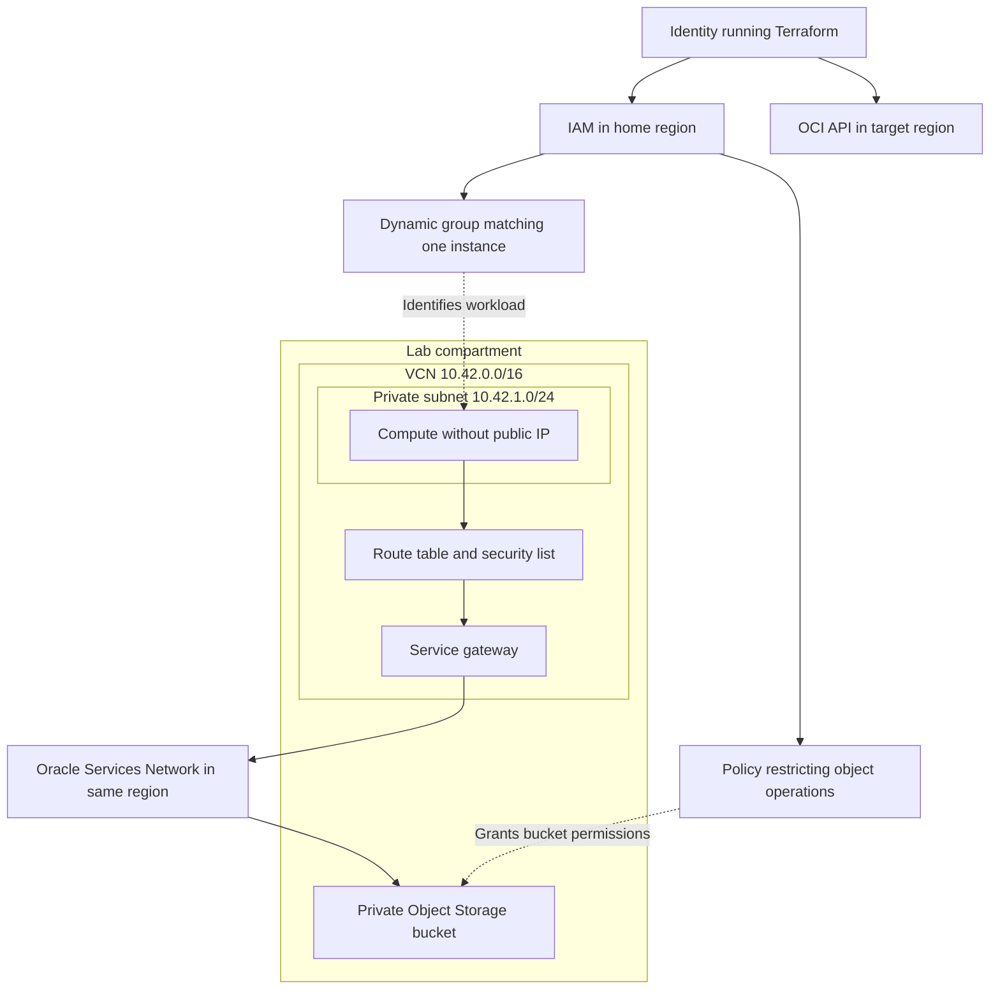

# Declaring IAM, VCN, Compute, and Object Storage with Terraform

In the **Infrastructure as Code** chapter of the **CLOUD_PROVIDERS_ORACLE** module, Terraform helps describe Oracle Cloud Infrastructure using version-controlled, previewable, and reusable code. The value of this approach lies not only in quickly provisioning a virtual machine, but also in clearly expressing where the machine lives, which services it connects to, and what permissions it holds.

This lesson builds a unified configuration comprising a compartment, VCN, private subnet, service gateway, Compute instance, and Object Storage bucket. IAM grants the instance itself permission to operate on objects in that specific bucket via instance principal. The configuration also captures decisions on state management, data protection, observability, and cost control when bringing IaC into operations.

## 1. Objectives and Hands-On Architecture

After this lesson, learners can:

- Map IAM, networking, compute, and storage requirements into OCI Terraform resources.
- Distinguish the permissions of the identity running Terraform from the permissions of the deployed workload.
- Use provider aliases to declare IAM in the home region and application resources in the target region.
- Create dependency relationships via resource references, avoiding copying output OCIDs across files.
- Read plans, deploy in a controlled manner, verify resources, and handle drift or partial apply failures.

Sample architecture:



The bucket does not reside inside the subnet. It is an Object Storage resource belonging to the compartment and region; the instance accesses the service's API over the network. **Routes and security rules solve connectivity; IAM solves access authorization.** Having a network path does not automatically grant permission to read objects, and having IAM permissions does not automatically create a network path.

The sample creates a private VM without installing a Java application, without creating a load balancer, and without setting up an SSH/Bastion path. Control-plane verification can be performed from the machine running Terraform; testing instance principal inside the VM requires a separately prepared management path.

## 2. Input Prerequisites and Permission Scope

### 2.1. Information You Must Know in Advance

| Input | Meaning | What to Verify |
| --- | --- | --- |
| Tenancy OCID | Tenancy identifier, also the root compartment | Matches the authentication profile's tenancy |
| Parent compartment OCID | Where the lab compartment is created | Deployer is allowed to create child compartments |
| Home region | Region managing IAM | May differ from the region hosting the application |
| Target region | Where VCN, VM, and bucket are created | Tenancy is subscribed to this region |
| Availability domain | Placement of the VM in the target region | Use the full name returned for your own tenancy |
| Image OCID | Operating system image to boot the VM | Correct region, architecture, and shape compatibility |
| SSH public key | Public key injected into the VM | Never pass private keys into Terraform metadata |
| Lab name and owner | Resource identification | Does not collide with existing resource names, contains no secrets |

One region may have a different number of availability domains than another. Do not copy AD names from another tenancy, do not assume there are always three ADs, and do not pick an image merely because its display name looks similar.

The example allows two flexible shapes: `VM.Standard.A1.Flex` for Arm and `VM.Standard.E4.Flex` for x86. These choices only illustrate flex configuration; they do not guarantee capacity, quota, or free-tier eligibility in your tenancy. When switching between the two architectures, swap to a compatible image and carefully review the VM replacement plan.

### 2.2. Two Independent Identity Layers

The **deployment identity** runs the provider and calls APIs to create resources. This identity requires pre-granted permissions: managing network/Compute/storage resources within the lab scope, creating the compartment as designed, and managing dynamic groups and policies within the required scope.

The **workload identity** is the VM's instance principal. It receives only the object operation permissions granted by the lesson's policy, not permissions to create VCNs, modify IAM, or run all of Terraform.

You cannot rely on a policy not yet created in the same configuration to authorize the deployer to create that very policy. If an organization separates IAM permissions from application permissions, the platform team executes the bootstrap/IAM part in a separate root module and state, then hands managed inputs to the application team. Do not open up `manage all-resources in tenancy` just to avoid analyzing permission errors.

The instance principal mechanism lets applications on Compute call OCI services without distributing a user's API signing key to the VM. Anyone with control over the VM can also exercise the instance's permissions, so machine administration access still requires strict control. See [Calling Services from an Instance](https://docs.oracle.com/en-us/iaas/Content/Identity/Tasks/callingservicesfrominstances.htm).

## 3. How to Read an OCI Terraform Configuration

Constructs used in the example:

| Construct | Role in This Lesson |
| --- | --- |
| `terraform` | Constrains Terraform and provider versions |
| `provider "oci"` | Configures region and authentication method for API calls |
| `variable` | Accepts environment-specific inputs |
| `locals` | Centralizes names, tags, and derived values |
| `data` | Reads existing information from OCI, such as namespace or service gateway service |
| `resource` | Declares objects Terraform is responsible for managing |
| `output` | Exposes information for inspection and handoff |

For example, `oci_core_subnet.private.id` is the `id` attribute of the resource with Terraform address `oci_core_subnet.private`. Terraform records that any resource referencing this value must wait until the subnet is created. A Terraform address is neither the Console display name nor the resource OCID.

Terraform reads `.tf` files in the same directory as one root module. Names such as `network.tf`, `compute.tf`, and `iam.tf` help readers organize content; they do not dictate execution order. Ordering comes from the dependency graph and API/provider behavior.

## 4. Directory Organization, Versions, and Authentication

### 4.1. Practice File Set

Learners create a dedicated directory, separate from any state managing real resources:

```text
oci-terraform-lab/
├── versions.tf
├── providers.tf
├── variables.tf
├── locals.tf
├── compartment.tf
├── network.tf
├── compute.tf
├── storage.tf
├── iam.tf
├── outputs.tf
├── lab.tfvars
└── .gitignore
```

The file-labeled code blocks in this lesson are intended to be placed into this lab directory. Do not split them across different root modules and expect resource references to still link automatically.

File `versions.tf`:

```hcl
terraform {
  required_version = ">= 1.5.0, < 2.0.0"

  required_providers {
    oci = {
      source  = "oracle/oci"
      version = "= 7.9.0"
    }
  }
}
```

The example pins provider `7.9.0` to establish a specific schema baseline, without claiming it is the latest release or a default version for production. In real usage, choose a version supported by your operations team, review changelogs, and inspect the plan before upgrading. You can reference [OCI provider release v7.9.0](https://github.com/oracle/terraform-provider-oci/releases/tag/v7.9.0).

After `terraform init`, commit `.terraform.lock.hcl` to Git to record the selected provider and checksums. The lock file does not replace managing Terraform CLI versions or module code. See [Dependency Lock File](https://developer.hashicorp.com/terraform/language/files/dependency-lock).

### 4.2. Configuring the Provider with a Profile

The sample assumes the practice machine already has an OCI API key profile named `LAB` in the SDK/CLI config file. The private key sits outside the project directory with appropriate file permissions, and the corresponding public key is registered on the user.

File `providers.tf`:

```hcl
provider "oci" {
  region              = var.region
  tenancy_ocid        = var.tenancy_ocid
  config_file_profile = var.oci_profile
}

provider "oci" {
  alias               = "home"
  region              = var.home_region
  tenancy_ocid        = var.tenancy_ocid
  config_file_profile = var.oci_profile
}
```

The default provider is used for application resources in `var.region`. The `oci.home` provider is used for IAM resources. The home region is where IAM objects such as compartments, policies, and dynamic groups are defined and updated. See [Managing Regions — The Home Region](https://docs.oracle.com/en-us/iaas/Content/Identity/Tasks/managingregions.htm).

The default OCI provider supports API key authentication and can read configuration profiles; methods like instance principal or resource principal suit other environments. Do not use an OCIR auth token in place of an API signing key for this API key configuration. Also check environment variables affecting the provider to avoid using the wrong credentials. See [Configuring the Provider](https://docs.oracle.com/en-us/iaas/Content/dev/terraform/configuring.htm).

Never write private key contents, passphrases, access tokens, or passwords into `providers.tf`, `lab.tfvars`, or Git. In CI, use the platform's identity/secret mechanisms and grant corresponding permissions instead of copying a developer's personal profile.

## 5. Declaring Inputs and Shared Conventions

File `variables.tf`:

```hcl
variable "tenancy_ocid" {
  type        = string
  description = "OCID of the tenancy used for the hands-on lab"
}

variable "parent_compartment_ocid" {
  type        = string
  description = "OCID of the parent compartment authorized for use"
}

variable "region" {
  type        = string
  description = "Region for deploying VCN, Compute, and bucket"
}

variable "home_region" {
  type        = string
  description = "Actual home region of the tenancy"
}

variable "oci_profile" {
  type    = string
  default = "LAB"
}

variable "lab_name" {
  type    = string
  default = "tfoci-lab01"

  validation {
    condition     = can(regex("^[a-z][a-z0-9-]{2,23}$", var.lab_name))
    error_message = "lab_name must be 3-24 characters, start with a lowercase letter, and contain only a-z, 0-9, and hyphens."
  }
}

variable "owner" {
  type    = string
  default = "learning-team"
}

variable "availability_domain" {
  type        = string
  description = "Full AD name belonging to the target region and this tenancy"
}

variable "image_ocid" {
  type        = string
  description = "Image OCID for the correct region and compatible with the shape architecture"
}

variable "shape" {
  type    = string
  default = "VM.Standard.A1.Flex"

  validation {
    condition = contains([
      "VM.Standard.A1.Flex",
      "VM.Standard.E4.Flex"
    ], var.shape)
    error_message = "The example only configures two flexible shapes: A1.Flex or E4.Flex."
  }
}

variable "ocpus" {
  type    = number
  default = 1

  validation {
    condition     = var.ocpus > 0
    error_message = "ocpus must be greater than 0; specific limits also depend on shape and quota."
  }
}

variable "memory_in_gbs" {
  type    = number
  default = 6

  validation {
    condition     = var.memory_in_gbs > 0
    error_message = "memory_in_gbs must be greater than 0; RAM/OCPU ratio must be valid for the shape."
  }
}

variable "ssh_public_key_path" {
  type        = string
  description = "Path to the public key on the machine running Terraform"
}

variable "instance_access_enabled" {
  type        = bool
  default     = true
  description = "Enable VM membership in the dynamic group; can be disabled when revoking lab access"
}
```

Validations only check simple input conventions. They do not prove that the image is compatible with the shape, that the shape has available capacity, that the CIDR does not conflict with external networks, or that the deployer has sufficient IAM permissions.

File `locals.tf`:

```hcl
locals {
  vcn_cidr    = "10.42.0.0/16"
  subnet_cidr = "10.42.1.0/24"
  bucket_name = "${var.lab_name}-artifacts"

  common_tags = {
    Project     = var.lab_name
    Environment = "lab"
    Owner       = var.owner
    ManagedBy   = "terraform"
  }
}
```

The subnet CIDR falls within the VCN CIDR. Before connecting a VPN, peering, or organizational networks, check for address overlaps against the overall design. Tags help identify and filter resources; tags do not automatically create budgets, shutdown schedules, or IAM permissions.

## 6. Declaring the Compartment for Lab Resources

File `compartment.tf`:

```hcl
resource "oci_identity_compartment" "lab" {
  provider       = oci.home
  compartment_id = var.parent_compartment_ocid
  name           = var.lab_name
  description    = "Dedicated compartment for the OCI Terraform learning lab"
  enable_delete  = true
  freeform_tags  = local.common_tags
}
```

In this resource, `compartment_id` is the **parent compartment**. In the VCN, VM, or bucket below, `compartment_id` will be the newly created lab compartment. Do not assign the same OCID to every parameter just because they share the same attribute name.

`enable_delete = true` is a choice meant for a new lab compartment with its own owner and lifecycle. With the OCI provider, when this option is not enabled, a compartment may not actually be deleted on destroy, and name-collision behavior also differs. With the example enabled, duplicate names result in an error rather than adopting an existing compartment. See [oci_identity_compartment](https://docs.oracle.com/en-us/iaas/tools/terraform-provider-oci/latest/docs/r/identity_compartment.html).

Do not set this flag on configurations managing shared compartments without evaluating the lifecycle. Compartment deletion also depends on child resources, permissions, and OCI state; setting the flag does not mean every compartment can be deleted immediately.

## 7. Declaring the VCN, Private Subnet, and Path to Object Storage

File `network.tf` contains the blocks below.

### 7.1. Reading Regional Services and Creating the VCN

```hcl
data "oci_core_services" "regional" {}

locals {
  osn_services = [
    for service in data.oci_core_services.regional.services : service
    if can(regex("^All .* Services In Oracle Services Network$", service.name))
  ]

  osn = one(local.osn_services)
}

resource "oci_core_vcn" "lab" {
  compartment_id = oci_identity_compartment.lab.id
  cidr_blocks    = [local.vcn_cidr]
  display_name   = "${var.lab_name}-vcn"
  dns_label      = "tflab"
  freeform_tags  = local.common_tags
}
```

`oci_core_services` returns the services that can be enabled on a service gateway in the active region. The example selects the **All ... Services In Oracle Services Network** group by name rather than assuming element `[0]` is the desired service. `one` requires the list to contain no more than one element; if there are zero elements, the result is `null` and subsequent attribute references will fail. When a service name changes or there is not exactly one match, inspect the actual list and fix the selection condition rather than picking an arbitrary service.

This is a catalog-reading data source, not something that creates a new OCI service. The `id` attribute attaches the service to the gateway, while `cidr_block` is the **service CIDR label**, used in route/security rules. See the [core_services schema in provider 7.9.0](https://github.com/oracle/terraform-provider-oci/blob/v7.9.0/website/docs/d/core_services.html.markdown).

### 7.2. Service Gateway and Route Table

```hcl
resource "oci_core_service_gateway" "osn" {
  compartment_id = oci_identity_compartment.lab.id
  vcn_id         = oci_core_vcn.lab.id
  display_name   = "${var.lab_name}-service-gateway"
  freeform_tags  = local.common_tags

  services {
    service_id = local.osn.id
  }
}

resource "oci_core_route_table" "private" {
  compartment_id = oci_identity_compartment.lab.id
  vcn_id         = oci_core_vcn.lab.id
  display_name   = "${var.lab_name}-private-routes"
  freeform_tags  = local.common_tags

  route_rules {
    destination       = local.osn.cidr_block
    destination_type  = "SERVICE_CIDR_BLOCK"
    network_entity_id = oci_core_service_gateway.osn.id
    description       = "Private access to regional Oracle services"
  }
}
```

A service gateway provides a path to supported Oracle services within the **same region** without needing public IPs, an internet gateway, or a NAT gateway for that access path. It is not a gateway to the entire Internet. Downloading packages or dependencies from an address outside the supported service group requires a different egress design. See [Access to Oracle Services: Service Gateway](https://docs.oracle.com/en-us/iaas/Content/Network/Tasks/servicegateway.htm).

Do not use a service OCID as the route `destination`, and do not assign the CIDR label string to `network_entity_id`: these parameters represent different objects.

### 7.3. Security List and Subnet

```hcl
resource "oci_core_security_list" "private" {
  compartment_id = oci_identity_compartment.lab.id
  vcn_id         = oci_core_vcn.lab.id
  display_name   = "${var.lab_name}-private-security"
  freeform_tags  = local.common_tags

  ingress_security_rules = []

  egress_security_rules {
    destination      = local.osn.cidr_block
    destination_type = "SERVICE_CIDR_BLOCK"
    protocol         = "6"
    stateless        = false
    description      = "HTTPS to regional Oracle services"

    tcp_options {
      min = 443
      max = 443
    }
  }
}

resource "oci_core_subnet" "private" {
  compartment_id             = oci_identity_compartment.lab.id
  vcn_id                     = oci_core_vcn.lab.id
  cidr_block                 = local.subnet_cidr
  display_name               = "${var.lab_name}-private-subnet"
  dns_label                  = "app"
  prohibit_public_ip_on_vnic  = true
  route_table_id             = oci_core_route_table.private.id
  security_list_ids          = [oci_core_security_list.private.id]
  freeform_tags              = local.common_tags
}
```

By omitting `availability_domain` on the subnet, the example uses a regional subnet. The subnet explicitly references the custom route table and security list, avoiding accidental use of the default security list with unintended rules. The VCN's default DHCP options are used; if the organization has custom DNS, declare the corresponding DHCP/DNS design.

The security list allows TCP 443 egress to the selected service group; `stateless = false` uses connection tracking for return traffic. There are no ingress rules for SSH or application ports. When adding NSGs or other security lists, the effective allow rule set can widen; a restrictive security list does not override allow rules elsewhere.

One OCI detail to note is that security rules are not enforced for traffic involving the link-local range `169.254.0.0/16`, where services such as instance metadata reside. Do not interpret this security list as a metadata-blocking mechanism. Controlling metadata also requires instance and OS configuration. See [OCI Security Rules](https://docs.oracle.com/en-us/iaas/Content/Network/Concepts/securityrules.htm).

## 8. Declaring the Compute Instance

File `compute.tf`:

```hcl
resource "oci_core_instance" "app" {
  compartment_id      = oci_identity_compartment.lab.id
  availability_domain = var.availability_domain
  display_name        = "${var.lab_name}-app"
  shape               = var.shape
  freeform_tags       = local.common_tags

  shape_config {
    ocpus         = var.ocpus
    memory_in_gbs = var.memory_in_gbs
  }

  create_vnic_details {
    subnet_id        = oci_core_subnet.private.id
    assign_public_ip = false
    hostname_label   = "app01"
  }

  source_details {
    source_type = "image"
    source_id   = var.image_ocid
  }

  metadata = {
    ssh_authorized_keys = trimspace(file(pathexpand(var.ssh_public_key_path)))
  }

  instance_options {
    are_legacy_imds_endpoints_disabled = true
  }

  preserve_boot_volume = false
}
```

Key points:

- `source_type = "image"` and `source_id` specify the boot volume source. Use a selected image OCID rather than automatically pulling the latest image every run.
- `shape_config` specifies OCPU and RAM for flexible shapes; the pair of values must be valid for the shape and actual quota.
- The subnet prohibits public IPs and the VNIC also sets `assign_public_ip = false`, expressing the same intent at two configuration layers.
- `file(pathexpand(...))` reads an existing **public key** on the machine running Terraform; placing a key in metadata does not mean an SSH path to the VM exists.
- Disabling legacy IMDS endpoints requires the image, agents, and libraries using metadata to support the corresponding access method.
- `preserve_boot_volume = false` fits a disposable lab VM; when the instance is terminated, do not retain the boot volume as an implicit backup.

Refer to the parameters and attributes of [oci_core_instance](https://docs.oracle.com/en-us/iaas/tools/terraform-provider-oci/latest/docs/r/core_instance.html).

The example has no `user_data` running package download commands. This avoids assuming the private VM has outbound Internet access. If Java/Spring Boot bootstrapping is needed, prepare an image with the runtime pre-installed or an artifact source with a designed access path; never put private keys or database passwords into cloud-init.

Terraform manages the instance lifecycle; it does not guarantee every process inside the OS is healthy. A `RUNNING` state does not prove the application has started, can connect to Oracle Database, or has enough replicas to maintain service.

## 9. Declaring a Private Object Storage Bucket

File `storage.tf`:

```hcl
data "oci_objectstorage_namespace" "tenancy" {}

resource "oci_objectstorage_bucket" "artifacts" {
  compartment_id = oci_identity_compartment.lab.id
  namespace      = data.oci_objectstorage_namespace.tenancy.namespace
  name           = local.bucket_name
  access_type    = "NoPublicAccess"
  storage_tier   = "Standard"
  versioning     = "Enabled"
  freeform_tags  = local.common_tags

  lifecycle {
    prevent_destroy = true
  }
}
```

Namespace is neither a compartment name nor a tenancy OCID. The data source reads the namespace for the authenticating identity; therefore, the profile and `tenancy_ocid` must be consistent from the start.

The example sets the bucket to private mode and enables versioning. Previous object versions can be retained on overwrite; retained data also affects cost and bucket cleanup. `storage_tier` belongs to bucket configuration, not an immediate instruction to place every object under an arbitrary storage policy. See the [objectstorage_bucket schema in provider 7.9.0](https://github.com/oracle/terraform-provider-oci/blob/v7.9.0/website/docs/r/objectstorage_bucket.html.markdown).

`prevent_destroy` instructs Terraform to reject plans that destroy/replace the bucket while the guard block remains present. It is not an Object Storage retention rule, does not block authorized users from deleting the resource via other APIs, and no longer protects in that way if the entire resource block is removed from configuration. See [lifecycle meta-argument](https://developer.hashicorp.com/terraform/language/meta-arguments/lifecycle).

The example does not create objects containing secrets, pre-authenticated requests, or customer secret keys. Application data objects are typically managed by applications/data pipelines; do not put all runtime data into Terraform merely because the bucket was created with IaC.

## 10. Declaring the Dynamic Group and Policy for the Workload

File `iam.tf`:

```hcl
resource "oci_identity_dynamic_group" "app" {
  provider       = oci.home
  compartment_id = var.tenancy_ocid
  name           = "${var.lab_name}-app-dg"
  description    = "Instance principal for the single lab VM"
  freeform_tags  = local.common_tags

  matching_rule = var.instance_access_enabled ? (
    "ALL {instance.id = '${oci_core_instance.app.id}'}"
  ) : (
    "ALL {instance.id = '${oci_core_instance.app.id}', instance.id != '${oci_core_instance.app.id}'}"
  )
}

resource "oci_identity_policy" "app_objects" {
  provider       = oci.home
  compartment_id = oci_identity_compartment.lab.id
  name           = "${var.lab_name}-app-objects"
  description    = "Allow object operations on the lab bucket without delete"
  freeform_tags  = local.common_tags

  statements = [
    "Allow dynamic-group id ${oci_identity_dynamic_group.app.id} to manage objects in compartment id ${oci_identity_compartment.lab.id} where all {target.bucket.name = '${oci_objectstorage_bucket.artifacts.name}', any {request.permission = 'OBJECT_INSPECT', request.permission = 'OBJECT_READ', request.permission = 'OBJECT_CREATE', request.permission = 'OBJECT_OVERWRITE'}}"
  ]
}
```

### 10.1. Why Does the Dynamic Group Use the Tenancy OCID?

A dynamic group is a tenancy-level IAM resource; therefore, its `compartment_id` is the tenancy OCID, not the compartment containing the VM. The matching rule determines which VMs are members. The example matches one exact instance OCID rather than granting access to all current and future instances in the compartment. See [oci_identity_dynamic_group](https://docs.oracle.com/en-us/iaas/tools/terraform-provider-oci/latest/docs/r/identity_dynamic_group.html).

When `instance_access_enabled = false`, the matching rule contains two contradictory conditions on the same instance ID so no instance matches. This is an intentional way to empty the lab group's membership when revoking access or cleaning up resources; it is not a deny policy.

### 10.2. What Does the Policy Actually Grant?

The policy resides in the lab compartment and restricts targets by bucket name. The `manage objects` verb is narrowed by the `request.permission` condition, so this statement grants only the four listed permissions:

| Permission | Purpose in the Lab |
| --- | --- |
| `OBJECT_INSPECT` | List objects |
| `OBJECT_READ` | Read object contents and corresponding object read operations |
| `OBJECT_CREATE` | Create new objects |
| `OBJECT_OVERWRITE` | Overwrite existing objects |

The statement does not grant permission to delete objects, delete buckets, or modify IAM. Nor does it automatically grant permission to list all buckets. When testing, supply the known namespace and bucket so discovery permissions outside scope are not required. Specific permissions must be cross-checked against the intended APIs; multipart workflows or other administrative operations may require additional analysis. See [Details for Object Storage and Archive Storage](https://docs.oracle.com/en-us/iaas/Content/Identity/policyreference/objectstoragepolicyreference.htm).

Effective permissions are the combined result of all relevant policies. Omitting `OBJECT_DELETE` in this statement does not stop another policy from already granting delete permissions to the same principal. Therefore, verifying permission boundaries requires examining all applicable IAM policies and dynamic groups the instance belongs to.

### 10.3. Avoiding Dependency Cycles

In the example, the dynamic group needs `oci_core_instance.app.id`, while the instance does not depend on the policy. Terraform can create the VM first, create the group matching that OCID, and then create the policy. Do not add `depends_on = [oci_identity_policy.app_objects]` to the instance: it will create a cycle between the instance, dynamic group, and policy.

If the application calls Object Storage immediately from cloud-init, design dedicated bootstrapping or appropriate retries. Correct Terraform creation order does not mean IAM has propagated to every endpoint instantaneously. `depends_on` controls ordering, not IAM propagation delay handling.

## 11. Exporting Information for Inspection and Handoff

File `outputs.tf`:

```hcl
output "compartment_id" {
  value = oci_identity_compartment.lab.id
}

output "region" {
  value = var.region
}

output "instance_id" {
  value = oci_core_instance.app.id
}

output "instance_private_ip" {
  value = oci_core_instance.app.private_ip
}

output "bucket_name" {
  value = oci_objectstorage_bucket.artifacts.name
}

output "object_storage_namespace" {
  value = data.oci_objectstorage_namespace.tenancy.namespace
}

output "dynamic_group_id" {
  value = oci_identity_dynamic_group.app.id
}
```

Outputs clarify the contract between infrastructure and application deployment steps. There is no need to export private keys, tokens, or secret contents. OCIDs, IP addresses, and namespaces are not passwords, yet they remain internal information that must be managed under appropriate access scopes.

Illustrative `lab.tfvars` file:

```hcl
tenancy_ocid          = "REPLACE_WITH_TENANCY_OCID"
parent_compartment_ocid = "REPLACE_WITH_PARENT_COMPARTMENT_OCID"
region                = "ap-singapore-1"
home_region           = "REPLACE_WITH_ACTUAL_HOME_REGION"
oci_profile           = "LAB"
lab_name              = "tfoci-lab01"
owner                 = "learning-team"
availability_domain   = "REPLACE_WITH_FULL_AD_NAME"
image_ocid            = "REPLACE_WITH_REGION_CORRECT_ARM_IMAGE_OCID"
shape                 = "VM.Standard.A1.Flex"
ocpus                 = 1
memory_in_gbs         = 6
ssh_public_key_path   = "~/.ssh/id_ed25519.pub"
instance_access_enabled = true
```

Replace all placeholders before planning. The Singapore region is only an example; choose a subscribed region that offers the required services/shapes. The public key file must exist at that path on the machine running Terraform itself; this path does not refer to a file inside the VM.

A minimal `.gitignore` for the lab directory:

```gitignore
.terraform/
*.tfstate
*.tfstate.*
*.tfplan
crash.log
crash.*.log
lab.tfvars
```

Commit `.tf` code, the lock file, and an example input file stripped of environment details to Git according to team conventions. Do not commit state or saved plans to Git.

## 12. Running Init, Checking Configuration, and Reading the Plan

The commands below are for learners inside the lab directory. `init`, `validate`, and `plan` do not execute resource creation like `apply`, though they may download providers, call read APIs, and create local files. Prepare proper access permissions and the working directory before running.

```bash
terraform version
terraform init
terraform fmt
terraform validate
terraform plan -var-file=lab.tfvars -out=lab.tfplan
terraform show lab.tfplan
```

`fmt` standardizes HCL formatting. `validate` checks configuration structure and consistency against loaded schemas; it does not guarantee quotas, capacity, image/shape compatibility, or runtime permissions are valid. `plan` compares configuration, state, and data read from the provider to propose actions. See [terraform plan](https://developer.hashicorp.com/terraform/cli/commands/plan).

In the first plan for a fresh state, you should recognize resources corresponding to the compartment, network, VM, bucket, dynamic group, and policy; data sources appear as reads. A VCN also comes with default resources created by OCI, so the number of objects visible in the Console does not necessarily equal the number of individual resource blocks in state.

Read the plan by impact:

| Symbol | Meaning to Review |
| --- | --- |
| `+` | Create new resource |
| `~` | Update existing resource |
| `-` | Destroy resource |
| `-/+` or `+/-` | Replace resource; pay attention to data, addresses, and downtime |
| `(known after apply)` | Value known only after API creation/read completes |

Before applying, check at minimum:

- All resources belong to the right tenancy, compartment, and region; IAM uses the home provider.
- Shape, OCPU, RAM, image, and AD match intent, with no unexpected resource expansion.
- The VM has no public IP; the subnet uses the right route/security list; egress matches the intended service group.
- The bucket remains private with versioning enabled and no planned deletion/replacement of data.
- The policy does not open access to all buckets or the entire tenancy and does not accidentally add delete permissions.

After the plan is reviewed, execute that exact saved plan:

```bash
terraform apply lab.tfplan
```

When passing a saved plan, Terraform does not prompt for interactive confirmation as it does when apply generates its own plan. Therefore, change review must happen before this command; do not treat the terminal prompt as the sole control point. A saved plan contains locked-in decisions and values and does not re-read `lab.tfvars` to swap them at the last minute. See [terraform apply](https://developer.hashicorp.com/terraform/cli/commands/apply).

If code, inputs, or environment have changed significantly, generate a new plan and review it again. Do not reuse an old plan as if it represented the latest OCI state.

## 13. Post-Apply Verification

### 13.1. Control-Plane Verification

From the lab directory:

```bash
terraform output
terraform state list
terraform plan -var-file=lab.tfvars
```

The goal of the subsequent plan is zero unexpected changes. A plan with no changes only proves that managed resources/attributes match as of that read; it does not substitute for workload testing.

In Bash, if OCI CLI is installed and using the matching deployment profile, you can read outputs to inspect the VM and bucket:

```bash
INSTANCE_ID=$(terraform output -raw instance_id)
REGION=$(terraform output -raw region)
NAMESPACE=$(terraform output -raw object_storage_namespace)
BUCKET=$(terraform output -raw bucket_name)

oci compute instance get --profile LAB --region "$REGION" \
  --instance-id "$INSTANCE_ID"

oci os bucket get --profile LAB --region "$REGION" \
  --namespace-name "$NAMESPACE" --bucket-name "$BUCKET"
```

If you renamed the profile, substitute `LAB` accordingly. The variables and line continuations in this block use Bash; in PowerShell, adjust variable assignment and line-continuation syntax accordingly.

Check the VM's lifecycle state, that the subnet/VNIC has no public IP, the attached security list, the service gateway route, and the bucket access mode. Commands run with the deployer profile only test using the deployer's permissions, not the instance principal's permissions.

### 13.2. Testing Instance Principal on the VM Itself

Perform this only once an approved management path exists and OCI CLI is available inside the VM. The sample does not provision these prerequisites: a private IP cannot be SSH'd directly from the Internet, and placing an SSH public key in metadata does not open ingress. If using Bastion, VPN, or another management path, prepare the corresponding routes/rules, services, and permissions.

On the VM, assign the region/namespace/bucket values from the handed-off outputs, then test a small object:

```bash
REGION='REPLACE_WITH_TARGET_REGION'
NAMESPACE='REPLACE_WITH_NAMESPACE_FROM_OUTPUT'
BUCKET='REPLACE_WITH_BUCKET_FROM_OUTPUT'

printf 'hello from instance principal\n' > hello.txt

oci os object put --auth instance_principal --region "$REGION" \
  --namespace-name "$NAMESPACE" --bucket-name "$BUCKET" \
  --name smoke/hello.txt --file hello.txt

oci os object list --auth instance_principal --region "$REGION" \
  --namespace-name "$NAMESPACE" --bucket-name "$BUCKET" \
  --prefix smoke/

oci os object get --auth instance_principal --region "$REGION" \
  --namespace-name "$NAMESPACE" --bucket-name "$BUCKET" \
  --name smoke/hello.txt --file downloaded.txt

cat downloaded.txt
```

Use an unused practice object name to avoid colliding with existing data. Do not copy the deployer's API key profile onto the VM to run this test; `--auth instance_principal` must use the instance's identity.

The expected result is creating, listing, and reading the object in the target bucket. With test data and reviewed permissions, you can design negative tests for another bucket or out-of-scope operations; do not test against important data. If effective permissions are broader than intended, inspect all policies and group memberships rather than only looking at the statement in `iam.tf`.

Changes to matching rules or IAM take time to propagate and update membership; if you hit errors right after apply, check propagation and perform bounded retries. Do not work around errors by making the bucket public or granting tenancy-wide permissions.

## 14. Managing State, Changes, and Partial Apply Failures

### 14.1. State Is Operational Data

State links Terraform addresses to real resources. In a single-person lab, a local backend helps observe the mechanics; in team workflows, choose a backend with access controls, data protection, versioning, and appropriate locking. Locking state across jobs is different from the `.terraform.lock.hcl` file used to lock provider selections.

Do not assume using Object Storage as a backend automatically provides distributed locking. Verify the capabilities of the exact backend/tool chosen. A bucket storing state should be bootstrapped and managed with a separate lifecycle; never place the sole state inside an application bucket that is about to be destroyed by the same configuration.

State and saved plans can contain sensitive data from configuration/providers. `sensitive = true` masks display in some contexts, without turning all state data into encrypted secrets. See [Manage sensitive data in Terraform](https://developer.hashicorp.com/terraform/language/manage-sensitive-data).

### 14.2. A Single Apply Is Not a System-Wide Transaction

If networking and the bucket were created but the VM fails due to capacity, already-created resources are not automatically rolled back. Keep the state, identify what succeeded, fix the root cause, and re-plan. Do not delete state to start over: doing so can orphan billable resources or cause duplicates.

If a resource was created manually and needs to be brought under Terraform, use the import workflow and adjust configuration so the plan reflects the existing resource accurately. One real resource should not be managed simultaneously by two independent addresses/states. See [terraform import](https://developer.hashicorp.com/terraform/cli/commands/import).

### 14.3. Drift and Resource Replacement

Suppose someone changes OCPUs in the Console: the next plan may propose reverting the configuration to the value in code. The team must decide whether the Console change was a temporary measure to revert or a valid change to codify. Do not use broad `ignore_changes` to hide all drift.

Changing the image OCID or an attribute that does not support in-place updates can trigger VM replacement; read the specific plan for the provider version in use. With a dynamic group matching a specific instance OCID, the new VM must have its membership updated before the new workload uses permissions. This mechanism keeps scope tight, though it does not create a zero-downtime cutover.

Renaming a resource address in code can also make Terraform interpret it as destroy/create unless address migration is managed. When refactoring a configuration that already has state, use proper address-moving procedures and inspect the plan rather than just renaming identifiers and applying.

## 15. Troubleshooting and Operational Decisions

| Symptom | What to Check | Resolution Path |
| --- | --- | --- |
| `NotAuthenticated` | Profile, user, fingerprint, key, machine clock, auth method | Fix authentication; do not swap in a token meant for another service |
| `NotAuthorizedOrNotFound` | Permissions, OCID, region, policy placement, and propagation | Do not conclude the resource definitely does not exist from this message alone |
| Error creating/updating IAM | Is the provider using the home region? | Verify `provider = oci.home` and the actual home region |
| No matching service or `one` fails | Service catalog in the target region and filter condition | Inspect live data and fix the selector intentionally |
| Invalid image/shape | Architecture, region, image compatibility | Choose a valid image/shape pair and review VM replacement |
| Out of host capacity or quota | Shape, AD, service limits, compartment quota | Pick an approved alternative; do not retry apply endlessly |
| Cannot SSH to private IP | Missing management path/ingress rules | Provision a management path per design; a key does not substitute for connectivity |
| Object Storage timeout | DNS, route table, service gateway, egress, and endpoint region | Check networking before loosening IAM |
| Object Storage access denied | Instance principal, matching rule, policy, bucket, API permissions | Test with the right principal; do not substitute an admin profile |
| Cannot destroy bucket | `prevent_destroy`, remaining objects/versions, retention, or permissions | Identify protection layers and preserve needed data before lab cleanup |
| State lock held | Which job is still running, backend, and lock owner | Handle job/lock per procedure; never force-unlock while another writer is active |
| Apply fails after partial creation | What exists in state and in live resources? | Keep state, re-plan, and address the root cause |

For observability, `ManagedBy` and owner tags aid traceability, but do not pre-build dashboards, alarms, or log collection. To know how much CPU/RAM the VM uses and how workload APIs fail, add agents, metrics, logs, and alarms per monitoring design.

For cost, monitor OCPU/RAM, boot volume, object capacity and retained versions, and requests/transfer under applicable pricing. Private buckets and private subnets are access choices, not guarantees of zero cost. Budget alerts also do not automatically block all spending by default.

For availability, a single VM is a single point of failure for the workload. A regional subnet does not turn one instance into a multi-AD or multi-region system. Moving toward production requires designing replicas, load balancing, proper fault domain/AD distribution, data storage, and recovery mechanisms; these must be expressed further in code and tested.

## 16. Lab Teardown and Completion Criteria

### 16.1. Cleaning Up Resources According to Designed Lifecycle

The sample has `prevent_destroy = true` on the bucket, so `terraform plan -destroy` will be blocked if asked to delete the bucket while that guard remains enabled. This is intentional behavior; do not try to bypass it by deleting state or deleting the resource block to evade the check.

For a lab confirmed ready for teardown:

1. Stop the workload and determine which objects/versions must be kept or handed off. If the bucket contains data outside the lab, separate ownership and complete handoff first.
2. Set `instance_access_enabled = false`, generate a plan, and apply the membership change; wait for permissions to update. Groups should be emptied per IAM procedure on deletion, rather than deleting only the policy and assuming membership is gone.
3. Clean up only the practice objects/versions using an authorized identity. Deleting current objects in a versioning-enabled bucket does not automatically purge all prior versions; retention rules can continue blocking deletion.
4. Only for the lab bucket approved for deletion, change the literal value of `prevent_destroy` to `false` in the controlled configuration.
5. Generate a destroy plan, review every object to be deleted, and only then apply that saved plan.

Commands for the final step:

```bash
terraform plan -destroy -var-file=lab.tfvars -out=destroy.tfplan
terraform show destroy.tfplan
terraform apply destroy.tfplan
```

Re-check state and the Console after completion, including the VM/boot volume, bucket, network components, dynamic group, policy, and compartment. A compartment can only be deleted when OCI conditions are met; remaining resources, propagation delay, or another workflow can keep destroy incomplete. Do not delete state until ownership and lifecycles of any remaining resources are resolved.

### 16.2. Evidence of Achieving Lesson Objectives

| Evidence | Expected Outcome |
| --- | --- |
| Terraform code | Includes IAM, VCN/subnet/route/security, Compute, and Object Storage; consistent linking references |
| Inputs and authentication | Explicit tenancy/home region/region/AD/image; no private keys or secrets in code |
| Pre-apply plan | Matches scope, budget, and network policy; replacements/deletions identified |
| Control-plane results | Private VM, private bucket, and resources placed in the right compartment/region |
| Workload testing if management path prepared | Instance principal operates on objects in the bucket per reviewed effective permissions |
| Lifecycle management | State protected, with plans for handling drift, data, and resource teardown |

A configuration that parses cleanly is not yet properly operating infrastructure. The goal is code that accurately expresses IAM boundaries, network paths, and data lifecycles, while post-deployment checks provide evidence that those boundaries work as intended.
