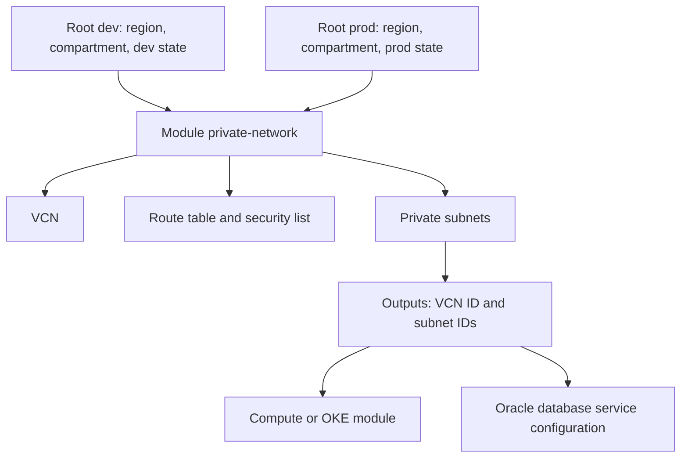

# Designing Terraform Modules and Configuration Reuse

## 1. Objectives and OCI Context

In the **Infrastructure as Code** chapter of the **CLOUD_PROVIDERS_ORACLE** module, reusing configuration is not merely about reducing lines of HCL. A useful Terraform module should encapsulate an infrastructure capability, expose clear inputs, return appropriate outputs, and allow upgrades whose impact consumers understand.

For example, both dev and prod environments need networking for Java applications and Oracle data services. The network layout may be similar, while compartments, CIDRs, regions, cost tags, and deployment permissions differ. Copying all resources into two directories easily causes configuration drift over time; cramming everything into one oversized module makes a small change affect too many resources.

This lesson builds an OCI module that creates a VCN and private subnets, then reuses it across root configurations. The goals are to:

- Choose module boundaries based on responsibility and lifecycle.
- Design inputs and outputs as a long-lived interface.
- Separate provider configuration, authentication, and state from reusable provisioning logic.
- Use stable keys to manage multiple resources.
- Manage versions, inspect plans, and refactor resource addresses in a controlled manner.
- Connect reuse with IAM, monitoring, availability, and cost control on OCI.

Terraform uses the OCI provider to call OCI services. Reusable code remains subject to API, IAM, quota, and live infrastructure state constraints; modules do not replace those layers. See [Oracle: Terraform provider](https://docs.oracle.com/en-us/iaas/Content/dev/terraform/home.htm).

## 2. Root Module and Child Module

A directory containing Terraform configuration files is a module. When running Terraform inside that directory, it acts as the **root module**. When the root calls another directory using a `module` block, the called directory is a **child module**.



The diagram shows two roots using the same source code. Each module call creates a set of resources under the running root's context and state; there is no automatically shared VCN simply because both point to the same source directory.

Files such as `main.tf`, `variables.tf`, and `outputs.tf` in one directory are read by Terraform as a single configuration. Filenames help humans organize content; they do not dictate execution order. Nor is a subdirectory executed automatically unless explicitly called.

| Component | Should Be Responsible For |
| --- | --- |
| Root module | Selecting environment, provider configuration, authentication source, backend, and composing modules |
| Child module | Delivering the promised capability with clear inputs/outputs |
| Provider | Translating Terraform declarations into OCI operations |
| State | Binding Terraform addresses to managed resources |

This is the foundation of [Terraform module design](https://developer.hashicorp.com/terraform/language/modules/develop).

## 3. Choosing Module Boundaries by Capability and Lifecycle

### 3.1. What Should a Module Solve?

A network module can own a VCN, subnets, routing, and the baseline security for that network. A Compute module can own a group of machines running the same workload pattern. A database module can own a data service along with settings tied to its lifecycle.

Not every resource type needs its own module. A thin wrapper that accepts every parameter and passes it straight to a single resource usually adds an interface without providing rules or reusable value.

Conversely, a module that creates tenancy policies, the entire network, OKE, databases, load balancers, and applications usually holds too many responsibilities. Callers struggle to upgrade one piece, read plans, and isolate failure scope.

| Design Question | Signal to Split |
| --- | --- |
| Do resources change together? | Network stays stable long-term, application machine groups change frequently |
| Who has management permissions? | Network team differs from database team |
| Who owns incident response? | Separate operational owners exist |
| How far should one change reach? | Wanting to update the application without modifying network configuration |
| Are policies uniform? | Multiple workloads share a baseline but have distinct business configurations |

Splitting code into modules and splitting state are two distinct decisions. You can split modules for clarity while composing them in one root/state; you can also split roots/states when permissions and lifecycles require it.

### 3.2. Composing Modules with Data

A Compute module should receive subnet IDs externally rather than searching for networks by display name on its own. The root can pass `module.network.subnets["app"].id` into the Compute module's input.

This composition style lets consumers use a network created by another module or a pre-existing network. Avoid letting a child module silently create dependencies the caller does not know about.

Output references establish data dependency relationships for Terraform. Add `depends_on` only when there is a behavioral dependency that data references cannot express; do not use it to turn the entire configuration into a sequential chain. See [HashiCorp: module composition](https://developer.hashicorp.com/terraform/language/modules/develop/composition).

## 4. Designing the Interface Before Writing Resources

### 4.1. Contract of the Example Module

The `private-network` module in this lesson has the following scope:

- Creates one IPv4 VCN.
- Carves subnets using a rule that extends the prefix by 8 bits.
- Creates regional subnets, prohibiting public IPs on VNICs.
- Attaches a dedicated route table with no routes outside the VCN.
- Attaches a dedicated security list with no ingress rules and egress limited to the VCN CIDR.
- Does not create an Internet Gateway, NAT Gateway, Compute, OKE, or databases.
- Returns the VCN ID and a map of subnets keyed by logical name.

This is an opinionated policy module, not a pass-through for all OCI networking attributes. Application connectivity must be designed additionally, such as NSGs for specific app-to-database flows.

| Input | Type | Required | Meaning |
| --- | --- | --- | --- |
| `compartment_id` | string | Yes | Existing compartment containing resources |
| `name_prefix` | string | Yes | Display name prefix |
| `vcn_dns_label` | string | Yes | DNS label of the VCN |
| `vcn_cidr` | string | Yes | Canonical IPv4 network, /16 to /22 prefix in this example design |
| `private_subnet_numbers` | map(number) | Yes | Subnet key and subnet number 0..255 |
| `freeform_tags` | map(string) | No | Tags from root for governance |

The /16..22 prefix rule is not the entire range OCI supports. It is this module's design choice: adding 8 bits produces /24..30 subnets. Do not apply that rule as a universal truth for every OCI module.

### 4.2. What Should Be an Input?

A value should become an input when callers genuinely need to decide it. Rules belonging to shared policy can live inside the module.

For instance, `prohibit_public_ip_on_vnic = true` is a commitment of the private network module; there is no need to add a boolean variable so callers can accidentally create public subnets. If public networking is needed, consider a separate module or interface with explicit operational conditions.

Do not pass private keys, passwords, or entire provider configurations down into every module. Region is provider context in the example; compartment is where resources reside and is passed separately. The two values do not replace each other.

### 4.3. Outputs Are Also a Commitment

Return the data other modules need: VCN ID, subnet IDs, CIDRs, or required endpoints. Avoid returning entire resource objects merely for convenience; consumers may become coupled to internal details you do not intend to maintain.

Do not access resources inside a child module directly from the root. Callers use published outputs, while internals of the module can be reorganized with an appropriate migration plan.

## 5. Directory Structure of the Example

```text
infra/
├── modules/
│   └── private-network/
│       ├── versions.tf
│       ├── variables.tf
│       ├── main.tf
│       ├── outputs.tf
│       └── README.md
└── environments/
    ├── dev/
    │   ├── versions.tf
    │   ├── providers.tf
    │   ├── variables.tf
    │   ├── main.tf
    │   └── terraform.tfvars
    └── prod/
        ├── versions.tf
        ├── providers.tf
        ├── variables.tf
        ├── main.tf
        └── terraform.tfvars
```

This is a structure for learners to create in their practice environment. Each environment directory is a separate root. Backend, lock file, and pipeline configuration are managed at each root according to the organization's operating model.

A module's README should document purpose, owned resources, version requirements, inputs/outputs, usage examples, required permissions, and network connectivity limits. Refer to [HashiCorp: standard module structure](https://developer.hashicorp.com/terraform/language/modules/develop/structure).

## 6. Implementing the `private-network` Child Module

### 6.1. Declaring Version Requirements

File `modules/private-network/versions.tf`:

```hcl
terraform {
  required_version = ">= 1.6.0, < 2.0.0"

  required_providers {
    oci = {
      source  = "oracle/oci"
      version = ">= 9.0.0"
    }
  }
}
```

The example uses the 9.x OCI provider line at the root. This is the example's version choice; when adopting it in another system, check the Terraform/provider versions supported by your runtime environment.

The child module declares the providers it needs and the minimum version of the interface it supports. It does not contain a `provider "oci"` block with region or credentials. The root selects and passes the provider configuration.

### 6.2. Defining and Validating Inputs

File `modules/private-network/variables.tf`:

```hcl
variable "compartment_id" {
  description = "OCID of the existing target compartment."
  type        = string
  nullable    = false

  validation {
    condition     = can(regex("^ocid1[.]compartment[.]", var.compartment_id))
    error_message = "compartment_id must be a compartment OCID."
  }
}

variable "name_prefix" {
  description = "Prefix used in display names."
  type        = string
  nullable    = false

  validation {
    condition     = can(regex("^[a-z][a-z0-9-]{2,23}$", var.name_prefix))
    error_message = "name_prefix must contain 3..24 lowercase letters, digits or hyphens and start with a letter."
  }
}

variable "vcn_dns_label" {
  description = "DNS label for the VCN."
  type        = string
  nullable    = false

  validation {
    condition     = can(regex("^[a-z][a-z0-9]{0,14}$", var.vcn_dns_label))
    error_message = "vcn_dns_label must contain 1..15 lowercase alphanumeric characters and start with a letter."
  }
}

variable "vcn_cidr" {
  description = "Canonical IPv4 VCN CIDR with prefix length 16..22."
  type        = string
  nullable    = false

  validation {
    condition = try(
      cidrnetmask(var.vcn_cidr) != "" &&
      cidrhost(var.vcn_cidr, 0) == split("/", var.vcn_cidr)[0] &&
      tonumber(split("/", var.vcn_cidr)[1]) >= 16 &&
      tonumber(split("/", var.vcn_cidr)[1]) <= 22,
      false
    )
    error_message = "vcn_cidr must be a canonical IPv4 CIDR with prefix length 16..22."
  }
}

variable "private_subnet_numbers" {
  description = "Stable subnet DNS labels mapped to unique subnet numbers."
  type        = map(number)
  nullable    = false

  validation {
    condition = (
      length(var.private_subnet_numbers) > 0 &&
      alltrue([
        for key in keys(var.private_subnet_numbers) :
        can(regex("^[a-z][a-z0-9]{0,14}$", key))
      ])
    )
    error_message = "Provide at least one subnet; each key must be a valid 1..15 character DNS label."
  }

  validation {
    condition = alltrue([
      for number in values(var.private_subnet_numbers) :
      try(number >= 0 && number <= 255 && floor(number) == number, false)
    ])
    error_message = "Every subnet number must be an integer in 0..255."
  }

  validation {
    condition = (
      length(distinct(values(var.private_subnet_numbers))) ==
      length(var.private_subnet_numbers)
    )
    error_message = "Subnet numbers must be unique."
  }
}

variable "freeform_tags" {
  description = "Free-form tags supplied by the caller."
  type        = map(string)
  default     = {}
  nullable    = false
}
```

Validation makes input errors easier to understand before making API calls. It does not prove the compartment exists, that the identity has IAM permissions, or that the CIDR does not overlap with peered/VPN-connected networks. Those require additional data and checks at the proper scope.

This contract requires a compartment OCID and does not accept a tenancy OCID to serve as the root compartment. That is an intentional constraint of this lesson, not a general OCI limitation.

Input types, defaults, and validation mechanics are documented at [HashiCorp: input variables](https://developer.hashicorp.com/terraform/language/values/variables).

### 6.3. Creating Resources

File `modules/private-network/main.tf`:

```hcl
locals {
  tags = merge(
    var.freeform_tags,
    {
      ManagedBy = "Terraform"
      Module    = "private-network"
    }
  )
}

resource "oci_core_vcn" "this" {
  compartment_id = var.compartment_id
  display_name   = format("%s-vcn", var.name_prefix)
  cidr_blocks    = [var.vcn_cidr]
  dns_label      = var.vcn_dns_label
  freeform_tags  = local.tags
}

resource "oci_core_route_table" "private" {
  compartment_id = var.compartment_id
  vcn_id         = oci_core_vcn.this.id
  display_name   = format("%s-private-rt", var.name_prefix)
  freeform_tags  = local.tags

  # No route to an internet, NAT or service gateway in this module.
}

resource "oci_core_security_list" "private" {
  compartment_id = var.compartment_id
  vcn_id         = oci_core_vcn.this.id
  display_name   = format("%s-private-sl", var.name_prefix)
  freeform_tags  = local.tags

  egress_security_rules {
    protocol         = "all"
    destination      = var.vcn_cidr
    destination_type = "CIDR_BLOCK"
    stateless        = false
    description      = "Allow outbound traffic within the VCN."
  }

  # No ingress rules are declared in this security list.
}

resource "oci_core_subnet" "private" {
  for_each = var.private_subnet_numbers

  compartment_id = var.compartment_id
  vcn_id         = oci_core_vcn.this.id
  display_name   = format("%s-%s", var.name_prefix, each.key)
  dns_label      = each.key
  cidr_block     = cidrsubnet(var.vcn_cidr, 8, each.value)

  prohibit_public_ip_on_vnic = true
  route_table_id            = oci_core_route_table.private.id
  security_list_ids         = [oci_core_security_list.private.id]
  dhcp_options_id           = oci_core_vcn.this.default_dhcp_options_id
  freeform_tags             = local.tags
}
```

OCI decisions in the code:

- The VCN uses `cidr_blocks`; do not simultaneously set the legacy `cidr_block` attribute. See [OCI provider: VCN](https://docs.oracle.com/en-us/iaas/tools/terraform-provider-oci/latest/docs/r/core_vcn.html).
- `availability_domain` is not assigned on the subnet, so it is a regional subnet. `prohibit_public_ip_on_vnic = true` forbids public IPs on VNICs. See [OCI provider: subnet](https://docs.oracle.com/en-us/iaas/tools/terraform-provider-oci/latest/docs/r/core_subnet.html).
- The custom route table declares no gateway routes; local VCN routing still exists. See [OCI provider: route table](https://docs.oracle.com/en-us/iaas/tools/terraform-provider-oci/latest/docs/r/core_route_table.html).
- The custom security list opens no inbound traffic and does not attach the default security list to this subnet. Additional NSGs or security lists can allow more traffic; evaluate the full rule set applied to the workload. See [OCI provider: security list](https://docs.oracle.com/en-us/iaas/tools/terraform-provider-oci/latest/docs/r/core_security_list.html).

The VCN still has default objects created by OCI, of which the sample uses default DHCP options. Do not manage the same object from two different modules/states.

This module is not yet a sufficient network for running OKE or databases under all requirements. For example, pulling images from OCIR, accessing OCI services, or app-to-database connectivity require dedicated network paths and rules. Do not blindly add NAT or an Internet Gateway just to make the sample look complete.

### 6.4. Understanding Subnet Calculation

With `vcn_cidr = "10.20.0.0/16"`:

```hcl
private_subnet_numbers = {
  app  = 10
  data = 20
}
```

Result:

| Logical Key | Expression | CIDR |
| --- | --- | --- |
| `app` | `cidrsubnet("10.20.0.0/16", 8, 10)` | `10.20.10.0/24` |
| `data` | `cidrsubnet("10.20.0.0/16", 8, 20)` | `10.20.20.0/24` |

The subnet number is not always an IP octet; it is the number placed into the newly added prefix bits. With a /20 VCN, interpreting it by octets differs. See [HashiCorp: cidrsubnet](https://developer.hashicorp.com/terraform/language/functions/cidrsubnet).

### 6.5. Exposing Outputs

File `modules/private-network/outputs.tf`:

```hcl
output "vcn_id" {
  description = "OCID of the VCN managed by this module."
  value       = oci_core_vcn.this.id
}

output "subnets" {
  description = "Private subnets keyed by the stable logical subnet name."

  value = {
    for key, subnet in oci_core_subnet.private :
    key => {
      id         = subnet.id
      cidr_block = subnet.cidr_block
    }
  }
}
```

Consumers can retrieve the application subnet via `module.network.subnets["app"].id`. The output structure does not force them to know the internal resource name `oci_core_subnet.private`.

## 7. Root Configuration for the Dev Environment

### 7.1. Provider Version at the Root

File `environments/dev/versions.tf`:

```hcl
terraform {
  required_version = ">= 1.6.0, < 2.0.0"

  required_providers {
    oci = {
      source  = "oracle/oci"
      version = "~> 9.0"
    }
  }
}
```

`~> 9.0` allows selecting versions 9.0 and higher below 10.0. After init, the lock file records the specific selected provider version. When upgrading majors, change the constraint intentionally and read the corresponding upgrade guide; do not treat a broad constraint as proof that every version has been tested.

### 7.2. Root Variables

File `environments/dev/variables.tf`:

```hcl
variable "region" {
  description = "OCI region used by this root configuration."
  type        = string
  nullable    = false
}

variable "oci_config_profile" {
  description = "Profile in the local OCI SDK/CLI configuration."
  type        = string
  default     = "DEFAULT"
  nullable    = false
}

variable "compartment_id" {
  description = "Existing compartment for this environment."
  type        = string
  nullable    = false
}

variable "name_prefix" {
  type     = string
  nullable = false
}

variable "vcn_dns_label" {
  type     = string
  nullable = false
}

variable "vcn_cidr" {
  type     = string
  nullable = false
}

variable "private_subnet_numbers" {
  type     = map(number)
  nullable = false
}

variable "freeform_tags" {
  type     = map(string)
  default  = {}
  nullable = false
}
```

The root accepts environment values; the child continues enforcing its contract via validations. For organization-wide standards, checks can be added at the root or in pipeline policies instead of forcing every module to duplicate every policy.

### 7.3. Authentication Configuration at the Root

File `environments/dev/providers.tf`:

```hcl
provider "oci" {
  region              = var.region
  config_file_profile = var.oci_config_profile
}
```

This sample uses an OCI SDK/CLI profile configured on the learner's machine with the corresponding API key method. Do not put private keys into `terraform.tfvars`, and do not commit credential files to the repository.

When running in an environment that supports instance principal or resource principal, the root configures the appropriate authentication method; child module code does not need to change. Authentication methods and configuration sources are documented in [Oracle: configuring the provider](https://docs.oracle.com/en-us/iaas/Content/dev/terraform/configuring.htm).

The identity invoking Terraform needs IAM permissions on resources in the selected compartment. Passing a compartment OCID does not grant access to that compartment. Nor should a network module create broad tenancy-wide policies to bypass a missing permission error.

### 7.4. Calling the Module

File `environments/dev/main.tf`:

```hcl
module "network" {
  source = "../../modules/private-network"

  providers = {
    oci = oci
  }

  compartment_id         = var.compartment_id
  name_prefix            = var.name_prefix
  vcn_dns_label          = var.vcn_dns_label
  vcn_cidr               = var.vcn_cidr
  private_subnet_numbers = var.private_subnet_numbers
  freeform_tags          = var.freeform_tags
}

output "network" {
  value = {
    vcn_id  = module.network.vcn_id
    subnets = module.network.subnets
  }
}
```

In simple configurations, the default provider can be inherited implicitly. This lesson passes it explicitly to demonstrate that the root is where provider configuration is decided.

`required_providers` in the child declares source and version requirements; the `provider` block in the root holds the active configuration. These are two separate layers. See [HashiCorp: providers within modules](https://developer.hashicorp.com/terraform/language/modules/develop/providers).

### 7.5. Environment Values

File `environments/dev/terraform.tfvars`:

```hcl
region              = "ap-singapore-1"
oci_config_profile  = "DEFAULT"
compartment_id      = "<dev-compartment-ocid>"
name_prefix         = "orders-dev"
vcn_dns_label       = "ordersdev"
vcn_cidr            = "10.20.0.0/16"

private_subnet_numbers = {
  app  = 10
  data = 20
}

freeform_tags = {
  Environment = "dev"
  Application = "orders"
  Owner       = "platform"
}
```

Replace placeholders with real OCIDs and choose a region subscribed by the tenancy. Example CIDRs must be cross-checked against the organization's network plan.

`ManagedBy` and `Module` tags in the child retain their values because they sit in the later argument of `merge`. This is an interface rule that should be documented so callers do not assume every tag can be overridden.

## 8. Reusing for Prod and Other Regions

### 8.1. Same Module, Different Environment Configuration

The prod root can use the same HCL declarations as the dev root, but with its own values and state storage location. Example `environments/prod/terraform.tfvars`:

```hcl
region              = "ap-singapore-1"
oci_config_profile  = "PROD"
compartment_id      = "<prod-compartment-ocid>"
name_prefix         = "orders-prod"
vcn_dns_label       = "ordersprod"
vcn_cidr            = "10.30.0.0/16"

private_subnet_numbers = {
  app  = 10
  data = 20
}

freeform_tags = {
  Environment = "prod"
  Application = "orders"
  Owner       = "platform"
}
```

Prod does not need a copy of the child module to change the CIDR. However, prod still requires separate decisions on apply permissions, configuration sources, state, observability, and recoverability.

Small root configurations can intentionally repeat some declarations. Only add a shared orchestration layer when it represents a genuinely stable model; avoid multiple wrapper layers just to eliminate a few lines of module calls.

### 8.2. Provider Aliases When Using Multiple Regions

If a single root needs an additional network in a second region, you can add a provider alias and another module call. This is an extension for a root that already has the variables above:

```hcl
provider "oci" {
  alias               = "secondary"
  region              = "ap-tokyo-1"
  config_file_profile = var.oci_config_profile
}

module "network_secondary" {
  source = "../../modules/private-network"

  providers = {
    oci = oci.secondary
  }

  compartment_id = var.compartment_id
  name_prefix    = "orders-secondary"
  vcn_dns_label  = "orderssecondary"
  vcn_cidr       = "10.40.0.0/16"

  private_subnet_numbers = {
    app  = 10
    data = 20
  }

  freeform_tags = merge(
    var.freeform_tags,
    { RegionRole = "secondary" }
  )
}
```

The child still uses the local provider name `oci`; the root maps it to `oci.secondary`. This case does not require the child to declare an alias named `secondary`.

If the child itself needs to use multiple provider configurations simultaneously, it must declare the corresponding `configuration_aliases` and the caller must pass them all. Do not choose a provider alias with a dynamic per-element `for_each` expression as if selecting a string value; design module calls to align with provider bindings.

Creating two networks in two regions does not yet constitute a complete DR solution. Database replication, data backups, DNS failover, capacity, and failover procedures still require separate design.

## 9. Stable Keys, Resource Addresses, and `for_each`

With a map input, subnets receive addresses such as:

```text
module.network.oci_core_subnet.private["app"]
module.network.oci_core_subnet.private["data"]
```

Adding a new key does not reindex existing keys. This is the advantage when resources have logical identities. If `count` were used based on list positions, inserting or reordering items could shift indexed addresses onto different elements.

`for_each` keys must be known at plan time; do not use an OCID available only after apply as a key when creating new objects. Do not use secret data as keys. See [HashiCorp: for_each](https://developer.hashicorp.com/terraform/language/meta-arguments/for_each).

Distinguish two types of changes:

| Change | Impact to Inspect |
| --- | --- |
| Add key `batch` with an unused number | Creates a new subnet, preserves addresses of existing subnets |
| Remove key `data` | Configuration no longer manages the subnet at that address; plan typically proposes destroy |
| Rename `app` to `api` | Terraform address changes, requiring migration review |
| Keep key but change subnet number | CIDR changes; check update/replacement behavior in plan |
| Change DNS label or VCN CIDR | Can alter critical resources; do not assume safety from stable keys |

In the example, the key is also used as `dns_label`. Therefore, renaming a key also changes an OCI attribute. A `moved` block only handles state address changes; it does not suppress replacement requirements caused by changing infrastructure attributes. If logical names need frequent changes, a new interface version can decouple `key` from `dns_label` using an object input.

## 10. Modules Are Not State or Security Boundaries

Two modules in the same root normally belong to the same state. Terraform does not create a separate state for each child module. To separate permissions and deployment lifecycles, design appropriate roots/backends and execution identities.

In a lab setting, two separate root directories create separate local states if using the default backend. When collaborating, choose a backend or execution service that supports your access model, while verifying the locking, versioning, and recovery capabilities of that specific backend. Backends are configured at the root; see [HashiCorp: backend configuration](https://developer.hashicorp.com/terraform/language/backend).

Mistakes to avoid:

- Running dev and prod alternately against the same state just by swapping tfvars files.
- Using one backend location for multiple environments unintentionally.
- Letting two states manage the same VCN or the same default security list.
- Assuming separating compartments automatically prevents someone with state read access from viewing another environment's information.
- Using CLI workspaces as a substitute for credential separation and access control.

CLI workspaces can separate multiple states for one configuration, but they are not suitable when independent credential separation and access control are needed. See [HashiCorp: state workspaces](https://developer.hashicorp.com/terraform/language/state/workspaces).

OCIDs are generally identifiers, not passwords. Even so, state and saved plans can contain other sensitive data, especially when managing databases or private keys. `sensitive = true` primarily controls display and does not automatically exclude data from state. See [HashiCorp: sensitive data](https://developer.hashicorp.com/terraform/language/manage-sensitive-data).

## 11. Module Sources, Versions, and Reproducibility

### 11.1. Local Source, Git, and Registry

| Source | How Consumed Code Is Pinned | Key Point to Understand |
| --- | --- | --- |
| Local directory | Commit of the repository containing root and module | Do not add `version` to a local module call |
| Git | `ref` pointing to a managed commit or tag | Branches can change content over time |
| Registry | `version` in the module block | Constraints allow a range; exact versions pin one release |

Git source example (replace host and commit with real values):

```hcl
module "network" {
  source = "git::https://git.example.com/platform/oci-modules.git//modules/private-network?ref=<full-commit-sha>"

  # Module inputs follow the same contract described above.
}
```

Example of an organization's registry with a published module:

```hcl
module "network" {
  source  = "registry.example.com/platform/private-network/oci"
  version = "1.2.3"

  # Module inputs follow the same contract described above.
}
```

These two snippets only illustrate choosing source/version, not complete module calls ready to apply standalone. Sources must be reachable from the runner, including runners in OCI Resource Manager if using that service. Refer to [HashiCorp: module usage](https://developer.hashicorp.com/terraform/language/modules/configuration).

The lesson uses literal sources and versions to keep the examples simple and compatible with the declared minimum Terraform version.

### 11.2. The Lock File Does Not Lock Module Code

`.terraform.lock.hcl` records provider selections of the root configuration. It does not automatically lock releases of remote modules. Therefore, committing the lock file does not replace pinning Git refs or module versions. See [HashiCorp: dependency lock file](https://developer.hashicorp.com/terraform/language/files/dependency-lock).

At least three versions must be tracked in operations: Terraform CLI, OCI provider, and module code. A change that only edits a constraint can also produce a different plan after a dependency upgrade.

### 11.3. When Is a Change a Breaking Change?

Examples that should be treated as breaking changes:

- Removing or renaming an input/output currently in use.
- Changing an input from map(number) to an incompatible object type.
- Changing defaults in a way that creates extra gateways, opens ingress, or changes public exposure.
- Changing CIDR calculation or DNS naming for existing inputs.
- Removing migration history that users of older versions still need.

Semantic versioning can be used to communicate scope, yet callers still must read release notes and plans. Do not automatically roll out every new module release to prod just because the version is tagged minor.

## 12. Refactoring Existing Code Without Unintended Resource Recreation

Suppose a VCN was previously managed directly in the root at `oci_core_vcn.network` and is now moved into `module.network.oci_core_vcn.this`.

If you only move the code, Terraform may see an old address removed and a new address needing creation. Record the migration explicitly at the root:

```hcl
moved {
  from = oci_core_vcn.network
  to   = module.network.oci_core_vcn.this
}
```

This is an example for the VCN only. When moving the entire network, account for each route table, security list, subnet, and corresponding keyed address. Keep infrastructure attributes unchanged if the goal is solely reorganizing code.

`moved` helps Terraform understand address mappings within the same state; it is not a way to transfer resources between two independent states. Nor should it be used to "adopt" an OCI resource never previously in state; that case requires a proper import workflow.

Before apply, the plan must show only the moves with no unintended destroy or replacement. Keep necessary `moved` blocks for consumers upgrading from older releases. See [HashiCorp: refactor modules](https://developer.hashicorp.com/terraform/language/modules/develop/refactoring).

Do not use `ignore_changes` or `prevent_destroy` as a way to mask a broken mapping. Lifecycle mechanisms serve specific purposes and do not replace understanding state, dependencies, and real resource changes.

## 13. Testing and Releasing Modules

### 13.1. Testing from the Dev Root

In the example, run from the `infra` directory. The following commands are instructions for learners to execute, not output already run against a tenancy:

```bash
terraform -chdir=environments/dev init
terraform -chdir=environments/dev fmt -check -recursive
terraform -chdir=environments/dev validate
terraform -chdir=environments/dev plan -out=dev.tfplan
terraform -chdir=environments/dev show dev.tfplan
```

To also check formatting of the child module, run from the `infra` directory:

```bash
terraform fmt -check -recursive
```

The dev root must use the right profile, compartment, and backend before generating a plan. `validate` does not prove sufficient IAM permissions exist or that OCI will accept every operation during apply.

With two subnets in a brand-new example, 5 Terraform resources are expected to be created: one VCN, one route table, one security list, and two subnets. Default objects created by OCI alongside the VCN do not appear as separate resource blocks of this lesson.

Once the plan is reviewed and resource creation falls within authorized scope:

```bash
terraform -chdir=environments/dev apply dev.tfplan
terraform -chdir=environments/dev output network
terraform -chdir=environments/dev plan
```

The subsequent plan should show no changes if configuration, state, and infrastructure have not drifted unexpectedly. Saved plans must be protected as artifacts that may contain sensitive data; if inputs or code change, generate a new plan. See [HashiCorp: terraform plan](https://developer.hashicorp.com/terraform/cli/commands/plan).

### 13.2. Testing Contract Behavior

A valuable test suite should target behavior, such as:

| Scenario | What to Confirm |
| --- | --- |
| Two subnets use the same number | Validation reports an error before apply |
| Non-canonical CIDR input | Appropriate error message appears; no API call is made to create a broken network |
| Add key `batch` | Plan adds the new subnet while preserving existing subnet addresses |
| Use secondary region provider | Resources are planned against the passed provider configuration |
| Upgrade module from prior release | No unintended destroy or network policy change outside contract |
| Apply from prod root | Does not read/write dev state and uses the right authorized identity |

This can be automated with Terraform testing tools and integration tests in a dedicated compartment. If a test performs an apply, account for live resources, state data, and cleanup procedures. Do not call a format check sufficient proof of module quality.

### 13.3. Release and Post-Apply Observation

A release process should include code changes, descriptions of affected inputs/outputs, examples, migration plans, and representative plans. Test in an appropriate environment before upgrading prod; upgrading the provider and changing network design in the same large batch makes root-cause analysis difficult.

After apply, verify resources sit in the right compartment/region, CIDRs match the plan, and routing/security match the contract. When integrating Compute, OKE, or databases, verify live connectivity paths and monitoring data for the respective services.

Tags help identify owners and allocate costs, but do not automatically create alerts. If alarms, logs, or flow logs are needed, explicitly define which module owns them and where data may be sent.

## 14. Common Design Mistakes

| Symptom | Consequence | Fix Direction |
| --- | --- | --- |
| Child hard-codes region and credentials | Hard to reuse, hard to control identity | Move provider configuration to the root |
| Child omits `oracle/oci` source | Terraform may infer the wrong provider source | Declare required_providers in every module needing the provider |
| Every resource attribute becomes an input | Large interface with no clear policy | Expose only decisions callers need to make |
| Many unrelated toggle variables | Too many combinations to test | Split modules by capability or deployment model |
| Looking up dependencies by display name | Easy to pick wrong resource, hidden data coupling | Pass minimal IDs/objects via inputs |
| Returning entire resources as outputs | Callers couple to internal structure | Return a concise, meaningful data contract |
| Sharing source while assuming state is isolated | Dev/prod can impact each other | Design separate roots/backends and permissions |
| Renaming keys or module names without migration | Plan may unintentionally destroy/create | Check state addresses and use moved/import properly |
| Adding NAT/Compute by default on module upgrade | Increases cost and alters connectivity | Document behavior changes, review plans and versions |
| Removing a module call thinking it only deletes code | Terraform may propose destroying all child resources | Review plan and resource lifecycles before applying |

## 15. Expected Outcomes

A module is reusable when callers can clearly answer five questions:

1. Which resources and rules does the module own?
2. What must callers pass, what do they receive, and which values must not change arbitrarily?
3. Where are provider, IAM, compartment, region, and state selected?
4. How can version upgrades or refactoring impact running resources?
5. What needs to be monitored and recovered after apply?

In this lesson's example, dev and prod use the same way to build networks while keeping configuration, permissions, and state per environment. When adding Compute, OKE, storage, or Oracle databases, the root composes them via clear inputs/outputs, while each module keeps its ownership scope small enough for operators to read the plan and take accountability for the outcome.
