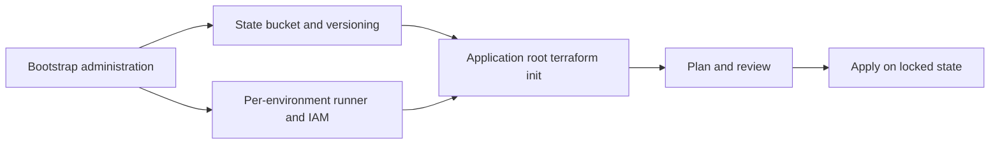
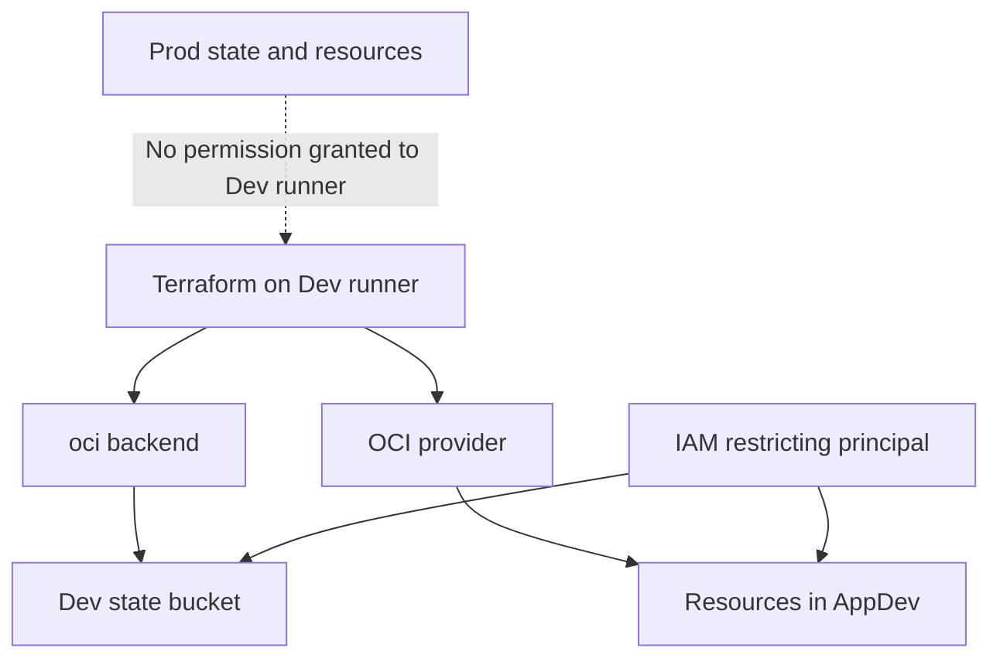

# Managing State, Access Locking, and Environment Isolation

In the **Infrastructure as Code** chapter of the `CLOUD_PROVIDERS_ORACLE` module, this lesson explains how to organize Terraform so multiple people can manage OCI infrastructure without overwriting each other's state, exposing credentials, or accidentally deploying into another environment.

Three pieces must be designed together: **state**, **access identity**, and **environment boundaries**. Proper state combined with overly broad tenancy-wide credentials can still cause out-of-scope changes. Restricted credentials combined with two pipelines writing to the same state can still corrupt resource management.

The primary example uses Terraform CLI with the native `oci` backend on OCI Object Storage, alongside OCI Compute runners authenticating via instance principal. The final section compares this with OCI Resource Manager. Configurations and commands serve as hands-on guidance and do not imply that resources have been created or commands executed in a specific tenancy.

## 1. What Does State Store and Why Manage It Separately?

Terraform needs to map addresses in configuration to real-world resources. For example:

```text
module.network.oci_core_vcn.this
    ↔ ocid1.vcn.oc1.<region>.<resource-id>
```

State stores that binding along with attributes and metadata for management. When planning, Terraform combines the desired configuration, state, and data read from the provider to determine changes.

State is neither a copy of Terraform code nor a full backup of infrastructure or application data. Having only state will not restore database contents, Object Storage data, or configurations not managed by Terraform.

Attributes stored in state may include:

- OCIDs of compartments, VCNs, Compute instances, volumes, and databases.
- IP addresses, endpoints, tags, and dependency metadata.
- Root module output values.
- Certain sensitive values used and persisted by resources or data sources.

Therefore, state must be treated as sensitive data. Do not commit `terraform.tfstate` to Git, do not send full state over chat, and do not use a public bucket for convenient downloads. The [Terraform State](https://developer.hashicorp.com/terraform/language/state) documentation describes state's role and how to manage it using Terraform tools.

### 1.1. Sensitive Does Not Mean Unstored

Example:

```hcl
variable "database_password" {
  type      = string
  sensitive = true
}
```

`sensitive = true` masks values in supported display interfaces and contexts. It does not encrypt state automatically, does not remove values from plans/state, and does not replace backend access controls.

Ephemeral or write-only features can avoid storing certain values in supported contexts, though this depends on the Terraform version and provider/resource schemas. Do not simply add `ephemeral = true` and pass it into every normal attribute; Terraform enforces constraints on where it can be used. See [Manage sensitive data](https://developer.hashicorp.com/terraform/language/manage-sensitive-data).

Reading a secret from OCI Vault via a data source and passing it to a resource also requires checking whether it is persisted in state or plans. Vault protects the secret source, while Terraform may still create copies during execution.

## 2. Distinguishing Types of "Locks" and "Keys"

| Concept | Purpose | What It Cannot Replace |
| --- | --- | --- |
| State lock | Prevents conflicting concurrent operations on the same state | IAM, code review, or change approval |
| API signing key | Signs OCI requests under an IAM user identity | SSH key, state lock, or IAM permissions |
| Customer Secret Key | Access Key/Secret Key credentials for the S3 Compatibility API | OCI native API signing key |
| Vault/KMS encryption key | Protects encrypted data at the appropriate service layer | State read permissions and keeping secrets safe on the machine running Terraform |
| `.terraform.lock.hcl` | Records selected provider versions and checksums | Locking plan/apply execution or protecting state |

An OCI API signing key consists of a public/private key pair used to sign requests; the private key must remain secret. It is not the SSH key pair used to log in to a Compute machine. A Customer Secret Key is a separate credential type for the S3-compatible interface. See [Required Keys and OCIDs](https://docs.oracle.com/en-us/iaas/Content/API/Concepts/apisigningkey.htm) and [Managing User Credentials](https://docs.oracle.com/en-us/iaas/Content/Identity/Tasks/managingcredentials.htm).

`.terraform.lock.hcl` should be managed in Git to review provider changes. State locks are managed by the backend during operations. Do not delete the dependency lock file to fix a "state is locked" error. Details of this file are in [Dependency Lock File](https://developer.hashicorp.com/terraform/language/files/dependency-lock).

## 3. Designing Environment Boundaries Before Naming State

### 3.1. An Environment Has Multiple Boundaries

For an `orders` service, an illustrative design is:

| Component | Dev | Prod |
| --- | --- | --- |
| Workload compartment | `AppDev` | `AppProd` |
| State storage compartment | `StateDev` | `StateProd` |
| State bucket | `tfstate-orders-dev` | `tfstate-orders-prod` |
| Root module | `live/dev/network` | `live/prod/network` |
| Runner/identity | `TfDevRunner` | `TfProdRunner` |
| Ability to modify prod | Not granted | Follows prod change process |

These names are examples and must be replaced with real resources. Separating compartments creates scopes for attaching IAM; it is effective only when policies do not grant broader permissions via other groups, parent policies, or shared identities.

A path or name containing `prod` does not protect production by itself. Verify the target backend, workspace, active credentials, region, workload compartment, and actual principal permissions.

### 3.2. Workspaces Are Not an IAM Boundary

Terraform CLI workspaces allow multiple states within the same working directory/backend. They are useful for experimental copies sharing the same permission model, but are not sufficient for separating environments that need different credentials and permissions.

Anyone with permission to read all objects in a bucket can still read states of other workspaces if policies allow it. Running `terraform workspace select` does not change OCI permissions either. HashiCorp analyzes this limitation in [Manage Workspaces](https://developer.hashicorp.com/terraform/cli/workspaces).

This lesson uses separate root modules and backends per environment, keeping the `default` workspace in each root to reduce confusion. Even so, the name `default` does not guarantee the backend is right; pipelines must explicitly determine initialization configuration.

### 3.3. Splitting State by Ownership and Lifecycle

Do not lump every tenancy resource into one state just because they use the same provider. Consider separating:

- Bootstrap foundation: state buckets, runner identities, and foundational IAM.
- Shared networking.
- Application infrastructure.
- Databases and resources with distinct lifecycles, access controls, or recovery requirements.

Each state needs an owner and a change process. Splitting too finely also increases cross-dependencies, deployment ordering, and recovery effort. Split points should follow administrative ownership, blast radius, and lifecycle, not merely resource type.

Every real resource must have one authoritative management source. Do not let the same OCID appear as a managed resource owned by two independent states.

## 4. Choosing Where to Store State on OCI

| Option | How State and Locking Are Managed | Best Suited When |
| --- | --- | --- |
| Local backend | State lives on the executing machine; does not solve multi-machine collaboration | Controlled standalone experiments |
| Terraform CLI + `oci` backend | State in Object Storage; backend supports locking | Team manages its own runners and pipelines |
| OCI Resource Manager | Service manages state per stack and orchestrates jobs | Team wants OCI's stack/job workflow |

The native `oci` backend has been available since Terraform 1.12 per Oracle guidance. The backend belongs to Terraform CLI, not an OCI provider resource; upgrading only the provider will not add the backend to an older Terraform binary. Oracle now recommends using the native backend over the older S3-compatible approach at [Using Object Storage for State Files](https://docs.oracle.com/en-us/iaas/Content/dev/terraform/object-storage-state.htm).

With the native backend, you do not need to create a Customer Secret Key just to follow legacy S3 instructions. The authentication mechanism must match the backend and version in use.

### 4.1. Bootstrapping Must Not Have Circular Dependencies

The bucket, policies, and identity used to access the backend must exist before the application root runs `terraform init` with that backend.



Bootstrapping can be done through a dedicated administrative process or a separate root with an independently prepared state location. Never allow an application destroy run to delete the bucket storing its own state and the permissions needed for recovery.

### 4.2. Protecting the State Bucket

For the Object Storage approach:

1. Create a private bucket dedicated to state within the designed scope.
2. Enable object versioning for recovery history.
3. Grant access only to appropriate runners, operators, and recovery roles.
4. Design encryption, lifecycle, access monitoring, and network paths.
5. Verify that creating, reading, overwriting, and deleting lock objects work properly.

Versioning preserves object versions, including change history and delete markers; it does not replace state locking. Oracle does not allow combining active retention rules with buckets that have versioning enabled. Do not turn on immutable retention on an active state bucket and expect all lock write/delete operations to still work. See [Object Storage Versioning](https://docs.oracle.com/en-us/iaas/Content/Object/Tasks/usingversioning.htm).

When immutable archival copies are required, design a separate backup flow while accounting for feature limits and copy read permissions. Do not use an archival bucket or read-only replica as a writable backend without verifying support.

## 5. Configuring the Backend and Root Module per Environment

### 5.1. Illustrative Structure

```text
iac/
├── modules/
│   └── network/
│       └── main.tf
└── live/
    ├── dev/
    │   └── network/
    │       ├── main.tf
    │       ├── backend.hcl
    │       ├── environment.tfvars
    │       └── .terraform.lock.hcl
    └── prod/
        └── network/
            ├── main.tf
            ├── backend.hcl
            ├── environment.tfvars
            └── .terraform.lock.hcl
```

The roots share a module but have separate backends and inputs. `.terraform.lock.hcl` is generated by Terraform and reviewed/committed; do not hand-write this file from a fake template.

### 5.2. Root Module

The following content is used for `main.tf` in each environment root:

```hcl
terraform {
  required_version = ">= 1.12.0, < 2.0.0"

  required_providers {
    oci = {
      source  = "oracle/oci"
      version = "~> 7.0"
    }
  }

  backend "oci" {}
}

provider "oci" {
  auth   = "InstancePrincipal"
  region = var.region
}

variable "region" {
  type = string
}

variable "compartment_ocid" {
  type = string
}

variable "environment" {
  type = string

  validation {
    condition     = contains(["dev", "stage", "prod"], var.environment)
    error_message = "environment must be dev, stage, or prod."
  }
}

variable "vcn_cidr" {
  type = string
}

module "network" {
  source = "../../../modules/network"

  compartment_ocid = var.compartment_ocid
  environment      = var.environment
  vcn_cidr         = var.vcn_cidr
}

output "vcn_id" {
  value = module.network.vcn_id
}
```

The 7.x provider line is an illustrative range, not a claim that it is the latest version or right for every project. CI must use the chosen Terraform version together with the exact provider recorded in the lock file. External modules also need their own version-pinning strategy; the dependency lock file does not lock module sources.

The provider gets its identity from the Compute instance running the runner. The backend must also have its own authentication configuration; the provider block does not automatically pass credentials to the backend.

### 5.3. Minimal Network Module

In `modules/network/main.tf`:

```hcl
terraform {
  required_providers {
    oci = {
      source = "oracle/oci"
    }
  }
}

variable "compartment_ocid" {
  type = string
}

variable "environment" {
  type = string
}

variable "vcn_cidr" {
  type = string
}

resource "oci_core_vcn" "this" {
  compartment_id = var.compartment_ocid
  display_name   = format("orders-%s-vcn", var.environment)
  cidr_blocks    = [var.vcn_cidr]

  freeform_tags = {
    environment = var.environment
    managed_by  = "terraform"
  }
}

output "vcn_id" {
  value = oci_core_vcn.this.id
}
```

The VCN is only a small resource for observing state; this is not yet a complete network architecture for applications or databases. Resource parameters are described in [oci_core_vcn](https://docs.oracle.com/en-us/iaas/tools/terraform-provider-oci/latest/docs/r/core_vcn.html).

### 5.4. Backend Configuration Without Private Keys

`live/dev/network/backend.hcl`:

```hcl
bucket    = "tfstate-orders-dev"
namespace = "<OBJECT_STORAGE_NAMESPACE>"
region    = "ap-singapore-1"
key       = "network/terraform.tfstate"
auth      = "InstancePrincipal"
```

`live/prod/network/backend.hcl`:

```hcl
bucket    = "tfstate-orders-prod"
namespace = "<OBJECT_STORAGE_NAMESPACE>"
region    = "ap-singapore-1"
key       = "network/terraform.tfstate"
auth      = "InstancePrincipal"
```

Replace the namespace with the real Object Storage namespace value; do not substitute a compartment name. The region here is the backend bucket's region; it is configured independently of the provider region used to deploy resources.

Partial backend files contain attributes directly, without wrapping them in `terraform` or `backend` blocks. Backends initialize early, so do not write `bucket = var.state_bucket` or reference resource outputs in the backend block. See [Backend block configuration](https://developer.hashicorp.com/terraform/language/backend).

In the native `oci` backend, `key` is the state object name. The `/` character helps organize object names and does not automatically create a new compartment or permission boundary. With the `default` workspace, state lives at the specified key; other workspaces construct paths using `workspace_key_prefix`. Details are in [OCI backend](https://developer.hashicorp.com/terraform/language/backend/oci).

### 5.5. Environment Inputs

Example `live/dev/network/environment.tfvars`:

```hcl
region           = "ap-singapore-1"
compartment_ocid = "<APP_DEV_COMPARTMENT_OCID>"
environment      = "dev"
vcn_cidr         = "10.20.0.0/16"
```

Prod uses its own compartment, `environment = "prod"`, and a CIDR aligned with the approved addressing plan, such as `10.30.0.0/16` in the test model. Do not reuse CIDRs arbitrarily when networks need to connect to one another.

The inputs above contain no credentials. They can be managed according to the team's repository policies. Validation accepting `dev` or `prod` only checks the input string; it does not prove that the input matches the root path, bucket, or runner identity.

## 6. Separating Backend Permissions from Infrastructure Provisioning Permissions

### 6.1. Two Separate Access Channels



Backend authentication can succeed while the provider is denied when creating a VCN. Conversely, the provider may read resources while the backend fails to create/delete the lock object. These are two separate permission sets to diagnose independently.

In the example, both channels use the same environment-specific runner instance principal, while policies grant two distinct duty scopes. Another design may use separate identities per channel if tools and workflows support it; do not infer that the provider block governs all backend permissions.

### 6.2. Illustrative Policy for the Dev Runner

Assume dynamic group `TfDevRunner` contains only the dev runner instance and belongs to the default identity domain. An administrator can place policies scoped cleanly to the two compartments:

```text
Allow dynamic-group TfDevRunner to read buckets in compartment StateDev where target.bucket.name = 'tfstate-orders-dev'

Allow dynamic-group TfDevRunner to manage objects in compartment StateDev where all {target.bucket.name = 'tfstate-orders-dev', request.operation != 'DeleteObjectVersion'}

Allow dynamic-group TfDevRunner to manage virtual-network-family in compartment AppDev
```

This is an illustrative policy for the network root in this lesson. `manage virtual-network-family` has broad scope over networking resources in `AppDev` and should not be labeled an absolute least-privilege policy for every organization. In real usage, narrow it to required operations and check dependencies such as tags or KMS.

The backend needs sufficient permissions to read state, create/overwrite state, and handle lock objects. `read objects` alone is insufficient for a writer. The object policy line excludes permanent version deletion; a separate recovery role may need additional permissions per governance procedures.

Examples of the `target.bucket.name` condition and object permissions appear in [Object Storage policy reference](https://docs.oracle.com/en-us/iaas/Content/Identity/policyreference/objectstoragepolicyreference.htm). Also check other policies: a restrictive condition in this policy does not remove broad permissions already granted to the principal elsewhere.

Do not write a dynamic group rule so broad that both dev and prod runners become members of a group with prod permissions. Anyone allowed to edit group membership, relevant tags, or runner configuration can also affect the effective permission scope.

### 6.3. Protecting the Runner Itself

Instance principal eliminates the need to distribute a long-lived IAM user private key onto the runner. It does not automatically make code running on the runner trustworthy.

Anyone able to execute code on that instance can exercise the instance's permissions under the corresponding access conditions. Therefore, prod runners must be isolated from experimental jobs, untrusted PRs, and shared shells. See [Calling Services from an Instance](https://docs.oracle.com/en-us/iaas/Content/Identity/Tasks/callingservicesfrominstances.htm).

Do not protect only the `apply` step. Untrusted Terraform configuration can be executed during steps involving providers or data sources, and `plan` can read sensitive information. Never grant prod credentials to jobs checking code from untrusted sources.

## 7. State Locking and Handling Concurrent Operations

### 7.1. How Does the Native OCI Backend Lock?

The `oci` backend uses a lock object in the same bucket, relying on Object Storage conditional object creation. For the example key, the corresponding lock name is:

```text
State: network/terraform.tfstate
Lock:  network/terraform.tfstate.lock
```

The lock applies to the specific state the backend is accessing. It is not a tenancy-wide lock, does not lock all root modules, and does not stop someone from modifying resources via the Console or another state.

Different backends do not share identical locking capabilities. Do not extrapolate native OCI locking behavior to a legacy S3-compatible configuration or another backend. General principles are described in [State Locking](https://developer.hashicorp.com/terraform/language/state/locking).

### 7.2. Wait for the Lock Instead of Bypassing It

Example of creating a plan with a lock acquisition wait timeout:

```bash
terraform -chdir=live/dev/network plan \
  -lock-timeout=5m \
  -var-file=environment.tfvars \
  -out=network.tfplan
```

`-lock-timeout=5m` is the timeout for acquiring the state lock, not an overall deadline for the entire deployment. If a valid job holds the lock, wait or coordinate.

Do not use `-lock=false` as a routine workaround when a pipeline reports a conflict. Backend locks and CI concurrency controls complement each other: CI reduces competing jobs, while the backend still protects against other clients accessing simultaneously.

### 7.3. Stale Locks Must Be Verified

After a runner crashes, an unreleased lock may remain. Before clearing it:

1. Read the lock ID, operation, timestamp, and associated owner details.
2. Verify the old job has terminated and no process or operation is still running.
3. Confirm the exact root, bucket, key, and workspace.
4. Prevent new jobs from entering while handling the lock.
5. Use the unlock mechanism supported by the backend, then generate a fresh plan.

Command using Terraform's mechanism:

```bash
terraform -chdir=live/dev/network force-unlock <LOCK_ID>
```

Use this only for a lock confirmed ready for release per team procedure. Never guess a lock ID, never delete an object just because its name resembles state, and never unlock a job that is still active. Refer to [force-unlock](https://developer.hashicorp.com/terraform/cli/commands/force-unlock).

Lock ID, object ETag/version ID, and state `serial` are different identifiers. Do not use them interchangeably.

### 7.4. Plan and Apply Do Not Hold a Lock Across Review Time

After `plan` finishes, do not assume the backend holds a lock until a human finishes reviewing and runs `apply`. In between, another job might modify state or changes might occur outside Terraform.

A saved plan helps apply the exact reviewed artifact, but when state changes render the plan stale, a fresh plan is required. Do not force an outdated plan just to preserve a formal workflow; Terraform is not a distributed transaction spanning the entire review window and every change in OCI.

## 8. Managing Credentials by Where Terraform Runs

### 8.1. Choosing the Right Identity Mechanism

| Execution Location | Option to Consider | What Must Be Controlled |
| --- | --- | --- |
| Runner on OCI Compute | Instance principal | Dynamic group, IAM, and who can execute code on the runner |
| Personal workstation | OCI profile with a supported authentication method | Separate credentials per user/environment and file permissions |
| Runtime with resource principal | Appropriate resource principal mechanism | Whether runtime actually supports it and that principal's policies |
| OKE or other CI systems | Workload identity/federation supported by the components in use | Do not assume backend and provider share identical support |

The backend and provider may use different libraries or release schedules. An authentication method working for the provider is not enough to conclude it works for the backend of the installed Terraform binary. See [Configuring the OCI Provider](https://docs.oracle.com/en-us/iaas/Content/dev/terraform/configuring.htm) and check the backend documentation.

### 8.2. When an API Signing Key Is Needed on a Personal Machine

An illustrative OCI config profile:

```ini
[TF_DEV]
tenancy=ocid1.tenancy.oc1..<TENANCY_ID>
user=ocid1.user.oc1..<USER_ID>
fingerprint=<PUBLIC_KEY_FINGERPRINT>
key_file=/secure/oci/tf-dev-api-key.pem
region=ap-singapore-1
```

Values are placeholders. The private key lives in a protected file and is never copied into HCL, tfvars, Git, or pipeline artifacts.

If switching the example to this profile, update authentication for both channels. Provider example:

```hcl
provider "oci" {
  auth                = "APIKey"
  config_file_profile = "TF_DEV"
  region              = var.region
}
```

In the corresponding backend partial file, set `auth` to `"APIKey"` and `config_file_profile = "TF_DEV"`. Keep bucket, namespace, key, and region matched to the environment; a profile only works if the config and necessary credentials are supplied to the tool.

Using a default profile is convenient, yet makes it easy for a dev terminal to accidentally carry broader permissions than intended. Naming a profile `TF_DEV` does not alter the permissions of the IAM user inside it.

On Linux, restrict file read permissions to the required account; on Windows, use matching ACLs. Do not bake keys into shared images or leave them long-term in an untrusted runner's workspace.

### 8.3. Rotating and Revoking Credentials

An API key rotation workflow can include:

1. Generate a new key pair using the chosen administrative process.
2. Register the public key and update credentials in the appropriate execution locations.
3. Verify both backend and provider access with the new key.
4. Confirm no running jobs still depend on the old key.
5. Revoke the old key and verify any copies have been handled.

Rotating an API key while keeping the same IAM user does not reduce that user's permissions. When key exposure is suspected, evaluate past actions, current permissions, artifacts, and secrets that the identity could read.

Instance principal avoids a class of manually issued long-lived keys, yet IAM permissions and runner access must still be revoked during an incident. KMS encryption keys have a different lifecycle: do not delete or disable them merely because you want to rotate Terraform credentials.

## 9. Protecting Source Code, Cache, Plans, and Logs

### 9.1. File Classification

| File or Data | How Managed in the Example |
| --- | --- |
| HCL, modules, non-secret inputs | Reviewed and version-controlled |
| `backend.hcl` with non-sensitive references only | Can be managed per repository policy |
| `.terraform.lock.hcl` | Committed and changes reviewed |
| `.terraform/` | Not committed; never reused blindly across environments |
| State, state backups, emergency state | Stored under control, encrypted, and access-restricted |
| Saved plans | Sensitive artifacts tied to commit/root/environment and validity window |
| Private keys, tokens, tfvars containing secrets | Supplied via proper secret mechanisms, never committed |
| Debug logs, JSON plans/state | Controlled as data that may contain secrets |

Example entries to exclude from Git:

```gitignore
.terraform/
*.tfstate
*.tfstate.*
*.tfplan
*.pem
*.key
*.secret.tfvars
*.secret.tfvars.json
crash.log
crash.*.log
```

Do not add `.terraform.lock.hcl` to this ignore list. Non-ignored tfvars files must still be reviewed to ensure they contain no secrets; `.gitignore` is not a secret scanner and does not purge data already present in Git history.

### 9.2. Backend Metadata Must Also Be Protected

Terraform caches initialized backend configuration inside `.terraform/`, separate from the actual remote state. If credentials are placed directly in the backend block or passed in plaintext via `-backend-config`, sensitive data can enter backend metadata and saved plans.

In this lesson, `backend.hcl` contains only the state location and authentication mode. Using a partial file does not make all contents of that file secret or automatically secure. The [Backend credentials and sensitive data](https://developer.hashicorp.com/terraform/language/backend) guide explains this storage scope.

CI should start from a clean working directory per root/environment. If caching provider packages to speed up downloads, do not share the entire `.terraform/` directory between dev and prod. Stale backend metadata in cache can point a job at an unintended state.

### 9.3. Plans Are High-Privilege Artifacts

A saved plan can contain configuration, prior state, and sensitive values. `terraform show -json` is not a secret-redacted output safe for public sharing; the [terraform show](https://developer.hashicorp.com/terraform/cli/commands/show) documentation states explicitly that sensitive data may appear in plaintext.

Bind a plan artifact to:

- Commit and toolchain/provider versions.
- Root module, environment, backend, and workspace.
- Input set used to generate the plan.
- Review outcome and identity authorized to apply.
- Validity window accepted by the team.

Only someone authorized to change the target environment may feed an artifact into apply. Never allow picking an arbitrary plan file from another job and running it with prod credentials.

Terraform/provider debug logs, shell tracing, or steps printing the full environment can expose credentials. Enable only the diagnostic level required, restrict storage locations, and sanitize data before sharing.

## 10. Operational Flow from Init to Apply

### 10.1. Initializing on the Dev Runner

After replacing placeholders and preparing the bucket/IAM, run in a clean checkout:

```bash
terraform version

terraform -chdir=live/dev/network init \
  -backend-config=backend.hcl

terraform -chdir=live/dev/network validate

terraform -chdir=live/dev/network workspace show
```

`validate` checks configuration within tool-supported limits; it does not prove credentials hold the right permissions or that the backend points to the intended environment. The expected workspace output in this design is `default`; also verify bucket, key, region, and compartment.

Initial initialization selects providers matching constraints and creates the dependency lock file. Review and commit that selection. In jobs that must preserve the reviewed lock file, use `terraform init -lockfile=readonly` with the appropriate backend parameters; upgrading dependencies must go through a separate intentional change.

### 10.2. Generating and Reviewing the Plan

```bash
terraform -chdir=live/dev/network plan \
  -lock-timeout=5m \
  -var-file=environment.tfvars \
  -out=network.tfplan

terraform -chdir=live/dev/network show \
  -no-color \
  network.tfplan
```

Review more than just the resource count. Check compartment, region, replace/delete operations, CIDRs, and any resources outside expected scope. If a root that already manages resources suddenly plans to recreate everything, investigate backend/key/workspace before applying.

Plan can read live data and requires corresponding permissions. Never run with prod credentials against configuration from an untrusted PR just because the step is not named `apply`.

### 10.3. Applying the Approved Saved Plan

After completing review and verifying environment readiness:

```bash
terraform -chdir=live/dev/network apply \
  -lock-timeout=5m \
  network.tfplan
```

When passing a saved plan, Terraform executes that plan without interactive confirmation prompts as in an auto-generated plan apply. Approval must precede this command in the team's workflow. Do not add other inputs or planning options to silently alter a saved plan's contents. See [terraform apply](https://developer.hashicorp.com/terraform/cli/commands/apply).

Promoting to prod means using the same selected code/module version, then generating a **separate prod plan** using prod inputs, state, and credentials. Never apply a dev plan to prod, and never copy dev state to "promote."

### 10.4. Coordinating Concurrency by State

CI concurrency locks should tie to the actual state identity, for example:

```text
tenancy + backend-region + bucket + key + workspace
```

Two repositories or two pipelines can still point at the same state. Locking only by branch or job name will not protect against that scenario.

Do not automatically cancel an in-flight apply just because a new commit arrives. Aborting a process can leave partially created resources, unreleased locks, or state write failures. The next job must know the outcome of the prior job, read current state, and generate an appropriate plan.

## 11. Sharing Data Across States

The network state may need to supply VCN/subnet OCIDs to the application state. This can be done via explicitly contracted outputs, pipeline-supplied inputs, or data sources reading resources with appropriate permissions.

`terraform_remote_state` exposes only root outputs in Terraform expressions, yet consumers still need backend-level access to the full state snapshot. Therefore, never grant read access to a database state just to fetch one endpoint and assume other values are hidden. See [terraform_remote_state](https://developer.hashicorp.com/terraform/language/state/remote-state-data).

If shared data is non-sensitive, you can publish a small set of attributes separately via a team-managed mechanism. If querying the OCI API, use a principal with read-only access to the needed resources. Both approaches still require managing deployment ordering, contract versioning, and OCID changes when resources are replaced.

Avoid circular dependencies across multiple states. State locks do not create a joint transaction across network, application, and database if they belong to three different backends.

## 12. State Backup, Migration, and Recovery

### 12.1. Backups Must Include Readability

Object versioning preserves history, but does not by itself create a complete recovery procedure. You must know:

- Which bucket/key/workspace is the authoritative source.
- Which object version corresponds to which apply or migration.
- Who has permission to read and restore snapshots.
- Which encryption mechanism protects the copies.
- Target RPO/RTO and where recovery can occur if a region or identity suffers an outage.

Object Storage encrypts stored data at the service layer; Oracle-managed or Vault keys can be used per design. Authorized readers still receive plaintext contents for use, so encryption at rest does not replace IAM. See [Object Storage Data Encryption](https://docs.oracle.com/en-us/iaas/Content/Object/Tasks/encryption.htm).

If using a customer-managed key, state recovery also depends on being able to access and use that key. Having an object copy without the ability to decrypt it is not a usable backup.

A CLI export can be taken in a protected backup environment:

```bash
umask 077

terraform -chdir=live/dev/network state pull \
  > /secure-backups/dev-network-before-migration.tfstate
```

The directory must exist and be properly protected; `umask` only controls default file permissions on supported systems and does not encrypt contents. Do not upload exported files to public artifacts or leave them on shared runners.

### 12.2. Backend Migration Is Not Switching Environments

When moving the same state from a local backend or an old backend to a new backend:

1. Pause writers on both source and intended target.
2. Verify root/workspace, managed resources, and source snapshot.
3. Back up state and old backend configuration per procedure.
4. Prepare the new bucket, IAM, and backend configuration.
5. Use Terraform's migration mechanism and carefully verify the destination confirmed by the tool.
6. Verify state at the destination, then run a plan to reconcile against live infrastructure.
7. Re-open only one authoritative write path; handle the old source according to retention policy.

Once configuration points to the appropriate target backend, the migration command takes the form:

```bash
terraform -chdir=live/dev/network init \
  -migrate-state \
  -backend-config=backend.hcl
```

`-migrate-state` migrates state between backend configurations based on the initialized context. `-reconfigure` discards locally cached backend configuration and reinitializes without migrating state. Do not confuse these two meanings; see [terraform init](https://developer.hashicorp.com/terraform/cli/commands/init).

Changing `key` or bucket and starting with an empty state can cause Terraform to plan recreating existing resources. That is not a successful migration.

If multiple CLI workspaces exist, inventory every state to migrate and how the backend assigns keys for them. Do not check only the active workspace and conclude the entire system has been migrated.

### 12.3. Restoring a Snapshot Does Not Roll Back OCI

An older state snapshot reflects management information at an earlier point in time. It does not revert VCNs, Compute instances, or databases to old configurations, nor does it restore application data.

Before restoring:

- Stop writers and save the current snapshot if possible.
- Determine whether the incident is lost state, corrupted state, or partially modified infrastructure.
- Select a snapshot with clear provenance and cross-reference job/resource history.
- Inspect the state's `lineage` and `serial`.
- Plan how to reconcile the snapshot with actual OCI state.

`lineage` identifies the state lineage, while `serial` is metadata tracking snapshot progression; it is not an Object Storage object version ID. `terraform state push` checks lineage and serial to prevent unsafe overwrites. Do not hand-edit these values or use `-force` as a default recovery step. See [terraform state push](https://developer.hashicorp.com/terraform/cli/commands/state/push).

If checks block pushing a snapshot into the backend, investigate and apply a proper recovery workflow rather than assuming it is a tool bug. After recovery, inspect a plan and reconcile against OCI before permitting further changes.

### 12.4. Mid-Apply Failures

Terraform does not provide atomic rollback across all OCI operations. A single apply may have created or altered several resources before failing.

If writing state back to the backend fails, the tool may leave a local recovery state file. Protect that file and investigate before re-running; see [State Storage and Locking](https://developer.hashicorp.com/terraform/language/state/backends).

Never assume "job failed" means "no resources changed." Inspect state, logs, OCIDs, and in-progress operations/work requests. If existing resources need importing, follow proper procedures to avoid having the same resource owned by two states.

## 13. Comparing with OCI Resource Manager

Resource Manager manages Terraform state per stack and locks state so only one job runs at a time on the same stack. Teams do not need to maintain their own application backend bucket in the CLI model above to gain stack state management. See [Overview of Resource Manager](https://docs.oracle.com/en-us/iaas/Content/ResourceManager/Concepts/resourcemanager.htm).

The same principles still apply:

| Concern | How Applied with Resource Manager |
| --- | --- |
| Environment isolation | Separate stacks, inputs, and permissions per environment |
| Control permissions | Who can edit stacks, create/apply jobs, and download state |
| Infrastructure permissions | Execution identity/mechanism can operate only on required resources |
| Sensitive artifacts | State, variables, configuration, outputs, and job logs are protected |
| Recovery | Job/state history and OCI reconciliation procedures exist |
| Ownership | No separate CLI pipeline independently manages those same resources |

Use Terraform configurations matching conventions and versions supported by Resource Manager. The lesson's `oci` backend example is for CLI execution; do not copy every backend configuration verbatim into a stack without checking service requirements.

Being allowed to create a plan job does not automatically mean being allowed to apply prod or download state snapshots. Grant permissions according to actual duties and audit inherited administrative permissions. The [Managing Stacks and Jobs](https://docs.oracle.com/en-us/iaas/Content/ResourceManager/Tasks/managingstacksandjobs.htm) guide lists related actions and IAM requirements.

Never use Resource Manager state while letting a separate CLI pipeline continue writing another state for the same resources. When switching execution models, define a transition plan for ownership, state handoff, and stopping old writers.

## 14. Hands-On Verification of the Design

### Step 1: Prepare the Test Scope

Create the compartments, private versioned buckets, and runners following the bootstrap approach. Use a principal with permissions strictly within the lab scope. Record the expected namespace, region, bucket, key, and workspace for each root.

### Step 2: Verify Initialization and Plan

Replace placeholders in the example, select the team's toolchain/provider, then run init and validate. Generate the dev plan and verify the VCN will be created in `AppDev` with no prod operations.

Apply only after the plan has been reviewed per the test environment's procedure. After apply, reconcile output OCIDs, state in the backend, and live resources.

### Step 3: Verify Permission Boundaries

From the dev runner, test accessing a test state entry in a prod-like scope and confirm corresponding read/write access is denied. Testing must never be performed by overwriting real prod state.

Check both backend and workload permissions: being unable to read the prod bucket while still having permission to modify `AppProd` resources means environments are not yet properly separated.

### Step 4: Verify Coordination and Locking

Run two test jobs performing valid operations on the same state with enough overlap time to observe the lock. Confirm the second job waits or fails in a controlled manner rather than bypassing the lock. Do not forge lock objects and do not perform destructive operations just to prolong a job.

If simulating an aborted runner, observe both the leftover lock and resource states before practicing the stale-lock procedure. Never rehearse force-unlock against an active prod apply.

### Step 5: Rehearse Recovery Separately

Export a test snapshot, verify storage location and access permissions, then rehearse recovery in a controlled scope. Document source snapshot, target key, required steps, and recovery time.

The goal is knowing how to read back and reconcile state, not merely proving the bucket holds multiple versions. Do not leave two states authorized to apply against the same live resource after the drill.

### Step 6: Record Results

Practice results should include:

- Map of root → backend → principal → workload compartment.
- Provider/toolchain used and dependency lock file status.
- Evidence of dev/prod permission isolation.
- State lock observations and conflict-handling procedure.
- Backup, migration, recovery procedures, and designated owners.

This is work for learners to execute in their own environment, not a report claiming OCI verifications were executed while authoring this document.

## 15. Troubleshooting Common Errors

| Symptom | What to Check |
| --- | --- |
| `oci` backend not recognized | Whether the Terraform binary supports the native backend; upgrading the provider does not upgrade Terraform CLI |
| Init succeeds but plan wants to recreate everything | Bucket/key/workspace, cached backend metadata, and whether state was actually migrated |
| Provider works but backend fails | Backend authentication and separate Object Storage permissions |
| Backend can read but cannot acquire/release lock | Object create/delete permissions, retention rules, or another job holding the lock |
| `NotAuthorizedOrNotFound` error | Both permissions and actual namespace/bucket/region/resource |
| State continuously reported as locked | Whether a job is truly still running, CI points to the same state, and whether the lock is stale |
| `.terraform.lock.hcl` changes unexpectedly | Selected provider version, upgrade flags, and constraints |
| Workspace is dev but resources land in prod | Credentials, compartment input, and backend; workspace name does not determine IAM |
| Secret exposed in JSON plan/output | Sensitive display scope, artifacts/logs, and access permissions |
| Runner cannot permanently delete versions | Policy blocking `DeleteObjectVersion` may be intentional by design |
| Cannot read backed-up snapshot | Access permissions, format, encryption key, and copy location |
| Restored state still shows large plan diffs | Snapshot and live infrastructure differ; restoring state does not roll back resources |

Do not resolve authorization errors by granting `manage all-resources in tenancy`. Identify the exact API, principal, resource, and operation, then adjust the required scope.

## 16. Operational Monitoring and Cost

Monitor init/plan/apply failures, lock wait times, conflicting job counts, IAM changes, versioning status, and out-of-band changes outside the pipeline. Cross-reference audit/logs by principal and timestamp; verify which event types are actually logged rather than assuming one log source captures every state read.

Retain enough metadata to trace back to the commit, job, plan, and object version. Do not dump full snapshots or secrets into dashboards for convenience.

State files are typically small, yet version history, backups, plan artifacts, logs, runners, and encryption services still incur costs. Set lifecycles aligned with required recovery windows; do not delete current state or versions within the recovery window just to save space.

The design meets expectations when each environment has explicit access controls, each resource has one management source, each state has locking, and the team can recover reproducibly without arbitrarily widening permissions.
