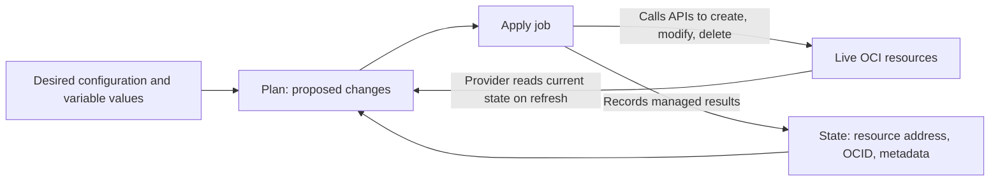
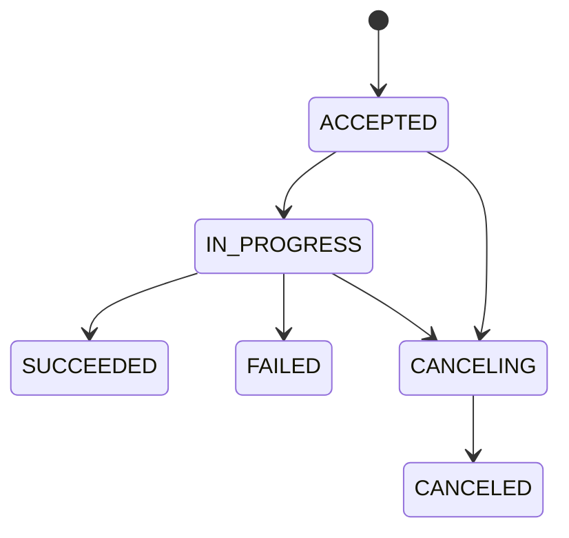
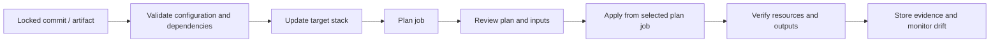

# OCI Resource Manager with Stacks, Jobs, and State

## 1. Objectives and Scope

In the **Infrastructure as Code** chapter of the **CLOUD_PROVIDERS_ORACLE** module, OCI Resource Manager provides a managed environment to run Terraform, maintain state, and record execution history. Instead of each user keeping a copy of state on a laptop, teams work with stacks and jobs that have clear identities in OCI.

This lesson focuses on three questions:

- What information does a **Stack** hold and how does it define management scope?
- How does a **Job** execute Plan, Apply, Import state, or Destroy?
- How does **State** bind Terraform code to real OCI resources and how must it be protected?

Learners will build a small VCN/subnet lab, create a stack, inspect a plan, apply the exact reviewed plan, inspect state, and observe drift. The lesson also explains how to handle failed jobs, cancel jobs, migrate state from an older environment, and end a stack's lifecycle.

The HCL blocks and commands below are intended for **the learner's own lab environment**. They are not a directive to deploy immediately into an active tenancy. Replace OCIDs, region, compartment, names, and CIDRs according to your authorized environment.

The example chooses Terraform **1.5.x** on Resource Manager and the **6.x** OCI provider line as an illustrative baseline. This is an intentional choice to explain the workflow, not a claim of the latest version. Before applying, verify the service's currently supported versions and the provider set approved by your team.

## 2. Stack, Job, and State Model

| Concept | Core Content | Example |
| --- | --- | --- |
| Terraform configuration | Resource, data source, variable, output, and provider requirement declarations | An HCL file creating a VCN and subnet |
| Stack | Management unit bound to configuration source, variables, Terraform version, and state | `rm-network-lab` |
| Job | A single execution of an operation on a stack | Plan job or Apply job |
| Execution plan | Proposed actions to move from current state to configuration | Add two resources |
| State | Maps Terraform resource addresses to live resources, plus metadata | `oci_core_vcn.lab` bound to a VCN OCID |
| Job artifacts | Data supporting inspection of an execution run | Logs, plan, configuration, and state depending on job type |
| Work request | Object tracking an asynchronous service operation | A drift detection run request |

A stack can have many jobs across its history. Each job has its own OCID; never use display name as a unique key when linking a Plan run to an Apply run.

A stack is a resource in a specific region and compartment. Resources configured inside a stack may reside in other compartments or multiple regions if the provider and IAM allow it. The stack's location does not automatically restrict every resource inside it. Oracle describes this relationship in [Overview of Resource Manager](https://docs.oracle.com/en-us/iaas/Content/ResourceManager/Concepts/resourcemanager.htm).

Nor is a stack an entire compartment. It manages the resources belonging to its configuration set and state; other resources in the compartment may be owned by another stack, operators, or other services.

## 3. Distinguishing Configuration, State, and Live Infrastructure

Three things must be observed simultaneously:



- **Configuration** describes intent: which VCN, which subnet, which attributes.
- **State** records which address Terraform binds to which object.
- **Live OCI** consists of the actually existing resources and their statuses.

Example:

```text
Resource address: oci_core_vcn.lab
Actual OCID:      ocid1.vcn.oc1.<region>.<unique-id>
Display name:     rm-lab-vcn
```

Changing a display name does not automatically change the resource address. Conversely, renaming the Terraform label from `lab` to `network` without handling state refactoring can make Terraform treat it as a brand-new resource address.

State is not an application data backup. Having database state does not mean Oracle Database data has been backed up; having Compute state does not mean boot volumes have been backed up.

Terraform uses state to maintain links to real objects, not merely to save display results. See [Terraform — State](https://developer.hashicorp.com/terraform/language/state) to understand why losing or corrupting state can skew subsequent plans.

## 4. What Does Resource Manager Handle for Operations Teams?

Resource Manager handles running Terraform and storing state attached to the stack. Users do not need to build their own Object Storage backend and custom locking mechanism just to run stacks in this workflow.

However, the team remains responsible for:

- HCL content, variable values, and referenced dependencies.
- IAM authorization for stacks/jobs and target resources.
- Change scope, deployment plans, and data requiring backup.
- Review workflows, approvals, and linking plans to applies.
- Costs, service limits, quotas, and resource availability.
- Handling drift, failed jobs, and out-of-band changes outside Terraform.

Resource Manager does not prove that network configuration is secure, that a database is highly available, or that a deployment meets SLOs. A `SUCCEEDED` job only reflects that execution finished under the conditions of that operation; post-deployment functional verification remains necessary.

Resource Manager maintains and updates state for a stack automatically, while allowing only one job to run on a stack at a time. This mechanism is explained in [Resource Manager and Terraform](https://docs.oracle.com/en-us/iaas/Content/ResourceManager/Concepts/resource-manager-and-terraform.htm).

## 5. Preparing IAM Across Two Permission Layers

### 5.1. Permissions to Control Resource Manager

The operations team needs appropriate permissions for stacks and jobs. Lab-scoped example:

```text
Allow group RMNetworkLabOperators to manage orm-stacks in compartment iac-lab
Allow group RMNetworkLabOperators to manage orm-jobs in compartment iac-lab
```

Group names and compartments must exist in the tenancy; group identification syntax may need adjustment depending on identity domain.

These two policies are examples for lab operators, not a least-privilege set for every role. `manage` encompasses broad capabilities; do not grant that same permission to everyone who only needs to read results.

### 5.2. Permissions for Provisioned Resources

Having permission to create an Apply job does not mean having permission to create all OCI resources. For the network lab in `network-lab`, the executor also needs appropriate networking permissions:

```text
Allow group RMNetworkLabOperators to manage virtual-network-family in compartment network-lab
```

When adding Compute, Database, Vault, or resources in other compartments, evaluate the corresponding additional permissions. Do not grant tenancy-wide permissions just to bypass a specific missing-permission error. Oracle distinguishes Resource Manager permissions from target resource permissions in [Securing Resource Manager](https://docs.oracle.com/en-us/iaas/Content/Security/Reference/resourcemanager_security.htm).

In the OCI provider configuration for Resource Manager, this lesson declares only `region`. Never put API signing private keys, fingerprints, or personal credential paths into the ZIP archive.

### 5.3. Review Roles and State Read Access

Design roles by responsibility: those who edit stacks, run jobs, read logs/state, and authorize resource destruction can be different people.

Read permissions on stacks/jobs can grant access to artifacts containing sensitive information. A role called "reviewer" does not automatically see only redacted plan data.

Policy conditions can restrict certain job types to a group, yet OCI IAM permissions are additive. A conditional policy does not negate broad permissions already granted through another policy or group.

Additionally, Plan is not a sandbox for untrusted code. It downloads providers/modules, reads data sources, and can use permissions to access data. Review configuration sources even when intending only to run Plan.

## 6. Locking Down Configuration Source, Versions, and Working Directory

### 6.1. Configuration Sources

Resource Manager supports multiple ways to create stacks, such as ZIP/folder, supported Git sources, Object Storage, templates, or compartment discovery. For versioned sources, record the actual revision used by each job.

Distinguish:

- **OCI Terraform provider:** the plugin such as `oracle/oci` that calls OCI APIs.
- **Configuration source provider:** connection details linking Resource Manager to the source code repository system.

These two concepts serve two completely different purposes.

This lesson uses a ZIP archive so the lab configuration set is easy to control. With Git, an active branch can receive new commits between two runs; never record only a branch name and assume plan and apply used the same inputs.

### 6.2. Working Directory and Upload Package

The working directory must contain at least one `.tf` file. In a simple ZIP upload flow, place HCL files at the root of the ZIP or select the working directory matching the packaged layout.

Do not include the following in the configuration package:

- The `.terraform/` directory.
- `terraform.tfstate` files and backups.
- Credentials, private keys, or files containing secrets.
- Stale plans or unnecessary artifacts.

State files are imported via the **Import state** operation, not bundled inside the configuration ZIP. Structural requirements are outlined in [Terraform Configurations for Resource Manager](https://docs.oracle.com/en-us/iaas/Content/ResourceManager/Concepts/terraformconfigresourcemanager.htm).

### 6.3. Terraform and Provider Are Two Version Layers

The Terraform version selected on the stack must satisfy `required_version` in HCL. The OCI provider version is determined by constraints and the corresponding dependency lock.

Resource Manager maintains its own list of supported Terraform versions; do not assume the version installed on your laptop exists in the service. The example selects 1.5.x per [Supported Terraform Versions](https://docs.oracle.com/en-us/iaas/Content/ResourceManager/Reference/terraformversions.htm).

The `~> 6.0` constraint in the example allows 6.x providers within the declared compatibility range; it does not pin a single patch version. Record the actual version from the run and upgrade providers only intentionally.

`.terraform.lock.hcl` is a provider dependency lock file, not a state file or a concurrency lock. Nor does it lock all Git module sources. These roles are distinguished in [Terraform — Dependency Lock File](https://developer.hashicorp.com/terraform/language/files/dependency-lock).

## 7. HCL Lab: One VCN and One Private Subnet

### 7.1. Resource Scope

The lab creates two declared resources:

```text
oci_core_vcn.lab
└─ oci_core_subnet.app
```

It does not create Compute, databases, load balancers, Internet Gateways, or NAT Gateways in this configuration. The goal is observing the stack/job/state lifecycle with minimal objects.

A VCN may come with default objects created automatically by OCI. Do not equate the number of resource addresses declared in Terraform with the total dependent objects the Console may display.

The illustrative CIDR must be changed if it conflicts with existing networks or peering/VPN plans. Do not connect a lab to production simply because it uses a private subnet.

### 7.2. Contents of main.tf

Create `main.tf` in the learner's lab directory:

```hcl
terraform {
  required_version = ">= 1.5.0, < 1.6.0"

  required_providers {
    oci = {
      source  = "oracle/oci"
      version = "~> 6.0"
    }
  }
}

variable "region" {
  description = "OCI region used by the network resources."
  type        = string
}

variable "compartment_ocid" {
  description = "Target compartment for the VCN and subnet."
  type        = string

  validation {
    condition     = can(regex("^ocid1.compartment.", var.compartment_ocid))
    error_message = "Use the OCID of the target compartment."
  }
}

variable "network_name" {
  description = "Name prefix for the lab network."
  type        = string
  default     = "rm-lab"

  validation {
    condition     = can(regex("^[a-z][a-z0-9-]{2,30}$", var.network_name))
    error_message = "Use 3 to 31 lowercase letters, digits, or hyphens."
  }
}

provider "oci" {
  region = var.region
}

locals {
  lab_tags = {
    ManagedBy   = "ResourceManager"
    Environment = "lab"
    Purpose     = "stack-job-state"
  }
}

resource "oci_core_vcn" "lab" {
  compartment_id = var.compartment_ocid
  cidr_blocks    = ["10.70.0.0/16"]
  display_name   = format("%s-vcn", var.network_name)
  dns_label      = "rmlab"
  freeform_tags  = local.lab_tags
}

resource "oci_core_subnet" "app" {
  compartment_id             = var.compartment_ocid
  vcn_id                     = oci_core_vcn.lab.id
  cidr_block                 = "10.70.1.0/24"
  display_name               = format("%s-app", var.network_name)
  dns_label                  = "app"
  prohibit_public_ip_on_vnic  = true
  freeform_tags              = local.lab_tags
}

output "vcn_id" {
  description = "VCN managed by this stack."
  value       = oci_core_vcn.lab.id
}

output "subnet_id" {
  description = "Private subnet managed by this stack."
  value       = oci_core_subnet.app.id
}
```

The `compartment_ocid` validation is a preliminary format check; it does not verify that the resource exists or that the user has permissions. Only the provider/API verifies actual conditions when the job runs.

Referencing `oci_core_vcn.lab.id` creates the subnet's dependency on the VCN. There is no need to add `depends_on` just to repeat this relationship.

`availability_domain` is omitted on the subnet in the example to create a regional subnet. `prohibit_public_ip_on_vnic = true` prevents VNICs in the subnet from having public IPs; it does not replace routes, NSGs, security lists, or other network controls. Attributes are documented in [OCI provider — VCN](https://docs.oracle.com/en-us/iaas/tools/terraform-provider-oci/latest/docs/r/core_vcn.html) and [OCI provider — Subnet](https://docs.oracle.com/en-us/iaas/tools/terraform-provider-oci/latest/docs/r/core_subnet.html).

### 7.3. Packaging the Lab Content

Assume the learner has this structure:

```text
rm-network-lab/
└─ main.tf
```

From the parent directory, PowerShell can package the exact file:

```powershell
Compress-Archive -LiteralPath '.\rm-network-lab\main.tf' -DestinationPath '.\rm-network-lab-v1.zip'
Get-FileHash -LiteralPath '.\rm-network-lab-v1.zip' -Algorithm SHA256
```

Verify the ZIP contains `main.tf` at its root. Record the artifact's SHA-256, source commit if any, and chosen variables. This hash identifies the upload package; it does not prove the configuration inside is correct.

If checking syntax in a development environment, use a compatible Terraform version. Do not run local apply to create the same resources under an independent state while Resource Manager owns the lab.

## 8. Creating the Stack Without Applying Infrastructure Yet

In the OCI Console:

1. Select the exact region used for Resource Manager.
2. Open Resource Manager and the Stacks list.
3. Choose the compartment containing the stack, for example `iac-lab`.
4. Create a stack from the ZIP `rm-network-lab-v1.zip`.
5. Give it an identifiable name, such as `rm-network-lab`.
6. Select Terraform 1.5.x matching the example's constraint.
7. Verify the working directory.
8. Enter variables and create the stack without automatically running Apply.

Illustrative variable values:

| Variable | Value to Supply |
| --- | --- |
| `region` | Actual target region, e.g., a region subscribed by the tenancy |
| `compartment_ocid` | OCID of the `network-lab` compartment |
| `network_name` | `rm-lab` |

Some variables such as region/compartment may be pre-filled by the Console during stack creation. Double-check them: the compartment holding the stack and the compartment where the network is created do not have to be the same.

After creating the stack, record the **stack OCID**, region, compartment, and Terraform version. Creating a stack only prepares the management unit; it does not prove the VCN/subnet have been provisioned.

The [Creating a Stack](https://docs.oracle.com/en-us/iaas/Content/ResourceManager/Tasks/create-stack.htm) guide links creation flows for each configuration source.

## 9. Running Plan and Reading Results Properly

### 9.1. What a Plan Job Does

A Plan job reads configuration, variables, and state, using the provider to build a change plan. For a brand-new stack in the lab with no resource state yet, the normal expectation is adding two declared resources.

Example summary:

```text
Plan: 2 to add, 0 to change, 0 to destroy.
```

This is the expected result for a clean lab configuration, not a guaranteed output string for every run. If you see other actions, inspect each resource address and cause.

Plan does not provision the two resources in the plan. However, it can still call APIs to read data, download dependencies, and produce logs/artifacts.

Oracle explains generating an execution plan in [Creating a Plan Job](https://docs.oracle.com/en-us/iaas/Content/ResourceManager/Tasks/create-job-plan.htm).

### 9.2. What to Review Before Apply

| Item | What to Confirm |
| --- | --- |
| Identity | Exact stack OCID, region, compartment, and environment |
| Inputs | Exact ZIP/revision, variables, and provider/Terraform versions |
| Resource addresses | Only resources within the lab scope |
| Actions | Add/update/delete/replace match intent |
| Networking | CIDRs, public IP policy, related routes/security |
| Data | Whether any resource holds data needing backup or retention |
| Cost | Whether unexpected shapes, storage, gateways, or services are introduced |
| Unknown values | Which attributes are known only after Apply and whether that is acceptable |

Common symbols in a plan:

```text
+    create new
~    update in-place
-    destroy
-/+  replace by destroying then creating
+/-  replace by creating then destroying when conditions allow
```

Do not look only at counts. A change with one resource replaced can have far greater impact than many resources merely updating tags.

A successful Plan also does not guarantee Apply will succeed: quotas/capacity, IAM, live data, or service conditions can change afterward.

### 9.3. Preserving the Plan Identifier

Record the plan job OCID once the job reaches `SUCCEEDED` and the plan has been reviewed. When applying, select that exact plan rather than picking a new unread plan.

If source, variables, provider, or state have changed, create a new plan and review it again. Never treat an old plan as an indefinite license for future Apply runs.

With Git or Object Storage sources whose contents can change between jobs, use a workflow that pins revisions/artifacts and records input evidence. Having the same stack name does not guarantee the inputs are still the same.

## 10. Applying the Exact Plan and Verifying Resources

In the stack's Apply dialog, select the previously generated plan when the service flow allows and confirm its identifier. The Console offers only valid plan choices; do not attempt to apply a stale plan or one from another stack.

The Apply job calls APIs to execute planned actions. For the lab:

1. The VCN is created.
2. The subnet is created once the VCN OCID is available.
3. Management state and outputs are recorded.

Once the Apply job reaches `SUCCEEDED`:

- Open the VCN/subnet resources in the right region and compartment.
- Cross-check OCIDs against job outputs.
- Check CIDRs, names, freeform tags, and public IP prohibition on the subnet.
- Inspect state to verify mappings for `oci_core_vcn.lab` and `oci_core_subnet.app`.
- Record the Apply job OCID and completion timestamp.

Do not treat creating an Apply job as proof deployment is complete. Job creation is asynchronous; the job may still be `ACCEPTED` or `IN_PROGRESS`.

`AUTO_APPROVED` is an execution mode not backed by a pre-generated plan in that flow. It does not produce evidence of human review. Linking plans and applies is described in [Creating an Apply Job](https://docs.oracle.com/en-us/iaas/Content/ResourceManager/Tasks/create-job-apply.htm).

In this lesson, prefer the Plan–review–Apply workflow with an explicit plan job ID.

## 11. Job Lifecycle and OCI CLI Examples

### 11.1. Job States



The diagram shows common state transitions for reading job status, not a guarantee that every internal transition occurs exactly once per diagram.

| State | Meaning |
| --- | --- |
| `ACCEPTED` | The service has accepted the job |
| `IN_PROGRESS` | The job is executing |
| `SUCCEEDED` | The job completed successfully |
| `FAILED` | The job failed; partial changes may have occurred |
| `CANCELING` | Cancellation requested but not yet finished |
| `CANCELED` | The job was canceled; does not mean prior changes were rolled back |

If the CLI times out or the terminal closes, do not assume the job stopped. Query status using the job OCID before submitting another job.

### 11.2. Creating a Plan Job from PowerShell

These commands use an installed OCI CLI with configured authentication and appropriate policies. Replace placeholders before running:

```powershell
$labRegion = '<oci-region>'
$stackId = '<stack-ocid>'

$planResponse = oci resource-manager job create-plan-job --region "$labRegion" --stack-id "$stackId" --display-name 'lab-plan-v1' --wait-for-state SUCCEEDED --wait-for-state FAILED --wait-for-state CANCELED --max-wait-seconds 1200

if ($LASTEXITCODE -ne 0) {
    throw 'Plan create/wait command failed or timed out; inspect the job on OCI before resubmitting.'
}

$planJob = ($planResponse -join [Environment]::NewLine) | ConvertFrom-Json

if ($planJob.data.'lifecycle-state' -ne 'SUCCEEDED') {
    throw 'Plan did not succeed; inspect logs and do not proceed to Apply.'
}

$planJobId = $planJob.data.id
$planJobId
```

Waiting for a terminal state does not mean that terminal state is success. The script explicitly checks `lifecycle-state` because `FAILED` and `CANCELED` are also among the waited states.

If an error/timeout prevents the CLI from returning complete JSON, open the stack's Jobs list and check timestamps, display name, and job OCID. Do not resubmit repeatedly just because no response arrived yet.

Open the plan job in the Console to read the full execution plan. Printing an OCID in a script does not replace the review step.

### 11.3. Applying the Reviewed Plan

After reviewing the plan and confirming no new inputs require re-planning:

```powershell
$applyResponse = oci resource-manager job create-apply-job --region "$labRegion" --stack-id "$stackId" --execution-plan-strategy FROM_PLAN_JOB_ID --execution-plan-job-id "$planJobId" --display-name 'lab-apply-v1' --wait-for-state SUCCEEDED --wait-for-state FAILED --wait-for-state CANCELED --max-wait-seconds 1200

if ($LASTEXITCODE -ne 0) {
    throw 'Apply create/wait command failed or timed out; inspect the job on OCI.'
}

$applyJob = ($applyResponse -join [Environment]::NewLine) | ConvertFrom-Json

if ($applyJob.data.'lifecycle-state' -ne 'SUCCEEDED') {
    throw 'Apply did not succeed; verify live resources and state.'
}

$applyJobId = $applyJob.data.id
$applyJobId
```

`FROM_PLAN_JOB_ID` is the strategy; `--execution-plan-job-id` holds the Plan job's OCID. Never pass the stack OCID to the plan parameter or swap the two ID types. Check [OCI CLI — create-apply-job](https://docs.oracle.com/en-us/iaas/tools/oci-cli/latest/oci_cli_docs/cmdref/resource-manager/job/create-apply-job.html) when using another CLI version.

To inspect a known job:

```powershell
oci resource-manager job get --region "$labRegion" --job-id "$applyJobId"
```

This status command can resume tracking after an earlier terminal disconnected. Inspection output should include failure details/logs when a job fails.

## 12. How State Is Stored and Read

### 12.1. Mappings Matter More Than Display Names

The form below only illustrates part of state's meaning; it is not a valid state file for importing:

```text
resources:
  oci_core_vcn.lab
    id -> ocid1.vcn...
    compartment_id -> ocid1.compartment...

  oci_core_subnet.app
    id -> ocid1.subnet...
    vcn_id -> ocid1.vcn...
```

Real state also contains schema versions, provider metadata, dependencies, and many other attributes. Do not hand-edit JSON to "make Terraform recognize" a resource without a proper state management procedure.

Renaming a resource in code, moving a resource into a module, or converting from `count` to `for_each` changes management addresses. It must be designed as refactoring, inspected in a plan, and handled with version-compatible mechanisms rather than merely changing display names.

### 12.2. Stack State and Job-Level Artifacts

State can be read from the stack or from jobs that produced corresponding artifacts. Oracle describes the state downloaded from a stack as the state associated with the **most recent successful job** in [Getting a Stack's State File](https://docs.oracle.com/en-us/iaas/Content/ResourceManager/Tasks/get-stack-tf-state.htm).

Consequently, after a failed Apply or force cancel, a state file downloaded from the stack page does not prove it reflects every change that occurred during the failed run. Cross-check job history, available artifacts, and live resources.

Example of downloading state for investigation in a controlled directory:

```powershell
oci resource-manager stack get-stack-tf-state --region "$labRegion" --stack-id "$stackId" --file '.\rm-network-lab.tfstate'
```

The downloaded file is a **point-in-time copy**, not a live backend connection syncing with the stack. Running local Terraform against this copy can introduce a second writer outside Resource Manager.

Some artifacts may not be available immediately the moment a job finishes. Distinguish artifact publication latency from job failure; check status and perform bounded download retries instead of triggering another Apply.

### 12.3. Protecting State, Plans, and Logs

State can contain sensitive data, including credential values the provider must retain. `sensitive = true` mainly masks display in some UIs and does not guarantee values are excluded from state or plans.

Using OCI Vault can avoid placing secrets directly in configuration, yet if Terraform reads a secret value and uses it, check whether that data enters state or logs. Never equate a secret reference with the entire processing chain being free of plaintext.

Limitations and protection options are detailed in [Terraform — Manage Sensitive Data](https://developer.hashicorp.com/terraform/language/manage-sensitive-data).

Good practices:

- Restrict who can download state/plans/logs.
- Never commit state to Git or attach it publicly to tickets.
- Never expose secrets via outputs merely for downstream convenience.
- Limit detailed/debug logs and review what information could be exposed.
- Retain investigation/migration copies per retention policies and delete under control.

## 13. State Locking and Resource Ownership Scope

Resource Manager runs only one job on a stack at a time. This lock reduces the risk of two executions modifying the stack's state concurrently.

It does not protect against:

- Two different stacks managing the same VCN/NSG/database.
- A local Terraform run using its own copy of state.
- Users editing resources directly in the Console.
- Another API or tool modifying resources while a job is running.
- Another configuration editing the same attributes or rule set.

Follow the principle **one managed object has one clear state owner**. If a stack only needs to use a subnet owned by the network team, receive the subnet OCID via an input contract or read it via an appropriate data source; never import that subnet into the application stack's state.

Some resources update entire lists/rule sets in one call. Two tools editing supposedly different parts can still overwrite each other; design ownership at the attribute and resource granularity matching the provider.

When splitting stacks, draw boundaries by lifecycle and responsibility:

| Stack | Suggested Scope | Characteristics |
| --- | --- | --- |
| Network foundation | VCN, subnets, connectivity components managed by the network team | Changes infrequently, many dependents |
| Application runtime | Compute/OKE and application-specific components | Changes at deployment cadence |
| Database foundation | Databases and data components | Needs separate backup, maintenance, and recovery policies |

This is an organizational example, not a strict rule to split into exactly three stacks. One giant stack increases blast radius; too many tiny stacks increase dependencies and coordination overhead.

Network stack outputs do not automatically become application stack variables. Pipelines or operational processes must read the exact output, verify the environment, and supply it to the receiving stack. Avoid granting read access to full state just to fetch one OCID when a narrower output-sharing mechanism exists.

## 14. Drift Detection and Remediation Decisions

### 14.1. Drift Is Deviation Beyond Applied Configuration

For example, a VCN was applied with display name `rm-lab-vcn`, and later someone manually edits it to `manual-change`. Managed code and state do not reflect this new intent; live infrastructure has diverged.

Resource Manager provides drift detection for eligible stacks, such as those with an appropriate Apply/Import state or created via compartment discovery per service support. You can check all or selected resource addresses.

Drift detection is an asynchronous operation with a **work request**, not something that yields a Plan job OCID just because of the task name. Oracle documents tracking work requests and results in [Detecting Drift in a Stack](https://docs.oracle.com/en-us/iaas/Content/ResourceManager/Tasks/detect-drift.htm).

### 14.2. Lab: Modifying a Low-Impact Attribute

After the lab Apply succeeds:

1. Record the current VCN name and managing resource address.
2. On that exact lab VCN, change the display name to an identifiable value.
3. Run drift detection per stack support conditions.
4. Track the work request until completion.
5. Open results by resource address and read the drifted attribute.

Do not use security rule edits, subnet deletion, or CIDR changes as your first experiment on a network with active users.

Drift detection does not mean automatic remediation. Once results are available, choose one approach:

- **Keep standard configuration:** generate a new plan and Apply to restore managed attributes to desired state.
- **Accept intentional change:** update code/variables to match intent, review, then Plan–Apply.
- **Adjust ownership:** if another tool must manage an attribute, redesign boundaries instead of letting two sides fight for write control.

Do not scatter `ignore_changes` broadly just to make drift reports clean. Ignoring an attribute is an ownership decision and can hide changes that matter.

### 14.3. Plan Does Not Replace All Meanings of a Drift Report

A fresh plan shows how Terraform expects to reconcile differences between current inputs and live infrastructure. A drift report highlights divergence from the last applied configuration under Resource Manager's mechanism.

If you just edited code without applying yet, expected differences in the new code do not mean someone tampered with live infrastructure. Track the deployed revision and proposed revision to tell the two cases apart.

After resolving drift and holding inputs steady, run a verification Plan. The expectation is no unexpected changes; inspect details if the provider or platform still exhibits normalized/computed fields causing diffs.

## 15. Importing State and Adopting Existing Infrastructure

### 15.1. Two Easily Confused Import Concepts

| Operation | Input | Purpose |
| --- | --- | --- |
| Resource Manager Import state job | A Terraform state file | Sets the provided state as the stack's current state |
| Terraform resource import | Resource address and existing object identifier | Creates a management binding for an object not yet in that state |
| Resource discovery | Supported OCI resource scope | Generates configuration/state from already deployed resources |

Importing state does not duplicate a VCN or database. It replaces the management mapping baseline; importing the wrong state can cause the next Apply to alter the wrong objects.

Oracle explains replacing current state accurately in [Creating an Import Job](https://docs.oracle.com/en-us/iaas/Content/ResourceManager/Tasks/create-job-import.htm).

### 15.2. Migrating a Local Terraform Environment to Resource Manager

A controllable workflow:

1. Identify the state/backend currently owning the resources and its responsible owner.
2. Pause old pipelines/writers during the migration window.
3. Record configuration, variables, Terraform/provider versions, and the latest state snapshot.
4. Save a protected backup and verify exact region/compartment/OCIDs.
5. Create a Resource Manager stack with matching configuration without running Apply to create new resources.
6. Run Import state into that exact stack.
7. Wait for the Import job to succeed and inspect resource addresses/OCIDs.
8. Run Plan and read every diff; for a migration without intent changes, expect no unintended changes.
9. Re-open deployment pipelines only after designating Resource Manager as the authoritative writer.

Never Apply a stack with an empty state first and import later thinking "the configurations match." Terraform may create duplicate resources or fail on name/identifier collisions before knowing existing objects belong to it.

Do not keep local writers active after migration. A state backup must never turn into a second deployment environment.

### 15.3. Discovery Must Be Reviewed Like New Code

Generating configuration from a compartment helps begin adopting resources, yet it does not prove the code has proper module structure, naming, policies, or lifecycles.

Inspect supported provider/resource coverage, out-of-scope dependencies, sensitive values, and objects with different owners. Never discover/import an entire compartment and assume you can safely Destroy everything.

## 16. Failed Jobs, Job Cancellation, and Rollback

### 16.1. Apply Is Not a Whole-Infrastructure Transaction

Suppose a job created the VCN but failed while creating the subnet:

```text
Create VCN       -> succeeded
Create subnet    -> failed
Apply job        -> FAILED
```

Do not assume the VCN was automatically deleted. Resource Manager/Terraform does not provide atomicity like a database transaction spanning every service API.

Before retrying:

- Read the root error in logs and failure details.
- Identify which operations succeeded or are still completing in the target service.
- Cross-check available state/artifacts against actual OCIDs.
- Fix the root cause, then generate a new plan.
- Apply only once remaining changes and ownership are clear.

If an API created a resource successfully but the result was not recorded properly, reconciliation/import procedures may be needed. Never delete state or spin up another stack just to re-run faster.

### 16.2. Cancel Differs from Rollback

Cancel requests stopping a job. Graceful cancellation can still leave already executed work behind; force cancel can further leave state out of sync with live resources.

Oracle highlights this risk in [Canceling a Job](https://docs.oracle.com/en-us/iaas/Content/ResourceManager/Tasks/cancel-job.htm).

After requesting cancellation, monitor until a terminal state and verify infrastructure. `CANCELING` is not yet `CANCELED`; `CANCELED` also does not mean "no resources were created."

Do not repeatedly force cancel to deal with routine permission/quota errors. Bypassing completion wait times can complicate recovery.

### 16.3. Rollback Uses a New Plan to Return to a Prior Configuration

Resource Manager supports Plan rollback and Apply rollback operations. The typical workflow picks a prior successful Apply job as the target, generates a rollback plan, reviews it, and applies it. See [Creating a Plan Rollback Job](https://docs.oracle.com/en-us/iaas/Content/ResourceManager/Tasks/create-job-plan-rollback.htm).

Rollback is still a forward infrastructure mutation from current state, which may require recreating, deleting, or updating resources. It does not restore lost data merely by selecting an old job.

Therefore:

- Restoring configuration does not mean restoring database data.
- Selecting an older image/shape does not recover contents of a deleted volume.
- Importing an old state file does not turn OCI resources back in time.
- A rollback plan must be reviewed for replacements, dependencies, and feasibility.

In some situations, fixing configuration forward causes less disruption than rolling back to an older version. Choose based on the concrete plan and recovery goals.

## 17. Destroy and Delete Stack Have Different Consequences

| Action | Primary Impact | What to Remember |
| --- | --- | --- |
| Destroy job | Executes teardown of managed resources via Terraform/provider mechanisms | Can delete resources and data; can fail partially |
| Delete stack | Deletes the stack object and its associated state in Resource Manager | Associated OCI resources may still remain |
| Manual resource deletion | Alters infrastructure outside state | Causes drift and can make subsequent runs unpredictable |

Oracle confirms that deleting a stack leaves resources intact while removing associated state in [Deleting a Stack](https://docs.oracle.com/en-us/iaas/Content/ResourceManager/Tasks/delete-stack.htm).

### 17.1. Ending the Lab in the Right Order

For this lesson's network lab:

1. Verify the VCN/subnet are truly lab resources and no other workloads use them.
2. Inspect state, OCIDs, and dependencies created after lab provisioning.
3. Run a Destroy job in the exact stack once authorized to clean up resources.
4. Wait for completion, read logs, and verify resources were handled.
5. If it fails, resolve dependencies/permissions and reconcile; do not delete the stack to hide errors.
6. Only once no managed resources remain and required evidence is preserved, delete the stack if no longer needed.

A normal Plan with the current configuration is not a preview of a Destroy job. Never inspect a "no changes" plan and conclude Destroy has no impact.

For data infrastructure, review backups, retention, deletion protection, retained volumes, and out-of-state resources before cleanup. An unused stack does not automatically stop OCI resource billing.

### 17.2. Scoped Destroy Permissions

Destroy jobs can be restricted via policies, yet that alone does not block all deletion actions. An Apply job can also delete resources when code removes a resource or forces replacement.

Therefore, destruction controls must cover configuration edit permissions, Apply permissions, plan inspection, and permissions on target resources. Never rely solely on hiding the Destroy button.

## 18. Organizing CI/CD and Deployment Evidence

An appropriate pipeline can follow this flow:



Each deployment should attach these records:

| Evidence | Purpose |
| --- | --- |
| Source commit or ZIP SHA-256 | Identifies delivered code |
| Stack OCID and region | Identifies the management unit |
| Variable set and relevant versions | Explains inputs; protect secret values |
| Plan job OCID | Identifies the reviewed plan |
| Approver/approval workflow | Proves deployment decision |
| Apply job OCID and outcome | Links execution to the plan |
| Outputs and post-deployment checks | Verifies live infrastructure |
| Timestamps and error codes on incidents | Supports investigation/audit |

Do not mix lab/staging outputs with production. Never use a single shared variable to swap states across multiple environments in the same stack and call that environment isolation.

If a stack's inputs are updated while a pipeline is running, stop the old approval flow and generate an appropriate plan. Concurrency locking does not substitute for keeping configuration sources and review workflows consistent.

Do not enable provider upgrades on every job just because the option exists. Upgrades require plans, compatibility checks, and separate evidence, especially for resources at risk of replacement.

## 19. Operational Monitoring, Cost, and Availability

Monitor jobs beyond just final outcomes:

- Which jobs are running, queue wait times, and execution durations.
- Provider/API errors, throttling, quotas, and capacity.
- Repeatedly canceled or failed jobs.
- New drift and when it was addressed.
- Divergence between desired revision and applied revision.
- Resources remaining after cleanup or stack deletion.

Apply appropriate tags to stacks/jobs and created OCI resources. Tags on a stack do not automatically ensure every child resource receives the same tags; in the example, freeform tags are declared directly on each resource.

When estimating cost, account for provisioned resources, volumes, gateways, IPs, backup storage, data transfer, and Resource Manager job/feature usage per service terms. Never assume using IaC or a small stack means all resources are free.

For availability, plans must be read with dependencies and lifecycles in mind:

- Will a subnet change cause applications to lose connectivity?
- Will Compute replacement maintain required replica counts?
- Can data resources recover within required timeframes?
- Is a foundation stack relied on by multiple applications being changed outside its maintenance window?

Resource Manager helps execute and store evidence; HA design still lives in configuration, application architecture, and operational procedures.

## 20. Isolating Common Errors

| Symptom | Causes to Check | Resolution Approach |
| --- | --- | --- |
| Stack not visible | Region, compartment, IAM, or filters | Verify stack OCID and exact Console/CLI scope |
| Job reports missing Terraform files | Wrong ZIP root/working directory | Inspect artifact structure and select the right directory |
| Incompatible Terraform version | Stack version differs from constraint | Choose a supported version set and plan upgrades |
| Cannot download provider | Constraint, provider source, or dependency/network | Inspect init logs and locked version set |
| Can create job but VCN creation denied | Missing target resource permissions | Check IAM in the VCN's compartment |
| `NotAuthorizedOrNotFound` | Wrong OCID/region or unauthorized to view resource | Check both identifiers and permissions; do not immediately conclude resource was deleted |
| Apply cannot use plan | Wrong stack, stale plan, or inputs/state changed | Generate and review a fresh matching plan |
| Apply fails after partial creation | API/quota/capacity/dependencies | Reconcile live resources and state before retrying |
| Cannot start a new job | An active job is running on the stack | Check lifecycle; do not create a second stack to bypass the lock |
| Plan wants to recreate everything | Empty state, wrong imported state, or renamed resource address | Halt Apply and inspect management mappings |
| Drift fails to run or yields no results | Stack eligibility, work request, permissions/provider | Check support prerequisites and work request errors |
| Destroy fails | Resources in use, protection, or missing permissions | Resolve dependencies with owners; do not delete stack first |
| Costs continue after deleting stack | OCI resources still exist | Audit resources and plan cleanup by OCID |

When escalating for support, retain stack/job/work request OCIDs, timestamps, region, error codes, and logs stripped of sensitive data. Never send full state or debug logs merely as a substitute for a specific error excerpt.

## 21. Hands-On Workflow and Completion Criteria

Execute sequentially in your own lab:

1. Prepare IAM, compartment, and region; confirm no other stack owns the resources you will use.
2. Write VCN/subnet HCL, verify versions, and package a ZIP with no state/credentials.
3. Create the stack and verify variables, working directory, and Terraform version.
4. Run Plan; inspect actions per resource and record the plan job OCID.
5. Apply the exact reviewed plan; wait for completion and verify live OCIDs/attributes.
6. Inspect state to identify both resource addresses and the subnet's dependency on the VCN.
7. Introduce drift by changing the display name on the lab resource; observe the work request and report.
8. Choose either restoring standard configuration or codifying intent; Plan–Apply per decision.
9. Run a verification Plan once inputs and infrastructure are steady.
10. Clean up resources with Destroy within authorized scope, verify, and only then consider Delete stack.

The lesson is complete when learners can explain why a resource exists in state, which job created/modified it, which plan was applied, and what to do when reality diverges from configuration.

A reliable Resource Manager workflow preserves the chain linking code, inputs, plans, executions, and live OCI resources, even when errors or out-of-band changes occur.
