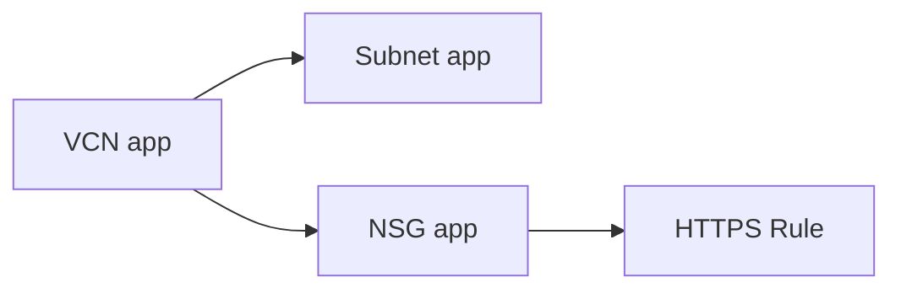

# Plan Review, Dependency Graph, and Controlled Change Application

## 1. Objectives and OCI Context

In the **Infrastructure as Code** chapter of the **CLOUD_PROVIDERS_ORACLE** module, a Terraform change must be evaluated by its impact on Oracle Cloud Infrastructure (OCI): right tenancy, right compartment, right IAM permissions, right network connectivity, and acceptable disruption level. A single line of configuration change can affect multiple Compute instances or cut off an application's path to an Oracle database.

After this lesson, learners can read an execution plan, explain dependency relationships between resources, and design an application workflow backed by approval evidence. The focus is making informed decisions before mutating infrastructure, then confirming the system still meets operational, cost, and availability requirements.

Overarching scenario: the application team operates a Java service inside an application-dedicated compartment. Infrastructure includes a VCN, private subnet, NSG, Compute, and database connectivity. A change request only requires adding HTTPS from the middle tier to the application; reviewers must catch it if the plan simultaneously widens access or proposes replacing running machines.

The commands in this lesson are examples for learners to run in a prepared practice environment. There is no need to provision Compute or databases just to learn how to read the graph; the HCL example below focuses on networking.

## 2. What Does a Plan Tell Us?

Terraform builds a plan from desired configuration, state, and resource information read via the provider. In normal mode, it refreshes state, compares, and proposes actions; running `plan` alone does not execute the proposed resource changes. Running with `-out` produces a plan file that can be passed to apply. If unsaved, the output mainly serves as a preview. [terraform plan documentation](https://developer.hashicorp.com/terraform/cli/commands/plan).

Three questions must be distinguished:

| Question | Evidence to Inspect |
| --- | --- |
| What does the configuration want to change? | Source code diff, input variables, module versions |
| What does Terraform expect to do? | Plan, resource addresses, before and after attributes |
| Can the service tolerate the change? | Architecture, traffic, data, runbooks, and monitoring |

For instance, editing a route table may look like a single update action yet affect every subnet sharing it. Conversely, adding multiple rules scoped precisely to the right source may have a smaller blast radius. Action counts guide reading; deployment decisions must rest on each individual change and the systems relying on it.

### 2.1. Read Symbols Before Reading Attributes

Common symbols in resource change sections:

| Symbol | Meaning to Recognize |
| --- | --- |
| `+` | Create resource |
| `~` | Update existing resource |
| `-` | Destroy resource |
| `-/+` | Destroy then recreate |
| `+/-` | Create new before destroying old object |
| `<=` | Read data source |

Replacements must be treated as identity and lifecycle changes. Look for the attribute triggering replacement, OCID references, attached data, and how traffic shifts. Lifecycle rules can influence create/destroy ordering, yet do not automatically guarantee uninterrupted application service. [lifecycle documentation](https://developer.hashicorp.com/terraform/language/meta-arguments/lifecycle).

The following diff snippet only illustrates an attribute change needing investigation; full actions must be read from an actual plan of the active provider:

```text
~ source = "10.20.10.0/24" -> "0.0.0.0/0"
```

If the request only allows one source subnet, this change widens allowed scope and must be fixed before approval. Actual reachability also depends on routes, IPs, NSGs attached to VNICs, security lists, and other filtering layers. However, lacking an Internet route today is no excuse to approve a rule exceeding requirements.

### 2.2. Understanding Unknown Values

`(known after apply)` indicates a value cannot be determined at plan time. The OCID of a resource about to be created is a normal example. For attributes governing access permissions or connection targets, reviewers must understand where that value is computed from and what its bounds are.

In JSON representation, `after_unknown` marks unknown values; `before`, `after`, and `change.actions` allow structured inspection of changes. Action arrays containing both `delete` and `create` represent replacements. [Terraform JSON output format](https://developer.hashicorp.com/terraform/internals/json-format).

Do not approve an IAM policy merely because critical content is hidden behind an unknown value. You may need to clarify inputs, narrow dependencies, or split the change into phases with clear targets.

### 2.3. What a Plan Does Not Prove

A valid plan does not prove that:

- Compute shapes have available capacity in the target placement or sufficient quotas.
- The Java application finishes starting up, passes health checks, and has a working database connection pool.
- Credentials at apply time hold sufficient permissions for every involved resource.
- The system meets RTO/RPO, or data can be recovered within the desired window.
- Post-change cost fits within budget.

These are additional operational acceptance criteria. For example, scaling up instance count requires a cost estimate and load-shedding readiness; changing database access requires a connectivity test from the exact application subnet.

## 3. Reviewing by Impact Scope on OCI

A helpful review order is confirming the deployment target, finding destructive actions, and then tracing networking, permissions, and data.

### 3.1. Confirm the Exact Target Before Reading Diffs

Record tenancy, region, compartment OCID, backend/state, and environment. When using provider aliases, check which provider configuration each resource uses. When using Resource Manager, also record the Stack OCID and Plan Job OCID.

A workspace named `prod` or a compartment display name is only partial evidence. Cross-check real identifiers against the change record. A reasonable-looking plan targeting the wrong compartment is still a misdirected change.

### 3.2. Resource-by-Resource Inspection Matrix

| Group | What to Check in the Plan | Impact to Explain |
| --- | --- | --- |
| IAM | Granted principal, verb, resource type, compartment scope | Does it escalate permissions beyond need or affect multiple applications? |
| VCN and subnets | CIDR, route table, security list, public IP assignment capability | Could it cause network conflicts, lost connectivity, or extra access paths? |
| NSG | Traffic direction, source/destination, protocol, ports, attached VNICs | Do rules match the intended flow and avoid overly broad exposure? |
| Compute | Replacement, shape, initialization config, VNIC, boot volume | Is draining, traffic shifting, or spare capacity needed? |
| Storage | Volumes, attachments, buckets, data retention periods | Is there data loss, permission changes, or added storage capacity? |
| Oracle Database | Actions on database, connection settings, backups | Is there downtime, recovery need, or changed HA conditions? |
| Monitoring | Alarms, logs, notification targets, and related metrics | Will errors and latency remain observable after deployment? |

These are review guidelines for the OCI architecture in this lesson, not a claim that every attribute supports in-place updates. Actual actions depend on the service type, provider, version, and specific configuration.

For critical data, require evidence of verified backups and recovery plans. For shared infrastructure such as route tables or IAM policies, list consuming systems before approving.

### 3.3. Actionable Review Outcomes

A good review comment links resource, attribute, and requirement:

```text
Not approved:
- The HTTPS rule changes source from the middle-tier subnet to 0.0.0.0/0.
- This scope exceeds the requirement to allow only internal traffic.
- Fix the source, generate a new plan, and resubmit that exact artifact for review.
```

An approval should include concrete conditions: which plan is approved, which environment, who is responsible for deployment, execution window, and how success is verified. When plan contents change, an old approval no longer represents the new change.

## 4. Dependency Graph: Ordering Derived from Relationships

Terraform uses a dependency graph to organize operations. Attribute references between resources create dependencies; `depends_on` adds explicit edges. The graph also includes provider nodes and lifecycle operations. Eligible nodes can be processed concurrently; appearance order in an HCL file is not an execution schedule. [Terraform dependency graph](https://developer.hashicorp.com/terraform/internals/graph).

### 4.1. Small OCI Network Example for Reading the Graph

Assume the root module already has appropriate OCI provider configuration, authentication, and backend, along with project-approved Terraform/provider versions. `compartment_id` is the OCID of an existing practice compartment and the principal has permission to create network resources there.

The following snippet can be placed in a practice configuration; it creates a VCN, private subnet, NSG, and HTTPS rule. This is not yet a complete application architecture.

```hcl
variable "compartment_id" {
  type        = string
  description = "Practice compartment OCID"
}

variable "https_source_cidr" {
  type        = string
  description = "Middle-tier subnet allowed to call the application"
  default     = "10.20.10.0/24"
}

resource "oci_core_vcn" "app" {
  compartment_id = var.compartment_id
  cidr_blocks    = ["10.20.0.0/16"]
  display_name   = "iac-review-vcn"
  dns_label      = "iacreview"
}

resource "oci_core_subnet" "app" {
  compartment_id             = var.compartment_id
  vcn_id                     = oci_core_vcn.app.id
  cidr_block                 = "10.20.20.0/24"
  display_name               = "iac-review-private-subnet"
  dns_label                  = "app"
  prohibit_public_ip_on_vnic = true
}

resource "oci_core_network_security_group" "app" {
  compartment_id = var.compartment_id
  vcn_id         = oci_core_vcn.app.id
  display_name   = "iac-review-app-nsg"
}

resource "oci_core_network_security_group_security_rule" "https" {
  network_security_group_id = oci_core_network_security_group.app.id
  direction                 = "INGRESS"
  protocol                  = "6"
  source_type               = "CIDR_BLOCK"
  source                    = var.https_source_cidr
  stateless                 = false
  description               = "HTTPS from middle tier"

  tcp_options {
    destination_port_range {
      min = 443
      max = 443
    }
  }
}
```

In the example, `protocol = "6"` represents TCP; the destination port is restricted via `destination_port_range`. Rule schema and field meanings are described in the [OCI provider NSG security rule resource documentation](https://docs.oracle.com/en-us/iaas/tools/terraform-provider-oci/latest/docs/r/core_network_security_group_security_rule.html).

The subnet references the VCN directly via `vcn_id`. When custom route table or security list settings are omitted, the subnet uses the VCN's corresponding defaults; inspect those defaults before deploying workloads. [OCI provider subnet resource documentation](https://docs.oracle.com/en-us/iaas/tools/terraform-provider-oci/latest/docs/r/core_subnet.html).

A VCN is created with default resources such as a route table, security list, and DHCP options. The resource count in the plan does not necessarily list every object OCI creates alongside it. [OCI provider VCN resource documentation](https://docs.oracle.com/en-us/iaas/tools/terraform-provider-oci/latest/docs/r/core_vcn.html).

Creating the NSG and rule does not attach the NSG to any VNIC yet, nor is there a server listening on port 443. When adding Compute, configure NSG attachment and verify the actual traffic path.

### 4.2. Conceptual Graph of the Example

The diagram below uses arrows **prerequisite → dependent resource** to show creation order. This is an explanatory diagram; edge direction in DOT output must be read according to the tool's convention.



`oci_core_subnet.app` and `oci_core_network_security_group.app` both require the VCN yet do not reference each other, so they can become two independent processing branches. The HTTPS rule requires the NSG first, but has no ordering relationship with the subnet in this configuration. `source` accepts only a CIDR string and does not create a dependency on another subnet whose CIDR happens to match that string.

To illustrate the dependency flow of a larger workload, the diagram can be extended with VNICs and applications. Do not turn every resource in an architecture diagram into `depends_on`: traffic-flow edges and creation-order edges can differ.

### 4.3. When Is `depends_on` Needed?

Prefer expressing relationships through data references, such as `vcn_id = oci_core_vcn.app.id`. `depends_on` fits when there is a behavioral dependency Terraform cannot infer from attributes. Overly broad declarations, especially at module level, can make plans more conservative and increase unknown values. [depends_on documentation](https://developer.hashicorp.com/terraform/language/meta-arguments/depends_on).

Design example: a bootstrap script on a Compute instance needs instance principal permissions to read a configuration object. The root module already declares `oci_identity_policy.app_access`, and the instance resource does not reference any attribute of that policy. You can add inside the existing instance block:

```hcl
# Addition inside an already fully declared instance resource.
# Bootstrap needs this policy to access the OCI service.
depends_on = [oci_identity_policy.app_access]
```

This edge expresses completing the policy resource operation before the instance operation. Afterward, still verify permissions work from the workload; if the API is temporarily not ready yet, bootstrap needs bounded retries, clear error reporting, and timeouts. Do not treat a fixed sleep duration as proof the service is ready.

Similarly, a VM in a running state is not enough to prove the Java process is ready to serve requests. Criteria for putting a VM into service should rely on application health checks and database dependency checks.

### 4.4. Dependency Cycles and Cross-State Dependencies

If A needs B to finish while B also needs A to finish, the configuration creates a dependency cycle. The fix is reviewing which object truly needs to exist first, separating initialization from attachment, or removing redundant edges. Reducing parallelism does not solve a cycle.

For example, when two network groups need to reference each other in rules, consider creating both NSGs first and then creating separate rule resources referencing both. Each rule depends on the required NSGs without the NSGs depending backward on the rules.

If networking and application reside in two different states, referencing an externally provided OCID does not automatically orchestrate across two runs. Pipelines must define explicitly: complete network changes, verify results, hand valid outputs to the application, and only then run application changes. Assign an owner to each state and avoid letting two states manage the same OCI resource.

### 4.5. Viewing the Graph from the Tool

After initializing the configuration, you can inspect the configuration graph or the graph for a saved plan:

```powershell
terraform graph
terraform graph -plan=review.tfplan
```

Output uses DOT format. The default graph shows resource/data dependencies; the `-plan` flag builds the apply graph from a saved plan. Graphviz can render DOT to an image when visual inspection is needed. [terraform graph documentation](https://developer.hashicorp.com/terraform/cli/commands/graph).

With large graphs, focus on chains leading to high-risk resources: shared VCNs, IAM policies, databases, or Compute instances slated for replacement. Look for missing edges, overly broad edges, and operations that may execute concurrently. The graph explains ordering; assessing disruption still requires application knowledge.

## 5. Keeping Deployment Inputs Stable

For approval to be meaningful, the deployment team must be able to reproduce the exact context of the plan. Record a minimum set of details:

| Component | Information to Bind |
| --- | --- |
| Source code | Exact commit, root module directory, module sources and versions |
| Toolchain | Selected Terraform and OCI provider versions |
| Variables | Exact environment variable set and related secret versions |
| Target | Tenancy, region, compartment, backend/state, or stack |
| Artifact | Plan identifier, creation time, and SHA-256 if file-based |
| Approval | Approver, application conditions, expiration, and approved scope |

`.terraform.lock.hcl` records selected provider versions and checksums. Manage it alongside source code; this lock file does not lock remote module versions, so module sources must also be pinned appropriately. Provider changes must be reviewed as changes capable of altering plans. [dependency lock file documentation](https://developer.hashicorp.com/terraform/language/files/dependency-lock).

Do not run provider upgrades between review and apply of the same deployment. If an upgrade is needed, generate a fresh plan with the new version details.

### 5.1. Protecting Plans, State, and Logs

A plan can contain sensitive values even when terminal output masks them. Never commit plans, state, or raw JSON outputs to source repositories; store artifacts in systems with access control, encryption, and appropriate retention periods. A `sensitive` label does not mean those values are encrypted inside files. [Terraform sensitive data management guide](https://developer.hashicorp.com/terraform/language/manage-sensitive-data).

Plans shared for broad review should be filtered according to project policy. Final accountable owners still need controlled access to view required details to confirm changes. Avoid pasting database passwords or private keys into pull request comments.

### 5.2. Separating Pipeline Permissions by Role

At the operational design level, separate duties for generating plans, approving, and executing changes. The plan principal needs read access to state and relevant data sources; the apply principal needs required management permissions. Backend access and permissions for services used in configuration must also be accounted for separately.

With OCI IAM, document which principal executes and which policies allow it to operate in the target compartment. Never assume plan success means create, update, or delete permissions are also sufficient. Production pipelines should accept only approved source code and artifacts, preventing untrusted code changes from running with deployment credentials.

## 6. CLI Workflow: Generating, Reviewing, and Applying the Same Plan

The commands below use PowerShell in a practice Terraform root module. They are instructions for learners, not requests to run against live production infrastructure.

Prerequisites before running: OCI authentication configured, input variables prepared, backend matched to the environment, and the lock file created, reviewed, and stored with source code. If this is the very first initialization, complete lock file preparation before using examples like `-lockfile=readonly`.

### 6.1. Initializing and Validating Configuration

```powershell
terraform init -input=false -lockfile=readonly
if ($LASTEXITCODE -ne 0) { throw "Terraform initialization failed" }

terraform fmt -check
if ($LASTEXITCODE -ne 0) { throw "Configuration formatting must be normalized" }

terraform validate
if ($LASTEXITCODE -ne 0) { throw "Terraform configuration is invalid" }
```

These steps catch preparation and configuration errors. Afterward, you still must generate a plan and inspect OCI impact. When using project-managed child modules, add formatting checks across the appropriate project directories.

### 6.2. Generating the Plan Artifact and Handling Exit Codes

```powershell
terraform plan -input=false -lock-timeout=5m -detailed-exitcode -out=review.tfplan
$planExitCode = $LASTEXITCODE

if ($planExitCode -eq 1) {
    throw "Plan failed; halting deployment"
}
if ($planExitCode -notin @(0, 2)) {
    throw "Unexpected plan exit code: $planExitCode"
}
if ($planExitCode -eq 0) {
    Write-Output "Plan has no changes; deployment flow can conclude"
}
if ($planExitCode -eq 2) {
    Write-Output "Plan has changes; proceeding to review"
}

terraform show -no-color review.tfplan
if ($LASTEXITCODE -ne 0) { throw "Unable to read plan" }

Get-FileHash -LiteralPath './review.tfplan' -Algorithm SHA256
```

With `-detailed-exitcode`, `0` means succeeded with no changes, `1` means error, and `2` means succeeded with changes. Pipelines must explicitly handle code `2`. [plan options reference](https://developer.hashicorp.com/terraform/cli/commands/plan).

The name `review.tfplan` is used for illustration. In CI/CD, store each run as a separate artifact with an immutable identifier; any new plan requires a corresponding review and approval. If the project uses `-var-file`, specify the exact variable set when planning and record the variable source in the log.

### 6.3. Recording Approval Bound to the Artifact

A review record can follow this template:

```text
Environment: production
OCI target: verified tenancy/region/compartment
Source code: exact commit of the run
State or Stack: verified environment identifier
Plan artifact: run artifact identifier
SHA-256: hash recorded during review
Approved changes: add HTTPS from middle-tier subnet
Replacements or deletions: none approved in this run
Operational readiness: capacity available, monitoring and on-call active
Window: within the system change window
Reviewer and deployer: recorded per team procedure
```

The hash helps verify file integrity. Store the approved hash in a protected approval record; recomputing the hash of a new file and treating it as old evidence defeats the control.

### 6.4. Applying the Approved Artifact

The apply step must receive the exact commit, toolchain, backend, and recorded artifact. You can verify SHA-256 before executing:

```powershell
# CI supplies the hash from the protected approval record.
$approvedPlanSha256 = $env:APPROVED_PLAN_SHA256
if ([string]::IsNullOrWhiteSpace($approvedPlanSha256)) {
    throw "Missing approved plan hash"
}

$actualPlanSha256 = (Get-FileHash -LiteralPath './review.tfplan' -Algorithm SHA256).Hash
if ($actualPlanSha256 -ne $approvedPlanSha256) {
    throw "Artifact does not match approved plan"
}

terraform apply -input=false -lock-timeout=5m review.tfplan
if ($LASTEXITCODE -ne 0) {
    throw "Apply did not complete cleanly; investigate actual state"
}
```

When passing a saved plan, Terraform executes that plan without interactive confirmation prompts. Conversely, `terraform apply` without a plan generates a fresh plan itself. Therefore, the approval gate must precede artifact execution; `-auto-approve` does not create proof of review. [terraform apply documentation](https://developer.hashicorp.com/terraform/cli/commands/apply).

If the apply runner differs from the plan runner, prepare the matching execution environment: compatible tool versions, locked providers, modules, and necessary auxiliary files. Carrying a plan file over to a new runner is not enough by itself to guarantee all execution prerequisites are ready.

### 6.5. When Must a New Plan Be Generated and Re-Reviewed?

In this lesson's recommended workflow, trigger a new approval cycle whenever source code, variables, providers, modules, or deployment target change, or when a plan exceeds the team's validity window. Likewise, if an out-of-band change is detected that could affect results, stop to evaluate and re-plan.

Terraform may reject a saved plan when state no longer matches. Do not interpret that as a mechanism catching every direct change on OCI: an out-of-band change may not yet be reflected in state. Thus, minimizing the gap between review and apply and controlling out-of-band changes are two halves of the same workflow.

If re-planning is necessary, the new output must be reviewed again. A plan previewed hours earlier is not valid evidence for what is about to execute. [Creating and applying saved plans guide](https://developer.hashicorp.com/terraform/tutorials/cli/plan).

## 7. Automated Screening Before Human Decision

JSON plans can be used to detect blocking conditions early. The PowerShell snippet below illustrates a rule for a deployment **that forbids deleting or replacing managed resources**:

```powershell
$planJsonText = terraform show -json review.tfplan
if ($LASTEXITCODE -ne 0) { throw "Failed to export JSON plan" }
$planDocument = ($planJsonText -join "`n") | ConvertFrom-Json

$changesWithDelete = @(
    $planDocument.resource_changes | Where-Object {
        $_.mode -eq 'managed' -and $_.change.actions -contains 'delete'
    }
)

if ($changesWithDelete.Count -gt 0) {
    $blockedAddresses = $changesWithDelete | ForEach-Object { $_.address }
    throw ("Deployment forbids delete/replacement: " + ($blockedAddresses -join ', '))
}
```

Checking `contains 'delete'` catches both pure deletions and replacements in either create/delete order. This script is only a screening step; it does not validate IAM, CIDRs, ports, or service impact. Do not print the full JSON to public logs.

Additional rules can match project requirements: block Internet sources on administrative ports; require cost-management tags when creating Compute; require data-owner approval when altering databases; or require explanation when critical network attributes are unknown at plan time. For unknown values, policies should distinguish soon-to-be-generated OCIDs from values governing access permissions.

If granting an exception, bind it to the specific resource address, exact change, accountable owner, and approved run. Avoid disabling the entire check suite just to let a single change through.

## 8. State Locking and Coordinating Runs

If supported by the backend, Terraform locks state for operations that can mutate state. Not every backend supports locking; verify your project's exact backend. When encountering lock contention, identify the run holding the lock and wait or handle it per procedure. Never use `-lock=false` to bypass an active run. [state locking documentation](https://developer.hashicorp.com/terraform/language/state/locking).

A lock is not a protection mechanism for the entire OCI tenancy. It does not prevent someone from editing directly in the Console, nor does it stop another state from mistakenly managing the same OCID. Moreover, approval wait time between plan and apply is not treated as a single transaction holding a lock continuously.

Therefore, deployment teams should queue runs per environment/state, designate a single owner per resource, and reconcile changes occurring during wait windows. If an abandoned lock must be cleared, act only after confirming no lock-holding process remains alive; record incident evidence and remediation decisions.

### 8.1. Controlled Concurrency

In OCI Resource Manager, the parallelism option limits concurrency as Terraform traverses the graph. Setting it too high can cause OCI service throttling. [Resource Manager apply job options](https://docs.oracle.com/en-us/iaas/Content/ResourceManager/Tasks/create-job-apply.htm).

When encountering throttling or needing to ease API pressure, consider lowering parallelism. However, lowering parallelism does not fix a missing dependency edge, does not confirm application readiness, and does not break dependency cycles. Ordering issues must be resolved in configuration or orchestration workflows.

## 9. Splitting Changes into Targeted Phases

Small, targeted changes with clear success criteria are usually easier to review than a plan mixing provider upgrades, network edits, and database migrations. Deployment phases for a Java application can be organized as:

| Phase | Proposed Change | Prerequisites Before Advancing |
| --- | --- | --- |
| Preparation | Create replacement resources and add required access paths | Sufficient capacity, permissions, and test connectivity |
| Canary | Shift a portion of workload to the new configuration | Health checks, errors, latency, and database connectivity meet thresholds |
| Cutover | Gradually shift traffic per runbook | Metrics remain within defined bounds |
| Cleanup | Remove legacy resources no longer needed | Observation window elapsed, zero remaining consumers confirmed |

This is a way of structuring work; each phase still needs its own plan, review, and recovery criteria. If a database schema change is incompatible with older Java versions, design forward-compatible rollout before treating application rollback as a recovery option.

`create_before_destroy` alters replacement order and requires coexistence constraints to be met. `prevent_destroy` protects only while the rule remains in configuration; deleting the resource block removes that protection. `ignore_changes` requires narrow scope because it suppresses corresponding updates. [Lifecycle rule limits](https://developer.hashicorp.com/terraform/language/meta-arguments/lifecycle).

### 9.1. Intentional Terraform Address Renaming

Renaming an HCL block can make Terraform interpret it as a different resource address. When the goal is purely renaming management labels, consider a `moved` block to preserve the binding to the existing object. [Module refactoring guide using moved blocks](https://developer.hashicorp.com/terraform/language/modules/develop/refactoring).

Example of renaming a subnet resource from `app` to `app_private` while updating references in configuration:

```hcl
moved {
  from = oci_core_subnet.app
  to   = oci_core_subnet.app_private
}
```

This accompanies renaming an actual resource within the same configuration, not a block creating a new subnet. Reviewers must see the intended address move in the plan and confirm no unexpected replacement occurs. If other attributes change simultaneously, review each of those changes separately.

### 9.2. Do Not Use Partial Targeting to Bypass Review

If a plan contains unwanted changes, fix the configuration or split management scopes cleanly before approval. Applying only part of the graph to temporarily skirt a risky resource can leave an incomplete state.

When an exceptional recovery action affects only part of the system, document the objective, remaining incomplete parts, and path back to full workflow. Then run a fresh plan across the full managed scope to understand remaining changes.

## 10. Applying the Workflow in OCI Resource Manager

Resource Manager organizes configuration and state by **stack**, then executes via jobs. The service stores state and locks the stack so only one job runs at a time on that stack. This aids team coordination, yet still requires change review and approval controls. [Resource Manager and Terraform](https://docs.oracle.com/en-us/iaas/Content/ResourceManager/Concepts/resource-manager-and-terraform.htm).

Recommended workflow:

1. Verify tenancy, compartment, Stack OCID, tool version, configuration, and stack variables.
2. Run a Plan Job; wait for completion and read the full output, including replacements/deletions and critical unknown values.
3. Record Plan Job OCID, source code, variables, and review conclusion in the change record.
4. Keep inputs stable; if stack or source changes, re-evaluate and start a new approval cycle.
5. When running the Apply Job, choose the exact reviewed plan in plan resolution and verify its identifier.
6. Monitor the job, inspect live resources, and run application verification after completion.

The Console only lets you select the latest Plan Job created for the stack. If a newer plan supersedes the one being approved, review the new plan before proceeding. Oracle documentation also notes that source in a code management system may be fetched at the latest commit when running a job; processes must control source updates during the approval window. [Creating an Apply Job guide](https://docs.oracle.com/en-us/iaas/Content/ResourceManager/Tasks/create-job-apply.htm).

Do not choose `Automatically approve` just because someone looked at a plan earlier. The deployment decision must bind to the exact plan the Apply Job actually consumes. For strict control requirements, teams should use per-run pinned sources or packages and restrict stack edits during the approval window.

The Resource Manager workflow and the CLI workflow are two distinct operating paths. Pick one state management path with clear ownership; never manage the same OCI resource in both a stack and a separate local state on a personal machine.

## 11. When Apply Fails Partially

Terraform does not automatically roll back an entire partially completed apply. After a failure, some resources may have changed and state may already reflect succeeded operations. Determine live state before deciding how to proceed. [Troubleshooting apply failures guide](https://developer.hashicorp.com/terraform/tutorials/cli/apply).

Operational scenario example: the NSG was updated, but creating a new Compute instance failed due to an OCI condition. Never conclude the environment remained untouched merely because the final job reported an error. The runbook should prescribe:

1. Halt subsequent deployments and check whether any processes are still running.
2. Save logs, failed resource addresses, OCI error codes/request IDs if available, and run identifiers.
3. Reconcile state against OCI using authorized read operations; identify completed parts, incomplete parts, and application impact.
4. Fix the root cause, such as permissions, resource limits, capacity, or configuration errors.
5. Generate a fresh plan from current state, review remaining work, and only then continue.
6. If recovery is needed, follow an approved runbook and re-verify data, traffic, and monitoring.

Do not endlessly retry an old artifact after the environment has changed. If a resource exists in OCI without a proper state binding, follow an approved reconciliation and adoption workflow; avoid creating duplicates or arbitrarily editing state.

Reverting a commit only changes source code. Returning infrastructure to an earlier configuration still requires planning from current state; deleted resources, altered data, or replaced OCIDs may not return via a single apply. For databases, data recovery plans must be designed separately around RPO/RTO.

## 12. Post-Deployment Verification

An accepted deployment needs both infrastructure evidence and service evidence. For a Java application on OCI, results can be recorded per table:

| Verification Layer | Concrete Evidence |
| --- | --- |
| IaC execution | Apply or Apply Job completed; logs and run IDs saved |
| OCI identity | Resources reside in right compartment/region; OCIDs and tags match intent |
| Networking | Required HTTPS flow works from exact source; unrequested paths restricted |
| Application | Health checks pass; error rate and latency stay within bounds |
| Database | Application connects and completes appropriate test operations |
| Monitoring | Required metrics, logs, and alarms remain operational |
| Cost | New counts/shapes/capacity match estimates; resource teardown owner assigned |
| Availability | Workload retains serving capacity when shifting traffic or losing one component per design |

Afterward, you can run a fresh plan to reconcile configuration with current state:

```powershell
terraform plan -input=false -lock-timeout=5m -detailed-exitcode
$postApplyPlanExitCode = $LASTEXITCODE

if ($postApplyPlanExitCode -eq 1) {
    throw "Failed to verify post-deployment state"
}
if ($postApplyPlanExitCode -eq 2) {
    throw "Unexpected changes remain after deployment"
}
if ($postApplyPlanExitCode -ne 0) {
    throw "Invalid verification exit code: $postApplyPlanExitCode"
}
```

A zero-change result applies only to the scope and attributes Terraform manages. It does not prove application APIs work, that no excess access paths exist, or that actual spend matches forecasts. Those criteria require separate checks as listed in the table.

## 13. Practicing Plan Review in a Test Compartment

This practice uses the network configuration from section 4 in an environment authorized to provision resources. Define cost limits, permissions, and teardown rules before deploying; never use a production tenancy to experiment with replacements.

1. Prepare OCI provider, backend, tool versions, and practice compartment; record environment identifiers.
2. Generate a plan for the network example. Locate the VCN, subnet, NSG, and rule addresses; explain why the subnet and NSG do not need to wait on each other.
3. Inspect the saved plan's graph and trace `vcn_id` and `network_security_group_id` references back to HCL.
4. Only in the test configuration, change the HTTPS source to `0.0.0.0/0`, run plan to read the diff, and document the rejection reason; do not apply this over-permissive change.
5. Restore the authorized source, generate a new plan, record its hash, review, and apply only if permitted in your practice environment. Confirm the NSG still must be attached to a VNIC before taking effect on a workload.
6. After inspecting results, generate a teardown plan for only the practice resources, review, and only then execute; confirm no resources remain incurring unexpected cost.

The learning deliverable is the ability to explain every action and application decision: which resources changed, why the ordering is right, what was approved, and what evidence confirms success. Whenever a replacement, widened permission, or critical unknown network value cannot be explained, the review cycle still has unfinished work.
