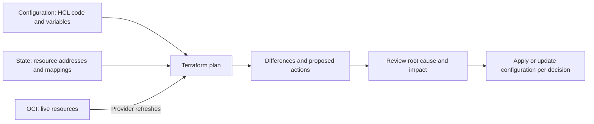

# Importing Existing Resources and Detecting Configuration Drift

## 1. Objective: Bringing Running Infrastructure Under Controlled Management

In the **Infrastructure as Code** chapter of the **CLOUD_PROVIDERS_ORACLE** module, not every VCN, Compute instance, or Oracle database was created with Terraform from day one. A system may already be running via the OCI Console, OCI CLI, or custom scripts before the team decides to manage it as code.

Two tasks must be distinguished:

- **Importing existing resources**: establishing a mapping between an existing OCI resource and a resource address in Terraform state.
- **Detecting configuration drift**: recognizing differences caused by out-of-band changes, then deciding whether to update code, restore infrastructure, or divide attribute ownership.

Importing does not copy a resource to another region and does not automatically make every current setting a sound design. Drift detection does not mean automatically overwriting every difference.

This lesson uses an OCI VCN and subnet as the running example. Learners build a reviewable baseline, import without unintended infrastructure mutations, and practice analyzing drift on a low-impact attribute such as a tag. Illustrative commands are meant to be run in an authorized environment, not reported as already executed in the learner's tenancy.

## 2. Understanding Three Components: Configuration, State, and Live Infrastructure

Define:

- **C — Configuration**: HCL code, variable values, and dependency versions expressing desired state.
- **S — State**: information Terraform currently records about the objects it manages.
- **R — Remote infrastructure**: live state returned by the OCI API at read time.



State binds an address such as `oci_core_vcn.existing` to a specific VCN OCID. During import, Terraform adds that mapping. During a normal plan, Terraform reads infrastructure via the provider and computes actions to converge toward the configuration.

Not every diff line indicates out-of-band drift:

| Scenario | Interpretation |
| --- | --- |
| Someone edits a tag in the Console while code stays unchanged | Out-of-band change outside Terraform requiring analysis |
| The team edits a CIDR in a pull request | Intended change in code; does not yet imply external drift |
| Provider upgrade changes how an attribute is represented | May be a schema change or data normalization |
| Resource exists in OCI but is not yet in state | Not yet managed by this root/state; does not automatically count as its drift |

To determine the cause, you need the configuration commit, provider version, state/backend, and observation timestamp. The [HashiCorp: manage resource drift](https://developer.hashicorp.com/terraform/tutorials/state/resource-drift) guide explains reconciling code with live state.

## 3. Before Importing: Defining Scope and Ownership

### 3.1. Build a Small but Accurate Inventory Table

Do not start by importing an entire compartment. Pick a clearly related group of resources, such as a VCN and a regional subnet used in a lab environment.

| Information | VCN | Subnet |
| --- | --- | --- |
| Region | VCN region | Same region as VCN |
| Compartment | OCID of compartment containing VCN | OCID of compartment containing subnet, may differ from VCN |
| Identifier | VCN OCID | Subnet OCID |
| Key configuration | CIDR blocks, DNS label, tags, IPv6 if any | VCN ID, CIDR, DNS label, public-IP policy, route/security/DHCP associations |
| Current owner | Team or system that created/manages it | Related team or controller |
| Already managed by Terraform? | Which root/state/Resource Manager stack | Which root/state/stack |
| Adoption scope | Only the VCN or also default objects | Only the subnet or also attached objects |

Display names on OCI are not guaranteed unique; use OCIDs and regions for identification. Record actual attributes from the Console or OCI API using an authorized identity rather than guessing from resource names alone.

### 3.2. One Object Must Have One Clear Management Owner

Never bind the same OCI resource to multiple Terraform addresses or multiple active states simultaneously. Two pipelines could overwrite each other's configurations even though each apply looks valid in isolation.

Check both Terraform roots running outside OCI and stacks inside OCI Resource Manager. If a state already owns the resource, the task may be locating that state, refactoring addresses, or transferring ownership—not importing a second duplicate mapping.

HashiCorp describes importing as adopting existing objects into state at [import overview](https://developer.hashicorp.com/terraform/language/import).

### 3.3. Confirm Provider, IAM, and Backend

Verify clearly:

- Tenancy, identity running Terraform, and authentication method.
- Exact region for the resources.
- Compartment holding the resources and required read permissions.
- Backend and target workspace/state to receive the resources.
- Permissions to update state or run jobs in the execution service.
- Who else can apply concurrently and the backend's locking mechanism.

Pure import mainly requires reading OCI resources and writing state. An apply that also includes update actions requires corresponding infrastructure modification permissions. State access and OCI IAM permissions are two independent layers.

The example uses the learner's OCI profile; when running in Compute or Resource Manager, select an authentication method supported for that environment. Never embed private keys or database passwords in code. See [Oracle: configuring the Terraform provider](https://docs.oracle.com/en-us/iaas/Content/dev/terraform/configuring.htm).

If state already exists, use the backend's versioning/backup mechanism before adopting resources. You can take a recovery copy per team procedure, but protect it as sensitive data and never commit it to Git.

## 4. Choosing an Import Method

| Method | Prerequisites | Key Outcome |
| --- | --- | --- |
| `import` block then plan/apply | Resource configuration and resource ID | Import is visible in code and reviewable in a plan |
| `terraform import ADDRESS ID` | Existing resource block and matching provider | Writes mapping directly to state; does not generate configuration |
| Generate configuration from import block | Provider, import target, and ID; no resource block yet | Generates starter HCL to edit and review |
| OCI Resource Discovery | Supported compartment/service scope | Generates configuration/state for adopting a broader scope |

This lesson prefers `import` blocks because they can be reviewed alongside pull requests and saved plans. The CLI import command remains useful for adopting single objects or running state runbooks.

Import IDs depend on resource type. For `oci_core_vcn` and `oci_core_subnet`, examples use their respective OCIDs; do not assume every OCI resource accepts the same format. Some types use composite identifiers or special import formats. See the Import section of [VCN resource](https://docs.oracle.com/en-us/iaas/tools/terraform-provider-oci/latest/docs/r/core_vcn.html) and [subnet resource](https://docs.oracle.com/en-us/iaas/tools/terraform-provider-oci/latest/docs/r/core_subnet.html).

## 5. Example: Adopting an Existing VCN and Subnet

### 5.1. Practice Environment Assumptions

The example assumes the following already exist:

- An IPv4 VCN named `orders-vcn`, DNS label `orders`, CIDR `10.40.0.0/16`.
- A regional private subnet named `orders-app`, DNS label `app`, CIDR `10.40.10.0/24`.
- Route table, security list, and DHCP options currently used by the subnet.
- No IPv6 or additional features outside the sample scope requiring declaration.
- No other state currently owns the two imported resources.

Do not use these values to force a different production VCN to look like the lab. Replace them with inventoried configuration. If resources have multiple CIDRs, IPv6, defined tags, or other attributes, add matching configuration before approving the plan.

In the initial phase, the goal is **adopting the existing baseline**, not combining it with renames, subnet re-carving, or tightening security policies. Those changes deserve separate plans and impact reviews.

### 5.2. Terraform and Provider Configuration

In a root configuration dedicated to the adoption scope, `versions.tf`:

```hcl
terraform {
  required_version = ">= 1.6.0, < 2.0.0"

  required_providers {
    oci = {
      source  = "oracle/oci"
      version = "~> 9.0"
    }
  }
}
```

The example's minimum Terraform version supports `import` blocks. The provider is constrained to the 9.x line and the lock file records the exact chosen version; adjust to the version supported by your organization's execution environment.

File `providers.tf`:

```hcl
provider "oci" {
  region              = var.region
  config_file_profile = var.oci_config_profile
}
```

Do not point a new root at a backend already used by another system just to reuse existing state. In a personal lab you can start with local state; when collaborating, use a backend/execution service with proper access controls and locking.

### 5.3. Defining Inventory Data

File `variables.tf`:

```hcl
variable "region" {
  type     = string
  nullable = false
}

variable "oci_config_profile" {
  type     = string
  default  = "DEFAULT"
  nullable = false
}

variable "vcn_id" {
  description = "OCID of the existing VCN to adopt."
  type        = string
  nullable    = false
}

variable "subnet_id" {
  description = "OCID of the existing subnet to adopt."
  type        = string
  nullable    = false
}

variable "vcn_baseline" {
  type = object({
    compartment_id = string
    display_name   = string
    dns_label      = string
    cidr_blocks    = list(string)
    freeform_tags  = map(string)
    defined_tags   = map(string)
  })
  nullable = false
}

variable "subnet_baseline" {
  type = object({
    compartment_id            = string
    display_name              = string
    dns_label                 = string
    cidr_block                = string
    prohibit_public_ip_on_vnic = bool
    route_table_id            = string
    dhcp_options_id           = string
    security_list_ids         = set(string)
    freeform_tags             = map(string)
    defined_tags              = map(string)
  })
  nullable = false
}
```

File `terraform.tfvars` (replace all OCID placeholders with real values):

```hcl
region             = "ap-singapore-1"
oci_config_profile = "DEFAULT"
vcn_id             = "<existing-vcn-ocid>"
subnet_id          = "<existing-subnet-ocid>"

vcn_baseline = {
  compartment_id = "<vcn-compartment-ocid>"
  display_name   = "orders-vcn"
  dns_label      = "orders"
  cidr_blocks    = ["10.40.0.0/16"]
  freeform_tags  = {
    Environment = "lab"
    Owner       = "platform"
  }
  defined_tags = {}
}

subnet_baseline = {
  compartment_id            = "<subnet-compartment-ocid>"
  display_name              = "orders-app"
  dns_label                 = "app"
  cidr_block                = "10.40.10.0/24"
  prohibit_public_ip_on_vnic = true
  route_table_id            = "<existing-route-table-ocid>"
  dhcp_options_id           = "<existing-dhcp-options-ocid>"
  security_list_ids         = ["<existing-security-list-ocid>"]
  freeform_tags = {
    Environment = "lab"
    Owner       = "platform"
  }
  defined_tags = {}
}
```

Tags and associations must reflect real resources. Passing `defined_tags = {}` for a resource that already has defined tags can trigger proposed tag deletions; never copy the example file while skipping inventory.

### 5.4. Writing the Resource Configuration

File `main.tf`:

```hcl
resource "oci_core_vcn" "existing" {
  compartment_id = var.vcn_baseline.compartment_id
  display_name   = var.vcn_baseline.display_name
  dns_label      = var.vcn_baseline.dns_label
  cidr_blocks    = var.vcn_baseline.cidr_blocks
  freeform_tags  = var.vcn_baseline.freeform_tags
  defined_tags   = var.vcn_baseline.defined_tags

  lifecycle {
    prevent_destroy = true
  }
}

resource "oci_core_subnet" "app" {
  compartment_id = var.subnet_baseline.compartment_id
  vcn_id         = oci_core_vcn.existing.id

  display_name              = var.subnet_baseline.display_name
  dns_label                 = var.subnet_baseline.dns_label
  cidr_block                = var.subnet_baseline.cidr_block
  prohibit_public_ip_on_vnic = var.subnet_baseline.prohibit_public_ip_on_vnic

  route_table_id    = var.subnet_baseline.route_table_id
  dhcp_options_id   = var.subnet_baseline.dhcp_options_id
  security_list_ids = var.subnet_baseline.security_list_ids
  freeform_tags     = var.subnet_baseline.freeform_tags
  defined_tags      = var.subnet_baseline.defined_tags

  lifecycle {
    prevent_destroy = true
  }
}
```

In the example, `availability_domain` is omitted because the existing subnet is regional. If the live subnet is bound to a specific availability domain, declare it accurately rather than copying the template verbatim.

The VCN uses `cidr_blocks` to configure the CIDR list; do not simultaneously set the deprecated `cidr_block` attribute of the VCN. Referencing the VCN from the subnet expresses the dependency rather than hardcoding the VCN ID again in the resource block.

`prevent_destroy` blocks destroy/replacement plans while the rule remains in configuration. It does not prevent others from deleting the resource in OCI, does not stop disruptive in-place updates, and no longer protects if the entire resource block containing the rule is deleted.

### 5.5. Declaring Imports

File `imports.tf`:

```hcl
import {
  to = oci_core_vcn.existing
  id = var.vcn_id
}

import {
  to = oci_core_subnet.app
  id = var.subnet_id
}
```

An `import` block specifies the object to adopt and the target address. The `resource` block is what describes the desired configuration. Omitting existing attributes that have non-default values can cause the plan to propose modifying the resource during the very apply that performs the import.

See [HashiCorp: importing a single resource](https://developer.hashicorp.com/terraform/language/import/single-resource).

## 6. Reviewing the Adoption Plan Before Writing State

The commands in this lesson use Bash, suited for Linux or WSL. Run inside the right root configuration:

```bash
terraform init
terraform workspace show
terraform state list
terraform fmt -check
terraform validate
terraform plan -out=adopt.tfplan
terraform show adopt.tfplan
```

If state does not yet exist, `state list` may have no entries to display. Do not skip verifying backend and ownership outside this root just because state is empty.

With a matching baseline and two resources not yet in state, the target action summary is equivalent to:

```text
Plan: 2 to import, 0 to add, 0 to change, 0 to destroy.
```

This is the expected result, not an execution log from this lesson. If `change`, `destroy`, or `must be replaced` appears, halt apply and find the differing attribute. If the plan proposes `create` for a resource that already exists, verify the import target, ID, and active state.

Do not read only the summary line: check exact OCIDs, region, compartment, change-sensitive attributes, and any actions on out-of-scope resources.

Once the saved plan is reviewed and state adoption falls within authorized scope:

```bash
terraform apply adopt.tfplan
terraform state show oci_core_vcn.existing
terraform state show oci_core_subnet.app
terraform plan
```

Applying a saved plan executes the stored plan without prompting again like an interactive apply. Never reuse an old saved plan after editing code, changing inputs, or learning of related infrastructure changes; generate and review a fresh plan. See [HashiCorp: terraform apply](https://developer.hashicorp.com/terraform/cli/commands/apply).

`terraform state show` reads content already recorded in state, not a fresh query to OCI. Combine it with a refreshing plan to confirm the baseline; see [HashiCorp: state show](https://developer.hashicorp.com/terraform/cli/commands/state/show).

Once import completes, a normal plan should show no unintended actions. You may keep `import` blocks as a provenance record or remove them; never delete the corresponding `resource` blocks just because importing finished.

## 7. What Is Not Automatically Imported with the VCN

Adopting a VCN into state does not automatically adopt:

- Other subnets.
- Route tables, security lists, or DHCP options.
- NSGs and their rules.
- Internet/NAT/Service Gateways, DRGs, or peering connections.
- Compute, OKE, load balancers, and database services using the network.

In the example, the route table, security list, and DHCP options are referenced by ID but are not yet resources managed by this root. When rules inside them change, leaving them unmanaged limits this lesson's drift detection scope.

Default VCN objects have their own management mechanisms. Do not arbitrarily choose standard resource types to manage them while leaving another state owning them. Refer to [Oracle: managing default VCN resources](https://docs.oracle.com/en-us/iaas/Content/dev/terraform/default-vcn.htm).

For Compute, importing an instance does not automatically import the full lifecycle of boot volumes, data volumes, and networking in every model. For Oracle Database, importing the service is not a data backup and does not replace database recovery procedures.

## 8. CLI Import and Module Addresses

If using CLI import, prepare the same resource configuration but **do not run the declarative import flow concurrently** for the same objects. For example:

```bash
terraform import oci_core_vcn.existing '<existing-vcn-ocid>'
terraform import oci_core_subnet.app '<existing-subnet-ocid>'
terraform plan
```

The CLI command writes directly to state for the imported object and does not generate HCL files. It does not guarantee the subsequent plan will make zero resource changes. See [HashiCorp: terraform import CLI](https://developer.hashicorp.com/terraform/cli/commands/import).

When a resource sits inside a module or uses `for_each`, the full address is required. Bash syntax example:

```bash
terraform import 'module.network.oci_core_subnet.private["app"]' '<existing-subnet-ocid>'
```

The module call and instance key must actually exist in configuration. In other shells, verify how quotes are passed to native commands; do not omit the instance key merely to avoid quoting issues.

If an object is already in state at an old address and is only moving into a new module, use proper address refactoring/migration procedures, such as `moved` within the same state. Importing a second time is not the fix for code restructuring.

## 9. Generating Configuration to Assist Discovery

When a resource has many attributes, you can start from an `import` block and have Terraform generate HCL. This is an **alternative pre-adoption workflow**, not a requirement to create a second state owning the resources already imported above.

Example of a separate discovery directory containing only this configuration:

```hcl
terraform {
  required_version = ">= 1.6.0, < 2.0.0"

  required_providers {
    oci = {
      source  = "oracle/oci"
      version = "~> 9.0"
    }
  }
}

variable "region" {
  type = string
}

variable "vcn_id" {
  type = string
}

provider "oci" {
  region              = var.region
  config_file_profile = "DEFAULT"
}

import {
  to = oci_core_vcn.discovered
  id = var.vcn_id
}
```

Do not add a `resource` block for `oci_core_vcn.discovered` yet. Run:

```bash
terraform init
terraform plan -var='region=ap-singapore-1' -var='vcn_id=<existing-vcn-ocid>' -generate-config-out=generated-vcn.tf
```

The target file must not already exist. Configuration generation is documented as experimental in Terraform docs; a file may still be written even if part of the plan fails. Read, refine, and validate it before treating it as production-ready configuration. See [HashiCorp: generating configuration](https://developer.hashicorp.com/terraform/language/import/generating-configuration).

Do not blindly copy every state attribute into HCL: some attributes are computed/read-only or involve mutually exclusive combinations. Replace hardcoded IDs with references where appropriate, preserve intentional attributes, and identify fields the API cannot read back.

Never run apply from the discovery directory to reclaim a resource already owned by another state. Move the reviewed configuration into the proper owning root and run plan there.

## 10. Drift Detection: Normal Plan vs. Refresh-Only Serve Different Roles

| Operation | Purpose | Intentionally Modifies OCI Resources? |
| --- | --- | --- |
| `terraform state show` | Inspect stored snapshot | No |
| `terraform plan` | Read live reality then compute changes toward code | Not yet executed; plan may propose update/create/delete |
| `terraform plan -refresh-only` | Preview expected state/output updates to reflect reality | Does not propose converging infrastructure toward configuration |
| Apply a refresh-only plan | Record live state into state/outputs | Does not modify remote objects to match configuration |
| Apply a normal plan | Execute approved actions | Possibly yes |

Refresh-only does not edit HCL. If a new tag is accepted into state while code still holds the old tag, a subsequent normal plan will still propose reverting the tag to the old value.

To inspect how reality diverges from the state baseline:

```bash
terraform plan -refresh-only -out=observed.tfplan
terraform show observed.tfplan
```

Apply only once you determine recording that snapshot is appropriate:

```bash
terraform apply observed.tfplan
```

Do not confuse this operation with approving a business change or updating configuration. State data is an operational record, while code still must be maintained per ownership decisions.

Avoid `-refresh=false` in drift detection jobs because it skips out-of-band changes. Do not narrow scope with `-target` and conclude the entire system has zero drift. Plan modes are explained in [HashiCorp: terraform plan](https://developer.hashicorp.com/terraform/cli/commands/plan).

The legacy `terraform refresh` command is deprecated and equivalent to an auto-approved refresh-only flow; prefer planning and reviewing rather than accidentally writing state immediately. See [HashiCorp: terraform refresh](https://developer.hashicorp.com/terraform/cli/commands/refresh).

## 11. Practicing Controlled Drift with a Tag

### 11.1. Creating a Low-Impact Difference

Once the baseline achieves a zero-change normal plan, in the lab environment edit the VCN's free-form tag `Owner` via the Console from `platform` to `incident-team`. Leave HCL and dependencies untouched.

Then run:

```bash
terraform plan -out=drift.tfplan
terraform show drift.tfplan
```

A normal plan typically proposes updating the tag back to `platform`, since that is what configuration declares. The output may also indicate the object changed outside Terraform.

Condensed diff description:

```text
Actual attribute:     freeform_tags.Owner = "incident-team"
Configured attribute: freeform_tags.Owner = "platform"
Proposed action:      update VCN to match configuration
```

This illustrates meaning, not a fixed provider log format.

### 11.2. Investigating Before Choosing a Fix

Answer these questions:

- Did the tag change from approved incident response or an accidental edit?
- Is another system automatically writing this tag?
- Did the difference appear after a provider upgrade or input change?
- Do the identity and timestamp in OCI Audit match a known activity?
- Does applying the plan touch networking, databases, or resources beyond the tag?

OCI Audit records calls to supported APIs, including timestamp, source, and target object. It helps trace who or what made the change; a Terraform diff alone does not supply full root cause. See [Oracle: Audit overview](https://docs.oracle.com/en-us/iaas/Content/Audit/Concepts/auditoverview.htm).

### 11.3. Three Possible Decisions

| Decision | Action Required |
| --- | --- |
| Value in code is still right | Review the normal plan and apply to restore configuration |
| Live value is a valid change to keep | Update HCL/tfvars through review, generate a new normal plan, and complete workflow |
| Attribute belongs to another system | Document the owner, bound Terraform's management scope, and design corresponding monitoring |

Do not use refresh-only as a substitute for updating code on a second branch. Do not edit HCL merely to "turn the plan green" before knowing whether the change is valid.

For security misconfigurations or suspicious changes, respond according to actual system impact. Never let a drift job automatically legitimize whatever state happens to be read from OCI.

## 12. `ignore_changes`: Dividing Ownership, Not Hiding All Differences

If an operations system is authorized to manage the `OperationsOwner` tag independently, you can consider a narrow rule inside the resource's lifecycle:

```hcl
lifecycle {
  prevent_destroy = true
  ignore_changes = [
    freeform_tags["OperationsOwner"]
  ]
}
```

This merges into the existing `lifecycle` block; do not add two `lifecycle` blocks to the same resource. The rule does not apply to the `Owner` tag from the test above.

`ignore_changes` tells Terraform to ignore that attribute when planning post-creation updates. It does not make the attribute immutable, does not stop other systems from changing it, and does not replace security/compliance alerting.

Never set `ignore_changes = all` just to avoid reading a long diff. For network ingress, public policies, or database backups, hiding attributes from convergence plans can mask critical conditions. See [HashiCorp: lifecycle rules](https://developer.hashicorp.com/terraform/language/meta-arguments/lifecycle).

When removing an ignore rule, Terraform may once again propose changes to match code. Treat that as a management-scope change requiring review.

## 13. Detecting Drift in CI Without Auto-Applying

### 13.1. Running Against a Sufficiently Stable Baseline

A meaningful drift job uses:

- The exact root, backend, workspace, and OCI read-capable identity.
- An identified configuration commit and matching environment values.
- The committed provider lock file, avoiding accidental dependency upgrades during detection.
- Permissions to store reports and handle backend state locks.
- A way to distinguish execution errors from a plan that has changes.

If every detection run simultaneously changes code and upgrades providers, it becomes hard to tell whether a diff comes from drift or from the job's own changes.

Bash example with Terraform and `jq`, run in an already initialized/managed root:

```bash
set -euo pipefail

terraform init -input=false -lockfile=readonly

plan_status=0
terraform plan -input=false -detailed-exitcode -out=drift.tfplan || plan_status=$?

case "$plan_status" in
  0)
    printf '%s\n' "Plan completed without a planned diff."
    ;;
  2)
    printf '%s\n' "Plan completed with differences; review is required."
    ;;
  *)
    printf '%s\n' "Planning failed; drift status is not established."
    exit 1
    ;;
esac

terraform show -json drift.tfplan > drift.json

jq '{
  observed_external_changes: [
    (.resource_drift // [])[] |
    {address, actions: .change.actions}
  ],
  planned_managed_changes: [
    (.resource_changes // [])[] |
    select(.mode == "managed") |
    select(.change.actions != ["no-op"]) |
    {address, actions: .change.actions}
  ]
}' drift.json
```

With `-detailed-exitcode`, 0 means plan succeeded with no diff, 2 means succeeded with diff, and 1 means error. Exit code 2 does not prove unauthorized changes occurred: code edits, inputs, import actions, or outputs can also produce a diff. Never collapse read permission errors, API failures, or state lock failures into a "no drift" result.

### 13.2. Reading Two Distinct JSON Sections

`resource_drift` records changes observed outside Terraform compared to the prior state; `resource_changes` describes actions proposed in the plan. These two lists serve different purposes, not two names for the same data.

An ignored or computed attribute can generate an observed difference without leading to a corresponding corrective action. Reporting should also account for output changes and other fields if they are part of pipeline criteria. See [HashiCorp: JSON plan format](https://developer.hashicorp.com/terraform/internals/json-format).

The script above only exports a report and preserves diffs for triage. Wire it into your team's incident/triage workflow within authorized scope; never add `apply -auto-approve` to a drift job just to force a green status.

Saved plans, JSON plans, and state can contain sensitive data in readable form. Restrict artifact permissions, retention duration, and what gets pushed to public logs.

## 14. Using OCI Resource Manager for Discovery and Drift

### 14.1. Resource Discovery to Adopt Broader Scope

OCI Resource Manager can scan supported resources in a compartment and export configuration/state. This provides a starting point for infrastructure with many resources not yet managed by Terraform.

Check:

- Compartment scope and list of supported resource types.
- Root compartment versus application compartment.
- Attributes unreadable from APIs, placeholders, and unrecoverable secrets.
- Generated lifecycle ignores used to handle missing attributes.
- Relationships with existing states that already own part of the resources.

Discovery is not a guarantee of full system recreation across another region/tenancy. Generated configuration may require edits and may omit attributes. See [Oracle: Resource Discovery](https://docs.oracle.com/en-us/iaas/Content/ResourceManager/Concepts/resource-discovery.htm).

Never import state into Resource Manager and keep letting the old root apply independently to the same resources. Perform a controlled handoff of ownership and execution location.

### 14.2. Stack Drift Detection

For stacks meeting service eligibility requirements, drift detection can run for all or selected resources in the stack. Practice steps:

1. Select the exact region, compartment, and stack.
2. Confirm a valid baseline from Apply/Import state or a compartment-created stack per service capability.
3. Run **Run drift detection** for the selected scope.
4. Monitor the work request, logs, and per-resource-address results.
5. Classify changes before creating a remediation plan.

This feature is scoped to the stack and does not replace tenancy-wide resource inventorying. Keep providers and configuration stable enough to analyze root causes. See [Oracle: detecting drift in a stack](https://docs.oracle.com/en-us/iaas/Content/ResourceManager/Tasks/detect-drift.htm).

A successful drift detection run does not mean infrastructure is fixed. It produces information so operators can decide the next step.

## 15. Detection Limits and Scenarios Requiring Caution

| Scenario | Why Results Are Incomplete | Next Action |
| --- | --- | --- |
| New resource created outside state | Normal plan does not scan the entire tenancy for unmanaged resources | Add inventorying, discovery, and cost audits |
| Attribute ignored or unreadable by provider | Incomplete visibility/convergence for that attribute | Identify owner and an alternative monitoring mechanism |
| OCI API returns permission error or wrong region | Object may not have been read accurately | Check identity, region, and diagnostics; do not conclude it was deleted |
| Resource deleted outside Terraform | Normal plan may propose recreating it | Assess data recovery options and identifier changes before applying |
| Database change affects only data | Resource schema does not represent business data | Use appropriate database monitoring and backup tools |
| Another controller continuously edits config | Two systems are fighting over management control | Adjust ownership boundaries |
| Provider was just upgraded | Diff may stem from schema/defaults/normalization | Check release notes and test separately |
| State abandoned or moved to wrong backend | Live resources exist but mapping is wrong | Locate original state and history before re-importing |

Drift in security rules can affect data access; drift in shapes, node counts, or storage capacity can raise costs; drift in backups or placement can impact availability. Triage by impact instead of treating every diff like a tag edit.

If you discover the wrong object was imported, stop apply and inspect both configuration and state. `terraform state rm` only removes the state binding and does not delete the OCI object; if the resource block remains, the next plan may propose creating a new one. Do not use that command habitually to hide a confusing diff. See [HashiCorp: state rm](https://developer.hashicorp.com/terraform/cli/commands/state/rm).

Restoring an older state snapshot does not automatically revert changes already made in OCI. If infrastructure was mutated by an apply, recovery planning must account for live resources, data, and state history.

## 16. Evidence Required Upon Completion

An adoption and drift-detection cycle is operationally complete when you have:

- Verified list of resources, OCIDs, region, compartment, and owners.
- One clear state management location per object.
- Configuration expressing the managed baseline without credentials.
- Reviewed import plan with zero unintended add/change/destroy actions.
- Post-import state pointing to exact objects; normal plan matching desired baseline.
- A scoped drift test with a report separating out-of-band observations from proposed actions.
- Recorded decision to keep live state, restore to code, or delegate attributes to another system.
- Periodic monitoring that never mistakes API read errors for synchronized state.

Never run destroy to "clean up the lab" on existing adopted resources if they still serve a live system. Tear down only resources created specifically for practice according to that environment's ownership and schedule.

Importing establishes management accountability; drift detection helps sustain that accountability over time. The value of the workflow lies in knowing clearly which code, which state, and which identity govern the state of OCI infrastructure.
