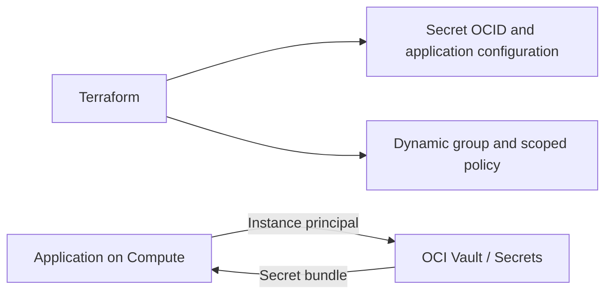

# Protecting Secrets, Handling Destroy, and Recovering Failed Deployments

## 1. Objectives and OCI Context

In the **Infrastructure as Code** chapter of the **CLOUD_PROVIDERS_ORACLE** module, a safe deployment must simultaneously protect credentials, business data, and the ability to manage resources after an incident. Creating a VCN, Compute, or database with Terraform is not enough; the operations team must also know who is allowed to read secrets, which plans can delete data, and what to do when a deployment stops midway.

This lesson places Terraform CLI and OCI Resource Manager inside a unified operational workflow. The context is an application running on OCI using a VCN, Compute, Block Volume, or Oracle database services; access is bounded by IAM and compartments. Examples are instructional templates—replace OCIDs, regions, and resource names according to your actual environment.

After this lesson, learners can:

- Identify where secrets appear outside source code, especially in state, plans, and logs.
- Choose appropriate deployment identities and separate deployment permissions from application secret-read permissions.
- Evaluate destroy, replacement, and protection layers for data-storing resources.
- Classify deployment failures, reconcile state against OCI resources, and build a recovery plan.
- Confirm the system is healthy, resources remain managed, and remaining costs have an owner.

Learners need basic familiarity with Terraform structure, the `init → plan → apply` cycle, OCIDs, and locating resources by tenancy, region, and compartment. Illustrative commands use PowerShell; they are executed only when learners actively practice in a prepared environment. For Resource Manager, perform corresponding operations via stacks and jobs rather than creating a separate local state to control the same resources.

## 2. Distinguishing Configuration, State, and Business Data

These three components serve three distinct purposes:

| Component | OCI Example | What It Helps Recover | What It Cannot Replace |
|---|---|---|---|
| Desired configuration | HCL declaring VCN, subnet, Compute, volume | Describes the infrastructure that should exist | Does not hold full operational state or application data |
| Terraform state | Maps `oci_core_volume.app_data` to volume OCID | Preserves the link between Terraform addresses and live resources | Not a backup of volume contents or database data |
| Business data and backups | Data on volumes, database backups, objects | Restores data per each service's capabilities | Does not automatically recreate IAM, routing, connectivity, or Terraform mappings |

An old Git commit cannot restore lost transactions on its own. An old state does not turn OCI back in time either: it only alters the information Terraform uses to reason. Therefore, a recovery plan must specify the configuration source, the trusted state source, and the data backup source.

For critical services, define **RPO**—the acceptable data loss window in time—and **RTO**—the maximum time to restore service—in advance. For example, a 15-minute RPO and 60-minute RTO require tested backup mechanisms, access permissions, capacity, and restore procedures; keeping a `.tfstate` file alone satisfies neither goal.

## 3. Where Can Secrets Leak?

Secrets include OCI API private keys, database passwords, tokens, SSH private keys, and wallets capable of granting access. OCIDs are normally identifiers rather than passwords themselves, though OCID lists and network details must still be shared within proper scope.

| Surface | Common Example | Design Control |
|---|---|---|
| Source code and Git history | Passwords in HCL, `.tfvars` files, private keys | Never put real values in the repository; check before committing |
| Terraform state and older versions | Resource or data source attribute values | Control read access, encryption, and retention policies |
| Saved plans and plan JSON | Deployment parameters packaged inside artifacts | Store per environment; restrict downloaders and retention window |
| CI/CD logs and outputs | Printing environment variables, request debug logs, outputs | Never print secrets; enable debug logging only under control |
| Bootstrap and execution machines | Passwords in cloud-init, temp files, shell history | Fetch at runtime, minimize disk persistence, clean runners after jobs |
| Resource names, tags, tickets | Tokens placed into `display_name` or error descriptions | Use only sanitized operational identifiers |

### 3.1. `sensitive` Masks Outputs, It Does Not Exclude Data from State

```hcl
variable "database_password" {
  type        = string
  sensitive   = true
  description = "Supplied from the deployment workflow's secret channel."
}
```

This flag tells Terraform to mask the value in supported outputs. If the value flows into a persisted attribute, it can still reside in state. Never treat `sensitive = true` as encryption; passing a password via an environment variable does not prevent state storage either. [Output and sensitive data reference](https://developer.hashicorp.com/terraform/language/block/output).

Terraform offers `ephemeral` starting in 1.10 and write-only arguments starting in 1.11, though support depends on context and provider capabilities. Do not blindly add `ephemeral = true` and pass it to an ordinary OCI attribute. Verify the exact Terraform version running in CLI or Resource Manager and the specific resource schema before use. [Manage sensitive data](https://developer.hashicorp.com/terraform/language/manage-sensitive-data).

### 3.2. Secrets in Vault Can Still Enter State

If Terraform reads a secret's value via a data source and passes that value to another resource, the data still flows through Terraform. Having OCI Vault protect the storage source does not make intermediate copies vanish automatically.

The preferred design lets HCL manage references and access permissions while the application fetches secrets via SDK at runtime:



This reduces the number of systems that ever see the secret's plaintext. If a database creation API strictly requires receiving a password via Terraform, accept and manage the corresponding state risk, or choose a service-supported integration mechanism. Never substitute an API requirement with the assumption that passing only an OCID suffices.

## 4. Choosing Identities and Permissions per Actor

### 4.1. Prefer Identities Bound to the Execution Environment

The provider example below is for Terraform CLI running on an **OCI Compute instance** already placed in an appropriate dynamic group:

```hcl
variable "region" {
  type = string
}

provider "oci" {
  region = var.region
  auth   = "InstancePrincipal"
}
```

The instance identity receives IAM permissions without copying an OCI API private key into HCL. This configuration cannot be used verbatim on a laptop or an arbitrary CI runner. Resource principal also works only in environments that support it. With Resource Manager, configure authentication and authorization according to the service's mechanisms. [Configuring OCI provider authentication](https://docs.oracle.com/en-us/iaas/Content/dev/terraform/configuring.htm).

If the current workflow requires an API key, store the private key in the CI/CD secret store or a protected path on the runner; grant least privilege, and maintain rotation and revocation schedules. Never place keys inside a Resource Manager source ZIP, machine images, or shared artifacts.

### 4.2. Separating Deployment Permissions from Secret-Read Permissions

A practical role separation:

| Actor | Required Scope | Permissions Requiring Separate Review |
|---|---|---|
| Plan reviewer | Configuration and controlled plan output | Permission to download state or artifacts containing secrets |
| Deployment runner | Resource operations required for the stack in the target compartment | Permission to modify IAM, delete data, or read out-of-scope secrets |
| Application | Retrieve only the exact secret needed to connect to services | Permission to edit stacks or manage secrets |
| Recovery personnel | Read backups, run restores, reconcile state | Time-bounded emergency permissions with audit logging |

Illustrative policy for the application's dynamic group:

```text
Allow dynamic-group AppRuntime to read secret-bundles in compartment AppSecrets where target.secret.id = 'ocid1.vaultsecret.oc1.REGION.REPLACE_ME'
```

Substitute names and OCIDs; the dynamic group must match only the target workload. The policy must be placed at a scope covering the compartment holding the secret. `read secret-bundles` governs reading secret contents; `read secrets` serves only the corresponding metadata API group. [IAM permissions for Secret Management](https://docs.oracle.com/en-us/iaas/Content/Identity/Reference/keypolicyreference.htm), [example scoping a single secret](https://docs.oracle.com/en/cloud/paas/autonomous-database/serverless/adbsb/vault-secret-credentials-oci.html).

Never grant `manage all-resources in tenancy` to fix an isolated permission error. Identify the denied API, executing principal, and target compartment, then add only the needed permissions. Also inspect effective permissions from other policies: a narrow policy does not cancel broad permissions already granted elsewhere.

## 5. Protecting Repositories, State, Plans, and Logs

### 5.1. Repositories Hold Only Shareable Information

A `.gitignore` template for learners to apply in practice projects:

```gitignore
.terraform/
*.tfstate
*.tfstate.*
*.tfplan
*.tfvars
*.tfvars.json
crash.log
crash.*.log
*.pem
*.key
```

You can commit `terraform.tfvars.example` containing only dummy values. Normally, commit `.terraform.lock.hcl` to record provider selections and checksums. Ignore rules do not untrack files already in Git and do not scan file contents; you must still inspect diffs before committing and run secret checks per team workflow.

If a key or password is exposed, prioritize revoking or rotating it, updating dependent systems, and reviewing access logs. Then remediate Git history, artifacts, logs, and related state copies per incident procedure. Deleting a line on the current branch does not invalidate an exposed credential.

### 5.2. State Is a High-Sensitivity Operational Asset

Choose a backend based on access control, encryption in transit and at rest, locking capability, versioning, and recovery. When using Object Storage in a backend architecture, verify the capabilities of the exact backend and configuration in use; never assume a versioned bucket automatically provides state locking.

Resource Manager maintains stack state and locks so only one job runs on a stack at a time. Never run a second local pipeline with an independent state managing the same OCIDs. [Resource Manager and Terraform](https://docs.oracle.com/en-us/iaas/Content/ResourceManager/Concepts/resource-manager-and-terraform.htm).

For CLI-managed state, if the backend supports locking, Terraform uses locks to prevent concurrent writes. Never use `-lock=false` as a workaround for contention errors. Consider force-unlock only once you confirm the lock-holding process has stopped and understand why the lock remained. [State locking](https://developer.hashicorp.com/terraform/language/state/locking).

### 5.3. Saved Plans Are Artifacts That Require Protection

A saved plan can contain sensitive values even if human-readable terminal output masks them. Exporting JSON via `terraform show -json` is not a data sanitization step either. [plan command documentation](https://developer.hashicorp.com/terraform/cli/commands/plan).

Workflows should bind each artifact to its commit, artifact checksum, Terraform/provider versions, backend, workspace or stack, region, and creation time. When configuration, input variables, state, or live conditions change, regenerate and review a fresh plan. Never share binary plan files over public channels.

Never pass passwords as command-line arguments that may be saved in shell history. For debug logs, limit how long they are enabled, download permissions, and retention; redact contents before sharing with support teams.

## 6. Understanding Destroy and Replacement Before Approval

Destroy actions can appear in routine deployments, not only when running `terraform destroy`.

| Plan Indicator | Meaning to Review |
|---|---|
| `+ create` | Creates resource; may incur cost and consume quota |
| `~ update in-place` | Modifies in place; may still affect connectivity or application behavior |
| `- destroy` | Deletes a resource currently managed by state |
| `-/+` or `+/-` | Replaces resource; review create/delete ordering and data impact |

Common causes of deletion or replacement include removing a resource from HCL, decreasing `count`, changing a `for_each` key, modifying an attribute that cannot update in place, or mixing up environment variable sets. If only renaming a resource address in code, evaluate migration using a `moved` block instead of letting Terraform treat it as destroy old, create new.

### 6.1. Block Volume Protection Example

The HCL snippet below is an isolated example for a data volume. It assumes an OCI provider and tested versions are already configured; this is not a complete application deployment configuration.

```hcl
variable "compartment_ocid" {
  type = string
}

variable "availability_domain" {
  type = string
}

resource "oci_core_volume" "app_data" {
  compartment_id      = var.compartment_ocid
  availability_domain = var.availability_domain
  display_name        = "app-data"
  size_in_gbs         = 50

  lifecycle {
    prevent_destroy = true
  }
}
```

Volume attributes must match the region, availability domain, and service limits. The volume must satisfy service prerequisites for attaching to Compute; this example does not yet create an attachment or backup. [`oci_core_volume` resource reference](https://docs.oracle.com/en-us/iaas/tools/terraform-provider-oci/latest/docs/r/core_volume.html).

While `lifecycle` remains in configuration, `prevent_destroy` forces Terraform to reject plans that delete or replace the protected resource. If the entire resource block is removed, that protection no longer applies in that way. Nor does it block deletions via the OCI Console or another tool. `create_before_destroy` alters replacement order, yet requires sufficient quota and does not copy data automatically. [Lifecycle reference](https://developer.hashicorp.com/terraform/language/meta-arguments/lifecycle).

Never remove `prevent_destroy` reflexively just to make a plan pass. First determine why replacement is triggered, where data resides, and how data will be migrated. IAM controls, service-native deletion protection, retention, and backups must be evaluated independently; no single attribute covers every OCI resource.

### 6.2. Limiting Blast Radius Through Stack Structure

A fitting organization for applications with long-lived data:

- **Foundation stack:** shared VCN and long-lived networking components.
- **Data stack:** volumes, databases, and corresponding backup configurations.
- **Application stack:** Compute or components replaced frequently.

This is a design decision, not a mandatory OCI requirement. Explicitly manage inputs/outputs between stacks and deployment/teardown ordering. Splitting stacks does not automatically protect shared dependencies; resources in another stack may still rely on the subnet or volume you intend to delete.

## 7. Controlled Destroy Workflow

### 7.1. Before Generating a Deletion Plan

The operator must directly verify:

1. Tenancy, region, compartment, and environment-matched backend/workspace or stack.
2. List of resources slated for deletion, resources that must stay, and data owners.
3. Backup status, data scope, and latest restore test results; backups outside the deletion scope must not be deleted unintentionally.
4. External dependencies outside the stack, traffic flows, and application shutdown order.
5. Access to encryption keys and secrets lasting long enough to complete restores.
6. Change window, approvers, and contingency plan if deletion completes only partially.

A backup is unusable if decryption permissions are gone, no one can perform the restore, or quota is insufficient to provision recovery resources.

### 7.2. Terraform CLI: Inspecting and Applying the Exact Deletion Plan

The commands below apply only to CLI-managed state. Run step by step and stop if a prior command fails:

```powershell
terraform workspace show
terraform plan -destroy -out=destroy.tfplan
terraform show destroy.tfplan
```

`workspace show` is only one check; the name `default` does not prove you are in the right tenancy or region. Also verify provider, input variables, and backend. Inspect every resource marked for deletion, especially databases, volumes, buckets, shared networks, and encryption keys.

Only after an authorized approver reviews that exact artifact and data prerequisites are satisfied, run:

```powershell
terraform apply destroy.tfplan
```

When passing a saved plan to `apply`, Terraform executes the saved plan without interactive confirmation prompts like a normal apply. Therefore, approval and exact artifact verification must precede this command. [apply command documentation](https://developer.hashicorp.com/terraform/cli/commands/apply).

Do not use `-target` to turn scoped deletion into a routine workflow. Narrowed scopes can miss downstream impacts; after any exceptional targeted action, run a full plan afterward.

### 7.3. Resource Manager: Distinguishing Destroy from Delete Stack

A Destroy job tears down resources tied to the stack while retaining job history and state. Deleting a stack removes the state tied to the stack, making inventorying and cleaning up remaining resources much harder. Never use Delete stack as a way to cancel a deployment or fix a failed job. After destroy, verify live results; running apply again can create new resources with different OCIDs. [Creating a destroy job](https://docs.oracle.com/en-us/iaas/Content/ResourceManager/Tasks/create-job-destroy.htm).

### 7.4. When Destroy Fails Midway

Preserve the existing state and classify resources into deleted, still present, asynchronously deleting, or blocked. Common OCI causes to check include still-attached volumes, subnets still holding VNICs, buckets still containing objects or retention rules, missing permissions, and service-specific constraints.

Resolve the exact dependency or policy, then generate a new plan from current state. Do not manually delete every resource just to clear the Console, and do not delete state to silence error messages.

Finish with an inventory of remaining resources by OCID, including backups, retained boot volumes or block volumes, public IPs, and billable network components. Every retained resource needs an owner, purpose, and next review date.

## 8. A Failed Apply Does Not Mean Infrastructure Stayed Unchanged

Terraform does not automatically roll back a partially succeeded apply. In normal apply failures, Terraform records already completed changes into state before exiting; if the process crashes, loses connectivity, or fails to write state, the actual recorded extent must be inspected separately. [Behavior on apply errors](https://developer.hashicorp.com/terraform/cli/commands/apply).

Illustrative timeline example:

```text
T0: Begin apply for the application.
T1: VCN and subnet are created successfully.
T2: Volume now exists on OCI.
T3: Compute fails to launch due to insufficient capacity for the selected shape.
T4: Job reports FAILED; resources from T1 and T2 may still exist.
```

If the provider times out, a resource creation API call may already have been accepted by OCI even though Terraform did not receive the full response. Never infer "no OCID in logs" means the resource was not created. Cross-check OCI work requests where supported by the service, live resources in the Console/API, and current state.

Also distinguish control-plane failures from application failures. A Compute instance in running state does not prove cloud-init succeeded, the service is listening on its port, or the application can reach the database.

## 9. Runbook for Recovering Failed Deployments

### Step 1 — Halt Concurrent Changes and Preserve Evidence

Pause automated pipelines for that environment and confirm the job has truly stopped. A canceling status does not mean all operations have finished. Do not trigger another pipeline to "retry quickly."

Record the commit, non-secret variable set, tool/provider versions, stack/job OCID, timestamp, error codes, OCI request IDs, and affected resources. Save logs, plans, and state in an access-restricted location; sanitize any copies shared externally.

### Step 2 — Classify the Failure Using Evidence

| Failure Category | Signals to Verify | Initial Remediation Direction |
|---|---|---|
| Syntax or schema | `validate` errors, unsupported attributes | Fix configuration to match exact versions |
| Identity or IAM | Authentication failure, denied operation | Check principal, policies, and compartment |
| Region, OCID, or scope | Resource not found as expected | Verify identifiers before touching state |
| Quota, limits, or capacity | Service refuses to provision resource | Check limits, shape/AD, and workload requirements |
| Timeout or service error | Ambiguous API outcome, work request still running | Verify live state before retrying |
| Application or bootstrap | Infrastructure exists but health checks fail | Check bootstrap, connectivity, config, and secrets |
| Backend or state | Unable to write state, lock still held | Preserve records and identify lock-holding process |

"Resource not found" errors can stem from permissions or wrong region; do not jump to concluding the resource was deleted. Reducing parallelism or adjusting timeouts helps only when evidence points to that cause; neither fixes broken configuration or missing capacity.

### Step 3 — Perform a Three-Way Reconciliation

Compare **desired configuration ↔ state ↔ live OCI** by OCID, not merely display names. With CLI, the following commands aid inspection:

```powershell
terraform state list
terraform plan -out=recovery.tfplan
terraform show recovery.tfplan
```

A normal plan re-reads resource status to propose changes. If it proposes deleting or recreating large numbers of resources unexpectedly, halt and inspect environment, configuration, read permissions, and state. Never apply merely because the immediate goal is "making the job green."

If the intent is updating state to reflect changes that occurred outside Terraform, generate a separate refresh-only plan:

```powershell
terraform plan -refresh-only -out=refresh.tfplan
terraform show refresh.tfplan
```

Run `terraform apply refresh.tfplan` only once the state updates are approved. Refresh-only does not modify infrastructure and does not adopt a resource not yet mapped in state. If configuration points to the wrong region or lacks read permissions, fix that before accepting removal of objects from state. [Refresh-only and state synchronization](https://developer.hashicorp.com/terraform/tutorials/state/refresh).

### Step 4 — Choose One Clear Recovery Path

| Option | When Appropriate | Conditions to Verify |
|---|---|---|
| Roll forward to desired config | Root cause fixed, existing resources remain usable | New plan preserves data and valid resources |
| Return to a stable config | New change cannot be used safely yet | Rollback plan does not delete data or break compatibility |
| Import existing resources | OCI has the resource but state does not manage it yet | Confirm exact OCID, address, and ownership |
| Restore data from backup | Data lost, corrupted, or incompatible | Backup source, decryption access, RPO/RTO, and app verification |
| Tear down failed deployment | Temporary environment safe to remove | Contains no data to retain and no shared dependencies |

In the Compute capacity failure example, you can retain the valid VCN, subnet, and volume, adjust deployment choices per application needs, and generate a new plan. Never arbitrarily change the AD if doing so prevents the existing volume from attaching to the new instance or forces data migration.

### Step 5 — Apply the Approved Recovery Plan and Verify

Run `terraform apply recovery.tfplan` only if it remains the valid reviewed recovery artifact. If configuration, state, or inputs changed after planning, regenerate the plan. With Resource Manager, run the corresponding job on the same stack and monitor until completion.

Verify infrastructure, application, data, and cost per section 12 before re-enabling automated pipelines.

## 10. Importing and Recovering State in Special Cases

### 10.1. Resource Exists in OCI but Is Missing from State

Before importing, confirm the resource is not managed by another stack or workspace. One OCID must never be independently managed by two states at the same time. Prepare the matching resource block and check critical attributes.

Example for an existing volume in a Terraform CLI environment:

```powershell
terraform import oci_core_volume.app_data 'ocid1.volume.oc1.REGION.REPLACE_ME'
terraform plan -out=after-import.tfplan
terraform show after-import.tfplan
```

Importing establishes the management mapping; it does not restore data and does not guarantee current configuration matches the resource. A post-import plan may still propose replacement. [Import concepts](https://developer.hashicorp.com/terraform/language/import), [OCI volume import format](https://docs.oracle.com/en-us/iaas/tools/terraform-provider-oci/latest/docs/r/core_volume.html).

In Resource Manager, use the service-supported import workflow to update the stack's exact state. Never run the CLI example above in a disconnected local directory and assume the stack is fixed.

### 10.2. Lost State or Failed State Write

Prioritize finding the latest trusted state version in the backend or job history; if Terraform reports saving a local recovery state after a backend write failure, protect that file before the runner is cleaned up. Identify timestamp, lineage, serial, and any OCI operations that occurred after that state snapshot.

Restoring state manipulates control metadata; it does not undo infrastructure changes. Preserve the current version and evaluate thoroughly before pushing back to the backend; never use `state push -force` to bypass safety checks for speed. [Recovering state from backup](https://developer.hashicorp.com/terraform/cli/state/recover).

With Resource Manager, you can retrieve an appropriate job's state for inspection and controlled recovery procedures. Downloaded copies may also contain secrets. [Getting a job's state](https://docs.oracle.com/en-us/iaas/Content/ResourceManager/Tasks/get-job-tf-state.htm).

### 10.3. Never Use State Commands to Hide Incidents

`terraform state rm` only removes the management mapping; the resource still exists and may keep incurring charges. If configuration still declares it, the next plan may try to create a duplicate resource. Use it only with a clear management objective and an assigned new owner. [state rm command](https://developer.hashicorp.com/terraform/cli/commands/state/rm).

Similarly, `force-unlock` fixes neither deployment failures nor data issues; it only clears the backend lock. Misusing it while another process is still active can cause two writers to corrupt state concurrently. [force-unlock command](https://developer.hashicorp.com/terraform/cli/commands/force-unlock).

## 11. Rollback with OCI Resource Manager

### 11.1. Plan Rollback First, Apply Rollback Second

Resource Manager supports creating a plan to revert to a chosen prior successful apply job. The workflow should include:

1. Identify a stable target job and document why it was chosen.
2. Create a **Plan Rollback** targeting that job.
3. Wait for the plan to succeed and inspect create, modify, delete, or replace actions.
4. Confirm data conditions and application availability.
5. Create an **Apply Rollback** using the reviewed rollback plan, then monitor results.

This executes Terraform using the target job's configuration, rather than copying all data backward to that job's timestamp. [Creating a Plan Rollback](https://docs.oracle.com/en-us/iaas/Content/ResourceManager/Tasks/create-job-plan-rollback.htm), [creating an Apply Rollback](https://docs.oracle.com/en-us/iaas/Content/ResourceManager/Tasks/create-job-apply-rollback.htm).

If the older configuration references deleted resources, incompatible provider versions, retired images, or insufficient quota, rollback can fail. If the application executed a non-backward-compatible schema migration, restoring older infrastructure alone will not run the older application. Coordinate data plans and application versions.

### 11.2. Automated Rollback Must Be Designed Explicitly

Oracle documents using scripts and CI/CD to watch failed apply jobs and trigger rollbacks. Never assume every `FAILED` job automatically reverts to the previous successful job. [Automatic rollback with Resource Manager](https://docs.oracle.com/en-us/iaas/Content/ResourceManager/Tasks/auto-rollback.htm).

An automated pipeline should define trigger conditions, allowed-to-replace resource lists, health checks, retry limits, and manual escalation paths. Long-lived data resources require stricter safeguards than disposable Compute instances.

Rollback may also need to create replacement resources before tearing down the failed version, temporarily increasing cost and quota usage. After rollback, update the authoritative configuration source so the next deployment does not reintroduce the broken change.

## 12. Recovery Completion Criteria

Do not rely solely on `Apply complete` or a `SUCCEEDED` job status. A recovery is accepted only with evidence across these groups:

| Verification Group | Required Evidence |
|---|---|
| Identity and secrets | Workload reads the right secret; no excess permissions; exposed credentials rotated |
| Infrastructure | OCIDs, region, compartment, and connectivity match design; no unexpected orphaned resources |
| State | Critical resources managed by the right stack/workspace; subsequent plan shows zero unintended diffs |
| Application | Health checks, user-facing access, and database connections succeed |
| Data | Business-appropriate data validation; restore timestamp and actual data loss recorded |
| Future recoverability | Backups, decryption permissions, secrets, and alerts remain operational |
| Cost | Newly created resources, retained resources, and teardown schedules documented |

Use OCI Audit to trace management operations, Logging for application/bootstrap output, and Monitoring for service symptoms. Pick evidence matching the failure mode; a normal CPU chart does not prove database transactions are accurate.

The incident closure record should document verified root cause, affected resources, final changes, chosen recovery path, and follow-up owner. Re-enable automated deployment flows only once authoritative configuration and live operational state align.

## 13. Controlled Practice Exercises

Practice in a dedicated compartment using dummy data and budget-capped resources. Keep production-grade protection layers intact. There is no need to provision billable databases to test the concepts in this lesson.

### Exercise A — Tracing the Secret Path

1. Diagram the path from secret storage to the application; mark where Terraform could read plaintext contents.
2. With a sample configuration holding only the secret OCID, identify the application principal and required policies.
3. Review storage plans for state, saved plans, and logs; specify who has download permissions for each.
4. Describe remediation if an API key is committed, including revocation and updating active consumers.

Expected outcome: clearly distinguish output masking from preventing state persistence, and avoid granting runners broad secret-read access when unnecessary.

### Exercise B — Inspecting a Destroy Plan Without Deleting

On an authorized lab stack, generate a destroy plan but stop before apply. For CLI, use the command sequence in section 7; for Resource Manager, check the corresponding resources and service workflow.

If a lab volume uses `prevent_destroy`, observe the rejection message and explain why the guard must not be removed reflexively. Classify every resource as delete, retain, or needs further review. Never decide solely from display names.

Expected outcome: identify data, backups, encryption keys, and dependencies that must be handled prior to deletion.

### Exercise C — Rehearsing a Partial Apply Failure

Use the hypothetical timeline in section 8: VCN, subnet, and volume exist, while Compute fails due to capacity. Do not intentionally break a real environment.

1. List the evidence to collect and where to verify each OCID.
2. Choose among rolling forward, rolling back, and tearing down created parts; state the selection criteria.
3. Describe handling when a volume exists in OCI yet is missing from state.
4. Explain why changing AD can break attachments and why a state backup does not replace a data backup.
5. Write recovery acceptance criteria covering application, data, and remaining billable resources.

Expected outcome: an evidence-driven runbook that preserves data and resource ownership instead of blindly repeating apply or destroy before understanding current state.
