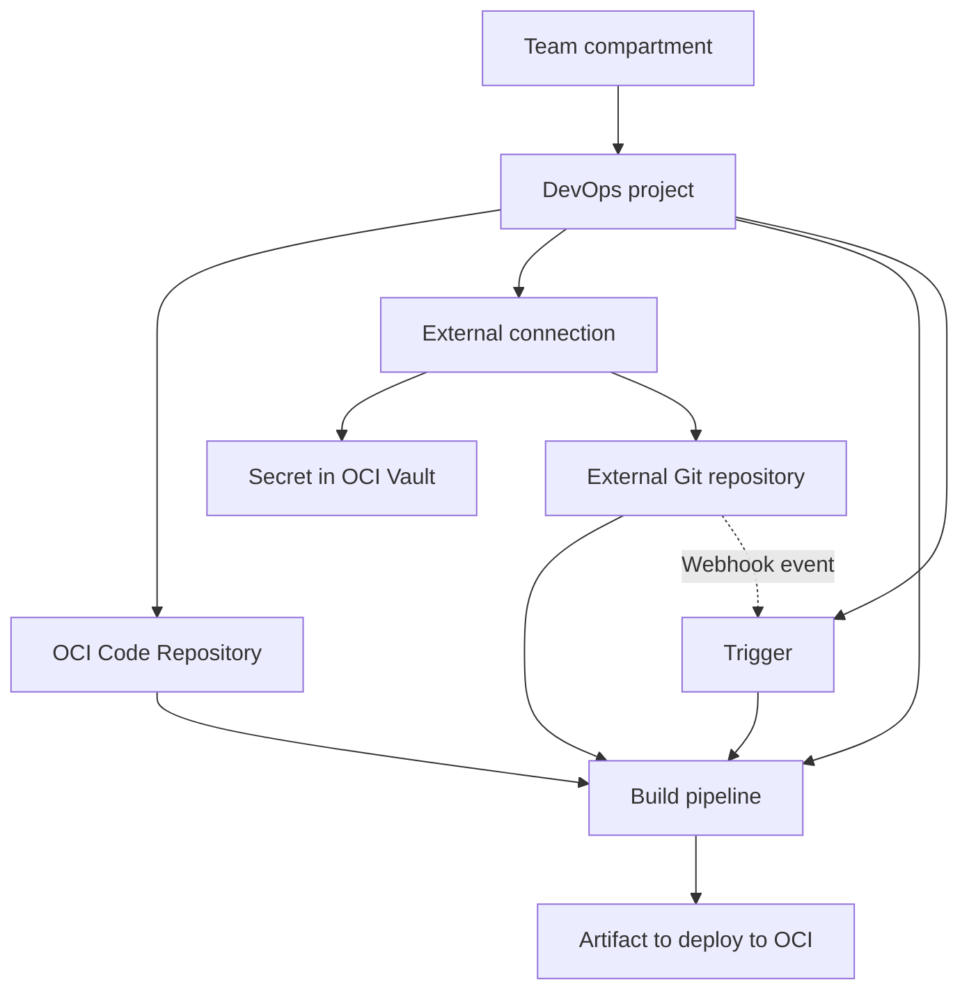

# OCI DevOps projects, repositories, and source code connections

## 1. Role of source code repositories in CI/CD on OCI

A deployment workflow on Oracle Cloud Infrastructure needs to know where the source code comes from, who is allowed to modify the code, and which service is permitted to fetch the code for execution. If these three answers are unclear, a pipeline might run successfully yet still build the wrong branch, use a token belonging to someone who has left the team, or pull unapproved code.

Within the **DevOps and CI/CD on OCI** chapter, this lesson establishes the foundation for source code management: a DevOps project, an OCI-hosted repository, and an external connection to an external Git provider. This is the preparatory step before building, publishing artifacts, and deploying applications to Compute, OKE, or Functions. OCI DevOps provides private Git repositories and external source integration within the same CI/CD service. [Oracle: DevOps Overview](https://docs.oracle.com/en-us/iaas/Content/devops/using/devops_overview.htm).

After completing this lesson, learners can:

- Distinguish between a compartment, DevOps project, code repository, and external connection.
- Choose the right place to manage source code for the team's workflow.
- Create a project and repository, then clone, commit, and push over HTTPS.
- Store a GitHub PAT in OCI Vault and create a connection using the Secret OCID.
- Distinguish between connecting, syncing a mirror copy, and receiving events to start a build.
- Identify the failure layer when a repository is not visible or code cannot be fetched.

The running example throughout is a team developing a Java application `orders-api`, which may later connect to an Oracle Database on OCI. The team needs to store application and infrastructure code in a controlled manner while keeping database passwords, wallets, and tokens out of Git. Resource names in this lesson are conventions for the example, not OCI naming requirements.

## 2. Resource model and responsibility boundaries

### 2.1. DevOps project as the workflow organization unit

A DevOps project groups resources used for CI/CD: code repositories, external connections, build pipelines, triggers, artifact references, environments, and deployment pipelines. A project helps the team view the components of a delivery workflow in one context. [Oracle: Managing DevOps Projects](https://docs.oracle.com/en-us/iaas/Content/devops/using/devops_projects.htm).

Distinguish the following concepts:

| Component | Question it answers | Example in this lesson |
| --- | --- | --- |
| Tenancy | Which organization owns the infrastructure? | Company tenancy |
| Compartment | Which governance scope do the resources belong to? | `team-delivery` |
| Region | Which geographic region are the resources operated in? | The team's chosen region |
| DevOps project | Which components jointly serve software delivery? | `orders-delivery` |
| Code repository | Where are the source code and Git history stored? | `orders-api` |
| External connection | Which credentials does OCI use to access external Git? | `github-orders-source` |
| Trigger | Which source code event is allowed to start a build? | Push to `main` |

A project does not replace a compartment or IAM policies. Two projects in the same compartment can share compartment-level policies. To separate administrative groups or limit blast radius, design IAM and compartments accordingly rather than simply giving projects different names.

### 2.2. Relationship diagram



The arrow from the external Git repository to the build represents one source option. The team can use the external source directly or create a mirror in OCI and use that mirror. Both approaches do not have to be implemented for the same pipeline.

### 2.3. Source code repositories and artifact repositories

In OCI, the word *repository* can refer to different objects:

| Type | Suitable content | Example |
| --- | --- | --- |
| DevOps Code Repository | Source code, branches, commits, and Git-managed configuration | Java, Terraform, SQL scripts without secrets |
| Container Registry repository | Container images for release | `orders-api` image |
| Artifact Registry repository | Published software packages | JAR or installation package |

A commit is a build input; a JAR or image is an output. OCI DevOps documentation uses Container Registry or Artifact Registry for built artifacts. [Oracle: Getting Started with DevOps](https://docs.oracle.com/en-us/iaas/Content/devops/using/getting_started.htm).

The design for this example keeps `pom.xml`, `src/`, and Terraform code in Git, and sends build outputs to an artifact repository. This separation keeps source history easy to inspect and prevents Git from bloating after every compilation.

## 3. Choosing an OCI repository, external source, or mirror

### 3.1. Three ways to organize source code

| Option | Where the dev team primarily works | When it fits | What needs to be managed |
| --- | --- | --- | --- |
| OCI hosted repository | Git repository on OCI | New projects wanting centralized governance in OCI | OCI identities, IAM, and review workflow |
| Direct external source | GitHub, GitLab, or a connector-supported source | Teams with an established repository and collaboration workflow | Tokens, provider-side permissions, connectivity |
| Mirror repository in OCI | Authoritative source defined by the team, plus a copy on OCI | Need a Git copy in OCI or supporting a migration | Sync schedule, lag, and writable source rules |

OCI supports selecting an external source directly in a Managed Build stage. An external connection does not require a mirror. When configuring the source, select the correct connection, repository, and branch. [Oracle: Adding a Managed Build Stage](https://docs.oracle.com/en-us/iaas/Content/devops/using/add_buildstage.htm).

For `orders-api`, if the team is already reviewing pull requests on GitHub, they can keep GitHub as the collaboration hub and let OCI read code through a connection. Add a mirror only when there is a clear requirement, such as keeping a commit copy for a planned fallback strategy.

### 3.2. Defining the authoritative source

The team must agree on:

- Which repository receives official commits.
- Which branch is used for integration; which branch or tag is used for releases.
- Who can write directly, who approves changes, and who can update the connection.
- Whether the pipeline fetches code from the primary repository or from a mirror.

For example: GitHub is the authoritative source, all changes to `main` go through pull requests, and OCI only reads from GitHub. In that case, do not push an isolated commit directly to the OCI copy and assume it exists on GitHub.

A mirror containing Git objects does not mean all operational settings have been copied. Do not assume that review rules, accounts, webhooks, and secrets from the external provider are also migrated to OCI.

## 4. Distinguishing credentials and access permissions

### 4.1. Each flow uses a distinct credential type

| Flow | Typical mechanism in this lesson | Where it is used |
| --- | --- | --- |
| Console administration | OCI login session | Creating and viewing resources |
| OCI CLI API calls | Configured OCI authentication profile | `oci devops ...` commands |
| Local Git accessing OCI over HTTPS | OCI username and OCI auth token | `git clone`, `git fetch`, `git push` |
| OCI DevOps reading GitHub | GitHub PAT stored in OCI Vault | External connection |
| GitHub sending events to OCI | Configured Trigger URL and trigger secret | Webhook |

OCI API signing keys and auth tokens serve different protocols. An auth token is an Oracle-generated credential; users manage tokens in their own user credentials section. [Oracle: Managing User Credentials](https://docs.oracle.com/en-us/iaas/Content/Identity/Tasks/managingcredentials.htm).

A common mistake is entering the Console password into Git's password prompt, or using a GitHub PAT instead of an OCI auth token. Both cases confuse which side is performing authentication.

### 4.2. Successful authentication is not enough for access

A developer with a valid OCI auth token who has not been granted permissions on the `orders-api` repository may still be unable to read or write code. Likewise, a PAT that exists on GitHub is not guaranteed to access an organization's private repository.

Separate two steps when diagnosing:

1. Does the receiving side recognize the identity or token?
2. Does that identity have permission to perform the operation on the exact target resource?

Storing a PAT in Vault protects how the secret is kept; it does not automatically grant access to a GitHub repository. Granting human users project management permissions also does not automatically grant the DevOps resource principal permission to read secrets.

## 5. Preparing IAM for operators and DevOps resources

### 5.1. Permissions for human users

Administrators prepare compartments, permissions to create projects, repositories, and connections, permissions to use topics, and permissions to configure logs by role. Whoever creates secrets also needs appropriate permissions on Vault and keys. There is no need to turn every developer into a tenancy administrator.

OCI policies have the form `Allow <subject> to <verb> <resource-type> in <location>`. The examples use OCIDs to avoid name ambiguity; replace every `<...>` placeholder with actual values. [Oracle: Policy Syntax](https://docs.oracle.com/en-us/iaas/Content/Identity/Concepts/policysyntax.htm).

```text
Allow group id <SETUP_GROUP_OCID> to manage devops-project in compartment id <DEVOPS_COMPARTMENT_OCID>
Allow group id <SETUP_GROUP_OCID> to manage devops-repository in compartment id <DEVOPS_COMPARTMENT_OCID>
Allow group id <SETUP_GROUP_OCID> to manage devops-connection in compartment id <DEVOPS_COMPARTMENT_OCID>
```

This covers the DevOps permissions for the setup group. Permissions for Notifications, Logging, and Vault must be prepared separately according to the actual resource locations.

### 5.2. Permissions for resource principals

A dynamic group for connections can use the matching rule:

```text
ALL {resource.type = 'devopsconnection', resource.compartment.id = '<DEVOPS_COMPARTMENT_OCID>'}
```

Policy for the dynamic group to read secrets:

```text
Allow dynamic-group id <CONNECTION_DYNAMIC_GROUP_OCID> to read secret-family in compartment id <SECRET_COMPARTMENT_OCID>
```

For a mirror to read secrets, prepare a dynamic group for `devopsrepository` along with secret-reading permissions for that group. When adding builds, also consider the `devopsbuildpipeline` principal. Someone validating a connection needs `use devops-connection` or higher appropriate permissions. [Oracle: DevOps IAM Policies](https://docs.oracle.com/en-us/iaas/Content/devops/using/devops_iampolicies.htm).

Secret permissions must point to the compartment containing the secret, even if the project lives in another compartment. Place policies at a level covering all relevant compartments; Oracle's documentation guides creating policies for external source integration at the root compartment.

One governance choice for the example team is separating who edits connections from who approves release code. Anyone who can both switch the source repository and approve releases could alter the system outside Git's standard review path.

## 6. Creating a DevOps project and preparing observability

### 6.1. Required information

Prepare the working region, authorized compartment, and Notifications topic. If using email for notifications, the subscription must complete confirmation according to the Notifications mechanism.

Conventions in the example:

| Attribute | Example value |
| --- | --- |
| Compartment | `team-delivery` |
| Project | `orders-delivery` |
| Topic | `orders-devops-events` |
| Repository | `orders-api` |
| Default branch | `main` |
| GitHub connection | `github-orders-source` |
| Secret holding PAT | `github-orders-source-pat` |

### 6.2. Console steps

1. Select the right region, then open **Developer Services → DevOps → Projects**.
2. Select compartment `team-delivery`.
3. Click **Create devops project**, enter a name and description.
4. Select the prepared Notifications topic and create the project.
5. Record the Project OCID and verify the compartment.

A project's name cannot be changed after creation; choose a durable name and keep mutable information in descriptions or tags. A topic is a component that must be prepared when creating a project. [Oracle: Creating a Project](https://docs.oracle.com/en-us/iaas/Content/devops/using/create_project.htm).

### 6.3. Enabling logging

OCI requires enabling logging for a project before running a build or deployment pipeline. Successfully creating a project does not prove pipelines are ready to run. [Oracle: Running a Build](https://docs.oracle.com/en-us/iaas/Content/devops/using/run_build.htm).

Inside the project, open **Logs** and enable logging; if no log exists yet, create a log with an appropriate log group first. OCI DevOps uses OCI Logging to manage logs. [Oracle: Managing Logs](https://docs.oracle.com/en-us/iaas/Content/devops/using/devops_logs.htm).

The example team should designate who reads notifications, the log retention period, and the point of contact for broken connections. A topic that exists with no subscribers or no one monitoring it will not shorten incident recovery time.

## 7. Creating an OCI hosted repository and pushing code to Git

### 7.1. Creating the repository

In project `orders-delivery`, open **Code Repositories → Create Repository**, enter `orders-api`, and choose `main` as the default branch. A new repository is empty; creating the repository object does not upload application code to OCI. [Oracle: Creating a Repository](https://docs.oracle.com/en-us/iaas/Content/devops/using/create_repo.htm).

To avoid confusion when migrating from legacy systems, explicitly specify the default branch rather than relying on each team's `master` or `main` habit.

### 7.2. Preparing HTTPS authentication

Create an OCI auth token for the user performing Git operations, then copy the HTTPS clone URL from the repository page. When Git prompts for a password, enter the auth token.

Username format depends on the identity model:

| Identity type | Username format |
| --- | --- |
| Direct sign-in, without identity domain | `TenancyName/YourUserName` |
| Direct sign-in, with identity domain | `TenancyName/domainName/YourUserName` |
| Federated user | `TenancyName/Federation/UserName` |

Default domain example: `Acme/Default/alice_jones`. Use the actual tenancy name; do not substitute the Tenancy OCID. [Oracle: HTTPS Authorization](https://docs.oracle.com/en-us/iaas/Content/devops/using/https_auth.htm).

Enter the token via prompt or an organization-approved credential manager. Avoid embedding tokens in URLs, because URLs easily appear in shell history, remote configs, or text copied during incident support.

OCI also supports cloning over SSH; this lab uses HTTPS to highlight the role of the auth token. [Oracle: Cloning a Repository](https://docs.oracle.com/en-us/iaas/Content/devops/using/clone_repo.htm).

### 7.3. First commit

Run the following commands in a terminal with Git, inside a directory dedicated to the exercise. Replace the placeholder URL with the URL just copied; do not run literal `<...>` values.

```bash
git clone '<HTTPS_CLONE_URL_FROM_OCI>' orders-api
cd orders-api
git switch -c main

printf '# orders-api\n' > README.md
printf 'target/\n*.log\n.env\n.env.*\n*.pem\nwallet/\n.terraform/\n*.tfstate\n*.tfstate.*\n' > .gitignore

git add README.md .gitignore
git diff --cached
git commit -m 'Initialize orders API repository'
git push -u origin main
```

This example assumes the repository is completely empty. If `main` already has commits, switch to the existing branch rather than recreating it or overwriting history. If Git identity is not yet configured on the machine, set `user.name` and `user.email` per team standards before committing.

Reopen the repository page to verify that the commit, files, and branch appear. Verify from the terminal:

```bash
git remote -v
git ls-remote --heads origin main
git log -1 --format='%H %s'
```

`ls-remote` tests reading refs from the remote; it does not prove the user has push permission. The commit SHA on OCI must match the commit just pushed.

### 7.4. If the application already has Git history

With an existing local repository, adding an OCI remote preserves the original remote:

```bash
git remote add oci '<HTTPS_CLONE_URL_FROM_OCI>'
git push oci main
git push oci --tags
```

These commands only push the `main` branch and tags to the destination. Additional branches should be pushed according to plan. If the destination already has history, check commit ancestry before pushing; do not use force push as the default fix.

A manual push is a one-time code transfer. It does not create an external connection or an automatic mirror schedule.

## 8. Creating an external connection to GitHub

### 8.1. Complete access chain

```text
DevOps resource principal
  → permitted by IAM to read secret
  → retrieves PAT from OCI Vault
  → authenticates to GitHub
  → permitted by GitHub to read the selected repository
```

To distinguish from the hosted repository, the integration exercise uses a separate private GitHub repository named `orders-api-external`. You can place the same sample code there, but treat it as an independent external source during the exercise.

### 8.2. Creating an appropriate PAT

OCI documentation describes a classic GitHub PAT with scope `repo` for private repositories and `public_repo` for public repositories. Do not assume a fine-grained PAT is directly interchangeable in every connector. [Oracle: Generating a GitHub PAT](https://docs.oracle.com/en-us/iaas/Content/devops/using/getting_started.htm).

In real organizations, choose a managed integration identity, token expiration, and accessible repository set according to team policy. The `repo` scope is quite broad, so the repository permissions of the account issuing the PAT should also be restricted. If the organization mandates another token type, verify compatibility before using it in a release workflow.

### 8.3. Storing the PAT in OCI Vault

1. Choose an appropriate vault and key in the working region.
2. Create secret `github-orders-source-pat` containing the PAT.
3. Record the **Secret OCID**.
4. Grant secret-reading permission to the resource principal that actually needs it.

The connection references the secret; never put the PAT into source code, READMEs, resource descriptions, or CLI arguments recorded in shell history. Record the owner and rotation date in administrative metadata that contains no secret values.

### 8.4. Creating the connection in the project

Open **External Connections → Create External Connection**, choose GitHub, name it `github-orders-source`, and select the vault and secret containing the PAT. OCI also has connection types for GitLab, Bitbucket Cloud, Visual Builder Studio, Bitbucket Server, and GitLab Server. Parameters depend on the type; self-managed servers may require a Base URL and CA bundle. [Oracle: Creating an External Connection](https://docs.oracle.com/en-us/iaas/Content/devops/using/create_connection.htm).

An easy CLI pitfall is `--personal-access-token`. For the command creating a GitHub connection, this value is the **OCID of the secret containing the PAT**, not the plaintext PAT string. [Oracle CLI: create-github-connection](https://docs.oracle.com/en-us/iaas/tools/oci-cli/latest/oci_cli_docs/cmdref/devops/connection/create-github-connection.html).

### 8.5. Validating and verifying the right repository

Click **Validate Connection**. Validation succeeding does not guarantee the PAT has access to the target repository; OCI notes that builds can still fail due to repository access permissions. Validation does not apply to GitLab Server and Bitbucket Server. [Oracle: Validating an External Connection](https://docs.oracle.com/en-us/iaas/Content/devops/using/validate_connection.htm).

Further evidence can be selecting `orders-api-external` when configuring the source or successfully syncing a mirror. Once a build pipeline exists, use a build run's checkout result to confirm the build principal can fetch code. Do not use a successful clone from a laptop in place of that check.

## 9. Repository mirroring and latency control

### 9.1. When to create a mirror

Mirroring fits when you need a Git copy on OCI. In the example, GitHub is the authoritative source and OCI receives a copy. This is a write-flow convention, not an assumption that every mirror setup automatically resolves two-way conflicts.

Open **Code Repositories → Mirror Repository**, select the GitHub connection and `orders-api-external`, name the copy `orders-api-mirror`, and choose a sync schedule. Oracle documents mirroring for GitHub, GitLab, Bitbucket Cloud, and Visual Builder Studio. Options include one-time, default, or custom sync; the default schedule is 15 minutes. [Oracle: Mirroring a Repository](https://docs.oracle.com/en-us/iaas/Content/devops/using/mirror_repo.htm).

Do not infer that a connection type supports mirroring just because it appears in Managed Build's source list. Those are two separate capabilities to verify.

### 9.2. Verifying the mirror receives the right commit

1. Push a commit to a test branch on GitHub.
2. In the OCI mirror, click **Synchronize now** if you want to check immediately.
3. Monitor the work request until the operation completes.
4. Compare the commit SHA of the same branch on both sides.

A sync request being accepted does not mean the process has finished. You can sync manually and adjust the interval on the repository page. [Oracle: Synchronizing a Mirrored Repository](https://docs.oracle.com/en-us/iaas/Content/devops/using/syncrepo.htm).

Suppose the last sync was at 10:00, GitHub received a commit at 10:04, and the next sync is at 10:15. A pipeline reading the mirror at 10:06 may still see the old commit. This is an example of lag, not a service-level timing guarantee.

### 9.3. Mirroring in a fallback plan

A source code copy is only one component of resilience. The team also needs to know who can write to the alternate repository, how to switch pipeline sources, where published artifacts live, and how to recover secrets.

Acceptance should use the criterion "can check out the specified commit SHA from the fallback repository," rather than merely "mirror exists in the Console." When returning to the primary source, changes made while using the fallback repository must be reconciled.

## 10. Source connections do not automatically create triggers

An external connection handles credentials for OCI to access an external source. A mirror handles keeping a Git copy. A trigger handles starting a build when a matching event occurs.

With GitHub, setting up a trigger requires configuring OCI and a GitHub webhook. Use the corresponding URL, secret, and event types; OCI requires content type `application/json` for GitHub webhooks. Branch filters and event conditions decide which changes trigger a build. [Oracle: Triggering a Build Run](https://docs.oracle.com/en-us/iaas/Content/devops/using/trigger_build.htm).

Different checks answer different questions:

| Check | What has been verified | What still needs verification |
| --- | --- | --- |
| Validate connection | Checks token according to connector capability | Specific repository permissions and checkout |
| Mirror sync succeeds | Copy received code from that sync run | Webhook and automatic build startup |
| Webhook received | Event path to OCI works | Whether the trigger matches and build fetches code |

Source configuration can be completed before creating a trigger. You do not need to create a build pipeline just to prove that a project, repository, and connection were created.

## 11. Automation example with OCI CLI

The commands below are for **Bash** such as OCI Cloud Shell or WSL with OCI CLI configured, not PowerShell. This is an alternative to Console operations; do not re-run create commands if the corresponding resource already exists.

Examples use placeholder OCIDs and resource names without putting plaintext tokens into the shell.

### 11.1. Creating a project

```bash
REGION='<OCI_REGION>'
DEVOPS_COMPARTMENT_ID='<DEVOPS_COMPARTMENT_OCID>'
TOPIC_ID='<NOTIFICATIONS_TOPIC_OCID>'

oci devops project create \
  --region "$REGION" \
  --compartment-id "$DEVOPS_COMPARTMENT_ID" \
  --name 'orders-delivery' \
  --description 'Source management for orders delivery' \
  --notification-config "{\"topicId\":\"$TOPIC_ID\"}" \
  --wait-for-state SUCCEEDED
```

`--notification-config` accepts valid JSON. The wait option tracks the work request; inspect the result and record the Project OCID for the next step. [Oracle CLI: project create](https://docs.oracle.com/en-us/iaas/tools/oci-cli/latest/oci_cli_docs/cmdref/devops/project/create.html).

### 11.2. Creating a hosted repository

```bash
PROJECT_ID='<PROJECT_OCID>'

oci devops repository create \
  --region "$REGION" \
  --project-id "$PROJECT_ID" \
  --name 'orders-api' \
  --repository-type HOSTED \
  --default-branch main \
  --wait-for-state SUCCEEDED
```

`HOSTED` indicates a repository stored on OCI. When creating a mirror, configure mirror settings matching the external source; merely changing `HOSTED` to `MIRRORED` is not enough. [Oracle CLI: repository create](https://docs.oracle.com/en-us/iaas/tools/oci-cli/latest/oci_cli_docs/cmdref/devops/repository/create.html).

### 11.3. Creating and validating a GitHub connection

```bash
PAT_SECRET_ID='<SECRET_OCID_CONTAINING_GITHUB_PAT>'

oci devops connection create-github-connection \
  --region "$REGION" \
  --project-id "$PROJECT_ID" \
  --display-name 'github-orders-source' \
  --personal-access-token "$PAT_SECRET_ID" \
  --wait-for-state SUCCEEDED

CONNECTION_ID='<CONNECTION_OCID>'

oci devops connection validate \
  --region "$REGION" \
  --connection-id "$CONNECTION_ID"
```

Replace `CONNECTION_ID` with the OCID from the previous create operation. If validation fails, save the error code and request ID for investigation; do not print secrets to logs. Updating the connection allows changing the secret reference when rotating credentials. [Oracle: Editing an External Connection](https://docs.oracle.com/en-us/iaas/Content/devops/using/edit_connection.htm).

## 12. Self-managed Git sources and provider changes

### 12.1. GitLab Server or Bitbucket Server

For self-managed servers, a valid token only satisfies part of the requirement. You must verify the Base URL, reachability from the code-fetching environment, routing, firewalls, and TLS certificate chain.

If using an internal CA, configure the CA bundle supported by the connector. Permissions for the CA bundle or network resources must be granted to the exact principal using them. Do not use disabling TLS verification as a long-term operational solution.

A successful clone from a laptop connected via VPN does not prove that an OCI build runner can reach the server. Verify from the actual execution path of the checkout step; private networking configuration for Managed Build is part of pipeline deployment design.

### 12.2. Note on Bitbucket Cloud

Some OCI pages still describe app passwords for Bitbucket Cloud. Atlassian has transitioned to API tokens and announced the deprecation of app passwords in 2026. For new deployments, cross-check current documentation on both sides and verify whether the OCI connector supports the replacement mechanism; do not keep instructing teams to create legacy app passwords. [Oracle: Creating an External Connection](https://docs.oracle.com/en-us/iaas/Content/devops/using/create_connection.htm), [Atlassian: App password deprecation](https://www.atlassian.com/blog/bitbucket/bitbucket-cloud-transitions-to-api-tokens-enhancing-security-with-app-password-deprecation).

Do not assume that placing an API token into an `app-password` field will be compatible: the connector may invoke both Git and REST APIs with different username requirements. Testing must include listing repositories and fetching code, not just saving the connection object.

## 13. Source code governance, cost, and availability

### 13.1. Managing changes and secrets

The recommended workflow for the team is developing on feature branches, reviewing before merging into `main`, and releasing from a specified commit. Branch protection and review permissions must be configured on the authoritative source system.

The `.gitignore` in the example is only a starting point. It does not remove files already tracked by Git, nor does it detect all secrets. When preparing infrastructure code or Oracle Database integration, check for:

- Environment files containing passwords or connection strings with credentials.
- Wallets, private keys, and OCI login configuration files.
- Terraform state that may contain sensitive data.
- Log files or archives generated during troubleshooting.

If a token appears in a commit, prioritize revoking or rotating the token and assessing impact. Deleting the file in a later commit does not remove the secret from shared history.

### 13.2. Verifiable credential rotation

A PAT rotation procedure may include:

1. Create a new PAT with appropriate permissions and store it in a new secret or secret version per organizational procedure.
2. Update the connection reference if the Secret OCID changes.
3. Validate with a supported connector.
4. Verify code retrieval for the target repository via an existing mirror or build.
5. Revoke the old PAT after confirming the new flow works.

Do not treat writing a new secret as proof that the connection is already using the new credential. Record the rotation timestamp and test result without storing the token value.

### 13.3. Cost and limits

Operational scope also includes Vault, Logging, Notifications, artifact storage, and build or deployment resources. Do not assume the entire lab falls under the Free Tier; check resource selections and applicable pricing before executing.

Before migrating large repositories, review service limits, Git history size, and push payload size. Use **Limits, Quotas and Usage** to check limits by service and region at deployment time. [Oracle: Limits by Service](https://docs.oracle.com/en-us/iaas/Content/General/service-limits/default.htm).

The team can control costs by choosing log retention based on need, keeping build binaries out of Git, and avoiding multiple overlapping build triggers for the same commit. Mirrors and triggers should be designed together so every automated action has a clear purpose.

### 13.4. Reproducibility

Each release version should record the source repository, commit SHA, pipeline source configuration, and produced artifact. Branch names indicate development direction; the SHA identifies the exact code snapshot used.

A connection working today does not guarantee it will work after the PAT expires or the integration account's permissions change. Include checking credential owners and fallback plans in routine operations.

## 14. Layered troubleshooting

| Symptom | Layer to check first | How to check |
| --- | --- | --- |
| Project not visible | Region, compartment, user IAM | Check Console scope and Project OCID |
| Git clone OCI reports authentication failed | Username and OCI auth token | Identity domain format; whether credential manager cached an old token |
| Can read but push is rejected | Write permissions or branch rules | Check IAM, target branch, and branch protection policy |
| Connection fails when reading secret | Resource principal and Vault | Whether dynamic group matches; policy points to secret's compartment |
| Validate succeeds but private repo not visible | Git provider permissions | Correct account, organization, repository, and token scope |
| Laptop clones fine but build cannot fetch code | Build principal or network | Check from the runner's execution path |
| Mirror does not have new commit | Sync schedule and work request | Check source, branch, sync result, and SHA |
| Push succeeds but no build starts | Trigger and webhook | Whether event arrived and filter matched |
| TLS error with internal server | Certificate chain and CA bundle | Check certificate, hostname, and trust configuration |
| Connection stops working after staff change | Credentials and provider permissions | Check PAT owner, expiration, and repository access |

The troubleshooting order is to verify the right region and resource, then check identity, permissions, network, and finally Git or trigger configuration. Avoid widening policies across the entire tenancy just to see if an error disappears.

When asking for support, provide the timestamp, region, relevant OCIDs, request ID or work request ID, and error messages with sensitive data stripped. This data is usually far more useful than a screenshot showing only "Failed".

## 15. Capstone practice and completion evidence

Perform this in the learning compartment with prepared permissions. Choose one of the two source code exercise tracks, or do both using separate repositories to avoid mixing authoritative sources.

**Common part:** create `orders-delivery`, attach a topic, enable logging, and record the Project OCID, compartment, and region. Define who manages repositories and who manages credentials.

**Track A — OCI hosted repository:** create `orders-api`, clone via HTTPS, commit the two sample files, and push `main`. Compare the SHA in the terminal and Console; test cloning into another directory to confirm the remote contains all pushed code.

**Track B — GitHub external connection:** prepare private repo `orders-api-external`, create a PAT, store it in Vault, and create `github-orders-source`. Validate the connection and verify access to the target repository. If practicing mirroring, create `orders-api-mirror`, push a new commit to GitHub, and compare the SHA after a successful sync.

Evidence to keep in the lab record, without including tokens:

| Item | Acceptance evidence |
| --- | --- |
| Correct governance scope | Consistent Project OCID, compartment, and region |
| Repository has code | Repo URL, branch name, and sample commit SHA |
| Git HTTPS works | Clone or push using an authorized identity |
| Connection uses secret | References Secret OCID, no PAT embedded in code |
| External source access | Reads the right repository through the tested OCI flow |
| Mirror if used | Succeeded work request and source branch SHA matches copy |
| Ready for build lesson | Authoritative source, credential owner, and logging status are clear |

The outcome is a source code foundation that is accessible, properly permissioned, and traceable. Build pipelines, build specifications, and artifact deployments will use this foundation in subsequent steps; creating a project and connection alone does not automatically produce a complete application delivery workflow.
