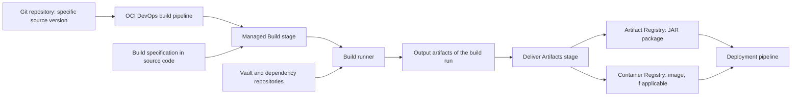

# Build pipelines, build specification, and build runners

## 1. Role of build in the DevOps workflow on OCI

In the **DevOps and CI/CD on OCI** chapter of the **CLOUD_PROVIDERS_ORACLE** module, build is the process of turning a specific version of source code into a product that can be tested, stored, and deployed. That product may be a JAR file, a container image, or a configuration bundle. OCI DevOps orchestrates this process, while the build specification describes the work that the execution environment must perform.

Three concepts must be distinguished from the start:

| Concept | Primary responsibility | Example |
| --- | --- | --- |
| **Build pipeline** | Orchestrates stages and dependencies | Fetch source code, run Managed Build, deliver artifacts to registry |
| **Build specification** | Declares commands, variables, timeouts, and outputs of a Managed Build stage | Run Maven, verify the JAR, publish output artifact names |
| **Build runner** | Provides the compute environment to execute commands | CPU, RAM, OS, tools, and network connectivity for Maven |

A properly configured pipeline can still fail because the runner lacks memory. A sufficiently powerful runner can still produce the wrong product if the build specification pulls the wrong source code. Therefore, build design must combine orchestration, execution configuration, permissions, and artifact provenance.

This lesson uses a Java application built with Maven as its example. The configuration snippets are templates to adapt to an authorized OCI environment; they are not results already executed on a specific tenancy. The focus is on building and delivering artifacts, while deployment strategies for Compute, OKE, or target services are handled in deployment pipelines.

## 2. From commit to artifact: how components work together



The Managed Build stage fetches the configured sources and executes the build specification on a runner. After generating outputs, the Deliver Artifacts stage sends the declared artifacts to the appropriate storage location. The deployment pipeline then consumes a specific artifact version.

Here are three important boundaries:

1. **A successful build command does not prove the artifact was published.** The file may only exist in the runner's filesystem.
2. **Declaring an output artifact does not replace artifact delivery configuration.** The pipeline still needs to map the output to a DevOps artifact resource and target repository.
3. **A published artifact does not mean the application has been deployed.** Deployment is a separate operation with its own identity, permissions, and control policies.

There is no need to rebuild the same commit for every environment just to swap a database address or compartment name. Prefer producing one clearly identified artifact, then passing environment configuration via the appropriate deployment mechanism. For Java, database passwords or private keys must never be packaged into a JAR or container image.

## 3. What is configured in the pipeline

The build specification does not contain all OCI DevOps settings. Part of the configuration belongs to the pipeline resource and the Managed Build stage:

| Configuration | Where responsibility lies | Operational meaning |
| --- | --- | --- |
| Project and compartment | OCI DevOps/IAM | Resource organization scope, operational permissions, and observability |
| Source repo, default branch, source alias | Managed Build source configuration | Defines what code is fetched and which source is primary |
| Build specification path | Managed Build stage | Selects the command file in source, typically `build_spec.yaml` |
| Runner configuration | Managed Build stage | Selects compute shape and appropriate connectivity |
| Preceding/subsequent stages | Build pipeline | Defines execution order and handoff conditions |
| Output mapping to target artifact | Deliver Artifacts stage and DevOps artifact | Defines which product is published where |
| Trigger | Pipeline event trigger config | Defines source events and trigger filters |

The filename `build_spec.yaml` is a common convention in this lesson, not a reason to skip the path field. If the file lives at `ci/build_spec.yaml`, the stage must point to that exact path in the fetched source.

When multiple sources exist, clearly identify the primary source and the alias of each source. Do not use relative paths based on guessing which directory the runner happens to be in. The `OCI_PRIMARY_SOURCE_DIR` variable points to the primary source directory in Managed Build.

A branch-based trigger is an activation mechanism. The build run record still needs the actual commit that was checked out, because the branch head can move after the event is emitted.

## 4. Structure of an OCI build specification

A build specification is YAML interpreted by OCI DevOps according to the service schema, not a plain shell script. Field names, data types, indentation, and the placement of each section all matter.

Fields used in this lesson:

| Field | Purpose | Key points to remember |
| --- | --- | --- |
| `version` | Build specification schema version | The example uses `0.1`; this is not the application version |
| `component` | Component type | For Managed Build in the example, it is `build` |
| `timeoutInSeconds` | Timeout for the described work | Does not override all stage or service limits |
| `shell` | Shell used for commands | The example chooses `bash` and uses Bash syntax |
| `env.variables` | Standard configuration variables | Do not place secrets here |
| `env.vaultVariables` | Maps environment variables to OCI Vault secrets | Requires appropriate secret-read permissions |
| `env.exportedVariables` | Variables passed out to subsequent stages | Values must be set during the build run |
| `steps` | Ordered list of execution steps | Each step has a type, name, command, and appropriate timeout |
| `steps[].onFailure` | Work run when a step fails | Used to gather diagnostics, not to turn a failed build into a false success |
| `outputArtifacts` | Name, type, and location of output products | This name is used when configuring Deliver Artifacts |

Do not copy GitHub Actions, Jenkinsfile, or other CI service structures directly into an OCI file. The concepts are similar, but the schema, source checkout, execution identity, and artifact passing differ.

Inside `command: |` is a multiline text block. Those lines are processed by the shell, whereas the outer YAML is parsed by OCI first. A YAML error can prevent the runner from running any command; a Maven error happens after the configuration has been accepted and commands have started.

## 5. Preparing a Java application for the example

Suppose the repository has the following structure:

```text
orders-service/
├── build_spec.yaml
├── pom.xml
├── mvnw
├── .mvn/
│   └── wrapper/
│       └── maven-wrapper.properties
└── src/
    ├── main/
    └── test/
```

The repository must contain the Maven Wrapper files matching the wrapper style the project uses; the tree above only shows the main components. Maven Wrapper pins the Maven version according to project configuration, though it still requires Java and may need to download the distribution or dependencies over the network.

The example requires:

- The runner has Bash, Git, Java, `sha256sum`, and utilities used in commands.
- The Java version matches `pom.xml`; if the project targets Java 17, the runner must provide a compatible JDK.
- The Maven build produces `target/app.jar`.
- Dependency repositories used by the project can be DNS-resolved and reached from the runner.
- Required tests are bound to the Maven lifecycle being run.

To standardize the filename, the `build` section in `pom.xml` can be configured as:

```xml
<build>
    <finalName>app</finalName>
    <!-- Actual project plugins are placed here. -->
</build>
```

This is a snippet to merge into an existing POM, not a complete POM. For multi-module projects, change the artifact path to the output of the module to package. With Spring Boot or tools producing multiple JARs, select the exact final artifact rather than an intermediate file.

A regular JAR is also not automatically executable with `java -jar`. How it starts depends on packaging, manifest, and application plugins; verifying that belongs to the project's artifact contract.

## 6. Sample build specification: validate, build, and generate provenance

File `build_spec.yaml`:

```yaml
version: 0.1
component: build
timeoutInSeconds: 1800
shell: bash

env:
  exportedVariables:
    - BUILD_VERSION

steps:
  - type: Command
    name: "Verify source and toolchain"
    timeoutInSeconds: 180
    command: |
      set -euo pipefail
      cd "${OCI_PRIMARY_SOURCE_DIR}"

      test -f pom.xml
      test -f mvnw
      test -f .mvn/wrapper/maven-wrapper.properties
      command -v git
      command -v sha256sum
      java -version
      bash ./mvnw --version

  - type: Command
    name: "Run Maven verify and generate metadata"
    timeoutInSeconds: 1200
    command: |
      set -euo pipefail
      cd "${OCI_PRIMARY_SOURCE_DIR}"

      bash ./mvnw --batch-mode --no-transfer-progress clean verify
      test -s target/app.jar

      source_commit="$(git rev-parse --verify HEAD)"
      build_run="${OCI_BUILD_RUN_ID:?OCI_BUILD_RUN_ID is required}"
      run_suffix="$(printf '%s' "${build_run}" | sha256sum | cut -c 1-12)"
      export BUILD_VERSION="${source_commit:0:12}-${run_suffix}"

      mkdir -p target/build-metadata
      printf 'commit=%s\nbuild_run_id=%s\nartifact_version=%s\n' \
        "${source_commit}" "${build_run}" "${BUILD_VERSION}" \
        > target/build-metadata/provenance.txt
      sha256sum target/app.jar > target/build-metadata/app.jar.sha256

    onFailure:
      - type: Command
        name: "List test reports for diagnostics"
        timeoutInSeconds: 60
        command: |
          cd "${OCI_PRIMARY_SOURCE_DIR}"
          printf '%s\n' "Build failed; inspect the original command error."
          if [ -d target/surefire-reports ]; then
            find target/surefire-reports -maxdepth 1 -type f -name '*.txt' -print
          fi

outputArtifacts:
  - name: application_jar
    type: BINARY
    location: ${OCI_PRIMARY_SOURCE_DIR}/target/app.jar

  - name: build_provenance
    type: BINARY
    location: ${OCI_PRIMARY_SOURCE_DIR}/target/build-metadata/provenance.txt

  - name: application_checksum
    type: BINARY
    location: ${OCI_PRIMARY_SOURCE_DIR}/target/build-metadata/app.jar.sha256
```

The timeouts of `180`, `1200`, and `1800` seconds are choices for the example, not OCI defaults or fixed limits. They must be tuned to the project and the limits applicable to the stage, runner, and tenancy.

### 6.1. Why split into two steps?

The first step validates the source and toolchain. If Java is missing or the wrapper cannot download Maven, the log surfaces the failure early before packaging. The second step runs the Maven lifecycle and only generates version metadata once the output file actually exists.

Each step explicitly runs `cd` to the source directory. Do not rely on the working directory or implicit shell state from a previous step. Data handed off must be represented through files, output artifacts, or an OCI-supported variable mechanism.

### 6.2. Why use `set -euo pipefail`?

These Bash options help prevent common pitfalls:

- A command fails yet the script continues and publishes a stale artifact.
- Using a required variable that has not been set.
- An earlier command in a shell pipeline fails but is masked by the exit code of the last command.

They do not replace understanding each tool's exit codes. Some commands return non-zero codes for normal business outcomes; handle those cases explicitly rather than adding `|| true` to every line.

### 6.3. How far does `verify` test?

`mvn verify` runs Maven phases up to `verify`. Unit tests typically run via their corresponding plugin. Integration tests only run if the project has configured the appropriate plugins and bindings; the command name alone does not create integration tests, security scans, or tests against Oracle Database.

If tests need to connect to an Oracle database, prepare the identity, test data, network path, and cleanup mechanism. Do not use a production schema as a test environment simply because the runner can reach that database.

### 6.4. Artifact versioning and provenance

`BUILD_VERSION` combines a commit prefix with a short value derived from the build run ID. The goal is to distinguish different builds of the same source code; this is not a claim of full build reproducibility or cryptographic supply-chain attestation.

The provenance file records the full commit, build run ID, and artifact version. The checksum file helps verify JAR contents after delivery. Together they support traceability, though they are not equivalent to digital signatures or a full provenance attestation framework.

Truncated hashes have a non-zero collision probability. If stronger identity guarantees are required, use versioning conventions and repository overwrite protections that meet organizational policy. Even if the version label is short, the build record must still retain full identifiers.

### 6.5. `onFailure` for diagnostics

The failure branch lists report locations so operators know where to look for information. It does not guarantee that reports are persisted outside the runner. If failed build reports must be retained, design additional collection and storage appropriate to pipeline behavior when a stage fails.

Never automatically print all environment variables, Maven settings, or configuration files during diagnostics. Those files may contain tokens, passwords, or internal details.

## 7. Build runner: execution environment, not storage

In the Managed Build flow, OCI DevOps provides a runner environment to execute stage work. A runner is not the application's Compute instance, an Oracle database, or a personal OCI Cloud Shell.

Do not design around assumptions that the next run will reuse the same machine or keep directories from the previous run. Only treat data as durable once it has been transferred to a designated storage service with proof of successful delivery.

### 7.1. Toolchain must be verified

Runners include a toolset according to the environment supported by the service. Do not infer that every runner has the exact JDK, Maven, Docker, or native libraries installed on a developer's laptop.

Actions to take at the start of a build:

- Record the Java version and relevant packaging tools.
- Use a wrapper or a controllable tool-version configuration.
- Verify required commands before long-running tasks.
- If additional tools must be downloaded, use trusted sources and verify integrity per team procedures.

Maven Wrapper pins the Maven version per wrapper configuration; it does not automatically pin the JDK, dependency repository contents, or every plugin. To improve reproducibility, also manage dependency versions, plugins, base images, and externally fetched resources.

### 7.2. CPU, RAM, architecture, and disk space

Runner shape must match the build workload:

| Factor | Symptom when mismatched | How to evaluate |
| --- | --- | --- |
| CPU | Compilation and tests take too long | Compare per-phase duration, concurrency, and actual resources |
| RAM | JVM runs out of heap or process is killed | Read JVM errors, OOM signs, and test fork concurrency settings |
| CPU architecture | Native libraries or images fail to run properly | Compare runner architecture, build output, and target environment |
| Temporary disk space | Extracting dependencies or building images fails | Check output size and intermediate data |
| Timeout | Stage is terminated while downloading or testing | Find the bottleneck before increasing the timeout |

Adding CPU does not automatically reduce Maven repository wait times. Increasing one JVM's heap can worsen total memory usage if multiple test forks run concurrently. Maven/JVM parameters must be tuned to the runner's total load.

### 7.3. Caching is a conditional optimization

Do not rely on leftover local state on a runner as a mandatory cache for correctness. If the environment has a supported cache mechanism, define the cache key, access permissions, invalidation strategy, and scope of use.

A build must still produce its output from a clean checkout when the cache is empty. For internal Java dependencies, a managed repository manager can provide a more reliable download source than relying on a specific runner's `.m2` directory.

### 7.4. Do not equate runners across CI systems

A Compute instance running a Jenkins agent or GitHub Actions runner is a different operational model from OCI DevOps Managed Build. If choosing another CI system on OCI, the team assumes separate responsibility for agent registration, machine patching, credentials, scaling, and job isolation.

Running a pipeline on OCI does not automatically make every agent an OCI DevOps managed runner. Clearly define which product orchestrates and which party owns the execution environment.

## 8. Runner networking and VCN connectivity

A build runner may need to reach several groups of endpoints:

| Access target | Example purpose | What to verify |
| --- | --- | --- |
| Source code repository | Fetch the commit to build | Connector, source permissions, DNS, and connectivity |
| Dependency repository | Maven downloads dependencies/plugins | Internet egress or path to internal repository |
| OCI APIs and Vault | Read secrets, call services per permissions | Endpoints, execution identity, and IAM |
| Artifact/Container Registry | Publish JAR or image | Connectivity, authentication, and write permissions to target repo |
| Database for testing | Integration tests | Private DNS, routes, NSGs/security lists, and test credentials |

If the project needs access to private resources, configure Managed Build private network access using the options OCI supports for that environment. Having the repository in the tenancy or the database in a VCN does not automatically give the runner a network path to them.

For traffic traversing a subnet/VCN, inspect route tables, security lists or NSGs, DNS, and appropriate gateways together. Do not assume that having a NAT Gateway grants access to every OCI service; some paths may use a Service Gateway or private endpoints depending on the service and design.

Two layers are frequently confused:

- **Network connectivity** determines whether the runner can reach the endpoint.
- **IAM or application credentials** determine whether the endpoint allows the operation.

Timeout or DNS errors should be investigated differently from authentication or authorization denials. Do not fix a network error by granting tenancy-admin permissions, and do not open database ingress to the entire Internet to fix a missing route in CI.

## 9. Standard variables, secrets, and OCI identities

### 9.1. Separating three kinds of values

| Kind | Examples | Appropriate management approach |
| --- | --- | --- |
| Standard configuration | Application name, log level, build profile name | Pipeline variables or `env.variables` per scope |
| Secrets | Internal repository token, test password | Vault/secret mechanism with restricted read permissions |
| Build outputs | Artifact version, image identifier | `env.exportedVariables` when passing to later stages |

In the example, `BUILD_VERSION` is not a secret and is set in the command using `export`. Declaring it under `env.exportedVariables` tells OCI to propagate that variable; simply running `export` in Bash does not replace the cross-stage variable contract.

Do not use exported variables to pass passwords across multiple stages. Subsequent stages should access secrets through a mechanism authorized for their own responsibilities.

### 9.2. Example using a Vault variable

If the build needs a token to access an internal Maven repository, the `env` section can be extended as follows:

```yaml
env:
  variables:
    APP_NAME: orders-service
  vaultVariables:
    INTERNAL_REPO_TOKEN: "<vault-secret-ocid>"
  exportedVariables:
    - BUILD_VERSION
```

This replaces/extends the existing `env` block rather than adding a second `env` key in the same YAML file. The value under `vaultVariables` references an appropriate secret, not the raw token committed directly to the repository.

The project still needs to configure Maven to use that variable properly, such as via securely prepared settings. Declaring the variable alone does not tell Maven which server the token belongs to.

Protect secrets across inputs, logs, and outputs:

- Do not run `set -x`, `printenv`, or `env` in flows with secrets unless output is controlled.
- Do not copy secrets into the build context directory or into artifacts.
- Do not use Docker build arguments assuming secrets will stay hidden across image layers.
- Do not supply release secrets to builds triggered from untrusted source code.

### 9.3. IAM per task

The person configuring the pipeline and the service identity executing the build may be different principals. A user being able to view Vault in the Console does not prove the runner can read the secret at runtime.

Depending on the resources and execution mechanism, configure IAM, dynamic groups/resource principals, and service permissions accordingly. Permission scope must match the compartment and actual task:

| Task | Permissions to review |
| --- | --- |
| Fetch code from protected repo | Repository read permission or connector credentials |
| Read Vault secret | Permission to read the relevant secret bundle |
| Publish generic artifact | Required permissions for the artifact and target repository |
| Publish container image | Permissions on the target Container Registry repository |
| Use private network config | Service permissions required to use associated network resources |
| Observe builds | Permissions to view build runs and logs, scoped for operators |

This table is a responsibility matrix, not a single policy to copy verbatim. Do not replace it with broad tenancy-admin permissions for testing convenience. Application deployment permissions should also not be bundled into build permissions merely because both pipelines share a project.

## 10. From output artifact to published artifact

In the sample, `application_jar` is the logical name declared by the build specification. `target/app.jar` is the file path on the runner. Neither is a repository name or an OCI artifact OCID.

A delivery configuration for the JAR can be designed as follows:

| Component | Illustrative value |
| --- | --- |
| Output name in build specification | `application_jar` |
| Output type | `BINARY` |
| Source file | `${OCI_PRIMARY_SOURCE_DIR}/target/app.jar` |
| Target repository | Generic artifact repository created in OCI Artifact Registry |
| Artifact path | `orders/app.jar` |
| Version | Value substituted from `${BUILD_VERSION}` |
| Linked record | Full commit, build run ID, and checksum |

Steps by responsibility:

1. Create or select the target repository and corresponding DevOps artifact resource.
2. Configure the artifact path/version and required variable substitution mechanism.
3. In the Deliver Artifacts stage, map the exact output name `application_jar` to the target artifact.
4. Add mappings for provenance and checksum if you want to store them durably.
5. Run the pipeline and verify delivery results in the repository, not just the Managed Build status.

If using `${BUILD_VERSION}` in an artifact field, enable/configure variable substitution according to the capabilities of that artifact resource. If left as a literal string, every build run may target the same wrong name or fail to locate the expected product.

In a real pipeline, provenance and checksum outputs also need a storage location and retention policy. Declaring them in `outputArtifacts` only defines build outputs; it does not prove operators can access them after the ephemeral environment is reclaimed.

Do not use `latest` as the sole identifier for an approved product. When redeploying or rolling back, you must be able to specify the exact version used; for containers, the digest is a useful content identifier to record in release logs.

## 11. Variant: creating a container image from the same build

If the deployment product is a container, the runner and Managed Build configuration must support the chosen image-building tool. Verify the ability to run Docker or the equivalent tool before invoking it; merely adding a `Dockerfile` to the repository does not guarantee the runner has a suitable execution environment.

Example using Docker: after generating `BUILD_VERSION` and the JAR in the same command block of the Maven step, you can add:

```bash
docker version
docker build --tag "orders-app:${BUILD_VERSION}" .
```

The Dockerfile must copy the right `target/app.jar` and select an appropriate Java runtime/base image. If a base image can change under the same tag, the product can also change between two builds even from the same source commit; digest-pinning policy should be evaluated alongside reproducibility and security patching needs.

The image output is added to `outputArtifacts`:

```yaml
  - name: application_image
    type: DOCKER_IMAGE
    location: orders-app:${BUILD_VERSION}
```

The snippet above is an item to merge into the existing list. Here `location` identifies the built image in the execution environment, unlike a JAR file path.

The Deliver Artifacts stage must map `application_image` to a container-image DevOps artifact and target repository. An illustrative destination URI looks like:

```text
<registry-domain>/<tenancy-namespace>/orders-app:${BUILD_VERSION}
```

Replace the registry domain, namespace, and repository config with actual environment values. Pushing to a private registry requires proper authentication and permissions; do not embed long-lived passwords in the build specification to bypass IAM configuration.

Do not both run a custom push command and add Deliver Artifacts for the same image without clearly assigning publication responsibility. One consistent delivery mechanism makes it clear which stage wrote the artifact and whether a failure occurred before or after release.

## 12. Sequence for creating a hands-on pipeline

### Step 1: confirm inputs and ownership

Choose the project/compartment, source code repository, lab branch, and target artifact repository. Confirm who can edit the build specification, who can run the pipeline, and who can read secrets.

In the first lab, use one application and one primary artifact. Do not attach production deployment permissions to the pipeline just to test Managed Build.

### Step 2: commit the build specification in the right commit

Commit the file along with required wrapper/POM changes. Treat the build specification as code executable with CI privileges, so changes to this file must be reviewed like application code with operational impact.

If the repository holds multiple applications, the build specification path and `cd` commands must reflect the selected application. For example, a monorepo with `services/orders/pom.xml` should not keep a build command at the root if there is no POM at the root.

### Step 3: configure the Managed Build stage

Select the primary source, specification path, runner configuration, and needed network access. Verify the toolchain against the repository rather than assuming every tool on a laptop is also available on the runner.

If multiple sources are needed, define aliases and version relationships between them. Do not check out the application at a pinned commit while pulling release scripts from an untracked branch head.

### Step 4: configure artifact delivery

Add Deliver Artifacts after Managed Build and map the exact output names. Configure the version from the exported value, along with repository write permissions and retention of needed metadata.

The example has three binary outputs. If the workflow only stores the JAR, explicitly accept that provenance/checksum are not yet persisted durably or add another storage mechanism.

### Step 5: run manually and inspect results

Inspect logs sequentially for toolchain checks, Maven results, artifact discovery, and delivery. Record the commit, build run ID, artifact path/version, and checksum.

A run meets its goal when the artifact is retrievable at the destination and traceable back to source, not merely when Maven prints `BUILD SUCCESS`.

### Step 6: add triggers after the manual flow is clear

Choose event types and branch filters according to team workflow. Separate pull-request validation flows from release artifact publication flows.

Code from pull requests can modify build scripts to read secrets or exfiltrate data. Therefore, source trust level must be evaluated alongside the secrets, registry permissions, and execution identity that the build run receives.

## 13. Observability and error classification

Start from the first failing stage and the root error message. Failures at the end of a pipeline are sometimes merely the consequence of an artifact not being created at the start.

| Symptom | Cause category to inspect | Resolution direction |
| --- | --- | --- |
| Specification rejected before running commands | YAML/schema or file path | Check indentation, field names, and specification in the actual commit |
| `pom.xml` not found | Wrong primary source or project directory | Check checkout and paths under `OCI_PRIMARY_SOURCE_DIR` |
| `java: command not found` | Runner toolchain | Select an appropriate environment or provision JDK in a controlled way |
| Maven Wrapper fails to start | Missing wrapper files, Java, or distribution download failure | Read wrapper error and verify committed files |
| Dependency download timeout | DNS, route, proxy, or slow repository | Check network path and dependency endpoint |
| `401`/`403` from repository | Credentials, permissions, or server config | Check identity and how Maven uses credentials |
| Test failure | Code, test data, or dependent services | Read test reports and first error |
| Process killed or exit code like `137` | Possible out-of-memory or external termination | Correlate logs, resources, and timeouts before concluding |
| Build succeeds but JAR missing | Wrong packaging, module, or filename | Check output contract; do not grab another file arbitrarily |
| Deliver Artifacts cannot find output | Wrong output name, location, or product does not exist | Compare `outputArtifacts` and stage mapping |
| Registry rejects publish | Wrong target, permissions, or version rules | Check repository, identity, and overwrite policy |
| Next stage receives wrong version | Variable not exported or not substituted | Check `exportedVariables`, setting command, and artifact field |

If a dependency download command fails, do not work around it by skipping tests or disabling TLS certificate verification. If an artifact was already published before a later step failed, inspect repository state before retrying to avoid overwrites or hard-to-trace releases.

Duration should be observed per phase: source fetch, tool setup, dependency download, compile, test, packaging, and delivery. A single total duration for the whole pipeline is rarely enough to pick the right optimization.

## 14. Reliability, reruns, and cost control

### 14.1. Reruns must have clear semantics

A retry may use an old commit while external dependencies have changed or a branch ref has resolved differently. Identify what inputs the rerun actually used and record them.

Do not blindly auto-retry every failure indefinitely. Transient connectivity errors may suit bounded retries; test failures, schema errors, or missing permissions usually require fixing the root cause.

For the publish step, know how the repository handles existing versions. Build-run-based versioning distinguishes attempts, but release policy must still decide which artifact is accepted for deployment.

### 14.2. Reproducible builds need more than a commit

Factors that can cause the same source commit to yield different results include:

- Different JDK or compiler/plugin versions.
- Snapshot dependencies or dependencies whose contents change.
- Base images drifting under a mutable tag.
- Unpinned external downloads.
- Timestamps, archive ordering, or environment metadata leaking into the output.

A commit is a crucial provenance anchor, though not the entirety of build inputs. When strong reproducibility is required, also govern dependencies, toolchains, and repeatable packaging rules.

### 14.3. Evidence-based resource optimization

Build operational costs can involve runner duration, compute shape, artifact storage, logs, data transfer, and auxiliary test resources. Exact billing depends on applicable services and pricing policies; do not estimate budgets from Maven build duration alone.

Helpful practices:

- Fail fast when inputs or toolchain are missing.
- Increase resources only after confirming the build is CPU/RAM bound.
- Avoid re-downloading large dependencies when a supported, safe repository/cache solution exists.
- Set per-phase timeouts so hung jobs do not consume resources indefinitely.
- Limit concurrency to match quotas and dependent service capacity.
- Maintain artifact and log retention/deletion policies while keeping versions needed for rollback.

If a pipeline creates Compute instances, databases, or other OCI resources for testing, they have their own lifecycles and costs. Runner termination does not automatically delete resources created via OCI APIs. Design cleanup even when a build is canceled or fails mid-run.

## 15. Lab completion criteria

A basic build flow can be considered established when operators can verify the following:

- The pipeline runs against the designated repository and commit.
- Managed Build reads the exact specification from the selected source.
- The runner has the right toolchain, resources, and network connectivity.
- If mandatory tests fail, artifact publishing does not proceed as a valid build.
- Output files or images match the declared contract.
- Deliver Artifacts moves the exact product into the right repository and version.
- Artifacts can be traced back to commit, build run, and integrity check info.
- Secrets are never placed into source, logs, provenance, or artifacts.
- Operators can distinguish errors across source, build commands, runner, network, permissions, and delivery.
- Retries, output retention, and test resources have clear rules.

In OCI DevOps, the build pipeline holds the workflow, the build specification describes how to produce the output, and the build runner provides execution conditions. When these three layers are designed alongside IAM, VCN, and artifact storage, teams can feed source code into a controlled automation flow and hand off reliable products to the deployment pipeline.
