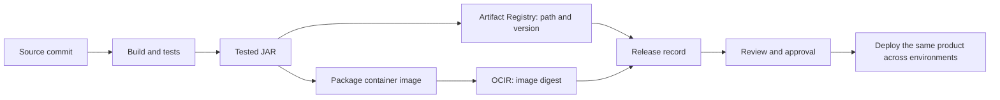

# Managing packages with Artifact Registry and container images with OCIR

## 1. Role of artifact repositories in DevOps on OCI

In the **DevOps and CI/CD on OCI** chapter of the **CLOUD_PROVIDERS_ORACLE** module, artifact repositories are where build outputs are handed over to deployment steps. Source code describes how to build software; an artifact is the concrete product that the runtime environment uses. A sound workflow must answer: which version is running, which commit produced it, who published it, and whether those exact bytes can be retrieved again.

This lesson uses a Java application named `orders-api`. The pipeline builds a tested JAR, stores the JAR in Artifact Registry, packages a container image, and pushes the image to OCIR. The deployment team selects the exact artifact to run on Compute or a container platform; Oracle Database access configuration is supplied separately per environment.

The goal is managing artifacts with clear identifiers, IAM permissions, traceability, and recoverability. Operations combine checking publish outcomes, observing errors, controlling storage usage, and retaining versions needed for availability.

## 2. Choosing the right service for each product type

**OCI Artifact Registry** stores, shares, and manages software packages as generic artifacts or blobs. The service supports versioning, hash verification, and immutable repositories. **Container Registry**, commonly called **OCIR**, stores and distributes container images in an Oracle-managed registry. [Artifact Registry Overview](https://docs.oracle.com/en-us/iaas/Content/artifacts/overview.htm), [Container Registry](https://docs.oracle.com/en-us/iaas/Content/Registry/home.htm).

| Product to manage | Where used in this lesson | Primary identification |
| --- | --- | --- |
| Built JAR, WAR, ZIP, or installer package | Artifact Registry | Repository OCID + artifact path + version, plus SHA-256 |
| Release descriptor or packaging report | Artifact Registry | Dedicated path/version and corresponding checksum |
| Image running the Java application | OCIR | Registry host + namespace + image path + digest |
| Source code, Dockerfile, pipeline definitions | Source code repository | Commit and branch per project workflow |
| Database passwords, auth tokens, private keys | Authorized secret management system | Secret reference and appropriate version |

OCIR complies with the **Open Container Initiative** specification, so it can also store compatible artifacts such as Helm charts. In this lesson, OCIR focuses on container images. The acronym OCI in Oracle's platform name and in the Open Container Initiative standard shares the same letters but refers to two different concepts. [Container Registry Concepts](https://docs.oracle.com/en-us/iaas/Content/Registry/Concepts/registryconcepts.htm).

### 2.1. Storing a JAR differs from providing the Maven protocol

A JAR uploaded via the Generic Artifact API remains a file managed by path/version. That workflow does not automatically provide a Maven endpoint, POM, metadata, or dependency resolution for `mvn` and Gradle. If the requirement is resolving dependencies by `groupId:artifactId:version` coordinates, you need a solution and endpoint compatible with those tools' protocol.

Examples in this lesson intentionally use OCI CLI to upload/download the JAR. Only after retrieving the exact file and verifying its checksum does the pipeline use it as an input for deployment or image packaging. This helps learners understand which operation is happening rather than guessing from service names.

### 2.2. Product handoff flow



For applications that only run a JAR on Compute, the pipeline can take the Artifact Registry branch without building a container. For containerized applications, the JAR and image are two products with different checksums; the release record must link them together.

## 3. Identifiers, versions, and immutability

### 3.1. Generic artifact identification

Within a repository, an artifact is named in the form `artifact-path:version`. Slashes (`/`) in the path organize names logically without creating actual filesystem directories. Example:

```text
Repository OCID: identifier of repository orders_releases
Artifact path:   java/orders-api/orders-api.jar
Version:         1.4.0-build.208
Artifact name:   java/orders-api/orders-api.jar:1.4.0-build.208
SHA-256:         JAR content checksum recorded by the build run
```

An immutable repository prevents overwriting an artifact. Even an artifact deleted from an immutable repository cannot have the same path/version reused; publishing again requires a new version. Thus, immutability does not mean an artifact is kept forever or can never be deleted. [Artifact Registry Concepts and Immutability](https://docs.oracle.com/en-us/iaas/Content/artifacts/concepts.htm).

Project teams should enforce a unique versioning convention for every build output. If a pipeline rerun produces different contents, issue a new version; never reuse an old release version to mask a change.

### 3.2. Image identification in OCIR

A complete image reference has the form:

```text
<registry-host>/<tenancy-namespace>/<image-path>:<tag>
<registry-host>/<tenancy-namespace>/<image-path>@sha256:<digest>
```

Illustrative example:

```text
iad.ocir.io/<tenancy-namespace>/orders-api:1.4.0-build.208-7ac92f1
iad.ocir.io/<tenancy-namespace>/orders-api@sha256:<64-hex-characters>
```

The host must belong to the right region/realm. `iad.ocir.io` is an Oracle-published endpoint for Ashburn in OC1. When using another region, take the corresponding endpoint from documentation or the Console; do not assemble a region key by guesswork. [OCIR Prerequisites and Regional Endpoints](https://docs.oracle.com/en-us/iaas/Content/Registry/Concepts/registryprerequisites.htm).

The namespace in the image reference is the tenancy namespace, not a compartment OCID, DevOps project name, or Kubernetes namespace name. The repository's compartment is set in the OCI resource configuration; it does not appear as a segment in the Docker path.

### 3.3. Tags for lookup, digests for selecting exact content

Tags like `latest`, `staging`, or `1.4.0` are human-readable, but can be repointed to different content in workflows that allow tag updates. To confirm the exact tested product, record the manifest digest in the release record and deploy by digest reference.

An image digest is neither the JAR's SHA-256 nor interchangeable with a local image ID. For multi-architecture images, distinguish the image index digest from platform-specific manifest digests; the release record must clearly state which object was scanned and deployed. Docker supports pulling by digest to select a deterministic content version. [Docker image pull reference](https://docs.docker.com/reference/cli/docker/image/pull/).

A tag containing a commit helps traceability, yet does not by itself prove the image was built from that commit. Also record the build run identifier, checksums, build source, and test results.

## 4. Repository design and access control

### 4.1. Placing repositories in the right management scope

In the example, use a compartment `AppDelivery` to manage team outputs and two repositories:

| Repository | Service | Purpose |
| --- | --- | --- |
| `orders_releases` | Artifact Registry | Versioned JARs and release records |
| `orders-api` | OCIR | Image running the Java application |

These are illustrative names; replace them with names and OCIDs from your lab environment. With multiple teams, partition by owner and trust level, and define who may create repositories, who may publish, who may read, and who may delete.

Pre-create a private **standard repository** in OCIR in the right compartment, then grant push permissions. OCIR can auto-create repositories in the root compartment on the first push if options and permissions allow; do not rely on that behavior for a pipeline requiring strict compartment scoping. Standard repositories accept push/pull; pull-through caches fetch from upstream and do not accept client pushes. [Creating a Repository in OCIR](https://docs.oracle.com/en-us/iaas/Content/Registry/Tasks/registrycreatingarepository.htm).

To avoid naming structure confusion, this lesson places the image at the root path `orders-api`. If using multi-segment names, check the repository's top-level setup before defining administrative boundaries and IAM policies.

### 4.2. Separating roles

| Role | Required task permissions | Permissions to review separately |
| --- | --- | --- |
| Repository administrator | Create, set compartment, configure settings and policies | Delete repositories, alter access scope |
| Pipeline publisher | Publish new products, read back to verify | Overwrite old versions, delete, change visibility |
| Deployment consumer | Read JAR or pull approved images | Publish or delete products |
| Lifecycle manager | View deployment references, compile retirement lists | Execute deletions outside verified lists |

Artifact Registry distinguishes resource types `artifact-repositories` and `generic-artifacts`. Reading artifact contents uses permissions in the `GENERIC_ARTIFACT_READ` group; uploading uses `GENERIC_ARTIFACT_CREATE`. Repository-level and artifact-level permissions must align with the actual operations. [Artifact Registry IAM Permissions Reference](https://docs.oracle.com/en-us/iaas/Content/artifacts/iam-policies-verb-resource-type-combinations.htm).

Example granting read permissions to two existing user groups:

```text
Allow group ReleaseReaders to read artifact-repositories in compartment AppDelivery
Allow group ReleaseReaders to read generic-artifacts in compartment AppDelivery
Allow group RuntimePullers to read repos in compartment AppDelivery
```

For OCIR, the resource type is `repos`; `read repos` allows pulling. Publishers need push permissions, and repository creation permission is a separate requirement if the repository does not yet exist. You can further scope by repository name with appropriate IAM conditions. [OCIR Repository Access Control Policies](https://docs.oracle.com/en-us/iaas/Content/Registry/Concepts/registrypolicyrepoaccess.htm).

The policies above illustrate permissions for user groups; they do not directly grant permissions to build runs or deployment services. When using OCI DevOps managed build/deploy, set up dynamic groups, service/resource principals, and policies along the actual execution path. Console login permissions of the pipeline creator do not automatically transfer to jobs. [IAM Policies for OCI DevOps](https://docs.oracle.com/en-us/iaas/Content/devops/using/devops_iampolicies.htm).

## 5. Publishing and retrieving JARs with Artifact Registry

The examples below use PowerShell and an installed, authenticated, authorized OCI CLI. They are hands-on guides, not intended to be run against production resources. Assume `./dist/orders-api.jar` is the executable JAR already tested by the pipeline.

### 5.1. Preparing the target and creating an immutable repository

Set `OCI_COMPARTMENT_OCID` from a controlled environment configuration. The example uses the Ashburn region for consistency with the OCIR section below:

```powershell
$compartmentId = $env:OCI_COMPARTMENT_OCID
$region = 'us-ashburn-1'
if ([string]::IsNullOrWhiteSpace($compartmentId)) {
    throw 'Missing lab compartment OCID'
}

# Run once using a principal with permission to create repositories.
$repositoryId = oci artifacts repository create --compartment-id $compartmentId --repository-type GENERIC --is-immutable true --display-name orders_releases --region $region --query 'data.id' --raw-output
if ($LASTEXITCODE -ne 0) { throw 'Failed to create Artifact Registry repository' }
if ([string]::IsNullOrWhiteSpace($repositoryId)) { throw 'Did not receive repository OCID' }
```

The repository creation command requires compartment, repository type, and immutability choice. Subsequent publishes reuse the OCID managed in pipeline configuration rather than creating a new repository per version. [OCI CLI: artifacts repository create](https://docs.oracle.com/en-us/iaas/tools/oci-cli/latest/oci_cli_docs/cmdref/artifacts/repository/create.html).

### 5.2. Uploading the JAR and comparing checksums

```powershell
$artifactPath = 'java/orders-api/orders-api.jar'
$releaseVersion = '1.4.0-build.208'
$jarPath = './dist/orders-api.jar'

if (-not (Test-Path -LiteralPath $jarPath -PathType Leaf)) {
    throw 'No built JAR available to publish'
}
$localJarSha256 = (Get-FileHash -LiteralPath $jarPath -Algorithm SHA256).Hash.ToLowerInvariant()

oci artifacts generic artifact upload-by-path --repository-id $repositoryId --artifact-path $artifactPath --artifact-version $releaseVersion --content-body $jarPath --region $region
if ($LASTEXITCODE -ne 0) { throw 'JAR upload failed' }
```

`--content-body` takes the local file path; `--artifact-path` is the logical name inside the repository. Do not swap these two values. [OCI CLI: upload-by-path](https://docs.oracle.com/en-us/iaas/tools/oci-cli/latest/oci_cli_docs/cmdref/artifacts/generic/artifact/upload-by-path.html).

Read metadata to confirm the newly published artifact:

```powershell
$publishedJarSha256 = oci artifacts generic artifact get-by-path --repository-id $repositoryId --artifact-path $artifactPath --artifact-version $releaseVersion --region $region --query 'data.sha256' --raw-output
if ($LASTEXITCODE -ne 0) { throw 'Unable to read JAR metadata' }
if ($publishedJarSha256 -ne $localJarSha256) {
    throw 'Artifact checksum on registry does not match built JAR'
}
```

Artifact metadata includes path, version, state, size, and SHA-256; `get-by-path` can look it up by repository/path/version. [Getting Artifact Details](https://docs.oracle.com/en-us/iaas/Content/artifacts/get-artifact.htm).

If upload fails because path/version already exists in an immutable repository, stop and inspect the previous publish. Do not delete the old artifact and try overwriting the same name. If this is a new build, assign a new version and update the release record.

### 5.3. Consumer downloading the JAR by approved version

A deployment host or downstream job must obtain the repository OCID, path, version, and checksum from a protected release record. The example below assumes the three identifier variables are provided as in the previous section; the checksum is supplied separately via `APPROVED_JAR_SHA256`.

```powershell
$expectedJarSha256 = $env:APPROVED_JAR_SHA256
if ($expectedJarSha256 -notmatch '^[0-9a-fA-F]{64}$') {
    throw 'Missing valid SHA-256 from approved release'
}

$downloadPath = './orders-api-approved.jar'
if (Test-Path -LiteralPath $downloadPath) {
    throw 'Choose a new download path to avoid reusing an existing file'
}

oci artifacts generic artifact download-by-path --repository-id $repositoryId --artifact-path $artifactPath --artifact-version $releaseVersion --file $downloadPath --region $region
if ($LASTEXITCODE -ne 0) { throw 'JAR download failed' }

$downloadedSha256 = (Get-FileHash -LiteralPath $downloadPath -Algorithm SHA256).Hash
if ($downloadedSha256 -ne $expectedJarSha256) {
    throw 'Downloaded JAR does not match approved content'
}
```

`download-by-path` fetches content by repository/path/version and writes it to the file specified by `--file`. Reading metadata with `get-by-path` in the previous step does not replace this content download operation. [OCI CLI: download-by-path](https://docs.oracle.com/en-us/iaas/tools/oci-cli/latest/oci_cli_docs/cmdref/artifacts/generic/artifact/download-by-path.html).

Checksum comparison confirms identical bytes against the reference value. If both the JAR and reference checksum were altered by the same untrusted actor, comparison alone does not prove publisher authenticity. Therefore, protecting the release record and approval rights is part of the workflow.

## 6. Authenticating Docker to OCIR

### 6.1. Distinguishing OCI CLI credentials and Docker credentials

OCI CLI uses the authentication mechanism configured for OCI APIs. In the illustrative Docker login flow, an OCIR user uses an **auth token** as the password, never the Console password or API signing key contents.

The login username typically follows `<tenancy-namespace>/<username>`; for federated identities, a domain segment may be required in the name. Match the exact format Oracle documents for the identity in use rather than hardcoding a single domain name for every tenancy. [Pushing Images Using the Docker CLI](https://docs.oracle.com/en-us/iaas/Content/Registry/Tasks/registrypushingimagesusingthedockercli.htm).

The example below receives values from CI configuration. `OCIR_AUTH_TOKEN` must come from a secret manager and never be committed to source or printed to logs.

```powershell
$registry = 'iad.ocir.io'
$tenancyNamespace = $env:OCI_TENANCY_NAMESPACE
$registryUser = $env:OCIR_USERNAME

if ([string]::IsNullOrWhiteSpace($tenancyNamespace)) {
    throw 'Missing tenancy namespace'
}
if ([string]::IsNullOrWhiteSpace($registryUser)) {
    throw 'Missing full OCIR username, including namespace'
}
if ([string]::IsNullOrWhiteSpace($env:OCIR_AUTH_TOKEN)) {
    throw 'Missing OCIR auth token'
}

$env:OCIR_AUTH_TOKEN | docker login $registry --username $registryUser --password-stdin
if ($LASTEXITCODE -ne 0) { throw 'OCIR login failed' }
```

`--password-stdin` avoids placing the token directly in command arguments. Docker may store credentials in a credential store or local config; base64 data in config is not secure encryption. On shared runners, isolate sessions and manage credential lifecycles. [Docker login reference](https://docs.docker.com/reference/cli/docker/login/).

### 6.2. Successful authentication does not prove sufficient publish permissions

Login verifies identity with the registry. Pushing also requires permissions on the target repository and other conditions such as the right region, namespace, and repository type. An account with pull permissions should not be granted delete permissions just to fix a push error.

For pipelines managed by OCI DevOps, do not assume the resource principal used for OCI APIs can be dropped directly into a Docker password prompt. Choose a publish mechanism supported by the stage type, configure corresponding IAM, and manage credentials along that execution path.

## 7. Packaging the JAR and publishing the image

### 7.1. Preparing a minimal build context

This section assumes Docker and Buildx are ready, private OCIR repository `orders-api` has been created, and the Java base image has been approved by the team. There is no need to recompile Java code per deployment environment.

Learner's input structure:

```text
dist/
  orders-api.jar
  Dockerfile
  .dockerignore
```

The JAR must be the exact file whose checksum was verified. If steps run on different runners, re-download the artifact by version and verify its checksum before placing it into the build context.

Example Dockerfile using a Java runtime passed in by digest:

```dockerfile
ARG JAVA_RUNTIME_IMAGE
FROM ${JAVA_RUNTIME_IMAGE}
WORKDIR /app
COPY --chown=10001:10001 orders-api.jar /app/app.jar
USER 10001:10001
EXPOSE 8080
ENTRYPOINT ["java", "-jar", "/app/app.jar"]
```

The base image needs the `java` binary, bytecode version compatibility, platform match, and support for running under the chosen UID/GID. If the application needs to write files, provide directories or volumes with explicit permissions. `EXPOSE` only documents the expected port; the application, port mappings, and OCI networking still require corresponding configuration.

You can restrict files sent to the builder using `.dockerignore`:

```text
*
!Dockerfile
!.dockerignore
!orders-api.jar
```

Never place auth tokens, OCI config files, private keys, database passwords, or sensitive Oracle wallets into an image. Runtime environment settings are supplied separately at deployment time; the same image can run with different configs for dev, staging, and production.

### 7.2. Building and pushing in the same run

The example selects `linux/amd64`. If the target environment is ARM or includes native libraries, confirm the platform and compatible base image before changing build configuration.

```powershell
$gitCommit = $env:GIT_COMMIT
$javaRuntimeImage = $env:JAVA_RUNTIME_IMAGE
if ([string]::IsNullOrWhiteSpace($gitCommit) -or $gitCommit.Length -lt 7) {
    throw 'Missing commit provided by CI'
}
if ($javaRuntimeImage -notmatch '@sha256:[0-9a-fA-F]{64}$') {
    throw 'Java base image must be pinned by an approved digest'
}

$shortCommit = $gitCommit.Substring(0, 7)
$imageRepository = "${registry}/${tenancyNamespace}/orders-api"
$imageTag = "${releaseVersion}-${shortCommit}"
$taggedImage = "${imageRepository}:${imageTag}"
$metadataPath = './image-build-metadata.json'

# Re-verify JAR right before placing it into the build context.
$currentJarSha256 = (Get-FileHash -LiteralPath './dist/orders-api.jar' -Algorithm SHA256).Hash
if ($currentJarSha256 -ne $localJarSha256) {
    throw 'JAR changed after the package publish step'
}

docker buildx build --platform linux/amd64 --build-arg "JAVA_RUNTIME_IMAGE=$javaRuntimeImage" --label "org.opencontainers.image.revision=$gitCommit" --tag $taggedImage --push --metadata-file $metadataPath ./dist
if ($LASTEXITCODE -ne 0) { throw 'Container image build or push failed' }

$buildMetadata = Get-Content -LiteralPath $metadataPath -Raw | ConvertFrom-Json
$imageDigest = $buildMetadata.'containerimage.digest'
if ($imageDigest -notmatch '^sha256:[0-9a-fA-F]{64}$') {
    throw 'Did not receive a valid digest for the published product'
}
$immutableImage = "${imageRepository}@${imageDigest}"
Write-Output $immutableImage
```

Buildx supports `--push` and outputs JSON metadata via `--metadata-file`; `containerimage.digest` records the digest of the build result. Do not substitute `containerimage.config.digest`. The directory receiving the metadata file must exist and be writable. [Docker Buildx build reference](https://docs.docker.com/reference/cli/docker/buildx/build/).

In CI, use a fresh workspace per run and only accept metadata when the build/push command succeeds. Variables in the example inherit from prior preparation steps; if split into independent jobs, pass them via controlled pipeline inputs/outputs.

### 7.3. Verifying the image is readable by digest

```powershell
docker pull $immutableImage
if ($LASTEXITCODE -ne 0) { throw 'Failed to pull image by the recorded digest' }
```

This step checks the distribution path from the registry. To verify the deployment principal has proper permissions, repeat the pull check using the consumer identity in the deployment environment, not only the publisher account.

After finishing the job's Docker operations, log out in a cleanup step that always runs, even if a step after publishing fails:

```powershell
docker logout $registry
```

If the image was published but a subsequent verification step failed, do not mark the release ready for deployment. The artifact may still exist in the registry; the next run must inspect that state and use a new version when producing another build.

## 8. Release record linking package and image

A release record should capture the following data:

| Information group | Recommended fields |
| --- | --- |
| Source | Full commit, source repo, build run identifier |
| Package | Repository OCID, artifact path, version, JAR SHA-256 |
| Image | Registry, repository/image path, digest, platform |
| Build inputs | Base image digest, Dockerfile or commit containing Dockerfile |
| Checks | Test results, scan results, SBOM, and build provenance as required |
| Approval | Who approved, target environment scope, and timestamp |
| Operations | Replacement version, rollback reference, and retention window |

Illustrative JSON structure; placeholder values inside `<...>` must be populated from an actual run:

```json
{
  "application": "orders-api",
  "release": "1.4.0-build.208",
  "sourceCommit": "<full-commit>",
  "buildRun": "<build-run-id>",
  "package": {
    "repositoryId": "<artifact-repository-ocid>",
    "path": "java/orders-api/orders-api.jar",
    "version": "1.4.0-build.208",
    "sha256": "<jar-sha256>"
  },
  "container": {
    "repository": "iad.ocir.io/<tenancy-namespace>/orders-api",
    "digest": "sha256:<image-digest>",
    "platform": "linux/amd64"
  }
}
```

This is an illustrative schema designed for the project, not a mandatory OCI DevOps schema. Protect the record so modifying image or package references requires review. If storing the JSON record in Artifact Registry, use a dedicated path such as `releases/orders-api/release.json` and a matching version.

Do not compute a checksum for the record in a way that requires the record to embed its own final checksum. You can store the record's checksum in an approval record or an independent verification mechanism.

## 9. Connecting into an OCI DevOps pipeline

OCI DevOps uses artifact references in stages to identify the product and version to deploy. A DevOps artifact reference resource does not replace the package or image contents stored in a registry. [Managing Artifacts in OCI DevOps](https://docs.oracle.com/en-us/iaas/Content/devops/using/artifacts.htm).

A pipeline can be organized around these handoff points:

1. **Build and test:** build the JAR from the chosen commit; run tests and record SHA-256.
2. **Publish:** publish the generic artifact and image; record actual identifiers from successful operations.
3. **Evaluate:** check checksums, scan results, build source, and release criteria.
4. **Approve:** select a specific release record for the target environment.
5. **Deploy:** consumer reads the exact package or pulls the exact digest, receiving environment-specific config.
6. **Verify:** validate the Java application, Oracle Database connectivity, and operational metrics.

When using managed stages instead of CLI commands, map build outputs accurately to target artifacts and configure IAM for the stage. Do not treat output names, local filenames, and registry paths as the same identifier.

### 9.1. Promoting a release across environments

If staging tested image digest D, production should receive that exact D along with its associated verification record. Rebuilding from the same commit can yield a different product because dependencies, base images, timestamps, or tools changed.

If regulations require separate repositories per environment or region, add a controlled promotion step and verify contents at the destination. Do not assume copying always preserves digests or signatures; record the destination identifier, compare contents, and re-verify required evidence.

### 9.2. Consumer on OKE

One way to grant private image pull permissions in OKE is using a Docker registry secret and declaring `imagePullSecrets` in the workload. The secret must exist in the Pod's namespace and be managed under credential-protection workflows. [Pulling Images from OCIR when Deploying to OKE](https://docs.oracle.com/en-us/iaas/Content/ContEng/Tasks/contengpullingimagesfromocir.htm).

The snippet below illustrates only the relevant portion of an existing Deployment's Pod template:

```yaml
spec:
  template:
    spec:
      imagePullSecrets:
        - name: ocir-readonly
      containers:
        - name: orders-api
          image: iad.ocir.io/<tenancy-namespace>/orders-api@sha256:<approved-digest>
          ports:
            - containerPort: 8080
```

This is a snippet with placeholders, not a complete manifest ready to apply. CI push credentials should not be placed into a cluster as read credentials if a dedicated pull-only principal can be issued. If using another identity integration approach, check supported mechanisms for your cluster and node type.

## 10. Verifying integrity and publisher origin

Each kind of evidence answers a different question:

| Evidence | Question it answers | What still needs checking |
| --- | --- | --- |
| JAR SHA-256 | Does the file match the reference checksum's bytes? | Is the reference checksum trustworthy? |
| Manifest digest | Which exact image/index content is selected? | Which pipeline produced it, and was it tested? |
| Image signature | Is the signature valid against a trusted key? | Are the key and signer authorized to release this product? |
| Scan report | Which issues did the scanner find at scan time? | Scan scope, freshness, and whether app layers are covered |
| Test run results | Did the version pass the designed checks? | What untested conditions and operational limits remain? |

### 10.1. Image scanning and managing findings

OCIR lets you attach an image scanner to a repository to scan for published vulnerabilities. Verify that the scanner is actually enabled and results match the exact image; do not treat a successful push as having a passing scan. [Scanning Images in OCIR](https://docs.oracle.com/en-us/iaas/Content/Registry/Tasks/registryscanningimagesforvulnerabilities.htm).

For `orders-api`, a project rule might require: releases must have compliant scan results, and findings above threshold must be fixed or have an approved, time-bound exception. This is a proposed project rule, not an OCIR default threshold.

OS-layer scan results do not automatically prove all Java dependencies, application logic, and runtime configurations are safe. Run application dependency analysis in CI and store reports/SBOMs linked to the corresponding digest. If an image spans multiple platforms, clarify which platform and manifest were inspected.

When new vulnerabilities emerge, update dependencies or base images, produce a new build/version/digest, test, and release. Preserve evaluation history for old versions rather than swapping contents behind an in-use release identifier.

### 10.2. Image signing and verification

OCIR supports image signing with asymmetric RSA keys in OCI Vault. Signatures bind to a specific image OCID; signing and key-usage permissions must be granted to the right principals. [Signing Images in Container Registry](https://docs.oracle.com/en-us/iaas/Content/Registry/Tasks/registrysigningimages_topic.htm).

In release design, permit signing only after mandatory checks succeed. Consumers must verify against trusted keys and handle missing or invalid signatures per policy; do not assume every `docker pull` automatically enforces organizational verification rules.

If transferring an image to another repository/region, check the destination image OCID and how signatures are carried over or re-issued. Equivalent content bytes do not guarantee all trust metadata from the source exists at the destination.

### 10.3. Secrets and environment configuration

Release JARs and images should not contain Oracle Database passwords, sensitive wallets, or OCIR tokens. In the example, connection values are supplied at deployment time through the environment's configuration/secret management mechanism.

A useful operational test is re-running the application with the same digest and newly rotated environment credentials and confirming it still works. This decouples software lifecycle from credential lifecycle and avoids releasing a new image just to change a password.

## 11. Retention, retirement, and cost control

### 11.1. Identifying products to keep before deleting

Cost and recoverability depend directly on how many versions are retained. However, deleting solely by file age can remove versions still serving production or needed for rollback.

A project policy can classify products as follows:

| Product category | Suggested lifecycle management |
| --- | --- |
| Currently deployed version | Retain for the full active period plus defined recovery window |
| Designated rollback version | Retain long enough for recovery windows and data compatibility |
| Retired release version | Retain per organizational audit rules, then evaluate retirement |
| Unselected experimental builds | Retire earlier after confirming no pipeline references remain |
| Test, scan, and SBOM reports | Retain tied to the release and investigation window |

Exact retention durations are set by operations based on criticality and budget; there is no single day-count right for every system. When estimating costs, consider storage size, build frequency, image size, replica counts, and cross-location distribution. Use pricing tables and actual tenancy metrics instead of assuming a fixed free allowance.

### 11.2. OCIR retention policies

OCIR provides region-level global image retention policies and custom policies for specific repositories. Criteria can be based on time since last pull, time without a version identifier, and exempted versions. Inspect which policy applies to a repository before modifying it. [OCIR Image Retention Policies](https://docs.oracle.com/en-us/iaas/Content/Registry/Tasks/registrymanagingimageretention.htm).

A rarely pulled image might be a critical rollback version. Cross-check active deployed digests, standby digests, and retention exemptions. If using version labels to exempt images from deletion, verify that the label points to the right content and understand which condition actually triggers the exemption.

Never use pull count as sole proof that nobody needs an image anymore. A running system may rarely re-pull, yet the next restart or scale-out will still need to fetch the product from the registry.

### 11.3. Generic artifact lifecycle

For JARs in Artifact Registry, teams should maintain an inventory of active path/versions and an approved retirement list. Evaluate each product by references in release records rather than merely filename or upload date.

Immutable repositories protect published version contents; they do not replace deletion authorization workflows or retention plans. Before retiring a version, update any deployment configurations and runbooks that still reference it.

### 11.4. Testing re-download and recovery capability

To verify distribution availability, periodically fetch a retained release from a clean consumer using proper read permissions. Checksum/digest, credentials, DNS, and network paths should be tested from the deployment environment rather than only from a cached workstation.

If recovery in another region is required, document where product copies live, destination identifiers, access permissions, signatures, and verification steps. Knowing the repository name in the primary region does not constitute a distribution fallback plan.

Software rollback also carries data constraints. For Java applications using Oracle Database, an older image may be incompatible with an altered schema; runbooks must specify backward-compatibility limits and data recovery procedures aligned with RTO/RPO.

## 12. Observability and error handling in the distribution path

### 12.1. What information to record

Pipeline logs should connect build, publish, and deploy: commit, build run, repository OCID, artifact path/version, JAR checksum, image digest, target environment, and check statuses. For OCI API errors, keep request IDs and error codes when available.

Never log auth tokens or secret contents. Organizations can aggregate publish/pull failure rates, artifact fetch latency, check durations, and storage usage from logs, metadata, and existing monitoring systems. These are metrics to intentionally collect; do not assume all of them exist out of the box as native registry metrics.

Key warning signs include: publish completes yet consumers cannot read, selected version no longer exists, scan has not completed, or deployment systems are pulling a digest different from the release record.

### 12.2. Symptom-based troubleshooting table

| Symptom | First area to check | Appropriate resolution |
| --- | --- | --- |
| Docker login rejected | Registry host, namespace, username/domain, auth token | Fix identity or token per procedure; never substitute Console password for token |
| Login succeeds but push rejected | Push permissions, target repo, compartment, repo type | Verify IAM and pre-create the proper standard repository |
| Pushed to unexpected destination | Host, namespace, image path, and repo auto-create behavior | Stop release, locate product, and fix target configuration |
| Image/tag not found | Region, repository, tag, and deletion status | Consult publish records; use recorded digest, do not switch to `latest` |
| Generic artifact upload fails | Path/version, create permissions, immutability | Check existing versions; issue a new version for a new product |
| Download succeeds but SHA-256 mismatches | Source file, download target, approved checksum, artifact version | Halt deployment, investigate divergence, and publish a valid build |
| OKE reports pull error | Secret, namespace, host, principal permissions, network path | Inspect workload pull path and properly scoped credentials |
| No manifest for platform | Image/index platforms and node architecture | Build/publish matching platform and re-verify digest |
| Slow or timed-out pull | DNS, proxy, egress/service endpoint used, image size | Locate bottleneck from consumer, shrink payload, adjust network design |
| Image exists but release is unapproved | Test results, scans, signatures, approval record | Keep un-deployed status until all criteria are met |

This is a diagnostic guide, not a one-to-one mapping between an error message and a single cause. Always preserve the original error message and check both the executing identity and the target resource.

## 13. End-to-end lab for orders-api

Practice in an authorized test compartment with a prepared JAR and explicit cost bounds. Code snippets in this lesson are instructional templates; fill in your environment's identifiers, credentials, and paths before running.

1. Prepare an immutable generic repository and a private OCIR standard repository; record region, compartment, repository OCID, and tenancy namespace.
2. Compute the JAR's SHA-256, upload by path/version, read back metadata, and download to a fresh path to compare contents.
3. Prepare a digest-pinned approved Java base image, Dockerfile, and minimal build context containing only required files; confirm target platform compatibility.
4. Log in with an authorized publish principal, build/push the image, and extract `containerimage.digest` from the successful run's metadata.
5. Create a release record linking commit, build run, JAR, and image; wait for mandatory checks before approving.
6. Use a read-only consumer to fetch the package or pull the image by digest. Confirm the consumer needs no publish/delete permissions for this task.
7. If test-deploying the application, supply separate database config and inspect health, connectivity, logs, and latency; confirm the running version matches the selected record.
8. Compile a list of test artifacts to retire, excluding versions still referenced or needed for recovery; execute cleanup strictly per the list and environment procedures.

A lab run succeeds when the learner can identify **which exact JAR and image were published**, verify a consumer retrieves the exact bytes, explain permission boundaries, and designate which versions must be retained for operations. The identifiers in the release record form the link connecting build, review, deployment, monitoring, and recovery on OCI.
