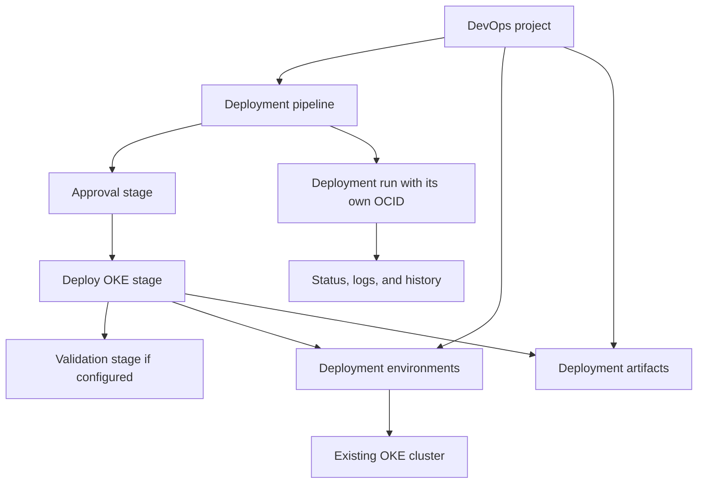
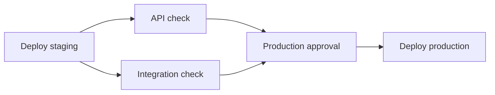
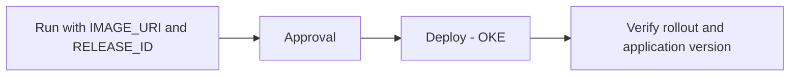

# Deploy pipelines and deployment environments

## 1. Role in CI/CD on OCI

In the **DevOps and CI/CD on OCI** chapter, a deployment pipeline orchestrates delivering a packaged software version to where the application runs. It connects artifacts with target resources, executes deployment steps, and records the outcome of each release.

For example, the Java application `orders` has been tested and packaged as a container image. The build pipeline pushes the image to OCI Container Registry; the deployment pipeline fetches the manifest, selects the OKE cluster, deploys the designated version, and enforces verification or approval conditions.

The focus of this lesson is the deployment structure in OCI DevOps: **pipeline → stage → environment → deployment run**. Learners will design deployment targets, choose stage types, scope IAM permissions, prepare network connectivity, and practice an OKE workflow with approval.

### 1.1. Distinguishing the concepts

| Concept | Meaning | Example |
| --- | --- | --- |
| DevOps project | Grouping of related DevOps resources | Project `orders-delivery` |
| Deployment pipeline | Defines the deployment flow and conditions | `orders-staging-release` |
| Deployment stage | An action or control gate in the flow | Approval, Deploy - OKE, Shell |
| Deployment environment | DevOps resource referencing a target platform | Reference to cluster `oke-staging` |
| Deployment artifact | Inline content or reference to content used during deployment | Kubernetes manifest, image, deployment spec |
| Deployment | A specific pipeline run or supported deployment operation | Release `orders-2026-11-21.1` |
| Runtime resource | The underlying infrastructure actually running the software | OKE cluster, Compute instance, function |

Oracle defines a deployment pipeline as a set of requirements that must be satisfied to deliver artifacts to a target environment. Stages can run sequentially or in parallel. Reference: [Managing Deployment Pipelines](https://docs.oracle.com/en-us/iaas/Content/devops/using/deployment_pipelines.htm).

A pipeline is a reusable configuration. Each deployment has its own identifier and outcome; renaming a pipeline does not replace recording which release actually ran.

### 1.2. Relationships between resources



The diagram is an illustrative design. Validation only becomes a pipeline success gate when added and configured to reflect verification results.

A build pipeline builds and tests software products; a deployment pipeline orchestrates releasing those products. When using OCI DevOps for both, you can add a **Trigger Deployment** stage to the build pipeline to invoke a deployment pipeline in the project. See [Adding a Trigger Deployment Stage](https://docs.oracle.com/en-us/iaas/Content/devops/using/triggerdeploy_stage.htm).

## 2. What does a deployment environment reference?

### 2.1. An environment is a reference to an existing resource

Before creating an environment, you must have a DevOps project and an appropriate target resource. Primary target types include OKE, Compute instance groups, and Functions. Creating an environment reference does not provision a cluster, virtual machine, or function. See [Managing DevOps Environments](https://docs.oracle.com/en-us/iaas/Content/devops/using/environments.htm).

An environment named `production` also does not automatically create:

- A production compartment.
- Least-privilege IAM policies.
- Application secrets or configuration.
- Network routes to target resources.
- Pre-deployment approval gates.
- Rollback rules or quality monitoring.

Those components must be designed at the appropriate layer. The environment name helps identify it, while the OCID, referenced resource, IAM, and stage config govern actual execution.

### 2.2. OKE cluster environment

An OKE environment references a Kubernetes cluster. When creating it, the user selects the target cluster, region, and compartment. For private clusters, select a VCN and subnet with a route to the Kubernetes API endpoint, plus NSGs if used. Official guidance is at [Creating a Kubernetes Cluster Environment](https://docs.oracle.com/en-us/iaas/Content/devops/using/create_oke_environment.htm).

**An application namespace is not a new cluster.** In OKE deployments, the namespace also depends on manifests and stage configuration. Two environment references pointing to the same cluster do not automatically create hardware, quota, or security isolation between staging and production.

Selection recommendations:

| Organization approach | Benefits | What to control |
| --- | --- | --- |
| One cluster, multiple namespaces | Leverages existing infrastructure | Namespace permissions, shared resources, and cross-impact |
| Separate clusters for staging and production | Clearer operational boundaries | Cost and effort of managing multiple clusters |
| Separate pipelines per environment | Easier control over permissions and release cadence | Syncing configuration and promoting the same approved artifact |

A namespace is a Kubernetes organizational boundary; actual isolation depends on RBAC, network policies, admission policies, and granted permissions.

### 2.3. Compute instance group environment

An instance group environment defines the set of Compute hosts receiving a deployment. OCI DevOps lets you select specific instances or use a query to find hosts at runtime. Hosts in an instance group belong to one region; service documentation currently states instance group deployment support for Oracle Linux and CentOS. See [Creating a Compute Instance Group Environment](https://docs.oracle.com/en-us/iaas/Content/devops/using/create_instancegroup_environment.htm).

Distinguish clearly:

| Term | Purpose |
| --- | --- |
| DevOps instance group environment | Selects hosts as deployment targets |
| Compute instance pool | Organizes and manages a set of instances as a Compute capability |
| IAM dynamic group | Identifies resource principals for granting IAM policies |

A query selecting instances by tag does not grant IAM permissions to those instances. Conversely, membership in a dynamic group does not automatically put a host into a deployment target list.

With dynamic queries, the host set can change between two releases. Operational practice is controlling permissions to edit tags/queries, recording the actual host list for each deployment, and avoiding overly broad filters such as matching every running instance.

Instance group deployment also depends on the Oracle Cloud Agent **Compute Instance Run Command plugin** and command-execution permissions. It is not merely an SSH script to selected machines. See [Deploying to an Instance Group](https://docs.oracle.com/en-us/iaas/Content/devops/using/deploy_instancegroups.htm).

### 2.4. Functions environment

When creating a Functions environment, select the specific application and function being referenced. The CLI uses `--function-id` along with `--project-id`. Therefore, you must know which function is updated or invoked when the stage executes. See [Creating a Functions Environment](https://docs.oracle.com/en-us/iaas/Content/devops/using/create_function_environment.htm).

Two operations serve different purposes:

- **Deploy - Function:** updates the function's software with an image artifact.
- **Invoke Function:** calls an existing function to run logic, such as verifying a release.

See [Deploying to Functions](https://docs.oracle.com/en-us/iaas/Content/devops/using/deploy_function.htm) and [Invoke Function](https://docs.oracle.com/en-us/iaas/Content/devops/using/invoke_function.htm). A stage invoking a verification function does not automatically update that verification function's image.

## 3. Stages and dependency graphs

### 3.1. A pipeline is a directed acyclic graph

Stages are connected via predecessor relationships—meaning which stage must complete before a subsequent stage becomes eligible to run. For a release branch with two independent checks, the design can be:



In this design, the production approval gate must depend on both checks. If connected from only one branch, the other branch fails to enforce the intended control gate.

OCI displays the graph and deployment snapshot during execution, and retains history after completion. Terminal stages of the graph must succeed for the deployment to succeed. See [Deployment Workflow](https://docs.oracle.com/en-us/iaas/Content/devops/using/deploy-workflow.htm).

When creating stages via API or CLI, the first stage uses the pipeline OCID as its root predecessor; subsequent stages use the previous stage's OCID. The structure looks like:

```json
{
  "items": [
    {
      "id": "<PIPELINE_OCID_OR_PREDECESSOR_STAGE_OCID>"
    }
  ]
}
```

Predecessor rules are documented in the [OCI deploy stage reference](https://docs.oracle.com/en-us/iaas/tools/terraform-provider-oci/latest/docs/r/devops_deploy_stage.html). Display names and entry order do not substitute for this dependency link.

### 3.2. Stage categories and appropriate tasks

| Category | Examples | Question to answer |
| --- | --- | --- |
| Deployment | Deploy - OKE, Instance Group, Function, Helm | Which artifact goes to which target? |
| Control | Approval, Wait, Traffic Shift | What condition permits the next step to run? |
| Integration | Invoke Function, Shell | Where does custom logic run and how does it report failure? |

Wait only introduces a pause. Recommended design is using a pause when an observation window is needed, then reading health signals; never treat timer expiration as proof the application works properly.

A Shell stage runs a command specification on a **Container Instance** created per the configured compartment and subnet. The CLI in this environment uses the pipeline resource principal; this is not a shell on a personal workstation or directly on an OKE worker node. See [Adding a Shell Stage](https://docs.oracle.com/en-us/iaas/Content/devops/using/shell_stage.htm).

### 3.3. Output contract for custom stages

A validation stage should clearly define:

- Target check endpoint and expected release ID.
- Success criteria: status code, response payload, or business outcome.
- Timeouts and retry counts.
- How errors are surfaced back to the orchestrator.
- Data safe to write to logs.

For example, a `curl` command receiving HTTP 200 whose body still reports an old release must be treated as a failed verification. A script that swallows every error with `|| true` defeats the purpose of a validation gate.

With Invoke Function, select the right execution mode and validation mechanism. If the function's outcome must gate the next step, configure waiting and result evaluation accordingly; never infer business success merely because an asynchronous invocation request was accepted.

## 4. Choosing a deployment strategy

### 4.1. Comparison by operational goals

| Strategy | How the new version enters service | Benefits | Trade-offs |
| --- | --- | --- | --- |
| Rolling | Gradually updates a set of replicas or hosts | No need for two full target sets at all times | Two versions may coexist during the update |
| Blue-green | Prepares the new version on standby targets then shifts traffic | Clear traffic cutover point | Requires standby capacity and shared-state handling |
| Canary | Sends a slice of traffic to the new version before expanding | Limits initial blast radius | Requires strong metrics and traffic-routing infrastructure |

OCI provides blue-green and canary stages for OKE and instance groups; Functions uses the service-specific deploy stage. Do not force one stage type onto every environment simply because they are all labeled "production."

With OKE rolling updates, replica updates are controlled by the Kubernetes Deployment. Values like `maxSurge`, `maxUnavailable`, readiness probes, and progress deadlines govern rollout behavior; they do not by themselves prove the application has no business logic bugs. See [Kubernetes Deployments](https://kubernetes.io/docs/concepts/workloads/controllers/deployment/).

### 4.2. Strategy also depends on how targets are modeled

Blue-green on OKE can use two namespaces within one cluster environment; it does not have to mean two clusters or two environment resources. OCI guidance requires preparing the namespaces and appropriate ingress mechanism. See [Blue-Green OKE Deployment](https://docs.oracle.com/en-us/iaas/Content/devops/using/bgoke_deploy.htm).

With instance groups, blue-green design uses host sets and corresponding load balancer configuration. Traffic Shift moves traffic after standby has been verified; finishing deployment of the new version does not yet make it the target receiving production traffic. Reference: [Deploying Using Blue-Green Strategy](https://docs.oracle.com/en-us/iaas/Content/devops/using/deploy_bgstrategy.htm).

Prefer rolling updates for the first lab to observe the pipeline and environment with fewer moving parts. Once artifacts, permissions, and verification checks are solid, add traffic shifting and canary evaluation.

## 5. IAM and networking: prerequisites for usable environments

### 5.1. Separating authorized principals

Suggested permission split by responsibility:

| Principal | Permissions to evaluate |
| --- | --- |
| Pipeline configurator | Create or edit pipelines, stages, artifacts, and environment references |
| Pipeline runner | Create deployments and read status within assigned scope |
| Approver | View release info and approve/reject eligible deployments |
| Deployment pipeline principal | Read artifacts and act on target resources |
| Compute instance principal | Receive/execute Run Commands and read inputs if architecture requires |
| Deployed Pod or application | Runtime permissions to databases, Object Storage, or other services |

The permissions of the user clicking **Run pipeline** do not automatically become the runtime permissions of the pipeline or application. A user being able to view a project also does not mean the pipeline principal is allowed to update a cluster.

### 5.2. Dynamic group for a deployment pipeline

An illustrative matching rule targeting only the assigned pipeline:

```text
ALL {
  resource.type = 'devopsdeploypipeline',
  resource.id = '<DEPLOY_PIPELINE_OCID>'
}
```

Once the pipeline has an OCID, an administrator adds that principal to a dynamic group and grants the required policies. For an OKE lab with a separate target compartment, target permissions are illustrated as:

```text
Allow dynamic-group id <DYNAMIC_GROUP_OCID> to read all-artifacts in compartment id <ARTIFACT_COMPARTMENT_OCID>
Allow dynamic-group id <DYNAMIC_GROUP_OCID> to manage cluster in compartment id <OKE_COMPARTMENT_OCID>
```

This is a template for the artifact and cluster access layer, based on [DevOps IAM Policies](https://docs.oracle.com/en-us/iaas/Content/devops/using/devops_iampolicies.htm). Operator permissions, logging, or private networking must be evaluated separately per configuration.

`manage cluster` is a significant permission over clusters within the policy scope. In a lab, isolating the target compartment limits blast radius. For production, administrators must review exact permission scope rather than treating this sample as least-privilege for every system.

OKE IAM and Kubernetes RBAC work together to determine access; they are not simply two barriers that always take the intersection of permissions. Never assume a narrow RoleBinding narrows an IAM permission already broad enough to permit an action. See [About Access Control and Kubernetes Engine](https://docs.oracle.com/en-us/iaas/Content/ContEng/Concepts/contengaboutaccesscontrol.htm).

### 5.3. Independent network paths

An OKE design has at least three paths to verify:

```text
DevOps deployment component → Kubernetes API endpoint
OKE worker/pod runtime      → Container Registry to pull images
Validation function/shell   → Application endpoint under test
```

These three paths may use different subnets, routes, and principals. Being able to pick the cluster in the Console does not prove all three paths work.

For a private OKE environment, configure the network channel per the environment creation guide: the subnet must reach the Kubernetes API endpoint, NSGs/security lists must permit required traffic, and the configuring account needs sufficient network permissions. When using the CLI, `--network-channel` is a JSON input to [create-oke-cluster-environment](https://docs.oracle.com/en-us/iaas/tools/oci-cli/latest/oci_cli_docs/cmdref/devops/deploy-environment/create-oke-cluster-environment.html).

There is no need to expose the Kubernetes API to all Internet addresses to complete the lab. Use the connectivity path designed for DevOps and the administrative path intended for learners.

### 5.4. Permission to read manifests differs from permission to pull images

A pipeline may read a Kubernetes manifest successfully while pods still hit `ImagePullBackOff` because they cannot pull the private image. The lab uses a registry secret named `ocir-pull` in the application namespace, pre-created by an administrator and referenced by the manifest.

Setting up registry secrets and image locations is documented by Oracle in [Pulling Images from Registry during Deployment](https://docs.oracle.com/en-us/iaas/Content/ContEng/Tasks/contengpullingimagesfromocir.htm). Never put auth tokens into pipeline parameters or embed tokens directly inside manifests stored in a repository.

## 6. Artifacts, parameters, and per-environment configuration

### 6.1. Artifact reference vs. actual content

A DevOps artifact can hold inline content or reference content in a registry. Distinguish clearly:

- Artifact OCID: identifier of the DevOps resource used.
- Manifest/spec content: deployment instructions.
- Image digest or package version: identifier of the software being released.
- Run parameters: values applied during that specific release run.

Trace a release using this information set:

```text
commit SHA
+ image digest or package checksum
+ manifest/spec version
+ pipeline and environment OCIDs
+ deployment arguments
+ deployment OCID
```

Storing only a name like `orders:latest` is insufficient to reproduce the exact running software if the tag is later updated. A pipeline snapshot also does not turn a mutable external reference into immutable data.

### 6.2. Parameters and arguments

A parameter is a named value used by the pipeline; an argument is the value supplied for a specific run. When an argument is supplied, it overrides the corresponding default value. To substitute placeholders inside artifact content, enable **Allow parameterization**. See [Parameters](https://docs.oracle.com/en-us/iaas/Content/devops/using/parameters.htm).

Example:

```yaml
image: "${IMAGE_URI}"
```

Here `IMAGE_URI` can take a value formatted like:

```text
<registry-host>/<tenancy-namespace>/orders@sha256:<verified-digest>
```

Parameter names are case-sensitive. Configuring `image_uri` will not match the `IMAGE_URI` placeholder. Parameters can be declared under the pipeline's **Parameters** tab per [Configuring Parameters](https://docs.oracle.com/en-us/iaas/Content/devops/using/configuring_parameters.htm).

If generating a manifest file from a shell heredoc, quote the delimiter so placeholders are preserved for OCI:

```bash
cat > deployment.yaml <<'EOF'
# Manifest content can include ${IMAGE_URI}.
EOF
```

If the shell expands the placeholder prematurely to an empty variable, enabling parameterization in OCI afterward cannot recover the lost placeholder.

### 6.3. Secrets vs. mutable inputs

Suggested classification:

| Data type | Appropriate handling |
| --- | --- |
| Release ID, image digest | Traceable arguments in the deployment |
| Target namespace and environment | Environment-controlled configuration |
| Database passwords, wallets, tokens | Secret mechanism suited to the stage or application |
| Replica count, timeouts | Operational configuration with bounds and owners |

Parameters are not a secret store. With Shell command specs or deployment specs supporting Vault variables, use secret references and corresponding IAM; runtime applications still need their own secret retrieval mechanism. See [Command Specification](https://docs.oracle.com/en-us/iaas/Content/devops/using/command_spec.htm) and [Deployment Configuration File](https://docs.oracle.com/en-us/iaas/Content/devops/using/deployment_specs.htm).

Allowing an operator to specify an image does not mean allowing them to pick any production cluster arbitrarily. For production pipelines, targets and argument ranges should be constrained by release process, IAM, and configuration-edit permissions.

## 7. Hands-on: pipeline deploying a Java app to OKE staging

### 7.1. Expected outcome and prerequisites

Lab flow:



The final verification step is performed by the learner after deployment. To have it automatically gate pipeline status, add a validation stage as shown in the next section.

Prerequisites:

1. A lab DevOps project with logging enabled.
2. An active staging OKE cluster with nodes having sufficient resources.
3. Namespace `orders-staging`.
4. Tested container image of the Java application pushed to the registry.
5. Image serves HTTP on port `8080`, exposes `/health/ready`, and `/version` returns JSON containing field `release`.
6. Application reads the `RELEASE_ID` variable to return its version; the readiness endpoint returns success when ready for traffic.
7. Registry secret `ocir-pull` in the namespace, if using a private image as in the example.
8. IAM and network paths for administrators, the pipeline principal, and verification actions.

This lesson uses an existing image and does not perform a build or create a cluster. If your application exposes different endpoints, adjust the manifest and check commands to match your application contract before running.

OCI requires enabling project logging to run a deployment pipeline. See [Deploying Applications](https://docs.oracle.com/en-us/iaas/Content/devops/using/run_pipeline.htm) and [Managing Logs](https://docs.oracle.com/en-us/iaas/Content/devops/using/devops_logs.htm).

### 7.2. Creating the environment reference

In the Console, open **Developer Services → DevOps → Projects**, select the project, then go to **Environments → Create environment**.

Configuration:

| Field | Lab value |
| --- | --- |
| Environment type | Oracle Kubernetes Engine |
| Name | `orders-oke-staging` |
| Target region and compartment | Where the staging cluster exists |
| Cluster | The lab OKE cluster |
| Private network | VCN, subnet, and NSG with appropriate connectivity if endpoint is private |

Save the environment and record the environment OCID. Verify the actual cluster OCID to avoid picking another cluster with a similar name.

The corresponding CLI command for this environment type is:

```bash
oci devops deploy-environment create-oke-cluster-environment \
  --project-id "$PROJECT_ID" \
  --cluster-id "$CLUSTER_ID" \
  --display-name orders-oke-staging
```

This command substitutes for basic Console reference creation. For a private cluster, include the prepared network channel; do not run the minimal command verbatim and expect private connectivity to work automatically. Do not create a duplicate reference if you already completed the same step in the Console.

### 7.3. Creating the pipeline and declaring parameters

In the project, create a **Deployment pipeline** named `orders-staging-release`.

Once the pipeline OCID exists:

- Administrators finalize the pipeline's dynamic group and policies.
- Declare two parameters: `IMAGE_URI` and `RELEASE_ID`.
- Prepare the approver group and approve/reject permissions.
- Confirm runners have permission to create deployments and read required logs.

For the lab, you can leave defaults empty and require entering values at runtime. Values contain no secrets; `IMAGE_URI` must point to the tested image digest.

### 7.4. Creating the Kubernetes manifest artifact

Create a DevOps artifact with:

| Field | Value |
| --- | --- |
| Name | `orders-oke-manifest` |
| Type | Kubernetes manifest |
| Source | Inline |
| Allow parameterization | Enabled |

Illustrative content:

```yaml
apiVersion: apps/v1
kind: Deployment
metadata:
  name: orders
  namespace: orders-staging
spec:
  replicas: 2
  revisionHistoryLimit: 3
  progressDeadlineSeconds: 180
  strategy:
    type: RollingUpdate
    rollingUpdate:
      maxSurge: 1
      maxUnavailable: 0
  selector:
    matchLabels:
      app: orders
  template:
    metadata:
      labels:
        app: orders
      annotations:
        learning.example/release-id: "${RELEASE_ID}"
    spec:
      imagePullSecrets:
        - name: ocir-pull
      containers:
        - name: orders
          image: "${IMAGE_URI}"
          imagePullPolicy: IfNotPresent
          ports:
            - name: http
              containerPort: 8080
              protocol: TCP
          env:
            - name: RELEASE_ID
              value: "${RELEASE_ID}"
          readinessProbe:
            httpGet:
              path: /health/ready
              port: http
            initialDelaySeconds: 10
            periodSeconds: 5
            timeoutSeconds: 2
          resources:
            requests:
              cpu: "100m"
              memory: "256Mi"
            limits:
              cpu: "500m"
              memory: "512Mi"
---
apiVersion: v1
kind: Service
metadata:
  name: orders
  namespace: orders-staging
spec:
  type: ClusterIP
  selector:
    app: orders
  ports:
    - name: http
      port: 80
      targetPort: http
      protocol: TCP
```

CPU, RAM, and timing values in the manifest are lab defaults only; tune them for your real JVM and application. With two replicas and `maxSurge: 1`, account for capacity for the extra replica during rolling updates. Two replicas also do not guarantee distribution across multiple nodes without corresponding scheduling policies.

The manifest specifies the namespace explicitly. If entering a namespace on the stage, use the same `orders-staging`; do not treat the stage default as a way to rewrite every namespace written inside the manifest.

Creating inline artifacts and enabling parameterization is documented in [Adding an Inline Artifact](https://docs.oracle.com/en-us/iaas/Content/devops/using/artifact_inlinesource.htm).

### 7.5. Adding Approval then Deploy - OKE

Add a **Control - Approval** stage at the start of the flow named `approve-staging-release` and require one approver for the lab. After that stage, add **Deploy - OKE** configured as:

| Field | Value |
| --- | --- |
| Stage name | `deploy-orders-staging` |
| Environment | `orders-oke-staging` |
| Artifact | `orders-oke-manifest` |
| Namespace if configured | `orders-staging` |
| Automatic rollback | Enabled to observe supported stage behavior |

Oracle performs Kubernetes server-side apply for selected manifests in configured order. Reference: [Deploying to a Kubernetes Cluster](https://docs.oracle.com/en-us/iaas/Content/devops/using/deploy_oke.htm).

Verify the graph: the OKE stage must come **after** Approval, not as a parallel branch that could deploy before approval.

Approval can require multiple approvals. Current documentation lists a default timeout of seven days, after which the deployment fails if unaddressed. Approvers still need appropriate IAM permissions. See [Adding an Approval Stage](https://docs.oracle.com/en-us/iaas/Content/devops/using/approval_stage.htm).

### 7.6. Starting a deployment for a specific release

In the Console, click **Run pipeline**, enter the image digest and release ID, and start. Or use Bash with OCI CLI and `jq` configured with an authorized identity:

```bash
set -euo pipefail

export OCI_CLI_REGION='ap-singapore-1'
PIPELINE_ID='<lab-pipeline-OCID>'
IMAGE_URI='<registry-host>/<tenancy-namespace>/orders@sha256:<digest>'
RELEASE_ID='orders-2026-11-21.1'

jq -n \
  --arg image "$IMAGE_URI" \
  --arg release "$RELEASE_ID" \
  '{
    items: [
      {name: "IMAGE_URI", value: $image},
      {name: "RELEASE_ID", value: $release}
    ]
  }' > release-arguments.json

DEPLOYMENT_ID="$(oci devops deployment create-pipeline-deployment \
  --pipeline-id "$PIPELINE_ID" \
  --deployment-arguments file://release-arguments.json \
  --display-name "$RELEASE_ID" \
  --query 'data.id' \
  --raw-output)"

printf 'Deployment ID: %s\n' "$DEPLOYMENT_ID"
```

Replace the region and placeholders with actual lab data. Commands in this lesson are instructions for practicing against prepared resources, not pre-executed outputs.

`--display-name` helps identify the run; arguments supply placeholder values. The API returning a deployment ID only proves the request was created. See [OCI CLI create-pipeline-deployment](https://docs.oracle.com/en-us/iaas/tools/oci-cli/latest/oci_cli_docs/cmdref/devops/deployment/create-pipeline-deployment.html).

### 7.7. Approving and monitoring the outcome

An authorized approver opens the deployment, inspects artifacts and arguments, and approves or rejects with a reason. When using the CLI:

```bash
oci devops deployment approve \
  --deployment-id "$DEPLOYMENT_ID" \
  --stage-id "$APPROVAL_STAGE_ID" \
  --action APPROVE \
  --reason 'Verified lab image digest and release'
```

`APPROVAL_STAGE_ID` is the OCID of the configured Approval stage. The command must run under an identity granted approval permission; changing a person's name variable does not change the CLI principal. Reference: [OCI CLI approve](https://docs.oracle.com/en-us/iaas/tools/oci-cli/latest/oci_cli_docs/cmdref/devops/deployment/approve.html).

Monitor in the Console or query:

```bash
oci devops deployment get \
  --deployment-id "$DEPLOYMENT_ID" \
  --query 'data."lifecycle-state"' \
  --raw-output
```

Inspect both stage states and logs. A deployment waiting on Approval should not be misdiagnosed as a cluster connectivity error simply because it has not finished. For automation, add bounded polling and accept only terminal state `SUCCEEDED`. See [OCI CLI deployment get](https://docs.oracle.com/en-us/iaas/tools/oci-cli/latest/oci_cli_docs/cmdref/devops/deployment/get.html).

### 7.8. Verifying results in Kubernetes and the application

From a machine with cluster permissions and management connectivity:

```bash
kubectl -n orders-staging rollout status deployment/orders --timeout=180s
kubectl -n orders-staging get deployment orders
kubectl -n orders-staging get pods -l app=orders
kubectl -n orders-staging get deployment orders \
  -o jsonpath='{.spec.template.spec.containers[0].image}'
```

Compare the image in the pod template with the chosen digest; for runtime verification, also compare each container's `imageID` and pod statuses.

To verify the endpoint via the Service, open a separate terminal:

```bash
kubectl -n orders-staging port-forward service/orders 18080:80
```

In another terminal, set `RELEASE_ID` to match the deployment and run:

```bash
curl --fail --silent --show-error http://127.0.0.1:18080/version |
  jq -e --arg expected "$RELEASE_ID" '.release == $expected'
```

Port-forward checks one path through the Service to a selected pod. For real systems, also check all replicas and the ingress/load balancer path users actually traverse. Stop port-forward after verification.

The lab succeeds when Approval is handled properly, the deployment succeeds, replicas are ready, and the observed version matches the released version.

## 8. Adding validation into the pipeline

### 8.1. Shell stage verifying the release

Once the lab works, you can add a Shell stage after Deploy - OKE to check the application endpoint. Prepare:

- A staging endpoint actually reachable by the Shell stage's Container Instance.
- Appropriate subnet, DNS, and NSG.
- Permissions to create/run Shell stage infrastructure per IAM docs.
- Stage runtime containing `curl` and `jq`.
- Parameter `SMOKE_BASE_URL` holding the authorized base URL to test.

Do not assume `orders.orders-staging.svc.cluster.local` is resolvable from a host outside the cluster's DNS/service network. Pods inside OKE resolving a Service name does not prove the Shell stage can.

Create a **Command specification** artifact, enable parameterization, with illustrative content:

```yaml
version: 0.1
component: command
timeoutInSeconds: 120
shell: bash
failImmediatelyOnError: true

env:
  variables:
    TARGET_URL: "${SMOKE_BASE_URL}"
    EXPECTED_RELEASE: "${RELEASE_ID}"

steps:
  - type: Command
    name: Verify the selected release
    timeoutInSeconds: 60
    failImmediatelyOnError: true
    command: |
      set -euo pipefail
      command -v curl > /dev/null
      command -v jq > /dev/null

      response="$(curl \
        --fail \
        --silent \
        --show-error \
        --connect-timeout 5 \
        --max-time 15 \
        "$TARGET_URL/version")"

      printf '%s' "$response" |
        jq -e --arg expected "$EXPECTED_RELEASE" \
          '.release == $expected' > /dev/null
```

Version, component, timeout, and error-handling fields follow [Command Specification](https://docs.oracle.com/en-us/iaas/Content/devops/using/command_spec.htm). Short timeouts in the example fit a simple check; adjust when adding bounded retries or testing multiple targets.

The example intentionally substitutes placeholders only in input configuration, then references shell variables in commands. Never interpolate arbitrary arguments directly into shell code. Test URLs must also be governed as controlled inputs so production stages cannot be turned into arbitrary request or credential senders.

This stage checks the version through one endpoint; it does not replace functional testing, checking every replica, or measuring latency and error rates under real traffic.

### 8.2. Invoke Function and quality signals

If the team already has a verification function, Invoke Function may fit better than running a Shell stage. Recommended function contract design:

```text
Inputs:
  release ID, target environment, test endpoint

Output:
  pass/fail conclusion evaluable by the stage
  verification info containing no secrets

Limits:
  timeout, access permissions, retry count, and impact on repeated calls
```

Ensure the stage actually waits for the evaluated result and configures validation per OCI's mechanism. A function that catches errors internally and returns a "success" response can let a pipeline proceed even when business checks failed.

For canary releases, pair this with observation windows and acceptance thresholds for errors, latency, or business metrics. One successful invocation is insufficient to represent version quality under real load.

### 8.3. Do not mix up spec files

| File or artifact | Where used | Identifying markers |
| --- | --- | --- |
| Kubernetes manifest | Deploy - OKE | `apiVersion`, `kind`, `metadata`, `spec` |
| Instance group deployment configuration | Deploying to Compute instance group | `version: 1.0` and `component: deployment` |
| Command specification | Shell stage | `version: 0.1` and `component: command` |

An instance group deployment spec can describe package downloads and host commands. A Shell stage command spec runs in a different execution environment. Copying one spec verbatim into the other artifact type will not yield equivalent behavior.

For Java apps on Compute, use a staging directory to receive artifacts, verify checksums, install into a release directory, and switch live traffic only after health checks pass. OS permissions and `runAs` should fit the specific operation; never grant unrestricted sudo just because an install command lacks permission.

## 9. Runs, shared environments, and release management

### 9.1. Single pipeline vs. multiple pipelines

OCI documentation notes that only one deployment runs at a time on the same pipeline. When multiple pipelines share an environment, the environment is locked during the deployment stage and unlocked after that stage completes. See [Deploying Applications](https://docs.oracle.com/en-us/iaas/Content/devops/using/run_pipeline.htm) and [Deployment Workflow](https://docs.oracle.com/en-us/iaas/Content/devops/using/deploy-workflow.htm).

Design around this behavior rather than assuming an application-wide transaction. For example:

1. Pipeline A deploys release A to staging.
2. The deploy stage finishes and unlocks the environment.
3. Pipeline B pushes release B to the same target.
4. Pipeline A's validation stage queries the endpoint and sees release B.

Recommended handling: serialize releases per application and environment, limit how many flows can mutate the same target, and assert the release ID in every validation check.

Do not infer that two different environment references always isolate the same Kubernetes object, Compute directory, or database schema. Operations outside OCI DevOps must also be included in release coordination.

### 9.2. Promoting from staging to production

Promote the **exact same tested image digest or package**, then swap per-environment config using managed configuration data. Do not rebuild software after staging approval and assume it is the same release.

A release tracking table can record:

| Field | Example |
| --- | --- |
| Release ID | `orders-2026-11-21.1` |
| Commit | SHA used for the build |
| Image | Digest-pinned URI |
| Manifest/spec | Reviewed version |
| Staging deployment | OCID of the verified run |
| Production target | Environment OCID and target resource |
| Release decision | Approver, timestamp, conditions |
| Recovery plan | Previous release and applicability conditions |

Production pipelines can be separated to restrict permissions and release cadence. Separately governed production configuration can still deploy the exact same software artifact; you do not need one manifest carrying staging endpoints and secrets.

### 9.3. Canceling, retrying, and rerunning

To cancel a running deployment, use the Console or:

```bash
oci devops deployment cancel \
  --deployment-id "$DEPLOYMENT_ID" \
  --reason 'Stopping release to investigate rollout failure'
```

Reference: [OCI CLI cancel](https://docs.oracle.com/en-us/iaas/tools/oci-cli/latest/oci_cli_docs/cmdref/devops/deployment/cancel.html). After submitting the cancel request, keep monitoring state; a cancel request does not immediately prove all changes have been reverted.

Before retrying or rerunning, check:

- Whether the old deployment has terminated and what state target resources are in.
- Whether artifacts and arguments retain the exact intended versions.
- What side effects earlier stages or scripts have already produced.
- Whether rerunning will send duplicate notifications, re-run migrations, or duplicate data processing.

OCI supports reruns and redeployments depending on deployment type. For blue-green, documentation notes specific restrictions for pipeline redeployment and rollback via traffic-shift stages; do not apply one generic rerun habit across all strategies. See [Deploying Using Blue-Green Strategy](https://docs.oracle.com/en-us/iaas/Content/devops/using/deploy_bgstrategy.htm).

Dry run also has specific support limits. The `--dry-run` option on deployment creation is currently documented for Helm deployments; it does not guarantee safe simulation of every Shell command, migration, or manifest in every pipeline.

## 10. Rollback and application compatibility

### 10.1. Automatic rollback is stage-scoped

On supported cluster or instance group stages, automatic rollback can revert to the previous successful release when stage validation fails. During this process, other running stages may finish, new stages will not start, and the deployment ends in `Failed` state. See [Rolling Back a Deployment](https://docs.oracle.com/en-us/iaas/Content/devops/using/deployment_rollback.htm).

Therefore, a successful rollback does not turn a failed release into a succeeded deployment. Inspect both the recovery outcome and the final state of the attempted release.

On the very first deployment, there is no prior successful release history to fall back to. Labs should establish a known-good baseline before intentionally practicing failure scenarios.

Enabling rollback on Deploy - OKE also does not guarantee a failing downstream Shell stage will automatically revert an earlier stage. Clarify which stage evaluates validation and what recovery mechanism applies when an independent check fails.

### 10.2. Manual rollback and post-recovery verification

Manual rollback lets you re-select a supported previously succeeded deployment version for the stage. Steps before executing:

1. Record the current state and active serving release.
2. Select a version whose artifact is still accessible.
3. Verify the configuration, secrets, and schema required by that version.
4. Execute rollback using the mechanism matching the stage type.
5. Re-verify readiness, running version, and business behavior.

Some strategies recover by shifting traffic back to old targets; others redeploy the prior software version. Never assume both handle all side effects identically.

### 10.3. When the application uses Oracle Database

Oracle Database, Autonomous Database, or other data services are common dependencies in this workflow. The list of native DevOps environments in this lesson does not mean picking a new environment creates and manages all database schemas automatically.

Recommendations for releases with migrations:

- Separate database infrastructure provisioning credentials from SQL migration execution privileges.
- Prepare networking, wallets, or secret mechanisms for the chosen migration tool.
- Apply schema changes backward-compatibly across the window where two app versions coexist.
- Identify which operations are compensable and which require data recovery plans.
- Review data changes according to impact.

Rolling back an image or JAR does not undo committed writes or restore dropped columns. Pipelines must identify the point where application rollback alone is insufficient before releasing past that point.

## 11. Logs, operational checks, and troubleshooting

### 11.1. Reading three signal layers properly

| Signal layer | Question it answers | Limitation |
| --- | --- | --- |
| Deployment and stage status | Which steps did the orchestrator execute? | Reflects only conditions the stage is configured to evaluate |
| Deployment logs and target events | Why did apply, artifact fetch, or startup fail? | Requires read permissions and time correlation |
| Application metrics and checks | Are users receiving the right version and behavior? | Requires measurements representative of load and business flows |

DevOps uses OCI Logging to manage project logs. See [Managing Logs](https://docs.oracle.com/en-us/iaas/Content/devops/using/devops_logs.htm).

Record project, pipeline, stage, environment, and deployment OCIDs alongside commit, digest, and non-sensitive arguments for each release. Where OCI Audit is available, use supported management events to verify who changed configuration or triggered runs; do not treat audit logs as a substitute for application logs.

Never put private keys, tokens, passwords, wallet contents, or secrets into approval reasons, deployment names, or command outputs.

### 11.2. Diagnosis by failure point

| Symptom | First area to inspect |
| --- | --- |
| Cannot create environment reference | Configurator permissions, region, OCID, and target resource state |
| Environment exists but OKE stage cannot reach it | Pipeline principal, dynamic group, policy, network channel, API endpoint |
| Manifest still contains literal `${IMAGE_URI}` | Parameter name, argument value, and Allow parameterization |
| Stage targets wrong namespace | Namespace in manifest vs. stage configuration |
| Pod `ImagePullBackOff` | URI/digest, registry secret, image read permissions, pull network path |
| Pod not Ready or rollout timeout | Application logs, probes, ports, resources, and node capacity |
| Apply reports field conflict | Field ownership when server-side apply coexists with another controller |
| Stage stuck waiting on approval | Approvers, approval IAM permissions, approval count, timeout |
| Instance group does not run command | Selected hosts, Run Command plugin, IAM, and OS permissions |
| Instance group query picks wrong hosts | Query scope, tags, and runtime evaluation set |
| Shell stage cannot reach application | Subnet, DNS, routes, NSGs, and actually exposed endpoint |
| Pipeline succeeds but users see old version | Actual running image, replicas, caches, Service selector, ingress path |
| Rollback does not restore service | Old artifact, current config, data compatibility, stage rollback scope |

This table provides diagnostic starting points, not one-to-one conclusions for every error. For example, an authorization error might stem from a wrong OCID; granting broader permissions will not fix every case.

OCI maintains dedicated guidance for OKE deployment errors, including manifests missing `protocol` in port declarations. The lab manifest explicitly specifies `TCP` to avoid that ambiguity. See [Troubleshooting DevOps](https://docs.oracle.com/en-us/iaas/Content/devops/using/troubleshooting.htm).

### 11.3. Signals after a successful release

Monitor at least:

- Error rates and latency over time windows.
- Healthy replica/host counts and running version.
- Restarts, database connection errors, and resource consumption.
- Critical application transactions or requests.
- Deviations from the pre-release baseline.

A succeeded deployment marks the start of observing the new version in the real environment. Keep alerts linked to the release ID so operators know when to halt canary expansion, roll back, or investigate.

## 12. Environment lifecycle and cost control

### 12.1. Managing reference changes

Environment references should be managed alongside the team's operational docs or infrastructure code. Record:

| Information | Purpose |
| --- | --- |
| Environment OCID and target OCID | Identify exact reference and runtime |
| Region, compartment, namespace, or selector | Bound deployment scope |
| Pipelines using it | Assess impact before editing or deleting |
| Associated principals and policies | Avoid orphaned references that cannot execute |
| Network channel and endpoint | Maintain valid connectivity |
| Owner and expiration window | Clean up test environments responsibly |

Swapping a cluster, editing an instance group query, or modifying an artifact shared by multiple pipelines can impact multiple release streams. Create and verify replacement configs before switching dependent stages, and keep rollback info intact.

### 12.2. Where do cost-incurring resources live?

Creating a reference does not provision a new runtime, but referenced resources still incur operational charges per service. Account for clusters/nodes, Compute, functions, registries, log storage, and actual networking or load balancer components used.

Shell stages also run on Container Instances and are billed per execution shape. Oracle highlights this in [Adding a Shell Stage](https://docs.oracle.com/en-us/iaas/Content/devops/using/shell_stage.htm).

Lab recommendations:

- Use an authorized staging cluster and restrict work to a lab namespace.
- Avoid creating a LoadBalancer Service if port-forward suffices for verification.
- Choose minimal replica counts and timeouts sufficient for testing.
- Monitor Container Instance, artifact, and log usage after failed attempts.
- Clean up workloads, secrets, and references created by the lab once no longer needed.
- Delete shared clusters, node pools, hosts, or registries only after owners confirm they are no longer needed.

Deleting a reference or removing an instance from a target list is not proof that the runtime stopped. After cleanup, separately verify running resources and retain artifacts needed for rollback per policy.

## 13. Completion criteria

An operational deployment pipeline must clearly answer:

| Question | Expected evidence |
| --- | --- |
| What is deployed? | Identified image digest/checksum and manifest/spec |
| Where is it deployed? | Environment reference with concrete target, region, and scope |
| Who can modify it? | IAM for operators, pipeline, and runtime components |
| What are the order and conditions? | DAG with proper predecessors, approval, and validation |
| Is connectivity sufficient? | Paths to target API, registry, and test endpoints |
| Did the release actually run? | Deployment ID, stage states, rollout, and application version |
| What happens on failure? | Timeouts, cancellation, retries, and stage-appropriate rollback plan |
| Who manages lifecycle? | Owners, logs, artifact retention, and cleanup |

For the OKE lab, learners must demonstrate an image selected by digest passing through Approval into the exact namespace, observe the corresponding release ID, and know how to read logs when a stage fails. This forms the foundation for extending the same design to instance groups, Functions, or advanced traffic-shifting strategies.
