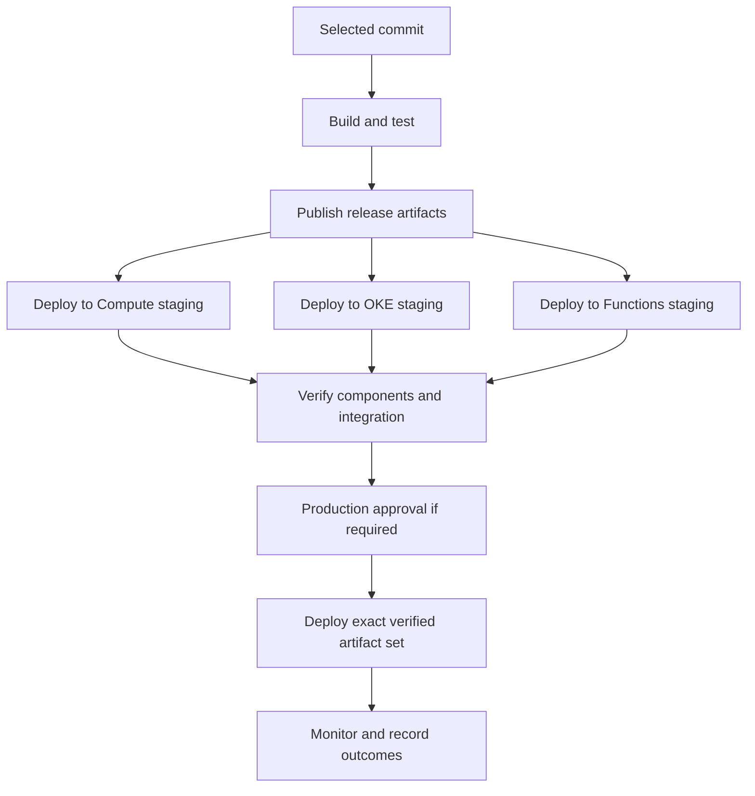

# Automated deployment to Compute, OKE, and Functions

## 1. Objectives and scope

In the **DevOps and CI/CD on OCI** chapter of the **CLOUD_PROVIDERS_ORACLE** module, automated deployment is the process of delivering a specified software version to a target environment, verifying that it works, and recording sufficient evidence for recovery when needed. This process ties into tenancies, compartments, IAM, VCNs, artifact repositories, and operational services of Oracle Cloud Infrastructure.

This lesson focuses on three targets: applications running on a Compute instance group, workloads running on Oracle Kubernetes Engine (OKE), and functions running on OCI Functions. Target infrastructure is provisioned beforehand by a separate workflow such as Terraform or OCI Resource Manager. Creating a DevOps environment only creates a reference to the deployment target; it does not mean DevOps automatically creates a Compute instance, OKE cluster, or function for every stage. [Managing DevOps environments](https://docs.oracle.com/en-us/iaas/Content/devops/using/environments.htm).

After this lesson, learners can design a build–publish–deploy flow, select the right artifacts and environments, configure deployment steps for each target, verify health and version, and manage access permissions, recoverability, and release costs.

The running example is an order-processing system consisting of a Java service on Compute, a containerized API on OKE, and an event-handling function. These are three components with distinct packaging formats. There is no need to deploy all three just because OCI supports all three; choose the platform that fits the workload.

The YAML, Bash, and CLI snippets below are instructional templates for learners to apply after preparing the environment. OCIDs, image URIs, digests, and service names must be replaced with real values. Bash scripts run on Linux or runners with Bash; do not paste raw Bash syntax into PowerShell.

## 2. General release model

### 2.1. Distinguishing resources in OCI DevOps

| Component | Role in release | Example |
|---|---|---|
| Project | Grouping of related DevOps resources | `orders-platform` |
| Build pipeline | Compiles, tests, and publishes outputs | Test Java then output JAR or image |
| Artifact repository | Stores software contents | Artifact Registry for files; Container Registry for images |
| DevOps artifact | Reference to content to deploy | Versioned JAR, manifest, image URI |
| Environment | Reference to target platform | Instance group, OKE cluster, function |
| Deployment pipeline | Describes stages and dependencies | Deploy staging, verify, approve, deploy production |
| Deployment run | A single execution with specific parameters | Release `r-ab12cd3` to staging |

A build pipeline has Managed Build, Deliver Artifacts, and Trigger Deployment stages. Trigger Deployment connects build outputs to a deployment pipeline; a successful build does not automatically prove the deployment succeeded. [Build pipeline stages](https://docs.oracle.com/en-us/iaas/Content/devops/using/managing_build_pipelines.htm).



This diagram is a reference design. Branches run in parallel only when independent; if a new function requires a new API, represent that deployment dependency accordingly. A multi-target pipeline does not create an atomic transaction: Compute may already be on the new version while OKE or Functions have not finished.

### 2.2. Identifying a release artifact set

Use a release ID tied to a commit, such as `r-ab12cd3`, and record the full commit SHA in the release record. Each component has its own output:

| Target | Software product | Accompanying deploy config | Identifiers to record |
|---|---|---|---|
| Compute | `orders.jar` and required resources | Controlled deployment specification and scripts | Artifact path/version and SHA-256 |
| OKE | Container image | Kubernetes manifest or Helm chart | Image digest, manifest/chart version |
| Image-based Functions | Image matching function runtime/FDK | Function reference and required config | Image URI, digest, and function OCID |

Never use a mutable tag such as `latest` as the sole release identifier. With OKE, digest-pinned images select exact content. For integrations using tags, enforce a rule against reusing release tags and store the digest for cross-checking. Never assume a tag name alone guarantees immutability.

The design recommendation is **build once per artifact, promote that exact artifact** across environments. One commit may produce several different artifacts, but an artifact verified in staging should not be rebuilt separately for production. Environment config and secrets are managed outside the software artifact whenever possible.

## 3. Preparing access permissions and network paths

### 3.1. Separating identities by task

| Actor | Primary need | What to avoid |
|---|---|---|
| Build pipeline | Read source, publish artifacts, trigger authorized deployments | Defaulting to full production permissions |
| Deployment pipeline | Read artifacts, act on the right target environment | Using tenancy-wide admin permissions |
| Compute instance or workload | Download or run software, access runtime dependencies | Sharing the publisher's personal credentials |
| Approver | Inspect evidence and approve releases within responsibility scope | Approving releases without identified artifacts |

OCI uses IAM policies and dynamic groups to grant permissions to DevOps resources. A pipeline and a Compute instance are distinct principals; pipeline permissions do not automatically become instance permissions. Consult the policy groups for OKE, Functions, instance groups, and artifacts, substituting compartments where resources actually live. [DevOps IAM policies](https://docs.oracle.com/en-us/iaas/Content/devops/using/devops_iampolicies.htm).

No single policy in this lesson applies safely to every tenancy. List the APIs each principal must call, the artifact repos it must read, and the environment scope before granting permissions. Narrowing one policy also does not remove broad permissions already granted by another policy.

For OKE, separate OCI cluster access permissions from Kubernetes object manipulation permissions. Verify ability to deploy into the exact namespace and resource types per the cluster's auth and authorization mechanisms; do not assume a pipeline needs `cluster-admin` just to update a Deployment.

### 3.2. Verifying each network path

At least four paths must be verified separately:

1. Build runner to source repository, dependency repository, and artifact repository.
2. Deployment service to the target's control API or agent.
3. Compute, node/pod, or Functions to artifacts and runtime dependencies.
4. Smoke test runner to the actual application endpoint used by users.

One working path does not prove the others work. For example, DevOps may apply manifests to OKE while nodes fail to pull images; or a function updates successfully yet fails to reach the database over the VCN.

For OKE with a private API, configure the environment with a subnet having a route to the API endpoint, along with appropriate routing, DNS, and security rules. Also verify permissions to configure the environment's private endpoint. Never expose the API to the Internet just to bypass a connectivity error. [Creating an OKE environment](https://docs.oracle.com/en-us/iaas/Content/devops/using/create_oke_environment.htm).

## 4. From build output to deployment run

Reference workflow before diving into each platform:

1. Select commit and release ID; run component-appropriate tests.
2. Produce outputs: JAR/package for Compute, image for OKE, function image for the Functions flow illustrated here.
3. Publish products and deployment configs to corresponding repositories; record checksums or digests.
4. Declare DevOps artifacts referencing exact paths, versions, or URIs.
5. Create environments referencing the exact target resources.
6. Create deployment stages and parameters; check dependency order, timeouts, and validation.
7. Use a Trigger Deployment stage to invoke the deployment pipeline with required artifacts/arguments.
8. Monitor the deployment run to completion and verify the application.

Trigger Deployment must map artifacts and parameters accurately between build and deploy. In particular, if an artifact URI contains placeholders, parameterization settings and passed values must match. [Adding a Trigger Deployment stage](https://docs.oracle.com/en-us/iaas/Content/devops/using/triggerdeploy_stage.htm).

Example of a team-designed release record, not a mandatory OCI schema:

```yaml
releaseId: r-ab12cd3
sourceCommit: REPLACE_WITH_FULL_COMMIT_SHA
components:
  computeService:
    artifactPath: orders/compute/orders.jar
    artifactVersion: r-ab12cd3
    sha256: REPLACE_WITH_ARTIFACT_SHA256
  okeApi:
    image: REGION_KEY.ocir.io/TENANCY_NAMESPACE/orders-api:r-ab12cd3
    digest: sha256:REPLACE_WITH_IMAGE_DIGEST
    manifestVersion: r-ab12cd3
  eventFunction:
    image: REGION_KEY.ocir.io/TENANCY_NAMESPACE/orders-event:r-ab12cd3
    digest: sha256:REPLACE_WITH_FUNCTION_IMAGE_DIGEST
```

These values support post-deployment verification. They do not automatically configure artifacts, sign images, or create pipelines. If each component follows an independent release cadence, record separate versions instead of forcing all of them to share the same release ID.

## 5. Deploying to a Compute instance group

### 5.1. Prerequisites on target hosts

OCI DevOps instance group deployment requires an environment pointing to instances, artifacts, and an enabled, healthy **Compute Instance Run Command plugin** on target hosts. Per service documentation, supported targets for this flow are Oracle Linux and CentOS; do not generalize to every OS just because it runs on Compute. The stage supports a rollout policy by host count or percentage and a failure policy. [Deploying to an instance group](https://docs.oracle.com/en-us/iaas/Content/devops/using/deploy_instancegroups.htm).

In the sample design, pre-provision a compatible Java runtime, systemd service, release directories, command execution permissions, and verification tools. Avoid installing a JDK or arbitrarily altering OS config during every application release; platform changes need their own lifecycle and testing.

Assumptions for the example:

- The artifact contains `orders.jar`, and the app listens on port `8080`.
- `/health/ready` returns a success code when ready; `/version` returns the exact release ID as plain text.
- User `ocarun` has write access to staging and `/opt/orders/releases`.
- An administrative helper `/usr/local/sbin/orders-activate` exists and is controlled by administrators; it validates the release ID, switches the service version, and restarts it.
- Sudoers permits only the required administrative invocation; never grant unrestricted root command execution.

`orders-activate` is a **team-built component**, not an out-of-the-box OCI tool. It must handle paths safely, service state, and preserving the active version for recovery. This example illustrates the contract between pipeline and target host; it does not replace implementing and testing that helper.

### 5.2. Deployment specification

```yaml
version: 1.0
component: deployment
runAs: ocarun
shell: bash
env:
  variables:
    RELEASE_ID: "${RELEASE_ID}"
files:
  - source: /
    destination: /var/ocarun_staging/orders
steps:
  - stepType: Command
    name: Prepare release directory
    timeoutInSeconds: 60
    command: |
      set -euo pipefail
      [[ "$RELEASE_ID" =~ ^r-[a-f0-9]{7,40}$ ]]
      test -s /var/ocarun_staging/orders/orders.jar
      release_dir="/opt/orders/releases/$RELEASE_ID"
      mkdir -p "$release_dir"
      install -m 0640 /var/ocarun_staging/orders/orders.jar "$release_dir/orders.jar"
  - stepType: Command
    name: Activate release
    timeoutInSeconds: 180
    command: |
      set -euo pipefail
      sudo -n /usr/local/sbin/orders-activate "$RELEASE_ID"
  - stepType: Command
    name: Verify readiness and version
    timeoutInSeconds: 120
    command: |
      set -euo pipefail
      curl --fail --silent --show-error --max-time 10 \
        --retry 10 --retry-delay 3 --retry-connrefused \
        http://127.0.0.1:8080/health/ready
      actual_release=$(curl --fail --silent --show-error --max-time 10 \
        http://127.0.0.1:8080/version)
      test "$actual_release" = "$RELEASE_ID"
```

`version` and `component` here belong to the deployment specification schema. `files` downloads content into staging; `steps` execute sequentially. Each step runs in its own process, so do not rely on `cd` or local variables from a prior step. `set -euo pipefail` ensures Bash fails promptly instead of letting a final succeeding command mask an earlier error. Placeholder `${RELEASE_ID}` requires deployment parameters and matching parameterization settings. [Deployment configuration file](https://docs.oracle.com/en-us/iaas/Content/devops/using/deployment_specs.htm).

In practice, add checksum verification before activation, verify JAR read permissions for the service user, and ensure an already-released release ID directory cannot be overwritten. Endpoints in the example must be implemented by the application; they do not appear automatically when creating an instance.

### 5.3. Stage configuration and rollout pacing

Create a **Deploy - Instance Group** stage, selecting the environment, deployment specification, and application artifact. If a load balancer is used, configure corresponding listeners/backends per design. Choose small batches suited to remaining capacity, and set timeouts and failure stop thresholds.

For example, in a four-instance group serving traffic: deploy one instance per batch, verify health, then advance. Ensure the remaining three instances can carry the load. Small batches do not preserve availability if there is only one instance or if the whole group shares a failing dependency.

A localhost health check proves only part of the picture. After appropriate stages, verify through the load balancer to catch misconfigured backend ports, NSGs, listeners, TLS, or stale-version responses. Avoid letting a deployment succeed while the load balancer keeps routing traffic only to the old version.

The staging directory may be overwritten on the next deployment; keep the active release and fallback release in separately managed locations. Never store uploaded files or business data inside an application directory tree replaced on deploy.

## 6. Deploying to OKE

### 6.1. Distinguishing manifest apply from runnable workloads

For a **Deploy - OKE** stage, choose the cluster environment, manifest artifact, and target namespace. The service runs server-side apply on the manifests in configured order. Helm is a separate stage option for charts, not merely renaming a YAML file to call it a chart. [Deploying to a Kubernetes cluster](https://docs.oracle.com/en-us/iaas/Content/devops/using/deploy_oke.htm).

The deployment path has three milestones to verify: manifests accepted, workload reaches ready state, and business requests succeed across the real access path. Each milestone can fail independently.

Images in private OCIR require proper pull authentication. The example below uses Secret `ocir-pull` pre-provisioned securely in namespace `orders-lab`; only the Secret name appears in the manifest. Registry credentials and node-to-registry networking must be valid. [Pulling OCIR images when deploying to OKE](https://docs.oracle.com/en-us/iaas/Content/ContEng/Tasks/contengpullingimagesfromocir.htm).

### 6.2. Sample manifest with resource limits and readiness

Namespace `orders-lab` and Secret `ocir-pull` must already exist. Replace the image URI with the actual digest before publishing the manifest. The application must expose both probe endpoints as declared.

```yaml
apiVersion: apps/v1
kind: Deployment
metadata:
  name: orders-api
  namespace: orders-lab
  annotations:
    example.com/release: r-ab12cd3
spec:
  replicas: 3
  minReadySeconds: 10
  progressDeadlineSeconds: 300
  revisionHistoryLimit: 3
  strategy:
    type: RollingUpdate
    rollingUpdate:
      maxSurge: 1
      maxUnavailable: 0
  selector:
    matchLabels:
      app: orders-api
  template:
    metadata:
      labels:
        app: orders-api
    spec:
      automountServiceAccountToken: false
      imagePullSecrets:
        - name: ocir-pull
      containers:
        - name: api
          image: "REGION_KEY.ocir.io/TENANCY_NAMESPACE/orders-api@sha256:REPLACE_WITH_DIGEST"
          ports:
            - name: http
              containerPort: 8080
          resources:
            requests:
              cpu: 250m
              memory: 256Mi
            limits:
              cpu: "1"
              memory: 512Mi
          startupProbe:
            httpGet:
              path: /health/startup
              port: http
            periodSeconds: 5
            failureThreshold: 24
          readinessProbe:
            httpGet:
              path: /health/ready
              port: http
            periodSeconds: 5
            timeoutSeconds: 2
            failureThreshold: 3
---
apiVersion: v1
kind: Service
metadata:
  name: orders-api
  namespace: orders-lab
spec:
  type: ClusterIP
  selector:
    app: orders-api
  ports:
    - port: 80
      targetPort: http
```

`maxSurge: 1` permits one extra Pod during rollout; `maxUnavailable: 0` aims to avoid reducing available Pods due to the update strategy. This still depends on sufficient capacity, quotas, and accurate probes; it is not an absolute zero-downtime guarantee. `progressDeadlineSeconds` helps detect stalled rollouts. [Deployment API](https://kubernetes.io/docs/reference/kubernetes-api/apps/deployment-v1/).

The template disables mounting the service account token because the sample application does not need it. If using workload identity requiring a token or accessing the Kubernetes API, design the service account and RBAC permissions accordingly. Resource requests/limits are illustrative values; size them to the actual Java application and JVM memory usage.

A `ClusterIP` Service does not create a public endpoint. To reach it outside the cluster, prepare an ingress/load balancer or an appropriate access path separately. Never switch to `LoadBalancer` just to test without assessing permissions, networking, and cost.

### 6.3. Checking rollout and application health

The following observation commands apply once the operator has kubeconfig, permissions, and the right cluster context:

```bash
kubectl config current-context
kubectl -n orders-lab get deployment orders-api
kubectl -n orders-lab rollout status deployment/orders-api --timeout=5m
kubectl -n orders-lab get pods -l app=orders-api -o wide
kubectl -n orders-lab get events --sort-by=.metadata.creationTimestamp
```

`rollout status` tracks progress; a non-zero exit code must fail the verification step. By default it tracks the latest rollout, so avoid overlapping releases or bind checks to the expected revision. [rollout status command](https://kubernetes.io/docs/reference/kubectl/generated/kubectl_rollout/kubectl_rollout_status/).

Next, call the version endpoint and run smoke tests over the real access path, checking running images and application error status. Do not stop at `kubectl apply` returning success or Pods showing `Running`.

Kubernetes may report `ProgressDeadlineExceeded` without automatically rolling back the workload. If you want OCI DevOps to auto-roll back in a supported stage, configure that feature and understand its trigger conditions; a smoke test in a separate downstream stage does not automatically produce the same effect. [Stalled Deployment progress](https://kubernetes.io/docs/concepts/workloads/controllers/deployment/).

### 6.4. Avoiding manifest manager conflicts

Server-side apply tracks field managers. If DevOps, operators, and a GitOps controller all update the same Deployment, conflicts or continual overwrites can occur. Designate one authoritative config source per workload, define emergency change handling, and reconcile hotfixes back to the authoritative source.

Similarly, if using Helm, track chart version, values, and release state together; avoid mixing ad-hoc `kubectl` edits while expecting Helm to know the full change history.

## 7. Deploying to OCI Functions

### 7.1. Container-image deployment path

For the **Deploy - Function** flow illustrated here, you need a deployment pipeline, a Functions environment referencing an existing function, and a container-image artifact. The stage selects the target function and image artifact to deploy. Do not confuse this stage with provisioning the entire Functions application, VCN, or event sources. [Deploying to Functions](https://docs.oracle.com/en-us/iaas/Content/devops/using/deploy_function.htm).

Prepare the function image using the right runtime and FDK; a web image that runs on OKE is not automatically a valid function image. Record compatible image architecture, memory/timeout settings, parent Functions application, and dependency network paths. Updating code does not automatically fix networking settings or function execution limits.

Reference stage settings:

| Attribute to define | Illustrative example |
|---|---|
| Environment | Staging event-processing function |
| Function OCID | OCID uniquely identifying the target function |
| Image artifact | Published `orders-event:r-ab12cd3` image reference |
| Content evidence | Image digest matching the release |
| Post-deploy verification | Invocation with synthetic payload and release check |
| Recovery | Redeploy stable version's image with compatible config |

Do not treat an `fn deploy` command in a production step as proof that the image tested in staging was promoted: that workflow may include a rebuild and push. When the goal is promotion, strictly separate artifact creation from updating the function to a designated artifact. [How OCI Functions works](https://docs.oracle.com/en-us/iaas/Content/Functions/Concepts/functionshowitworks.htm).

### 7.2. Deploy Function vs. Invoke Function

**Deploy Function** delivers a new version to the target. **Invoke Function** calls a function to run logic, such as verifying an application. You can use a dedicated test function; a business function does not have to become its own test harness.

If using Invoke Function as a gate in OCI DevOps, choose **synchronous** execution and enable validation. The service evaluates the returned result against the documented UTF-8 strings `true` or `false`; a JSON object like `{"status":"ok"}` is not automatically equivalent to validation result `true`. Asynchronous execution only confirms the call was dispatched per stage mechanics, not a gate waiting for tests to complete. [Invoke Function stage](https://docs.oracle.com/en-us/iaas/Content/devops/using/invoke_function.htm).

### 7.3. Smoke testing via CLI and verifying the response contract

Another option is using a runner granted invoke permission and appropriate connectivity. Assume the sample function has a healthcheck mode that creates no real transactions. Input file `smoke-request.json`:

```json
{"operation":"healthcheck","testRunId":"smoke-001"}
```

Application response contract defined by the team in the example:

```json
{"release":"r-ab12cd3","status":"ok"}
```

Illustrative Bash script, requiring OCI CLI, `jq`, an authorized identity, and variables `FUNCTION_OCID`, `RELEASE_ID`:

```bash
set -euo pipefail
: "${FUNCTION_OCID:?Missing FUNCTION_OCID}"
: "${RELEASE_ID:?Missing RELEASE_ID}"
oci fn function invoke \
  --function-id "$FUNCTION_OCID" \
  --body file://smoke-request.json \
  --file smoke-response.json
jq -e --arg release "$RELEASE_ID" \
  '.release == $release and .status == "ok"' smoke-response.json >/dev/null
```

CLI invoke takes the function OCID, request body, and response output file. The script above also checks the business contract; merely seeing the invoke command succeed does not prove the right release ran. [invoke command reference](https://docs.oracle.com/en-us/iaas/tools/oci-cli/latest/oci_cli_docs/cmdref/fn/function/invoke.html).

Never reuse a side-effecting smoke payload that creates real orders or sends real notifications repeatedly. If tests must write data, use isolated test records, idempotency keys, and explicit cleanup. Also test the real invocation path through API Gateway or event sources if that is how users trigger the function; direct invocation does not verify that entire integration.

### 7.4. Note on the code-only option

Starting September 24, 2026, OCI Functions added code-only deployment for supported managed runtimes, accepting code/dependency archives—in some Java cases an uber JAR. The container image flow remains supported. This lesson chooses the image flow because that is the artifact for Deploy - Function described above; do not infer every function on OCI requires users to build images themselves. [Code-only Functions announcement](https://docs.oracle.com/en-us/iaas/releasenotes/functions/functions-code-only-functions.htm).

When choosing code-only, design the pipeline to invoke the archive-update mechanism supported by Functions, store archive versions/checksums, and verify the corresponding runtime, dependencies, and invocation. Check capabilities of the exact stage/API in use; do not pass a ZIP into a container-image artifact field expecting automatic conversion.

## 8. Coordinating releases across multiple targets

### 8.1. Mapping dependencies by compatibility

A release may update the Java service on Compute, the API on OKE, and the function on different schedules. Before deploying, determine which version pairs must interoperate during the transition.

Example plan designed by the team:

| Phase | Desired state | Gate to proceed |
|---|---|---|
| Preparation | Database and config support both old and new versions | Compatibility review and data plan |
| Update OKE API | New API accepts old clients | Rollout and smoke tests pass |
| Update Compute service | Service adopts new API capabilities | Load balancer health and integration checks pass |
| Update function | Function uses the new available contract | Invocation and event checks pass |
| Finalization | All components on the accepted version set | Observe stability before removing legacy support |

This order is illustrative only. If the function feeds data to the API, the order might need to be reversed. Oracle Database schema changes require a dedicated migration process; expand-then-contract strategies typically allow coexisting versions during transitions. Never let individual replicas run uncoordinated migrations on their own.

### 8.2. Preventing overlapping releases

Enforce concurrency controls per environment or component so two releases never mutate the same Deployment, function, or host group simultaneously. Tie runs to exact artifact sets and handle new release requests with queuing or defined superseding rules.

Never arbitrarily cancel a run currently modifying hosts and start a new run without inspecting state. A canceled stage does not mean already-applied changes were rolled back. After an interruption, record actual running versions on every target before deciding to retry.

## 9. Choosing release and recovery strategies

### 9.1. Comparison by behavior

| Strategy | How new version enters service | Fits when | Costs and limits to consider |
|---|---|---|---|
| Rolling | Replaces hosts or Pods gradually | Multiple replicas exist and versions can coexist | Requires spare capacity, quotas, and accurate health checks |
| Blue-green | Prepares new version in standby environment then switches traffic | Verification must be decoupled from user cutover | Needs extra capacity plus session, data, and routing control |
| Canary | Directs a portion of traffic to the new version first | Reliable metrics exist for comparison | Needs traffic shifting and go/no-go thresholds |
| Release-based function update | Updates function to chosen artifact then verifies invocation | Functions workloads per section 7 | Does not inherit all OKE blue-green/canary traits |

OCI DevOps provides blue-green flows for instance groups and OKE. With OKE blue-green, environments are separated by namespace and manifests must follow the stage's namespace rules; the manifest in section 6 cannot be reused verbatim for every strategy. [Blue-green OKE](https://docs.oracle.com/en-us/iaas/Content/devops/using/bgoke_deploy.htm), [blue-green instance group](https://docs.oracle.com/en-us/iaas/Content/devops/using/bginstance_deploy.htm).

OCI DevOps OKE canary has specific ingress and traffic-shift requirements. Do not assume a Kubernetes Deployment running two versions automatically gives user-percentage canary routing; Pod counts and traffic percentages are not always equal. [Canary OKE](https://docs.oracle.com/en-us/iaas/Content/devops/using/canaryoke_deploy.htm).

### 9.2. Defining rollback limits

OCI DevOps lets you enable automatic rollback on supported cluster or instance group flows. When a stage failure condition triggers, the service can redeploy the previously succeeded release; the failed deployment is still marked failed. Inspect configuration and scope per stage—do not extrapolate across all branches or every target type. [Deployment rollback](https://docs.oracle.com/en-us/iaas/Content/devops/using/deployment_rollback.htm).

Platform-specific preparation recommendations:

- **Compute:** know which hosts changed versions; retain prior artifacts, configs, and activation mechanisms; re-verify through the load balancer.
- **OKE:** retain stable manifests/charts and images; verify ability to restore the exact release with associated configs.
- **Functions:** retain stable images or archives; update targets via a controlled workflow and invoke to confirm.

Application rollback does not undo committed database transactions. Neither does it revert old passwords, restore user files, or reverse an incompatible schema migration. If data cannot be safely rolled back, rolling forward with a fix may be more appropriate.

Do not immediately purge previous artifacts and images right after a release succeeds. Retention policies must preserve enough content for the committed recovery window, including charts/manifests, non-secret parameters, and configuration references.

## 10. Troubleshooting by failure point

| Symptom | Evidence to inspect | Verification path |
|---|---|---|
| Deployment cannot fetch artifact | DevOps stage logs, path/version, repo policies | Artifact exists in right region, principal has read permission |
| Compute does not receive or run commands | Run Command plugin status, agent, command output | Plugin active, principal permissions and network fit |
| Compute command succeeds but service fails | systemd logs, port, JAR version, load balancer health | Right Java runtime, file permissions, config, traffic path |
| OKE cannot reach API | Environment, DNS, NSG, routing to API endpoint | Control-plane path and access permissions are valid |
| OKE reports `ImagePullBackOff` | Pod events, image URI, Secret in same namespace | Digest/tag exists, pull credentials valid, nodes reach registry |
| OKE Pod `Pending` | Scheduler events, requests, node capacity, quotas | Sufficient CPU/memory and matching scheduling constraints |
| OKE rollout never becomes ready | Probes, startup logs, ports, configs | Probes accurately reflect app state; do not mask bugs with arbitrary timeout bumps |
| Function updates but invoke fails | Invocation logs, runtime/image, memory/timeout, dependency connectivity | Code/config compatible, runtime identity has needed permissions |
| Smoke test passes but serves wrong version | Version endpoint, image digest, artifact mapping | Testing the right target and release, not hitting stale replicas |
| One branch succeeds, another fails | Version snapshot per target and stage dependencies | Choose retry or recovery using compatibility matrix |

When an incident occurs, halt promotion to production, preserve logs, and record run ID, stage, artifacts, and actual versions. Fix issues based on evidence; never grant tenancy-wide permissions, open all ingress, or remove readiness checks just to turn the pipeline green.

If retrying, verify which steps are idempotent. Re-copying the same artifact can usually be made safe; emitting events, migrations, and data mutations require idempotency controls or separate recovery plans.

## 11. Monitoring, secrets, and cost control

### 11.1. Tying evidence to every release

Project Logging must be enabled to run a deployment pipeline per service requirements. [Running a deployment pipeline](https://docs.oracle.com/en-us/iaas/Content/devops/using/run_pipeline.htm).

Release records should link commit, artifact digest/checksum, deployment run, environment OCID, timestamp, approver, and smoke test results. Use application logs, OCI Monitoring, and user-path checks to evaluate error rates, latency, resource usage, and business impact post-deploy.

A single health check does not prove long-term stability. Pick observation windows and thresholds aligned with real traffic; a canary receiving almost no traffic provides insufficient comparative evidence.

### 11.2. Keeping secrets out of release artifacts

Never embed OCI private keys, database passwords, OCIR auth tokens, or sensitive wallets inside JARs, images, or manifests. Manage secret references and access permissions per environment; limit credential lifetime on runners and target machines.

Secrets used to pull images differ from secrets the app uses to connect to a database. Likewise, the principal deploying a function differs from the identity the function uses at runtime. Isolate these flows so leaking or breaking one credential does not grant unnecessary access everywhere.

Restrict log and artifact read permissions, and avoid printing secret variables or responses containing customer data. Log masking is only a secondary safeguard; avoid emitting secrets by design.

### 11.3. Accounting for surge resources during rollouts

Compute blue-green holds two host groups; OKE rolling updates may require extra Pods and nodes; standby environments, registries, logs, and smoke tests also consume resources. Functions also require estimating invocation counts and concurrency capacity for real workloads.

Set budgets, tags, and cleanup dates for lab or standby resources. For OKE, `replicas: 3` in the example illustrates multi-replica rollout, not a minimum requirement for every lab. Pick replica counts matching your learning goals, and explicitly note availability limits when scaling down.

Deleting a deployment run or DevOps environment is not a teardown procedure for all application infrastructure. Separately inventory instances, nodes, load balancers, volumes, registry artifacts, and retained assets by owner.

## 12. Practice and completion criteria

### 12.1. Picking one target to run end-to-end

In an authorized lab compartment, pick an application with no real user data and prepare target infrastructure. There is no need to provision all three platforms simultaneously just to prove understanding.

1. Identify source commit, release ID, and version-check contract.
2. Build, test, and publish the artifact; record checksum or digest.
3. Create the artifact reference, environment, and target deployment stage.
4. Run once manually to verify IAM, networking, and artifact mapping.
5. Connect build to deployment via Trigger Deployment and run the next release.
6. Verify the version across the real user access path, save results, and observe post-deploy.
7. Redeploy a retained stable version to test the recovery plan.

For Compute, verify command exit codes, service status, and load balancer health. For OKE, verify rollout, image, and readiness. For Functions, verify invocation and response payload matching the release. These proofs supplement the pipeline's succeeded status.

### 12.2. Rehearsing a controlled failure

Use a lab manifest referencing a nonexistent image or a lab app build that fails readiness. Record which stage catches the failure, which resources changed, and whether promotion halts at the right point. Run this only when the lab is isolated and a recovery version is ready.

For a tabletop drill, assume Compute already runs the new version, OKE has not finished rolling out, and the function remains on the old version. Build a version matrix, decide whether service can continue or which component needs recovery, and list the evidence to gather before retrying.

### 12.3. Acceptance criteria

A deployment workflow meets its goal when the released product is clearly identified, the right target is selected, execution uses an authorized identity, bad health/version states are detected, and recoverability is preserved. A succeeded run must correspond to the app serving the expected version; a failed run must leave clear enough state to decide the next step.

Lab output should include immutable artifacts per team policy, per-platform verification evidence, a recovery record, and an inventory of ongoing billable resources with cleanup schedules. There is no need to expand into services outside the selected application scope.
