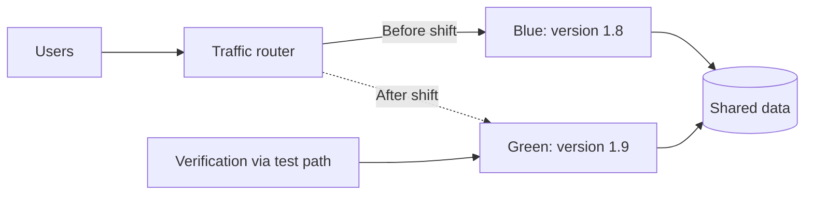
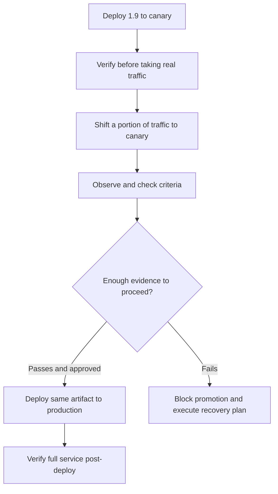

# Blue-green, canary, and application rollback

## 1. Objectives and deployment scenario

In the **DevOps and CI/CD on OCI** chapter, controlling how a new version receives traffic bridges the deployment pipeline and application availability. A succeeded build, an existing artifact, and a process that starts up are not enough to conclude a version serves users safely.

This lesson uses the Java service `orders-api` on Oracle Cloud Infrastructure. Version `1.8` is serving stably; the team wants to release `1.9`, which changes shipping-fee calculation. The application uses an Oracle database, exposes an order-creation API, and runs background jobs. All load numbers, thresholds, and resource names below are lab assumptions, not OCI defaults or guarantees.

After this lesson, learners can:

- Choose blue-green or canary based on infrastructure capabilities and application risk.
- Map strategies to concrete OCI DevOps stages on OKE or Compute instance groups.
- Set verification criteria before and after shifting traffic.
- Execute rollback within supported scopes while verifying data and background side effects.
- Prepare resources, permissions, monitoring, and cost controls for a traceable drill.

OCI DevOps supports blue-green and canary for OKE and instance group deployments. Deploying to Functions uses a separate update mechanism; do not assume options for OKE or Compute also apply to Functions. [Oracle: Managing Deployment Pipelines](https://docs.oracle.com/en-us/iaas/Content/devops/using/deployment_pipelines.htm).

## 2. Distinguishing deployment, release, and recovery

| Concept | What changes | Example |
| --- | --- | --- |
| Deployment | Artifact or config running in the target environment | Placing `1.9` onto standby hosts |
| Release | Users or business flows begin using the version/feature | Routing live traffic to `1.9` |
| Traffic shift | Routing rules between serving groups | Directing a slice of traffic to canary |
| Rollback | Returning the system to a known-good serving state | Switching back to the group running `1.8` |
| Roll forward | Fixing a defect with a subsequent version | Releasing `1.9.1` compatible with new data |

Deployment and release can be decoupled: a new version can run in standby without serving real users yet. Feature flags also allow enabling a capability after code is deployed, though flags also require governance permissions and clear disablement plans.

Rollback is not an undo button for the entire system. At least four layers must be considered:

1. **Traffic:** which version receives new requests.
2. **Application:** which binary, image, manifest, and config are running.
3. **Data:** whether the schema and already-written data remain compatible.
4. **External side effects:** emitted messages, sent emails, or transactions committed to external services.

Shifting traffic back to `1.8` only handles new requests if that version still runs and can read current state. It does not recall sent emails or reverse a successfully recorded order.

## 3. Blue-green: verify on standby then shift traffic

### 3.1. Mechanism

Blue-green maintains two application environments with equivalent serving capacity. One side is active receiving production traffic, while the other is standby for deploying and verifying the new version.

Color names are not permanently tied to "old" and "new." After a successful switch, the side that just received the new version becomes active; on the next release, roles can swap.

| Phase | Blue | Green | Primary serving path |
| --- | --- | --- | --- |
| Pre-deploy | `1.8`, active | Standby | Blue |
| Preparation | Keep `1.8` unchanged | Installing and testing `1.9` | Blue |
| Post-switch | Keep `1.8` on standby | `1.9`, active | Green |
| If reverting | `1.8`, active | Isolate `1.9` for investigation | Blue |



In OCI DevOps, the blue-green sequence consists of deploying to standby, optional Invoke Function verification, optional manual approval, and then blue-green traffic shift moving all production traffic to the verified side. [Oracle: Deploying Using Blue-Green Strategy](https://docs.oracle.com/en-us/iaas/Content/devops/using/deploy_bgstrategy.htm).

### 3.2. Strengths and practical prerequisites

Blue-green fits when you need to fully prepare a new environment with a clear path back. Installation time on standby does not directly reduce active capacity.

However, "shifting all traffic" describes the routing target, not a guarantee that all existing connections switch versions instantaneously. Sessions, long-lived connections, queues, and in-flight requests must be accounted for separately.

Conditions for the `orders-api` example:

- Green must have enough CPU, memory, and database connections to carry expected load.
- Blue is preserved during the rollback window; do not immediately overwrite it with another new version.
- Tests hit green specifically, verifiable via a release ID in responses.
- Background workers on standby must not duplicate work already running on active.
- Schemas, caches, and message formats must allow `1.8` and `1.9` to coexist.

Two namespaces in the same OKE cluster only separate objects at the namespace level. If they share node pools, ingress, networking, or databases, they can still share the same outage. Application blue-green does not by itself create cross-region redundancy.

## 4. Canary: limiting exposure before expanding

### 4.1. Mechanism and differences from rolling updates

Canary exposes a new version to a portion of real traffic for observation before broad rollout. The goal is learning from production behavior while limiting the scope of users exposed to risk.

Rolling updates replace groups of instances or pods sequentially. The ratio of new pods does not automatically equal the ratio of requests reaching the new version: keepalive connections, load-balancing policies, and per-backend capacity influence actual distribution.

| Approach | Primary control lever | What to observe |
| --- | --- | --- |
| Rolling update | Pace of replacing pods or hosts | Rollout status and remaining serving capacity |
| Blue-green | Active and standby environments | Target environment readiness before switch |
| Canary | Traffic slice or cohort using new version | New version's isolated quality under real load |

A general canary plan can have multiple traffic stages. However, do not take a generic "5% → 25% → 50% → 100%" diagram and assume it is an out-of-the-box OCI DevOps configuration.

### 4.2. Actual OCI DevOps canary flow

OCI structures canary into stages: deployment to canary, optional Invoke Function, traffic shift, manual approval, and production deployment. The version verified in canary is deployed to production in the final stage; it does not simply dial canary weight up to 100%. [Oracle: Deploying Using Canary Strategy](https://docs.oracle.com/en-us/iaas/Content/devops/using/deploy_canarystrategy.htm).



In the OKE and instance group canary wizards, the **Ramp Limit** for the traffic shift step is between 1–25%. Do not confuse this limit with the general Control - Traffic Shift stage, which has its own ramp and batch configuration. [Oracle: Canary OKE Deployment](https://docs.oracle.com/en-us/iaas/Content/devops/using/canaryoke_deploy.htm), [Oracle: Adding a Traffic Shift Stage](https://docs.oracle.com/en-us/iaas/Content/devops/using/traffic_stage.htm).

The example plan chooses 5% canary, observation, approval, and then production deployment with the same artifact. That is one choice for the lab; stepping through multiple increments requires designing orchestration aligned with actual stages and APIs.

### 4.3. Traffic ratio does not equal user ratio

Routing weights usually produce approximate distributions across many backend selections. Never infer that exactly 5 out of every 100 requests, or exactly 5% of users, always hit canary.

One user may send many requests, sessions may stick to the same backend, and requests may be retried. If business requirements demand keeping a fixed cohort of users on the new version, design intentional cohort routing at a layer that supports it; do not treat probabilistic weighted routing as user bucketing.

For `orders-api`, monitor endpoints, release IDs, and business outcomes together to verify canary actually processed order-creation paths rather than only serving health check requests.

## 5. Preparing OCI resources and execution permissions

### 5.1. Common components

Before selecting a strategy, you need:

- An active DevOps project, deployment pipeline, and logging.
- Environments representing the exact clusters or Compute groups.
- Old and new version artifacts along with matching deployment configs.
- Production routing path and candidate-environment test path.
- Metrics, logs, alarms, and designated decision owners.
- Pipeline permissions, artifact read permissions, target access permissions, and approval permissions.

Distinguish pipeline editor permissions from the resource principal permissions executing the deployment. A user being able to view a cluster in the Console does not prove the pipeline can deploy to that cluster.

With private networks, verification functions must also reach test endpoints. A function that invokes successfully yet cannot reach the target service is not a valid application check.

### 5.2. Blue-green on Compute instance groups

OCI requires two instance group environments, a load balancer, and a listener. Deployment artifacts live in Artifact Registry; the deployment configuration specifies how to download packages and run steps on hosts. The Compute Instance Run Command plugin must be enabled and running, with appropriate command permissions. [Oracle: Blue-Green Instance Group Deployment](https://docs.oracle.com/en-us/iaas/Content/devops/using/bginstance_deploy.htm).

Example organization:

| Component | Illustrative value | Responsibility |
| --- | --- | --- |
| Environment A | `orders-blue` | Holds `1.8` while active |
| Environment B | `orders-green` | Receives `1.9` while standby |
| Production listener | Application HTTPS listener | Routes user traffic |
| Backend port | `8080` | Application port on instances |
| Test path | Test listener or test load balancer | Verifies standby before shift |

**Rollout policy** controls how many hosts are deployed concurrently; **traffic shift** controls traffic. Limiting simultaneous updates to 25% of hosts does not mean only 25% of users are affected.

### 5.3. Canary on Compute instance groups

Canary and production must be two instance group environments with no shared instances. The canary group needs enough capacity for its assigned traffic slice; the production group continues serving the remainder. [Oracle: Canary Instance Group Deployment](https://docs.oracle.com/en-us/iaas/Content/devops/using/canaryinstance_deploy.htm).

If one host belongs to both groups, deploying to "canary" can mutate a host actively serving production, defeating isolation.

In practice, using two separate pipelines for the two strategies avoids confusing active states, artifacts, and routing paths. Never let two pipelines modify the same listener simultaneously.

### 5.4. Blue-green and canary on OKE

Blue-green OKE uses two existing namespaces. OCI documentation requires omitting the namespace from manifests used in this flow, because the namespace is supplied in the stage configuration. After deployment, if scaling down standby, documentation requires keeping at least one replica. OCI modifies annotations on the application's ingress to execute the strategy. [Oracle: Blue-Green OKE Deployment](https://docs.oracle.com/en-us/iaas/Content/devops/using/bgoke_deploy.htm).

Canary OKE uses canary namespace and production namespace configurations along with an appropriate ingress. The ingress name in the stage is the application's Ingress resource name, not automatically the Deployment name of the ingress controller.

**Ingress compatibility must be checked at deployment time.** OCI's OKE strategy documentation describes integration with NGINX ingress. Meanwhile, the community **ingress-nginx** project reached end of maintenance on March 24, 2026. Do not assume another controller—even a product named NGINX—is a drop-in compatible replacement for the annotations OCI manipulates. For new deployments, verify supported choices and controller lifecycles; the primary hands-on portion of this lesson uses Compute instance groups to avoid depending on installing a retired controller. [Kubernetes: Ingress NGINX retirement](https://kubernetes.io/blog/2026/04/22/kubernetes-v1-36-release/).

## 6. Identifying the exact artifact and config to release

### 6.1. Pinning a reproducible version

A release record should capture:

```text
release_id: orders-1.9
source_commit: <COMMIT_SHA>
application_artifact: <IMAGE_DIGEST_OR_IMMUTABLE_PACKAGE_VERSION>
deployment_config_version: <CONFIG_VERSION>
previous_release: orders-1.8
deployment_id: <OCI_DEPLOYMENT_OCID>
```

This is a template for a release record, not a schema passed directly into OCI CLI.

Do not rebuild canary and production separately from the same branch name and assume both outputs are identical. Use the exact verified artifact combined with controlled environment configuration. Avoid using `latest` as the sole identifier for either the current version or the rollback target.

An old artifact still existing while secret references, feature flags, or JVM arguments changed may still fail to reproduce old behavior. Therefore, save associated configuration alongside the artifact.

### 6.2. Keeping the rollback target usable

Before a release, verify:

- The old artifact is still readable and has not been purged by retention policies.
- Secrets, certificates, and permissions required by the old version remain valid.
- Standby environments or redeployment capacity remain sufficient.
- A confirmed successful baseline version exists.
- No other pipeline overwrites the standby group during the recovery window.

For an initial deployment, there is no prior successful version to revert to. Options then include switching to a maintenance page or a separately prepared baseline; never rely on enabling auto rollback to invent history that does not exist.

## 7. Designing health checks and application verification

### 7.1. Three layers of checks

| Layer | Question | Example |
| --- | --- | --- |
| Process | Is the app alive and finished starting? | Startup/liveness probe |
| Serving readiness | Is the backend ready for requests? | Readiness or HTTP health check |
| Business logic | Does the version handle critical scenarios correctly? | Reading a sample order, checking shipping fee |

OCI Load Balancer supports TCP and HTTP health checks. TCP primarily verifies connectivity; HTTP can inspect URIs, status codes, or response bodies. An open port does not prove order-creation logic works. [Oracle: Health Check Policies for Load Balancers](https://docs.oracle.com/en-us/iaas/Content/Balance/Tasks/load_balancer_health_management.htm).

In OKE, startup probes protect initialization, readiness controls traffic routing through the Service, and liveness detects states requiring a container restart. Do not turn every external dependency failure into a liveness failure, as that can cause restart loops when the database slows down. [Kubernetes: Pod probes](https://kubernetes.io/docs/concepts/workloads/pods/probes/).

### 7.2. Verification path must hit the right version

Suppose the lesson's application exposes dedicated endpoints:

- `GET /health/ready`: checks serving readiness.
- `GET /version`: returns `{"version":"1.9"}` on the candidate build.
- `GET /api/orders/lab-order-001`: returns a sample order with a known shipping fee.

This is a contract provided by the example application, not built-in OCI endpoints. Test endpoints must traverse security configs and access paths authorized by the organization.

The Bash snippet below assumes `curl`, `jq`, a valid TLS endpoint, and a sample order seeded in lab data:

```bash
set -euo pipefail

CANDIDATE_BASE_URL='https://candidate.orders.example.com'
EXPECTED_VERSION='1.9'

curl -fsS --connect-timeout 3 --max-time 10 \
  "$CANDIDATE_BASE_URL/health/ready" >/dev/null

curl -fsS --connect-timeout 3 --max-time 10 \
  "$CANDIDATE_BASE_URL/version" |
  jq -e --arg version "$EXPECTED_VERSION" \
    '.version == $version' >/dev/null

curl -fsS --connect-timeout 3 --max-time 10 \
  "$CANDIDATE_BASE_URL/api/orders/lab-order-001" |
  jq -e '.id == "lab-order-001" and .shippingFee == 30000' >/dev/null

printf 'Candidate checks passed\n'
```

Domains and data are illustrative; replace them with your lab environment. A test pointing at the production URL might accidentally test blue and declare green healthy. Checking the version catches this mistake.

If testing write operations, use an isolated test tenant or test data with idempotency keys and a cleanup plan. Never use a real customer order to test a new path and rely on application rollback to erase the effect.

### 7.3. Integrating Invoke Function in the right mode

When using an **Invoke Function** stage as a verification gate, choose synchronous execution and enable validation. OCI checks for the returned UTF-8 string `true` or `false`; validation only happens on synchronous calls. Asynchronous execution only confirms the invocation was dispatched, without waiting for verification results. [Oracle: Invoke Function](https://docs.oracle.com/en-us/iaas/Content/devops/using/invoke_function.htm).

The verification function must treat timeouts, unreadable data, wrong release IDs, and missing prerequisites as failures. Never return `true` inside an error handler just to let the pipeline continue.

If multi-minute observation is needed, design multiple short checks or an appropriate external evaluator. Do not assume a single synchronous function can wait indefinitely for an entire canary window.

## 8. Go/no-go criteria must be data-driven

### 8.1. Monitoring baseline and canary separately

Signals needed for `orders-api`:

| Signal | Recommended breakdown | Failures detectable |
| --- | --- | --- |
| Request count | Release, endpoint, environment | Canary receives no load or too small a sample |
| Error rate | Release and business error codes | New version failing even while aggregate looks healthy |
| Latency p95/p99 | Release, endpoint | One processing path slowed down |
| Resources | Host group or workload | CPU, memory, or thread exhaustion |
| Oracle Database connections | Release/app group if measurable | Connection pool exhaustion or global connection spike |
| Business outcomes | Valid orders, fee accuracy, duplicate errors | HTTP 200 with wrong calculation |

OCI Monitoring ingests resource metrics and custom metrics with dimensions, then uses alarms to detect configured conditions. If you need a dimension like `release_id`, ensure the application or collector actually emits it; OCI does not automatically attach arbitrary custom dimensions to service metrics. [Oracle: Overview of Monitoring](https://docs.oracle.com/en-us/iaas/Content/Monitoring/Concepts/monitoringoverview.htm).

For logs, tagging release ID, request ID, and environment aids post-shift debugging. Avoid using request ID as an aggregate metric dimension because high cardinality explodes metric series.

### 8.2. Do not let aggregate metrics hide canary errors

Suppose the stable version receives 95% of requests with a 0.1% error rate; canary receives 5% but fails 10% of the time.

```text
error_rate_total
  = 0.95 × 0.1% + 0.05 × 10%
  = 0.595%
```

If an alarm only fires when system-wide errors exceed 1%, a severely broken canary goes unnoticed. Inspect the new version separately and compare against the baseline over the matching window.

Never average the p95 latencies of two groups to estimate overall p95. Percentiles must be computed from the underlying distribution or histogram of the evaluated data.

### 8.3. Observation time and sample size

Under steady load, estimate requests reaching canary:

```text
n_canary ≈ request_rate_total × canary_fraction × observation_seconds
```

If total traffic is 2 requests/second, canary is 5%, and observation lasts 300 seconds, expected requests are only around 30. "No errors in 5 minutes" provides very weak evidence in that case.

If total traffic is 2,000 requests/second, the same setup yields around 30,000 requests. Still, many requests hitting one repeated endpoint do not replace testing key business flows.

Example criteria for the lab:

| Condition | Illustrative value |
| --- | --- |
| Minimum time after receiving load | 5 minutes |
| Minimum canary requests | 1,000 |
| Canary error rate | At most 0.5% |
| Error increase vs. baseline | At most 0.2 percentage points |
| Canary p95 latency | At most 1.2x baseline and under 450 ms |
| Business data accuracy | Sample orders and fee rules all pass |
| Missing required metrics or endpoints | Hold; do not promote |

Thresholds must be tuned to real SLOs and traffic. These are gate design examples, not OCI default settings.

### 8.4. Wait, approval, and alarms play different roles

A Wait stage only inserts a pause into the pipeline. It does not read metrics or decide whether a new version is safe. [Oracle: Adding a Wait Stage](https://docs.oracle.com/en-us/iaas/Content/devops/using/deploywait_stage.htm).

An Approval stage lets authorized approvers approve or reject. Approver count is configurable, yet approvers still need evidence from metrics, artifacts, and data. [Oracle: Adding an Approval Stage](https://docs.oracle.com/en-us/iaas/Content/devops/using/approval_stage.htm).

A firing alarm also does not automatically turn into a rollback command without an execution integration. Designs must specify who or what reads alarms, blocks promotion, and triggers recovery. Separating detection from action prevents the misconception that pipelines automatically fix every production bug.

## 9. OCI DevOps rollback: distinguishing stage types

### 9.1. Supported scope

| Scenario | Mechanism to design | Key caveat |
| --- | --- | --- |
| Blue-green after switching active | Manual rollback at traffic shift stage | Do not use pipeline redeployment as default revert mechanism |
| Canary production stage fails | Auto rollback to prior succeeded version can be enabled | Configured on supported production stage |
| Canary deployment/traffic shift/approval stages | Strategy-wide recovery procedure | Single-stage redeployment is unsupported for these stages |
| Business bug appears after pipeline succeeds | Detect and trigger runbook | Pipeline success does not imply continuous monitoring of all app bugs |
| Incompatible schema or data | Dedicated data recovery plan | Application rollback does not roll back the database |

Oracle notes that blue-green does not support pipeline redeployment for either instance groups or OKE; single-stage redeployment via manual rollback applies only to the blue-green traffic shift stage. Canary supports pipeline redeployment and can auto-roll back when the production stage fails if configured. [Oracle: Blue-Green Deployment Rollback](https://docs.oracle.com/en-us/iaas/Content/devops/using/deploy_bgstrategy.htm), [Oracle: Canary Deployment Rollback](https://docs.oracle.com/en-us/iaas/Content/devops/using/deploy_canarystrategy.htm).

The words "rerun" or "redeployment" do not automatically mean "return to the stable version." Inspect the chosen deployment, artifacts, parameters, and target snapshot before executing.

### 9.2. Auto rollback is not a pipeline-wide transaction

Per OCI documentation, when auto rollback occurs, other running stages continue; new stages do not start, and the deployment finishes in `Failed` state. Rollback itself can also fail depending on host state and rollout policies. [Oracle: Rolling Back a Deployment](https://docs.oracle.com/en-us/iaas/Content/devops/using/deployment_rollback.htm).

Therefore, carefully weigh placing data migrations or irreversible tasks in parallel with deployments. One stage rolling back does not undo side effects from another stage.

Final interpretation requires reading two facts together: how the system is currently serving and whether the release succeeded. A `Failed` deployment after a successful rollback is still a failed release, even though service stability was restored.

### 9.3. Stopping deployment and recovering service are two different actions

Rejecting an approval or canceling a deployment stops the workflow from advancing according to that operation's mechanics. Do not treat them as proof that traffic has returned to the old version.

When a canary is rejected after traffic shift, verify whether canary still receives traffic and execute the prepared routing recovery plan. Do not attempt to rerun an individual canary traffic shift stage using a capability the strategy does not support.

If routing must be reverted through a recovery pipeline or verified load-balancer procedure, first ensure no other pipeline is still mutating the same resource. Afterward, reconcile live state with managed configuration so the next deployment does not overwrite the recovery action.

## 10. Application recovery runbook

### 10.1. Before shifting

Record the stable release, deployment OCID, artifact version, active listener/ingress, and authorized recovery operators. For blue-green, confirm the old side still has enough capacity to take full load, not merely one running process.

Recovery time budget can be broken down as:

```text
T_recovery
  = T_detection
  + T_decision
  + T_execution
  + T_verification
```

This is a runbook breakdown, not an SLA formula. "Switching routes takes seconds" does not ensure short recovery if detecting the fault takes many minutes.

### 10.2. When the candidate version fails

1. Halt promotion, note timestamp and release ID, and preserve necessary logs.
2. Determine whether the fault is routing, application, config, or data.
3. Verify the old version remains compatible with current data.
4. Choose the action supported by the stage and strategy.
5. Execute using an authorized identity, avoiding conflicting concurrent route edits.
6. Verify traffic, metrics, and business behavior post-recovery.
7. Isolate the faulty version for investigation; clean up resources only after recovery needs end.

For a blue-green instance group that completed shifting, open the deployment under **Deployment Pipelines → Deployments**, locate the blue-green traffic shift stage, and use **Revert traffic shift** per manual rollback. Never pick an old deployment solely by timestamp; verify the exact release and environment state.

### 10.3. Post-rollback verification

Be able to answer:

- Which stable version is receiving new requests?
- Have error rates and latency returned to acceptable levels?
- Are any requests still running on the faulty version or stuck on long-lived connections?
- Do orders created during the incident window need reconciliation?
- Are background workers and queues still running the faulty version?
- Is routing configuration synchronized with the management system?

Green health checks are necessary, yet you must test real user paths and inspect related data. If the old version cannot read new data, flipping back and forth between host groups can worsen state; consider isolating the feature, toggling feature flags, or rolling forward per a prepared plan.

### 10.4. Observing OKE without confusing rollback scope

Read-only command examples, assuming authorized kubeconfig and existing namespaces:

```bash
kubectl --context '<OKE_CONTEXT>' -n orders-blue \
  get deployment,pods,service,ingress

kubectl --context '<OKE_CONTEXT>' -n orders-green \
  get deployment,pods,service,ingress

kubectl --context '<OKE_CONTEXT>' -n orders-green \
  rollout status deployment/orders-api --timeout=120s

kubectl --context '<OKE_CONTEXT>' -n orders-green \
  rollout history deployment/orders-api
```

Passing rollout status does not fully validate business logic. Kubernetes Deployment revision history primarily tracks Pod template changes; rolling back a Deployment does not automatically restore Services, ingresses, data, or external configs. If Kubernetes tools are used in an emergency, reconcile back with OCI DevOps artifacts and state afterward. [Kubernetes: Deployments](https://kubernetes.io/docs/concepts/workloads/controllers/deployment/).

## 11. Databases, sessions, and background jobs determine reversibility

### 11.1. Shared schemas require compatibility during transitions

Suppose `1.8` reads an old fee column, while `1.9` adds detailed fee breakdown data. Dropping the old column immediately when deploying `1.9` can break `1.8` after a rollback.

An **expand–migrate–contract** plan for the example:

| Phase | Change | Application rollback condition |
| --- | --- | --- |
| Expand | Add new structure while keeping old structure | `1.8` continues working |
| Compatible deploy | `1.9` reads/writes supporting both per plan | `1.8` still understands required state |
| Migrate/backfill | Backfill legacy data in controlled batches | Reconciled with concurrent write handling |
| Contract | Remove old structure after support window | Returning to `1.8` is no longer expected |

This is an application design plan, not an automatic OCI DevOps feature. Dual writes require transaction handling, retries, and reconciliation; simply issuing two separate write statements does not guarantee consistency.

Never make full database point-in-time recovery your first reflex for an application bug, because it can discard valid transactions committed after the restore point. Oracle Database data recovery must be planned with data owners, acceptable data-loss bounds (RPO), and dedicated recovery procedures.

### 11.2. Caches and sessions

Two versions sharing Redis or another cache must maintain compatible keys and value formats. A new version changing session serialization can break users after reverting to the old version.

Options include preserving backward-compatible formats, versioning cache entries, or using a session store designed for cross-version sharing. Flushing the entire cache "for cleanliness" can trigger a sudden load spike on the database.

### 11.3. Background workers do not follow HTTP traffic percentages

Routing 0% of HTTP traffic to green does not stop schedulers or queue consumers running on green. Even a small canary can write shared data or publish messages affecting the whole system.

For `orders-api`, clearly decide which workers run on active, how duplicate execution is prevented, order-processing idempotency, and message compatibility. To reduce risk, decouple worker releases from API releases or use permissions/feature flags suited to your architecture.

Canary percentages limit the controlled ingress path; they are not an absolute cap on all side effects.

## 12. Capacity, cost, and retention windows for old versions

### 12.1. Estimating capacity

Suppose total load is 2,000 requests/second, one instance at the tested shape reliably handles 200 requests/second, and the team budgets 30% headroom.

```text
Instances_needed_for_full_load
  = ceil(2000 × 1.30 / 200)
  = 13
```

This is an estimate from assumed load and test results, not an OCI shape performance spec. Blue-green taking full load must provision sufficient capacity on the new side before shifting.

At 5% canary, expected load is 100 requests/second, yet you still must account for single-host failure, bursts, heavy requests, and background connections. Never drop instance counts below availability requirements just because average request count is low.

### 12.2. Including shared resources

Two running application environments can open two sets of connection pools to Oracle Database. If each opens 500 connections, the database bears the combined load even while standby receives few HTTP requests.

Likewise, adding pods inside the same node pool can contend with active for CPU or memory. A low-traffic canary that consumes heavy startup memory can still destabilize the stable environment.

### 12.3. Keeping the old version long enough, with a time limit

Increased costs go beyond compute instances: OKE nodes, test load balancers, artifact storage, logs, and monitoring resources also add up. Use tenancy pricing, limits, and budgets at practice time; do not assume configurations stay within Free Tier.

Agree on a rollback window based on fault-detection time and data compatibility duration. Once the window closes, scale down resources per plan while retaining necessary artifacts and evidence. For blue-green OKE, follow standby replica requirements of the integration in use rather than scaling to zero arbitrarily.

## 13. Practicing a verifiable end-to-end flow

This section guides hands-on steps in a learning environment without adding a real production pipeline. Prepare two application versions and test data; direct test traffic only to endpoints reserved for the lab.

### 13.1. Establishing the baseline

1. Prepare `orders-api 1.8` running stably in the initial environment.
2. Record artifact version, release ID, and sample business output.
3. Collect baseline error rates, latency, and capacity.
4. Confirm listeners, health checks, pipeline permissions, and approvers.
5. Verify standby or canary environments independently of the stable group.
6. Prepare recovery access paths before running the new release.

### 13.2. Blue-green drill on Compute

In the project, create a deployment pipeline dedicated to the lab. Add **Blue/Green Strategy → Instance group**, select Environments A/B, artifact, load balancer, listener, backend port, and rollout policy.

Enable synchronous verification and add approval before traffic shift so learners can inspect standby state. During the lab, pause at approval to verify active still serves `1.8` while the test endpoint already serves `1.9`.

After approving, verify production routes to `1.9`. Record shift timestamp, backend state, check results, and release ID. Next, rehearse **Revert traffic shift** and prove production serves `1.8` again with data still readable.

Do not simulate failure by deleting the database or shutting down both host groups simultaneously. Use a test build returning incorrect output for a sample order to observe the verification gate blocking the shift.

### 13.3. Canary drill on Compute

Use a separate pipeline and environment set:

1. Select **Canary Strategy → Instance group**, ensuring canary and production share no hosts.
2. Select the same `1.9` artifact for verification and promotion.
3. Configure test endpoints and application checks.
4. Set a 5% Ramp Limit on the canary traffic shift step.
5. Send synthetic load, collect per-release metrics, and wait for sufficient time and sample size.
6. Approve once criteria pass; the production stage deploys the verified artifact.
7. Verify HTTP paths, data, and workers post-deploy.

With a faulty test build, run the rejection branch, check whether canary still receives load, and execute the prepared recovery plan. This is a critical check because blocking promotion alone does not prove the faulty version was removed from serving paths.

### 13.4. Completion evidence

| Item | Evidence to retain |
| --- | --- |
| Consistent artifact | Release ID, commit, digest, or package version |
| Right environment | Environment OCIDs, listeners, or namespaces |
| Blue-green works | Standby verified beforehand; release ID switches after traffic shift |
| Canary works | Live metrics show new version receiving a slice of load |
| Gate is effective | Faulty build blocked with a clear reason |
| Rollback works | Service returns to target version; metrics and business checks pass again |
| Data preserved | Sample orders and test-created records reconciled |
| No orphaned state | Workers, routes, environments, and costs audited after the lab |

Record deployment OCIDs, timestamps, and outcomes; never store tokens, passwords, or real user data in lab records.

## 14. Common design mistakes

| Misconception | Consequence | Redesign approach |
| --- | --- | --- |
| "Pod Ready means release succeeded" | Misses business logic errors | Verify data and user paths |
| "5% new pods equals 5% traffic" | Misestimates blast radius | Measure actual traffic per release |
| "Canary only affects 5% of the system" | Ignores shared data and workers | Account for all side-effect paths |
| "Waiting 5 minutes is enough" | Promotes on tiny sample size | Require duration, sample size, and coverage |
| "Rejecting approval already rolled back" | Faulty canary may still receive traffic | Check routes and run recovery runbook |
| "Auto rollback handles every stage" | Migrations or parallel stages keep effects | Define recovery scope per stage |
| "Reverting to old image is enough" | Config or schema no longer compatible | Version configs and data plans |
| "Keeping old namespace provides HA" | Shared node, ingress, or database outage | Analyze shared failure domains |
| "Console access means pipeline has permission" | Deployment fails due to different principal | Grant permissions to execution identities |
| "Green backend means routing is right" | Listener, TLS, or security rules still broken | Test end-to-end from user perspective |

OCI documents cases where backend health checks pass yet traffic still fails due to listeners or security rules, as well as cases where backends are unreachable due to networking and firewalls. Cross-check application logs with load balancer logs and configs instead of looking only at overall health colors. [Oracle: Understanding Load Balancer Health Issues](https://docs.oracle.com/en-us/iaas/Content/Balance/Tasks/understanding_health_issues.htm).

A release strategy meets requirements when the team proves three things: which version is serving, which data drives go/no-go decisions, and how service is restored when a candidate fails. Blue-green, canary, and rollback become effective when those answers are anchored to real artifacts, permissions, routing, and data of the application on OCI.
