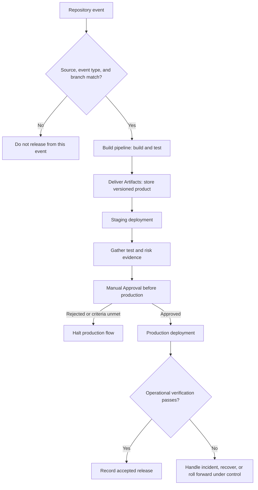

# Triggers, approvals, and release management

## 1. Goal: automated execution while still controlling releases

In the **DevOps and CI/CD on OCI** chapter of the **CLOUD_PROVIDERS_ORACLE** module, a pipeline needs more than a successful build. Operations teams also need to know why the pipeline ran, who authorized deployment, which product reached the environment, and which version can be restored on failure.

Three mechanisms coordinate to solve this problem:

- **Triggers** ingest an event and decide whether to start a pipeline.
- **Approvals** place a decision gate before high-impact actions, typically deploying to a protected environment.
- **Release management** ties source code, artifacts, configuration, test evidence, approval decisions, and deployment outcomes into a traceable record.

The running context is the Java service `orders-service` running on OCI infrastructure. The application is built into a JAR or container image, tested in staging, and deployed to production only after meeting release criteria. Production may be Compute, OKE, or another target supported by deployment pipelines; how each deployment strategy is configured depends on target type.

Configurations and records in this lesson are learning examples, not yet executed on the learner's tenancy. There is no requirement to build a real release system just to read or apply this knowledge.

## 2. Distinguishing events, builds, deployments, and releases

| Concept | Question it answers | Example |
| --- | --- | --- |
| Source event | What just happened? | A commit was pushed to the main branch |
| Build run | How was source turned into a product? | Compiled, tested, and published a specific JAR version |
| Deployment | Which product reached which environment, and how? | Deployed that artifact to the staging Compute group |
| Approval | Which decision permits the next step to proceed? | Approved a pending production deployment |
| Release | Which change was accepted into service, with what record? | Release `orders-2026.11.21.1` with artifact, config, and verification results |

A single release may involve multiple deployments, such as staging, production, and a recovery run. One build run may also serve multiple environments if the same artifact is promoted across stages.

In this lesson, **release** is a team governance concept, not a claim that OCI DevOps always provides a native object encompassing every field in a release record. Teams can store records in a change system, metadata store, or chosen tool while linking to OCI build runs and deployments.

Do not equate three distinct outcomes:

- Build succeeded: product creation met the build pipeline's criteria.
- Deployment succeeded: deployment execution met the conditions configured for that deployment.
- Release accepted: the product was operationally verified and satisfies the team's release criteria.

For example, a Java process starting up does not prove Oracle Database connectivity, IAM permissions, or order-placement flows work properly. Acceptance criteria must reflect service behavior.

## 3. Coordination flow in OCI DevOps



OCI DevOps binds triggers to code sources and build pipelines. Inside a build pipeline, stages like Managed Build, Deliver Artifacts, and Trigger Deployment serve different roles. Manual Approval is a stage type in a deployment pipeline; it is not an arbitrary field added to `build_spec.yaml`.

The diagram shows responsibility relationships. It does not require every team to deploy staging and production within a single deployment pipeline. You can choose:

1. One deployment pipeline with staging, verification, approval, and production steps.
2. Separate staging and production pipelines with a handoff mechanism for a verified release candidate.

The second approach must guarantee production receives the exact tested artifact and config. Passing only a branch name or mutable tag does not link two pipelines tightly enough.

In both approaches, approval must sit on every execution path leading to the protected production deployment. A parallel branch deploying directly to production invalidates an approval placed on another branch.

## 4. Designing triggers around event semantics

### 4.1. A trigger is a launch condition, not a release decision

A well-defined trigger specifies at least:

- The repository or connected source permitted to emit events.
- Event types supported by the connector and OCI DevOps.
- Supported branch conditions or filters.
- The target build pipeline.
- How the run's source version is resolved.
- Permissions and credentials needed for the service to ingest events and read source.

Event capabilities and filters differ between OCI Code Repositories and external Git providers. Do not infer that an option available in GitHub has the same name or semantics in every connector.

In particular, do not assume every source supports triggers by tag, schedule, changed file paths, or every pull-request state. If the service lacks a needed filter, add appropriate checks or orchestration rather than entering non-schema settings.

### 4.2. Trigger policy matrix

The table below describes **team policy**, not filter syntax to copy verbatim into OCI:

| Policy event | Work to trigger | Publish for production release? |
| --- | --- | --- |
| Change on feature branch | Compile and fast tests if needed | Not by default |
| Pull request opened or updated | Quality checks on proposed source | Never grant release rights solely because a PR exists |
| Valid commit on protected main branch | Build candidate, store artifact, test staging | Only produces a candidate for release workflow |
| Team selects a version to release | Production flow with identified artifact | Yes, after mandatory checks and approvals |
| Redeploy or recovery needed | Authorized operational flow | Use known artifact; do not rebuild from branch head |

If policy uses release tags, verify whether the source supports tag-based triggers. Tags must also be protected and resolved to concrete commits/artifacts. Naming a tag like a version creates neither release authorization nor immutability.

### 4.3. Distinguishing push, pull request, and merge

A commit on a feature branch can trigger both a push event and a PR update. A merge can emit a PR event plus a push to the target branch. If two triggers are configured without distinguishing targets, the same change can build or deploy multiple times.

A PR closed event also does not necessarily mean the PR was merged. Read the exact event semantics provided by the source and align them with team policy.

For PRs, specify whether the pipeline tests the source commit or a trial merge commit. The two cases produce different evidence. Build records must log the actual commit used, not just the PR number or branch name.

### 4.4. Protected branches still need pipeline edit permissions checked

Main-branch protection governs code entering the release flow, yet build specifications and deployment scripts are also code executing with CI/CD privileges. Anyone who can edit those files can alter release behavior without touching Java source.

Require reviews on changes to specifications, Dockerfiles, scripts, Terraform, and pipeline configuration resources. Restrict OCI pipeline update permissions alongside repository write permissions; the two layers do not replace each other.

## 5. Trusted sources, duplicate events, and causality

### 5.1. Never trust a payload merely because it carries a familiar repo name

If using native connectors, set up connections and credentials via service mechanisms and scope repository access narrowly. If building a custom webhook receiver, authenticate events per provider mechanism, protect secrets, and validate targets before calling OCI DevOps.

Never accept an arbitrary repository URL, pipeline OCID, or artifact version from an external payload and run it under a production-privileged identity. Validate or map those values against a trusted configuration set.

External PR source code can run commands that inspect environment variables or exfiltrate data over the network. Untrusted-source validation flows must receive permissions and secrets matching that low trust level. Post-build approval cannot revoke a secret already leaked during the build.

### 5.2. Events can be redelivered

Design for source systems redelivering events, retries, or operators clicking rerun. Never assume a trigger creates strictly one build and strictly one deployment in all scenarios.

If there is a custom orchestration layer, an idempotency key might combine:

```text
source_provider + repository_id + event_id + pipeline_id
```

This is an illustrative integration-layer key, not a mandatory native OCI trigger field. To recognize two distinct events pointing to the same change, you may also need policies keyed on commit, run intent, and target environment.

Do not deduplicate purely by commit for all actions: the same commit may need an intentional rebuild or deployment to another environment. Conversely, requesting the same release into production twice should not spawn two uncontrolled mutation runs.

### 5.3. Preserving an end-to-end identifier chain

A useful traceability chain is:

```text
event → repository + commit → build run → artifact identity
      → release candidate → deployment → approval → verification
```

Retain full identifiers for OCI build runs and deployments alongside repository/commit, artifact version or digest, and the team's release ID. Do not rely solely on display names, as names can collide or change.

For late-arriving events, verify whether a newer release has already been accepted. An old pipeline whose approval just cleared must not overwrite production without checking current state and release ordering rules.

## 6. Preparing a release candidate before requesting approval

### 6.1. Choosing tightly pinned artifact identifiers

For approval to mean something, approvers must know the exact product being deployed:

| Product | Identifiers to keep | Risk of using only generic names |
| --- | --- | --- |
| JAR in Artifact Registry | Repository, artifact path, version, and checksum | The same filename can point to different contents |
| Container image in Container Registry | Repository and digest; tag may be noted alongside | A tag can shift to different target content |
| Deployment configuration bundle | Version or revision, plus controlled contents | New config may differ from tested config |
| Associated infrastructure code | Commit/revision and matching change plan | App deploy may bundle unapproved network or IAM changes |

Building once and promoting the same artifact across environments preserves the link between tests and release. If a rebuild is necessary, treat it as a new product requiring verification per policy, even if the source commit did not change.

Never use `latest` or branch names as the sole identifier of an approved release. For containers, recording the content digest prevents tag drift after testing. For JARs, checksums detect content differing from the accepted build; they do not replace repository write-permission controls.

Example checking a JAR in a handoff directory using Bash:

```bash
set -euo pipefail
# app.jar.sha256 contains the checksum and filename app.jar in this directory.
sha256sum --check app.jar.sha256
```

The command only verifies consistency between the file and the received checksum. If both were replaced with another pair, the check can still pass. Protect the checksum record source and artifact mutation permissions.

### 6.2. Handing off data between build and deployment

In OCI DevOps, values produced during a build can be exported via exported variables and mapped into artifact configs or stage inputs where supported. Configure variable substitution/references explicitly; merely setting a shell variable does not make deployments pick it up automatically.

At the handoff point, verify:

- The artifact finished publishing before deployment references it.
- Artifact path/version or digest resolved cleanly with no remaining placeholders.
- Values passed with exact names and intended scopes.
- Deployment does not fetch branch head or rebuild instead of using the selected product.
- Target environment and deployment identity sit within authorized scope.

A team release ID can appear in logs and metadata to link records. However, passing only `release_id` is insufficient if the system still resolves it to an artifact that can change without control.

### 6.3. Illustrative release record

The YAML sample below is an **illustrative internal schema**, not a build specification, deployment specification, or OCI API payload:

```yaml
schema_version: 1
release_id: orders-2026.11.21.1
service: orders-service

source:
  repository: "<approved-repository>"
  commit: "<full-git-commit>"

build:
  run_ocid: "<oci-build-run-ocid>"

artifact:
  kind: container_image
  uri: "<registry-domain>/<tenancy-namespace>/orders-service@sha256:<digest>"
  digest: "sha256:<64-hex-characters>"

configuration:
  revision: "<configuration-revision>"
  database_change_id: "<change-id-or-none>"

staging:
  deployment_ocid: "<staging-deployment-ocid>"
  verification_evidence: "<test-evidence-reference>"

production:
  target_compartment_ocid: "<production-compartment-ocid>"
  deployment_ocid: "<production-deployment-ocid>"

recovery:
  previous_release_id: "<previous-accepted-release>"
  procedure_revision: "<recovery-runbook-revision>"
```

Replace all placeholders before use. For JARs, replace the artifact block with corresponding repository/path/version/checksum fields; never keep an image URI for a binary deployment pipeline.

The record must have change control and appropriate read/write permissions. Never store Oracle Database passwords, private keys, tokens, or secret contents in manifests. Referencing configuration does not mean writing sensitive values in cleartext.

## 7. Manual Approval in deployment pipelines

### 7.1. Where is Approval placed?

OCI DevOps supports Manual Approval stages to require a decision before dependent stages proceed. Approval count policies can be configured per stage capabilities, and authorized operators are controlled via IAM.

A logical layout for the example:

```text
Deploy staging
    → Verify staging
    → Manual Approval
    → Deploy production
    → Verify production
```

This is a logical ordering. If verification uses external tools or a separate execution stage, ensure failures actually block the flow; a link to a report that always returns success does not form a quality gate.

Never place approval after production has already been modified and call it pre-deployment control. Post-deploy acceptance has its own role and may still be needed, yet it cannot prevent impact that already occurred.

### 7.2. What do approvers need to see?

Each approval request should present a concrete set of facts:

| Item | Purpose |
| --- | --- |
| Release ID and deployment OCID | Identify the exact execution awaiting approval |
| Commit and build run | Trace source and build provenance |
| Artifact version/digest/checksum | Know the exact contents about to be deployed |
| Environment, region, compartment, and target | Avoid confusing staging with production |
| Mandatory test and security check results | Check against release criteria |
| Configuration and dependency changes | Spot impacts outside application code |
| Risks, recovery plan, and on-call owner | Know how to act if verification fails |
| Deadline or deployment window per process | Avoid applying a decision in a stale context |

Approvers do not need to rerun the whole pipeline themselves. They need sufficient evidence to assess blast radius, criteria compliance, and recoverability. Never rely on a mutable report link unattached to the corresponding build run.

### 7.3. Vote counts alone do not create separation of duties

If policy requires two approvers, verify both decision count and authorized identities. Configuring approval count does not by itself prove that the code author, pipeline editor, and approvers are independent actors under team policy.

Rules such as "authors cannot self-approve," "operations representation required," or "a database governance member required" must be checked against actual enforcement capabilities. If native stages and IAM cannot express them fully, add a workflow or check capable of enforcing those rules; never assume they are automatically satisfied.

Meanwhile, anyone able to edit the pipeline or escalate IAM permissions can modify the approval barrier itself. Therefore, govern and audit control-configuration changes, not just clicks on Approve.

### 7.4. Executing decisions on the right deployment

Authorized approvers use the Console or supported API/CLI to act on the pending stage approval. Before acting, verify the deployment OCID, stage, and attached artifact.

An email or chat notification can guide an approver to the right screen. Writing "approved" in another channel is not automatically a native decision recorded by OCI DevOps.

If building an integration accepting decisions from an external system, authenticate the approver, permissions, target deployment/stage, and current state. Never allow a generic link to approve any arbitrary deployment or let an old callback affect a new run.

### 7.5. Rejection, cancellation, and expired requests

When rejected, the protected production flow must not advance. Record the reason and determine whether code fixes, additional evidence, or a new candidate is needed. Never delete the approval stage just to rerun until green.

Distinguish the cases:

- **Rejected:** an authorized approver actively declines the candidate in the current context.
- **Canceled:** the run no longer needs to continue, such as being replaced by a newer candidate.
- **Timed out / waiting too long:** no timely decision arrived; this never implies implicit approval.

If policy requires approvals to expire after a window, enforce it explicitly. Writing `expires_at` in an internal record does not make OCI automatically halt a stage. Use supported timeout settings where available, or an explicit orchestrator/review check.

After a long wait, re-verify production state, evidence, and deployment conditions. If artifacts, configs, or deployment scope changed, never reuse an old decision as if approvers accepted the new contents.

### 7.6. Approval binds to context, not just a name

A decision should be understood as accepting the combination:

```text
release + artifact identity + configuration revision
        + target environment + deployment context
```

For example, an approver accepts image digest A with config C in production. If a tag moves to digest B or a deployment parameter changes to config D, that is a new context requiring handling per approval policy.

Native approval should not be interpreted as an independent cryptographic signature sealing every file in a release system. Systems must ensure approved inputs cannot be altered uncontrollably before execution. When inputs must change, prefer creating or updating a clearly reviewable run instead of assuming the old decision covers all changes.

## 8. IAM and separation of duties

In OCI, projects and pipelines live in one compartment scope, while artifacts, Vault, Compute, OKE, or databases may live in other compartments. Permission to view a pipeline does not automatically grant permission to deploy or read secrets.

A role matrix can be designed as follows:

| Principal | Responsibility | Scope to restrict |
| --- | --- | --- |
| Developer | Propose code and monitor builds | Authorized repos and logs; no default production access |
| Build execution identity | Read source, build, and publish artifacts | Secrets and repos needed for builds |
| Release operator | Select candidates, trigger allowed flows | Assigned pipelines and environments |
| Production approver | Review evidence, approve/reject exact runs | IAM approval permissions plus required read scope |
| Deployment execution identity | Apply changes to targets | Compute/OKE and related resources in target env |
| Pipeline/IAM administrator | Modify orchestration or permissions | Controlled permissions with change history |

This is a responsibility model for designing policies, not a literal list of built-in role names to create verbatim. Match actual IAM permissions to each operation and the service's resource principal/dynamic group mechanisms.

A parameter `environment=production` or a tag on a pipeline is not a security boundary. Execution identities must genuinely lack permissions outside their assigned scope. When staging and production require different controls, separate pipelines, compartments, and identities by design.

Protect trigger edit permissions as well: changing source repositories, target pipelines, or filters can let unexpected code enter privileged flows. Manage these changes like release configuration changes.

If an emergency bypass is needed, pre-define who may invoke it, what scope it covers, and what retroactive evidence is required. Controlled exceptions must leave an audit trail; never turn a shared admin account into a routine way around approvals.

## 9. Concurrent releases, ordering, and pre-deploy checks

Suppose release A is awaiting approval, and meanwhile release B succeeds in production. If A is later approved late, production could unintentionally revert to old contents. Approval alone does not resolve races across multiple deployments or pipelines.

Teams need a per-environment policy:

- How many deployments may modify the environment concurrently?
- Can an older candidate proceed after a newer candidate was accepted?
- How are orchestration locks acquired and released if a process fails?
- Who may request an intentional rollback to an older version?

A design using a dedicated orchestration layer might follow:

```text
receive release candidate with evidence
→ wait for approval decision for the exact context
→ acquire exclusive orchestration lock on the environment
→ re-verify approval, artifact, config, and current active release
→ deploy if ordering policy permits
→ verify and record outcome
→ release orchestration lock
```

This is responsibility pseudocode, not native OCI stage keywords. If durable locking is required, pick a real state-and-concurrency store; a shell variable or local build-runner file cannot lock across multiple pipelines.

Do not assume locks are only released on success. Handle cancellations, timeouts, disconnected processes, and dead lock holders. Also avoid holding a long-lived lock prior to approval that blocks all other releases for hours unless that is an intentional policy.

The check right before execution must confirm the candidate has not been superseded or had its scope altered. If intentionally re-releasing an older version, record it explicitly as an authorized rollback/redeployment rather than disguising it as the latest release.

## 10. Release lifecycle and evidence to retain

Teams should maintain a state model showing where each candidate stands. The table below is an **illustrative internal model**, not an OCI DevOps API status list:

| Release state | Recording condition | Primary evidence |
| --- | --- | --- |
| Candidate | Published product and source identity exist | Commit, build run, artifact identity |
| Verified in staging | Mandatory staging checks pass | Staging deployment and test results |
| Waiting for approval | Record complete enough to request decision | Exact context and approval request |
| Authorized | Authorized decision, still valid | Approver, timestamp, deployment, scope |
| Deploying | Target environment mutation started | Deployment OCID and execution status |
| Accepted | Production verification meets criteria | Functional and operational check results |
| Rejected | Candidate declined | Reason and decision |
| Failed | Build/deploy/verification failed criteria | Error, impact level, next action |
| Superseded | Candidate replaced by another choice | Superseding release and cancel/block decision |
| Rolled back | Recovery executed and verified | Target recovery release, deployment, outcome |

Synchronize internal records with OCI results using real identifiers and facts, not display names alone. If ingesting status automatically via APIs or events, handle redeliveries and out-of-order updates.

For example, a late "deployment started" notification must never overwrite an "accepted/verified" record. An unknown state after a connection error should also never be reset to "not deployed"; before rerunning, query and determine how far changes actually reached.

Keep two operational questions separate:

1. Which release was most recently accepted?
2. Which artifact/config is live infrastructure actually running right now?

Those two answers can diverge during partial rollouts or incident response. A metadata store recording only "last successful" cannot describe an in-flight or partially failed state.

## 11. Release recovery and Oracle Database changes

### 11.1. Preparing the plan before approval

The release record must specify a usable prior version, retrievable artifacts, matching configuration, and post-recovery verification steps. If the repository already purged the old artifact, writing "roll back to previous" is not an actionable plan.

An application recovery sequence might include:

1. Assess impact and block conflicting new releases.
2. Select a known-compatible artifact/config.
3. Obtain authorization via normal flow or authorized emergency exception.
4. Execute the recovery deployment.
5. Verify functionality, error rates, and dependent service connectivity.
6. Record the actual running version and incident outcome.

Never rebuild an old artifact from branch head assuming it matches the binary that previously ran. If rebuilding is required, identify and verify the new product under appropriate risk controls.

Automatic rollback or traffic shifting depends on the strategy and target type supported by the pipeline. Never assume every Compute or OKE deployment natively includes identical canary, blue-green, or auto-recovery capabilities.

### 11.2. Application rollback does not automatically roll back data

For Java applications using Oracle Database, an older version may fail to run after an incompatible schema change. Restoring the old image does not revert committed writes or executed migrations.

For example, a new release drops a column that the old version still queries. Rolling back the app can spike errors even if the artifact deployment succeeds. Evaluate together:

- Compatibility between current schema and both old/new applications.
- Periods where two application versions run concurrently during transitions.
- Whether migrations are safely idempotent/rerunnable.
- How to detect partially vs. fully completed migrations.
- Data backup/restore needs and impact on already-committed transactions.

**Expand–migrate–contract** design can reduce risk: add compatible structures first, shift reads/writes gradually, and drop old structures only once no longer needed. This is a migration design principle, not a guarantee that every change is reversible.

Data recovery plans must be evaluated separately by database service, recovery time requirements, and acceptable data loss. Never blindly restore a production database merely because an application deployment failed; assess impact and authorization for that procedure.

### 11.3. Canceling a pipeline does not undo all changes

Canceling a running deployment does not prove hosts returned to prior state, secrets were revoked, or migrations were reversed. Inventory completed work and verify actual state before deciding to proceed, roll back, or roll forward.

If a stage provisioned Compute or test resources, pipeline termination does not automatically delete them. Cleanup responsibility must be designed for succeeded, failed, and canceled branches alike.

## 12. Observing triggers, approvals, and releases

### 12.1. Correlating execution logs with control history

Use build run/deployment details and OCI-configured logs to track commands, stages, timestamps, and errors. OCI Audit traces OCI API calls recorded by the service; it does not replace shell logs, test reports, or Git review history.

During investigations, you may need to correlate:

- Events and delivery history in Git/connector systems.
- Trigger and pipeline configuration at the relevant time.
- Build runs, actual commits, and artifact delivery results.
- Deployments, approval stages, and deciding principals.
- Artifact identity, configuration, and target objects.
- Application logs, metrics, and post-deploy verification results.

Grant log and metadata read permissions strictly on a need-to-know basis. Payloads, internal paths, or error messages can expose sensitive details; never log raw secrets in the name of "complete evidence."

### 12.2. Notifications assist response; they do not replace approval authority

Integrate alerts/notifications with permitted OCI mechanisms and operational systems. Verify which events services actually emit rather than assuming every custom internal release state emits a native OCI event.

Useful payload fields include environment, release ID, build/deployment OCID, outcome, and a link to the protected record. Never embed tokens, passwords, or unauthenticated magic approval links in notifications.

Never treat a missing notification as implicit approval. The source of truth remains verified state inside the authoritative system.

### 12.3. Metrics for spotting bottlenecks

| Metric | What it reveals |
| --- | --- |
| Runs per source change | Overlapping triggers or uncontrolled retries |
| Commit-to-artifact duration | Build and test efficiency |
| Approval wait time | Process responsiveness and record quality |
| Approval rejection rate | Candidate readiness issues or risk levels |
| Deployment/verification failure rate | Release reliability |
| Recovery time | Practical executability of recovery plans |
| Superseded candidates blocked | Contention and release ordering health |

Metrics are signals for process improvement, not excuses to drop approvals or cut tests just to shrink a number. Long wait times may stem from approvers lacking clear evidence rather than lacking automation.

For cost control, avoid running a polling loop inside a build step waiting for human approval. Use Manual Approval in deployment pipelines and scope resource-consuming jobs to their true lifecycles. Also maintain artifact/log retention and temporary-resource cleanup policies; keeping every candidate indefinitely raises cost, while deleting too early destroys recovery capability.

## 13. Common errors and how to distinguish them

| Symptom | Causes to check | Remediation direction |
| --- | --- | --- |
| Push causes no build | Wrong source, connection, event type, filter, or target pipeline | Compare actual event with trigger configuration |
| One change launches duplicate pipelines | Overlapping push/PR triggers or redelivered events | Separate run targets and add context-aware deduplication |
| External PR reads release secrets | Untrusted sources not isolated from privileged identities | Drop privileges, isolate flows, rotate exposed secrets per procedure |
| Build succeeds but deploy picks wrong version | Mutable tag, wrong parameter, or undelivered artifact | Check artifact identifiers and cross-stage mappings |
| Pipeline skips waiting for approval | Wrong dependencies or alternate path into production | Inspect all graph branches reaching production actions |
| Assigned approver cannot approve | IAM, identity, stage, or deployment in wrong state | Verify permissions and exact run; avoid tenancy-wide grants |
| Approved in chat but pipeline still waits | Decision not submitted through valid mechanism | Act on the stage or through an authenticated integration |
| Old release approved after newer release | Missing ordering policy and pre-deploy check | Block superseded candidates or treat as authorized rollback |
| Deployment reports succeeded yet service fails | Success checks did not verify required behavior | Add functional, metric, and dependency verification |
| App rolled back yet database still errors | Incompatible schema or data | Review migrations and separate data recovery plan |
| Pipeline canceled yet production partially changed | Some actions completed before cancellation | Inventory live state before choosing next action |

When investigating, do not keep creating new candidates blindly to mask earlier failures. Preserve links between failures, fixes, and subsequent runs so operators understand why the current release is qualified.

## 14. Practice sequence in an authorized environment

### Step 1: pick a test scope

Use non-production repositories, OCI DevOps projects, and environments. Identify region, compartment, build/deployment identities, artifact repository, and authorized approvers.

Prepare an artifact with a clear output contract. There is no need to provision a new database or extra infrastructure if the lab objective is triggers and approval gates.

### Step 2: define event policy

Select an event type supported by your connector along with branch conditions. Document explicitly which events only validate code and which produce release candidates.

Make a small change within the chosen scope and trace the event to the build run. Verify the actual commit built, not merely the branch name shown in the trigger UI.

### Step 3: store artifacts and provenance records

Build, test, and deliver the artifact to the destination repository. Record commit, build run, path/version or digest, and matching checksum.

If using an internal release manifest, store it somewhere with access control and change history. YAML samples in this lesson do not create that store by themselves.

### Step 4: build a path gated by approval

Create a test deployment flow with verification followed by Manual Approval before the action representing production. In a lab, that protected action can still target an isolated test environment.

Configure approval count and IAM per goal. Confirm every path reaching the protected action depends on approval.

### Step 5: test approving and rejecting

For one run, supply sufficient evidence and approve using an authorized identity. Verify the right artifact and target after the downstream step executes.

For another run, reject and confirm the protected action does not proceed. Never use production to test whether a rejected approval actually blocks execution.

### Step 6: test a superseded context

Create two candidates within the lab scope. Let one candidate become accepted, then observe how the workflow handles the older pending candidate.

If automated enforcement is not built yet, note what still requires operational verification. Never claim out-of-order releases are prevented merely because two separate pipelines each succeeded.

### Step 7: finalize records and operational ownership

Record links across event, build, artifact, deployment, approver, and verification. Designate who handles trigger errors, who can edit pipelines, who decides on recovery, and who cleans up test resources.

Clean up only lab-scoped resources created for practice. Never delete repositories, older artifacts, or existing system resources without clear retention policies and owner sign-off.

## 15. Readiness criteria for an operational release flow

Before using a workflow for an important environment, have concrete answers to the following:

- Triggers match the exact source, event type, and code version.
- Builds from untrusted sources never receive out-of-scope release privileges.
- Tested artifacts are uniquely identified and preserved unchanged across approval and deployment.
- Approvers see artifacts, config, environment, evidence, and recovery plans.
- Approvals are recorded on the right deployment with proper authority and decision counts.
- No alternate execution branch bypasses mandatory approval gates.
- Concurrent releases and older candidates are handled by explicit policy.
- Deployment results are verified at the service level, not only command exit status.
- True state can be determined after failures, cancellations, or lost connections.
- Application recovery plans account for Oracle Database data and related resources.
- Logs, artifacts, and release records have proper access controls, history, and retention.

Triggers bring changes into automation; approvals place decision accountability before controlled actions; release management preserves the link between that decision, the software product, and real outcomes on OCI. When those links are clear, teams can release with proper separation of duties, monitor impact, control costs, and stay better prepared to sustain availability.
