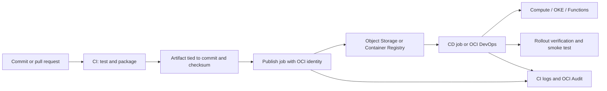
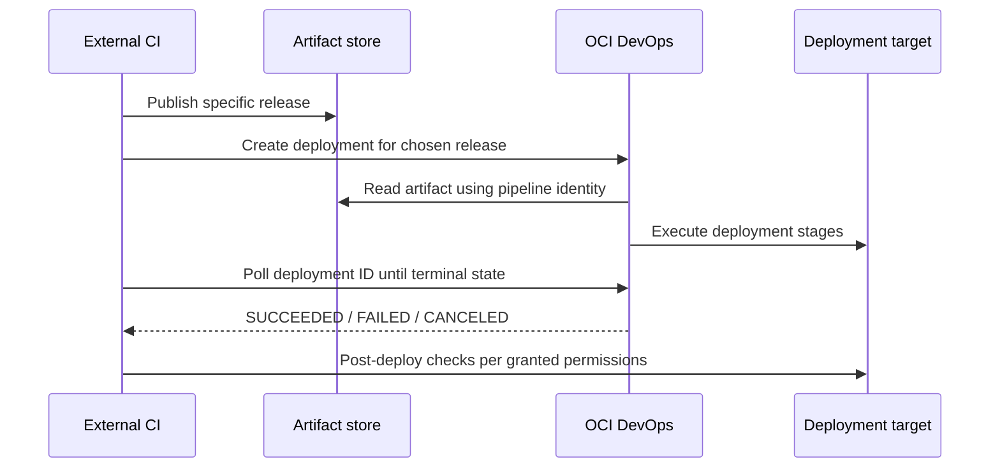

# Integrating GitHub Actions or external CI tools with OCI

## 1. Objectives and scope

In the **DevOps and CI/CD on OCI** chapter, integrating external CI tools lets development teams keep their testing workflows in GitHub Actions, GitLab CI, or Jenkins while using Oracle Cloud Infrastructure for storing artifacts and running applications.

This lesson focuses on the bridge between the CI system and OCI: job identity, IAM permissions, network connectivity, artifact transfer, and outcome verification. From this bridge, teams can extend to Compute, Oracle Kubernetes Engine (OKE), Functions, or triggering an OCI DevOps deployment pipeline.

After this lesson, learners can:

- Choose an authentication method suited to runner placement and key management requirements.
- Scope a pipeline strictly to the required compartment, bucket, and operations.
- Set up a GitHub Actions workflow that publishes artifacts to Object Storage.
- Distinguish publishing an artifact, submitting a deployment request, and a succeeded deployment.
- Apply the same principles to another CI tool with traceability and cost control.

The hands-on lab uses a small manifest bundle to observe the full integration flow without needing to provision Compute or OKE yet. For a Java application, replace the manifest packaging step with your project's test and JAR packaging steps while keeping artifact transfer and verification identical.

## 2. Integration architecture and responsibility boundaries

### 2.1. Three common patterns

| Pattern | What the external CI tool runs | What performs CD | Key decision point |
| --- | --- | --- | --- |
| CI calls OCI services directly | Test, package, authenticate, call CLI/SDK | The CI job itself | The job needs permissions and network reachability to targets |
| CI hands off to OCI DevOps | Test, publish artifacts, create deployment | OCI DevOps deployment pipeline | Separate caller identity from pipeline identity |
| CI runs on self-hosted runners in OCI | Execute jobs on Compute or dedicated runner infra | Job or OCI DevOps | Isolate runners, protect machine identity, control networking |

These are design options. Teams can combine them—for example, having GitHub Actions build artifacts while granting the job only permission to trigger OCI DevOps to deploy an approved version.



In the diagram, an artifact is the concrete output of a build. A successful upload only proves the artifact reached storage; it does not prove the application is serving traffic on that version.

### 2.2. Four conditions for a call to succeed

A job calling OCI succeeds only when all four hold:

1. **Valid identity:** OCI recognizes the principal signing the request.
2. **Proper permissions:** IAM permits that principal to perform the action on the target resource.
3. **Network connectivity:** the runner resolves DNS and reaches the endpoint.
4. **Correct inputs:** region, namespace, OCIDs, resource names, and artifacts match the environment.

Design recommendation: record these four conditions explicitly in deployment configuration. For instance, a staging bucket must pair with a staging identity and the bucket's region; never change only an `ENVIRONMENT` variable and reuse all production parameters by default.

## 3. Choosing an identity for CI jobs

### 3.1. Comparing options

| Authentication method | When it fits | Primary responsibility |
| --- | --- | --- |
| Dedicated automation IAM user + API signing key | Runners outside OCI needing transparent CLI config | Guard private key, revoke and rotate keys |
| Instance principal | Runners running on OCI Compute | Dynamic groups, IAM policies, runner host isolation |
| Workload Identity Federation | CI supports OIDC and tenancy configured token exchange | Trust, claim conditions, token-exchange client, principal permissions |
| User session token | Short experiments or human-assisted runs | Token lifetime and re-issuance workflow |

With API signing keys, OCI uses an RSA PEM pair, fingerprint, user OCID, and tenancy OCID. The public key is registered on the IAM user; the private key stays with the API caller. This is a different key type from SSH keys used to log into Compute. Reference: [Oracle Required Keys and OCIDs](https://docs.oracle.com/en-us/iaas/Content/API/Concepts/apisigningkey.htm).

A user created for automation is still an **IAM user**. Naming it "CI account" does not automatically create a service-account mechanism or restrict permissions.

With instance principals, the identity belongs to the Compute instance and OCI manages instance certificates. The CLI supports `--auth instance_principal`. See [Calling Services from an Instance](https://docs.oracle.com/en-us/iaas/Content/Identity/Tasks/callingservicesfrominstances.htm) and [Using the CLI](https://docs.oracle.com/en-us/iaas/Content/API/SDKDocs/cliusing.htm).

### 3.2. OIDC and Workload Identity Federation

Oracle announced JWT-to-RPST token exchange for external workloads, including GitHub Actions. This flow exchanges a JWT from a trusted issuer for a Resource Principal Session Token (RPST) to call OCI APIs; do not conclude external CI always requires static API keys. See [JWT-to-RPST Token Exchange announcement](https://docs.oracle.com/en-us/iaas/releasenotes/identity/jwt_to_rpst_token_exchange_for_workload_identity_federation.htm).

The flow requires configuring trust, claim checks, resource permissions, and a workload keypair to sign requests with the RPST. The token-exchange endpoint also authenticates the caller; Oracle docs describe an OAuth client or signing requests with a supported principal. If using an OAuth client with a client secret, protect that secret too. Enabling `id-token: write` alone does not complete the integration. See [OCI token exchange grant guide](https://docs.oracle.com/en-us/iaas/Content/Identity/api-getstarted/token_exchange_grant_type_workload_id-federation.htm).

On GitHub, the job needs permission to request an OIDC token:

```yaml
permissions:
  contents: read
  id-token: write
```

This permission allows minting an OIDC token; it does not directly grant write permissions on OCI resources. Trust policies should validate issuer, audience, and claims identifying the repository, environment, or workflow. Never copy a `sub` pattern blindly from an old example: GitHub has multiple subject formats depending on configuration and repository creation date. See [OpenID Connect](https://docs.github.com/en/actions/concepts/security/openid-connect) and [OIDC reference](https://docs.github.com/en/actions/reference/security/oidc).

Implementation recommendation: verify the federation flow on a test resource first, then swap only the identity-setup step in your pipeline. Artifact selection, permission scoping, checksum verification, and CD checks remain essential.

### 3.3. Never mix credential types

| Credential | Purpose in the integration |
| --- | --- |
| `GITHUB_TOKEN` | Interacts with the GitHub repository and APIs per job permissions |
| OCI API signing key | Signs OCI API requests as an IAM user |
| OCI auth token for OCIR | Authenticates Docker client per registry login method |
| RPST | Participates in OCI resource principal authentication |
| SSH private key | Logs into OS hosts when architecture genuinely requires SSH |

OCI Container Registry supports Docker login with an OCI auth token per service guidance. Never use an API signing private key as a Docker password. See [Container Registry FAQ](https://www.oracle.com/cloud/cloud-native/container-registry/faq/).

## 4. Designing IAM permissions for the lab

### 4.1. Resources and identities

An administrator prepares:

- A compartment dedicated to lab artifacts.
- A **private** bucket named `ci-release-artifacts` in the selected region.
- A dedicated automation IAM user belonging only to the needed group.
- An IAM group containing this user.
- An API public key registered for the user; the private key stored as a GitHub environment secret.

The pipeline only needs to publish and re-download objects for verification. The pipeline has no business creating buckets, editing VCNs, creating users, or managing the entire tenancy.

### 4.2. Policy scoped by bucket and permissions

Replace `<GROUP_OCID>` and `<COMPARTMENT_OCID>` with real OCIDs before creating the policy:

```text
Allow group id <GROUP_OCID> to manage objects in compartment id <COMPARTMENT_OCID> where all {
  target.bucket.name = 'ci-release-artifacts',
  any {
    request.permission = 'OBJECT_CREATE',
    request.permission = 'OBJECT_INSPECT',
    request.permission = 'OBJECT_READ'
  }
}
```

OCI lets policies reference groups and compartments by OCID. Reference: [Policy Syntax](https://docs.oracle.com/en-us/iaas/Content/Identity/Concepts/policysyntax.htm).

Here, `manage objects` is narrowed down to three permissions: create objects, inspect metadata, and read contents. The lab does not grant overwrite or delete permissions. Bucket name is a policy condition; name comparisons in IAM conditions are case-insensitive, so avoid buckets differing only in casing. Detailed permission tables live in [Object Storage policy reference](https://docs.oracle.com/en-us/iaas/Content/Identity/Reference/objectstoragepolicyreference.htm).

This policy intentionally targets **single-part** uploads, inspection, and downloads. The workflow passes the namespace explicitly so no separate namespace-lookup call is needed. When scaling to large artifacts requiring multipart uploads or customer-managed encryption keys, add the corresponding permissions.

Place the policy on the compartment or an appropriate parent compartment. An authorized administrator creates the policy; the publishing pipeline must never hold permissions to edit its own policy.

Note: IAM permissions are additive. This narrow policy does not remove broad permissions the user already inherits from another group or policy.

## 5. Preparing GitHub for the workflow

### 5.1. Creating the environment

Create an environment named `oci-staging` in the repository. Configure deployment branch restrictions; if approvals are needed, add reviewers per features supported by your GitHub plan and repository visibility. Environment secrets are supplied to jobs only after protection rules pass. See [Deployments and environments](https://docs.github.com/en/actions/reference/workflows-and-actions/deployments-and-environments).

Declare these **environment variables**:

| Name | Content |
| --- | --- |
| `OCI_TENANCY_OCID` | Tenancy OCID |
| `OCI_USER_OCID` | OCID of the automation IAM user |
| `OCI_KEY_FINGERPRINT` | Fingerprint of the registered API public key |
| `OCI_REGION` | Region holding the bucket, e.g. `ap-singapore-1` if prepared there |
| `OCI_NAMESPACE` | Tenancy's Object Storage namespace |
| `OCI_BUCKET` | `ci-release-artifacts` |

Declare the **environment secret**:

| Name | Content |
| --- | --- |
| `OCI_API_PRIVATE_KEY` | Full PEM private key, preserving line breaks |

OCIDs and fingerprints do not substitute for the private key. If your organization treats infrastructure identifiers as sensitive data, move them to secrets and update workflow references consistently.

The example uses a passphrase-free private key for automation. If policy requires a passphrase-protected key, add a secure CLI-supported passphrase mechanism; never commit the passphrase to the repository.

### 5.2. Tools and limits of the example

The workflow below targets **GitHub.com**, using runner `ubuntu-24.04`. This image includes Bash, `jq`, and `pipx` per the [official runner software list](https://github.com/actions/runner-images/blob/main/images/ubuntu/Ubuntu2404-Readme.md). The job installs a pinned OCI CLI version to minimize unexpected drift.

References like `@v4` and `@v5` in the example are major tags for readability. In production pipelines, replace them with verified full commit SHAs alongside a dependency-update process. GitHub recommends pinning actions to full commit SHAs and scoping `GITHUB_TOKEN`; see [Secure use reference](https://docs.github.com/en/actions/reference/security/secure-use).

Never run deployment workflows on untrusted pull request code. The packaging job receives no OCI credentials; the publish job runs only on `main` when the event is not a pull request.

## 6. GitHub Actions workflow: publishing and verifying artifacts

Create the following workflow in your application repository, for example `.github/workflows/oci-artifact.yml`. This is an illustrative configuration for learners to adapt to their own CI repository.

```yaml
name: Publish release artifact to OCI

on:
  push:
    branches: [main]
  pull_request:
    branches: [main]
  workflow_dispatch:

permissions:
  contents: read

defaults:
  run:
    shell: bash

jobs:
  package:
    runs-on: ubuntu-24.04
    timeout-minutes: 10
    steps:
      - name: Checkout source
        uses: actions/checkout@v4
        with:
          persist-credentials: false

      - name: Package a release manifest
        run: |
          set -euo pipefail
          mkdir -p payload

          commit="$(git rev-parse HEAD)"
          jq -n \
            --arg repository "$GITHUB_REPOSITORY" \
            --arg commit "$commit" \
            --arg run_id "$GITHUB_RUN_ID" \
            --arg run_attempt "$GITHUB_RUN_ATTEMPT" \
            '{
              repository: $repository,
              commit: $commit,
              run_id: $run_id,
              run_attempt: $run_attempt
            }' > payload/release.json

          tar -czf release.tgz -C payload .
          sha256sum release.tgz > release.tgz.sha256

      - name: Preserve this build output
        uses: actions/upload-artifact@v4
        with:
          name: release-bundle
          path: |
            release.tgz
            release.tgz.sha256
          if-no-files-found: error
          retention-days: 7

  publish:
    needs: package
    if: github.ref == 'refs/heads/main' && github.event_name != 'pull_request'
    runs-on: ubuntu-24.04
    timeout-minutes: 15
    environment: oci-staging

    concurrency:
      group: oci-staging-publish
      cancel-in-progress: false

    env:
      OCI_CLI_VERSION: "3.96.3"
      OCI_CLI_AUTH: api_key
      OCI_CLI_CONFIG_FILE: ${{ runner.temp }}/oci-release-config
      OCI_KEY_FILE: ${{ runner.temp }}/oci-release-key.pem
      OCI_TENANCY_OCID: ${{ vars.OCI_TENANCY_OCID }}
      OCI_USER_OCID: ${{ vars.OCI_USER_OCID }}
      OCI_KEY_FINGERPRINT: ${{ vars.OCI_KEY_FINGERPRINT }}
      OCI_REGION: ${{ vars.OCI_REGION }}
      OCI_NAMESPACE: ${{ vars.OCI_NAMESPACE }}
      OCI_BUCKET: ${{ vars.OCI_BUCKET }}

    steps:
      - name: Download output from the package job
        uses: actions/download-artifact@v5
        with:
          name: release-bundle
          path: bundle

      - name: Install the selected OCI CLI version
        run: |
          set -euo pipefail
          pipx install "oci-cli==${OCI_CLI_VERSION}"
          echo "$HOME/.local/bin" >> "$GITHUB_PATH"

      - name: Create temporary OCI configuration
        env:
          OCI_API_PRIVATE_KEY: ${{ secrets.OCI_API_PRIVATE_KEY }}
        run: |
          set -euo pipefail
          for name in OCI_TENANCY_OCID OCI_USER_OCID OCI_KEY_FINGERPRINT \
                      OCI_REGION OCI_NAMESPACE OCI_BUCKET OCI_API_PRIVATE_KEY; do
            if [[ -z "${!name:-}" ]]; then
              printf 'Missing configuration: %s\n' "$name" >&2
              exit 1
            fi
          done

          umask 077
          printf '%s\n' "$OCI_API_PRIVATE_KEY" > "$OCI_KEY_FILE"
          printf '%s\n' \
            '[DEFAULT]' \
            "user=$OCI_USER_OCID" \
            "fingerprint=$OCI_KEY_FINGERPRINT" \
            "tenancy=$OCI_TENANCY_OCID" \
            "region=$OCI_REGION" \
            "key_file=$OCI_KEY_FILE" \
            > "$OCI_CLI_CONFIG_FILE"

          chmod 600 "$OCI_KEY_FILE" "$OCI_CLI_CONFIG_FILE"
          oci --version

      - name: Upload and verify the same bytes
        run: |
          set -euo pipefail
          cd bundle
          sha256sum --check release.tgz.sha256

          object_name="${GITHUB_REPOSITORY}/${GITHUB_SHA}/${GITHUB_RUN_ID}-${GITHUB_RUN_ATTEMPT}/release.tgz"
          metadata="$(jq -nc \
            --arg commit "$GITHUB_SHA" \
            --arg run_id "$GITHUB_RUN_ID" \
            --arg run_attempt "$GITHUB_RUN_ATTEMPT" \
            '{commit: $commit, run_id: $run_id, run_attempt: $run_attempt}')"

          oci os object put \
            --namespace-name "$OCI_NAMESPACE" \
            --bucket-name "$OCI_BUCKET" \
            --name "$object_name" \
            --file release.tgz \
            --metadata "$metadata" \
            --no-multipart \
            --no-overwrite \
            --output json > /dev/null

          oci os object get \
            --namespace-name "$OCI_NAMESPACE" \
            --bucket-name "$OCI_BUCKET" \
            --name "$object_name" \
            --file "$RUNNER_TEMP/release-downloaded.tgz" \
            > /dev/null

          expected="$(awk '{print $1}' release.tgz.sha256)"
          actual="$(sha256sum "$RUNNER_TEMP/release-downloaded.tgz" | awk '{print $1}')"
          if [[ "$expected" != "$actual" ]]; then
            printf 'Artifact checksum mismatch\n' >&2
            exit 1
          fi

          {
            printf 'Commit: %s\n\n' "$GITHUB_SHA"
            printf 'Object: %s\n\n' "$object_name"
            printf 'Verified SHA-256: %s\n' "$actual"
          } >> "$GITHUB_STEP_SUMMARY"

      - name: Remove temporary credential files
        if: always()
        run: |
          rm -f -- "$OCI_KEY_FILE" "$OCI_CLI_CONFIG_FILE" \
            "$RUNNER_TEMP/release-downloaded.tgz"
```

### 6.1. How the workflow operates

The `package` job creates a manifest and saves the tarball plus SHA-256 as a GitHub artifact. The `publish` job downloads the artifact from that exact workflow run rather than rebuilding the release. Data sharing across jobs and `needs` behavior are documented in [Store and share data with workflow artifacts](https://docs.github.com/en/actions/tutorials/store-and-share-data).

For a Java repository, add a step setting up the exact JDK version and running your project's test command before packaging. Place the tested JAR into the `payload` directory alongside the manifest; never rebuild a different JAR in the publish job or when promoting from staging to production.

The private key is passed only into the environment of the configuration step. Subsequent steps use temporary files with restricted permissions. Config and key files stay outside directories uploaded as artifacts. Cleanup runs as long as the job can still execute final steps; lost or forcibly terminated runners still require separate environment teardown.

### 6.2. Object naming and write permissions

The object name includes repository, commit SHA, run ID, and run attempt. Two repositories sharing a commit SHA or a workflow rerun still receive distinct paths.

`--no-overwrite` prevents the CLI from overwriting an existing object; `--no-multipart` keeps the lab in single-part upload mode. CLI documentation describes both flags and default multipart behavior in [oci os object put](https://docs.oracle.com/en-us/iaas/tools/oci-cli/latest/oci_cli_docs/cmdref/os/object/put.html).

IAM conditions also omit `OBJECT_OVERWRITE`, so removing that flag in a workflow edit does not grant overwrite permissions. Even so, this design is not WORM storage: administrators or other broad principals can still modify data.

If a name collision happens, do not rely solely on the upload exit code. The workflow downloads the object and compares its SHA-256 against the bundle from the package job. If an object with that name has different contents, verification fails.

SHA-256 inside the same bundle detects byte corruption during transfer. It does not prove the artifact is trustworthy if the build job itself or both the tarball and checksum were tampered with. When release origin verification is needed, add signatures or provenance rooted in an independent trust anchor.

### 6.3. Lab acceptance criteria

After a valid push to `main`:

1. The `package` job completes successfully.
2. The `publish` job runs after environment protection checks pass.
3. The bucket contains the object at the release path logged in the job summary.
4. The re-downloaded bundle matches the packaged SHA-256.
5. Logs contain no private keys or sensitive configuration.
6. No Compute or OKE resources were created by this workflow.

A pull request targeting `main` runs only the `package` job. That validates workflow changes without exposing OCI credentials to unreviewed code.

## 7. Moving to self-hosted runners on OCI

Runners on OCI Compute can use instance principals instead of a user's API key. Administrators create a dynamic group with a narrow membership rule, such as a single runner instance:

```text
ALL {instance.id = '<RUNNER_INSTANCE_OCID>'}
```

Then create a policy for the dynamic group matching the lab's bucket and permission scope, replacing `group id <GROUP_OCID>` with `dynamic-group id <DYNAMIC_GROUP_OCID>`.

This is a different identity from the IAM user in the earlier example. It requires its own policy; adding an instance to a dynamic group does not automatically grant bucket access.

On a runner with OCI CLI installed, a connectivity check can be:

```bash
export OCI_CLI_AUTH=instance_principal

oci os object head \
  --namespace-name "$OCI_NAMESPACE" \
  --bucket-name "$OCI_BUCKET" \
  --name "$KNOWN_OBJECT_NAME"
```

In this command, `KNOWN_OBJECT_NAME` must be an existing object the runner is allowed to inspect. Passing the namespace avoids an extra lookup call beyond the check's scope.

Dynamic groups and instance principal risks are covered by Oracle in [Calling Services from an Instance](https://docs.oracle.com/en-us/iaas/Content/Identity/Tasks/callingservicesfrominstances.htm).

**Instance identities are not isolated per job.** Code running on the same host can use permissions granted to that instance. Recommended runner practices:

- Reserve deployment runners for trusted repositories and workflows.
- Separate runners handling external pull requests from runners holding cloud privileges.
- Prefer ephemeral single-use runners or environments rebuilt between jobs.
- Separate staging runner pools from production runner pools.
- Restrict who can alter dynamic group rules, tags, and host configs.

Never place a deployment runner on a shared machine merely because that host already has network connectivity to production.

## 8. Networking: reaching OCI APIs and deployment targets

Two network paths must be evaluated separately:

| Network path | Examples | Questions to answer |
| --- | --- | --- |
| Runner → OCI service APIs | Upload to Object Storage, create deployment | Are DNS, HTTPS, proxies, endpoints, and region right? |
| Runner or CD pipeline → application target | Kubernetes API, Compute SSH, database endpoint | Over which network are private targets reached, and who is permitted? |

Successfully uploading an object to a private bucket does not mean the runner can reach a private subnet. "Private bucket" is a data access setting; it does not create a private network tunnel from GitHub into your VCN.

For OKE with a private Kubernetes API endpoint, provide an appropriate route into the VCN or an access mechanism designed for that endpoint. OCI distinguishes setting up kubeconfig from endpoint reachability in [Setting Up Cluster Access](https://docs.oracle.com/en-us/iaas/Content/ContEng/Tasks/contengdownloadkubeconfigfile.htm).

Architectural options include placing runners inside the VCN, private network links between CI and OCI, or handing off to a CD pipeline with proper connectivity. Never open SSH or the Kubernetes API to the entire Internet just so a hosted runner can reach it.

For runners in a private subnet, also design outbound egress to fetch jobs, download dependencies, and send logs. Having a route to an OCI service does not automatically ensure the runner can reach GitHub or public package registries.

## 9. Adapting to GitLab CI, Jenkins, or other tools

What changes is mainly credential injection, artifact passing, and job restrictions. OCI CLI invocations can keep the same contract:

```text
Inputs:
  built artifact and checksum
  release ID, commit SHA
  region, namespace, bucket, or deployment pipeline OCID
  identity granted only within the job scope that needs it

Outputs:
  published artifact identifier
  verified checksum
  deployment ID if applicable
  final outcome and diagnostic info stripped of secrets
```

| Responsibility | GitHub Actions | GitLab CI | Jenkins |
| --- | --- | --- | --- |
| Passing artifacts across stages | Upload/download workflow artifacts | Job artifacts and job dependencies | Archive or stash/unstash per pipeline design |
| Supplying credentials | Environment secrets or federation step | Scoped CI/CD variables or ID tokens | Credentials Binding or agent identity |
| Restricting who can deploy | Branches, environment protections, workflow edit rights | Protected refs, environments, job rules | Job/Jenkinsfile edit rights, agents, approval steps |
| Traceability | Repository, SHA, run ID, attempt | Project, SHA, pipeline/job ID | Repository, SHA, build number, job |
| Preventing state races | Environment concurrency | Job serialization per environment | Locks or queues per Jenkins architecture |

GitLab provides job ID tokens for OIDC integration with external services. Still, you must configure OCI to trust the exact issuer, audience, and claims; OIDC setups for another cloud will not work directly with OCI. Reference: [GitLab Connect to cloud services](https://docs.gitlab.com/ci/cloud_services/).

When using multiline private keys in GitLab, pick an appropriate variable type rather than trying to force masking on every option. With file-type variables, the job receives a file path; pass that path to `key_file`. Check variable limits and scoping in [CI/CD variables](https://docs.gitlab.com/ci/variables/).

In Jenkins, Credentials Binding can provide secret files and path variables scoped to `withCredentials`. Other processes or builds sharing an agent can threaten confidentiality; never treat log masking as job isolation. See [Credentials Binding](https://www.jenkins.io/doc/pipeline/steps/credentials-binding/).

Another option is dedicated actions, such as `oracle-actions/run-oci-cli-command`, which installs OCI CLI and executes a supplied command. When using it, read its exact credential variables, tool-installation behavior, and action version instead of assuming variables from the self-installed workflow in this lab apply unchanged. See [Oracle's action repository](https://github.com/oracle-actions/run-oci-cli-command).

Recommendation to avoid tight CI vendor lock-in: keep packaging and publishing logic in scripts with explicit inputs, while pipeline files manage scheduling, identities, and approval gates. Those scripts must never escalate privileges or fall back to production credentials when an environment variable is missing.

## 10. Handing off from external CI to OCI DevOps

### 10.1. Splitting permissions between both sides

In this pattern, the external job identity only needs permissions to publish artifacts and start/read deployments as designed. The OCI DevOps deployment pipeline identity holds separate permissions to read artifacts and act on deployment targets.



Design recommendation: the platform team manages OCI DevOps projects, pipelines, stages, deployment environments, and IAM. The development team supplies artifacts and release IDs. Thus, permissions to create Compute or modify clusters stay inside controlled pipelines rather than sitting in every build job.

### 10.2. Triggering must be paired with waiting for results

The example below assumes:

- `OCI_DEPLOY_PIPELINE_OCID` points to an existing deployment pipeline.
- `RELEASE_ID` is the release identifier selected by the release system.
- The pipeline is configured to select that release's exact immutable artifact.
- The CLI holds the identity and permissions needed to create and inspect deployments.

```bash
set -euo pipefail

deployment_id="$(oci devops deployment create-pipeline-deployment \
  --pipeline-id "$OCI_DEPLOY_PIPELINE_OCID" \
  --display-name "$RELEASE_ID" \
  --query 'data.id' \
  --raw-output)"

printf 'Deployment ID: %s\n' "$deployment_id"

for attempt in $(seq 1 120); do
  state="$(oci devops deployment get \
    --deployment-id "$deployment_id" \
    --query 'data."lifecycle-state"' \
    --raw-output)"

  case "$state" in
    SUCCEEDED)
      printf 'OCI deployment succeeded\n'
      exit 0
      ;;
    FAILED|CANCELED)
      printf 'OCI deployment ended in state: %s\n' "$state" >&2
      exit 1
      ;;
    *)
      sleep 5
      ;;
  esac
done

printf 'Timed out; check deployment %s before retrying\n' "$deployment_id" >&2
exit 1
```

Commands and states are documented in [create-pipeline-deployment](https://docs.oracle.com/en-us/iaas/tools/oci-cli/latest/oci_cli_docs/cmdref/devops/deployment/create-pipeline-deployment.html) and [deployment get](https://docs.oracle.com/en-us/iaas/tools/oci-cli/latest/oci_cli_docs/cmdref/devops/deployment/get.html).

`--display-name` only sets the display name; it does not select artifacts. If the pipeline accepts a release via parameters or artifact overrides, configure and pass that data per the pipeline contract. You can generate sample input with `--generate-param-json-input` per CLI docs; never assume an object name automatically becomes a deployment parameter.

If using a waiter instead of a loop, still inspect the final state. "Reached a waited-for state" does not always mean `SUCCEEDED`.

A CI job timing out or being canceled also does not guarantee the OCI-side deployment stopped. Before creating a new deployment, inspect the recorded deployment ID to avoid overlapping deployments.

## 11. Extending to deployment targets

### 11.1. Container Registry and OKE

A typical container flow is:

1. CI tests and builds the image.
2. CI pushes the image to OCI Container Registry.
3. The release system records the image digest.
4. A CD job or OCI DevOps deploys the selected digest.
5. Verify rollout, readiness, and application behavior.

Registry endpoints, namespaces, and username formats depend on tenancy and identity domain configuration. When using Docker CLI with an auth token, pass the token over stdin:

```bash
printf '%s' "$OCIR_AUTH_TOKEN" |
  docker login "$OCIR_ENDPOINT" \
    --username "$OCIR_USERNAME" \
    --password-stdin
```

Here `OCIR_ENDPOINT` is the registry hostname, not a URL containing a repository path. Prepare the username per your tenancy's guide rather than deriving it from the tenancy OCID. Oracle distinguishes default-domain users from other domains in [Deploy Sign-In Application to OKE](https://docs.oracle.com/en/solutions/enhance-ux-custom-signin-app-oke/deploy-sign-application-oke1.html).

Store Docker config in a job-scoped temporary directory and clean it up afterward. After pushing, prefer deploying by digest so a release never shifts simply because a tag was updated.

On OKE, being able to call OCI APIs or generate kubeconfig does not prove a job has permission to modify workloads. Also verify Kubernetes access, target namespace, Role/RoleBindings, and networking. Never grant `cluster-admin` just to update a Deployment.

Once manifests and permissions are ready, the CD step should verify actual results, for example:

```bash
kubectl -n app-staging apply -f deployment.yaml
kubectl -n app-staging rollout status deployment/orders --timeout=180s
```

Namespace, Deployment, and manifest names here are examples. For production, pin the image digest and prepare a rollback plan before applying.

### 11.2. Compute

When deploying to Compute, define how hosts receive the release: pipeline agent, artifact download mechanism, or SSH per your chosen architecture. OCI permissions to manage instances and OS login privileges are two separate layers.

Recommended deployment pattern: hosts download the package from a verified release path, verify checksums, install into a new versioned directory, and switch the active version after health checks pass. Keep the prior version for rollback; avoid overwriting a running JAR in place.

### 11.3. Infrastructure with Terraform

For pipelines managing infrastructure, the artifact contract must add config commits, provider versions, state backends, and approved plans.

Design recommendations:

- Use separate identities and permission scopes per environment.
- Never place state files or plans containing sensitive data into public artifacts.
- Ensure only one flow mutates a given state at a time using proper backend locking and orchestration.
- Apply the exact approved plan only while corresponding state and input variables remain valid.
- Re-plan when drift or input changes occur; never auto-apply a plan different from the approved one.

Permissions to publish to the lab's bucket are not enough to provision VCNs, Compute, or databases. Those permissions require a dedicated infrastructure IAM design rather than expanding the artifact publisher user by default.

### 11.4. Oracle Database

If a pipeline also runs schema migrations, add database identities, endpoint connectivity, wallet or secret storage, and data recovery plans.

OCI permissions to manage an Autonomous Database do not automatically grant SQL privileges inside the database. Separate infrastructure provisioning from migration execution, and verify compatibility between older application versions and newer schemas. Application rollback can be far simpler than rolling back a migration that already altered data.

## 12. Observability and troubleshooting

### 12.1. Evidence chain to retain

A release should preserve links across:

```text
Repository + commit SHA
        ↓
CI run ID + attempt + test results
        ↓
Object name / image digest + checksum
        ↓
Deployment ID + environment + approver or approval rule
        ↓
Rollout result + smoke test + serving version
```

Logs should record only metadata needed for diagnostics. Never print private keys, OIDC JWTs, RPSTs, auth tokens, wallet contents, or full environment dumps for "quick debugging."

In OCI Audit, Object Storage is logged at bucket-event granularity, not every object operation. To track lab uploads/downloads, enable read/write bucket service logs in OCI Logging. Reference: [Overview of Audit](https://docs.oracle.com/en-us/iaas/Content/Audit/Concepts/auditoverview.htm) and [Details for Object Storage logs](https://docs.oracle.com/en-us/iaas/Content/Logging/Reference/details_for_object_storage.htm).

Service logs are best-effort; never use log arrival time as the sole criterion that an upload finished. Workflows use API responses and re-download verification to confirm data.

### 12.2. Troubleshooting table

| Symptom | Likely causes to check | First action |
| --- | --- | --- |
| CLI cannot read private key | Stripped PEM newlines, wrong path, missing passphrase | Check secret injection and file path without printing key |
| `NotAuthenticated` | Mismatched user, key, fingerprint, or token; clock skew | Verify identity config and runner system clock |
| `NotAuthorizedOrNotFound` | Missing permissions or resource not in call scope | Verify region, namespace, bucket, OCIDs, and group membership |
| Namespace lookup denied | Tool making unneeded lookup call | Pass namespace explicitly or evaluate lookup permissions |
| Small upload works, large fails | Tool switched to multipart upload | Check upload mode and multipart permissions |
| Object already exists | Reused release name | Compare checksums; do not fix by immediately granting overwrite |
| OIDC token exchange rejected | Wrong audience, issuer, claims, trust, or caller auth | Compare trust config against actual claims without logging JWT |
| OCI API works but OKE times out | Missing network path to Kubernetes endpoint | Check DNS, routes, NSGs, and security lists |
| `kubectl` returns `Forbidden` | Missing Kubernetes permissions for that action | Check principal and Role/RoleBinding in the namespace |
| CI passes yet app stays old | Job only uploaded or only created deployment | Check deployment ID, rollout, and live serving version |
| New self-hosted runner fails | Stale credentials/workspace or different tool versions | Inspect runner environment and use isolated temp dirs |

This table is a suggested diagnostic order, not a strict one-to-one mapping between an error and a single root cause. In particular, never interpret `NotAuthorizedOrNotFound` as proof that a resource was deleted.

When using CLI debug mode, run it in a controlled environment, scrub sensitive data before sharing, and retain only necessary logs. Enabling debug does not replace checking IAM permissions per operation.

## 13. Reliability, cost, and credential lifecycle

### 13.1. Release reliability

Release design should answer: **which exact bytes are deployed, from which commit, into which environment?**

Recommended practices:

- Build once and promote the same artifact across environments.
- Avoid using only mutable tags like `latest` or static object names like `app.jar` as release identifiers.
- Serialize operations mutating the same environment.
- Do not treat job concurrency alone as guaranteeing commits release in order; maintain an explicit selected-release record.
- Use bounded retries for transient errors; verify resource state when a creation call returns an unknown outcome.
- Set timeouts on APIs, rollouts, and smoke tests.
- Record the last known-good running version before changes to support rollback.

A useful smoke test must observe the updated environment, such as an endpoint returning the selected commit or release ID. An HTTP 200 from a health endpoint alone does not prove the new version is serving.

### 13.2. Cost control

The lab creates small objects and uses runner minutes without provisioning application servers. When scaling out, account for self-hosted runners, artifact and log retention, data transfer, test environments, and auxiliary resources.

Recommendations for learning environments:

- Set appropriate retention limits on GitHub artifacts and Object Storage object lifecycles.
- Keep enough release versions for rollback before deleting older versions.
- Clean up test resources using a separate narrow-scoped cleanup identity.
- Tag pipeline-created resources with owner, environment, and release info.
- Pair cost alerts with quotas or provisioning controls; never treat alerts as automatically blocking spend.
- Avoid leaving self-hosted runners running 24/7 when idle.
- Set log retention limits and avoid uploading duplicate bundles across retries.

The lab user has no object deletion permissions. At the end of practice, an administrator or separately authorized cleanup task deletes only the lab objects; never expand the publish job's permissions just for cleanup.

### 13.3. Rotation and revocation

For API keys, a rotation procedure includes: generate a new keypair, register the public key, update the fingerprint and CI secret, verify one run with the new key, then revoke the old public key. Execute within a change window so a run does not mix half-old and half-new configs.

If a credential leaks, prioritize revoking access and auditing affected runs. Simply deleting a log line does not invalidate a copied key.

For short-lived tokens, beyond expiration windows, govern trust, permissions, and token-exchange callers. Revoking an old secret is insufficient if the workflow or runner still has another path to mint fresh credentials.

## 14. Integration completion criteria

An integration ready for a release workflow requires the following evidence:

| Criterion | Required evidence |
| --- | --- |
| Clear identity scope | Know whether jobs use an IAM user, instance principal, or federation |
| Least-privilege permissions | Policies match operations, compartment, and target resources |
| Identified artifacts | Commit, release ID, and checksum or image digest recorded |
| Protected credentials | None stored in repositories, caches, or build artifacts |
| Verified network paths | Runners and CD components reach required endpoints |
| Confirmed outcomes | Distinguish upload, deployment request, and completed deployment |
| Operability | Proper logs, timeouts, retry handling, and rollback |
| Managed lifecycle | Owners, credential revocation, and resource cleanup defined |

For the lab, passing means one workflow run's artifact is published to the private bucket and re-downloaded with a matching checksum. When adding application deployment, extend acceptance criteria to cover deployment status, rollout, and verifying the live serving version.
