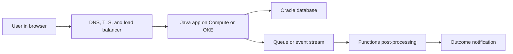
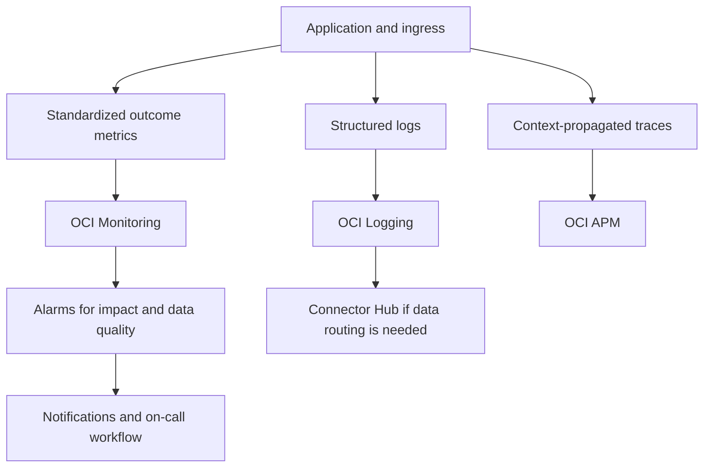

# Designing Observability Around SLIs, SLOs, and User Journeys

## 1. Starting from the Experience You Need to Protect

In the **Logs, Metrics, and Tracing** chapter of the **CLOUD_PROVIDERS_ORACLE** module, observability helps operations teams understand what is happening with applications on Oracle Cloud Infrastructure and choose actions based on evidence. This design connects user experience with IAM, VCN, Compute, OKE, storage, Functions, and Oracle databases, while keeping data collection within appropriate access boundaries and cost limits.

A Compute instance with low CPU does not prove that users can place orders. A database that still accepts connections does not prove that transactions are being persisted properly. Conversely, a machine with high CPU does not necessarily mean user experience is degraded. Therefore, the starting point is **what outcome the user wants to achieve**, and only then do you determine how to measure it, which data sources to use, and how to build dashboards.

After this lesson, learners can:

- Translate a critical user journey into clearly defined SLIs.
- Set SLOs with evaluation windows and calculate error budgets.
- Combine metrics, logs, and traces to detect, isolate, and explain incidents.
- Map the design to OCI Monitoring, Logging, and Application Performance Monitoring (APM).
- Define actionable alerts with clear responders, verify telemetry quality, and control data volume.

The running example throughout this lesson is an order-placement system with a Java application running on Compute or OKE, storing transactions in an Oracle database and handling certain asynchronous tasks with Functions. The illustrative targets, metric names, and schemas in this lesson are hypothetical application designs, not default configurations provided automatically by OCI.

## 2. Distinguishing SLIs, SLOs, SLAs, and Infrastructure Metrics

| Concept | Meaning | Example |
|---|---|---|
| SLI — Service Level Indicator | A quantitative measure of service quality | Ratio of valid order-creation requests that receive confirmation on time |
| SLO — Service Level Objective | Target for an SLI over a specified time period | At least 99.9% of requests meet the criteria over a rolling 30-day window |
| SLA — Service Level Agreement | Service contract with defined conditions and consequences | Customer commitment within the agreed scope |
| Infrastructure metric | A measure of a resource or component | CPU, memory, connection count, I/O latency |

An SLI answers "what are we measuring"; an SLO answers "what level of quality is acceptable." A metric becomes a useful SLI when it maps to what users care about and has a reliable measurement definition. An SLA of an underlying OCI service does not automatically become the end-to-end SLO of your application. [Service Level Objectives concepts](https://sre.google/sre-book/service-level-objectives/).

For example, `CpuUtilization` typically serves diagnostics and capacity management. The order-creation success rate directly reflects the ability to perform that action. Both are necessary, but they support different decisions.

Do not default to 100% for every SLO. Targets must balance user needs, business impact, historical quality, architecture, and the cost of improvement. An overly high target without a way to measure or meet it only creates an illusion of control.

## 3. Mapping the Journey and Defining Measurement Boundaries

### 3.1. Breaking Down the Order-Placement Journey



The "place order" journey has multiple milestones: opening the page, submitting the request, receiving confirmation that the order is saved, and receiving a follow-up notification. Do not lump every milestone into a vague measurement called "system is up."

| User action | Outcome to protect | Candidate measurement boundary |
|---|---|---|
| Open order page | Page is interactive | From navigation start to UI-ready milestone |
| Submit order-creation request | Order is saved with a valid confirmation | From API ingress to confirmation response |
| Complete processing workflow | Business task reaches terminal state | From accepted event to completion outcome |
| View order status | User sees accurate and sufficiently fresh data | From view request to rendered data per contract |

Pick a few critical journeys first. For each journey, document the owner, target users, dependencies, start point, end point, and failure modes to count. [Setting SLOs based on service needs](https://sre.google/workbook/implementing-slos/).

### 3.2. You Only See Failures Where You Measure

Measuring duration inside a Java handler excludes DNS, TLS, queuing before the handler, and browser rendering. Measuring at API ingress still misses users who cannot connect to ingress at all. Measuring in the browser is closer to user experience, but can lose data due to network drops, ad blockers, or scripts failing to execute.

Therefore, a design typically combines:

- Server-side measurements for controlled counting of requests and outcomes.
- Real User Monitoring (RUM) to observe browser sessions and interactions.
- Active synthetic checks from appropriate locations to detect broken access paths even when traffic is low.

Do not combine these measurements into a single ratio if they do not share the same population and boundary. Dashboards must clearly indicate whether an SLI reflects API quality, browser quality, or active checks.

### 3.3. Retries and Asynchronous Flows Require Separate Conventions

One user click followed by three client retries can produce three HTTP attempts. If the SLI measures requests, count by attempts; if the SLI measures logical transactions, you need an identifier and proper deduplication. Never use total requests as the denominator and unique orders as the numerator.

Similarly, a `202 Accepted` response only confirms acceptance per the API contract—it does not prove the task completed. Asynchronous flows must track terminal states, deadlines, and tasks without outcomes yet; counting only completed tasks misses stuck jobs.

## 4. Writing an SLI Measurement Contract

### 4.1. Denominator, Numerator, and Classification Rules

For an event-based SLI:

```text
N = number of valid events in the evaluation window
G = number of valid events meeting the good criteria
B = N - G
SLI = G / N, where N > 0
```

"Valid" defines the population to measure. "Good" defines an acceptable outcome within that population. Every valid event must be classified exactly once under the contract, or have a clearly managed pending/unknown state.

A measurement contract should document at minimum:

| Field | What needs to be decided |
|---|---|
| Name and owner | Which journey and which team is responsible |
| Boundary | Start and end points of the measurement |
| Valid events | Call path, user type, environment, and input conditions |
| Good events | Correct outcome, deadline, and data conditions |
| Exclusions | Which exclusions are justified and controlled |
| Counting unit | HTTP attempt, logical transaction, job, or time slice |
| Window | Rolling or calendar-aligned, timezone, and finalization rules |
| Data source | Counters, outcome logs, business events, or another system |
| Data quality | Lateness, loss, duplicates, sampling, resets, and zero-traffic handling |

A well-specified definition lets two independent people compute the exact same result from the same dataset.

### 4.2. Two SLIs for the Order-Creation API

In this example, the population consists of **valid HTTP attempts** to the order-creation API in production, recorded at the chosen ingress boundary. We do not label this measurement as the entire end-to-end browser experience.

| Item | Illustrative convention |
|---|---|
| Valid event | Request matching the route, authentication, and input schema per contract |
| Good availability | Confirmed durable order persistence with a valid response within 10 seconds |
| Good latency | Also meets good availability and completes within 2 seconds |
| Timeout or system error | Counted as a bad event |
| Rejection due to insufficient capacity | Still counted as bad if the request belongs to the valid population |
| Malformed or unauthorized request per defined rules | May be excluded from this population, but tracked separately |
| Retries | Count each HTTP attempt; logical transactions are a separate measurement |

Do not mechanically classify every `4xx` as a user error and every `2xx` as good. For example, a `429` due to insufficient capacity may reflect service quality; a `200` containing a business failure payload can still be a bad event. Classify according to agreed semantics, and never change rules after an incident just to inflate numbers.

The system must be able to identify requests belonging to the population even when failures occur before the Java handler. If only the application increments counters after completing processing, requests dropped at earlier layers disappear from the denominator. Use ingress data or supplemental measurements to verify coverage.

### 4.3. Computing Accurately on a Sample Dataset

Suppose over 30 days we have fully reconciled data:

| Classification | HTTP attempts |
|---|---:|
| Confirmed valid, within 2 seconds | 987,000 |
| Confirmed valid, over 2 seconds and within 10 seconds | 12,350 |
| Errors, timeouts, or failing availability criteria | 650 |
| Total valid | 1,000,000 |

Then:

```text
Availability SLI = (987,000 + 12,350) / 1,000,000 = 99.935%
Latency SLI      = 987,000 / 1,000,000            = 98.7%
```

High availability does not imply acceptable latency. The two SLIs share the same denominator but use different good criteria, making it visible when a system still returns correct results but is too slow for many users.

For the post-processing flow, define a separate SLI—such as the proportion of valid events completing within 60 seconds. Pending events must be retained until sufficient classification data arrives or the deadline expires; do not look only at successful Functions invocations.

## 5. Setting SLOs and Using Error Budgets

### 5.1. Targets Must Be Bound to a Window and Scope

With the contract from Section 4, a team might choose these illustrative SLOs:

- Availability: at least **99.9%** of valid HTTP attempts meet the good availability criteria over a **rolling 30-day window**.
- Latency: at least **99%** of valid HTTP attempts meet the good latency criteria over the same window.

These are targets chosen by the hypothetical application, not default OCI commitments. You must specify the production environment, journey, request population, and associated data source. Some dashboards inspect 5-minute windows during incident response, but those windows do not replace the 30-day SLO evaluation window.

A rolling window continuously reflects the most recent period; a calendar-month window is convenient for certain reporting processes. The two choices produce different evaluation behaviors. For calendar windows, specify the timezone; for all choices, document how late-arriving data and insufficient-data periods are handled.

### 5.2. Calculating Error Budgets in the Right Units

Given target ratio `S`, valid event count `N`, and bad event count `B`:

```text
Allowed error budget   = N × (1 - S)
Consumed error budget  = B
Remaining error budget = N × (1 - S) - B
Budget burn ratio      = B / [N × (1 - S)]
```

Applying this to the one-million-attempt dataset from Section 4:

| SLO | Target | Actual bad events | Allowed budget | Result |
|---|---:|---:|---:|---|
| Availability | 99.9% | 650 | 1,000 | 65% consumed, 350 events remaining |
| Latency | 99% | 13,000 | 10,000 | 130% consumed, exceeded by 3,000 events |

The two budgets are tracked independently. Remaining availability budget does not offset an exceeded latency budget.

This is an event-based SLO—do not directly convert the budget into minutes of downtime. Time-based indicators have a different definition and denominator. In a rolling window, the current budget changes as new events enter and old events age out of the window; do not treat the remaining budget as a fixed allowance granted at the start of the month.

### 5.3. Predefining Decisions When Budgets Are Consumed

An operational policy agreed upon by the team might state:

| Condition | Reference decision |
|---|---|
| Meeting target with stable error rate | Continue releases under normal processes |
| Budget being consumed rapidly | Review recent changes and restrict rollout expansion |
| Target exceeded | Prioritize recovery and remediation of root causes |
| Missing measurement data | Mark quality as unknown, fix telemetry, and verify via independent sources |

Decisions require clear owners and explicit exceptions. Do not automatically block all patches during an active outage: a bug fix or emergency change may be precisely what is needed to recover. Error budgets inform risk trade-offs; they do not replace operational judgment.

## 6. Assigning Roles to Metrics, Logs, and Traces

| Signal | Primary question | Example in the order-placement journey |
|---|---|---|
| Metrics | How large is the impact and what is the trend? | Attempt counts, good/bad counts, processing time distribution |
| Logs | How did a specific event unfold? | Request timed out acquiring a DB connection, standardized error code |
| Traces | Where did the time go and where are the dependencies? | Request passing through service, connection pool, and SQL call |

The three signals complement each other. OpenTelemetry provides models and collection mechanisms; the application still needs proper instrumentation and semantic conventions. Installing an agent does not automatically define "order saved properly" for the business. [OpenTelemetry signals](https://opentelemetry.io/docs/concepts/signals/).

### 6.1. Metrics for Computing SLIs and Guiding Investigation

Design metrics with a controlled number of dimensions, such as `journey`, `environment`, `region`, and `outcome_class`. Use normalized route names like `/orders/{id}` rather than raw URLs containing individual order IDs.

Do not put `trace_id`, email addresses, user IDs, or unique order IDs into metric dimensions. Each dimension combination can create a separate stream; high cardinality increases volume and slows queries. Detailed identifiers belong in logs or traces with proper access controls.

Track latency distributions using histograms or an aggregation type supported by your backend. A small number of very slow requests can be masked by an average. Likewise, averaging p99 values across multiple instances does not yield the service-wide p99. To compute the ratio under 2 seconds, directly count events meeting the threshold or aggregate distributions using a method supported by the measurement system. [Metrics data model](https://opentelemetry.io/docs/concepts/signals/metrics/).

### 6.2. Structured Logs and Outcome Semantics

Hypothetical application outcome record (not a mandatory OCI Logging schema):

```json
{
  "schema_version": "1",
  "event_id": "evt-lab-0001",
  "event_time": "2026-11-21T03:00:00Z",
  "service": "orders-api",
  "environment": "prod",
  "journey": "submit-order-api",
  "route": "POST /orders",
  "release": "r-ab12cd3",
  "trace_id": "0123456789abcdef0123456789abcdef",
  "span_id": "0123456789abcdef",
  "http_status": 201,
  "duration_ms": 2700,
  "outcome": "success",
  "availability_good": true,
  "latency_good": false
}
```

This record represents a success in 2.7 seconds: good for availability in our example, but bad for latency. The rules generating classification fields must share the same version as the SLI contract; do not let each service interpret them differently.

Standardize timestamps, units, service names, and release tags. Distinguish event time from log ingestion time. Use `event_id` or an appropriate key if the pipeline needs deduplication; a re-sent log line must not become a new request. Never log passwords, tokens, wallet data, or full customer payloads just to make debugging easier.

### 6.3. Traces for Explaining Specific Experiences

A trace consists of spans with causal relationships. Propagate context across HTTP, client libraries, threads, or messages appropriately so a single transaction is not fragmented into unrelated pieces. You can attach trace/span IDs to logs to investigate from the same request. [Context propagation](https://opentelemetry.io/docs/concepts/context-propagation/).

For example, investigating a 2.7-second request reveals that waiting for the connection pool accounts for most of the critical path, while SQL execution is relatively fast. In that case, optimizing the SQL query or adding Compute CPU alone may miss the root cause. This is a trace-based hypothesis that should be cross-checked against pool metrics, load, and configuration changes.

Never sum all span durations to infer end-to-end duration: nested or parallel spans can overlap. You must read parent/child relationships and the actual execution path. Trace coverage also depends on which libraries are instrumented; the absence of a DB span does not prove the application made no database calls.

### 6.4. Sampling Must Not Distort the Denominator

Sampling helps limit trace volume. However, sampled traces—especially those biased toward errors or slow requests—do not represent all traffic by default. Do not use the error rate among retained traces as a primary SLI without proving a valid estimation method. [Sampling in OpenTelemetry](https://opentelemetry.io/docs/concepts/sampling/).

Keep an independent SLI counting source with verified coverage, and use traces for diagnosis. Outcome logs used as an SLI source also require their own completeness policy: dropping logs via sampling can distort either the numerator or the denominator.

## 7. Mapping to OCI Services

### 7.1. Choosing Services Based on the Job to Be Done

| Task | Relevant OCI service | Boundary to understand |
|---|---|---|
| View service and application metrics | Monitoring | Built-in infrastructure metrics do not replace business SLIs |
| Configure alert conditions and send notifications | Monitoring Alarms and Notifications | Requires accurate queries, recipients, severity, and runbooks |
| Collect and search logs | Logging | Service logs and custom logs must be configured per source |
| Investigate distributed transactions | Application Performance Monitoring | Requires instrumentation, context propagation, and sufficient data |
| Observe browser experience | APM Real User Monitoring | Coverage is affected by client-side collection constraints |
| Proactively test applications | APM Availability Monitoring | Probe locations and scripts determine what is observed |
| Move data between services | Connector Hub | Requires source/target configuration and transfer-quality monitoring |

Monitoring provides metrics and alarms accessible via the Console, CLI, or API. When designing application SLIs, define your own metric namespace and dimensions rather than assuming default metrics already capture journey outcomes. [Monitoring Overview](https://docs.oracle.com/en-us/iaas/Content/Monitoring/Concepts/monitoringoverview.htm).

Logging distinguishes service logs, custom logs, and Audit logs; log groups are organizational units for management and permissions. Audit helps investigate recorded OCI management API calls and does not replace application business transaction logs. [Logging Overview](https://docs.oracle.com/en-us/iaas/Content/Logging/Concepts/loggingoverview.htm).

APM includes distributed tracing, RUM, and Availability Monitoring (formerly Synthetic Monitoring). Match the data type to the boundary you want to measure; a synthetic check calling `/health` does not automatically test the full order-placement flow. [APM Capabilities](https://docs.oracle.com/en-us/iaas/application-performance-monitoring/doc/application-performance-monitoring.html).

### 7.2. Reference Data Flow



This is a reference architecture, not a pre-provisioned pipeline created when you open a tenancy. For Java, choose an APM agent or OpenTelemetry instrumentation suited to your environment and support matrix, configure the required endpoints and permissions, and verify that signals actually reach their destinations.

You can use Connector Hub to route data from Logging to Monitoring or another supported target service. Connector Hub is the current name for the service formerly called Service Connector Hub. If generating metrics from logs, verify the record-selection logic and aggregation behavior. [Connector Hub Overview](https://docs.oracle.com/en-us/iaas/Content/connector-hub/overview.htm).

## 8. Designing Aggregatable SLI Metrics

### 8.1. Declaring Semantics Before Writing Queries

Suppose the application or aggregator emits the following metrics into a custom namespace `app_journeys` over non-overlapping reporting intervals:

| Custom application metric | Value of each data point |
|---|---|
| `JourneyValid` | Number of valid attempts in that interval |
| `JourneyAvailabilityGood` | Number of attempts meeting good availability in the same interval |
| `JourneyLatencyGood` | Number of attempts meeting good latency in the same interval |
| `TelemetryHeartbeat` | Scheduled liveness signal from the emitter |

These are **interval delta counts**, not cumulative counters since process startup. All exporters must agree on units and conventions. If the source is a cumulative counter, you need an appropriate conversion or query before applying the illustrative logic shown here.

With delta points, `sum()` adds up event counts. `count()` counts the number of observations received in the interval without knowing how many requests each point represents. This distinction is critical when a single data point summarizes thousands of attempts. [Monitoring Query Language Reference](https://docs.oracle.com/en-us/iaas/Content/Monitoring/Reference/mql.htm).

### 8.2. MQL Examples for a Journey

Once metrics are emitted to Monitoring and you select the right compartment, region, and namespace, you can inspect per-minute totals with separate queries:

```text
JourneyValid[1m]{journey="submit-order-api",environment="prod"}.grouping().sum()

JourneyAvailabilityGood[1m]{journey="submit-order-api",environment="prod"}.grouping().sum()

JourneyLatencyGood[1m]{journey="submit-order-api",environment="prod"}.grouping().sum()
```

`grouping()` aggregates the remaining streams for this query. If you need to slice by region or a controlled user segment, use an appropriate grouping strategy rather than collapsing away the slice you need to monitor. [Aggregating Metric Streams](https://docs.oracle.com/en-us/iaas/Content/Monitoring/Tasks/query-metric-grouping.htm).

The three lines above only retrieve interval counts—they do not automatically produce a 30-day SLO. Your SLI calculator must sum counts over the exact same window, handle data-quality checks, and divide total good events by total valid events. Never average per-minute ratios when minutes have different traffic volumes.

Likewise, default metrics in one region do not automatically represent all application regions. If consolidating multi-region data, implement an explicit collection and reconciliation step while keeping per-region dashboards to spot local anomalies.

## 9. Treating Telemetry Quality as Part of the Design

### 9.1. No Data Is Not the Same as No Errors

Distinguish at least three states:

| State | Example | Representation |
|---|---|---|
| Data present, traffic present, no errors | Full total received and every attempt is good | Good ratio based on received data |
| Data present, zero attempts | Emitter sends heartbeat and counts equal zero | Insufficient events to compute a ratio in the interval |
| No data received | Agent, collector, network, or permissions failed | Quality unknown; inspect telemetry pipeline |

When `N = 0`, the SLI division is undefined under the chosen formula. Never turn missing values into zero errors or 100% good. Conversely, do not automatically assume losing one telemetry source means all users are failing; alert on measurement reliability and verify via independent sources.

You can use an absence alarm to detect when a metric stops emitting data under Monitoring conditions. For heartbeats, define the emission schedule, publisher scope, and test detection, reset, and recovery timing. [Creating an Absence Alarm](https://docs.oracle.com/en-us/iaas/Content/Monitoring/Tasks/create-alarm-absence.htm).

### 9.2. Controlling Common Biases and Distortions

| Issue | Potential distortion | Required design safeguard |
|---|---|---|
| Re-sent logs | Counting a single request multiple times | Event IDs and deduplication rules where needed |
| Late-arriving events | Recent windows temporarily missing outcomes | Event time, ingestion time, and report update rules |
| Counter resets | Spurious spikes/drops or negative deltas | Understand temporality and exporter restarts |
| Sampling | Numerator and denominator represent different populations | Full-coverage SLI source or proven estimation method |
| Unsynchronized clocks | Out-of-order events or negative durations | Synchronize clocks; measure local durations with monotonic clocks |
| Requests dropped before the app | Denominator includes only requests that reached processing | Measure at appropriate boundaries and reconcile with ingress |
| Jobs that never terminate | Counting only finished jobs inflates the ratio | Deadlines, pending tracking, and overdue classification |
| Multiple collectors counting the same traffic | Event totals multiplied | Clear stream ownership and aggregation rules |

In particular, specify which window an event belongs to. If assigned by request start time, a window only finalizes after the agreed deadline and ingestion latency pass. Never divide requests that started in a given minute by successes that finished in that same minute: the two cohorts can differ and produce ratios above 100% or artificially low numbers.

For pipelines using Connector Hub, monitor connector errors and data freshness. Seeing data appear in Logging does not prove derived metrics have updated in Monitoring. [Troubleshooting Connector Hub](https://docs.oracle.com/en-us/iaas/Content/connector-hub/troubleshooting.htm).

### 9.3. Meeting the Overall Target Can Still Hide a Failing Segment

Hypothetical example:

| Segment | Valid count | Good count | Good ratio |
|---|---:|---:|---:|
| Region A | 999,000 | 998,950 | Approx. 99.995% |
| Region B | 1,000 | 900 | 90% |
| Total | 1,000,000 | 999,850 | 99.985% |

The overall 99.9% SLO is met in this example, yet users in Region B are experiencing clear degradation. Monitor key slices such as region, channel, or functional group within cardinality limits. You can set separate targets when a segment has independent requirements; do not assume every dimension needs its own SLO.

The overall ratio must be total good divided by total valid, not a simple average of the two regions' ratios. At the same time, keep per-segment views so high-volume segments do not mask the experience of smaller ones.

## 10. Alerting on Impact and Error Budget Burn Rate

### 10.1. Burn Rate Shows How Fast Errors Are Accumulating

Given an SLO target `S` and a bad event rate `e` in the observation window:

```text
Burn rate = e / (1 - S)
```

For example, a 99.9% availability SLO has an allowed bad rate of 0.1%. If the current bad rate is 1.5%, the burn rate is 15. This is the error rate relative to the target, not "15% of the monthly budget already consumed."

You must use the specific bad criteria of each SLO. For a 99% latency target, a 1.3% bad rate yields a burn rate of 1.3; do not use the 0.1% allowance from availability to compute latency burn rate.

### 10.2. Combining Long and Short Windows

A reference pattern for a 30-day SLO fires an urgent page when both a long window and a short window breach a threshold simultaneously:

```text
fast_burn = BR(1 hour) > 14.4 AND BR(5 minutes) > 14.4
slow_burn = BR(6 hours) > 6 AND BR(30 minutes) > 6
urgent_alert = fast_burn OR slow_burn
```

The long window confirms sustained impact; the short window confirms the error condition is still ongoing. This is a starting pattern that must be tuned to your traffic and response capacity. Under uniform traffic, a burn rate of 14.4 over one hour consumes roughly 2% of a 30-day budget; uneven traffic changes actual budget consumption. [Alerting on SLOs by Burn Rate](https://sre.google/workbook/alerting-on-slos/).

In the 99.9% example, if the one-hour window has 1.5% bad attempts and the five-minute window has 2% bad attempts, the burn rates are 15 and 20, exceeding the fast-burn pair. You do not need to wait until the 30-day SLO fails before starting an investigation.

The expressions above are pseudocode, not MQL you can paste directly into the OCI Console. When implementing on OCI, choose supported queries or an external evaluator emitting properly computed burn-rate metrics. Verify that conditions match the same journey, environment, and slice; avoid pairing errors from one journey with the window of another.

If using an external evaluator, monitor the evaluator itself, window completeness, and data freshness. Never emit a burn rate of 0 when input data is missing or unreliable.

### 10.3. Low Traffic Requires a Different Design

One error out of two requests yields a 50% error rate, yet two requests do not provide the same statistical evidence as millions of requests. You can consider minimum event thresholds, longer windows, and active synthetic checks. However, do not set traffic thresholds so high that an outage on a low-traffic service goes completely undetected.

When traffic unexpectedly drops to 0, check both possibilities: either there is genuinely no demand, or the access path is broken so requests never reach the measurement point. A synthetic check from an appropriate location can provide supplemental evidence.

### 10.4. Every Alert Must Lead to Action

| Signal type | Reference handling |
|---|---|
| High burn rate, users actively impacted | Page the on-call team per incident response procedures |
| Slow degradation at risk of persisting | Create an investigation ticket with a deadline and owner |
| Capacity approaching limits | Plan ahead or raise early growth-rate warnings |
| Missing or corrupt telemetry | Inspect measurement pipeline and assess service via other sources |
| Isolated diagnostic event | Record for investigation; paging on-call is not necessarily required |

Alert payloads should include the journey, affected SLO, window, burn level, scope, timestamp, dashboard link, and runbook. Test Notifications and intake routing according to your organization's workflow. A "High CPU" alert is only useful when the recipient understands the potential impact and what action to take.

## 11. Journey-Oriented Dashboards and Investigation Workflows

### 11.1. Ordering Information by Decision Flow

A well-structured dashboard should help answer these questions in order:

1. Which journey is degraded, and how many requests or users are in the affected scope?
2. What are the current SLI, SLO, remaining budget, and burn rate?
3. Which region, route, or release is experiencing the impact?
4. Were there recent deployments, configuration changes, or traffic shifts around that time?
5. Which logs and traces explain the phenomenon, and which dependencies show anomalies?
6. Is telemetry complete and fresh enough to trust the conclusion?

The top section should display traffic, good/bad ratios, latency, and data quality. Compute, OKE, network, connection pool, and database metrics sit below for deeper drill-down. Avoid forcing on-call responders to scroll through dozens of CPU charts before knowing whether users are impacted.

Label units, timezone, aggregation methods, and windows on charts. If SLO numbers are still provisional pending late-arriving events, display that status clearly.

### 11.2. Example Investigation of Latency Degradation

Suppose an alert reports rising latency burn after a release change, while availability remains nearly unchanged. An investigation sequence might look like:

- Check the denominator and measurement source to rule out stopped metrics or schema changes.
- Identify which routes and regions contribute most slow events; correlate with the release timeline.
- Find representative traces during the impacted interval, then inspect corresponding logs by trace ID.
- If traces show long connection-pool waits, cross-check connection counts, wait queues, transaction durations, and DB metrics.
- Choose an appropriate remediation, such as rolling back to a stable release or fixing connection management once supported by evidence.
- Monitor short-window SLIs, burn rate, and user-experience data to confirm recovery.

Temporal correlation with a release is a clue, not proof of root cause by itself. Increasing a connection pool without controls can shift pressure onto the database; simply adding application replicas can also increase total database connections. Actions must be grounded in dependency limits and verified results.

### 11.3. Confirming Recovery Is Different from Erasing Incident History

After remediation, short windows may recover much faster than the 30-day SLO. Bad events that already occurred remain in the report until they age out of the window or are corrected with documented justification due to telemetry defects. Never delete them just to make a dashboard look green.

Incident records should capture the impacted journey, time range, estimated scope, evidence sources, verified root cause, and changes to prevent recurrence. If measurements had gaps, document the limitations of the reported figures.

## 12. Permissions, Cost, and Operational Ownership

### 12.1. Organizing by Management Scope

In OCI, identify the region and compartment for all relevant resources, metrics, log groups, and APM domains. Users permitted to view one portion of telemetry do not automatically have permission to view all of it. Separate permissions for emitting data, reading for investigation, and modifying configuration by role.

Logs and traces can contain sensitive data even without passwords. Design filtering or redaction right at the source, and control read access, retention, and evidence sharing. For SQL payloads, do not collect full bind values or production payloads by default.

`NotAuthorizedOrNotFound` errors, or selecting the wrong compartment, region, or time range, can leave charts blank. Verify query configuration and permissions before concluding that a service has no activity. [Troubleshooting Missing Metrics or Resources](https://docs.oracle.com/en-us/iaas/Content/Monitoring/troubleshooting-queries.htm).

### 12.2. Allocating Volume Based on Operational Value

Keep SLI counts sufficiently reliable, while carefully balancing trace sampling, log verbosity, dimension count, and synthetic check frequency. Set retention based on investigation, reporting, and organizational requirements; data retained for less than the SLO window needs a corresponding durable aggregated source.

Monitor ingestion volume, stream cardinality, retained data, and observability cost over time. Enabling system-wide debug logging adds cost and makes relevant signals harder to find. When debugging is needed, constrain both scope and duration, then revert to standard operational levels.

Cost optimization does not mean arbitrarily sampling unique events used to compute error budgets. Before reducing data, identify which measurements and investigation capabilities will be affected.

### 12.3. Assigning Owners to Both Services and Measurements

Every SLO needs an owner responsible for its definition, data sources, dashboards, alerts, and budget-breach decisions. Whenever routes, event schemas, release pipelines, or asynchronous architectures change, evaluate the impact on measurement.

If you change a latency threshold from 2 seconds to another value, maintain explicit versioning and effective timestamps. Never stitch two different definitions into a single historical series without clear annotation.

## 13. Practice: Designing a Journey on OCI

### 13.1. Write a Contract Before Configuring Tools

Pick a small journey in a lab application, such as order creation or status lookup. The template below is a team-designed artifact for recording decisions—**it is not an OCI or OpenTelemetry configuration schema**:

```yaml
name: submit-order-api
owner: orders-team
environment: prod
measurement:
  unit: http_attempt
  start: selected_api_ingress
  finish: durable_confirmation_or_timeout
  maxCompletionMs: 10000
  fastThresholdMs: 2000
  source: reconciled_unsampled_outcomes
objectives:
  window: rolling_30_days
  availabilityTarget: 0.999
  fastSuccessfulAttemptTarget: 0.99
telemetry:
  metricNamespace: app_journeys
  dimensions:
    - journey
    - environment
    - region
  correlateLogsAndTraces: true
  missingDataPolicy: report_unknown_and_investigate
```

Supplement this in writing with descriptions of valid events, exclusions, retries, window finalization rules, and alert responders. A short YAML snippet does not replace those rules.

### 13.2. Validate with Synthetic Lab Data Having Known Outcomes

Create a lab dataset containing fast successes, slow successes, timeouts, capacity rejections, and out-of-population requests. Calculate the expected numerator, denominator, and budget by hand before wiring up Monitoring.

Then proactively test these scenarios:

- If a record is submitted twice, is it double-counted?
- Is a late-arriving result assigned to the right window?
- When there are no requests but the heartbeat still fires, what does the dashboard show?
- When the emitter stops, does a data-quality alert fire?
- When a request is slow yet succeeds, do availability and latency classify it differently per the contract?
- When a low-traffic region experiences heavy failures, is that slice visible?

This exercise validates your design; there is no need to disrupt production or generate real transactions.

### 13.3. Complete an End-to-End Investigation Flow

With an instrumented lab application, verify that counts reach Monitoring, logs reach Logging, and traces reach APM under a supported configuration. Using a synthetic request with a correlation ID, retrieve the evidence and explain whether it is good or bad for each SLI.

You succeed when you can clearly identify the measurement boundary, accurately compute SLIs/SLOs/error budgets, recognize telemetry limitations, route alerts to an owner, and trace from user symptoms down to component evidence. A dashboard full of charts only has value when it supports those decisions.
