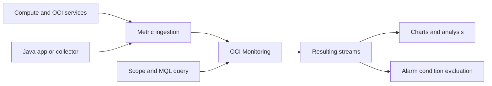
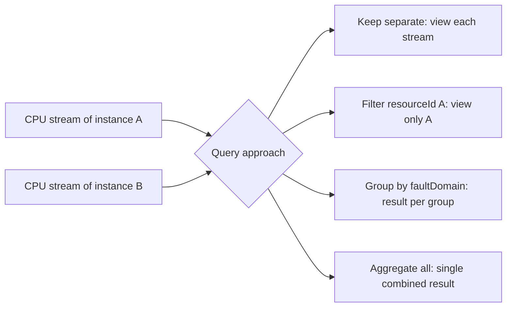

# OCI Monitoring, Namespaces, Dimensions, and Metric Streams

## 1. Operational Goal and Context

In the **Logs, Metrics, and Tracing** chapter of the **CLOUD_PROVIDERS_ORACLE** module, OCI Monitoring helps observe the health, utilization, and performance of infrastructure, services, and applications. To read charts accurately, operators must understand where data originates, what resource it represents, and how it has been aggregated.

Running scenario: a Java application `orders-api` runs across multiple Compute instances in an application compartment, communicates over a VCN, and uses an Oracle database. After a deployment, latency increases while average cluster CPU remains low. The operations team needs to inspect individual instances, compare resource groups, and verify monitoring data completeness before deciding whether to scale up shapes or instance counts.

After this lesson, learners can:

- Distinguish namespace, metric name, dimensions, metadata, and resource group.
- Explain metric streams and the number of lines appearing on a chart.
- Use MQL to filter, group, and aggregate data suited to operational questions.
- Explore metric definitions, query metric data, and test publishing custom metrics.
- Recognize missing data, scope-selection errors, and stream cardinality explosion risks.

This lesson focuses on the metric model and querying. Alarms are mentioned to explain the impact of stream selection; an appropriate query still requires its own notification routing and incident-handling process.

## 2. What Does Monitoring Ingest and Return?

Emitters send data points consisting of a timestamp, value, and descriptive attributes to Monitoring. Sources can be OCI services or custom metrics published by applications. When queried, Monitoring returns data aggregated over the selected time range and expression; Metrics Explorer renders the results for analysis. [OCI Monitoring Overview](https://docs.oracle.com/en-us/iaas/Content/Monitoring/Concepts/monitoringoverview.htm).



In the `orders-api` scenario, there are at least a few distinct types of questions:

| Question | Appropriate data |
| --- | --- |
| Which machine has high CPU? | Infrastructure metrics for each Compute instance |
| How many requests is the app handling? | Application metrics with clear counting conventions |
| Why is a request slow? | Combine metrics with logs and traces from the relevant time window |
| Does the database show signs of contention? | Metrics from the specific database service and application-side metrics |

Low CPU does not prove a service is healthy: the application could be waiting on database connections or another dependency. Conversely, high CPU should be read alongside traffic, latency, and responsiveness rather than treated as an automatic reason to increase infrastructure spend.

## 3. Components of a Metric

### 3.1. Namespace Identifies the Metric Source

A metric namespace identifies the emitter group—for example, `oci_computeagent` for metrics sent by the Compute Instance Monitoring plugin. Namespace is part of the query context; the same metric name in two different namespaces must not be treated as the same measurement.

Common scopes on OCI:

| Namespace | Resource or source to correlate |
| --- | --- |
| `oci_computeagent` | Metrics measured on Compute instances |
| `oci_blockstore` | Boot volume or block volume metrics |
| `oci_vcn` | Network metrics at the VNIC level among related metrics |
| `acme_orders` | Custom namespace designed in this lesson for the app |

In the first three service namespaces, `resourceId` may refer to an instance, volume, or VNIC respectively. Do not use an instance OCID to filter a metric that expects a VNIC OCID just because both belong to the same machine. [Compute and Related Resource Metrics](https://docs.oracle.com/en-us/iaas/Content/Compute/References/computemetrics.htm).

`acme_orders` is an illustrative name for this lesson, not a built-in OCI namespace. When designing custom namespaces, never use reserved prefixes `oci_` or `oracle_`. [Publishing Custom Metrics](https://docs.oracle.com/en-us/iaas/Content/Monitoring/Tasks/publishingcustommetrics.htm).

### 3.2. Metric Name Defines What Is Measured

In the `oci_computeagent` namespace, `CpuUtilization` measures CPU usage as a percentage. Other metric names may measure bytes, operation counts, or ratios; always read the metric definition instead of guessing from a chart.

Before using a metric, record at minimum:

| Attribute to know | Example or question |
| --- | --- |
| Namespace and name | `oci_computeagent` / `CpuUtilization` |
| Unit | Percent, bytes, milliseconds, or count? |
| Data point semantics | Instantaneous gauge, interval delta count, or cumulative counter? |
| Emission cadence | How often does new data arrive, and can the source batch points? |
| Supported dimensions | Does it include `resourceId`, `faultDomain`, `instancePoolId`, or other keys? |
| Collection prerequisites | Which plugin, service setting, permission, or connectivity is required? |

Do not apply the same `sum()` to every metric. Summing CPU percentage samples usually does not answer average utilization; summing a metric that counts requests per interval can be appropriate.

### 3.3. Dimensions Describe the Resource and Context

A dimension is a key–value pair attached to a metric. Simplified example of a dimension set:

```json
{
  "resourceId": "<instance-ocid-A>",
  "faultDomain": "FAULT-DOMAIN-1",
  "shape": "<actual-shape>"
}
```

Real metrics may carry additional dimensions. Which dimensions are available depends on the emitter's definition; do not invent a key in MQL and expect Monitoring to infer it from resource names or tags.

A dimension serves two roles in analysis:

- **Filtering:** retrieve only data matching a key–value pair.
- **Grouping:** combine data by one or more selected keys.

For example, `resourceId` narrows down to a specific instance, while `faultDomain` reveals trends across placement groups. Display names are helpful for quick reading but can collide or change; when investigating a specific resource, verify its actual identifier.

### 3.4. Metadata Is Different from Dimensions

Metadata holds supplemental information such as units. It does not automatically become a filter key in dimension expressions and should not replace a dimension that your analytical question actually requires.

Custom metric example:

```json
{
  "namespace": "acme_orders",
  "name": "RequestCount",
  "dimensions": {
    "application": "orders-api",
    "environment": "prod",
    "resourceId": "demo-node-a"
  },
  "metadata": {
    "unit": "count"
  }
}
```

This is a condensed description without compartment or datapoints yet. In this design, `environment` can be used for filtering; `unit` only describes the value's meaning. Converting milliseconds to seconds must be handled in the data or query itself, not merely by editing a metadata label.

### 3.5. Resource Group Is a Separate Field

A resource group is an optional string that can accompany a custom metric, such as `orders-api`. When querying, you can specify the resource group to match. A null value returns only data without a resource group; it does not mean "aggregate across all groups." [Resource Group Query Parameter](https://docs.oracle.com/en-us/iaas/tools/oci-cli/latest/oci_cli_docs/cmdref/monitoring/metric-data/summarize-metrics-data.html).

Do not confuse a metric's `resourceGroup` field with the MQL function `groupBy(...)`. Likewise, do not assume `resourceGroup` is a dimension on every service metric: to group by a key, that key must exist in the metric's dimension definition.

### 3.6. Region and Compartment Scope

A query requires the right region, compartment, namespace, and relevant filters. A namespace is not a compartment and does not replace IAM boundaries. Two queries with identical MQL strings but different scopes can return different sets of resources.

For custom metrics, the compartment is specified in the posted payload. For service metrics, check the documentation and monitored resource to pick the right compartment. Never treat being logged into the right tenancy in the Console as proof that you selected the right region and compartment for the data.

## 4. Metric Streams: One Metric Can Have Many Data Series

### 4.1. New Data Points Do Not Necessarily Create New Streams

Think of each stream as a time series for a metric with a specific combination of dimensions within the selected scope. Oracle defines a metric stream as an aggregated set of metric data with zero or more dimension values; on a chart, each line typically represents one resulting stream.

The table below holds namespace, compartment, region, and the `CpuUtilization` metric constant. Dimensions are simplified for readability:

| Timestamp | resourceId | faultDomain | CPU value |
| --- | --- | --- | --- |
| 10:00 UTC | instance-A | FD-1 | 20% |
| 10:01 UTC | instance-A | FD-1 | 30% |
| 10:00 UTC | instance-B | FD-1 | 70% |
| 10:01 UTC | instance-B | FD-1 | 90% |

Assuming all other dimensions are also stable, this represents two source streams by instance, each with two timestamps. Four rows do not mean four streams. If a different dimension combination appears, the data will form its own separate stream.

For custom metrics, consider namespace, metric name, resource group (if present), and the full set of dimensions when correlating streams. Do not treat `resourceId` alone as a complete identifier for every metric of a resource.

### 4.2. Resulting Streams Depend on How You Query

Two per-instance source streams can be kept separate, filtered down to one, or combined into a single aggregate result. Therefore, the number of lines on a chart also depends on grouping functions and the dataset matching the query.



Here, "metric stream" refers to the metric series concept in Monitoring—not a stream resource in the OCI Streaming service. An alarm can send notifications to Streaming, but that does not make the two concepts the same.

### 4.3. A Clean-Looking Line Can Hide an Overloaded Node

Suppose four instances have the same number of valid observations and CPU utilization of 90%, 10%, 10%, and 10% in an interval. The overall average is 30%. Someone looking only at the average line might miss the first instance under heavy load.

This is illustrative data, not measurements from a real tenancy. It shows why you need to combine views:

| Perspective | Question answered |
| --- | --- |
| Per resource | Which specific machine is abnormal? |
| By group | Which fault domain or pool is under pressure? |
| Across the selected set | Has the overall trend shifted? |
| Peak value | Are any observations exceeding thresholds that need investigation? |

An average across CPU samples is also not automatically weighted by OCPU count across different shapes. To assess capacity, account for configuration and proper calculation across the cluster.

## 5. Reading and Writing MQL Queries

MQL is Monitoring's metric query language. A basic expression specifies the metric name, interval, and statistic; namespace and compartment are set in the query context or API/CLI parameters. [MQL Reference](https://docs.oracle.com/en-us/iaas/Content/Monitoring/Reference/mql.htm).

### 5.1. Keeping Streams Separate and Filtering by Dimension

```text
CpuUtilization[1m].mean()
```

This expression calculates the mean within each one-minute window for every stream matching the query scope. It does not return a single average across all instances by default.

To select a single instance:

```text
CpuUtilization[1m]{resourceId = "<instance-ocid>"}.mean()
```

To also filter by a fault domain, use the exact key and value present in the data:

```text
CpuUtilization[1m]{resourceId = "<instance-ocid>", faultDomain = "FAULT-DOMAIN-1"}.mean()
```

Dimension filters narrow the dataset. A wrong filter condition can return empty results; do not try to "fix" it by changing the statistic before verifying the filter.

OCIDs inside `<...>` are placeholders. Retrieve real identifiers from your environment before running queries.

### 5.2. groupBy Produces Results Per Group

```text
CpuUtilization[1m].groupBy(faultDomain).mean()
```

This query combines streams by `faultDomain` value and then applies the statistic. If matching data spans three fault domain values, you can see three resulting lines instead of many per-instance lines. `groupBy()` is useful for observing group-level trends. [Using groupBy in Queries](https://docs.oracle.com/en-us/iaas/Content/Monitoring/Tasks/query-metric-groupby.htm).

For an instance pool, you can filter by a dimension supported by the metric:

```text
CpuUtilization[1m]{instancePoolId = "<instance-pool-ocid>"}.groupBy(resourceId).mean()
```

This query filters to the pool while preserving a per-instance view. Verify the `instancePoolId` key against the actual metric definition; do not substitute a similar-looking key name from another example.

Keep `resourceId` when you need to know which machine is having issues. Group solely by fault domain when checking which group has an anomalous trend, then drill back down into that group's instances.

### 5.3. grouping Combines All Selected Streams

```text
CpuUtilization[1m].grouping().mean()
```

`grouping()` combines all matching streams into a single result using the statistic. You can inspect the highest observation across the entire filtered set:

```text
CpuUtilization[1m].grouping().max()
```

In the Console, the **Aggregate metric streams** option corresponds to `grouping()`. Once aggregated into a single resulting stream, individual instance lines are no longer visible in that result. [Aggregating Metric Streams in Queries](https://docs.oracle.com/en-us/iaas/Content/Monitoring/Tasks/query-metric-grouping.htm).

In the four-machine example (90%, 10%, 10%, 10%), `grouping().mean()` and `grouping().max()` answer different questions. The max value reveals a high observation exists, but finding the specific machine still requires querying per resource.

### 5.4. Choosing a Statistic Based on Data Semantics

| Statistic | Basic meaning | Watch-outs |
| --- | --- | --- |
| `mean()` | Sum of values divided by observation count in the interval | Averages can mask short spikes or outlier machines |
| `max()` | Largest observed value in the interval | A single transient spike differs from sustained load |
| `sum()` | Sum of values in the interval | You must know whether emitted values are interval counts or cumulative counters |
| `count()` | Number of observations received in the interval | Not automatically the business total stored inside metric values |

For example, suppose an application sends a `RequestCount` point with `value = 42`, `count = 1`, meaning one observation reported 42 requests in the defined interval. For that point, the sum of values is 42 while the observation count is 1. To count requests accurately, use compatible emission conventions and aggregations.

Conversely, if an application emits a cumulative counter from process startup, summing consecutive values double-counts. You must handle deltas, resets, and measurement intervals matching the counter design. Never pick `sum()` simply because a metric name contains `Count`.

For latency, percentiles are meaningful only when input data preserves an appropriate distribution. If each point is merely a one-minute average, taking a percentile of those averages does not produce the true percentile of the underlying requests.

### 5.5. Predicates Add Conditions to Results

Example conditional query on an instance's average CPU:

```text
CpuUtilization[5m]{resourceId = "<instance-ocid>"}.mean() > 80
```

The threshold `80` is a learning example, not a workload recommendation. The five-minute window aggregates data; it does not by itself specify a five-minute pending duration for an alarm rule. Trigger wait durations must be evaluated separately when designing alarms.

Before adding a predicate, inspect the unconditional query to understand the baseline and which streams will be evaluated. If a chart already aggregates across an entire cluster, a predicate on it does not replace monitoring critical individual instances.

## 6. Time: Time Range, Interval, and Resolution

These three parameters all relate to time but serve distinct roles:

| Component | Role | Example |
| --- | --- | --- |
| Time range | Bounds the overall period to inspect | From 09:00 to 10:00 UTC |
| Interval | Length of the aggregation window | `[5m]` aggregates over a five-minute window |
| Resolution | Step size between resulting windows | `1m` produces windows spaced one minute apart |

Interval determines the window length over which the statistic applies. Read the timestamp of an aggregated point according to Monitoring's window conventions; do not assume it represents the exact instant every underlying sample occurred. [Selecting Query Interval](https://docs.oracle.com/en-us/iaas/Content/Monitoring/Tasks/query-metric-interval.htm).

### 6.1. Windows Can Overlap

With a five-minute interval and a one-minute resolution, consecutive windows shift by one minute and overlap in underlying data. Conceptual illustration:

```text
Window A: 10:00 ───────── 10:05
Window B:   10:01 ───────── 10:06
Window C:     10:02 ───────── 10:07
```

These are not three disjoint event sets. If each point represents a request sum over an overlapping window, summing those resulting points to calculate an hourly total will overcount. [Selecting Query Resolution](https://docs.oracle.com/en-us/iaas/Content/Monitoring/Tasks/query-metric-resolution.htm).

For reproducible results, the CLI examples in this lesson specify resolution explicitly. Choose interval and resolution based on your question and emission cadence—not just to make chart lines look smoother.

### 6.2. Do Not Confuse Query Limits with Data Retention

Requested resolution affects how long a time range a query can return. High-resolution queries over long spans may hit limits even when data remains available at coarser resolutions. Check current limits before designing reports or historical exports.

When comparing two charts, keep time range, interval, resolution, filters, and statistics consistent. A five-minute chart with `max()` and a one-minute chart with `mean()` cannot be compared as equivalent views.

### 6.3. Incomplete Windows and Late-Arriving Data

The most recent data point may belong to an incomplete interval or one still awaiting data from emitters. Operators should know the collection cadence, shipping cadence, and observed end-to-end latency of the monitoring path.

Use UTC or state the timezone explicitly when correlating metrics with logs, traces, and deployments. For custom metrics, emitter clocks must be accurate; bad timestamps can cause data to be rejected or fall outside the queried range.

## 7. Read and Publish Permissions for Metrics

Example policy for metric readers and a workload dynamic group in compartment `AppRuntime`:

```text
Allow group MetricReaders to read metrics in compartment AppRuntime
Allow dynamic-group OrdersMetricPublishers to use metrics in compartment AppRuntime where target.metrics.namespace = 'acme_orders'
```

Group names, dynamic group names, and compartments must match your environment. Configure appropriate membership or matching rules before expecting a workload to exercise granted permissions. You can restrict read permissions by namespace if required. [Common Policies for Monitoring](https://docs.oracle.com/en-us/iaas/Content/Identity/Concepts/commonpolicies.htm).

Metric permissions do not automatically grant permission to modify Compute or manage alarms, Notifications topics, or other resources. Your CLI login account does not automatically become the Java application's identity either. For workloads on OCI, choose a supported authentication mechanism and grant permissions to the actual principal calling the API.

Namespaces help organize metric sources, not create an automatic private security boundary. If you use namespaces to restrict access, enforce those restrictions in IAM policies and verify them using the target identity.

## 8. Exploring Metrics via Console and CLI

### 8.1. Starting in Metrics Explorer

A helpful hands-on sequence:

1. Select the right region and compartment for your test resource.
2. Open Metrics Explorer or navigate from Service Metrics to the relevant query.
3. Choose the `oci_computeagent` namespace, then select `CpuUtilization` if data exists.
4. Inspect the interval, statistic, time range, and stream aggregation options.
5. Add a `resourceId` dimension filter for one instance and verify the chart narrows accordingly.
6. Switch to MQL view to inspect the expression, then test `groupBy(faultDomain)` and `grouping()` separately.
7. Record the scope and query whenever sharing findings with others.

Not seeing a namespace or metric is not enough to conclude a resource is down. Check the emitter, permissions, region, compartment, and time range first.

### 8.2. Listing Metric Definitions

The commands below are examples for learners running in an environment with OCI CLI configured and read permissions granted. They do not modify running infrastructure.

```powershell
$compartmentId = $env:OCI_COMPARTMENT_OCID
$region = $env:OCI_REGION
if ([string]::IsNullOrWhiteSpace($compartmentId) -or [string]::IsNullOrWhiteSpace($region)) {
    throw 'Missing compartment OCID or region'
}

oci monitoring metric list --compartment-id $compartmentId --namespace oci_computeagent --name CpuUtilization --all --region $region
if ($LASTEXITCODE -ne 0) { throw 'Failed to list metric definitions' }
```

`metric list` returns matching definitions, allowing you to verify namespace, name, and dimensions; it does not return time-series values for charting. `--all` fetches all paginated results within the selected scope. [OCI CLI: monitoring metric list](https://docs.oracle.com/en-us/iaas/tools/oci-cli/latest/oci_cli_docs/cmdref/monitoring/metric/list.html).

The `--group-by` parameter on the list operation groups definitions in the API response. It differs from the MQL `groupBy()` function that aggregates query data; do not mix up the two mechanisms just because their names look similar.

### 8.3. Querying Data for a Single Instance

```powershell
$instanceId = $env:OCI_INSTANCE_OCID
if ([string]::IsNullOrWhiteSpace($instanceId)) { throw 'Missing instance OCID' }

$queryEnd = [DateTime]::UtcNow
$queryStart = $queryEnd.AddMinutes(-30)
$startTime = $queryStart.ToString('yyyy-MM-ddTHH:mm:ssZ')
$endTime = $queryEnd.ToString('yyyy-MM-ddTHH:mm:ssZ')
$mql = 'CpuUtilization[1m]{resourceId = "' + $instanceId + '"}.mean()'

oci monitoring metric-data summarize-metrics-data --compartment-id $compartmentId --namespace oci_computeagent --query-text $mql --start-time $startTime --end-time $endTime --resolution 1m --region $region
if ($LASTEXITCODE -ne 0) { throw 'Metric query failed' }
```

`SummarizeMetricsData` returns aggregated data, not every raw sample emitted by the source. In the response, inspect the `dimensions` and aggregated datapoints of each returned item rather than counting JSON array items and assuming that equals the number of machines. [OCI CLI: summarize-metrics-data](https://docs.oracle.com/en-us/iaas/tools/oci-cli/latest/oci_cli_docs/cmdref/monitoring/metric-data/summarize-metrics-data.html).

To inspect the whole group, adjust the MQL expression while holding the other parameters constant for comparison. For child compartments, check the supported query scope; do not assume selecting a parent compartment automatically scans the entire subtree.

## 9. Testing Custom Metric Publishing with Two Streams

This section uses synthetic data to test the model, not production traffic. It assumes your CLI principal has permission to publish to the `acme_orders` namespace in a test compartment and read that data back.

Metric conventions used in this exercise:

| Component | Value or meaning |
| --- | --- |
| Namespace | `acme_orders` |
| Metric | `RequestCount` |
| Resource group | `orders-api` |
| Dimensions | `application`, `environment`, `resourceId` |
| Value | Request count in the application-defined interval |
| Datapoint count | `1`, meaning one observation reporting that total |
| Metadata unit | `count` |

The values `demo-node-a` and `demo-node-b` are illustrative custom labels. Naming a key `resourceId` does not automatically link those labels to real Compute instances.

### 9.1. Generating a Payload with the Current Timestamp

The PowerShell snippet below guides learners in generating an input JSON file in their working directory:

```powershell
$samplePath = './monitoring-demo.json'
if (Test-Path -LiteralPath $samplePath) {
    throw 'Choose a new practice file to avoid overwriting an existing payload'
}

$sampleTimestamp = [DateTime]::UtcNow.ToString('yyyy-MM-ddTHH:mm:ss.fffZ')
$samples = @(
    @{ node = 'demo-node-a'; requests = 42 },
    @{ node = 'demo-node-b'; requests = 9 }
)

$metricData = @(
    foreach ($sample in $samples) {
        [ordered]@{
            compartmentId = $compartmentId
            namespace = 'acme_orders'
            resourceGroup = 'orders-api'
            name = 'RequestCount'
            dimensions = @{
                application = 'orders-api'
                environment = 'lab'
                resourceId = $sample.node
            }
            metadata = @{ unit = 'count' }
            datapoints = @(
                @{
                    timestamp = $sampleTimestamp
                    value = $sample.requests
                    count = 1
                }
            )
        }
    }
)

$payloadJson = ConvertTo-Json -InputObject $metricData -Depth 8
$payloadFullPath = [System.IO.Path]::GetFullPath($samplePath)
[System.IO.File]::WriteAllText($payloadFullPath, $payloadJson, [System.Text.UTF8Encoding]::new($false))
```

`$compartmentId` and `$region` come from the CLI setup section. When running snippets in separate sessions, re-populate and validate them. The timestamp is generated at runtime to avoid submitting an old timestamp outside the ingestion acceptance window.

### 9.2. Posting to the Ingestion Endpoint

PostMetricData uses the `telemetry-ingestion` endpoint, which differs from the `telemetry` endpoint used for other Monitoring operations. Payloads must comply with timestamp, dimension count, stream count, and per-request limits. [OCI CLI: monitoring metric-data post](https://docs.oracle.com/en-us/iaas/tools/oci-cli/latest/oci_cli_docs/cmdref/monitoring/metric-data/post.html).

The endpoint example below applies to OC1 regions with the corresponding domain name. For other realms, use the endpoint published by Oracle for your environment:

```powershell
$ingestionEndpoint = "https://telemetry-ingestion.${region}.oraclecloud.com"

$postJson = oci monitoring metric-data post --metric-data 'file://monitoring-demo.json' --batch-atomicity ATOMIC --endpoint $ingestionEndpoint --region $region
if ($LASTEXITCODE -ne 0) { throw 'Failed to post custom metric' }

$postResponse = ($postJson -join "`n") | ConvertFrom-Json
if ($postResponse.data.'failed-metrics-count' -ne 0) {
    throw 'Some metrics were rejected; read the response details before continuing'
}
```

`ATOMIC` requires every metric object in the request to pass validation. In non-atomic mode, a request can succeed partially while returning failed objects; always inspect the error summary rather than relying solely on CLI exit codes. After a successful post, query the data to confirm the right scope and values reached the read path.

### 9.3. Reading Back from the Right Resource Group

```powershell
$customStart = [DateTime]::UtcNow.AddMinutes(-10).ToString('yyyy-MM-ddTHH:mm:ss.fffZ')
$customEnd = [DateTime]::UtcNow.ToString('yyyy-MM-ddTHH:mm:ss.fffZ')
$customMql = 'RequestCount[1m]{environment = "lab"}.groupBy(resourceId).sum()'

oci monitoring metric-data summarize-metrics-data --compartment-id $compartmentId --namespace acme_orders --resource-group orders-api --query-text $customMql --start-time $customStart --end-time $customEnd --resolution 1m --region $region
if ($LASTEXITCODE -ne 0) { throw 'Failed to read back custom metric' }
```

If only the two samples above exist in the selected window and data is available, you should see results for `demo-node-a` totaling 42 and `demo-node-b` totaling 9. Omitting `--resource-group orders-api` can prevent the query from matching the posted dataset—one of the first things to check if results come back empty.

You can switch expressions separately to compare:

```text
RequestCount[1m]{environment = "lab"}.grouping().sum()
RequestCount[1m]{environment = "lab"}.grouping().count()
```

Assuming only those two observations exist, the sum of values is 51 while the observation count is 2. If you posted additional payloads or re-sent the file, interpret the output based on what was actually ingested rather than forcing it to match the illustrative numbers.

If querying immediately returns no points, check the post response, timestamp, and scope, then wait for ingestion visibility and re-query with an updated time range. Avoid repeatedly posting payloads just to force a chart to appear.

### 9.4. Long-Term Implementation for a Java Application

This lab uses the CLI so the payload structure is transparent. In real applications, use a managed collector or client with proper authentication, batching, error handling, rate limiting, and monitoring of the metric shipping path itself. Use the SDK or an appropriate agent integration rather than invoking the CLI on every application request.

Document these decisions explicitly: who owns the namespace, what the metric measures, when counts finalize, whether zeros are emitted during idle periods, how restarts are handled, and which dimensions are allowed. Changing measurement conventions can break historical comparability even when the metric name stays unchanged.

## 10. Cardinality: Dimension Combinations Can Grow Rapidly

### 10.1. Estimating Stream Count Before Publishing

In this lesson, cardinality refers to the number of distinct dimension value combinations tracked for a metric within a given scope. Additional design example:

- 20 instances.
- 4 normalized routes, such as `/orders/{id}` instead of individual raw URLs.
- 3 response status classes.
- 1 fixed environment.

If every combination occurs, a single metric can produce `20 × 4 × 3 = 240` streams. This is an illustrative calculation under stated assumptions; the actual count depends on emitted combinations and any extra splitting fields.

If you add a nearly unique `requestId` per request, stream count scales with traffic rather than resource count. `groupBy()` reduces the number of lines in query results, but does not fix the source emitting excessive combinations.

### 10.2. Choosing Dimensions by the Questions You Need to Answer

| Candidate value | Considerations |
| --- | --- |
| Environment, application | Bounded value set; useful for partitioning |
| Instance or pool | Useful for operations, though values churn with infrastructure lifecycle |
| Normalized route | Useful when route count is bounded and conventions are stable |
| Status code class | Helps analyze outcomes without excessive granularity |
| Full URL with query string | Easily explodes cardinality and may leak data that does not belong in metrics |
| Request ID, trace ID, user ID | Usually belongs in logs or traces for per-event investigation |
| Very frequent build versions | Weigh historical value growth against actual analytical need |

A `traceId` is invaluable for looking up a request in logs and traces, but it does not belong as a dimension on aggregated metrics. Correlate investigations by time, resource, and application context first, then use the appropriate tool for per-event details.

### 10.3. Technical Limits and Cost

Distinguish per-request payload limits, API rate limits, query stream limits, and tenancy-wide data limits. Never treat the maximum stream count of a single post call as the maximum stream limit for the entire system.

For custom metrics, teams should monitor active emitted streams, posting frequency, observed data volume, and query volume. Estimate costs using actual usage and current tenancy pricing; do not assume all custom metrics share the same terms as service metrics.

If stream counts spike unexpectedly, check dimension changes at the emitter first. Widening the interval on a chart does not reduce the number of points already ingested into the system.

## 11. Missing Data, Zeros, and Emitter Outages

### 11.1. Zero Is a Value; Missing Means No Matching Observations

A metric returning zero can indicate the emitter measured and reported a value of zero. Having no points can result from no data, wrong filters, missing permissions, wrong region, wrong resource group, or a broken shipping path. Therefore, never convert empty results into zero indiscriminately.

For an interval-based `RequestCount`, if the application only emits when requests arrive, quiet periods look different from a design that emits periodic zeros. Those two conventions lead to different chart interpretations and emitter health checks.

If you need to know whether an application can still emit telemetry, design a periodic heartbeat with clear conventions. A heartbeat proves part of the observability path works; it does not prove business workflows or database connectivity are healthy.

### 11.2. Prerequisites for Compute Metrics

`oci_computeagent` metrics depend on the Compute Instance Monitoring plugin being enabled, running, and able to reach Monitoring. An existing VM or a Java application still serving requests does not prove the plugin is successfully shipping metrics. [Compute Metric Prerequisites](https://docs.oracle.com/en-us/iaas/Content/Compute/References/computemetrics.htm).

When multiple metrics from an instance vanish together, inspect the plugin, agent, system clock, and network path per your environment configuration. For workloads in private subnets, verify reachability to service endpoints, DNS, and egress rules rather than checking only NSGs for application ports.

### 11.3. Impact on Alarms and Availability

A CPU threshold condition does not replace a missing-data condition. Likewise, a cluster-wide average does not share the same evaluation scope as per-instance streams.

Before using a query in an alarm, verify the targeted streams, missing-data behavior, emission cadence, trigger delay, and potential notification volume. If you must detect every resource expected to be monitored, cross-check against an expected resource inventory rather than watching only streams currently reporting data.

Never auto-scale or recreate resources solely because a metric goes blank. First separate workload outages from observability outages so you do not increase spend while making diagnosis harder.

## 12. Diagnosing Unexpected Query Results

### 12.1. Check in Order from Scope to Calculation

A practical sequence:

1. Verify tenancy, region, compartment, and active principal.
2. Confirm the emitter published metrics in the target window and read permissions exist.
3. List definitions to verify namespace, metric name, resource group, and dimensions.
4. Start with a broad query within the permitted scope, then add filters one by one.
5. Check interval, resolution, UTC timestamps, and data-return limits.
6. Compare ungrouped stream results against grouped or aggregated results.
7. Read the measurement definition before deciding which statistic is valid.

Do not broaden permissions across the entire tenancy just to try making a chart appear. Determine which resource the query targets and grant least-privilege permissions for that task.

### 12.2. Symptom and Check Table

| Symptom | What to check |
| --- | --- |
| Namespace not visible | Region, compartment, permissions, emitter, and emission timing |
| `metric list` succeeds but chart is empty | Time range, filters, resource group, and whether source data is recent |
| Single line despite multiple instances | Is aggregation enabled or `grouping()` used; is a filter overly narrow? |
| More lines than machines | Varying dimensions, multiple resource groups, or multiple resources in scope |
| Correct instance name does not match | Duplicate or renamed display names; are you using the actual resource OCID? |
| CPU chart differs between two people | Are statistic, interval, resolution, time range, scope, and query identical? |
| `RequestCount` is smaller than expected | Using `count()` instead of `sum()`, or missing streams? |
| Request total is abnormally large | Summing cumulative counters or summing overlapping windows? |
| Custom metric post returns failed objects | Payload, timestamps, publish permissions, ingestion endpoint, and per-request limits |
| Long-range query hits limits | Resolution, time range, stream count, and returned datapoint count |
| Metrics stop after a network change | DNS, endpoints, routing, egress policies, and agent/client configuration |

This is an investigation guide, not a rigid one-to-one mapping from symptom to root cause. Preserve the original query, parameters, timestamps, and raw error responses to reproduce issues.

## 13. Practice: Reading Metrics Under Control

Practice in an authorized environment; the commands and payloads in this lesson are examples for learners, not instructions to run in production.

1. Pick a Compute instance that already emits Monitoring metrics. Record its actual region, compartment, namespace, metric, and dimensions.
2. Query per-instance CPU over a 30-minute range; explain the interval, statistic, and resolution used.
3. Compare keeping streams separate, grouping by fault domain, and aggregating everything. Point out what information can no longer be distinguished after each aggregation step.
4. Using the illustrative four-machine numbers (90%, 10%, 10%, 10%), explain why a 30% average cannot rule out one overloaded machine.
5. If you have publish permissions, post the two custom streams from the lab section, inspect the response, and read back from the right resource group. Explain the difference between the sum of 51 and observation count of 2 under the example's conditions.
6. Test a non-matching filter or a different resource group on read operations only. Confirm that an empty result does not mean the same thing as a zero data point.
7. Estimate stream count when adding routes, status classes, or request IDs; select dimensions aligned with operational questions and cost limits.
8. Save the query along with scope, units, and interpretation notes so others can reproduce your results; stop any periodic test emitter if you started one.

The target learning outcome is an explanation grounded in full context: **which source emits the metric, which combination defines a stream, which set is selected, and which aggregation produces the value being read**. That foundation supports sound decisions when investigating Java apps, Oracle database connections, infrastructure capacity, and resource usage on OCI.
