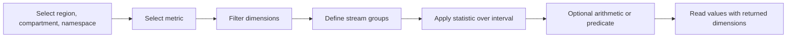

# Writing MQL to Query and Aggregate Metrics

## 1. Objectives and Scope

In the **Logs, Metrics, and Tracing** chapter, metrics help answer quantitatively measurable questions: which instance has high CPU, which fault domain bears concentrated load, how an application's error rate changes, or whether a telemetry source has stopped emitting data.

On Oracle Cloud Infrastructure, **Monitoring Query Language — MQL** is the language used to query data in the Monitoring service. An MQL expression selects a metric, time window, and statistic, and may add dimension filters, grouping, or predicates. It is not SQL for reading Oracle Database tables, nor is it a language for searching logs or querying traces. [Oracle: Monitoring Query Language Reference](https://docs.oracle.com/en-us/iaas/Content/Monitoring/Reference/mql.htm).

After this lesson, learners can:

- Write queries ranging from simple metrics to filtering, grouping, and aggregating across multiple streams.
- Distinguish `mean()`, `sum()`, `count()`, percentile, and rate based on data semantics.
- Choose appropriate intervals, resolutions, and query time ranges.
- Use predicates, nested queries, and compound conditions.
- Execute queries in Metrics Explorer or via the OCI CLI.
- Spot syntactically valid queries that answer the wrong operational question.

The running example is a Java application `orders-api` running on a group of Compute instances and using an Oracle database. The infrastructure portion uses the real metric `CpuUtilization` in the `oci_computeagent` namespace. The application portion uses hypothetical custom metrics with explicitly defined data contracts; they do not exist automatically in a tenancy.

## 2. Understanding a Metric Before Writing a Query

### 2.1. A Metric Is More Than a Name and Value

A metric lives inside a context consisting of its emitter, compartment, namespace, name, dimensions, and time-series data. Different dimension combinations create different metric streams.

| Component | Meaning | Example |
| --- | --- | --- |
| Region | Region being queried | Region containing the instances |
| Compartment | Scope of resources/metrics being read | Operations team's compartment |
| Namespace | Service or application emitter | `oci_computeagent` |
| Metric name | Quantity to read | `CpuUtilization` |
| Dimensions | Attributes used to select and group streams | `resourceId`, `faultDomain` |
| Timestamp | Time of the observation | UTC time |
| Value, unit | Measurement value and unit | CPU 65%, latency 180 ms |
| Resource group, if present | Source group defined when emitting metrics | An application custom metric group |

OCI Monitoring ingests metrics from services, applications, and supported emitters; query results are data aggregated according to the selected parameters. Do not treat every point on a chart as a single request or raw observation. [Oracle: Overview of Monitoring](https://docs.oracle.com/en-us/iaas/Content/Monitoring/Concepts/monitoringoverview.htm).

### 2.2. Query Context Lives Outside the MQL Expression

The expression:

```text
CpuUtilization[1m].mean()
```

does not itself contain the tenancy, region, compartment, namespace, or full time range to fetch. Those values are supplied by Metrics Explorer or the CLI/API request.

The same expression with a different compartment or namespace can return a different dataset. When sharing a query during incident investigation, share the full context rather than sending only the MQL string.

Do not invent a fake dimension like `compartmentId` to replace the request's compartment scope. Only filter by a dimension if the metric definition actually includes it.

### 2.3. Distinguishing Gauges, Interval Counts, and Cumulative Counters

| Data contract | Example | Typically appropriate statistic |
| --- | --- | --- |
| Utilization at sample time | CPU %, currently open connections | `mean()`, `max()`, `min()` |
| Event count per emission interval | Orders processed each minute | `sum()` to add non-overlapping intervals |
| Cumulative counter | Total bytes or requests since process start | `rate()`/`increment()` after accounting for contract and resets |
| Per-event observation | Latency of each request | `mean()`, `percentile()` |
| 0/1 flag per event | Success 0, failure 1 | `sum()` gives error count; `mean()` gives error ratio |

Having `Count` in a metric name does not dictate using `count()`. You must know what the emitted value represents.

If an application emitted "120 requests in this minute," that is a single observation with value 120. `count()` counts observations received—it does not turn that value into 120 requests.

## 3. Structure of an MQL Expression

Reference learning form:

```text
MetricName[interval]{dimensionName = "dimensionValue"}.groupBy(dimensionName).statistic()
```

Not every component is mandatory. The metric name, interval, and statistic form the foundation of a numeric query; filters and grouping are added based on the question to answer.

Example:

```text
CpuUtilization[5m]{resourceId = "<INSTANCE_OCID>"}.mean()
```

Reading left to right: select `CpuUtilization`, use a five-minute window, restrict to the specified instance, and take the mean within each window.



The order of grouping and statistic matters. Do not copy SQL syntax such as `SELECT` or `GROUP BY` into MQL.

## 4. Verifying Metrics and Query Permissions

### 4.1. Reading Real Definitions and Dimensions

Before filtering, verify:

1. Does the metric exist in the right namespace?
2. What are the unit and semantics of each observation?
3. What dimensions are published and what are their actual values?
4. What is the emission cadence, missing-data behavior, and reset possibility?
5. Is a resource group used?

Metrics Explorer lists namespaces, metric names, and dimensions for the selected compartment; the API/CLI provides `ListMetrics` to inspect definitions. [Oracle: Listing Metric Definitions](https://docs.oracle.com/en-us/iaas/Content/Monitoring/Tasks/list-metric.htm).

**An important OCI detail:** a nonexistent dimension may be accepted without filtering any data. Therefore, a query returning results does not prove your filter took effect. Always verify dimension names and the dimensions returned in the output. [Oracle: Selecting Dimensions for a Query](https://docs.oracle.com/en-us/iaas/Content/Monitoring/Tasks/query-metric-dimension.htm).

For example, adding `environment = "production"` to a Compute metric does not automatically filter by the instance's environment tag. OCI tags do not automatically become dimensions on every metric.

### 4.2. Minimum Permissions for This Lab

An illustrative policy for reading metrics:

```text
Allow group id <METRIC_READERS_GROUP_OCID> to read metrics in compartment id <METRIC_COMPARTMENT_OCID>
```

Replace placeholder OCIDs and place the policy at the appropriate governance level. `inspect metrics` allows listing; `read metrics` includes querying data via `SummarizeMetricsData`. You do not need Compute management permissions just to perform this metric-reading exercise. [Oracle: Details for Monitoring](https://docs.oracle.com/en-us/iaas/Content/Identity/Reference/monitoringpolicyreference.htm).

For `oci_computeagent`, instances must emit metrics through the appropriate monitoring mechanism. Compute documentation describes the Compute Instance Monitoring plugin and dimensions such as `resourceId`, `resourceDisplayName`, `faultDomain`, `availabilityDomain`, `instancePoolId`, and `shape`. [Oracle: Compute Instance Metrics](https://docs.oracle.com/en-us/iaas/Content/Compute/References/computemetrics.htm).

### 4.3. Exploring with OCI CLI on PowerShell

The CLI examples in this lesson use **PowerShell** with a configured OCI CLI. They are read-only operations; replace placeholder values before running.

```powershell
$ociRegion = '<OCI_REGION>'
$metricCompartmentId = '<METRIC_COMPARTMENT_OCID>'

$metricListArgs = @(
    'monitoring', 'metric', 'list',
    '--region', $ociRegion,
    '--compartment-id', $metricCompartmentId,
    '--namespace', 'oci_computeagent',
    '--name', 'CpuUtilization',
    '--all'
)

oci @metricListArgs
```

The output is the metric definition and dimensions, not a CPU time series. Do not confuse the `--group-by` option of the metadata listing operation with `groupBy()` in an MQL data query expression. [Oracle CLI: monitoring metric list](https://docs.oracle.com/en-us/iaas/tools/oci-cli/latest/oci_cli_docs/cmdref/monitoring/metric/list.html).

## 5. Filtering Metric Streams by Dimension

### 5.1. Selecting a Single Resource

```text
CpuUtilization[1m]{resourceId = "<INSTANCE_OCID>"}.mean()
```

`resourceId` is well suited to identifying a specific instance. Display names can change or collide, so they are not always reliable identifiers when precision matters.

### 5.2. Combining Multiple Conditions

```text
CpuUtilization[5m]{faultDomain = "FAULT-DOMAIN-1", resourceDisplayName =~ "orders-*"}.mean()
```

Comma-separated dimension pairs combine with AND: the instance must belong to fault domain 1 **and** match the name pattern.

Fuzzy matching uses `=~`. `*` matches character sequences and `|` expresses alternative patterns:

```text
CpuUtilization[5m]{faultDomain =~ "FAULT-DOMAIN-1|FAULT-DOMAIN-2"}.mean()
```

This is MQL's fuzzy matching syntax; do not assume arbitrary regular expression syntax is supported.

### 5.3. Excluding Values

```text
CpuUtilization[5m]{faultDomain != "FAULT-DOMAIN-3"}.mean()
```

Excluding multiple matching names:

```text
CpuUtilization[5m]{resourceDisplayName !~ "test-*|sandbox-*"}.mean()
```

Exclusion filters still require the dimension to exist. If your goal is to isolate production, a blacklist of test prefixes does not replace explicitly identifying the production set.

After adding each filter, inspect the remaining stream count and dimensions. A misspelled filter key can yield a broader result than intended; a valid key with the wrong value can return no data.

## 6. Interval, Resolution, Time Range, and Emission Frequency

### 6.1. Four Distinct Concepts

| Concept | Question it answers | Example |
| --- | --- | --- |
| Emission frequency | How often does the source send data? | Every minute |
| Interval | How long is each aggregation window? | `[5m]` |
| Resolution | How far apart are consecutive aggregation windows? | `1m` |
| Time range | Which overall period are results fetched for? | Last 60 minutes |

Interval is not the duration of the whole query. `CpuUtilization[5m].mean()` can retrieve many hours of data, where each point represents the aggregation of a five-minute window.

An aggregated point's timestamp corresponds to the end of the evaluated window. When correlating a log at 10:04 with a metric point at 10:05, examine the window that point represents. [Oracle: Selecting the Interval for a Query](https://docs.oracle.com/en-us/iaas/Content/Monitoring/Tasks/query-metric-interval.htm).

### 6.2. Overlapping Window Example

Holding a five-minute interval fixed:

| Resolution | Illustrative windows | Meaning |
| --- | --- | --- |
| `5m` | 10:00–10:05, 10:05–10:10 | Non-overlapping consecutive windows |
| `1m` | 10:00–10:05, 10:01–10:06 | Overlapping sliding windows |

A finer resolution lets you observe changes more smoothly, but it does not make underlying source data any finer than its actual emission frequency.

When using the CLI or API, set `--resolution` explicitly to avoid relying on interface-specific defaults. Resolution cannot exceed interval; for alarm queries, the service fixes resolution at one minute. [Oracle: Selecting a Nondefault Resolution](https://docs.oracle.com/en-us/iaas/Content/Monitoring/Tasks/query-metric-resolution.htm).

### 6.3. Do Not Sum Overlapping Sums

Suppose `CompletedOrders[5m].sum()` runs at `1m` resolution. A single order can appear in multiple resulting windows. Summing all those five-minute points to compute an hourly total will double-count.

To sum across disjoint intervals, choose matching window and resolution sizes, align time boundaries clearly, and only then aggregate. Be especially careful when exporting MQL results into spreadsheets or reporting scripts.

### 6.4. Granularity and Historical Range

How far back you can query depends on resolution. Do not assume one-minute granularity remains queryable across all historical periods. When expanding to large time ranges, check which interval/resolution combinations the service supports.

For "how did CPU rise over the last 30 minutes," start with `1m` or `5m`. For multi-week trends, use coarser aggregation and document the statistic in chart notes so readers do not confuse averages with peak load.

## 7. Choosing a Statistic to Answer the Right Question

### 7.1. Basic Statistics

| Statistic | Interpretation | Suitable example |
| --- | --- | --- |
| `mean()` or `avg()` | Average of observations | Average CPU utilization |
| `min()` | Lowest observation | Lowest headroom level |
| `max()` | Highest observation | Peak CPU |
| `sum()` | Sum of values | Event count when values are additive counts |
| `count()` | Number of observations received | Checking sample count |
| `first()`, `last()` | Value at the start/end timestamp of the window | Inspecting window boundaries |

Oracle defines statistics over observations within the interval. A function name does not arbitrarily change units: `max()` of CPU is still a percentage, and `sum()` of multiple CPU values does not become the number of cores in use. [Oracle: Selecting the Statistic for a Query](https://docs.oracle.com/en-us/iaas/Content/Monitoring/Tasks/query-metric-statistic.htm).

### 7.2. Averages Hide Short Spikes

Suppose a host records six CPU values in a window: `10, 10, 10, 10, 10, 100`.

```text
mean = 25%
max = 100%
count = 6
sum = 150
```

If the question is "did CPU ever hit 100%?", `mean()` is insufficient. If the question is "how much CPU is typically used in the window?", `max()` alone can create the false impression of sustained high load.

### 7.3. Percentiles Require the Right Kind of Observations

```text
RequestLatencyMs[5m]{service = "orders-api", environment = "production"}.groupBy(releaseId).percentile(0.95)
```

This query assumes a custom metric contract where each observation is the latency of one request in milliseconds, with dimensions `service`, `environment`, and `releaseId`. `percentile(0.95)` estimates p95—it is not `percentile(95)`.

If the emitter only sends a per-minute average latency, p95 over those values is the p95 of **minute averages**, not request p95. Similarly, never average per-host p95 values and call that the service-wide p95.

Check sample size as well. A p95 computed from a handful of requests does not carry the same confidence as a p95 from a large, representative business sample.

## 8. Grouping: What Detail to Keep and What to Drop

### 8.1. No Grouping: Keep Individual Streams

```text
CpuUtilization[1m]{resourceDisplayName =~ "orders-*"}.mean()
```

This query returns statistics for each stream remaining after filtering. A chart with many lines does not necessarily have that many instances: one resource can emit multiple streams if remaining dimensions distinguish them.

To group explicitly by instance:

```text
CpuUtilization[1m]{resourceDisplayName =~ "orders-*"}.groupBy(resourceId).mean()
```

### 8.2. groupBy(): One Result per Group

```text
CpuUtilization[5m]{resourceDisplayName =~ "orders-*"}.groupBy(faultDomain).mean()
```

Streams sharing the same `faultDomain` are combined for the statistic. Dimensions excluded from the grouping key no longer serve as primary differentiators in the result.

You can group by multiple dimensions:

```text
CpuUtilization[5m].groupBy(availabilityDomain, faultDomain).max()
```

Here, each combination of availability domain and fault domain forms a group. Do not assume fault domains across an entire region are merged solely by matching names. [Oracle: Using groupBy(x) in a Query](https://docs.oracle.com/en-us/iaas/Content/Monitoring/Tasks/query-metric-groupby.htm).

### 8.3. grouping(): Combine All Selected Streams

```text
CpuUtilization[5m]{resourceDisplayName =~ "orders-*"}.grouping().mean()
```

`grouping()` corresponds to the **Aggregate metric streams** option in the Console. It combines all selected streams into a single stream for the chosen statistic. [Oracle: Aggregating Metric Streams in a Query](https://docs.oracle.com/en-us/iaas/Content/Monitoring/Tasks/query-metric-grouping.htm).

Comparison:

| Query | Expected output |
| --- | --- |
| `.groupBy(resourceId).mean()` | One mean line per instance |
| `.groupBy(faultDomain).mean()` | One mean line per fault domain |
| `.grouping().mean()` | One mean line across the entire selected set |
| `.grouping().max()` | One peak-observation line across the entire selected set |

A single aggregated line is easier to read but can hide a failing host. During incident investigation, keep a per-resource query alongside the group-wide query.

### 8.4. Numerical Example to Check Understanding

Suppose each instance has six observations in the same minute, all equal to that row's value:

| Instance | Fault domain | CPU per observation |
| --- | --- | --- |
| A | `FAULT-DOMAIN-1` | 95% |
| B | `FAULT-DOMAIN-1` | 15% |
| C | `FAULT-DOMAIN-2` | 20% |
| D | `FAULT-DOMAIN-2` | 30% |

Expected results for this example:

- `groupBy(resourceId).mean()`: 95, 15, 20, 30.
- `groupBy(faultDomain).mean()`: 55 for domain 1; 25 for domain 2.
- `grouping().mean()`: 40.
- `grouping().max()`: 95.
- `count()` per stream: 6; `grouping().count()`: 24.

Thus, "40% group average CPU" does not rule out instance A running at 95%. And "count equals 24" does not mean there are 24 instances.

### 8.5. Observation Average Is Not Capacity-Weighted Average

Suppose a 1-vCPU machine uses 90% and a 9-vCPU machine uses 10%, with equal sample counts. The simple average of the two percentages is 50%, whereas the vCPU-weighted utilization in this example is:

```text
(1 × 90% + 9 × 10%) / (1 + 9) = 18%
```

The two numbers answer different questions. `grouping().mean()` does not automatically weight by cost or compute capacity the way an operator might intend.

Similarly, an emitter sending more frequent samples contributes more observations. Before using a cluster-wide mean to downsize instances or change shapes, verify sampling behavior, capacity, and performance constraints.

## 9. rate(), increment(), and Summing Cumulative Counters

### 9.1. Choose Based on Data Semantics

`rate()` returns the average rate of change per second; `increment()` returns the change over the interval. Do not call them "error rate" (proportion): rate of change per second and error ratio are two different measurements.

For example, suppose custom metric `ProcessedRequestsTotal` is a monotonically increasing process counter with dimension `instanceId`:

```text
ProcessedRequestsTotal[5m]{service = "orders-api"}.groupBy(instanceId).rate()
```

The intended meaning is requests/second for each counter source during segments that conform to the defined contract.

Do not merge multiple independent counters into one combined counter before deriving a rate without handling resets and instances joining or leaving. Inspect behavior specifically around restarts, missing samples, and version rollouts; never assume MQL applies the exact same counter rules as another monitoring system.

### 9.2. Why sum() on a Counter Can Be Wrong

Suppose three cumulative values are `1000, 1100, 1200`. Summing the values gives 3300, which is not the number of new requests; the increase between the first and last point is 200.

Conversely, if the emitter sends non-overlapping deltas `40, 60, 50` for three intervals, the sum 150 can represent the events across those three intervals. The exact same `sum()` function has completely different validity depending on the emitter contract.

### 9.3. Count per Minute Differs from Rate of Change of That Count

Suppose custom metric `RequestsPerMinute` emits one value per completed minute representing that minute's request count, not a cumulative total since startup.

```text
RequestsPerMinute[1m]{service = "orders-api"}.grouping().sum() / 60
```

With aligned windows and boundaries, this converts requests per minute into average requests per second—provided the values represent non-overlapping request sets and the window has complete data.

Calling `RequestsPerMinute.rate()` asks for the rate of change of the per-minute request count, not throughput directly. Before picking a function, write down both the input unit and desired output unit next to the query.

## 10. Arithmetic, Ratios, and Compound Conditions

### 10.1. Arithmetic with Constants

MQL supports arithmetic operations. Two examples on a custom metric with known units:

```text
RequestLatencyMs[5m]{service = "orders-api"}.grouping().mean() / 1000
```

The result is in seconds rather than milliseconds.

```text
100 - CpuUtilization[5m]{resourceId = "<INSTANCE_OCID>"}.mean()
```

The result is the percentage of remaining CPU time as measured—not guaranteed headroom for a new workload.

Never use unit division to mask differences in measurement definitions. Bytes and bits differ by a factor of 8, and MB and MiB have different bases; always label the unit on transformed charts.

### 10.2. Error Ratio from a 0/1 Metric

In custom namespace `orders_app`, suppose `RequestFailed` has this contract:

- Every completed request emits one observation.
- Value is 0 for success, 1 for failure.
- Every outcome is emitted, not only failures.
- Dimensions include `service`, `environment`, `releaseId`, and `instanceId`.

Then:

```text
RequestFailed[5m]{service = "orders-api", environment = "production"}.groupBy(releaseId).mean() * 100
```

yields the percentage error rate per release across observed requests.

For example, 1,000 requests with 8 errors give `sum() = 8`, `count() = 1000`, `mean() = 0.008`, or 0.8%. If the emitter only sent the eight failure points, `mean()` would be 1, and the calculation would no longer reflect the error ratio across all requests.

The one-observation-per-request contract is solely for illustrating semantics. At high scale, choose batching or pre-aggregation strategies that preserve the true denominator and accuracy requirements while controlling telemetry cost.

### 10.3. Do Not Average Unweighted Ratios

Host A handles 100 requests with 10 errors; Host B handles 900 requests with 0 errors.

```text
Simple average of host ratios = (10% + 0%) / 2 = 5%
Overall request error ratio   = 10 / 1000 × 100 = 1%
```

To compute the service-wide ratio, preserve request counts in the denominator. Never average per-host ratios and relabel the result as the overall ratio.

If using two separate metrics for errors and total requests, ensure matching scopes, intervals, dimensions, timestamps, and zero-denominator handling. Placing two charts side by side does not accomplish a proper join.

### 10.4. Predicates and Joining Conditions Have Specific Roles

A predicate:

```text
CpuUtilization[5m]{resourceId = "<INSTANCE_OCID>"}.mean() > 80
```

evaluates whether the window's average CPU exceeds 80%.

Combining sufficient sample size and error ratio over the same request set:

```text
RequestFailed[5m]{service = "orders-api", releaseId = "1.9"}.grouping().count() >= 1000 && RequestFailed[5m]{service = "orders-api", releaseId = "1.9"}.grouping().mean() > 0.01
```

Both sides share the exact same scope and aggregate into a single stream so there is no ambiguity across instances.

`&&` and `||` combine **queries**, not dimension pairs inside `{...}`. Inside dimension filters, use comma-separated pairs or valid fuzzy-match patterns. [Oracle: Specifying a Predicate in a Query](https://docs.oracle.com/en-us/iaas/Content/Monitoring/Tasks/query-metric-predicate.htm).

You can use comparison operators such as `>`, `>=`, `<`, `<=`, `==`, and `!=`. Note that `=` inside a dimension filter and `==` in a predicate serve different roles.

## 11. Nested Queries to Count Violating Resources

Question: "How many instances have a one-minute average CPU above 80%?"

```text
(CpuUtilization[1m]{resourceDisplayName =~ "orders-*"}.groupBy(resourceId).mean() > 80).grouping().sum()
```

Interpretation:

1. Select CPU streams for the target set of instances.
2. Group by `resourceId` and compute each instance's mean.
3. Evaluate the threshold condition on each group.
4. Aggregate the boolean results to count how many groups violated the threshold.

MQL supports nested queries by wrapping the evaluated query in parentheses, then appending grouping and a statistic. [Oracle: Nesting Queries in an MQL Expression](https://docs.oracle.com/en-us/iaas/Content/Monitoring/Tasks/query-metric-nested.htm).

With the A/B/C/D dataset from earlier, the expected result is 1. This operates after reducing to per-instance groups, unlike calling `count()` directly on raw CPU samples.

The query still only sees available telemetry. If instance A stops emitting data, the count of violating instances can drop even though the system has not improved. Pair violation counts with emitter-health checks and an expected resource inventory.

## 12. Missing Data and absent()

### 12.1. Distinguishing Zero, Missing Points, and Missing Streams

| State | Possible meaning |
| --- | --- |
| Value equals 0 | Emitter reported an observation of 0 |
| Gap with no points in an interval | Delayed delivery, network drop, stopped emitter, or irregular emission |
| Expected stream absent | Wrong scope, wrong filter, permissions, emitter never started, or resource replaced |

Having no CPU data points does not mean CPU is 0. Having no error metrics does not prove there are no errors if the collection pipeline has stopped.

### 12.2. Querying Absence for the Right Emitter

```text
CpuUtilization[5m]{resourceId = "<INSTANCE_OCID>"}.absent()
```

`absent()` checks for missing metric data within the interval. For multi-instance fleets, check per `resourceId` so one healthy emitter does not mask another that went silent.

Do not use `grouping().absent()` when the real question is "did any instance lose telemetry?": aggregating all streams together may only trigger when the entire fleet stops reporting.

### 12.3. Absence Detection Period Is Not Trigger Delay

Example customizing the absence monitoring window:

```text
CpuUtilization[5m]{resourceId = "<INSTANCE_OCID>"}.absent(2h)
```

The `2h` argument does not mean "wait two full hours before reporting missing data." It relates to how long absence is tracked before the stream is dropped by that mechanism. An alarm's trigger delay is a separate setting. Oracle documentation notes a default two-hour absence detection period and allows customizing it. [Oracle: Customizing the Absence Detection Period](https://docs.oracle.com/en-us/iaas/Content/Monitoring/Tasks/create-edit-alarm-query-absence-detection-period.htm).

A query with a predicate is not yet a complete alerting system. Sending notifications requires configuring an alarm, pending duration, destination topic, and permissions; this lesson focuses on writing and reading queries accurately.

## 13. Running Queries in Metrics Explorer and CLI

### 13.1. Metrics Explorer

1. Select the region containing your resources.
2. Open **Observability & Management → Monitoring → Metrics Explorer**.
3. Select the compartment and the `oci_computeagent` namespace.
4. Pick a recent time range that has data.
5. Start from the query `CpuUtilization[1m].mean()`.
6. Switch to **Advanced mode**, edit the MQL, and click **Update Chart**.
7. Check the legend, dimensions, units, and stream count before interpreting results.

Advanced mode lets you edit MQL directly; scope parameters remain selected in the query controls. [Oracle: Editing the MQL Expression for a Query](https://docs.oracle.com/en-us/iaas/Content/Monitoring/Tasks/query-metric-mql.htm).

When investigating, change one piece at a time: filter to one instance first, adjust the statistic next, and group multiple instances afterward. Changing namespace, filter, and interval simultaneously makes it hard to tell what caused a shift in output.

### 13.2. Querying in PowerShell 7

This example continues using `$ociRegion` and `$metricCompartmentId` from the discovery step. Specify both interval and resolution explicitly, and leave a two-minute buffer before the current time as a practice margin for newly ingested data:

```powershell
$queryEnd = [DateTimeOffset]::UtcNow.AddMinutes(-2)
$queryStart = $queryEnd.AddMinutes(-30)
$mqlText = 'CpuUtilization[5m].groupBy(resourceId).mean()'

$metricQueryArgs = @(
    'monitoring', 'metric-data', 'summarize-metrics-data',
    '--region', $ociRegion,
    '--compartment-id', $metricCompartmentId,
    '--namespace', 'oci_computeagent',
    '--query-text', $mqlText,
    '--resolution', '1m',
    '--start-time', $queryStart.ToString('yyyy-MM-ddTHH:mm:ssZ'),
    '--end-time', $queryEnd.ToString('yyyy-MM-ddTHH:mm:ssZ')
)

oci @metricQueryArgs
if ($LASTEXITCODE -ne 0) {
    throw 'Metric query failed; inspect the OCI CLI error.'
}
```

The two-minute buffer is a practical choice, not an ingestion latency guarantee from Monitoring. If a source emits more slowly, adjust according to the emitter contract.

`SummarizeMetricsData` takes namespace and query separately; timestamps use RFC3339 format. Results include metric metadata, dimensions, and aggregated datapoints. For this operation, the start timestamp is inclusive and the end timestamp is exclusive. [Oracle CLI: summarize-metrics-data](https://docs.oracle.com/en-us/iaas/tools/oci-cli/latest/oci_cli_docs/cmdref/monitoring/metric-data/summarize-metrics-data.html).

### 13.3. Reading JSON Instead of Only Looking at Chart Lines

For each returned element, check:

- Are `name` and `namespace` correct?
- Do `dimensions` retain the expected grouping keys?
- Do `aggregated-datapoints` have timestamps and values within the target window?
- How many streams, how many points, and what gaps are present?
- What unit do the values represent after arithmetic?

`--query-text` is the MQL sent to Monitoring. The global OCI CLI `--query` option uses JMESPath to filter client-side JSON output; it does not replace MQL and does not alter how Monitoring aggregates data.

If custom metrics were published with a resource group, supply the matching resource group context in the request. Do not tweak filters or broaden permissions just because you forgot that parameter.

### 13.4. UTC and Local Time

The CLI example uses UTC with the `Z` suffix. When correlating with logs displayed in Vietnam time, convert timezones before concluding that two signals do not line up.

Document exact time boundaries and resolution when sharing reports. Two charts of the same metric—one showing one-minute max and the other one-hour mean—can look starkly different while both are completely accurate for their settings.

## 14. Operational Patterns for OCI

| Question | Query pattern | Interpretation conditions |
| --- | --- | --- |
| CPU per instance | `CpuUtilization[5m].groupBy(resourceId).mean()` | Compute namespace and active emitters |
| Peak CPU by fault domain | `CpuUtilization[5m].groupBy(faultDomain).max()` | Do not treat peak as average load |
| Overall average CPU | `CpuUtilization[5m].grouping().mean()` | Not automatically weighted by shape |
| Count of high-CPU instances | `(CpuUtilization[1m].groupBy(resourceId).mean() > 80).grouping().sum()` | Evaluates only groups with valid data |
| App latency by release | `RequestLatencyMs[5m].groupBy(releaseId).percentile(0.95)` | Custom metric holds raw per-request latencies |
| Completed orders | `CompletedOrders[5m].grouping().sum()` | Emitter sends non-overlapping deltas |
| Active DB connections | `DbConnectionsInUse[1m].groupBy(instanceId).max()` | Custom gauge metric from app connection pool |

The two custom metric rows for orders and connections are illustrative contracts in an application namespace, not default metric names for Autonomous Database or another Oracle database service.

When switching to real database, storage, or load balancer metrics, look up that service's namespace, units, dimensions, and cadence. Never just swap the metric name into a Compute query while keeping all the old dimensions.

Metrics help guide scaling decisions, locate bottlenecks, or verify new releases. To explain root causes, correlate logs and traces across the same resource, release, and time window; high CPU alone does not prove which SQL statement is slow.

## 15. Common Pitfalls and How to Narrow Them Down

| Symptom | Possibilities to check | Remediation direction |
| --- | --- | --- |
| Namespace not visible | Wrong region/compartment, missing permissions, or inactive emitter | Verify scope and list metric definitions |
| Query returns data but filter seems ignored | Misspelled dimension name | Inspect actual dimensions; don't rely on syntax alone |
| Expected resource missing | Wrong time range, filter, or monitoring agent | Widen time range reasonably; remove filters one by one |
| Count exceeds host count | Counting observations instead of resources | Group by resource before counting groups |
| Low average while users report slowness | A host or endpoint is masked by aggregation | Break down by resource or endpoint |
| CPU sum exceeds 100 | Summing percentage samples | Switch to the statistic matching the question |
| Event total too large after export | Summing overlapping windows or cumulative counters | Check interval/resolution and emitter contract |
| P95 does not match app stats | Computing percentile on pre-averaged data | Verify input observation granularity |
| Negative rate or jump after restart | Counter resets, missing samples, or mixed emitters | Inspect per-counter streams and restart windows |
| Too many streams returned | Overly broad filter or high cardinality | Narrow scope and group as needed |
| CLI and Console differ | Different time range, resolution, grouping, or namespace | Compare the entire query context |
| Missing latest point | Late data or incomplete window | Check source timestamps and buffer margin |

OCI enforces query and metric stream limits; broad filters or large dimension combinations can exceed those limits. When resources are missing from results, Oracle documentation advises checking the time range, compartment, and whether monitoring is enabled on Compute. [Oracle: Troubleshooting Queries](https://docs.oracle.com/en-us/iaas/Content/Monitoring/troubleshooting-queries.htm).

Never turn `requestId`, email addresses, or unique order IDs into dimensions just to enable arbitrary filtering. Unbounded values drive up stream counts and ingestion/processing costs. Reserve dimensions for purposeful aggregation; per-transaction details belong in properly managed logs or traces.

Truncating displayed rows after querying does not fix an overly broad server-side query. Narrow the query upfront via compartment, namespace, and source filters.

## 16. Practice and Completion Evidence

Use a learning compartment or an authorized read-only scope. You do not need to provision new machines just to practice queries if Compute instances are already emitting suitable metrics.

### 16.1. Practice with Built-In Compute Metrics

1. List `CpuUtilization` in `oci_computeagent` and record its dimensions.
2. Pick one instance and run one-minute queries with `mean()`, `max()`, and `count()`.
3. Keep the time range fixed, switch interval to five minutes, and observe the difference.
4. Run queries grouped by `resourceId`, by `faultDomain`, and then with `grouping()`.
5. Compare stream counts and values against the actual instance fleet.
6. Run a nested query counting instances above an illustrative threshold.
7. Re-run one query via the CLI with explicit start, end, and resolution.

Do not intentionally spike CPU on a live system just to trigger a threshold point. You can pick a threshold suited to existing data or validate understanding on paper with synthetic numbers.

### 16.2. Practice with Custom Metrics if Provisioned

First verify the contracts of `RequestFailed` and `RequestLatencyMs` in your learning environment. If those sources do not exist, treat the corresponding queries as design examples; do not conclude Monitoring is broken when no data appears.

Using a small sample with known request and error counts, check whether `sum()`, `count()`, and `mean()` match manual calculations. Then group by release and explain the difference between per-release ratios and the overall request ratio.

### 16.3. Evidence to Record

| Item | Evidence |
| --- | --- |
| Accurate scope | Region, compartment, namespace, and resource group if applicable |
| Accurate source | Metric name, unit, and value contract |
| Effective filters | Returned dimensions match target resources |
| Proper grouping | Stream count and grouping keys explained |
| Proper aggregation | Statistic directly answers the initial question |
| Clear timing | Start/end, timezone, interval, and resolution |
| Reproducible results | Complete MQL and Console or CLI execution steps |
| Missing data distinguished | Absence is never arbitrarily treated as zero |

A good MQL query doesn't just execute without syntax errors. It preserves the right scope, units, denominator, and grouping granularity so operators can use its results to make sound decisions about application performance, cost, and availability on OCI.
