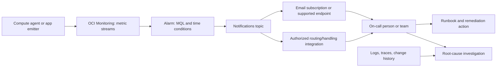

# Alarms, Notifications, and Designing Actionable Alerts

## 1. Alerts Must Lead to an Operational Action

In the **Logs, Metrics, and Tracing** chapter of the **CLOUD_PROVIDERS_ORACLE** module, an alarm is more than just a threshold on a chart. A useful alerting system must detect a condition worth attention, deliver information to the right person or system, and help them decide what action to take next.

This lesson uses a Java service `orders-service` running on OCI Compute and connecting to Oracle Database as its context. The team needs to monitor application health, host resources, database connectivity, and the telemetry collection path itself. The same principles apply to other targets on OCI, though exact namespaces, dimensions, and metrics must be verified against the specific service in use.

Three components carry distinct responsibilities:

| Component | Responsibility | What does it not guarantee on its own? |
| --- | --- | --- |
| **OCI Monitoring** | Ingest, store, and query metrics; evaluate alarms | Does not automatically know which thresholds fit business needs |
| **Alarm** | Define the condition to watch and notification behavior | Does not automatically pick the on-call person or incident fix |
| **OCI Notifications** | Deliver messages from a topic to subscriptions | Does not automatically confirm recipients read or acted on them |

An alarm transitioning to an attention-needed state while its topic has no active subscription is still an incomplete operational workflow. Conversely, an email arriving does not prove the incident was resolved or the system recovered.

The thresholds, durations, and configuration snippets in this lesson are learning examples, not enforced on any specific tenancy. They must be tuned using real data, service capabilities, and the permissions of your assigned environment.

## 2. Flow from Metric to Responder



Metrics provide quantitative signals for alarm evaluation. Logs and traces usually help explain root causes once a signal fires. Not every log in OCI Logging automatically becomes a metric usable in Monitoring; to alert on log contents, you need a properly designed query, conversion, or metric-emission mechanism.

A topic is a message distribution point, not a complete on-call roster. Subscriptions define receiving endpoints. If you need on-call schedules, escalation, acknowledgment, or grouping multiple alarms into one incident, choose and configure a mechanism that provides those capabilities.

A system can have multiple topics by responsibility—such as production operational alerts versus lab info. However, putting `production` in a topic name does not create access control: IAM, subscription permissions, and endpoints govern who can view or receive notifications.

## 3. What Makes an Alert Actionable?

Before creating an alarm, answer five questions:

1. **What is being impacted?** Users, latency, error rate, connectivity, or remaining capacity?
2. **Who is responsible?** Which team is on call and who is the escalation point if there is no response?
3. **What should be done first?** Are there safe diagnostic checks and a concrete runbook?
4. **How quickly must someone respond?** Immediately, during business hours, or merely track the trend?
5. **How do we know it recovered?** Based on which signals and observed for how long?

An alert whose body merely says "High CPU" lacks scope and next steps. A more useful summary might contain:

```text
Service: orders-service / production / specified region
Signal: Average CPU of specified instance exceeded 85%
Condition: per 1-minute query and 5-minute alarm pending duration
Impact to check: latency, error rate, processing queues
Owner: orders operations team
First steps: check traffic, JVM, and most recent deployment changes
Runbook: reference to the team-maintained guide
Context: alarm OCID, resource OCID, timestamp, and notification status
```

This is an operational content template, not a native JSON schema that OCI always emits. Some data comes from the alarm payload, while other parts live in the configured body, dashboards, or an integration layer.

Do not automatically conclude that high CPU requires scaling up the shape. It could stem from legitimate traffic growth, an error loop, garbage collection, batch processing, or insufficient resources. Actions must follow user signals and diagnostics, not a percentage alone.

### Classifying by Expected Response

| Purpose | Illustrative situation | Required channel/workflow |
| --- | --- | --- |
| Wake on-call responder | Prolonged production errors impacting transactions | On-call paging with escalation and acknowledgment |
| Schedule remediation work | Capacity steadily climbing with lead time to act | Ticketing or appropriate work-tracking workflow |
| Observe trend | Brief CPU spike during a known batch job | Dashboard or low-urgency notification |

OCI severity is severity-level metadata, with options such as `CRITICAL`, `ERROR`, `WARNING`, and `INFO`. It does not automatically turn an email into a phone call or build an on-call schedule. Mapping severity to delivery channels and response SLAs is part of your operational design.

## 4. Components That Define an OCI Alarm

| Component | Meaning | Risk if misconfigured |
| --- | --- | --- |
| Region | Where target data and resources live | Looking at the wrong scope or seeing no metrics |
| Alarm compartment | Where the alarm resource is managed | Operators lack permission to view/edit the alarm |
| Metric compartment | Scope of metric-emitting resources | Empty query or watching the wrong environment |
| Namespace | Metric group emitted by a service or app | Matching metric name with different source/meaning |
| Metric name | Quantitative signal | Monitoring a signal that does not reflect the target issue |
| Dimension filters | Select streams by resource or attribute | Merging wrong instances, environments, or targets |
| Interval and statistic | How query data is aggregated | Masking spikes or making the signal overly noisy |
| Predicate | Condition to detect | Threshold in wrong units or reversed comparison |
| Pending duration | Wait condition before the alarm fires | Triggering too early or too late |
| Destination | Supported topic or target | Messages routed to wrong team or zero recipients |
| Repeat/suppression | Re-notification and muting behavior | Alert spam or missing vital signals |

The alarm compartment and metric compartment can differ. For instance, an observability team might manage alarms in a shared compartment while metrics originate from Compute instances in an application compartment. Permissions across both scopes must be accounted for.

Never infer namespace and dimensions from a machine's display name. Inspect the actual metric stream before writing a query. Identical metric names do not imply identical units or semantics across different namespaces.

## 5. MQL: Separating Aggregation Window from Pending Duration

### 5.1. CPU Example for a Compute Instance

Suppose an instance emits `CpuUtilization` in the `oci_computeagent` namespace. Illustrative query:

```text
CpuUtilization[1m]{resourceId = "<compute-instance-ocid>"}.mean() > 85
```

Components:

- `CpuUtilization`: metric to observe.
- `[1m]`: aggregation interval specified in the query.
- `{resourceId = "..."}`: filters to the selected instance's stream.
- `.mean()`: computes the mean according to MQL aggregation rules.
- `> 85`: predicate on the CPU value in this metric's percentage unit.

Namespace and metric compartment are configured outside the query string. Replace placeholders with real OCIDs only after confirming streams carry the expected dimensions.

A Compute instance existing or being in the `RUNNING` state does not guarantee this metric has data. Verify the Oracle Cloud Agent monitoring plugin, agent status, network connectivity, and environment prerequisites.

### 5.2. Interval Is Not Pending Duration

Combining the query above with `pending_duration = "PT5M"` is intended to avoid firing on a single brief spike; the condition must persist across the wait window per the alarm's evaluation mechanism.

Compare with this query:

```text
CpuUtilization[5m]{resourceId = "<compute-instance-ocid>"}.mean() > 85
```

The second query changes the aggregation window to 5 minutes. It does not automatically mean "every individual minute exceeded the threshold for 5 minutes." An average can mask dips and peaks within the window.

Pending duration, metric emission cadence, ingestion latency, and evaluation schedule all affect notification timing. Never promise that an email will arrive exactly 5 minutes after CPU actually begins rising.

Illustrative timeline:

```text
Brief CPU spike that drops before meeting the pending condition
    → should not trigger a sustained alert under this design
CPU stays high and satisfies the pending condition
    → alarm may transition to FIRING based on evaluation results
```

Verify timing milestones against real data; examples do not replace understanding how Monitoring evaluates your specific query.

### 5.3. One Alarm Can Watch Multiple Metric Streams

Omitting the `resourceId` filter can cause a query to evaluate multiple streams. Grouping and aggregation determine whether resources stay separate or get combined.

Cluster-wide average CPU can look normal while one instance serving most users is overloaded. Conversely, notifying independently for every stream can generate hundreds of notifications for a single shared incident.

Decide clearly on the actionable unit: a single instance, a node pool, a service, or a shared dependency. If enabling per-metric-dimension notifications, inspect the payload and notification volume of that option. Never assume one alarm OCID always equates to one single incident.

## 6. Missing Data Does Not Mean a Healthy Service

### 6.1. Distinguishing Zero from No Samples

An error metric equal to 0 can mean zero errors were recorded in an interval. Having no datapoints can mean the app is down, the emitter broke, networking failed, the namespace is wrong, or the system emits nothing when traffic is idle.

These are two completely different situations. Never convert empty gaps into 0 and conclude the system is healthy.

With OCI Monitoring, you can design missing-data alarms using MQL functions such as `absent()`. Illustrative query form for a specific CPU stream:

```text
CpuUtilization[1m]{resourceId = "<compute-instance-ocid>"}.absent()
```

Verify how MQL and alarm absence detection behave in your environment, including the absence detection period, pending duration, and whether data was previously observed. Do not interpret `[1m]` in the example as a guarantee of notification after exactly 1 minute of missing samples.

A missing-data alarm also does not automatically inventory every machine in a tenancy. Newly launched resources that never emitted metrics, streams with changed dimensions, or replaced instances must be handled through asset inventory and monitoring lifecycle management.

### 6.2. Designing Liveness Signals Around Expectations

| Scenario | Expected data behavior | How to interpret gaps |
| --- | --- | --- |
| Always-on production Compute | Infrastructure metrics emit on expected cadence | Inspect agent, instance, and connectivity |
| Application emitting heartbeat | Samples arrive even with zero requests | Missing heartbeat is a distinct signal to investigate |
| Metric emitted only on transactions | Gaps possible during idle traffic | Insufficient alone to conclude the app stopped |
| Scheduled batch job | Data appears during job windows | Compare against schedule and expected completion time |
| Validly terminated instance | Stream is no longer expected | Update config/inventory to prevent orphan alarms |

A heartbeat proves part of the path or process is still running; it does not replace end-to-end functional checks. A heartbeat loop can keep ticking while the application cannot connect to Oracle Database.

You can add appropriate synthetic checks to test critical flows. If checks run externally, document the probe's location, permissions, and dependencies; a failure at the probe origin must not automatically be blamed on the entire application.

## 7. Selecting Signals by Impact, Not Only Resources

### 7.1. Pairing Symptoms with Likely Causes

| Signal group | What you need to know | Alerting role |
| --- | --- | --- |
| Request error rate | Are users failing? | Direct impact signal when measured properly |
| Request latency | Are users waiting too long? | Experience degradation signal |
| Queues/backlog | Is work piling up and delayed? | Detects insufficient processing capacity |
| CPU/RAM/disk capacity | Are resources saturated or nearing exhaustion? | Diagnostics and proactive capacity alerting |
| JDBC connection pool | Is the app waiting or failing to acquire connections? | Points to app/database bottleneck to inspect |
| Database health | Is the data service anomalous? | Check metrics specific to the Oracle Database service type |
| Missing telemetry | Can we still observe the system? | Protects incident detection capability |

Not all JVM/JDBC metrics are built into `oci_computeagent`. Application signals often require instrumentation and a proper custom-metric emission path. Nor do all Oracle database services emit the same namespaces or dimensions.

A practical design might route high CPU to a lower-urgency alert while reserving on-call paging for production error rate or latency spikes. That is an impact-driven choice; specific workloads may still need early action on resource saturation before users feel the impact.

### 7.2. Ratios Must Have the Right Denominator

Illustrative business formula:

```text
error_rate = valid failed requests / total requests in measurement scope
```

This is not valid MQL syntax for joining multiple metrics. To implement it on OCI, choose a metric/emission model and query pattern supported by the service.

When aggregating across instances, avoid taking a simple average of percentages with vastly different denominators. For example:

- Instance A: 1 failed request out of 1 request, 100% error rate.
- Instance B: 0 failed requests out of 999 requests, 0% error rate.
- Simple average of the two percentages is 50%, whereas the true overall rate is 1/1000, or 0.1%.

If an alert targets service-wide experience, aggregation must reflect that goal. If an alert targets a specific partition or customer segment, aggregating across the entire service can hide localized failures.

During low traffic, weigh error ratio, absolute error count, and transaction value together. One failure on a single transaction can matter greatly on a rare yet vital flow; do not let minimum-traffic filters accidentally blind you to it.

### 7.3. Connecting Alerts to Service Objectives

When a team has reliability objectives, alerts should prioritize threats to those objectives. A brief spike and a sustained error streak consume risk budgets differently.

You can design multiple observation windows to separate fast, severe outages from slow degradation. Compound rules must be implemented using actual capabilities of the metric/alarm system or a dedicated evaluation layer; never write fake MQL syntax simply because a mathematical formula looks neat on paper.

Do not apply identical CPU, latency, or error thresholds to every application. Establish baselines by load, operating hours, resource type, and recovery characteristics.

## 8. Notifications: From Topic to Working Endpoint

### 8.1. Creating a Topic and a Subscription Are Separate Tasks

A Notifications topic can have multiple subscriptions. Endpoints can be email, HTTPS, or other integrations supported by the service in that environment. Choose protocols based on intake requirements and team operational readiness.

For endpoints requiring confirmation, the endpoint owner must complete the confirmation workflow. A created subscription still in pending confirmation is not a ready delivery path.

Basic sequence:

1. Select the right region, compartment, and topic for the owning team.
2. Create a subscription to an authorized endpoint.
3. Complete confirmation when required by the protocol.
4. Verify the subscription status.
5. Send a test message containing non-sensitive content.
6. Verify the endpoint actually receives and processes the message.
7. Attach the topic as an alarm destination.
8. Verify further with a controlled alarm state transition.

A topic test message confirms part of the delivery path. It does not test the query, metric source, pending duration, or that the alarm emits the expected message to the topic.

### 8.2. What Is Email Good For?

Email works well for labs or informational alerts that do not require immediate response. However, full inboxes, spam filters, out-of-office staff, and lack of escalation can cause alerts to be missed.

When strict response times are required, use an on-call mechanism supporting acknowledgment and escalation. Adding more email addresses to a list does not create an on-call rotation or clear accountability.

### 8.3. HTTPS and Automated Integrations

An HTTPS endpoint must handle the message format and confirmation flow used by Notifications. Protect the endpoint, authenticate the source using supported mechanisms, and handle malformed or failed message processing.

Design consumers to tolerate duplicate deliveries, retries, late arrivals, and out-of-order messages. Never assume every state transition generates exactly one HTTP request that succeeds on the first try.

If a consumer opens incidents or triggers downstream actions, enforce idempotency. Returning HTTP 200 on receipt does not mean downstream remediation succeeded; persist state and monitor the outcome of that work.

Never let an arbitrary `resourceId` inside a payload directly execute administrative actions. Always validate the alarm source, resource scope, action type, and permissions of the executing identity.

### 8.4. Inspect Real Messages Before Building a Parser

OCI supports notification formats based on configuration and target type. Inspect actual alarm payloads to see their exact structure, states, timestamps, and included metric stream details.

Do not treat text summaries in this lesson as a service schema. When writing parsers, handle missing fields, newly added fields, and multiple metric streams per the real contract; avoid relying on indentation or JSON key ordering.

## 9. Permissions and Protecting Alert Content

There are at least four responsibility groups:

| Actor | Permission needs |
| --- | --- |
| Alarm administrator | View metrics and create/update alarms within assigned scope |
| Notifications administrator | Manage topics/subscriptions and test delivery |
| Agent/application emitter | Send telemetry via configured identity mechanism |
| Consumer/recipient | Receive notifications; gain action permissions only when explicitly granted |

For custom metrics, emitters can use resource principal, instance principal, or another supported auth method. Grant permissions to the exact principal and namespace/scope required. Never grant tenancy-wide admin rights to an application host just because metrics haven't appeared yet.

When alarms and metrics reside in different compartments, whoever configures them needs appropriate permissions across both scopes. If the Notifications destination is in another compartment, verify permissions to use/manage resources at that layer too. Never infer from seeing a chart that all topic configurations are valid.

Alert bodies and payloads may leave OCI to external endpoints. Never include database passwords, private keys, tokens, customer data, or full SQL statements with sensitive bind values in notifications.

A runbook should link to protected documentation rather than embedding secrets. Someone receiving an alert email does not automatically hold permissions to view dashboards or logs: grant on-call responders necessary read access while keeping sensitive data properly scoped.

## 10. Terraform Example: CPU Alarm Sending to Operations Email

The following example defines an alarm for a Compute instance already emitting metrics, a Notifications topic, and an email subscription. It uses a preconfigured OCI profile on the execution host; never put API private keys or passwords into HCL.

Select, review, and pin provider versions according to your environment's standards before operating. This snippet does not hardcode an assumed "latest" version.

```hcl
terraform {
  required_providers {
    oci = {
      source = "oracle/oci"
    }
  }
}

variable "region" {
  type = string
}

variable "oci_config_profile" {
  type    = string
  default = "DEFAULT"
}

variable "alarm_compartment_id" {
  type = string
}

variable "metric_compartment_id" {
  type = string
}

variable "instance_ocid" {
  type = string
}

variable "oncall_email" {
  type = string
}

provider "oci" {
  region              = var.region
  config_file_profile = var.oci_config_profile
}

resource "oci_ons_notification_topic" "orders_ops" {
  compartment_id = var.alarm_compartment_id
  name           = "orders-prod-observability"
  description    = "Operational notifications for orders-service"
}

resource "oci_ons_subscription" "orders_email" {
  compartment_id = var.alarm_compartment_id
  topic_id       = oci_ons_notification_topic.orders_ops.id
  protocol       = "EMAIL"
  endpoint       = var.oncall_email
}

resource "oci_monitoring_alarm" "orders_cpu_high" {
  compartment_id        = var.alarm_compartment_id
  metric_compartment_id = var.metric_compartment_id
  display_name          = "orders-prod-instance-cpu-high"
  namespace             = "oci_computeagent"

  query = "CpuUtilization[1m]{resourceId = \"${var.instance_ocid}\"}.mean() > 85"

  severity                     = "WARNING"
  is_enabled                   = true
  pending_duration             = "PT5M"
  repeat_notification_duration = "PT1H"

  destinations = [
    oci_ons_notification_topic.orders_ops.id
  ]

  body = "Owner: orders-ops. Check latency, request errors, JVM, and recent changes. Verify alarm/resource OCID. Runbook: ORD-CPU-01 in internal runbook repository."
}
```

Meaning of these choices:

- The alarm is managed in `alarm_compartment_id`, while reading metrics from `metric_compartment_id`.
- The topic lives in the alarm management compartment in this template; that is an organizational choice, not a universal rule.
- The CPU threshold is a `WARNING`-level example that must be calibrated against application impact.
- `PT5M` is an ISO 8601 duration for pending duration in the example.
- `PT1H` is the chosen repeat notification interval—not the sampling period or initial wait time before the first alert.
- The body includes only non-sensitive operational context. The placeholder code `ORD-CPU-01` must point to a real runbook with maintained content and an owner.

### Completing the Notification Delivery Path

After reviewing and applying the configuration in an authorized environment, complete the email subscription confirmation. Terraform creating the subscription resource does not replace endpoint owner confirmation.

Verify the CPU stream for the exact instance before expecting the alarm to work. Then test the topic, subscription, and a controlled state transition. If on-call paging is required, add the corresponding integration and escalation rules rather than merely changing severity to `CRITICAL`.

Protect Terraform state and variable files because they can contain endpoint addresses and internal details. When replacing an instance or rolling out a new group of machines, update the observation scope so alarms do not keep pointing at retired resources.

Do not copy fields from another alerting system's schema into this resource. For example, the threshold condition here lives inside the MQL query; do not invent a comparison attribute just because you saw one on another cloud provider.

## 11. Pending, Repeat, Suppression, and Recovery States

### 11.1. These Mechanisms Solve Different Problems

| Mechanism | Primary problem solved | What to verify |
| --- | --- | --- |
| Aggregation window | Characteristics of compared data | Does it mask spikes or delay the signal? |
| Pending duration | Reducing reactions to overly brief anomalies | Does it delay response beyond error tolerance? |
| Repeat notification | Reminding responders of an ongoing issue | Does the cadence cause spam or let incidents slip? |
| Suppression | Limiting notifications during controlled windows | Who set it, why, when does it expire, and how is it verified afterward? |
| Disable alarm | Turning off alarm evaluation per config | Do we lose detection of unexpected outages? |
| Intake grouping/routing | Consolidating and routing to the right owner | Could two independent incidents be merged by mistake? |

Increasing pending duration does not replace repeat notifications. Suppression does not fix root causes. Disabling noisy alarms long-term just because they fire often can blind you to critical signals.

### 11.2. Understanding `OK` and `FIRING` Within Query Scope

When inspecting alarm state, `FIRING` indicates the condition triggered under the evaluation mechanism. `OK` indicates the condition is no longer triggered under that evaluation; it is not a certification that the whole service is healthy.

A CPU alarm can return to `OK` because CPU dropped after the application stopped accepting requests. If metrics still arrive while the service is functionally dead, low CPU still does not prove recovery. Verify impact signals and real traffic data.

Missing-data behavior must be verified specifically for your chosen query. Never conflate silence, alarm state, subscription state, and application health.

### 11.3. Flapping and Hysteresis

A signal oscillating across a threshold can cause an alarm to flip states repeatedly. Before adjusting thresholds, inspect noise levels, emission cadence, aggregation method, and real user impact.

Hysteresis is the concept of using separate trigger and recovery conditions to curb oscillation. However, do not invent two thresholds on one alarm and assume OCI shares the same semantics as another platform. If hysteresis is needed, use supported capabilities or implement a clearly designed state-management layer.

In many cases, picking the right metric and reasonable pending duration already cuts noise substantially. For severe production failures, over-smoothing can delay necessary action.

### 11.4. Maintenance and Time-Bound Suppression

A maintenance window should have an owner, reason, start/end timestamps, and an authorized scope for limiting notifications. Use service-supported suppression when appropriate for that goal.

Before maintenance, decide which alerts must remain active: data loss, out-of-scope impact, or security failures may fall outside what should be muted. Avoid applying a blanket mute across all of production.

After maintenance, verify suppression expired, alarms remain enabled, and Notifications delivery still works. Never assume all notifications generated during suppression will replay once it ends; rely on documented service behavior and current state.

If an alarm must be disabled, document the decision and the exact time to re-enable it. A note in a ticket will not automatically re-enable a disabled resource.

## 12. Preventing Duplicate Notifications and Grouping Incidents Accurately

There are two separate problems:

1. The same message is delivered multiple times.
2. Multiple valid messages reflect the same underlying incident.

For the first problem, consumers can use the delivery/event identifier provided by the actual payload alongside durable state storage to enforce idempotency. For the second problem, you need an incident key grounded in operational semantics.

Illustrative internal incident key:

```text
alarm_ocid + environment + normalized_resource_or_service_dimensions
```

This is not a mandatory native OCI field name. Choose stable dimensions matching the actionable unit. If a query evaluates per-stream, using only the alarm OCID can accidentally merge multiple independent resources.

Never use request ID, trace ID, or timestamp as the main component of an incident grouping key: constantly changing values turn every message into a brand-new incident. Nor should you strip all dimensions if those resources belong to different owners.

A valid repeat notification should update the open incident and drive escalation rather than opening a duplicate ticket. Recovery notifications must be matched against the same scope and timestamp so a late-arriving old message does not prematurely close a new incident.

When a shared Oracle Database encounters issues, many applications may report connection failures simultaneously. An intake layer can group by dependency to curb alert storms while preserving evidence and identifying each affected service individually. Never silence all application alarms simply because a database alarm exists.

## 13. Minimum Runbook for an Alert

A runbook should be concise enough to follow during an active incident, yet include safe checks, required permissions, and verification criteria. For `ORD-CPU-01`, it could be structured as follows:

### A. Confirm Scope and Impact

- Verify alarm OCID, instance OCID, region, compartment, and time range.
- Check latency, request errors, backlog, and traffic over the same period.
- Check for recent deployments, batch jobs, or shape changes.
- Confirm incident ownership and active coordination channel per team process.

### B. Gather Necessary Diagnostics

- Inspect CPU per stream to see whether one machine or the whole fleet is affected.
- Check JVM, garbage collection, thread pools, and JDBC connections if telemetry is available.
- Inspect logs and traces in the same time window, correlated by deployment version.
- Check the Oracle Database dependency and network connectivity when symptoms align.

Never use a fleet-wide restart command as your default first step. When taking thread dumps, accessing hosts, or querying databases, be aware of permissions, performance cost, and sensitive data that might surface in outputs.

### C. Choose an Authorized Action

Depending on the root cause, you might throttle batch jobs, roll back an application version, add capacity, or fix a dependency. Every action must have a defined scope, stop conditions, and an authorized decision-maker.

When using automation, start with bounded actions and validated inputs. A CPU alarm does not grant a system authority to terminate machines, modify IAM policies, or scale resources without limits.

### D. Verify and Close

Verify that user-facing signals recovered, metrics continue arriving, and the change caused no side effects. Observe over an appropriate stabilization window before closing the incident.

Record root cause, actions taken, timestamps, and any alert adjustments needed. If an alert never leads to useful action, revisit the metric, scope, or threshold—do not simply raise thresholds to reduce notification noise.

## 14. Testing Alerts Layer by Layer

### 14.1. Test the Query Before Testing Email

First, inspect data in the right region, metric compartment, namespace, and time window. Verify dimensions, units, and statistics against your goal.

If the query returns no data, an email failing to arrive tells you nothing about Notifications. If the query returns unexpectedly many streams, fix the scope before creating an alarm that could flood recipients.

Next, test the topic/subscription independently with a test message. Once both pieces work independently, test the full path from metric emission to state transition and recipient delivery.

### 14.2. Use Lab Metrics Instead of Stressing Production

You can emit a custom metric in a test scope, for example:

| Lab attribute | Illustrative value |
| --- | --- |
| Namespace | `orders_alert_lab` |
| Metric name | `QueueDepth` |
| Meaning | Simulated queue length, gauge |
| Unit | Job count |
| Dimensions | `environment=lab`, `service=orders-service` |
| Test condition | Exceeds 20 for the chosen pending condition |

Illustrative query:

```text
QueueDepth[1m]{environment = "lab"}.max() > 20
```

You need an emitter authorized to publish custom metrics into the test compartment. Use valid timestamps, an appropriate cadence, and consistent dimension sets across samples. Naming entries in a table does not by itself create data in Monitoring.

A test sequence might run as follows:

1. Emit samples with value 10 to observe the baseline.
2. Emit value 30 for shorter than the expected pending duration.
3. Return to 10 and confirm no sustained alert fired.
4. Emit 30 long enough to satisfy the alarm condition.
5. Verify alarm state, message contents, and recipient receipt.
6. Return to 10 and confirm recovery behavior.

The numbers 10, 20, and 30 are strictly for controlling the test. Never treat them as recommended thresholds for real queues.

To test missing data, use a dedicated absence alarm with timing expectations aligned to actual configuration. Stopping an emitter and waiting an arbitrary few minutes is not enough to prove absence detection works or is broken.

### 14.3. Operational Cases to Verify

| Check | Expected observation |
| --- | --- |
| Normal values | No false threshold breach incidents |
| Brief spike | Behavior matches selected interval and pending duration |
| Sustained breach | Alarm fires and the right endpoint receives notification |
| Ongoing breach | Repeat/escalation follows policy without infinite duplicate tickets |
| Recovery | State and notification handled within the right scope |
| Unconfirmed subscription or failing endpoint | Delivery pipeline unreadiness is detected |
| Suppression during lab window | Notifications suppressed appropriately and restored afterward |
| Duplicate event received by consumer | Dangerous actions are not executed twice |
| Resource/dimension change | No blind spots or unintended orphan alarms left behind |

Tests must use authorized endpoints and resources. Never test by filling disks, exhausting connection pools, or shutting down a production database without an approved test plan and dedicated authorization.

Evidence should include the query, alarm configuration, sample emission timestamps, alarm OCID, state transitions, receipt timestamps, and consumer decisions. Document actual observed outcomes rather than merely checking off "alarm created."

## 15. Diagnosing Missing Notifications or Excessive Alerts

### 15.1. No Notifications Arriving

Walk through the layers in order to avoid fixing the wrong thing:

| Layer | Questions to check |
| --- | --- |
| Data source | Is the metric still emitting? Is the agent/emitter running with sufficient permissions? |
| Query scope | Are region, compartment, namespace, metric name, and dimensions right? |
| Timing | Do timestamps, view range, interval, ingestion delay, and pending duration align? |
| Alarm | Is it enabled? Does the query meet the condition? Is suppression active? |
| Destination | Is the alarm pointing to the right topic/target? |
| Subscription | Is it confirmed and active? Did the endpoint change? |
| Consumer | Are there parser, auth, queue, or downstream processing errors? |
| Responder | Are on-call schedules, escalation, and acknowledgment paths in place? |

Cross-check available logs and alarm/notification history per your configuration. An endpoint returning a success HTTP response does not prove an on-call engineer saw it; seeing it does not prove remediation succeeded.

Keep these states distinct in operational workflows:

```text
metric observed
→ alarm triggered
→ message accepted
→ person or system took ownership
→ action executed
→ service verified recovered
```

Never collapse this entire chain into a single `sent=true` flag.

### 15.2. Too Many Notifications

Before disabling an alarm, check:

- Is a single outage firing alarms across multiple layers without correlation?
- Is the query accidentally picking up lab resources or other environments?
- Is it notifying per dimension when the owner only needs one service-level incident?
- Is the repeat interval shorter than the time responders need to diagnose?
- Is the signal flapping around the threshold?
- Is the consumer opening a new incident on every retry?
- Are decommissioned resources still included in monitoring scope?

Address noise via better metrics, grouping, pending duration, routing, and lifecycle management. Any tuning must preserve detection of the failures the alarm was originally built to catch.

A chronically noisy alarm needs an owner and a concrete remediation task. Never let indefinite muting become the default operational state.

## 16. Controlling Cost, Cardinality, and Lifecycle

### 16.1. Dimensions Must Have a Purpose

Each dimension combination can create a distinct metric stream. Putting request IDs, user IDs, or timestamps into dimensions can explode stream counts, making queries, service limits, and costs hard to manage.

Use stable dimensions meaningful for aggregation, such as service, environment, or bounded resource groups. Per-request details belong in logs or traces governed by proper access controls and retention.

Conversely, stripping all dimensions can obscure ownership and impacted resources. Aim for enough context to act while keeping stream counts manageable.

### 16.2. Storage and Notification Flows

Metric volume, custom telemetry, logs/traces, message counts, integration endpoints, and processing resources can all contribute to cost depending on the services used. Review usage against tenancy limits; never assume an alarm that sends few notifications means the whole observability stack is cheap.

Set retention periods aligned with investigation needs and operational history. Preserve essential evidence while avoiding duplicating sensitive payloads across multiple stores merely for search convenience.

Cost/budget alerts may require dedicated mechanisms suited to billing data. A CPU alarm is not a measure of spend, and flat metric graphs do not prove budgets aren't growing.

### 16.3. Alarms Have a Configuration Lifecycle Too

When an application moves regions, changes compartments, replaces instances, or migrates to OKE, review alarms, dimensions, topics, and owners. When retiring a service, clean up associated alarms and subscriptions according to ownership.

Infrastructure as code aids review and change tracking, but does not automatically verify that a query still fits new metrics. Record why thresholds were chosen, the last test date, and the runbook owner so future maintenance has clear context.

## 17. Minimum Readiness Checklist for Productionizing an Alarm

An alarm is ready for handoff when it includes the following details and evidence:

- Detection objective and user/system impact being protected.
- Owner, delivery channel, and escalation path.
- Region, alarm compartment, metric compartment, namespace, and dimension scope.
- Query, units, statistic, interval, and rationale behind the threshold.
- Pending duration, repeat behavior, missing-data behavior, and suppression rules.
- Active topic/subscription along with delivery test results.
- Runbook covering confirmation, diagnosis, authorized actions, and recovery verification.
- Handling for duplicates, multiple streams, and late-arriving events if a consumer exists.
- Safe trigger/recovery test results.
- Change-management, retention, and end-of-life cleanup policy.

Alarms drive decisions from metrics; Notifications carry those decisions to receivers. An alert only holds operational value when recipients understand the scope, hold the permissions, and have a clear path to act. Designing signals, permissions, delivery paths, and runbooks together keeps OCI environments responsibly monitored, resilient, and free of wasted effort on unactionable noise.
