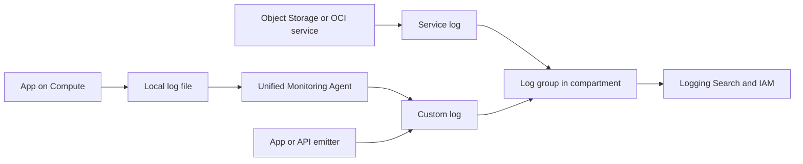

# OCI Logging, Log Groups, Service Logs, and Custom Logs

## Objectives and Use Case

In the **Logs, Metrics, and Tracing** chapter of the Oracle Cloud Infrastructure (OCI) track, this lesson focuses on centralizing infrastructure and application logs with proper access control for incident investigation. You will learn how to choose log sources, organize log groups, grant permissions to log readers and shipping hosts, and verify that data actually arrives at its destination.

Suppose a Java application `orders-api` runs on Compute, reads documents from Object Storage, and calls an Oracle database. When customers report errors, the operations team needs to know where requests traveled, which service denied access, and what the application recorded. A spike in an error chart detects the problem; logs provide the concrete events needed to trace the root cause.

After this lesson, you can:

- Distinguish log group, log object, and log entry.
- Choose service logs or custom logs based on the emitting source.
- Enable a service log and configure application log collection from Compute.
- Use the OCI CLI to ingest a test record, search logs, and verify access permissions.
- Set retention, reduce redundant data, and detect interrupted log pipelines.

## 1. What Problem Does OCI Logging Solve?

OCI Logging provides centralized log ingestion, management, and search. For supported OCI services, you enable log categories on the resource. For self-developed applications, you can use the Unified Monitoring Agent or ingest directly through the Logging Ingestion API. Log content uses UTF-8 text encoding. [Oracle: Logging Overview](https://docs.oracle.com/en-us/iaas/Content/Logging/Concepts/loggingoverview.htm).

Centralizing logs reduces reliance on SSHing into individual hosts during incidents. However, investigation quality still depends on input quality: a line saying `request failed` without a timestamp, service name, and correlation ID rarely suffices to explain a failure.

In application design, link the three signal types:

| Signal | Typical question | Example in the order application |
| --- | --- | --- |
| Metric | How widespread is the issue? | HTTP 5xx rate over the recent interval |
| Log | What specific event occurred? | An object read failure with error code and correlation ID |
| Trace | Which steps did a request pass through? | Time spent in API, storage call, and database query |

Within the scope of this lesson, logs are the primary data. Adding a `traceId` to logs allows lookup by ID when proper instrumentation exists; doing so alone does not create distributed tracing.

## 2. Resource Model: Compartment → Log Group → Log → Entry

Distinguish three concepts often loosely referred to simply as "logs":

| Concept | Meaning | Example |
| --- | --- | --- |
| Log group | Container resource holding logs for organization and access control | `orders-dev` |
| Log object | Log resource with an OCID, log type, status, and configuration | `orders-app`, `orders-bucket-read` |
| Log entry | A single event ingested into a log object | Error line from a request failing to read a document |

Log groups reside in compartments; every log object must belong to a log group. You can use IAM to restrict access at the log group level rather than relying solely on compartment boundaries. [Oracle: Logs and Log Groups](https://docs.oracle.com/en-us/iaas/Content/Logging/Task/managinglogs.htm).



This diagram shows organizational relationships and data flow; a log group is not an intermediary process you have to deploy yourself.

Example layout for a development team:

```text
Compartment: ObservabilityLab
└── Log group: orders-dev
    ├── orders-bucket-read   [SERVICE]
    ├── orders-bucket-write  [SERVICE, if write operations are needed]
    └── orders-app           [CUSTOM]
```

Separate logs containing sensitive data from general operational logs whenever the two have different authorized readers. Simply naming them differently creates no security boundary; corresponding IAM policies are required.

When configuring via the Console or CLI, always verify region, compartment, and target OCID. Human-readable names help operators; OCIDs prevent confusing two similarly named resources across different environments.

## 3. Service Logs, Custom Logs, and Audit Logs

| Type | Data source | How to start | When to use |
| --- | --- | --- | --- |
| Service logs | OCI services with built-in Logging integration | Enable a category on a supported resource | Investigate bucket access, load balancer activity, or network flows |
| Custom logs | Applications, OS, or sources you manage | Create a custom log, then configure an agent or call the API | Track Java errors, business events, and background jobs |
| Audit logs | OCI Audit events for supported APIs | Query Audit data under existing permissions | Investigate administrative resource operations |

Oracle distinguishes these three types in the Logging overview. Audit events can be searched alongside other logs, but Audit is not a custom log you create for your application. [Oracle: Logging Overview — log types](https://docs.oracle.com/en-us/iaas/Content/Logging/Concepts/loggingoverview.htm).

For service logs, each service defines its own categories and schemas. For example, Object Storage provides read and write access logs; Load Balancer provides service-specific log fields. Pick categories based on your investigation questions, then inspect an actual record's structure before writing filters. Never assume all services share the exact same `message`, `status`, or `type` values. [Oracle: Service Log Reference](https://docs.oracle.com/en-us/iaas/Content/Logging/Reference/service_log_reference.htm).

In the `orders-api` scenario, you might combine:

- Object Storage service logs to inspect data-access operations.
- Application custom logs to trace business steps and errors handled in Java.
- Audit logs to investigate a related administrative configuration change.

Application logs recording database call failures do not mean all Oracle database diagnostic or audit logs have been forwarded into OCI Logging. Always verify collection mechanisms for the specific database product in use.

## 4. Designing Storage Locations and Ownership

Before creating logs, the operations team should agree on a brief design table:

| Decision | Suggestion for the lab | Rationale |
| --- | --- | --- |
| Compartment | `ObservabilityLab` | Keeps lab scope easy to verify |
| Log group | `orders-dev` | Groups logs for the same app and environment |
| Owner | `orders-api` operations team | Clear accountability if logs stop arriving |
| Readers | Dev support team | Limits access to data beyond operational need |
| Custom log | `orders-app` | Separates application events from service logs |
| Initial retention | 30 days | An illustrative choice for bounded lab practice |
| Management tags | `application`, `environment`, `owner` | Aids resource identification and auditing |

This is a sample design plan, not a mandatory OCI structural rule. In production, you may store logs in a dedicated observability compartment; in that case, design permissions across data sources, agent configurations, and destinations.

Avoid dumping logs from every environment into a single log group just for search convenience. For example, developers may need to read dev logs without being allowed to read production transaction records. Conversely, never create one log group per request: that complicates resource management without helping access control.

## 5. IAM: Separating Resource Management, Content Reading, and Log Ingestion

Three key resource types to remember are `log-groups`, `log-content`, and `unified-configuration`. Managing log objects falls under `log-groups`; reading or pushing log entries falls under `log-content`; agent configurations use `unified-configuration`. Verbs are cumulative: `use log-content` includes reading content. [Oracle: Details for Logging](https://docs.oracle.com/en-us/iaas/Content/Identity/policyreference/loggingpolicyreference.htm).

### 5.1. Sample Policies for a Lab Compartment

Assume user groups `LogAdmins`, `LogReaders`, and dynamic group `AppLogSenders` have been created by an administrator. Examples use short group names; tenancies with identity domains must reference groups with the appropriate domain prefix.

```text
Allow group LogAdmins to manage log-groups in compartment ObservabilityLab
Allow group LogAdmins to manage unified-configuration in compartment ObservabilityLab
Allow group LogAdmins to inspect dynamic-groups in tenancy

Allow group LogReaders to read log-groups in compartment ObservabilityLab
Allow group LogReaders to read log-content in compartment ObservabilityLab

Allow dynamic-group AppLogSenders to use log-content in compartment ObservabilityLab
```

Administrators creating agent configurations need permissions to manage configurations, target logs, and inspect target host groups. Instance principals in the dynamic group use `log-content` permissions to fetch configurations and push logs. Searchers need read access to log content. [Oracle: Required Permissions for Working with Logs and Log Groups](https://docs.oracle.com/en-us/iaas/Content/Logging/Task/managinglogs.htm#Required_Permissions_for_Working_with_Logs_and_Log_Groups).

To select a single Compute instance for the lab, the dynamic group can use a matching rule:

```text
ALL {instance.id = '<COMPUTE_INSTANCE_OCID>'}
```

Replace the placeholder with a real OCID. For multiple instances, scope the group deliberately; avoid sweeping unrelated hosts into the same log-sending group. The dynamic group defines **which instances**, while the policy defines **what those instances may do**.

To enable service logs on a resource, the administrator also needs appropriate permissions on the source resource. For example, for buckets in the same compartment:

```text
Allow group LogAdmins to use buckets in compartment ObservabilityLab
```

Source permissions vary by service; managing log groups does not automatically grant permission to update arbitrary OCI resources. [Oracle: IAM Policy Requirements for Resources](https://docs.oracle.com/en-us/iaas/Content/Logging/Task/managinglogs.htm#IAM_Policy_Requirements_for_Resources).

### 5.2. Narrowing Permissions After the Lab

In a compartment hosting multiple applications, you can restrict access by log group:

```text
Allow group LogReaders to read log-content in compartment ObservabilityLab where target.loggroup.id = '<LOG_GROUP_OCID>'
```

`target.loggroup.id` is supported for `log-groups` and `log-content`. Evaluate this condition alongside all other policies granted to the principal; an existing broader policy can still grant wider read access. [Oracle: Logging policy variables](https://docs.oracle.com/en-us/iaas/Content/Identity/policyreference/loggingpolicyreference.htm).

The `use log-content` policy in the lab is not write-only. If production requires that a log-shipping principal must never read logs back, design a dedicated permission set per the IAM reference table instead of calling the sample policy "write-only."

## 6. Enabling a Service Log: Object Storage Example

Service logs are enabled per resource and category. Enabling a log creates an event sink for that configuration going forward; do not expect historical activity prior to enablement to appear.

For Object Storage, read and write categories cover different sets of access operations. When investigating document downloads, enable the read category; when auditing object mutations, consider the write category. Consult the Object Storage schema to understand field meanings, operation types, and logged data boundaries. [Oracle: Details for Object Storage](https://docs.oracle.com/en-us/iaas/Content/Logging/Reference/details_for_object_storage.htm).

### Step-by-Step Procedure

1. Choose a test bucket in the active region and create log group `orders-dev` in `ObservabilityLab`.
2. Open the bucket page or **Logging → Logs**, and select the option to enable a service log.
3. Choose the bucket resource and the read category. Double-check the configured source.
4. Select log group `orders-dev`, name the log `orders-bucket-read`, and set retention.
5. Enable the log, then open its details page to verify its state and configuration.
6. Using an authorized account, perform an object read operation covered by that category. Record the timestamp, test object name, and request ID if provided by the tool.
7. Open Logging Search from the newly created log, pick a time range bracketing the operation, and inspect the record.

The Console enablement flow lets you choose the log group, name, and retention duration. **Disable** stops capturing new data while preserving the log object; **Delete** removes the log resource. [Oracle: Enabling Logging for a Resource](https://docs.oracle.com/en-us/iaas/Content/Logging/Task/enabling_logging.htm).

If search returns no records, verify whether the test action actually falls under the enabled category. A bucket management API call and an object read operation map to different log purposes; never use an event appearing in Audit to conclude that the service log is working.

## 7. Custom Logs via Unified Monitoring Agent

Custom logs handle data produced by applications or sources you manage. There are two main ingestion paths: Unified Monitoring Agent and the `PutLogs` API. Within Oracle Cloud Agent, the custom-log collection component is the **Custom Logs Monitoring** plugin. [Oracle: Custom Logs](https://docs.oracle.com/en-us/iaas/Content/Logging/Concepts/custom_logs.htm).

### 7.1. Preparing the Compute Instance

Choose an image and operating system supported by the agent. On the target Compute instance, verify that **Oracle Cloud Agent → Custom Logs Monitoring** is enabled and running—do not only check instance state. Enabling the plugin on supported images provisions the agent via Oracle's mechanism. For custom images, follow the corresponding installation and support documentation. [Oracle: Installing the Agent](https://docs.oracle.com/en-us/iaas/Content/Logging/Task/installing_the_agent.htm).

The agent is a managed component. Control collection sources through **Agent Configurations** rather than hand-editing Fluentd config files and expecting those edits to be supported or preserved long-term by Oracle. [Oracle: Agent Management Overview](https://docs.oracle.com/en-us/iaas/Content/Logging/Concepts/agent_management.htm).

On the network side, the instance needs connectivity to the required OCI endpoints. For private subnets, consider a Service Gateway for Oracle Services Network services or a properly designed egress path. Service Gateway provides private access to supported OCI services, including Logging. [Oracle: VCN FAQ — private access to services](https://www.oracle.com/anz/cloud/networking/virtual-cloud-network/faq/).

When troubleshooting connectivity, inspect DNS, route tables, NSGs/security lists, proxies, and outbound HTTPS. Never open inbound application ports merely to troubleshoot an agent failing to ship logs.

### 7.2. Creating a Custom Log and Agent Configuration

Create custom log `orders-app` inside `orders-dev`, then create an agent configuration with these values:

| Attribute | Illustrative value |
| --- | --- |
| Configuration compartment | `ObservabilityLab` |
| Configuration name | `orders-dev-agent` |
| Host group | Dynamic group `AppLogSenders` |
| Input | Log path on the Compute instance |
| Path | `/var/log/orders-api/application.jsonl` |
| Parser | JSON if each line is a JSON object |
| Destination | `orders-dev` → `orders-app` |

An agent configuration specifies hosts, paths, parser, and target log. The target must be an existing custom log. [Oracle: Creating an Agent Configuration](https://docs.oracle.com/en-us/iaas/Content/Logging/Task/create-logging-agent-configuration.htm).

In the lab, placing the configuration and target log in the same compartment avoids permission scope confusion. The path in the table is a **path on the source VM**, not a file stored inside OCI Logging.

On the VM, the application needs write access to the file, and the user running the agent needs read access to the file plus traverse permissions on parent directories. Grant minimal OS permissions or ACLs; never use `chmod 777` as a default fix.

### 7.3. Standardizing Application Logs Before Collection

Example log line emitted by `orders-api`:

```json
{"timestamp":"2026-11-21T03:20:15.123Z","level":"ERROR","service":"orders-api","environment":"dev","correlationId":"lab-order-001","event":"document_read_failed","errorCode":"STORAGE_ACCESS_DENIED","message":"Unable to read order attachment"}
```

This is an illustrative application schema, not a mandatory OCI schema. When testing on a live system, generate events with the current timestamp.

Follow these principles:

- Keep each event as a single-line JSON object; escape newlines in stack traces when using JSON Lines.
- Keep `level`, `service`, `environment`, and `correlationId` consistent across application versions.
- Use timestamps with explicit timezones, synchronize host clocks, and configure the parser to match the time field.
- Include `traceId` only when you have a real ID from a tracing system or defined correlation scheme.
- Strip passwords, access tokens, API keys, session cookies, and unnecessary personal data before shipping.

Logging supports multiple parsers, including JSON, regexp, and multiline. Pick JSON when input is JSON; pick multiline intentionally for multi-line event formats. Even when structured parsing is not needed, configure the `NONE` parser appropriately. [Oracle: Log Inputs and Parsers](https://docs.oracle.com/en-us/iaas/Content/Logging/Concepts/log_inputs_and_parsers.htm).

Once the configuration is applied, emit a new line with a unique marker, such as `oci-log-lab-agent-001`. Verify this marker in both the source file and Logging Search. This avoids confusing previously ingested old lines with newly collected data.

Do not assume the agent will automatically re-ingest an entire historical file. When testing log rotation, generate events both before and after rotation, and confirm both appear under the active configuration.

## 8. Creating Resources and Ingesting Custom Logs with OCI CLI

This section uses **Bash in OCI Cloud Shell** with the OCI CLI authenticated against the right tenancy. Commands are examples for learners in a lab environment; replace placeholders with real values. If `orders-dev` or `orders-app` was already created earlier, reuse its OCID and skip the corresponding creation command.

### 8.1. Creating a Log Group

```bash
OCI_REGION='<REGION_ID>'
COMPARTMENT_OCID='<COMPARTMENT_OCID>'

oci --region "$OCI_REGION" logging log-group create \
  --compartment-id "$COMPARTMENT_OCID" \
  --display-name orders-dev \
  --description 'Logs for the orders development environment' \
  --wait-for-state SUCCEEDED

oci --region "$OCI_REGION" logging log-group list \
  --compartment-id "$COMPARTMENT_OCID" \
  --all
```

Capture the group OCID from the list output and assign it to `LOG_GROUP_OCID` in the next step. Group names must be unique within a compartment per the creation API; inspect existing resources before re-running. [Oracle CLI: logging log-group create](https://docs.oracle.com/en-us/iaas/tools/oci-cli/latest/oci_cli_docs/cmdref/logging/log-group/create.html).

### 8.2. Creating a Custom Log

```bash
LOG_GROUP_OCID='<LOG_GROUP_OCID>'

oci --region "$OCI_REGION" logging log create \
  --log-group-id "$LOG_GROUP_OCID" \
  --display-name orders-app \
  --log-type CUSTOM \
  --is-enabled true \
  --retention-duration 30 \
  --wait-for-state SUCCEEDED

oci --region "$OCI_REGION" logging log list \
  --log-group-id "$LOG_GROUP_OCID" \
  --all
```

Set `LOG_OCID` to the OCID of `orders-app` from the output. Log creation may use an asynchronous work request; wait for success and list logs to obtain the resource ID rather than assuming the create response always includes `data.id` for the log. `--log-type` accepts `CUSTOM` or `SERVICE`; this example creates `CUSTOM`. [Oracle CLI: logging log create](https://docs.oracle.com/en-us/iaas/tools/oci-cli/latest/oci_cli_docs/cmdref/logging/log/create.html).

### 8.3. Sending a Test Entry via PutLogs

The principal running the CLI needs permission to ingest into the custom log. When using a personal account in Cloud Shell, permissions granted to a VM's dynamic group do not transfer to your user account. A lab administrator can grant ingestion permissions to the test group within the compartment.

```bash
LOG_OCID='<CUSTOM_LOG_OCID>'
ENTRY_TIME=$(date -u +%Y-%m-%dT%H:%M:%SZ)
ENTRY_ID="oci-log-lab-$(date -u +%s)-${RANDOM}"

LOG_BATCH=$(cat <<JSON
[
  {
    "source": "manual-lab",
    "type": "example.orders.log",
    "subject": "smoke-test",
    "entries": [
      {
        "id": "${ENTRY_ID}",
        "time": "${ENTRY_TIME}",
        "data": "INFO oci-log-lab direct ingestion test"
      }
    ]
  }
]
JSON
)

oci --region "$OCI_REGION" logging-ingestion put-logs \
  --log-id "$LOG_OCID" \
  --specversion 1.0 \
  --log-entry-batches "$LOG_BATCH"
```

`log-entry-batches` is a list of batches; each batch includes source metadata and an `entries` array. The `PutLogs` payload uses a string `data` field for each entry, along with an ID and timestamp. [Oracle: Ingesting Custom Logs](https://docs.oracle.com/en-us/iaas/Content/Logging/Concepts/using_the_api_customlogs.htm).

Command success means the data was accepted—not yet that you have verified it in search. Open the target log and search for the marker `oci-log-lab`. You can run `--generate-param-json-input log-entry-batches` to view the parameter template for your CLI version when building different payloads. [Oracle CLI: logging-ingestion put-logs](https://docs.oracle.com/en-us/iaas/tools/oci-cli/latest/oci_cli_docs/cmdref/logging-ingestion/put-logs.html).

This example sends plain text to separate testing the API from testing the agent's JSON parser. An agent configuration does not re-parse payloads sent directly by applications over the API.

When implementing an emitter inside a Java application, use the OCI SDK with appropriate authentication, bounded batching, and backoff retries. Avoid letting synchronous log shipping block business requests indefinitely.

## 9. Reading Records and Searching Within the Right Scope

OCI normalizes logs into an envelope based on CloudEvents, accompanied by Oracle metadata and a `data` section. Fields such as source, event type, time, log ID, and payload identify records. Payloads vary across sources, so always inspect a complete record before choosing filter fields. [Oracle: Logging Format Overview](https://docs.oracle.com/en-us/iaas/Content/Logging/Reference/top_level_logging_format.htm).

In Logging Search, select the region, scope, and time window containing the event you generated. Starting from a single specific log makes it easier to distinguish pipeline failures from query errors.

Example Advanced mode query; replace all placeholders with OCIDs:

```text
search "<COMPARTMENT_OCID>/<LOG_GROUP_OCID>/<LOG_OCID>"
| sort by datetime desc
```

Search for a marker without relying on application schema:

```text
search "<COMPARTMENT_OCID>/<LOG_GROUP_OCID>/<LOG_OCID>"
| where logContent = '*oci-log-lab*'
| sort by datetime desc
```

Once you confirm records from the JSON parser expose `level` and `correlationId` directly under `data`, you can filter by fields:

```text
search "<COMPARTMENT_OCID>/<LOG_GROUP_OCID>/<LOG_OCID>"
| where data.level = 'ERROR' and data.correlationId = 'lab-order-001'
| select datetime, data.service, data.correlationId, data.message
```

The Logging query language supports scoping by compartment/group/log, `where`, `select`, `sort`, and full-text matching via `logContent`. This is Logging's own query syntax. [Oracle: Logging Query Language Specification](https://docs.oracle.com/en-us/iaas/Content/Logging/Reference/query_language_specification.htm).

If the event sits inside a single string like `data.message` rather than parsed JSON fields, querying `data.level` will not match as expected. Inspect the actual record structure and parser first rather than assuming the event was never sent.

When investigating `orders-api` errors, use correlation IDs to link application log lines together. With service logs, join by request ID only when both sources actually expose the exact same ID; otherwise, correlate timestamps, resource IDs, and operation details to build a hypothesis.

## 10. Verifying Log Pipelines and Troubleshooting

An active log object only confirms the resource configuration side. To verify the entire pipeline, emit a known event, record the timestamp, and locate that exact event at the destination.

| Symptom | Check first | Evidence to collect |
| --- | --- | --- |
| Log group not visible | Region, compartment, and metadata view permissions | Selected region, compartment OCID, active principal |
| Log object visible but content unreadable | `log-content` permissions | Applied policies and search error message |
| Service log empty | Category, enabled state, and source activity | Action timestamp, resource, API operation invoked |
| Custom log empty | Plugin, host group, and file path | Plugin status, dynamic group rule, marker in local file |
| Agent reports access error | Principal and policy scope | Configuration compartment, target compartment, and agent error |
| Lines arrive but field filtering fails | Parser and payload shape | One full record from Logging Search |
| Delayed or missing data after rotation | Connectivity, buffer, new file permissions | Pre-/post-rotation markers and agent diagnostics |
| Sudden unexpected log surge | Log level and application retry loops | Onset timestamp, related release, repeating event type |

Agent configurations offer an operational metrics option to monitor agent behavior such as heartbeats, retries, and remaining buffer capacity. When enabled, configure the target metrics compartment and required Monitoring permissions. [Oracle: Agent configuration — operational metrics](https://docs.oracle.com/en-us/iaas/Content/Logging/Task/create-logging-agent-configuration.htm).

Observe both **business log data** and **collector health**. A quiet application may naturally generate few logs; conversely, a dead agent also stops logs from arriving. Use deliberate test events or an appropriate heartbeat to tell those two situations apart.

For production readiness, run controlled interruption tests in a test environment: block egress briefly, restore it, and inspect results. Never assume on-host buffers are infinite storage or that retries guarantee zero loss and zero duplicates.

## 11. Retention, Cost, and Long-Term Archival

Log retention can be set in 30-day increments up to 180 days. Reducing retention makes data older than the new window inaccessible and unsearchable; raising retention afterward does not restore pruned data. Confirm investigation needs before shortening retention. [Oracle: Getting a Log's Details](https://docs.oracle.com/en-us/iaas/Content/Logging/Task/get-logging-log.htm).

For capacity planning, start with a rough estimate:

```text
Retained payload volume ≈ daily payload volume × retention days

Hypothetical example:
3 GiB/day × 30 days ≈ 90 GiB payload
```

This is a back-of-the-envelope estimate, not an OCI bill. Actual volume also depends on metadata and data characteristics; custom logs have metadata appended during ingestion. Track real usage metrics rather than relying solely on source file sizes. [Oracle: Custom Log Metadata and Storage Charging](https://docs.oracle.com/en-us/iaas/Content/Logging/Concepts/custom_logs.htm).

Review these levers per log source:

- Keep error logs and investigation-worthy events while turning off verbose debug logging long-term.
- Avoid logging full request/response bodies when error codes, sizes, and correlation IDs suffice.
- Avoid configuring multiple inputs that accidentally tail the same file.
- Set retention per application and operational need; re-evaluate after measuring live volume.
- Check usage reports, current pricing, and tenancy policies when estimating budgets.

If longer retention is needed, route logs from Logging through **Connector Hub** to Object Storage. Connectors specify a source, optional filtering/processing, and a target; grant permissions for the transfer flow and verify objects actually land in the bucket. [Oracle: Overview of Connector Hub](https://docs.oracle.com/en-us/iaas/Content/connector-hub/overview.htm).

Connector Hub's Logging source window is 24 hours, separate from log search retention. Newly created connectors do not backfill all historical logs by default; prolonged outages can leave un-transferred gaps. Delivery uses at-least-once semantics, so downstream consumers must tolerate duplicates. [Oracle: Connector Hub — Logging source and delivery](https://docs.oracle.com/en-us/iaas/Content/connector-hub/overview.htm#logging-source).

Storing copies in a bucket also requires defining who can read them, lifecycle rules, retention terms, and retrieval procedures. For regional disaster recovery requirements, design dedicated storage and recovery plans; a log group name does not create cross-region replication automatically.

## 12. Completing the Lab and Cleaning Up

A lab run meets its goals when you have all of the following evidence:

1. A log group in the target compartment, along with the OCIDs of the chosen service log and custom log.
2. A service event generated after enabling the category and located in the service log.
3. A new application marker carried by the agent from the source file into the custom log.
4. An API-ingested marker (if following the OCI CLI branch) appearing in the target log.
5. An authorized reader able to search logs within granted scope, and an out-of-scope test account denied access to that data.
6. Retention, ownership, and collector health-monitoring approach documented in the lab's operational plan.

These are verification items to capture in your own environment, not pre-executed outputs provided by the lesson.

When cleaning up the lab, stop any test log generators, disable or delete unused agent configurations, and check associated logs and connector flows. Delete resources only after deciding what data must be kept; a log group may be shared by other sources or readers. Review policies and dynamic groups created specifically for the lab to avoid leaving excess privileges behind.

An operational logging design must clearly answer: **who produces the logs, where do they go, who can read them, how long are they kept, and what evidence proves the pipeline is still working**. Those answers enable OCI Logging to support incident investigation, access control, and cost governance for Oracle Cloud infrastructure.
