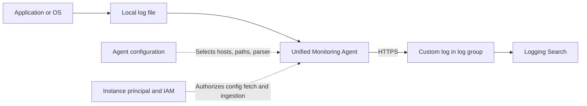

# Collecting Logs from Compute and Applications

In the **Logs, Metrics, and Tracing** chapter of the **CLOUD_PROVIDERS_ORACLE** module, this lesson builds a log collection pipeline from the operating system and applications on OCI Compute into OCI Logging. The running scenario is an Oracle Linux host running the `orders-api` service: operators need to trace request failures without SSHing into individual hosts one by one.

This collection pipeline ties together concepts from compartments, IAM, VCN, and Compute with OCI infrastructure operations. A complete setup must specify which hosts are collected from, which files are read, which identity is authorized to ship logs, which log resource receives the data, and how to detect pipeline interruptions. The lesson also covers log file lifecycle, configuration automation, and cost limits; distributed tracing implementation and specialized Oracle Database log administration are outside the scope of this lab.

## 1. Learning Outcomes

After this lesson, learners can:

- Distinguish logs emitted by OCI services from OS and application logs on Compute.
- Configure a custom log, dynamic group, IAM policies, and agent configuration for an instance.
- Collect JSON logs carrying UTC timestamps and request correlation IDs.
- Prove that a record traveled from a source file to search results in OCI Logging.
- Troubleshoot file read permission errors, parser mismatches, connectivity loss, and log rotation issues.

Bash commands in this lesson target the **lab's Oracle Linux Compute instance**. Policy blocks are configured in OCI IAM; queries run in OCI Logging Search. Do not run these Linux commands in PowerShell on your local machine.

## 2. Choosing the Right Log Type and Collection Path

### 2.1. Logs on a Host Do Not Appear in OCI Logging Automatically

| Source | Example | Approach in this lesson |
| --- | --- | --- |
| Application on Compute | JSON files from `orders-api`, web server access logs | Collect into a custom log |
| Compute operating system | Syslog files, login messages, or Windows Event Logs | Select the appropriate input and collect into a custom log |
| OCI services supporting Logging | VCN Flow Logs, access logs of a supported service | Enable a service log on the corresponding resource |
| OCI API activity | Instance creation commands or API resource mutations | Search Audit logs to investigate administrative actions |

Audit records API activity, whereas contents like a `NullPointerException` inside an application must flow through an application collection path. Service logs, custom logs, and Audit logs are separate concepts in OCI Logging. [Source: Logging Overview](https://docs.oracle.com/en-us/iaas/Content/Logging/Concepts/loggingoverview.htm).

An application writing to `stdout` under systemd does not necessarily produce `/var/log/orders/application.log`. Before configuring the agent, verify where data is actually written. For apps writing only to the journal, configure the logging system to write to a managed file or choose another appropriate collection mechanism. Never enter a nonexistent file path and treat configuration creation as successful collection.

### 2.2. Two Paths to Ingest Custom Logs into OCI

| Collection path | Suitable when | Operational responsibilities |
| --- | --- | --- |
| Unified Monitoring Agent reading host files | App already writes files; many hosts share one config | Source files, read permissions, parsers, and host selection |
| Logging Ingestion API via `PutLogs` | App or forwarder actively pushes events | Auth, batching, payload limits, retries, and send error handling |

OCI supports both paths. In the Oracle Cloud Agent plugin UI, the Unified Monitoring Agent is called **Custom Logs Monitoring**. This lab uses the agent so the application keeps writing files without integrating a log-shipping API client. [Source: Custom Logs](https://docs.oracle.com/en-us/iaas/Content/Logging/Concepts/custom_logs.htm).

### 2.3. Journey of a Log Record



**Log group** organizes logs. **Custom log** is the destination resource receiving data. **Agent configuration** defines source hosts, inputs, and destination; it does not store application records itself.

For instance, multiple `orders-api` instances can ship to the same custom log. Therefore, keep source identification and request IDs in each event so you can pinpoint the exact host and transaction during investigations.

## 3. Preparing the Lab and Access Permissions

### 3.1. Resources Used

To minimize permission scope confusion, the lab places the Compute instance, log group, and agent configuration in the same compartment `ObservabilityLab`, in the same region.

| Component | Value used in the lab |
| --- | --- |
| Operating system | Oracle Linux 8 or 9, image with Oracle Cloud Agent |
| SSH account | `opc`, with `sudo` privileges |
| Compute instance | One lab VM with management connectivity |
| Dynamic group | `dg-orders-logging` |
| Log group | `lg-orders-lab` |
| Custom log | `orders-app` |
| Agent configuration | `ac-orders-app` |
| Source file | `/var/log/oci-orders-lab/application.json.log` |
| Parser | JSON, one object per line |

Have the instance and compartment OCIDs ready. Replace values inside `<...>` with real values before use. If your image, architecture, or FIPS mode differs from the lab, check the supported OS matrix in [Agent Management Overview](https://docs.oracle.com/en-us/iaas/Content/Logging/Concepts/agent_management.htm).

### 3.2. Separating Configurer, Shipping Host, and Reader

- **Configurer** creates the log group, custom log, and agent configuration.
- **Instance** uses instance principal to fetch configurations and ship logs.
- **Investigator** reads log content, possibly without permission to alter configuration.

On OCI Compute, instance principal avoids placing a user's private key inside an application just to ship logs. Linux SSH account permissions and the instance's IAM permissions are two independent layers: having file read access does not imply permission to ingest into OCI.

An IAM administrator creates dynamic group `dg-orders-logging` with a matching rule scoped strictly to the lab host:

```text
instance.id = '<INSTANCE_OCID>'
```

Dynamic groups define membership; policies grant permissions to those members. When modifying rules, account for IAM propagation delay rather than concluding misconfiguration immediately after saving. [Source: Managing Dynamic Groups](https://docs.oracle.com/en-us/iaas/Content/Identity/Tasks/managingdynamicgroups.htm).

Illustrative policies for the instance and read-only users:

```text
Allow dynamic-group dg-orders-logging to use log-content in compartment ObservabilityLab

Allow group LoggingReaders to read log-groups in compartment ObservabilityLab
Allow group LoggingReaders to read log-content in compartment ObservabilityLab
```

`LoggingReaders` is an existing or admin-created user group. Format group/dynamic-group names according to your tenancy's identity domains. Permissions on log metadata and log content are managed separately. [Source: Required Permissions for Working with Logs and Log Groups](https://docs.oracle.com/en-us/iaas/Content/Logging/Task/managinglogs.htm).

If an operations team needs to create the lab's Logging resources, an administrator can grant:

```text
Allow group LoggingOperators to manage log-groups in compartment ObservabilityLab
Allow group LoggingOperators to manage unified-configuration in compartment ObservabilityLab
Allow group LoggingOperators to inspect dynamic-groups in tenancy
```

The lines above assume the dynamic group and user groups already exist. Permissions to create or edit dynamic groups, policies, and enable Compute plugins must be granted separately to the responsible actors.

For Logging resources, `manage` is required for creation; `use` does not grant permission to create logs or agent configurations. Furthermore, `use log-content` includes reading content, shipping logs, and generating agent configs. Thus, the sample instance policy is not write-only. In real environments, review compartment scope and constituent permissions before narrowing further. [Source: Details for Logging](https://docs.oracle.com/en-us/iaas/Content/Identity/policyreference/loggingpolicyreference.htm).

### 3.3. Preparing Outbound Networking

The agent needs DNS resolution and HTTPS connectivity to required endpoints. For standard commercial-realm endpoints, custom logs documentation lists:

```text
https://auth.<REGION>.oraclecloud.com
https://ingestion.logging.<REGION>.oci.oraclecloud.com
```

Verify the region, realm, and endpoints applicable to your actual environment. Host firewalls, NSGs, security lists, route tables, and proxies can all interrupt shipping. The agent initiates outbound connections; there is no need to open public inbound ports just to receive logs from the agent. [Source: Custom Logs — endpoint requirements](https://docs.oracle.com/en-us/iaas/Content/Logging/Concepts/custom_logs.htm).

For private subnets, use an appropriate egress path such as a NAT gateway, or a service gateway for supported Oracle services in the same region. When using a service gateway, configure the proper service CIDR label and route; creating the gateway alone is not enough. Downloading packages or updates from outside Oracle Services Network may require separate internet egress. [Source: Access to Oracle Services: Service Gateway](https://docs.oracle.com/en-us/iaas/Content/Network/Tasks/servicegateway.htm).

## 4. Standardizing Application Logs Before Collection

### 4.1. One Event per JSON Line

A log may be human-readable yet hard to query if every detail sits inside an unstructured message string. Keep investigation-relevant attributes as distinct fields:

```json
{"time":"2026-11-21T03:15:00Z","level":"ERROR","service":"orders-api","environment":"lab","event_id":"evt-demo-001","request_id":"req-demo-001","message":"Database call timed out","latency_ms":1500,"error_type":"SQLTimeoutException"}
```

The timestamp above only illustrates the format. When testing, emit events with the current time so they fall inside your search window.

| Field | Purpose | Recommended convention |
| --- | --- | --- |
| `time` | Event timestamp | UTC, formatted consistently with the parser |
| `level` | Severity level | Consistently use `INFO`, `WARN`, `ERROR` |
| `service`, `environment` | Distinguish app and environment | Stable values, no secrets |
| `event_id` | Identify a single event | Unique across events |
| `request_id` | Correlate events of a single request | Propagated across processing layers |
| `message` | Describe what happened | Concise, informative, free of credentials |
| `latency_ms` | Processing duration | Keep numeric to allow numeric filter operators |

Fluentd's JSON parser reads one JSON map per line. For string-formatted time fields, configure the time type and format explicitly rather than relying on numeric defaults. [Source: Fluentd JSON parser](https://docs.fluentd.org/parser/json).

`request_id` links logs together but does not constitute distributed tracing. If the application already has tracing instrumentation, you can include `trace_id` and `span_id` to pivot from investigation to the matching trace.

### 4.2. Stack Traces and Sensitive Data

Java applications frequently produce multi-line stack traces. If each line is shipped as a separate event, the error message and stack frames split apart. Two solutions are writing stack traces as escaped JSON strings, or using a multiline parser with rules identifying record boundaries.

The example below is still **one physical line** in the file:

```json
{"time":"2026-11-21T03:15:00Z","level":"ERROR","service":"orders-api","request_id":"req-demo-002","message":"Request failed","stack_trace":"java.lang.IllegalStateException: demo\n\tat example.OrderService.create(OrderService.java:42)"}
```

Use your logging library's JSON encoder to escape data; never concatenate JSON strings manually from user-supplied input. With multiline parsers, test both consecutive errors and an error right before log rotation to verify event boundaries. OCI provides JSON, Syslog, Regexp, and Multiline parsers in agent configurations. [Source: Log Inputs and Parsers](https://docs.oracle.com/en-us/iaas/Content/Logging/Concepts/log_inputs_and_parsers.htm).

Design schemas using an allowlist of safe fields. Strip passwords, bearer tokens, private keys, session cookies, and full authentication headers right inside the application. For Oracle Database errors, log the error type, error code, and wait time—avoid logging JDBC passwords or SQL bind values carrying personal data. Log read access must be treated as access to application data.

## 5. Hands-On Log Collection from Compute

### Step 1 — Enable the Agent and Verify Execution Capability

On the Compute instance details page, open **Oracle Cloud Agent**, enable the **Custom Logs Monitoring** plugin, and verify its running status. On supported images, enabling the plugin installs the agent automatically; do not install a second log forwarder on the same file. Refer to [Installing the Agent](https://docs.oracle.com/en-us/iaas/Content/Logging/Task/installing_the_agent.htm) if using a custom image or installing manually.

On Oracle Linux, verify:

```bash
sudo systemctl status unified-monitoring-agent.service --no-pager
sudo systemctl status unified-monitoring-agent_config_downloader.timer --no-pager
```

Once the agent is installed and started, expect the main service to be running and the timer active or waiting. If the units are reported missing, revisit the plugin status and installation. Plugin enabled, service running, and data arriving at destination are three separate verification milestones.

### Step 2 — Create a Dedicated Source File for the Lab

Use a separate directory so you do not alter real application files:

```bash
sudo install -d -o opc -g opc -m 0750 /var/log/oci-orders-lab
LOG_FILE='/var/log/oci-orders-lab/application.json.log'
touch "$LOG_FILE"
chmod 0640 "$LOG_FILE"
ls -ld /var/log/oci-orders-lab
ls -l "$LOG_FILE"
```

These commands assume you are logged in as `opc` as a prerequisite. Do not generate log entries yet; we will emit test records after the configuration loads.

The collector process needs traverse permissions on every parent directory and read permission on the file. Check the actual process user before granting permissions; do not assume the service account name is identical across all OSes. If needed, use group permissions or ACLs scoped to that identity. Never grant world-write access just to fix a file read error. Also check SELinux or OS access controls if Unix permissions look right yet access is still denied.

### Step 3 — Create the Log Group and Custom Log

In the Console, go to **Observability & Management → Logging**:

1. Select the right region and the `ObservabilityLab` compartment.
2. Create log group `lg-orders-lab`.
3. Under **Logs**, choose **Create custom log**, name it `orders-app`, and select the newly created log group.
4. Pick a retention suited for the lab, such as 30 days.
5. To keep steps separate, configure the agent configuration afterward.

After this step, the target log exists with no data yet. Note down the OCIDs of the log group and custom log. Creating the target log and configuring the source are two distinct steps to complete. [Source: Creating a Log](https://docs.oracle.com/en-us/iaas/Content/Logging/Task/create-logging-log.htm).

### Step 4 — Create the Agent Configuration

Go to **Logging → Agent Configurations** and create `ac-orders-app` with these settings:

| Attribute | Value |
| --- | --- |
| Configuration compartment | `ObservabilityLab` |
| Host group type | Dynamic group |
| Host group | `dg-orders-logging` |
| Input type | Log path |
| Input name | `orders-json-input` |
| Path | `/var/log/oci-orders-lab/application.json.log` |
| Parser | JSON |
| Destination compartment | `ObservabilityLab` |
| Destination log group | `lg-orders-lab` |
| Destination log | `orders-app` |

The configuration target must be an existing custom log. Host group picks which machines receive the config; path picks the input on each machine. In the lab, start with a single file for easy verification before expanding. [Source: Creating an Agent Configuration](https://docs.oracle.com/en-us/iaas/Content/Logging/Task/create-logging-agent-configuration.htm).

In the JSON parser section, configure these concepts; exact UI labels may vary slightly:

| Time setting | Value for lab data |
| --- | --- |
| Event time field | `time` |
| Time type | String |
| Time format | `%Y-%m-%dT%H:%M:%SZ` |
| Keep time key in data, if available | Enable for easier correlation |

This format matches UTC with a `Z` suffix to second precision, matching what the script below generates. If your app emits milliseconds or an offset like `+07:00`, adjust the parser to match real data. Time field, time type, and time format properties are documented in [UnifiedJSONParser](https://docs.oracle.com/en-us/iaas/tools/python/latest/api/logging/models/oci.logging.models.UnifiedJSONParser.html).

Save the configuration and allow the agent to download it. Do not treat hand-editing agent-managed config files as a standard deployment method: OCI manages and distributes this configuration from the service. [Source: Agent Management Overview](https://docs.oracle.com/en-us/iaas/Content/Logging/Concepts/agent_management.htm).

### Step 5 — Emit Three Events After the Agent Is Ready

In the same Bash session on Compute:

```bash
LOG_FILE='/var/log/oci-orders-lab/application.json.log'
RUN_ID="oci-orders-lab-$(date -u +%Y%m%dT%H%M%SZ)-$$"
REQUEST_ID="req-${RUN_ID}"

for LEVEL in INFO WARN ERROR; do
  EVENT_TIME="$(date -u +%Y-%m-%dT%H:%M:%SZ)"
  case "$LEVEL" in
    INFO) LATENCY_MS=25 ;;
    WARN) LATENCY_MS=350 ;;
    ERROR) LATENCY_MS=1500 ;;
  esac

  printf '{"time":"%s","level":"%s","service":"orders-api","environment":"lab","run_id":"%s","event_id":"%s-%s","request_id":"%s","message":"OCI logging lab event","latency_ms":%s}\n' \
    "$EVENT_TIME" "$LEVEL" "$RUN_ID" "$RUN_ID" "$LEVEL" \
    "$REQUEST_ID" "$LATENCY_MS" >> "$LOG_FILE"
done

printf 'RUN_ID=%s\nREQUEST_ID=%s\n' "$RUN_ID" "$REQUEST_ID"
tail -n 3 "$LOG_FILE"
```

The script only appends data. `RUN_ID` separates the current test from earlier ones; three distinct `event_id` values let you compare source lines against ingested records. Save the two printed values for searching. The strings in this script are fixed lab values; real apps still require a proper JSON encoder.

If the configuration hadn't finished downloading when you emitted the events, confirm the agent is ready and re-run to generate a fresh `RUN_ID`. Do not rely on re-reading older lines as a default assumption for your first test.

### Step 6 — Search and Inspect the Received Payload

Open **Logging → Search**, pick log `orders-app` and a time range covering when the script ran (such as the last hour). Expand an event and inspect its JSON to see where application fields sit within the log envelope. The Console may display timestamps in a non-UTC local timezone; cross-check with the event's inner timestamp during investigation. [Source: Viewing and Working with Search Results](https://docs.oracle.com/en-us/iaas/Content/Logging/Concepts/work_with_search_results.htm).

In Advanced mode, replace every placeholder, including `<` and `>`:

```text
search "<COMPARTMENT_OCID>/<LOG_GROUP_OCID>/<LOG_OCID>"
| where data.run_id = '<RUN_ID>'
| sort by datetime desc
```

This query assumes JSON was parsed and `run_id` appears under `data`. If the actual payload differs, use the field path shown in JSON; never alter your app schema just to fit an assumed query.

To filter specifically for high-latency error events:

```text
search "<COMPARTMENT_OCID>/<LOG_GROUP_OCID>/<LOG_OCID>"
| where data.run_id = '<RUN_ID>' and data.level = 'ERROR' and data.latency_ms >= 1000
| sort by datetime desc
```

If testing an input configured with parser `NONE`, you can search for the run ID across the full log content:

```text
search "<COMPARTMENT_OCID>/<LOG_GROUP_OCID>/<LOG_OCID>"
| where logContent = '*<RUN_ID>*'
| sort by datetime desc
```

`NONE` helps isolate parsing issues, though it does not create structured JSON fields. Scope syntax, `where`, numeric comparisons, and `logContent` matching belong to the OCI Logging Query Language. [Source: Logging Query Language Specification](https://docs.oracle.com/en-us/iaas/Content/Logging/Reference/query_language_specification.htm).

### Step 7 — Record Evidence of Success

Conclude that the pipeline works only once you verify:

- The source file contains all three `event_id` entries from the new run.
- Search on the target log retrieves the corresponding `event_id` entries.
- `level`, `request_id`, and `latency_ms` hold expected values; the numeric filter returns the expected `ERROR` event.
- Timestamps match emission time and the source host is properly identified in payload/metadata.

Three distinct events are the goal of this test. If you see more than three records with the same `RUN_ID`, compare `event_id` values to check for duplicates; matching line count alone does not prove extra business events occurred. A service showing `running` only proves the process is alive—not that the entire log pipeline works.

## 6. Extending to OS Logs and Other Sources

Once application logging works, you can create custom log `orders-os` and agent configuration `ac-orders-os` using the same dynamic group while reading real OS log files on the host. Separating destinations allows tailored read permissions and retention per data category.

| Source | What to check before picking input |
| --- | --- |
| Oracle Linux with rsyslog | Whether files like `/var/log/messages` exist and actively grow |
| Other Linux distributions | Filename may be `/var/log/syslog`, or logs may live only in journal |
| Login logs | Access permissions, user identity info, and investigation needs |
| Windows Server | Choose Windows Event Log and required channels like System or Application |
| Web server | Pick the right access/error files and a parser matching the configured format |

The agent supports Windows Event Logs and Log Directory/Tail inputs. Never apply Linux paths to Windows or assume all OSes share the exact same file layout. [Source: Log Inputs and Parsers](https://docs.oracle.com/en-us/iaas/Content/Logging/Concepts/log_inputs_and_parsers.htm).

For containers, determine whether logs live inside the container, on the host, or in a platform collector. A host-level agent does not automatically see every path inside containers. If the platform runs its own collector, clarify which collector owns each source to avoid duplicate shipping.

If choosing `PutLogs`, each call must target the right custom log with valid authentication and payload. Applications must handle timeouts, exponential-backoff retries, and buffering; avoid making business requests block indefinitely when the logging path is disrupted. Use a supported SDK to sign requests rather than hand-crafting unsigned HTTP calls. [Source: Ingesting Custom Logs](https://docs.oracle.com/en-us/iaas/Content/Logging/Concepts/using_the_api_customlogs.htm).

## 7. Operating Through Rotation, Restarts, and Network Drops

### 7.1. Rotation Must Align with Permissions and File Reopening

Applications cannot let log files grow unbounded. During rotation, coordinate the rotation mechanism, logger file reopening, and the agent continuing to tail data.

Items to verify in a test environment:

1. New files have owner, group, and permissions allowing the app to write and the agent to read.
2. Emit events with unique IDs before and after rotation, then locate both in Logging.
3. If using rename-and-create, confirm the application switched to writing the new file.
4. Avoid overly broad globs capturing active files, rotated copies, and compressed archives before understanding tail tracking.
5. Check how the agent behaves across restarts; preserve position tracking state unless executing an intentional recovery procedure.

Fluentd's tail input tracks read positions and handles rotation; exact behavior depends on configuration, position file state, and tracked files. Never assume adding a glob automatically backfills full history without creating duplicates. [Source: Fluentd tail input](https://docs.fluentd.org/input/tail).

`copytruncate` can leave a race window where data written during copy-and-truncate is lost. Test your actual rotation strategy under representative load instead of inferring reliability from a single `tail` check. For critical logs, retain `event_id` to detect gaps and duplicates.

### 7.2. Local Buffering Is Bounded

Distinguish application log files, data buffered by the agent, and data already searchable in OCI. Each has a different lifecycle. Deleting source files early or losing a VM with unsent buffers can lose forensic evidence.

A rough planning estimate for temporary storage:

```text
Minimum space ≈ data generation rate × expected outage duration
```

For example, assuming 100 KB/sec during a one-hour network outage produces roughly 360 MB (decimal) of raw data. That covers raw payload only; leave headroom for overhead, traffic spikes, rotated files, and existing disk usage. This calculation does not mean the agent automatically allocates that buffer size or guarantees zero loss for exactly one hour.

Set free-disk alarms and define disk-full actions: drop low-value logs, fix egress issues, and protect the application's ability to keep writing. Raising service-side log retention does not increase local disk capacity or agent buffer size.

### 7.3. Monitoring the Collection Pipeline Itself

Enabling agent operational metrics lets you track signals such as `Heartbeat`, `EmitRecords`, `BufferSpaceAvailable`, and `RetryCount`. Use them to spot when an agent stops reporting status, emission drops abnormally, buffers fill up, or retries climb. Choose the right compartment, namespace, and permissions for the metric path; log-shipping permissions do not grant custom-metric publishing permissions. [Source: Operational Metrics for OCI Logging's Unified Monitoring Agent](https://blogs.oracle.com/cloud-infrastructure/operational-metrics-unified-monitoring-agent).

Do not expect a disconnected agent to keep reporting a heartbeat value of 0. Watch for **absence of new datapoints** alongside end-to-end log evidence.

A helpful operational check is emitting a low-frequency synthetic event with a distinct marker and checking end-to-end arrival latency. Frequency and alerts must fit actual traffic; an idle application may produce few logs even when completely healthy.

## 8. Diagnosing Hop by Hop

Start at the source and walk downstream toward the destination. Change one variable at a time so you know what actually restored the pipeline.

| Symptom | First check | Remediation direction |
| --- | --- | --- |
| File has no new records | Where the logger actually writes, log level, flushing | Generate a lab event and verify directly at the source |
| File has data, agent cannot read | Path, process user, directory/file permissions | Grant exact read access and check OS access controls |
| Agent runs but lacks config | Matching rule, Host Groups, IAM, downloader | Fix host scope/permissions, then verify config download |
| Authentication or authorization error | Instance principal, policies, and compartment | Identify the denied operation before broadening policies |
| Connectivity or TLS error | DNS, routes, egress, proxy, clock, and certificates | Verify path to the region's ingestion endpoint |
| Missing expected JSON fields | Parser and actual ingested payload | Compare raw source line against parser settings |
| Logs missing in Search | Region, log OCID, read permissions, time filter | Widen time filter deliberately and strip extra filters |
| Duplicate logs or sudden surge | Overlapping inputs, globs, multiple configs tailing same file | Enforce one collection path per source |
| Logs stop only after rotation | New file permissions and logger file reopening | Test rotation with pre-/post-rotation event IDs |

On Oracle Linux, these status and log commands help diagnose agent errors:

```bash
sudo journalctl -u unified-monitoring-agent.service --since '30 minutes ago' --no-pager
sudo journalctl -u unified-monitoring-agent_config_downloader.service --since '30 minutes ago' --no-pager
sudo tail -n 100 /var/log/unified-monitoring-agent/unified-monitoring-agent.log
```

The downloader service may show `inactive (dead)` after a successful run; check its exit status and timer schedule before concluding it failed. Config updates take time to propagate to the agent. When forcing a config refresh in the lab, Oracle documentation advises:

```bash
sudo systemctl restart unified-monitoring-agent_config_downloader.service
```

This tells the agent to fetch its configuration; it will not fix broken policies or blocked networks. Log paths, systemd units, and reload steps are detailed in [Troubleshooting Logging](https://docs.oracle.com/en-us/iaas/Content/Logging/troubleshooting.htm).

Investigation example: the local file has three lines, yet Search returns nothing. If the agent log shows authorization errors, inspect the dynamic group and IAM policies first. If there are no shipping errors yet timestamps landed outside the search window, inspect the time parser and host clock. Never apply the same blind fix to both cases.

## 9. Controlling Cost and Managing Configuration

### 9.1. Limiting Data at the Source

Set log levels by environment. Enable `DEBUG` only for an intentional troubleshooting window with a scheduled revert to normal levels. Strip large payloads, redundant records, and overly frequent heartbeats before shipping. General log sampling requires rules that preserve critical error evidence.

Rough daily raw volume estimate:

```text
Records/sec × average bytes per record × 86,400
```

A hypothetical 50 records/sec at 800 bytes average produces about 3.456 GB/day (decimal) before overhead. This is a capacity estimate for comparing options; billing depends on actual usage and current pricing, including any downstream services.

Custom/service log retention is configured in 30-day increments up to 180 days per current documentation. Extending retention does not recover expired data; reducing retention makes older logs beyond the new window inaccessible. [Source: Editing a Log](https://docs.oracle.com/en-us/iaas/Content/Logging/Task/update-logging-log.htm).

For longer storage, route data via Connector Hub to Object Storage. Verify permissions, readability, and bucket lifecycle rules; archived objects do not automatically provide the same indexed search experience as active logs. [Source: Logging Overview — Connector Hub](https://docs.oracle.com/en-us/iaas/Content/Logging/Concepts/loggingoverview.htm).

### 9.2. Scaling from One Instance to Many

Once the single-host lab succeeds, manage configurations with infrastructure-as-code tools or OCI CLI/API for repeatability. Parameterize compartments, log group/log OCIDs, dynamic groups, paths, parsers, and retention. Never hardcode test-environment OCIDs into production templates.

A useful way to inspect CLI schemas before automating is generating a parameter template:

```bash
oci logging agent-configuration create \
  --generate-param-json-input service-configuration
```

This command inspects the parameter JSON structure; it is not a complete deployment command. Real creation requires mandatory parameters and host-group associations per the command reference. [Source: OCI CLI — agent-configuration create](https://docs.oracle.com/en-us/iaas/tools/oci-cli/latest/oci_cli_docs/cmdref/logging/agent-configuration/create.html).

Roll out parser changes to a single canary host first, emit an event with a unique ID, and inspect the parsed structure before rolling out to the fleet. Watch for overlapping inputs so two agent configurations do not tail the same file and double-ship to the destination.

When replacing instances, ensure new hosts match the dynamic group, run the required plugin, and create files with proper permissions before taking traffic. Provision the logging path during instance bootstrap so diagnostic data exists from the start of the instance lifecycle.

## 10. Completing the Lab

Keep `RUN_ID`, the three `event_id` values, the target log name/OCID, and a query locating the error event as self-verification artifacts. They distinguish "configuration created" from "collection pipeline proven end-to-end."

When finished, stop emitting lab logs. If test resources are no longer needed, disable or delete the lab's agent configuration, custom log, and log group after saving required evidence. Revoke lab dynamic groups/policies and delete local lab files only when they serve no other sources; follow your environment's data-retention policy before deleting anything.

An operational collection pipeline requires four things to hold true simultaneously: the source emits properly structured data, the agent can read the source, IAM and networking permit shipping, and authorized investigators can find the exact events at the destination. Re-verify all four conditions after every significant application or infrastructure change.
