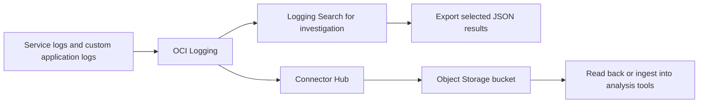

# Searching, Retaining, and Exporting Logs to Object Storage

## 1. Objectives and Context

In the **Logs, Metrics, and Tracing** chapter of the **CLOUD_PROVIDERS_ORACLE** module, logs must support both rapid incident investigation and readability months later. This lesson brings OCI Logging and Object Storage together into a single design tied to tenancies, compartments, IAM, and applications running on Compute, OKE, Functions, or connecting to Oracle Database services.

The running example is a Java order-processing application. The operations team needs to search errors by time window and trace ID, retain recent logs for incident response, and export selected data to a dedicated bucket for longer retention. Resource names, application schemas, and retention schedules in this lesson are illustrative examples, not configurations pre-created by OCI.

After this lesson, learners can:

- Choose the right scope, time range, and fields when searching in OCI Logging.
- Write explainable queries for filtering, projecting fields, and summarizing.
- Distinguish ad-hoc investigation exports from continuous log-export pipelines.
- Design Logging retention, Object Storage retention, and appropriate lifecycle rules.
- Configure a Logging → Connector Hub → Object Storage flow with required permissions and verification.
- Identify gaps, duplicate records, and insufficient evidence before claiming an export is complete.

Commands and configurations in this lesson are for learners to apply in a prepared environment. Nothing automatically creates tenancy resources merely because an example is shown. When practicing, replace OCIDs, namespaces, regions, and buckets with your own values; Bash snippets require a compatible shell.

## 2. Distinguishing Where You Search from Where You Store

### 2.1. Three Distinct Tasks

| Task | Appropriate mechanism | Output obtained |
|---|---|---|
| Investigate recent logs | Logging Search with specific scope and time window | Events or summary aggregations for analysis |
| Preserve evidence from one investigation | Export search results, record query and accompanying metadata | A query-scoped snapshot, not the entire source by default |
| Continuously archive logs elsewhere | Connector Hub from Logging to Object Storage | Batches written as objects per configuration |

Logs stored in a bucket do not automatically become searchable in Logging Search. Conversely, a saved search saves only the query definition, not an independent copy of every log the query could return.



To use this flow, ingestion at the source must still be enabled or configured. Logs that were never collected cannot be recovered later by increasing retention.

### 2.2. Understanding Logs, Log Groups, and Identifiers

In OCI Logging, log groups organize logs; every log must belong to a log group. Record the OCIDs of the compartment, log group, and log to pin down the exact scope. Display names help humans, while OCIDs prevent confusing two similarly named resources. [Logs and Log Groups](https://docs.oracle.com/en-us/iaas/Content/Logging/Task/managinglogs.htm).

Distinguish service logs emitted by supported OCI services from custom logs supplied by applications. Audit is a separate source with its own mechanism and scope; do not infer that every business event in Java appears in Audit simply because the app runs on OCI.

Before searching, answer four questions: which region are we in, which compartment holds the source, which log is selected, and does the account have permission to read content? Empty results can stem from any of those four conditions.

## 3. Standardizing Fields for Accurate Search

### 3.1. Use Structured JSON

Example application log payload placing attributes inside the `data` field of a log record:

```json
{
  "id": "evt-lab-0001",
  "time": "2026-11-21T03:05:00Z",
  "source": "orders-api",
  "type": "com.example.orders.request",
  "data": {
    "service": "orders-api",
    "environment": "prod",
    "level": "ERROR",
    "event_id": "evt-lab-0001",
    "trace_id": "0123456789abcdef0123456789abcdef",
    "release": "r-ab12cd3",
    "duration_ms": 2700,
    "error_code": "DB_POOL_TIMEOUT",
    "message": "Timed out while acquiring a database connection"
  }
}
```

This is a condensed illustration to explain query fields, not the mandatory full envelope of every OCI source. Inspect actual JSON in the Console to determine exact field paths. If the agent ships an unparsed JSON string inside `data.message`, `data.error_code` may not exist as a separate field.

Standardize numeric types for `duration_ms`, severity conventions, and field names across application releases. A string `"2700"` should not be treated as always equivalent to the number `2700` across filters and aggregations.

### 3.2. Distinguishing Timestamps and Correlation Keys

| Data | Purpose | Note |
|---|---|---|
| Event time | Know when the business event occurred | Can differ from ingestion time due to buffering or retries |
| Ingestion/export time | Assess pipeline latency | Does not replace when the event occurred |
| `trace_id` | Link events of a distributed request | One trace can span many log records |
| Event ID | Identify a single event | Needs a clear uniqueness scope for deduplication |
| Resource OCID | Identify which resource emitted or participated | Never use display name as a unique identifier |
| Release | Correlate errors with a deployment | Temporal correlation alone does not prove causation |

With UTC timestamp `2026-11-21T03:05:00Z`, the local time in Vietnam is 10:05 on the same day. Always state timezones explicitly during incident discussions and when exporting data. A range like 10:00–10:15 without a timezone can send a team searching the wrong window entirely.

Never log passwords, tokens, private keys, wallets, or full sensitive payloads just to make searching easier. Once exported to a bucket, that copy carries its own lifecycle and access permissions; modifying the source does not scrub already-exported objects.

## 4. Searching in OCI Logging

### 4.1. Narrow-to-Broad Investigation Workflow

1. Select the relevant region, compartment, log group, and log.
2. Pick a time range covering the incident plus potential clock skew or ingestion latency.
3. Run a simple query to confirm the source has data.
4. Expand one JSON record and verify exact field paths and types.
5. Filter by service, environment, trace, or error code.
6. Inspect surrounding context before summarizing or drawing conclusions.

Logging Search supports Basic and Advanced modes, searches ingested logs, and can export search results to JSON. Searching requires permission to read log content as well as read the corresponding log group. [Logging Search](https://docs.oracle.com/en-us/iaas/Content/Logging/Concepts/searchinglogs.htm).

In the examples below, replace `COMPARTMENT_OCID/LOG_GROUP_OCID/LOG_OCID` with your actual scope. Select the time range in the Console, such as 03:00–03:15 UTC on 2026-11-21. The syntax is **Logging Query Language**, not Monitoring's MQL or OCI Search's resource-query language.

### 4.2. Confirming Scope Has Data

```text
search "COMPARTMENT_OCID/LOG_GROUP_OCID/LOG_OCID"
| sort by datetime desc
```

Scope can target a compartment, log group, or specific log using supported syntax. Narrow scopes reduce cross-source confusion. Query fields and JSON paths are case-sensitive. [Logging Query Language Specification](https://docs.oracle.com/en-us/iaas/Content/Logging/Reference/query_language_specification.htm).

### 4.3. Filtering Structured Errors

```text
search "COMPARTMENT_OCID/LOG_GROUP_OCID/LOG_OCID"
| where data.service = 'orders-api'
  and data.environment = 'prod'
  and data.level = 'ERROR'
| sort by datetime desc
```

Level filtering only works if the source supplies that field and convention. Service logs from Load Balancer, Functions, or other services may use different schemas; do not blindly apply `data.level` to every source and conclude there are no errors.

### 4.4. Following a Trace and Projecting Fields

```text
search "COMPARTMENT_OCID/LOG_GROUP_OCID/LOG_OCID"
| where data.trace_id = '0123456789abcdef0123456789abcdef'
| select datetime, data.service, data.level, data.error_code, data.message
| sort by datetime asc
```

One trace can cross multiple sources. When needed, broaden the search to authorized logs sharing the same trace ID. A missing record in one service could stem from instrumentation gaps, lost context, sampling, or ingestion delays—not enough on its own to conclude the request bypassed that service.

### 4.5. Finding Slow Events and Aggregating Error Codes

With a numeric duration field:

```text
search "COMPARTMENT_OCID/LOG_GROUP_OCID/LOG_OCID"
| where data.service = 'orders-api' and data.duration_ms >= 2000
| select datetime, data.trace_id, data.duration_ms, data.error_code
| sort by data.duration_ms desc
```

Counting errors by group in the selected window:

```text
search "COMPARTMENT_OCID/LOG_GROUP_OCID/LOG_OCID"
| where data.level = 'ERROR'
| summarize count() as error_count by data.error_code
| sort by error_count desc
```

Aggregation queries produce a summary table rather than preserving individual log events. Never treat this count table as a raw archive expecting to read full per-event messages from it later.

### 4.6. Full-Text Search and Understanding Result Limits

When you don't know the field name yet, use full-text matching as an initial probe:

```text
search "COMPARTMENT_OCID/LOG_GROUP_OCID/LOG_OCID"
| where logContent = '*DB_POOL_TIMEOUT*'
| sort by datetime desc
```

Once you locate a record, switch back to structured fields to trim irrelevant hits. Expand the JSON and use Before & After to inspect surrounding context when appropriate. The Console limits how many results are displayed; never cite visible row counts as proof that you read or exported the entire source. [Working with Search Results](https://docs.oracle.com/en-us/iaas/Content/Logging/Concepts/work_with_search_results.htm).
