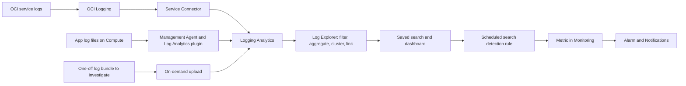

# Logging Analytics and Centralized Log Analysis

## Learning Objectives

In Oracle Cloud Infrastructure (OCI), a single request can pass through a Load Balancer, an application on Compute, and an Oracle database. When users report errors, related logs often live across multiple resources with different formats and access controls. Merely aggregating files into one place only solves locating data; effective investigation also requires understanding timestamps, emitting sources, and fields that correlate events together.

This lesson belongs to the **Logs, Metrics, and Tracing** chapter of the **CLOUD_PROVIDERS_ORACLE** module and focuses on using Logging Analytics for centralized log analysis within an OCI infrastructure context featuring IAM permissions, monitoring, and cost control.

After this lesson, you can:

- Distinguish the roles of OCI Logging and Logging Analytics in the log pipeline.
- Explain the relationships among log group, entity, source, parser, and field.
- Choose collection paths for service logs and application logs on Compute.
- Standardize logs, query errors, and correlate records belonging to the same request.
- Design access controls, monitor collection pipelines, and manage data lifecycles.

Oracle documentation now uses the name **Oracle Log Analytics** across many pages. This lesson uses **Logging Analytics** per the topic title; both names refer here to OCI's log analysis service.

## 1. From Distributed Logs to an Investigation Workflow

Suppose an order-processing system runs two Java services: Orders and Payments. Orders returns HTTP 504, Payments records a dependency timeout, and the Compute OS logs a process restart.

If operators open individual files one by one, they have to manually stitch together timestamps and hostnames. When there are many instances or instances get replaced, that process stops being repeatable.

A centralized design needs to answer three groups of questions:

| Question group | Examples to answer |
| --- | --- |
| Where did the data come from? | Which service, environment, instance, and collection source produced the record? |
| What is happening? | Which error patterns are rising, which requests are slow, and which hosts behave anomalously? |
| Is the evidence trustworthy? | Are there missing logs, clock skew, parser errors, or duplicate collection? |

The practical goal is building a chain of **collect → parse → search → correlate → act**. A sleek dashboard that is missing Payments logs can still lead to the wrong conclusion.

## 2. Where Logging Analytics Fits in the Observability Stack

Responsibilities can be divided in your architecture as follows:

| Component | Role in the design |
| --- | --- |
| OCI Logging | Ingestion point for service logs or custom logs, and search for Logging-managed logs |
| Service Connector | Moves data from a configured source, such as Logging, to Logging Analytics |
| Logging Analytics | Field-level log analysis, aggregation, pattern discovery, and record linking |
| OCI Monitoring | Tracks numeric time series and evaluates alarm conditions |
| APM/tracing system | Tracks spans and request execution relationships when apps are instrumented |

Oracle provides a flow using Service Connector to bring logs from OCI Logging into Log Analytics. Choosing the connector's source, target, and permissions is a separate configuration step. See [Ingest Logs from Other OCI Services Using Service Connector](https://docs.oracle.com/en-us/iaas/log-analytics/doc/ingest-logs-from-other-oci-services-using-service-connector.html).

In your design, treat logs as detailed event evidence, metrics as quantitative trend measurements, and traces as execution path structures. For example:

- Metrics show the Orders error rate rose at 10:00.
- Traces pinpoint that requests stalled during the call to Payments.
- Payments logs explain which dependency timed out.

A `trace_id` field in logs helps locate related records. To obtain a span tree and step-by-step execution timings, applications still require proper trace context generation and propagation.

## 3. Concepts to Distinguish

### 3.1. Log Group and Compartment

A Logging Analytics log group organizes log data to manage access control. It resides in a compartment. Define your data boundaries before picking group names. Oracle describes this relationship in [Manage Log Groups](https://docs.oracle.com/en-us/iaas/log-analytics/doc/manage-log-groups.html).

One layout option for the order system:

| Compartment | Log group | Purpose |
| --- | --- | --- |
| Observability-Lab | la-orders-lab | Lab practice data and parser testing |
| Observability-Prod | la-orders-prod | Operational logs for Orders and Payments |
| Security-Prod | la-security-prod | Logs requiring isolated access for the security team |

Names in this table are illustrative design examples, not mandatory OCI resource names.

OCI Logging also has a resource called a log group. Store the OCIDs of the **source group in Logging** and the **target group in Logging Analytics** separately. When configuring a connector, having the same display name does not make them the same resource.

### 3.2. Entity, Source, Parser, and Field

| Concept | Question it answers | Example in the order system |
| --- | --- | --- |
| Entity | Which actual resource generated the data? | Compute host `orders-host-01` |
| Entity type | What resource category does the entity belong to? | Host type compatible with the selected source |
| Source | Which log type and collection/processing config applies? | `Orders Application JSON` |
| Parser | How is a raw record split into fields? | JSON parser for application logs |
| Field | Which values can be filtered or computed on? | Service, Request ID, Duration ms |
| Association | Which source is bound to which entity for continuous collection? | App source associated with Orders hosts |

A source can reference a parser and additional settings. When collecting via Management Agent, verify entity type compatibility and associate the source with the entity. See [Create a Source](https://docs.oracle.com/en-us/iaas/log-analytics/doc/create-log-source.html) and [Continuous Log Collection from Your Hosts](https://docs.oracle.com/en-us/iaas/log-analytics/doc/continuous-log-collection-form-your-hosts.html).

A shared parser can serve logs from multiple hosts if their record structures match. Conversely, two files on the same host may require two sources when their formats and processing rules differ.

Do not confuse the **resource-representing entity** with the **Log Entity** field that may describe the originating file or location. During investigations, you need to know both which host emitted the record and which file on that host held it.

## 4. Designing Log Ingestion Paths



This diagram shows the available design options. An application log set should have one clear primary collection path so you can easily verify completeness and detect duplicates.

Oracle describes choosing ingestion paths based on data location and whether collection is continuous or batch-based in [Architecture of Log Analytics](https://docs.oracle.com/en-us/iaas/log-analytics/doc/architecture-logging-analytics.html).

### 4.1. When Logs Are Already in OCI Logging

For service logs, first enable the required log category on the source resource and confirm records appear in Logging. Then configure a connector with Logging as source and Logging Analytics as target.

Your configuration record should explicitly state:

- Active region.
- Source compartment, log group, and log in Logging.
- Target compartment and target log group OCID in Logging Analytics.
- Connector filters.
- Source read permissions, target write permissions, and operational owner.

To verify the pipeline, trigger an event with a recognizable marker, find it at the source, and then find it at the target. This check separates "source never emitted the log" from "connector did not transfer the log."

### 4.2. When Applications Write Files on Compute

One option uses Management Agent with the Log Analytics plugin. In the Compute ingestion workflow, Oracle Cloud Agent, the Management Agent plugin, and the Log Analytics plugin have related but distinct roles. Guided setup can deploy the necessary components; the mere presence of Oracle Cloud Agent does not prove application logs are being collected. See [Ingest Logs from OCI Compute Instance](https://docs.oracle.com/en-us/iaas/log-analytics/doc/ingest-logs-from-oci-compute-instance.html).

For the Orders application, a collection spec should include:

1. Target hosts/entities to collect from.
2. File paths and patterns, such as `/var/log/orders/application*.log`.
3. Agent service account, file read permissions, and parent directory traverse permissions.
4. Corresponding source, parser, and association.
5. Target log group.
6. Rotation policy and local file retention on the host.

Patterns must match active files and post-rotation filenames accurately. Avoid sweeping in a backup directory holding copies of those exact same files.

If hosts sit in a private subnet, verify DNS and egress paths to required OCI endpoints, along with route tables, proxies, and active network policies. Design networking for the deployment topology; never fix connectivity errors by throwing open broad network access.

### 4.3. When You Only Need to Ingest One Log Bundle

On-demand upload works well for testing parsers or investigating exported log files. Prepare the log source, log group, and dataset; attach an entity when appropriate. This is the option used in the hands-on exercise later in this lesson. See [Upload Logs on Demand](https://docs.oracle.com/en-us/iaas/log-analytics/doc/upload-logs-demand.html).

## 5. IAM: Separating Permissions for Data and Pipelines

An authorization design must address three actors separately:

| Actor | Needs | Design scope |
| --- | --- | --- |
| Analyst | Run queries and read assigned logs | Log groups containing the team's data |
| Platform administrator | Manage sources, parsers, associations, and related config | Assigned administrative scope |
| Collection principal | Ingest data via agent or connector | Pipeline sources and targets |

Logging Analytics has two key resource families to note:

- `loganalytics-features-family`: covers configurations such as sources, parsers, and fields; corresponding policies must be placed at the tenancy/root scope required by the service.
- `loganalytics-resources-family`: covers resources such as log groups and entities; permissions can be scoped per compartment where appropriate.

Consult [IAM Policies Catalog](https://docs.oracle.com/en-us/iaas/log-analytics/doc/iam-policies-catalog-logging-analytics.html) to pick matching scopes and policy templates.

When deploying, map permissions by operation:

| Operation | Permissions to check |
| --- | --- |
| Query logs | Service query permissions and read access to the target log group |
| Create parser/source | Admin permissions for those feature configuration types |
| Collect via agent | Dynamic group matching management agents, log-upload permissions, and metric-emit permissions |
| Transfer logs via connector | Connector permissions to read the source and write to the target log group |
| Run scheduled queries | Permissions for the background task, plus metric-publishing permissions |
| Delete or purge logs | Dedicated data-management permissions restricted to accountable owners |

Permissions of the user who created a connector do not substitute for runtime permissions required by the connector's principal. Likewise, an operator being able to read a file on a VM does not prove the agent account can read it.

With Management Agent, dynamic groups must match the agent resource using the proper rule rather than blindly assuming the Compute instance and agent share one identical principal. See [Allow Continuous Log Collection Using Management Agents](https://docs.oracle.com/en-us/iaas/log-analytics/doc/allow-continuous-log-collection-using-management-agents.html).

Acceptance testing for permissions should use two representative accounts:

- An Orders analyst can query Orders logs within their granted scope.
- A lab-only account cannot read production data.

Hiding a dashboard widget creates no data-protection boundary. Test permissions directly on the underlying log resources.

## 6. Standardizing Records Before Analysis

### 6.1. Data Conventions for Java Applications

For Orders and Payments, choose one-line-per-event JSON. A shared field set lets teams query without guessing each app's format:

| JSON key | Meaning | Example convention |
| --- | --- | --- |
| `timestamp` | Event time | ISO 8601 with timezone |
| `severity` | Event severity | `INFO`, `WARN`, `ERROR` |
| `service` | Emitting service | `orders`, `payments` |
| `environment` | Environment | `lab`, `prod` |
| `event` | Event type | `request_complete`, `dependency_error` |
| `request_id` | Request correlation key | Propagated across related calls |
| `host` | Hostname in sample data | `orders-host-01` |
| `status` | HTTP status code in event context | Integer |
| `duration_ms` | Duration of recorded operation | Numeric, in milliseconds |
| `error_code` | Stable error code | Empty string when no error |
| `message` | Human-readable explanation | Free of secrets or sensitive payloads |

In Java apps, the request ID typically goes into the request's logging context. With thread pools and asynchronous execution, propagate context deliberately and clear it upon completion to avoid leaking one request's ID onto another.

Design messages so error codes and event types can be counted independently of prose phrasing. For example, editing `message` wording for readability must not break counts of `DB_POOL_TIMEOUT`.

### 6.2. Parser Field Mapping

JSON keys do not automatically guarantee every query field has the right name, data type, and semantics. When creating a parser, map them explicitly:

| JSON key | Field in this lab | Data type |
| --- | --- | --- |
| `timestamp` | `Time` | Timestamp |
| `severity` | `Severity` | String |
| `service` | `Service` | String |
| `environment` | `Environment` | String |
| `event` | `Event` | String |
| `request_id` | `Request ID` | String |
| `host` | `App Host` | String |
| `status` | `HTTP Status` | Long |
| `duration_ms` | `Duration ms` | Appropriate numeric type |
| `error_code` | `Error Code` | String |
| `message` | `Message` | String |

`Service`, `Environment`, `Event`, `Request ID`, `App Host`, `HTTP Status`, `Duration ms`, and `Error Code` are names chosen for this example. Check built-in fields first; create custom fields as needed and keep names consistent across queries.

Map `timestamp` as the event time. If time is misparsed, records may fall back to ingestion time, skewing investigation windows. Oracle covers timestamp mapping, parser testing, and handling wrapped logs in [Create a Parser](https://docs.oracle.com/en-us/iaas/log-analytics/doc/create-parser.html).

When logs arrive through OCI Logging and Service Connector, incoming records may carry an outer envelope. Sample actual records on that ingestion path to see where the inner message sits. A parser that passes tests on raw JSON is not guaranteed to parse the same payload when nested as a JSON string inside an envelope.

### 6.3. Time and Data Quality

In this example, `2026-11-21T03:00:00Z` corresponds to `10:00:00` in Vietnam. When searching, record the time picker's timezone and selected window.

Beyond timestamps, also test:

- `ERROR` lines missing optional fields.
- Records containing Unicode characters or quotation marks.
- Multi-line stack traces if the app writes plain-text logs.
- Late-arriving events after a network outage.
- Time units: `3000 ms` must be interpreted as 3 seconds.

Parser errors can degrade statistical accuracy while still leaving parts of a record searchable. Finding the string `timeout` does not prove numeric fields are working properly.

## 7. Hands-On Lab: From JSON to Centralized Querying

This is a hands-on guide for your own tenancy. Create the resources and run the queries below in an authorized lab environment.

### 7.1. Preparing Resources

Prepare:

- Logging Analytics onboarded in your chosen region.
- Lab compartment and log group `la-orders-lab`.
- JSON parser and a File-type source named `Orders Application JSON`.
- Mapped fields as shown in Section 6's table.
- Permissions to create configurations, upload data, and run queries per each account's role.

Onboarding may pre-create certain policies. Inspect existing configurations before adding more; Oracle distinguishes service policies, user policies, and resource policies in [Prerequisite IAM Policies](https://docs.oracle.com/en-us/iaas/log-analytics/doc/prerequisite-iam-policies.html).

### 7.2. Sample Dataset

Create a UTF-8 text file for the lab, with one complete JSON object per line. The sample file has six events:

```json
{"timestamp":"2026-11-21T03:00:00Z","severity":"INFO","service":"orders","environment":"lab","event":"request_complete","request_id":"r-001","host":"orders-host-01","status":200,"duration_ms":84,"error_code":"","message":"Order request completed"}
{"timestamp":"2026-11-21T03:01:03Z","severity":"ERROR","service":"orders","environment":"lab","event":"request_complete","request_id":"r-002","host":"orders-host-01","status":503,"duration_ms":3000,"error_code":"DB_POOL_TIMEOUT","message":"Order request failed while waiting for a database connection"}
{"timestamp":"2026-11-21T03:01:02Z","severity":"ERROR","service":"payments","environment":"lab","event":"dependency_error","request_id":"r-002","host":"payments-host-01","status":503,"duration_ms":2950,"error_code":"DB_POOL_TIMEOUT","message":"Payment operation could not acquire a database connection"}
{"timestamp":"2026-11-21T03:02:00Z","severity":"INFO","service":"orders","environment":"lab","event":"request_complete","request_id":"r-003","host":"orders-host-02","status":200,"duration_ms":92,"error_code":"","message":"Order request completed"}
{"timestamp":"2026-11-21T03:03:05Z","severity":"ERROR","service":"orders","environment":"lab","event":"request_complete","request_id":"r-004","host":"orders-host-02","status":504,"duration_ms":5000,"error_code":"DEPENDENCY_TIMEOUT","message":"Order request exceeded the payment dependency timeout"}
{"timestamp":"2026-11-21T03:03:04Z","severity":"ERROR","service":"payments","environment":"lab","event":"dependency_error","request_id":"r-004","host":"payments-host-01","status":504,"duration_ms":4850,"error_code":"GATEWAY_TIMEOUT","message":"Payment gateway did not respond before the deadline"}
```

Two notes on interpretation:

- Line order in the file is not chronological order. Sort by `Time` when reconstructing the timeline.
- Error codes are illustrative application labels; they do not assert a specific Oracle Database or OCI fault.

### 7.3. Testing the Parser and Uploading Data

1. Test a sample record inside the JSON parser test screen.
2. Verify extracted values for `Time`, `Request ID`, `HTTP Status`, and `Duration ms`.
3. Test both an error record and a success record to verify empty fields.
4. Save the parser and attach it to the `Orders Application JSON` source.
5. Open Logging Analytics upload and give the upload a recognizable name.
6. Select log group `la-orders-lab`, the sample dataset, and the prepared source.
7. Monitor processing status and inspect any warnings.
8. Open Log Explorer, select the log group, and set the time range to cover `03:00–03:04 UTC` on 2026-11-21.

The following queries assume you scoped to the right log group and uploaded the sample file once. Start with:

```text
'Log Source' = 'Orders Application JSON' | stats count as 'Record Count'
```

Expected count is **6** records. If you are practicing on a different date than the sample timestamps, pick the matching absolute time range instead of leaving the default "Last 15 minutes."

## 8. Querying by Investigation Question

The Logging Analytics query language uses a search filter followed by commands separated by `|`. Field names containing spaces must be quoted according to service syntax. These commands use Logging Analytics syntax; refer to [Query Language Command Reference](https://docs.oracle.com/en-us/iaas/log-analytics/doc/command-reference.html).

### 8.1. Which Service Is Logging Errors?

```text
'Log Source' = 'Orders Application JSON' and Severity = 'ERROR'
| stats count as 'Error Records' by Service
```

Expected output:

| Service | Error Records |
| --- | ---: |
| orders | 2 |
| payments | 2 |

This counts **error log records**. It does not count failed orders directly, because a single request can emit multiple events.

To inspect error codes in Orders:

```text
'Log Source' = 'Orders Application JSON' and Service = 'orders' and Severity = 'ERROR'
| stats count as 'Error Records' by 'Error Code'
```

With the given sample, `DB_POOL_TIMEOUT` and `DEPENDENCY_TIMEOUT` appear once each in Orders.

### 8.2. How Many Orders Requests Failed?

Count Orders request-completion events by HTTP status:

```text
'Log Source' = 'Orders Application JSON' and Service = 'orders' and Event = 'request_complete'
| stats count as 'Requests' by 'HTTP Status'
```

| HTTP Status | Requests |
| --- | ---: |
| 200 | 2 |
| 503 | 1 |
| 504 | 1 |

In the sample dataset:

```text
Total completed Orders requests = 4
Requests with HTTP 5xx          = 2
Request failure ratio           = 2 / 4 × 100% = 50%
```

Dividing four `ERROR` lines by six total log lines yields roughly 66.7%. That figure describes the proportion of error-severity records in the log set—not the failed Orders request rate.

In production, define which event represents a single request, how retries are counted, and how missing completion events are handled. If the log contract does not guarantee this, use an appropriate request metric to measure error rates.

### 8.3. How Long Did Requests Take?

Filter strictly to Orders completion events:

```text
'Log Source' = 'Orders Application JSON' and Service = 'orders' and Event = 'request_complete'
| stats avg('Duration ms') as 'Average ms', max('Duration ms') as 'Maximum ms'
```

Expected output:

- Average: `(84 + 3000 + 92 + 5000) / 4 = 2044 ms`.
- Maximum: `5000 ms`.

Numeric aggregation functions require a numeric field type. The [stats](https://docs.oracle.com/en-us/iaas/log-analytics/doc/stats.html) reference documents `count`, `avg`, `max`, and other statistical functions.

Never sum `duration_ms` across Orders and Payments to infer user-perceived latency. Operations can be nested or concurrent; every field must have a clearly defined measurement boundary.

### 8.4. Which Minute Saw Concentrated Errors?

```text
'Log Source' = 'Orders Application JSON' and Severity = 'ERROR'
| timestats span=1min count as 'Error Records' by Service
```

In the sample dataset, error events occur at `03:01` and `03:03 UTC`. Choose a time-series chart view to compare Orders against Payments.

`timestats` aggregates metrics into time buckets. Bucket width affects how error bursts appear; see [timestats](https://docs.oracle.com/en-us/iaas/log-analytics/doc/timestats.html).

During real investigations, keep the exact same time range when comparing two charts. Two services plotted over different windows can make it look like their errors spiked together when the timestamps don't actually align.

### 8.5. What Happened to Request r-004?

```text
'Log Source' = 'Orders Application JSON' and 'Request ID' = 'r-004'
```

Display columns `Time`, `Service`, `App Host`, `Event`, `Error Code`, `Duration ms`, and `Message`, sorted ascending by time.

Expect two rows:

1. Payments logs `GATEWAY_TIMEOUT` at `03:03:04 UTC`.
2. Orders logs `DEPENDENCY_TIMEOUT` at `03:03:05 UTC`.

The evidence-supported conclusion is: both events share the same request ID, and Payments reported a timeout before Orders logged its failure outcome. Concluding whether the gateway suffered a network fault, overload, or slow processing requires further evidence from the gateway, network path, or traces.

### 8.6. Are Many Error Messages Similar?

```text
'Log Source' = 'Orders Application JSON' and Severity = 'ERROR'
| cluster
```

`cluster` groups similar messages to reduce the number of samples an analyst must read. It shines when thousands of records differ only by IDs or dynamic parameters. See [cluster](https://docs.oracle.com/en-us/iaas/log-analytics/doc/cluster.html).

With six sample lines, the benefit is small. In practice, read a few representative records from each cluster and inspect low-frequency clusters too. A newly appearing low-count pattern can still signal a serious issue.

### 8.7. Grouping All Events by Request

```text
'Log Source' = 'Orders Application JSON'
| link 'Request ID'
```

On the sample dataset, expect four request groups; `r-002` and `r-004` contain two records each.

`link` groups records by a correlation key while reporting record counts and group durations. See [link](https://docs.oracle.com/en-us/iaas/log-analytics/doc/link.html).

The span between the earliest and latest log record is only what was observed in logs. It can be shorter than actual request duration if start events or intermediate milestones were not logged.

In production, ensure request IDs are sufficiently unique within your search scope. You may need to combine environment or tenant identifiers when separate systems reuse similar IDs.

## 9. From Investigation Queries to Dashboards and Alerts

### 9.1. Save Queries with Stable Semantics

For Orders, choose queries with unambiguous definitions:

| Query | Purpose | Condition for valid interpretation |
| --- | --- | --- |
| Completed requests by HTTP status | Track processing outcomes | One representative event per execution per convention |
| Duration of completed requests | Track application latency | Consistent units and measurement boundary |
| Error records by service | Guide investigation | Never interpret directly as request error rate |
| Errors grouped by error code | Spot rising failure modes | Error codes remain stable across releases |
| Lookup by request ID | Inspect detailed evidence | ID propagated and logged across involved services |

Save the query, default time range, and interpretation notes. When placing it on a dashboard, keep a drill-down link so on-call responders can open raw logs. Oracle covers saving queries in [Save and Share Log Searches](https://docs.oracle.com/en-us/iaas/log-analytics/doc/save-share-log-searches.html).

### 9.2. Turning a Saved Search into a Monitoring Signal

A supported workflow runs a saved search on a schedule, emits results to Monitoring, and attaches an alarm to that metric. See [Create a Schedule to Automatically Run a Saved Search Query](https://docs.oracle.com/en-us/iaas/log-analytics/doc/create-schedule-run-saved-search.html) and [Manage Alarms in Log Analytics](https://docs.oracle.com/en-us/iaas/log-analytics/doc/manage-alarms-logging-analytics.html).

Illustrative design for Orders:

1. Pick a query counting `DB_POOL_TIMEOUT` inside Orders production `request_complete` events.
2. Pick a lookback window and run cadence suited to measured log ingestion latency.
3. Choose the target namespace, metric name, and required dimensions per supported configuration.
4. Set alarm thresholds based on traffic volume and impact.
5. Attach a Notifications topic and investigation runbook for on-call responders.
6. Emit controlled test events to verify the entire alerting path.

This is an illustrative design; thresholds and cadences must come from your system's operational requirements.

Too short a lookback window can miss late-arriving events. Using overlapping windows can cause a single event to be counted in multiple evaluations. Define the metric as "events per window" and avoid summing overlapping window points as independent totals.

Do not put `request_id` into aggregated metric dimensions out of habit. That field belongs in forensic log searches; creating a new dimension per request generates excessive cardinality.

### 9.3. Distinguishing Zero Errors from Missing Data

For every signal, explicitly separate:

- Logs exist and error count is 0.
- No new requests arrived, so no corresponding logs exist.
- The application is running, but the log pipeline stopped shipping.
- The scheduled search failed to run or failed to emit metrics.

These four cases require different responses. A dashboard showing all zeros is meaningful only when both the pipeline and source emitters are verified healthy.

## 10. Monitoring Collection Pipeline Health

Create a periodic canary record with a recognizable marker, such as `LOG_PIPELINE_CHECK`, and measure the time from application write to searchability at the destination. This is a system design test; it must be implemented to produce real data.

Monitor these checkpoints:

| Checkpoint | Expected evidence |
| --- | --- |
| Application | Fresh events exist and local files are actively written |
| Operating system | Agent reads files cleanly after rotation |
| Agent | Plugin, association, and upload status look healthy |
| Connector | Right source selected, connector active, permissions valid |
| Parser | Required fields populate with expected types |
| Log Explorer | Canary event found in right log group and time window |
| Alerting | Scheduled task, metric, and alarm reflect test events |

Management Agent exposes metrics for upload size and upload errors by source. Use them to monitor collectors per [Monitor Your Continuous Log Collection](https://docs.oracle.com/en-us/iaas/log-analytics/doc/monitor-your-continuous-log-collection.html).

For critical pipelines, test network loss followed by recovery, file rotation during outages, and host replacement. Record which data recovered, how long it took, and whether duplicates occurred. Use those findings to set local log retention and outage tolerances.

A target log group does not replace a tested recovery plan. For high-availability or cross-region DR requirements, design dedicated collection paths, raw archival, and recovery workflows; verify service limits before committing to recovery time objectives.

## 11. Storage, Security, and Cost

### 11.1. Lifecycle Management

Data ingested into Logging Analytics sits in active storage for analysis. The service provides archive, recall, and purge mechanisms; recalled data counts toward active storage until released. Enabling archival also has minimum capacity and active-duration eligibility requirements, so check tenancy eligibility before planning around it. See [Manage Storage](https://docs.oracle.com/en-us/iaas/log-analytics/doc/manage-storage.html).

For the order-processing system, translate retention into business requirements:

| Data category | Question to decide lifecycle |
| --- | --- |
| Operational request logs | How far back does on-call typically investigate incidents? |
| Rare error logs | Do we need to correlate across multiple release cycles? |
| Security logs | Who owns retention duration and access controls? |
| Temporary debug logs | When does the heightened collection window end? |
| Lab logs | When is the exercise done and safe to purge? |

Distinguish retention across source files, OCI Logging, and Logging Analytics. Changing retention in one place does not automatically synchronize the others.

### 11.2. Estimating Volume from Verifiable Assumptions

Suppose Orders alone writes:

```text
500 requests/second
2 events/request
800 bytes/event

Daily raw log volume
= 500 × 2 × 800 × 86,400
= 69,120,000,000 bytes
≈ 69.12 GB (decimal)
```

This is a raw log estimate from example assumptions, excluding other services, envelopes, duplicates, compression, or service billing units.

For budgeting, measure actual volume over a representative period and check service usage metrics and applicable pricing. Account for the full ingestion path, source storage, active analytics storage, and recalls; raw byte math alone is not enough to forecast bills.

High-impact cost levers include:

- Dialing back debug logs once investigations conclude.
- Stripping verbose payloads that do not help answer operational questions.
- Detecting duplicate ingestion paths for the same dataset.
- Retaining enough metadata to filter cleanly before running broad queries.
- Choosing retention windows aligned with actual feature requirements and eligibility.

### 11.3. Sensitive Data

For Orders and Payments, logging conventions should strip tokens, passwords, private keys, and sensitive payment details right at the emitter. If customer identification is required for investigation, use an identifier compliant with your system's data policy.

Hiding a field from a result table does not remove that content from the underlying stored record. Before ingesting production logs, inspect message strings, stack traces, and envelopes.

Data protection is part of schema and access-control design—not an afterthought applied to dashboards.

## 12. Handling Common Implementation Errors

| Symptom | First check | Isolation method |
| --- | --- | --- |
| No results returned | Region, group, time range, and read permissions | Trace a sample event hop by hop |
| Content exists, fields missing | Source/parser or outer envelope | Sample raw input and verify field mappings |
| Wrong displayed timestamps | Timestamp format, timezone, host clock | Compare raw source time with `Time` field |
| Upload succeeds, wrong counts | Filters, parsing, duplicate uploads | Count per individual upload or per source |
| Logs stop after rotation | File pattern and new file permissions | Inspect rotated file under the agent user |
| Error metric stuck at 0 abnormally | Emitter stopped or pipeline broken | Verify app activity and collector health |
| Data volume nearly doubles | Multiple collection paths | Compare request IDs, payloads, and ingestion sources |
| One account reads too many logs | Overly broad policy or target log group | Audit test accounts and compartment boundaries |
| Dashboard slow over long ranges | Broad query, high-cardinality group-by | Narrow time window and grouping fields |
| Uncertain root cause | Only coinciding timestamps | Correlate request IDs, traces, and independent signals |

If using agents with auto-association enabled, stopping collection requires checking both auto-association rules and existing associations. Oracle guides this in [Stop Agent-based Log Collection](https://docs.oracle.com/en-us/iaas/log-analytics/doc/stop-agent-based-log-collection.html).

For connectors, manage the lifecycle of the connector and source logs separately. Stopping a transfer flow does not purge data already ingested at the target; purging target data does not guarantee collection has stopped.

## 13. Artifacts to Save After the Lab

Learners complete the lab when they have the following evidence:

- Description of the record path from source to target log group.
- Parser accurately extracting timestamps, request IDs, and numeric fields for the sample dataset.
- Six records found after a single upload, grouped into four requests.
- Calculated Orders request failure rate of 50%, with an explanation of why the `ERROR` line ratio differs.
- Traced both events of `r-004`, distinguishing observed evidence from root-cause hypotheses.
- Access-control design covering analysts, administrators, and collection principals.
- Documented approach for detecting pipeline stalls, planned retention, and cost ownership.

In your lab environment, record the log groups, sources, parsers, uploads, and queries created so the exercise is repeatable. Afterward, stop any active test collectors and clean up lab resources per your environment's policy. If an agent or configuration is shared, detach only the associations created for this lab.
