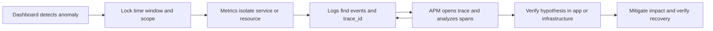

# Dashboards and Correlating Logs, Metrics, and Traces During Incident Investigation

A dashboard showing rising error rates tells you where to focus. A log recording `Connection acquisition timeout` tells you what the application encountered. A trace showing a request spending most of its time waiting for a database connection narrows down which step to inspect. When all three evidence sources share timestamps, service identifiers, and request context, operators can move from detecting symptoms to verifying root causes.

In Oracle Cloud Infrastructure (OCI), this investigation path typically flows through Monitoring, Logging, and Application Performance Monitoring (APM), then extends to Compute, Load Balancer, or Oracle Database depending on the evidence. This lesson belongs to the **Logs, Metrics, and Tracing** chapter and focuses on organizing dashboards and connecting signals during an investigation, while accounting for compartments, IAM, collection costs, and observability resilience during outages.

## 1. Objectives and Investigation Model

After this lesson, you can:

- Design a dashboard that answers which service is affected, when impact started, and where to investigate next.
- Identify shared fields for correlating metrics, logs, and traces in OCI.
- Pivot from an anomalous time window to related logs, then open the trace for a specific request.
- Recognize limitations of aggregated data, trace sampling, ingestion latency, and access permissions.
- Document evidence and verify recovery after incident remediation.

A useful workflow is:



This is a reference flow. If a user supplies a request ID, you might start in logs. If APM already flagged a slow transaction, you might start with a trace. What matters is that every step preserves context and produces a concrete question for the next step.

## 2. Three Signal Types Answer Three Question Groups

| Signal | Primary question | Example in an OCI system | Limitation to remember |
| --- | --- | --- | --- |
| Metrics | How large is the anomaly and what is the trend? | Traffic, HTTP 5xx rate, latency, Compute CPU, active connections | Aggregated numbers usually do not isolate a single request |
| Logs | What event did a component record? | Timeouts, exceptions, config changes, request processing outcomes | A single log line reflects only the emitter's local perspective |
| Traces | Where did a request go and which step took time? | API → service → Oracle Database or downstream service call | Traces or spans may be missing due to sampling, instrumentation, or export errors |

For example, low CPU during an API slowdown is completely consistent with threads waiting on a connection pool. Conversely, many timeout logs do not prove Oracle Database is overloaded: time may have been lost before any query ever reached the database.

OCI Monitoring handles metric queries and alarms; Logging provides log search; APM provides performance monitoring and distributed tracing. These distinct roles guide where you begin an investigation. [Oracle Monitoring and Observability Documentation](https://docs.oracle.com/en-us/iaas/Content/cloud-adoption-framework/monitoring-and-observability.htm).

### 2.1. Distinguishing Statistical Correlation from Request-Level Causality

There are two levels of correlation:

1. **By scope and time:** an instance's CPU metric and the app's error logs on that instance spike within the same window. This supports scoping.
2. **By request context:** logs and spans carry the same trace ID. This ties events directly to one instrumented transaction.

Two lines rising together do not prove causation. Likewise, a single trace represents only that single transaction; compare multiple samples and system-wide metrics before generalizing impact.

## 3. Choosing the Right Dashboard Surface in OCI

OCI provides multiple dashboard surfaces with different capabilities and data sources. When building one, know which surface you are configuring.

| Surface | Appropriate role in this lesson | How to use for investigation |
| --- | --- | --- |
| Console Dashboards | Assemble operational views from supported Monitoring, Logging, and Markdown widgets | View metrics, log charts or tables, plus links to saved queries and runbooks |
| Management Dashboards | Build dashboards for supported Observability & Management services | Use APM, Database Management, Log Analytics, and matching metric widgets |
| Metrics Explorer | Detailed metric analysis | Switch statistics, intervals, dimensions, and compare resources |
| Logging Search | Read and search logs | Filter by compartment, log group, log, time, and event fields |
| APM Trace Explorer | Analyze traces and spans | Find traces, inspect span trees, durations, errors, and collected attributes |

Console Dashboards offer Monitoring widgets, Logging Chart, Logging Data Table, and Markdown widgets. They make a convenient starting point for operations teams. [Console Dashboards Widget Types](https://docs.oracle.com/en-us/iaas/Content/Dashboards/Concepts/dashboardsoverview.htm).

Management Dashboards serve services such as APM, Database Management, Log Analytics, Management Agent, Ops Insights, and Stack Monitoring. This framework also includes widgets for displaying OCI Monitoring data. [Management Dashboards Overview](https://docs.oracle.com/en-us/iaas/management-dashboard/doc/management-dashboard.html), [Manage Widgets](https://docs.oracle.com/en-us/iaas/management-dashboard/doc/manage-widgets.html).

**Logging and Log Analytics are two separate services.** Having logs in OCI Logging does not automatically put them into Log Analytics. If you choose Log Analytics for widgets or deep analysis, configure the corresponding ingestion pipeline and check access permissions, actual ingested data, and resulting costs.

A practical setup might use a Console Dashboard for metrics and Logging, linking out to APM via saved links. Teams already using multiple Observability & Management services may prefer a Management Dashboard as their hub. Never force every signal onto a single screen if switching to a dedicated explorer makes evidence clearer.

## 4. Standardizing Data to Connect Signals

### 4.1. Establishing Common Correlation Axes

Before adding charts, agree on how to represent these fields:

| Field or axis | Example | How to use |
| --- | --- | --- |
| Event time | `2026-11-21T09:12:24.183Z` | Correlate in UTC; label timezones explicitly when displayed |
| Tenancy and region | Lab tenancy, `ap-singapore-1` | Avoid checking the right resource type in the wrong region |
| Compartment | OCID of compartment holding data or resources | Define query scope and read permissions |
| Service and environment | `checkout-api`, `lab` | Isolate the exact app; avoid mixing lab with production |
| Resource identifier | Instance OCID or workload ID | Correlate app logs with infrastructure metrics |
| Deployment version | `2026.11.21-2` | Compare cohorts running new versus old builds |
| Route or operation | `/checkout`, `acquire-db-connection` | Narrow down specific behaviors |
| Trace ID and span ID | IDs captured from active tracing context | Link logs to traces or spans |
| Request ID | `req-lab-83c41` | Follow requests across layers recording this ID |

These are **data design conventions**, not a list of dimensions pre-supplied by every OCI service. For example, custom metrics might carry `service` and `environment`, while Compute metrics use dimensions defined by Compute. Map fields across sources rather than adding an arbitrary dimension name and assuming queries filtered properly.

The compartment storing a dashboard may differ from compartments holding metrics, logs, or APM domains. A single filter will not necessarily represent all four places accurately.

### 4.2. A Structured Log Record

The example below is JSON emitted by a lab application. OCIDs containing `example` are illustrative placeholders; replace them with real identifiers in your own system.

```json
{
  "timestamp": "2026-11-21T09:12:24.183Z",
  "level": "ERROR",
  "service": "checkout-api",
  "environment": "lab",
  "region": "ap-singapore-1",
  "resource_id": "ocid1.instance.oc1.ap-singapore-1.example",
  "deployment_version": "2026.11.21-2",
  "route": "/checkout",
  "request_id": "req-lab-83c41",
  "trace_id": "7c02f3e3ea6c4e41a6d3d7e1c3d901ab",
  "span_id": "9f12c15a2b6714ee",
  "http_status": 503,
  "duration_ms": 2104,
  "error_type": "db_connection_acquisition_timeout",
  "message": "Timed out waiting for a connection from the application pool"
}
```

OpenTelemetry specifies how to record `trace_id` and `span_id` across log formats, including JSON. When an app uses this format, those IDs must come from the event's active tracing context. [Trace Context in Log Formats](https://opentelemetry.io/docs/specs/otel/compatibility/logging_trace_context/).

In this lesson, assume the collection pipeline parsed this JSON into attributes inside `data` on the OCI Logging record. You can then query by `data.trace_id`, `data.service`, and `data.http_status`.

If live records instead pack the entire JSON string inside `data.message`, the field-level queries below will not work yet. Open an actual record, inspect its structure, and fix the parser or ingestion mapping first. The app's `timestamp` field must also map to the event timestamp used by the search engine; merely printing a timestamp inside log text does not make time filters use it.

### 4.3. Preserving Trace Context Across Execution Boundaries

Tracing must propagate context across related calls and tasks so spans assemble into a single trace. A shared trace ID identifies one trace; span IDs and parent–child links reveal the internal operation tree. [OpenTelemetry Traces and Spans](https://opentelemetry.io/docs/concepts/signals/traces/).

In Java applications, verify context propagation across HTTP clients, executors, async tasks, and message consumers. When logs are written inside worker threads, the logging framework must receive that context too. Manage MDC or equivalent contexts per request lifecycle so IDs from prior requests never leak into new logs.

Custom request IDs, trace IDs, and OCI API `opc-request-id` headers can coexist without being identical by default. Only link them when the application or integration layer explicitly logs the relationship. Never generate a random fake trace ID per log line—those lines will point to no real trace.

### 4.4. Do Not Turn Request Identifiers into Metric Dimensions

`trace_id`, `span_id`, request IDs, and order IDs typically have vast numbers of unique values. Placing them into metric dimensions spawns excessive time series, increases costs, and degrades query performance.

Use bounded metric dimensions such as environment, service, normalized route, or status code class. Keep request identifiers in logs and traces. Aggregated metrics lead you to the right **request cohort**; to inspect **one specific request**, pivot to logs or traces. Rely on exemplars only when your pipeline and tools genuinely support and have been verified with them.

## 5. Designing Decision-Driven Dashboards

### 5.1. Start with Operational Questions

A dashboard should let on-call responders answer in sequence:

1. Are users being impacted?
2. When did impact begin, and which route, release, or resource group is concentrated?
3. Does the bottleneck appear in the app, a dependency, or infrastructure resources?
4. Where can I open detailed evidence from here?

A layout for `checkout-api` might include:

| Section | Content | Decision supported |
| --- | --- | --- |
| Scope | Region, environment, service, data compartment, time range | Confirm you are viewing the right system |
| Experience | Request count, error rate, p95 or p99 latency | Quantify user impact |
| Breakdown | Errors and latency by route, instance, or version | Pick which cohort to investigate first |
| Capacity | CPU, memory; connection pool and queues if app emits metrics | Test hypotheses about load and contention |
| Dependencies | Call durations to databases or downstream services | Spot likely slow steps |
| Events | Representative error logs, recorded deployment markers | Grab trace IDs and correlate changes |
| Navigation | Links to Logging queries, APM domain, Trace Explorer, and runbooks | Transition to deep-dive analysis |

Metrics like connection pools, queues, or per-version error rates require instrumentation or appropriate emitters. Compute does not automatically know how many free connections remain inside a JVM pool.

### 5.2. Define Formulas Before Naming Chart Titles

For an observation window `W`, an illustrative definition is:

```text
error_rate(W) = 100 × count of HTTP 5xx in W / total HTTP requests in W
```

State the source, included routes, and zero-denominator handling clearly. Never convert missing data into 0% errors. When there are zero requests, show a no-traffic state; when the pipeline drops data, show missing telemetry.

When aggregating across instances, divide total errors by total requests within the exact same scope. Taking a simple arithmetic mean of per-instance error percentages is wrong whenever instances carry different traffic volumes.

Likewise, system-wide p95 is not the average of per-instance p95 values. Accurate computation requires aggregatable distribution data or queries suited to your telemetry source. Never take a percentile of pre-averaged latency points and label it as request p95.

### 5.3. Preserve Timestamp Semantics and Data Status

- Use one shared window when comparing charts, such as 15 minutes around the incident onset.
- When investigating a past event, switch to absolute timestamps so the window doesn't slide on every refresh.
- Label timezone, latency units, statistic, and interval explicitly.
- Distinguish event time, ingestion time, and dashboard refresh time.
- Annotate deployment or configuration changes when backed by a reliable change source.

For instance, `09:10–09:20 UTC` corresponds to `16:10–16:20` in Vietnam. If one tool shows UTC and another shows local workstation time, convert before concluding they show two different events.

Distinguish a "No data" widget from zero values and from missing read permissions. A dashboard can look healthy while an underlying emitter has stopped sending data.

## 6. Hands-On: Building an Investigation Starting Point on OCI

### 6.1. Preparation Before Configuring Widgets

For a lab environment, prepare:

- A compartment for the test workload and read access to relevant telemetry sources.
- The app shipping logs to the right log group, alongside app or infrastructure metrics to watch.
- An APM domain and trace shipping configured, with at least one recent trace verified.
- A test request traceable from app to logs and traces.
- Bounded lab budget and runtime, with rollback steps for configuration changes.

APM ingests telemetry from supported sources such as agents, tracers, and APIs. Creating a dashboard does not automatically instrument applications or generate missing spans. [APM Data Sources](https://docs.oracle.com/en-us/iaas/application-performance-monitoring/doc/application-performance-monitoring-data-sources.html).

### 6.2. Option A: Console Dashboard for Monitoring and Logging

1. Open **Dashboards** in the OCI Console Home area and create a dashboard for the lab environment.
2. Add a **Monitoring widget**; choose the region, compartment, namespace, metric, and dimensions actually emitted by the source.
3. Add a **Logging Chart** to spot when errors rise and a **Logging Data Table** to inspect matching events.
4. Configure every widget with matching time range, environment, and service filters; verify results after saving.
5. Add a **Markdown widget** containing steps to open the APM domain, sample queries, and runbooks. Use links copied from your live Console and note which filters to double-check upon opening.

Individual widgets hold their own region, time range, and filter settings. Inspect each widget rather than assuming a change elsewhere propagates across the entire dashboard. [Managing Console Dashboard Widgets](https://docs.oracle.com/en-us/iaas/Content/Dashboards/Tasks/widgetmanagement.htm).

### 6.3. Option B: Management Dashboard for APM and Dependency Views

1. Open **Management Dashboards** under Observability & Management.
2. Pick a built-in dashboard or create a custom dashboard.
3. Add APM widgets suited to the transaction under watch, and configure compartment and APM domain.
4. Add metric widgets or database-management widgets where sources are configured and viewers hold permissions.
5. Bind widget inputs to dashboard-level filters; test changing filters to confirm widgets actually update.

A custom dashboard can combine widgets and filters from supported services, even when underlying data lives across different compartments. Widgets can also carry local filter overrides. [Create Custom Management Dashboards](https://docs.oracle.com/en-us/iaas/management-dashboard/doc/create-custom-dashboard.html).

### 6.4. Verifying Context Handoff Links

For every link from a dashboard to a drill-down explorer, verify these values remain accurate after opening:

```text
region
source data compartment
APM domain or log group/log
start and end timestamps
service, environment, resource, or trace ID filter
```

Never assume clicking any metric automatically opens its matching trace. Aggregated metrics generally carry no transaction identifiers. When the UI doesn't pass all parameters forward, your runbook should explain how to re-enter them manually. Avoid hand-crafting internal Console URLs with unverified query string patterns.

## 7. Queries to Move from Overview to a Specific Request

The examples below run in three distinct tools. Never run Logging syntax in Metrics Explorer or Trace Explorer syntax in Logging Search.

### 7.1. Metrics Explorer: Checking CPU on the Exact Compute Instance

In Metrics Explorer, select the instance's compartment and the `oci_computeagent` namespace, then run MQL:

```text
CpuUtilization[1m]{resourceId = "<INSTANCE_OCID>"}.mean()
```

This retrieves one-minute mean CPU for the selected instance. Replace `<INSTANCE_OCID>` with a real OCID. Namespace, compartment, region, and time window are selected outside the expression.

You can switch to:

```text
CpuUtilization[1m]{resourceId = "<INSTANCE_OCID>"}.max()
```

`max()` highlights the highest sample within each interval; it does not turn a CPU metric into request latency. MQL specifies interval, statistic, and dimension filters specific to metric queries. [MQL Reference](https://docs.oracle.com/en-us/iaas/Content/Monitoring/Reference/mql.htm).

`oci_computeagent` data depends on the instance's monitoring mechanism being configured and active. If data is missing, check the emitter before concluding CPU is 0. [Compute Instance Metrics](https://docs.oracle.com/en-us/iaas/Content/Compute/References/computemetrics.htm).

### 7.2. Logging Search: Finding Errors in the Right Scope

Select the region and incident window in Logging Search. Assuming the parser setup from Section 4, this Advanced query locates application error logs:

```text
search "<COMPARTMENT_OCID>/<LOG_GROUP_OCID>/<LOG_OCID>"
| where data.service = 'checkout-api'
    and data.environment = 'lab'
    and data.http_status >= 500
| sort by datetime desc
```

Replace placeholders with real OCIDs for the source log. `http_status` is numeric in this example; if your pipeline stores it as a string, fix the mapping or adapt the condition to match the actual data type.

Once you obtain a trace ID, search all events for that trace across the log group:

```text
search "<COMPARTMENT_OCID>/<LOG_GROUP_OCID>"
| where data.trace_id = '7c02f3e3ea6c4e41a6d3d7e1c3d901ab'
| sort by datetime asc
```

The second query drops the single-log constraint to search across multiple logs in the same group. If services log to different groups or compartments, include those scopes and ensure read permissions exist. Chronological sorting helps read events, though clock skew can cause log timestamps to differ slightly from true execution order.

The Logging query language lets you scope streams by compartment/log group/log and apply operators such as `where` and `sort`. Field names are case-sensitive. [Logging Query Language Specification](https://docs.oracle.com/en-us/iaas/Content/Logging/Reference/query_language_specification.htm).

Logging Search lets you inspect raw payloads. When queries return nothing, open a recent record and verify actual field names; logs are searchable only for periods after collection and ingestion started. [Searching Logs Guide](https://docs.oracle.com/en-us/iaas/Content/Logging/Concepts/searchinglogs.htm).

### 7.3. APM Trace Explorer: Opening the Trace Found in Logs

In APM, select the right region, compartment, APM domain, and time range. Locate the trace with:

```text
show traces traceId
where traceId = '7c02f3e3ea6c4e41a6d3d7e1c3d901ab'
```

`traceId` is the dimension name in APM queries; `data.trace_id` is the log field path in our example schema. The ID value bridges the two systems—their field names do not have to match. Trace Explorer syntax uses `show traces` or `show spans` with filter clauses. [Work with Queries in Trace Explorer](https://docs.oracle.com/en-us/iaas/application-performance-monitoring/doc/work-queries-trace-explorer.html).

After finding the trace, open its details and inspect:

- The root span and total request duration.
- Services, operations, and dependency calls present in the trace.
- Error spans, exceptions, or attributes identifying the failing step.
- Wait time before database calls begin.
- Retries or concurrent calls that change how total duration should be read.

Trace Explorer displays trace/span data alongside collected dimensions. A missing attribute may simply mean that step wasn't instrumented, not proof the operation never ran. [Using Trace Explorer](https://docs.oracle.com/en-us/iaas/application-performance-monitoring/doc/use-trace-explorer.html).

### 7.4. Reading a Waterfall Properly

Suppose the root span lasts 2,200 ms, a connection-acquisition span lasts 1,850 ms, and an SQL execution span lasts 90 ms. This pattern points to investigating pool contention before tuning SQL.

Never sum durations of all spans to compute total latency: spans can be nested or parallel. Likewise, subtracting child spans from a parent span does not automatically equal pure CPU time; the remainder can include waits or uninstrumented work.

If current instrumentation only emits JDBC spans around SQL execution, you won't automatically see pool wait time. You need pool metrics, connection-acquisition timing logs, or custom spans to separate those two phases.

## 8. Illustrative Investigation Workflow: Post-Deploy HTTP 503

The figures and timestamps below are hypothetical data for practicing diagnostic reasoning. The system includes an OCI Load Balancer, a Java app on Compute, and Oracle Database, with structured logs, tracing, and connection-pool metrics.

### Step 1: Lock Scope and Impact

The dashboard shows that starting at `09:10 UTC`, the `/checkout` error rate jumped from 0.2% to 8%, and p95 jumped from ~300 ms to 2,200 ms. Total traffic barely changed.

The on-call engineer records the region, environment, instances, the `09:05–09:20 UTC` window, and the error-rate data source. If numbers come from Load Balancer, check whether errors came from the frontend or backend based on actual logs/metrics; never blindly assume every HTTP 503 is an application bug.

### Step 2: Isolate the Affected Cohort

Compare the same route across instances and deployment versions. Hosts running `2026.11.21-2` show far more errors than the older cohort. CPU stays moderate, while pool metrics show active connections hitting the cap with many waiting threads.

This strengthens the hypothesis around the new release or pool settings. It does not yet prove the pool is too small: a slow database, long transactions, or connection leaks can also exhaust a pool.

### Step 3: Grab a Trace ID from Error Logs

Logging Search returns `db_connection_acquisition_timeout` events tied to the new version and our example trace ID. Query by that ID to inspect logs before and after the timeout.

Check timeout timing, route, instance, and request ID. Do not stop at counting `ERROR` strings; separate the root failure from secondary messages like canceled requests or failed retries.

### Step 4: Inspect Traces and Test Hypotheses

In collected traces, connection-pool waiting accounts for nearly the entire latency while SQL execution stays fast. Database telemetry over the same window shows no matching spike in load or waits. Operations diffs configurations and discovers the pool limit on the new cohort was unintentionally lowered.

| Hypothesis | Evidence to cross-check | When to pivot elsewhere |
| --- | --- | --- |
| Compute CPU starvation | CPU, runnable threads, per-instance error distribution | CPU is modest and time is mostly spent waiting |
| Slow database execution | SQL spans, session/wait stats, or database management telemetry | SQL executes quickly while connection acquisition stalls |
| Constrained app pool | Active/idle/pending connections, timeouts, deployment config | Pool has plenty of headroom or zero waiters |
| Network failure to database | Connection logs, network timeouts, path diagnostics | Errors happen before opening or using network connections |
| Change in new release | Deployment timeline, config diffs, old vs. new cohort comparison | Both cohorts fail identically or errors predate deployment |

An absence of anomalous database metrics does not rule out every database issue either. Granularity, scope, missing data, or long transactions can obscure evidence.

### Step 5: Mitigate Impact and Verify Recovery

Under an authorized change process, restore the known-good pool configuration or roll back the release. When raising pool limits, account for total instance count and database connection limits; raising limits fleet-wide can shift saturation straight onto the database.

After remediation, watch the exact same route and scope used during detection:

- Error rate and latency return to expected levels across multiple consecutive intervals.
- Waiting threads drop and the connection pool retains headroom.
- New test requests succeed; fresh traces show no abnormal wait gaps.
- The database and dependencies show no new signs of overload.
- Traffic remains present and telemetry continues arriving, ensuring you don't mistake data loss for recovery.

Conclusions must distinguish observed facts from inferences. Here, config diffs, cohort-specific errors, pool-wait traces, and post-rollback recovery all corroborate the pool change diagnosis. Merely noticing errors began after a deployment would be far weaker evidence.

## 9. When Signals Fail to Correlate

| Symptom | Causes to examine | Check direction |
| --- | --- | --- |
| Dashboard shows metrics, zero logs | Logging disabled, ingestion failing, wrong scope, or missing permissions | Open source log, check ingestion timing and IAM |
| `data.trace_id` query returns nothing | JSON packed in string, different field name, event lacks trace context | Inspect raw payload and verify actual schema |
| Trace ID in logs not found in APM | Wrong APM domain/region, past retention, sampling, or export failure | Verify scope, wider window, sampling rules, and pipeline |
| One request splits into disjoint traces | Context not propagated or restored across service/async boundaries | Check instrumentation and propagation at every hop |
| Logs carry another request's ID | Logging context not cleared when reusing threads | Audit MDC scoping and async handoffs |
| Overall chart looks fine while one cohort fails | Aggregation masks failing route, instance, or version | Slice by available dimensions keeping identical denominators |
| Dashboard author sees data, teammate doesn't | Dashboard permissions differ from underlying source permissions | Test viewer's account against each underlying source |
| Trace hides pool wait time | Instrumentation wraps SQL calls only | Cross-check pool metrics, wait logs, or add custom spans |

Trace sampling can cause logs to hold IDs of unsampled traces. Not finding a trace does not prove a request never happened. Conversely, retained error trace counts do not automatically equal total system errors. Service-wide error rates require full-coverage counters or sampling-aware estimation.

When suspecting slow ingestion, compare both event time and ingestion time. Widen the search window deliberately while keeping service, environment, and resource filters intact to avoid overly broad queries.

## 10. IAM, Cost, and Observability Resilience During Outages

### 10.1. Dashboard Access Does Not Replace Source Read Access

Separate three roles:

| Role | Permission scope to design |
| --- | --- |
| On-call responder viewing dashboards and debugging | Read dashboards plus metrics, logs, and APM data for owned services |
| Dashboard builder | Create or edit dashboards/widgets in appropriate management compartments |
| Agent or workload emitting telemetry | Write permissions required for the exact source and compartment |

Never grant tenancy-wide admin rights just to fix an empty widget. Identify which underlying source lacks permission and grant least-privilege access there. When a dashboard pulls data across compartments, verify permissions on each source compartment, not only the dashboard compartment.

Traces, logs, and query attributes can carry sensitive data. Strip tokens, passwords, payment details, secret-bearing connection strings, and unnecessary personal payloads. If capturing SQL or detailed exceptions, audit bind parameters and error message contents. Never put sensitive details into widget titles or shared URLs.

### 10.2. Controlling Cost Across Data Paths

Operations teams must know what is being emitted, shipped, stored, and queried:

- Bound metric dimension counts intentionally; normalize routes so every URL ID doesn't create a new time series.
- Choose appropriate log levels; enable debug logging only temporarily for targeted investigations.
- Tune trace sampling to investigation needs, verify pipeline capacity, and document blind spots.
- Narrow queries by time, service, and log source before expanding scope.
- Align retention across metrics, logs, and traces with incident postmortem needs.
- Audit routing pipelines to prevent accidental duplication across multiple stores, especially when adding Log Analytics or external archives.

Never treat static price or quota figures as permanent dashboard assumptions. Before scaling collection up, check current configurations, limits, and costs of the services actually in use.

### 10.3. Designing for When Telemetry Fails Too

Dashboards and alarms serve different roles. Dashboards support interactive analysis; alarms and notification channels catch failures when nobody is watching a screen. For critical signals, add missing-data detection and agent/exporter health checks.

For multi-region workloads, every investigation link must target the right region. A green dashboard in one region does not prove another region is healthy. Maintain an independent external probe path, such as external synthetic requests, so you aren't wholly blind if an app fails to emit telemetry.

Manage queries, dashboard definitions, and runbooks under your team's change-control process. When automating, use mechanisms supported by the dashboard surface and keep secrets out of shared definitions. Assign an owner to update links, schemas, and filters whenever architecture evolves.

## 11. Controlled Practice Exercise

Run this in a lab environment; the steps below build and test an investigation workflow without inducing failures in production.

1. **Establish baseline:** send light test traffic and record success rate, latency, and at least one request with matching log and trace IDs.
2. **Build a dashboard:** add user-experience metrics, infrastructure metrics, error logs, and a link to the right APM domain. Label region, scope, and timezone clearly.
3. **Verify bidirectional pivoting:** take a trace ID from logs to open APM; take a trace ID from APM to locate matching logs.
4. **Induce an app-level anomaly:** use controlled fault injection to add latency to an instrumented operation, or use a test app's fault toggle. Bound duration and request count, and keep a quick kill switch ready.
5. **Investigate:** using a fixed absolute window, isolate the impacted cohort, locate a slow/error log, and open its trace. Separate observed facts from hypotheses.
6. **Revert:** disable fault injection, restore baseline settings, and confirm recovery with both test traffic and fresh telemetry.
7. **Wrap up the lab:** stop load generators, turn off temporary debug logging or elevated sampling, and clean up unnecessary resources and retention rules.

If the fault test adds only latency without errors, error-rate widgets may remain unchanged. The expected result is seeing the impacted latency and span shift—not forcing every widget to turn red.

A lab run succeeds when someone else can follow your recorded links and parameters to locate the exact event, inspect the same logs/trace, follow your reasoning, and verify rollback. If a trace wasn't kept due to sampling, document that limit and use a pipeline-retained sample to prove correlation works.

## 12. Investigation Note Template for Reproducible Evidence

```text
Service / environment:
Region / data compartment:
Start and end timestamps with timezone:
Symptoms and impact scope:
Metric source, statistic, interval, and dimensions:
Log group / log / query and search window:
APM domain / trace ID / relevant span or operation:
Impacted resources and deployment versions:
Observed evidence:
Hypotheses and missing evidence:
Mitigation change applied:
Post-change verification results:
Limitations from sampling, ingestion, retention, or permissions:
Follow-up improvements and owner:
```

A dashboard is useful when it shortens the path from symptom to evidence. On OCI, that means picking the right data sources, keeping scopes and timestamps aligned, preserving request context, and corroborating conclusions across multiple signals. One log with an accurate trace ID and one well-scoped query often resolve incidents far faster than adding dozens of purposeless charts.
