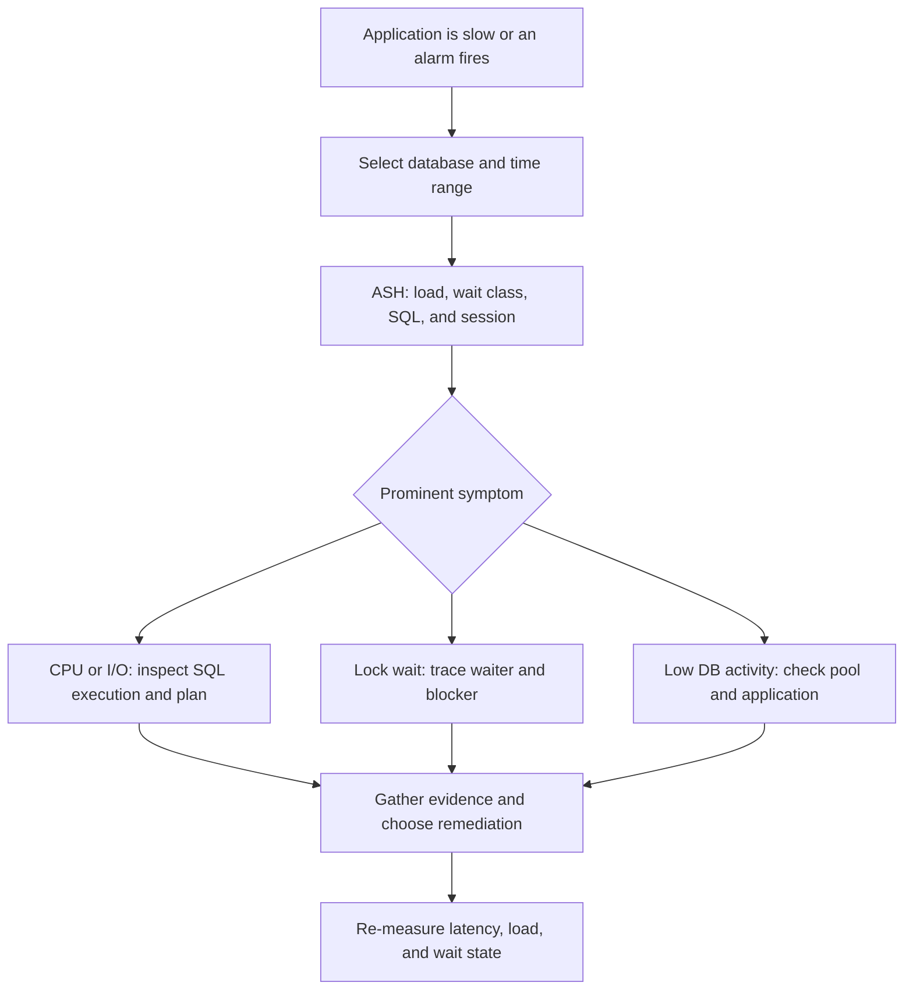

# Performance Hub and Investigating Anomalous Sessions

## Lesson Objectives

In the **Database Management and Optimization** chapter of the Oracle Cloud Infrastructure (OCI) learning path, Performance Hub helps connect slow application symptoms to internal Oracle Database activity. The goal of this lesson is to locate the relevant sessions, SQL statements, and resources, form an evidence-backed hypothesis, and select a remediation approach aligned with availability and operational cost.

Suppose `orders-api` runs on OCI Compute and connects to an Oracle database. After a deployment, order processing time increases while database CPU does not rise proportionally. An operator needs to distinguish whether SQL statements are consuming heavy CPU, waiting on I/O, being blocked by another transaction holding a lock, or whether requests are still waiting to acquire a connection in the application.

After this lesson, you will be able to:

- Select the right database and time range in Performance Hub.
- Read Average Active Sessions and group by wait class, SQL, and session.
- Distinguish ASH Analytics, SQL Monitoring, and Blocking Sessions.
- Identify waiters, blockers, and open transactions using observation queries.
- Reproduce a lock-wait scenario in a test environment and prove the root cause.
- Verify remediation effectiveness using before-and-after metrics rather than only checking session state.

## 1. Where Does Performance Hub Fit in an Investigation?

Performance Hub is a centralized interface for analyzing Oracle Database activity over time, SQL statements, and sessions. The areas commonly used in this lesson include:

| Area | Data to Inspect | Investigation Question |
| --- | --- | --- |
| ASH Analytics | Sampled session activity over a time range | Where did load increase, and which SQL or session group caused it? |
| SQL Monitoring | Monitored SQL executions | Which step of a specific run spent the time? |
| Blocking Sessions | Current blocking and waiting relationships | Which session is holding a resource that makes another wait? |

Which tabs appear depends on the database type and management configuration. For services described in the Performance Hub documentation, Basic Management provides ASH Analytics and SQL Monitoring; Full Management adds additional capabilities. Do not assume an interface always has every tab across all deployment types. [Oracle: Performance Hub Features](https://docs.oracle.com/en-us/iaas/performance-hub/doc/perf-hub-features.html).

Performance Hub provides evidence about database activity, but it does not cover the entire duration of an HTTP request. A request may also wait in a connection pool, an application queue, an external service, or over the network. Therefore, place database metrics alongside application latency, logs, and traces when available.



## 2. Preparing the Right Scope and Access Permissions

### 2.1. Choosing the Supported Oracle Database Service

This lesson applies to **Oracle Databases with Performance Hub supported on OCI**. Do not apply the tabs, views, and queries below directly to MySQL or PostgreSQL simply because they are also deployed on OCI.

For Autonomous Database, open the database details page in the right compartment and select **Performance Hub**. For Base Database Service or Exadata, navigate to the database inside the corresponding DB system or VM cluster. The access documentation for Base Database Service and Exadata states the requirements that Database Management be enabled and the database be Enterprise Edition from a supported version. [Oracle: Access Performance Hub for Autonomous Database](https://docs.oracle.com/en-us/iaas/performance-hub/doc/access-perf-hub-adb.html), [Oracle: Access Performance Hub for Base Database Service and Exadata](https://docs.oracle.com/en-us/iaas/performance-hub/doc/access-perf-hub-base-db-and-exadata.html).

You must distinguish between database/CDB, PDB, and instance. Performance Hub documentation also notes limitations regarding Base Database Service PDBs; the fact that a Database Management feature supports PDBs does not mean every Performance Hub UI variant supports them identically. In the lab, open Performance Hub on a supported resource and record the container of your SQL connection. [Oracle: Performance Hub Features — support notes](https://docs.oracle.com/en-us/iaas/performance-hub/doc/perf-hub-features.html).

### 2.2. Checking Both Permission Layers

| Permission Layer | What Is It For? | What to Check |
| --- | --- | --- |
| OCI IAM | Access resources and management features in the Console | Principal, compartment, and granted management/observation permissions |
| In-database privileges | Read diagnostic views and execute SQL operations | Account, container, and actual privilege set |

Permission to open a resource in OCI does not automatically turn a SQL account into a DBA. Conversely, an account with privileges to read database views does not automatically have permission to open Performance Hub in the Console.

When Database Management needs to be configured, satisfy the IAM, networking, and database prerequisites for the service in use. Full Management incurs additional service costs; management options should be chosen based on required capabilities. [Oracle: Enable Diagnostics & Management for Oracle Cloud Databases](https://docs.oracle.com/en-us/iaas/database-management/doc/enable-database-management-oracle-cloud-databases.html).

The illustrative queries require read access to the referenced views. Request observation privileges scoped to your work; do not grant `DBA` to an application account just to run an investigative query. With Autonomous Database, use the capabilities and privileges provided by the service, and do not assume OS access or every view behaves like a self-managed database.

### 2.3. Recording Context Before Analysis

Prepare a short record:

```text
Database / OCID: ...
Region / compartment: ...
Related service / CDB / PDB / instance: ...
Incident time and time zone: ...
Symptom: latency, timeout, throughput, or queue ...
Affected module / endpoint / job: ...
Most recent change: release, batch, pool config, data ...
```

For example, `10:00–10:10 Asia/Ho_Chi_Minh` corresponds to `03:00–03:10 UTC`. Use the exact same time window when aligning the Console, Java logs, and SQL reports to avoid correlating unrelated events.

## 3. Understanding Metrics Before Drawing Conclusions

### 3.1. Average Active Sessions Is Not Total Connections

Database time, or DB time, sums CPU processing time and non-idle wait time across foreground sessions. Average Active Sessions (AAS) over an interval is understood by the relationship:

```text
AAS = total DB time in interval / interval length

Hypothetical example:
180 seconds of DB time / 60 seconds observed = 3 AAS
```

Because DB time is summed across multiple sessions, it can exceed elapsed wall-clock time. AAS can also be a decimal number. [Oracle: Monitoring Real-Time Database Performance](https://docs.oracle.com/en/database/oracle/oracle-database/21/tdppt/monitoring-real-time-database-performance.html).

A pool with 100 connections where only a few are working may have a low AAS. Conversely, many sessions blocked simultaneously can raise the wait portion of AAS even when CPU is not busy.

When comparing against CPU capacity, examine the **CPU component of load**, actual CPU utilization, and allocated resource limits. Total AAS includes all wait classes; seeing total AAS exceed CPU count alone is not enough to conclude CPU starvation or decide to scale up resources.

### 3.2. ASH Is Sampled Data

Active Session History (ASH) samples the activity of active sessions. This data supports slicing by time, session, module, action, and SQL ID; it is not a complete log of every SQL statement or every application request. [Oracle: Concepts for Database Administrators — Active Session History](https://docs.oracle.com/en/database/oracle/oracle-database/19/cncpt/concepts-for-database-administrators.html).

Implications when reading charts:

- A very short task may not show up clearly in samples.
- A brief bottleneck spike may be smoothed out if viewing too wide an interval.
- An idle session holding an uncommitted transaction may barely appear in ASH, while its waiters appear prominently.
- A large ASH contribution indicates where time was spent, not by itself who the root cause is.

ASH Analytics allows changing analysis dimensions and resolution. Higher resolution provides finer detail but may increase latency and query overhead when retrieving data. [Oracle: ASH Analytics](https://docs.oracle.com/en-us/iaas/performance-hub/doc/ash-analytics-tab.html).

### 3.3. Separating Session, SQL, and SQL Execution

| Object | Identifiers to Record | Meaning During Investigation |
| --- | --- | --- |
| Session | Instance, SID, SERIAL# | A specific connection session |
| SQL | SQL_ID, plus child cursor or plan when needed | The shared statement and its execution variants |
| SQL execution | SQL_ID, SQL_EXEC_START, SQL_EXEC_ID, and related instance | A specific run of a SQL statement |
| Transaction | Owning session and transaction info | An open unit of data modification |

SQL Monitoring stores information per execution, unlike cumulative metrics aggregated across many runs. One SQL statement may have multiple concurrent executions; with parallel SQL there are also coordinator and worker processes. Therefore, select the right execution before reading resource usage. [Oracle: V$SQL_MONITOR](https://docs.oracle.com/en/database/oracle/oracle-database/19/refrn/V-SQL_MONITOR.html).

## 4. Investigation Workflow in Performance Hub

### Step 1: Isolate the Time Window with Symptoms

Open the right database, select a window surrounding the error timestamp, and keep a normal baseline segment for comparison. For example, start from 15 minutes before to 15 minutes after the application report, then narrow down to the few minutes showing anomalies.

This is an illustrative way to choose an investigation window, not a fixed threshold. For batch jobs running for hours or failures lasting only seconds, adjust accordingly.

Double-check:

- Is the database you are viewing the one the application actually connects to?
- Is the chart in real-time mode or historical mode?
- Is an old filter hiding a user, instance, or SQL statement you need to see?
- Does the application slowdown window match the database fluctuation?

### Step 2: Read Load Breakdown in ASH Analytics

Start with **Wait Class**, then switch to **SQL ID**, **User Session**, **User Name**, **Module**, or other dimensions provided by the interface. The two activity tables below the chart help identify top contributing SQL statements and sessions within the selected time range. [Oracle: ASH Analytics — activity tables](https://docs.oracle.com/en-us/iaas/performance-hub/doc/ash-analytics-tab.html).

Instead of stopping at "the database is slow", write a testable hypothesis:

```text
During 03:04–03:07 UTC, the wait portion of the orders-api workload increased.
A group of sessions running the same UPDATE appears prominently.
Hypothesis to test: requests are waiting on a lock-holding transaction.
```

A heavy report may be running legitimately on schedule, while a small number of blocked OLTP sessions are actually why users cannot place orders. Correlate load contribution with the affected business scope.

### Step 3: Open SQL Monitoring When Analyzing a Single Execution

Select the execution corresponding to the error window, and inspect its status, start time, duration, CPU, I/O, wait classes, and execution plan. Focus on steps showing heavy resource consumption or producing large amounts of intermediate data.

SQL Monitoring displays currently running executions and monitored completed executions. You can open a report from the corresponding SQL ID to inspect further details. [Oracle: SQL Monitoring](https://docs.oracle.com/en-us/iaas/performance-hub/doc/sql-monitoring-tab.html), [Oracle: SQL Monitoring Report](https://docs.oracle.com/en-us/iaas/performance-hub/doc/view-sql-monitoring-report.html).

Not every SQL statement appears here. Under Oracle Database's automatic mechanism, typical criteria include parallel execution or consuming at least 5 seconds of CPU or I/O in a single execution; forcing monitoring has its own mechanisms. A SQL statement waiting a long time on a lock in wall-clock time may not meet this automatic threshold. [Oracle: Monitoring Database Operations](https://docs.oracle.com/en/database/oracle/oracle-database/21/tgsql/monitoring-database-operations.html).

Therefore, **having no row in SQL Monitoring does not prove there is no anomalous session**. Fall back to ASH, live session views, or application evidence when necessary.

When comparing plans, verify matching input shapes, data volumes, and concurrency levels. A plan hash change is an investigative signal; actual impact must still be demonstrated via execution behavior and latency.

### Step 4: If Waiting on Locks, Switch to Blocking Relationships

Open **Blocking Sessions** if the feature is available. Inspect waiting sessions, blocking sessions, SQL, objects, and wait times. A minimum wait time filter may prevent short waits from appearing.

This tab shows **current** blocking relationships and does not support full historical blocking session analysis. Dragging the time slider back to a finished incident does not turn the current list into a past blocking chain. [Oracle: Blocking and Waiting Sessions](https://docs.oracle.com/en-us/iaas/performance-hub/doc/view-blocking-and-waiting-sessions.html).

Distinguish between:

- **Waiter**: a session waiting for a resource.
- **Immediate blocker**: the session directly blocking the waiter.
- **Final blocker**: the end element of the wait chain identifiable from currently available data.

For example `S3 → S2 → S1`: S3 waits on S2, and S2 waits on S1. Addressing S3 first may only remove one symptom; you must find out what S1 is holding and why.

## 5. Interpreting Wait Events with Evidence

| Signal | Next Check | Avoid Jumping to Conclusions |
| --- | --- | --- |
| CPU portion dominates | SQL, plan, concurrency, and actual CPU | Every high AAS requires adding CPU |
| `db file sequential read` or `db file scattered read` | Read volume, plan, and I/O latency | Any read wait means storage is broken |
| `log file sync` | Commit behavior and redo processing path | Changing storage alone fixes the issue |
| `enq: TX - row lock contention` | Lock-holding transaction, SQL, and contended object | Only the waiter needs to be handled |
| Resource wait due to Resource Manager | Consumer group, queue, and configured limits | This is always physical resource exhaustion |
| `SQL*Net message from client` | What is the application doing between DB calls? | Having "Net" in the name means the network is broken |

Wait events reflect where a session is waiting; examine duration, frequency, and context rather than the name alone. `SQL*Net message from client` typically reflects the database waiting for the next call from the client. [Oracle: Descriptions of Wait Events](https://docs.oracle.com/en/database/oracle/oracle-database/19/refrn/descriptions-of-wait-events.html).

For TX row lock contention, causes may involve sessions modifying the same data, unique key contention, or other locking cases. Identify the holder and related operation rather than assuming a single index type or SQL statement is always at fault. [Oracle: Instance Tuning Using Performance Views — enqueue waits](https://docs.oracle.com/en/database/oracle/oracle-database/19/tgdba/instance-tuning-using-performance-views.html).

## 6. Supplementary Queries for Observing Sessions

The queries below are observation tools for learners with appropriate privileges. Results reflect only the moment they run; collect again after a reasonable interval if you need to see progression. Do not loop system-wide queries at excessively high frequency.

### 6.1. Viewing Active User Sessions on the Current Instance

```sql
SELECT
    s.sid,
    s.serial#,
    s.con_id,
    s.username,
    s.service_name,
    s.module,
    s.action,
    s.client_identifier,
    s.sql_id,
    s.sql_exec_start,
    s.last_call_et AS active_call_seconds,
    s.state,
    CASE WHEN s.state = 'WAITING' THEN s.wait_class END AS current_wait_class,
    CASE WHEN s.state = 'WAITING' THEN s.event END AS current_wait_event
FROM v$session s
WHERE s.type = 'USER'
  AND s.username IS NOT NULL
  AND s.status = 'ACTIVE'
ORDER BY s.last_call_et DESC;
```

`LAST_CALL_ET` on an active session is the time since the session became active; do not use it as CPU time or exact execution duration of a single SQL statement. `SQL_EXEC_START` and execution info serve a different purpose. Observer sessions may also appear in the output. [Oracle: V$SESSION](https://docs.oracle.com/en/database/oracle/oracle-database/19/refrn/V-SESSION.html).

`EVENT` may hold the most recent wait event if the session is not currently waiting. The query uses `STATE = 'WAITING'` to display only active waits, avoiding attributing an old wait to current state. [Oracle: V$SESSION_WAIT](https://docs.oracle.com/en/database/oracle/oracle-database/19/refrn/V-SESSION_WAIT.html).

### 6.2. Finding Waiter–Blocker Pairs on RAC

When multiple instances exist, SID alone is insufficient. The following query joins on both the blocker's instance and SID:

```sql
SELECT
    w.inst_id AS waiter_inst,
    w.sid AS waiter_sid,
    w.serial# AS waiter_serial,
    w.con_id,
    w.sql_id AS waiter_sql,
    w.event AS waiter_event,
    b.inst_id AS blocker_inst,
    b.sid AS blocker_sid,
    b.serial# AS blocker_serial,
    b.status AS blocker_status,
    b.module AS blocker_module,
    b.sql_id AS blocker_sql,
    b.prev_sql_id AS blocker_prev_sql
FROM gv$session w
LEFT JOIN gv$session b
  ON b.inst_id = w.blocking_instance
 AND b.sid = w.blocking_session
WHERE w.type = 'USER'
  AND w.state = 'WAITING'
  AND w.blocking_session_status = 'VALID'
ORDER BY w.inst_id, w.sid;
```

`BLOCKING_SESSION` and `BLOCKING_INSTANCE` should only be interpreted when the blocker status is valid. On a single instance, you can use `V$SESSION` and join by SID on that instance. Record `SERIAL#` as well before taking any intervention action. [Oracle: V$SESSION — blocking session columns](https://docs.oracle.com/en/database/oracle/oracle-database/19/refrn/V-SESSION.html).

This lists direct blocking pairs, not an algorithm that builds the full wait tree. If a blocker is also a waiter, continue tracing it or use the chain shown in the UI. A row where the join finds no holder should also be rechecked because session state can change between observations.

### 6.3. Viewing Transactions of Sessions in a Module

On the current instance:

```sql
SELECT
    s.sid,
    s.serial#,
    s.status,
    s.module,
    s.action,
    s.sql_id,
    s.prev_sql_id,
    t.start_date AS transaction_start,
    t.used_ublk,
    t.used_urec
FROM v$session s
LEFT JOIN v$transaction t
  ON t.addr = s.taddr
WHERE s.type = 'USER'
  AND s.module = 'ph-session-lab'
ORDER BY s.sid;
```

`V$TRANSACTION` provides active transactions, start time, and amount of undo used. `USED_UBLK` and `USED_UREC` provide additional context; they are not a countdown timer for rollback duration. With `GV$` views on RAC, add the instance condition when joining transactions and sessions. [Oracle: V$TRANSACTION](https://docs.oracle.com/en/database/oracle/oracle-database/19/refrn/V-TRANSACTION.html).

### 6.4. Viewing SQL Text and Child Cursors of a SQL Statement

In SQLcl or a tool supporting bind variables:

```sql
VARIABLE target_sql_id VARCHAR2(13)
EXEC :target_sql_id := '<ACTUAL_SQL_ID>';

SELECT
    sql_id,
    child_number,
    plan_hash_value,
    executions,
    buffer_gets,
    disk_reads,
    ROUND(cpu_time / 1000000, 3) AS cpu_seconds,
    ROUND(elapsed_time / 1000000, 3) AS elapsed_seconds,
    sql_text
FROM v$sql
WHERE sql_id = :target_sql_id
ORDER BY child_number;
```

Replace `<ACTUAL_SQL_ID>` with the actual SQL ID obtained. Numbers in `V$SQL` accumulate per child cursor currently in the cache and are not automatically scoped to the few minutes of the incident. Do not use a large cumulative total as proof that SQL generated all that load just now; obtain an execution report or proper metric deltas. [Oracle: V$SQL](https://docs.oracle.com/en/database/oracle/oracle-database/19/refrn/V-SQL.html).

SQL text may contain business information. When saving evidence into operational documents, keep only what is needed and mask sensitive data.

## 7. Three-Connection Lab: An Idle Session Holding a Lock

### 7.1. Practice Environment

Use a dedicated test schema on an Oracle Database authorized for practice. Prepare three **independent physical connections** A, B, and C to the same database/PDB; two worksheets sharing one session will not reproduce this scenario.

- A acts as the lock-holding transaction.
- B acts as the waiting update request.
- C acts as the observer, with privileges to read the required views.

Turn off autocommit for A and B. In SQLcl/SQL*Plus you can run `SET AUTOCOMMIT OFF`; in other tools, check the corresponding setting. The commands below are instructions for the learner to execute and are not pre-executed on a database.

In the lab schema, create a new table and initial data:

```sql
CREATE TABLE ph_session_lab (
    id NUMBER PRIMARY KEY,
    note VARCHAR2(100)
);

INSERT INTO ph_session_lab (id, note)
VALUES (1, 'initial');

COMMIT;
```

If the table already exists, verify whether it belongs to a previous lab run before continuing. Never substitute a business table name to test locking.

### 7.2. Connection A Holds an Unfinished Transaction

```sql
BEGIN
    DBMS_APPLICATION_INFO.SET_MODULE(
        module_name => 'ph-session-lab',
        action_name => 'hold-row'
    );
    DBMS_SESSION.SET_IDENTIFIER('ph-holder-001');
END;
/

UPDATE ph_session_lab
SET note = 'held-by-A'
WHERE id = 1;
```

Do not run `COMMIT` or `ROLLBACK` in A yet. After the UPDATE returns, leave A idle at the prompt.

`DBMS_APPLICATION_INFO` attaches module/action names so observation has context. `DBMS_SESSION.SET_IDENTIFIER` attaches a client identifier to the session. The values here are lab markers. [Oracle: DBMS_APPLICATION_INFO](https://docs.oracle.com/en/database/oracle/oracle-database/19/arpls/DBMS_APPLICATION_INFO.html), [Oracle: DBMS_SESSION](https://docs.oracle.com/en/database/oracle/oracle-database/19/arpls/DBMS_SESSION.html).

### 7.3. Connection B Attempts to Update the Same Row

```sql
BEGIN
    DBMS_APPLICATION_INFO.SET_MODULE(
        module_name => 'ph-session-lab',
        action_name => 'wait-row'
    );
    DBMS_SESSION.SET_IDENTIFIER('ph-waiter-001');
END;
/

UPDATE ph_session_lab
SET note = 'written-by-B'
WHERE id = 1;
```

B waits while A still holds the uncommitted change. Do not send additional commands on connection B while the UPDATE is waiting.

### 7.4. Observing with C and Performance Hub

In C, run the transaction query by module from section 6.3. At the same time, open ASH Analytics for the lab time window; if Blocking Sessions is available, inspect the active blocking relationship.

**Expected** signals to be verified by the learner:

| Connection | Signal to Look For | Meaning in the Lab |
| --- | --- | --- |
| A | Module `ph-session-lab`, action `hold-row`, has a transaction | A's change has not finished |
| A | May be `INACTIVE` while sitting at the prompt | A session not running new SQL can still hold a lock |
| B | Action `wait-row`, UPDATE still waiting | Request reached the database and is waiting |
| B | TX row lock wait, blocker points to A | Evidence of the blocking relationship |
| ASH | Wait activity from B during the lab window | Supports time-based correlation |

Do not expect A and B to stand out equally in Top SQL. B is spending time waiting, whereas A may simply be waiting on the client. Also do not assume B's UPDATE must produce a SQL Monitoring report just because it has waited a long time.

If only part of the sessions appear in local queries on RAC, use the appropriate `GV$SESSION` query or connect the observer to the relevant instance. Verify privileges and container before concluding a session has disappeared.

### 7.5. Releasing the Transaction and Verifying

In **A**, finish the test change with:

```sql
ROLLBACK;
```

After A releases the lock, B's UPDATE can complete. Once the command in B returns, run in **B**:

```sql
ROLLBACK;
```

Rolling back A does not automatically roll back the change B executes afterward. Both transactions must be closed deliberately.

Re-run the observer queries and verify:

1. B is no longer waiting on A for the test row.
2. Both A and B's lab transactions have ended.
3. Connections can still execute a simple query.
4. The value of `note` returns to `initial` after both A and B roll back.

```sql
SELECT id, note
FROM ph_session_lab
WHERE id = 1;
```

After completing, clear the markers in A and B:

```sql
BEGIN
    DBMS_APPLICATION_INFO.SET_MODULE(NULL, NULL);
    DBMS_SESSION.CLEAR_IDENTIFIER;
END;
/
```

Only when lab transactions have finished and no connections remain using the table may the schema owner drop `ph_session_lab`. Perform DDL cleanup in a session with no other uncommitted changes pending.

This lab proves a specific cause: an application can become slow due to an unfinished transaction, even when database CPU is low and the blocker is `INACTIVE`.

## 8. Choosing Remediation by Root Cause

| Evidence Gathered | Remediation Options to Consider | Further Verification Needed |
| --- | --- | --- |
| Transaction holds lock longer than expected | Transaction owner closes per business logic; fix transaction boundaries | Commit/rollback flow and external calls inside the transaction |
| SQL CPU/I/O increases after release | Analyze plan, inputs, data volume, and SQL changes | Matching workload, concurrency, and comparison data |
| Many small repeated SQL calls | Reduce call count; consider batching or data access patterns | Executions per request and data correctness |
| Requests wait for connections, low database activity | Check pool, connection leaks, and long transactions | Active/idle/pending pool metrics and connection hold times |
| Legitimate load routinely hits allocated limits | Evaluate capacity or workload scheduling | Actual utilization, latency targets, and cost |

### 8.1. Distinguishing Cancel SQL and Terminate Session

Canceling SQL targets the currently running call; terminating a session ends the session. The two actions do not have the same effect. Canceling the current SQL statement does not guarantee that earlier changes in the transaction have ended.

Terminating may trigger rollback and resource cleanup; lock release is not guaranteed to be instantaneous in all situations. The application may also reconnect and retry, repeating the load if the root cause is not fixed. [Oracle: Managing Processes — Terminating Sessions](https://docs.oracle.com/en/database/oracle/oracle-database/19/admin/managing-processes.html).

Before intervening in production, record instance, SID, SERIAL#, user, module, SQL, transaction, and impact scope. Re-verify identifiers right before acting because a SID can be reused after an old session ends.

In the lab above, the transaction owner used rollback to test a hypothesis. In real systems, choosing commit or rollback must follow the desired business outcome; never commit an unknown transaction just to make a lock wait disappear.

### 8.2. Do Not Use Scale-Up as the Default Diagnostic Step

Adding CPU can be appropriate when a workload is genuinely CPU-bound. It does not replace closing a lock-holding transaction, fixing chatty/repeated SQL, or resolving a connection leak.

A resource change also alters comparison baselines and costs. Document the hypothesis, expected improvement, and re-measurement method before applying it. For scheduled workloads, adjusting batch timing may be worth considering alongside SQL tuning and capacity changes.

## 9. Attaching Java Application Context to Database Sessions

If all connections use one database user, looking only at `USERNAME` makes it hard to tell which endpoint or task owns a session. Use `MODULE` for the application name, `ACTION` for the operation, and `CLIENT_IDENTIFIER` for an appropriate correlation ID.

Example when starting a unit of work on a connection:

```sql
BEGIN
    DBMS_APPLICATION_INFO.SET_MODULE('orders-api', 'reserve-stock');
    DBMS_SESSION.SET_IDENTIFIER('req-7f42');
END;
/
```

These calls can be executed via JDBC on the same connection that runs the business SQL. Do not set markers on a different connection and expect them to describe the session under investigation.

With a connection pool, reset markers per unit of work and clear them upon completion, including error paths. Also handle commit/rollback per the application's transaction contract. If stale markers remain on a reused connection, a subsequent request's session may be misattributed.

Client identifiers should not contain tokens, passwords, or unnecessary personal data. Keep the same correlation ID in application logs so you can trace from request to session when errors occur.

## 10. Re-Measuring and Documenting Investigation Findings

After remediation, do not check only that a session disappeared. Compare during a window with comparable traffic:

| Metric or Evidence | Confirmation Question |
| --- | --- |
| Application latency and timeouts | Can users complete the affected operation again? |
| Throughput | Has the system recovered processing or merely stopped receiving requests? |
| AAS by wait class | Did the anomalous wait component drop? |
| Current blocking relationships | Has the old chain cleared and has any new chain formed? |
| SQL execution | Are duration, resources, and plan behavior appropriate? |
| Pool and retries | Did queues drain without triggering a retry storm? |

Short recording template:

```text
Symptom and scope:
Time window / time zone:
Database / container / instance:
Related session and SQL execution:
Evidence of CPU, I/O, or blocking relationship:
Tested hypothesis:
Remediation action and owner:
Before / after results under comparable workload:
Follow-up fixes to prevent recurrence:
```

Common pitfalls that mislead investigations include: mistaking total connections for AAS; treating an old wait event as a current wait; using cumulative SQL statistics as incident-only numbers; looking only for active sessions and missing an idle holder; and assuming the current Blocking Sessions tab reproduces all historical blocking chains.

For long-term operations, maintain time-of-day baselines, alert thresholds tied to application targets, pre-provisioned observation privileges, and procedures to capture evidence while an issue is still occurring. Increase collection granularity only as much as needed to limit investigative overhead on the database.

A useful conclusion must state **which database, which time window, which session or execution, what evidence, and which change improved the symptom**. This is the foundation for optimizing Oracle Database on OCI while keeping access permissions, cost, and availability under control.
