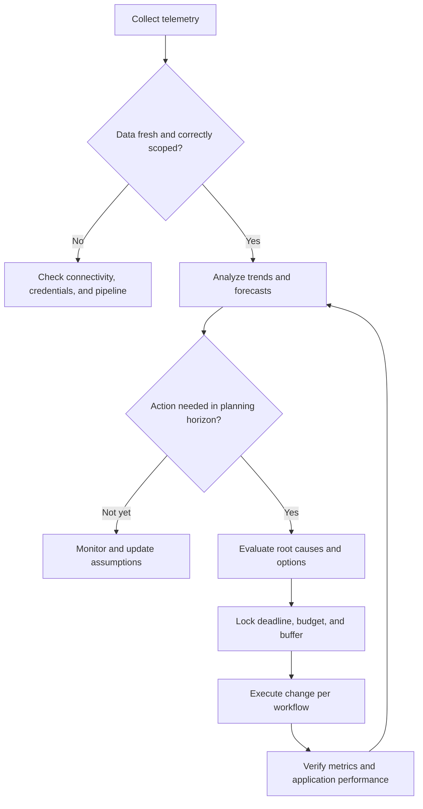

# Operations Insights and Database Capacity Forecasting

In the **Database Management and Optimization** chapter of the Oracle Cloud Infrastructure (OCI) module, Operations Insights helps turn operational telemetry into resource plans. A database running well today can still run out of storage during the next billing close or run short of CPU after transaction volume grows.

This lesson focuses on Oracle database capacity on OCI, while also explaining how to ingest data from outside OCI when needed. Deployment connects to compartments, IAM, VCN connectivity, monitoring, automation, cost control, and availability.

> Oracle now calls this service **Ops Insights** in its documentation and Console. This lesson uses Operations Insights and Ops Insights to refer to the same service.

## 1. Expected Outcomes

After this lesson, you will be able to:

- Identify which questions Operations Insights answers in the database management lifecycle.
- Prepare data sources, access permissions, and connectivity suited to each database type.
- Read allocation, usage, utilization, average load, and peak load without confusing units or scope.
- Compare linear, seasonality-aware, and AutoML forecasts; validate forecast usefulness with backtesting.
- Estimate time-to-threshold and the deadline to initiate resource changes.
- Combine forecasts with alarms, change workflows, budgets, and redundancy requirements.

## 2. Placing Operations Insights in the Right Operational Workflow

Ops Insights is an OCI service that analyzes historical resource utilization for databases and hosts. Capacity Planning serves resource forecasting; capabilities such as SQL Insights help explore SQL performance trends. You can start with sample data via Demo mode before connecting real resources. Source: [Introduction to Ops Insights](https://docs.oracle.com/en-us/iaas/operations-insights/doc/operations-insights.html).

A division of responsibilities within an operations team:

| Operational Question | Appropriate Tool or Activity | Next Decision |
| --- | --- | --- |
| Is CPU high and are transactions currently slow? | Current metrics, alarms, and database investigation | Isolate the ongoing incident |
| Which SQL changed behavior after a release? | SQL analysis, execution plans, and performance data | Fix the query or root cause of higher load |
| At current growth, will storage still be sufficient next month? | Capacity Planning and historical forecasting | Plan expansion or slow down data growth |
| Can resources be reduced while still meeting peak load? | Historical analysis combined with load testing and SLAs | Pilot a smaller shape within controlled scope |
| If one node is lost, does the system still have enough capacity? | Failure capacity modeling and failover testing | Adjust redundancy levels |

A forecast is an input to a decision. A forecast curve does not by itself prove a database must scale and does not automatically modify configurations. The operations team must also evaluate load drivers, optimization opportunities, service limits, and application impact.

For example, CPU rising because a query lost an index after deployment requires a different response than CPU rising because order volume is growing steadily. Adding CPU may buy time during an incident, but long-term plans must reflect the true cause.

## 3. From Database to Forecastable Telemetry

### 3.1. Choosing the Data Collection Path

Ops Insights supports telemetry sources including **Cloud Infrastructure**, **Enterprise Manager**, and **Agent Service**. Resources outside OCI not already managed by Enterprise Manager typically require a Management Agent; an external database also requires an appropriate handle and connector. Autonomous Database offers a basic mode including Capacity Planning and a full features mode expanding analytics. Source: [Prerequisites for Enabling Resources](https://docs.oracle.com/en-us/iaas/operations-insights/doc/prerequisites-enabling-resources.html).

Do not apply a single agent-installation recipe to every database. Before configuring, document:

| Information to Identify | Examples to Clarify |
| --- | --- |
| Service type | Autonomous Database, Base Database Service, Exadata, or external Oracle Database |
| Database structure | Non-CDB, CDB/PDB, single instance, or RAC |
| Telemetry source | Cloud Infrastructure, Enterprise Manager, or Agent Service |
| Connection path | Private endpoint, agent, or Enterprise Manager bridge per supported configuration |
| Analysis scope | Single database, database group, host, VM cluster, or entire fleet |
| Operational roles | Who enables the service, who views data, who modifies resources |

For cloud database and Exadata configurations, Oracle provides distinct collection methods. Data after enabling the service can take up to 24 hours to appear. Source: [Enabling Cloud Databases and Exadata Systems](https://docs.oracle.com/en-us/iaas/operations-insights/doc/enabling-database-cloud-service-databases-and-exadata-systems.html).

### 3.2. Task-Based Authorization

In IAM, the service's resource-type family is `opsi-family`. Distinguish between users configuring/enabling the service and users who only consume analytical data. Source: [Groups, Users, and Policies](https://docs.oracle.com/en-us/iaas/operations-insights/doc/groups-users-policies.html).

An organizational model for a learning environment:

- The observability administration group configures collection in the assigned compartment.
- The DBA group reads capacity data and investigates load shifts.
- The infrastructure management group executes resource changes under a separate workflow.

Illustrative policy example for a read-only group:

```text
Allow group Default/CapacityReaders to read opsi-family in compartment DbLab
```

Replace `Default`, `CapacityReaders`, and `DbLab` with the actual identity domain, group, and compartment. This is an example of read access to service resources, not a complete permission set to enable collection, read every metric, or access every related resource. Analytical data access and database administration permissions must be evaluated separately.

Policy Advisor helps configure permissions for users and service resource principals. When applying, select the exact telemetry, resources, and compartment, then preview the policies. Oracle documentation has moved away from legacy service-principal policies; do not copy full policy blocks from outdated guides. Source: [Policy Advisor](https://docs.oracle.com/en-us/iaas/operations-insights/doc/create-manage-policies-policy-advisor.html).

### 3.3. Preparing Connectivity and Credentials

For collection over a private endpoint, verify the VCN/subnet, DNS, NSG or security list, and actual listener port. The NSG must allow traffic between the private endpoint and the database according to the connection configuration. For RAC, pay attention to the SCAN address. Source: [Network Connectivity for Ops Insights](https://docs.oracle.com/en-us/iaas/operations-insights/doc/prerequisites-network-comms.html).

For Autonomous Database, prerequisites differ between basic and full features; full features impose requirements on the monitoring user, credential type, and network. IAM credential configurations also carry specific requirements. Source: [Prerequisites for Autonomous Databases](https://docs.oracle.com/en-us/iaas/operations-insights/doc/prerequisites-autonomous-databases.html).

In practice, verify three layers in order: the endpoint resolves and has a network path; the database connection authenticates successfully; and the monitoring account has the required collection privileges. Never use an application account as the monitoring account just to bypass a configuration error. If secrets or wallets are used, manage them via supported methods and your organization's credential rotation process.

## 4. Selecting the Right Scope Before Reading Charts

In Ops Insights, open **Capacity Planning → Databases**. Pages include Summary, CPU, Storage, Memory, I/O, and Database Explorer. Filters include compartment, time range, database type, entity, creation source, and tags; the Include child compartments option expands scope into child compartments. Source: [Accessing Database Capacity Planning](https://docs.oracle.com/en-us/iaas/operations-insights/doc/application-menu-scope.html).

For each analysis, record a repeatable observation configuration:

```text
Region: region containing the resources and data being viewed
Compartment: DbProduction
Include child compartments: yes
Group: databases for the ordering application
Historical window: 90 days, if sufficient data exists
Time zone used when aligning business schedules: Asia/Ho_Chi_Minh
Objective: evaluate peak load and storage growth over the next 30 days
```

This is an analyst's note template, not a configuration file imported into OCI. A 90-day window is an illustrative choice; it does not guarantee enough data for every model or every business cycle.

A wrong scope can produce wrong conclusions even when the math is right. For instance, an overall production dashboard may look healthy while the payments database is already near its threshold. Conversely, looking at a single PDB while ignoring the shared CDB and host can hide resource contention.

Do not add metrics from a CDB and its child PDBs if they represent the same resource consumption at two levels. When aggregating, identify which objects are independent members and which are simply different views of the same system.

## 5. Understanding Metrics Before Forecasting

### 5.1. Allocation, Usage, and Utilization

As an analytical principle:

```text
Utilization (%) = Usage / Allocation × 100
Headroom = Allocation − Usage
```

Both quantities in the division must share the same unit, timestamp, and scope. Never divide a database's CPU usage by the entire VM cluster's allocation and call that the database's utilization.

On CPU charts, Oracle distinguishes allocation, max allocation, infrastructure capacity, average usage, and max usage. Capacity appears only in certain scopes; max allocation is relevant with eligible autoscaling configurations. Max usage is the maximum of aggregated hourly/daily data, so it is not synonymous with instantaneous peaks at every resolution. Source: [Trend and Forecast Chart](https://docs.oracle.com/en-us/iaas/operations-insights/doc/available-cpu-trend-forecast.html).

| Quantity Viewed | Question to Ask Before Concluding |
| --- | --- |
| CPU count or CPU unit | Is this a chart unit, logical CPU, OCPU, or ECPU? |
| Allocation | Is it configured per database, per host, or summed across a group? |
| Average usage | Is it hourly average, daily average, or a statistic over the whole selected window? |
| Max usage | Maximum of which series, and at what granularity? |
| Utilization | Did the allocation denominator change during the observation window? |
| Headroom | Is this remaining margin actually usable during failover or overlapping workload peaks? |

Do not convert OCPU to ECPU using a single universal multiplier across all analyses. In the arithmetic examples in this lesson, "CPU units" simply represents a consistent scale; when applying in practice, use the actual units of your service.

### 5.2. Low Average Can Still Mean CPU Shortage

Suppose a database is provisioned with 16 CPU units:

- Average usage: 4 units, equal to 25%.
- Observed peak usage: 12 units, equal to 75%.
- Forecasted peak for the next period: 14 units, assuming model and data are sufficiently suitable.

If you look only at 25%, you might propose cutting resources in half. Yet at 8 CPU units, a 12-unit peak load already exceeds the new configuration's capacity. You must also inspect response times, transaction volume, and the nature of the high-load window.

Short peaks caused by batch jobs may be addressed by rescheduling. Sustained high load during transaction hours may require additional resources. Both situations can have the same daily average yet lead to opposite decisions.

### 5.3. Aggregating Percentages Requires Weighting

Suppose at the same timestamp, two databases use the same type of CPU unit:

| Database | Allocation | Usage | Utilization |
| --- | ---: | ---: | ---: |
| A | 4 | 3 | 75% |
| B | 40 | 8 | 20% |

The unweighted arithmetic mean of the two percentages is `(75 + 20) / 2 = 47.5%`. However, the ratio of total usage to total allocation is:

```text
(3 + 8) / (4 + 40) × 100 = 25%
```

The 25% figure describes the group total under that calculation, but it does not erase the individual risk on A. Similarly, for peak load, do not assume you can sum peaks observed at different hours into a single simultaneous fleet peak. To evaluate workload consolidation, align the time series on the same time axis.

### 5.4. Storage, Memory, and I/O Do Not Substitute for One Another

In the Database Storage table, several usage, allocation, and utilization columns use the 90th percentile of daily averages over the selected time range. They are not necessarily the latest value or the maximum value. When making expansion decisions, check column definitions and the specific database's time series. Source: [Analyzing Storage Resources](https://docs.oracle.com/en-us/iaas/operations-insights/doc/analyze-available-storage-resources-insights.html).

For storage, separate four layers of questions:

1. How much capacity is the database consuming according to the metric viewed?
2. Does a specific tablespace or datafile have a limit that must be addressed?
3. Does the underlying ASM disk group or filesystem still have room to expand?
4. Are there service limits or constraints blocking a storage increase?

Adding capacity at one layer does not guarantee the other layers expand accordingly. When investigating out-of-space risks, also check operational areas such as temporary space, undo, or recovery storage using tools appropriate for the database.

High memory usage must be examined alongside memory components, real pressure, and performance. I/O requires distinguishing operations per second, throughput, and latency. Do not assume a database needs more CPU simply because I/O latency rose while CPU remains low.

Metric visibility depends on resource type; for example, Oracle documentation notes that database memory information is not available for Autonomous Database serverless in this comparison view. Source: [Compare Memory Utilization Between Databases](https://docs.oracle.com/en-us/iaas/operations-insights/doc/compare-memory-utilization-between-databases.html).

## 6. Choosing Forecasting Models and Data Windows

### 6.1. Separating Training Period and Forecast Horizon

The **training period** is the historical window used to build the forecast. The **forecast horizon** is the future period you want to predict. A longer observation window is not automatically better if it includes past configurations or operating patterns that no longer resemble the present.

Before choosing a data window, mark:

- Dates of CPU or storage increases.
- Dates of workload migrations, partitioning changes, or data retention policy changes.
- Application release dates that altered query volume.
- Accounting closes, business campaigns, or recurring batch runs.
- Windows when the database was down or telemetry collection was interrupted.

For example, after a migration, daily data growth changes from 5 to 20 GiB/day. Forecasting from the entire prior year can understate the growth rate of the new phase. Conversely, using only a single peak week can exaggerate long-term demand. Window selection must be justified by business context and configuration changes.

### 6.2. Linear Regression

A linear model is an easy-to-verify starting point when a series grows relatively steadily. A manual illustrative model is:

```text
Projected usage on day t = Current usage + Average growth rate × t
```

This formula helps sanity-check results; it does not describe OCI's full forecasting algorithm. Series with configuration step-changes, seasonality, or sharply shifting growth typically require further analysis.

### 6.3. Seasonality Aware

Seasonality-aware models capture recurring cycles such as higher load on weekdays or a specific day of the week, which a straight linear trend would flatten out. A wide prediction interval indicates high remaining variance in the data. Source: [Seasonality Aware](https://docs.oracle.com/en-us/iaas/operations-insights/doc/seasonality-aware.html).

In practice, cross-check detected cycles against the business calendar. A wavy chart does not prove the model has learned monthly close cycles if the data only covers a few weeks. Never-before-seen events, such as a first-time promotional campaign, require an overlay scenario from the business team.

### 6.4. AutoML

AutoML selects an appropriate model from multiple candidates trained over a fixed data window. Per Oracle documentation, this capability uses daily data, up to 13 months or all available data if the resource was recently enabled, and is available only at the single-resource level. Forecasts are precomputed and retrained periodically. Source: [AutoML Forecasting](https://docs.oracle.com/en-us/iaas/operations-insights/doc/automl-forecasting.html).

When using AutoML, inspect the training window and algorithm displayed in the UI. Do not assume changing the chart zoom window retrains the model. Also, do not extrapolate one representative database's results to the entire fleet.

### 6.5. Forecast Bands and Confidence Levels

The center line shows the trend; the lower and upper bounds help assess uncertainty. When the consequence of resource exhaustion is high, the operations team may plan around the upper bound scenario and buffer for upcoming business events.

For example, the center line forecasts crossing the threshold in 40 days, while the upper bound crosses it in 18 days. If total lead time to execute a change is 20 days, the operations team needs to consider acting early. Do not wait until day 40 just because that is where the center line intersects.

Statistical confidence levels rely on historical data and model assumptions. They are neither a service availability guarantee nor assurance that the forecast holds after a major workload change.

## 7. Using Backtesting to Validate Forecasts

Forecast Backtesting lets you place the training period in the past and compare the forecast against known actual data. The interface lets you adjust the training period, forecast period, and view error margins. Source: [Forecast Backtesting](https://docs.oracle.com/en-us/iaas/operations-insights/doc/forecast-backtesting.html).

An illustrative analysis workflow when at least 90 days of data are available:

1. Use the first 60 days to generate a forecast for the next 30 days, if supported by the model/UI options.
2. Compare the forecast with the known 30 actual days, keeping the target and units identical.
3. Check errors on peak-load days and days near thresholds.
4. Repeat across another period with similar business conditions.
5. Note cases where the model under-predicted demand rather than looking only at average error.

You can use Mean Absolute Error (MAE) for an independent check:

```text
MAE = Sum |Actual value − Forecast value| / Number of comparison points
```

Suppose actual storage over three days is 2,800, 2,820, and 2,840 GiB, and the corresponding forecasts are 2,790, 2,800, and 2,810 GiB. MAE equals `(10 + 20 + 30) / 3 = 20 GiB`. However, all three forecasts are below actuals, so you must also check for systematic under-prediction bias.

MAE in original units makes discrepancies easy to read directly. For CPU, also check whether the model missed peak windows. A forecast with a small average error that misses the month-end load spike may still be unsuitable for deciding to downsize resources.

Do not strip out every outlier just to make a chart look clean. Exclude a period only when there is evidence it no longer represents future operations; document the reason so others can review the decision.

## 8. Calculating Time-to-Threshold and Action Deadlines

The calculations below form a simple planning model assuming constant allocation and steady usage growth. Hand calculations serve to cross-check forecasts, not replace the service's statistical models.

Notation:

- `C`: provisioned capacity.
- `U0`: current usage at the analysis timestamp.
- `g`: net daily growth rate.
- `p`: operational threshold ratio, written as a decimal.

```text
Usage at threshold = p × C
Days to threshold ≈ (p × C − U0) / g
```

Apply the division formula only when `g > 0`. If already past the threshold, treat the risk as immediate. If `g ≤ 0`, do not conclude it is guaranteed safe: still check peaks, seasonality, and planned data loads.

### 8.1. Storage Example

Suppose we have illustrative figures:

| Parameter | Value |
| --- | ---: |
| Current allocation | 4,000 GiB |
| Usage at analysis timestamp | 2,600 GiB |
| Net growth | 20 GiB/day |
| Team-chosen operational threshold | 80% |

The 80% threshold is an assumption in this example, not a universal OCI default.

```text
Usage at threshold = 0.8 × 4,000 = 3,200 GiB
Remaining margin before threshold = 3,200 − 2,600 = 600 GiB
Days to threshold = 600 / 20 = 30 days
Modeled days until full = (4,000 − 2,600) / 20 = 70 days
```

"70 days until full" and "30 days until operational threshold" answer two different questions. An early threshold creates lead time to mitigate risk before storage runs out.

### 8.2. Calculating Backwards to the Start Deadline

Suppose the change workflow requires:

| Activity | Illustrative Days |
| --- | ---: |
| Proposal and budget approval | 7 |
| Quota check, provisioning readiness, and prep | 3 |
| Testing, rollout, and verification | 4 |
| Buffer for delays | 6 |
| Total lead time needed before threshold | 20 |

```text
Start deadline ≈ Days to threshold − Total required lead time
               = 30 − 20 = 10 days from the analysis timestamp
```

If a higher-growth scenario pulls the threshold crossing before day 20, the change window is already urgent. You must evaluate ways to shorten lead time, reclaim space in a controlled manner, or expand early.

Preparation time is not just clicking a scale button. It includes handling quotas, verifying configuration limits, maintenance schedules, coordinating with applications, and assessing recovery impact.

### 8.3. Sizing Capacity for a Planning Horizon

If you want to cover the next 90 days plus an extra 400 GiB buffer beyond projected growth:

```text
Minimum required capacity
  = (Current usage + Growth × 90 + Additional buffer) / Target threshold
  = (2,600 + 20 × 90 + 400) / 0.8
  = 6,000 GiB
```

On day 90, projected usage is 4,400 GiB; with 6,000 GiB provisioned, utilization is about 73.3%. The additional buffer and the target threshold serve different purposes; the operations team should justify why both are used to avoid unjustified overprovisioning.

If the growth rate changes to 30 GiB/day, the same formula yields 7,125 GiB. This sensitivity check shows that choosing 6,000 GiB depends on the growth assumption. Actual deployment sizing must also round to supported service increments and underlying storage expansion capabilities.

## 9. Balancing CPU, Cost, and Availability

### 9.1. Estimating Resources from Peak Load

Continuing the CPU example with a projected peak of 14 units. If the operations team sets a target that peak usage should not exceed 70% of resources:

```text
Reference allocation ≥ Projected peak / Target utilization ratio
                     ≥ 14 / 0.7
                     ≥ 20 CPU units
```

This is a reference calculation assuming load and capacity are comparable on the same scale. Actual performance may not scale linearly due to locks, I/O, connection limits, or query algorithms. Validate the plan with representative workloads and application metrics.

Before choosing to add CPU, examine:

- Are anomalous SQL statements or execution plans increasing cost per transaction?
- Can batch jobs shift to off-peak hours?
- Is the demand increase short-term or sustained?
- Does autoscaling on the database service in use fit the load profile and budget?
- Are other resource limits preventing added CPU from improving response times?

### 9.2. Planning Redundancy for Failures

Suppose a system has two nodes, 16 CPU units each, with expected total concurrent load of 24 units:

```text
When both nodes are up: 24 / 32 = 75%
If load must run on one node: 24 / 16 = 150%
```

This is a simple model when remaining workload must continue on one node with no replacement capacity yet. It shows that acceptable normal utilization does not guarantee resilience during an outage. For RAC or other HA solutions, check load redistribution mechanics, per-node limits, and failover performance targets.

Do not sum primary and standby capacity and treat it as available primary capacity. With Data Guard, plans must check the standby site's shape, service limits, and real load after switchover/failover. Historical forecasts on the primary are only one input to this analysis.

### 9.3. Overprovisioning and Cost Considerations

Low average CPU is a signal to investigate optimization potential, not sufficient grounds on its own to downsize. For storage, overprovisioned capacity must also be checked against the service's shrink capabilities; deleting data does not automatically reduce provisioned storage or cost proportionally.

Ops Insights costs depend on configuration and applicable SKUs; do not assume enabling databases and hosts always generates identical billing. The service also enforces data retention rules: up to 25 months of retention, and data is purged 30 days after disabling Ops Insights on a resource. Source: [Scope, Data Retention, and Pricing](https://docs.oracle.com/en-us/iaas/operations-insights/doc/operations-insights.html).

Before expanding monitoring fleet-wide, list the resources to track, required feature tiers, billing units, and budget owners. For extracting data from source Oracle Databases or Enterprise Manager targets, the database analysis documentation notes Oracle Diagnostics Pack requirements; verify actual licensing entitlements. Source: [Analyze Database Resources](https://docs.oracle.com/en-us/iaas/operations-insights/doc/analyze-database-resources.html).

## 10. Hands-On Workflow in the OCI Console

This lab is intended for an existing lab database, or sample data if you do not yet have permissions to connect real resources. Steps modifying real resources must use the assigned compartment and follow environment procedures.

### Step 1: Lock Down Target and Question

Record the database to analyze, service type, OCID, compartment, region, owner, and specific question. For example: "Will storage exceed our team-set threshold in the next 30 days, and by what date must preparation begin?"

### Step 2: Prepare and Enable Collection

In the Ops Insights area, choose the appropriate telemetry and complete prerequisites for the resource. Verify user policies, resource principal policies, credentials, and connectivity per database type. If the resource is already enabled, inspect its current status and telemetry source before creating another collection path.

### Step 3: Verify Input Data

Wait for data to appear, then check the latest timestamp, gaps, and units. Compare a time window against existing operational metrics. A newly enabled database without enough history should only have an initial baseline recorded; do not present a short forecast curve as evidence for the entire year.

### Step 4: Start Broad Then Narrow Down

Select the compartment and historical range, then review Summary to spot high-usage or fast-growing databases. Next, open each database of interest and inspect CPU and Storage individually. On supported configurations, also inspect Memory, I/O, and related resource layers.

### Step 5: Analyze Trends and Forecasts

Record explicitly whether the statistic viewed is average or maximum. Start with an explainable model, check seasonality if the workload is cyclical, and inspect AutoML when eligible. Check forecast bands, configuration step-changes, and threshold-crossing dates. Perform backtesting on an appropriate historical slice if data allows.

### Step 6: Make a Time-Bound Decision

Estimate the threshold-crossing date from raw data, compare against the forecast, then subtract lead time and buffer. Propose actions such as query optimization, batch rescheduling, retention cleanup, or scaling. Each action needs an owner, deadline, and verification method.

### Step 7: Verify After the Change

After implementing the plan, check metrics and application indicators over a comparable window, including a peak-load period. Annotate the change milestone so future forecasts do not misinterpret a utilization drop caused by increased allocation as reduced demand.

The practice output should be a quantified statement, for example: "At a growth rate of 20 GiB/day and 4,000 GiB allocation, the 80% threshold is projected in 30 days. The workflow takes 20 days, so action must begin within the next 10 days. We also need to evaluate a 30 GiB/day growth scenario before finalizing the expansion size."

## 11. Querying Forecasts via OCI CLI

The CLI is useful when repeating the same analysis or feeding results into periodic reports. The example below is a read operation; it does not increase storage and does not modify database configuration.

Assuming OCI CLI is configured with valid authentication, region, and permissions. In PowerShell, replace the two OCIDs and run:

```powershell
$forecastArgs = @(
    'opsi', 'database-insights',
    'summarize-database-insight-resource-forecast-trend',
    '--compartment-id', '<compartment_ocid>',
    '--id', '<database_insight_ocid>',
    '--resource-metric', 'STORAGE',
    '--analysis-time-interval', 'P90D',
    '--forecast-days', '30',
    '--forecast-model', 'LINEAR',
    '--statistic', 'MAX',
    '--high-utilization-threshold', '80',
    '--output', 'json'
)
oci @forecastArgs
```

`--id` filters by Database Insight OCID; `--database-id` is a separate filter for the associated database's OCID. `P90D` selects a 90-day analysis interval; `--forecast-days` sets the forecast horizon. The model parameter accepts `LINEAR`, `ML_NO_AUTO`, `ML_AUTO`, which differ from UI labels. Source: [Forecast CLI Command Reference](https://docs.oracle.com/en-us/iaas/tools/oci-cli/latest/oci_cli_docs/cmdref/opsi/database-insights/summarize-database-insight-resource-forecast-trend.html).

When you need to check flags for your installed CLI version:

```powershell
oci opsi database-insights summarize-database-insight-resource-forecast-trend --help
```

Requesting an analysis interval does not guarantee the source has a full 90 days of data. After receiving output, verify the resource scope, metric, statistic, actual data window, and model rather than extracting only a single days-to-threshold number.

When automating reports, preserve the exact parameter set and query timestamp so analyses are reproducible. Never put credentials or secrets into report outputs. If calling APIs for many databases, handle pagination per the API specification, use bounded retries, and avoid bursty polling.

## 12. From Forecasts to Alarms and Change Workflows

Ops Insights emits the `DaysToReachHighUtilization` metric indicating projected days until high utilization. Dimensions distinguish resource, metric, statistic, and model; `exceededForecastWindow` must be checked to avoid mistaking the end of the forecast window for the true threshold date. Source: [Ops Insights Metrics](https://docs.oracle.com/en-us/iaas/operations-insights/doc/metrics.html).

Illustrative MQL expression for a Database Insight emitting the corresponding metric series:

```text
DaysToReachHighUtilization[1D]{resourceId="<database_insight_ocid>",resourceMetric="STORAGE",aggregateDataMeasure="MAX",exceededForecastWindow="false"}.grouping(resourceId).mean() < 30
```

In Metrics Explorer/Alarms, choose the actual namespace emitting the metric, and check available dimensions, model, and applied threshold before using the expression. The value `30` here is the alert threshold in days, not 30% utilization. Passing an 80% threshold in a separate CLI query does not automatically alter the threshold of the service-emitted metric.

The metric's `resourceId` is the Ops Insights resource ID; distinguish it from the underlying database's OCID. Telemetry source dimensions help identify the collection path. Source: [Metric Dimensions](https://docs.oracle.com/en-us/iaas/operations-insights/doc/dimensions-common-all-operations-insights-metrics.html).

Data pipeline health must also be monitored: `DataFlowDelayInHrs` represents data processing delay, while `MetricCollectionErrors` reflects collection errors on supported sources. Source: [Data Flow and Collection Error Metrics](https://docs.oracle.com/en-us/iaas/operations-insights/doc/metrics.html).

When designing alarms, separate two conditions:

- **Capacity risk:** data is fresh and the forecast shows time-to-threshold is shorter than the lead time the operations team needs to respond.
- **Observability risk:** metrics stopped updating, data is missing, or collection is erroring; in that state, concluding safety from an old forecast is no longer justified.

Do not mechanically replace missing values with 0 usage or 0 days. Missing data means no valid observation exists and must be handled as a distinct state.

A workflow can be organized as follows:



Alarms can be routed to configured operational channels using an appropriate notification mechanism. If integrating an automated workflow, scaling up or down needs explicit guardrails on budget, shape limits, change windows, and failure handling. Querying a forecast and executing a scale operation are two separate actions that must be designed, authorized, and verified independently.

## 13. Common Mistakes That Distort Capacity Plans

| Symptom or Practice | Why Conclusions Can Be Wrong | How to Handle |
| --- | --- | --- |
| Database enabled but charts remain blank | Data has not arrived yet or pipeline has an issue | Check status, timestamps, and telemetry path before forecasting |
| Fleet totals look healthy while app is slow | Aggregation hides one hot database or node | Narrow down by database, instance, and load window |
| Using daily average CPU to downsize | Batch or peak transaction hours are smoothed out | Check peaks, latency, and business schedule |
| Utilization drops right after scaling | Allocation denominator grew; usage may not have dropped | View usage and configuration change history together |
| Treating storage percentage as latest value | Column may be an aggregate statistic over the selected range | Check column definition and time series |
| Forecast misses an upcoming campaign | Historical data does not contain that event | Overlay business projections and run load tests |
| Consolidating databases based on averages | Workloads may share peaks or contend on a bottleneck | Compare aligned time series and test resource isolation |
| Adding CDB with PDB or primary with standby | Totals are double-counted or not usable primary capacity | Identify resource level and serving scenario |
| Alarm stays silent when pipeline stops | No fresh data to evaluate risk | Monitor missing data and collection health |
| Treating a forecast as an autoscale command | No execution workflow or guardrails in place | Build a separate change workflow with post-change checks |
| Acting only when nearly full | Lead time may exceed remaining days | Calculate action deadline backward from threshold date |

## 14. Capacity Decision Record Template

Use this template in your team's change management system or operational reports:

```text
Target: specific database / PDB / host / VM cluster
Scope: region, compartment, OCID, and telemetry source
Analysis timestamp: ...
Latest data timestamp: ...
Historical window and configuration change milestones: ...
Metric, unit, and statistic: ...
Allocation and usage at analysis timestamp: ...
Forecast model and forecast horizon: ...
Backtesting results or data limitations: ...
Operational threshold and rationale: ...
Threshold crossing date: baseline scenario / growth-surge scenario
Preparation, rollout, and buffer lead time: ...
Deadline to start action: ...
Option: optimize / reschedule / retention / scale / combined
Impact on HA, recovery, and budget: ...
Owner and execution conditions: ...
Post-change verification method and review date: ...
```

A well-founded decision must connect data to action: which resource is at risk, which assumptions govern the forecast, by when work must start, and what evidence will confirm the plan met its objective.
