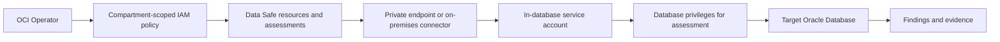
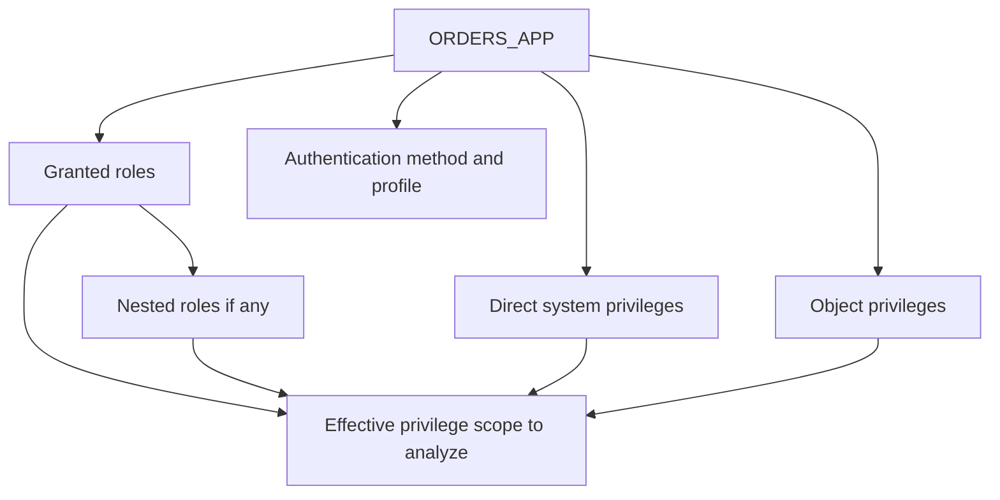
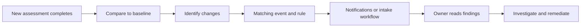

# Data Safe and Database Security Assessment

## Lesson Objectives

A database running smoothly can still have over-privileged accounts, inappropriate password policies, or audit configurations that fail to meet operational requirements. These issues are difficult to detect solely from CPU graphs, tablespace utilization, or SQL execution times.

In the **Database Management and Optimization** chapter of the **CLOUD_PROVIDERS_ORACLE** module, this lesson introduces how to use **Oracle Data Safe** to assess Oracle database security, read evidence, and organize remediation. The material connects with tenancy, compartments, IAM, VCN, and database services in OCI, while also addressing monitoring, automation, cost, and assessment availability.

After this lesson, you will be able to:

- Explain the roles of Security Assessment and User Assessment.
- Prepare the connectivity and permissions needed to register a target database.
- Interpret findings by risk level, scope, and evidence.
- Cross-check selected configurations using read-only SQL.
- Build a workflow for remediation, reassessment, and baseline selection.
- Track configuration changes without mistaking an old report for the current state.

## 1. What Problem Does Data Safe Solve?

Oracle Data Safe centralizes security capabilities for Oracle databases. The capabilities relevant to this lesson include configuration assessment, user assessment, sensitive data discovery, audit activity monitoring, and masking. See [Oracle Data Safe Overview](https://docs.oracle.com/en-us/iaas/data-safe/doc/oracle-data-safe-overview.html).

Start from the question you need to answer to pick the right capability:

| Question | Appropriate Capability |
| --- | --- |
| Which configurations and security controls need review? | Security Assessment |
| Which accounts have privileges or traits needing attention? | User Assessment |
| In which columns is sensitive data located? | Data Discovery |
| Which activities are recorded in the audit trail? | Activity Auditing |
| How can masked data be prepared for an appropriate environment? | Data Masking |

This lesson focuses on **Security Assessment**, using User Assessment and database metadata for deeper investigation.

The running example is the Java Orders application connecting to an Oracle PDB using the `ORDERS_APP` account. The development team needs to know whether runtime holds privileges beyond its needs, whether authentication policies are suitable, and whether post-release changes introduce new risk.

A finding must be turned into a concrete decision: who handles it, what evidence is required, which application is affected by the change, and what result confirms remediation.

### Limitations of Assessment Results

Treat an assessment as the outcome of a check suite against a target at the assessment timestamp. Consequently:

- An old report does not reliably represent a recently modified configuration.
- A passing finding does not cover every attack vector into the application.
- Standard references support control mapping; the organization still must define compliance scope and evidence.
- Controls for the operating system, VCN, backups, and applications must be evaluated in their own workflows.
- Recommendations must be implemented and tested on the exact responsible component.

For example, a private subnet can restrict network paths to the database, but it does not eliminate excessive privileges on an account that logs in legitimately.

## 2. Target Database and Assessment Scope

### 2.1. Registering a Target Creates a Management Relationship

A **Target database** is a database registered so Data Safe can connect and use authorized features. Supported Oracle Database deployments can reside on OCI or in other environments. Check database types and connection methods in [Target Registration Overview](https://docs.oracle.com/en/cloud/paas/data-safe/dsiad/datasafe_target_reg.html).

A target record should clearly specify:

| Detail | Example in This Lesson |
| --- | --- |
| Environment | Lab |
| Database service | Oracle Base Database Service |
| Scope under review | PDB serving Orders |
| Target display name | orders-pdb-lab |
| Compartment holding Data Safe target | DataSafe-Lab |
| Connection path | Data Safe private endpoint |
| Service connection account | Dedicated account for Data Safe |
| Database owner | DBA team |
| Finding triager | Database security team |

Names in the table are design examples, not default Oracle resource names.

The compartment holding the Data Safe target may differ from the compartment holding the DB system. Record the database resource OCID and the Data Safe target OCID separately; permission to read one resource does not fully describe permissions on the other. See [Register an Oracle Cloud Database](https://docs.oracle.com/en-us/iaas/data-safe/doc/register-oracle-cloud-database.html).

### 2.2. CDB and PDB Must Be Identified Explicitly

In a multitenant system, the CDB name, PDB name, and service name can differ. A session connecting to the wrong container can return valid metadata that is not from the target you intended to inspect.

Before reading a report or running verification SQL, specify:

- Which service the target points to.
- What the actual database and container are.
- In which container users and grants are being inspected.
- Whether findings apply to one PDB or a broader scope.

Oracle provides policy-driven automatic registration for supported deployment types: configured at the CDB to manage registration of eligible PDBs. Check the support list before applying; do not assume a single manual registration covers all current and future PDBs. See [Automatically Register Target Databases](https://docs.oracle.com/en-us/iaas/data-safe/doc/automatic-registration.html).

## 3. Two Permission Layers: OCI IAM and In-Database Privileges



The two permission layers answer two different questions:

| Permission Layer | Question |
| --- | --- |
| OCI IAM | Which user or principal may operate on Data Safe resources? |
| Database privileges | What may Data Safe's connection session read or perform inside the database? |

Oracle specifies that Data Safe access is controlled at both IAM and target database roles in [Security and Permissions](https://docs.oracle.com/en/cloud/paas/data-safe/dsiad/datasafe_iam.html).

### 3.1. OCI Authorization by Responsibility

One way to divide roles:

| Group | Responsibility |
| --- | --- |
| Readers | Read assigned findings and evidence |
| Assessors | Refresh, compare assessments, and manage baselines within assigned scope |
| Target administrators | Register targets, manage connections and credentials |
| Network administrators | Manage endpoints, routes, and security rules |
| DBAs | Grant service privileges and remediate database configurations |

For the **security-assessments** resource, **read** permission allows viewing; operations such as refreshing and managing baselines require **manage** per the service's permission model. See [Security Assessment and User Assessment Resources](https://docs.oracle.com/en-us/iaas/data-safe/doc/security-and-user-assessment-resources.html).

Example permissions for the assessment team in the lab compartment:

```text
Allow group 'Default'/'DS-Assessors' to manage security-assessments in compartment DataSafe-Lab
Allow group 'Default'/'DS-Assessors' to read data-safe-work-requests in compartment DataSafe-Lab
```

Replace the domain, group, and compartment with actual names. Registering targets and configuring networking require their own corresponding permissions. Read access to `data-safe-work-requests` relates to setting baselines and comparing results, per [Common Resources](https://docs.oracle.com/en-us/iaas/data-safe/doc/common-resources.html).

If also analyzing User Assessment, evaluate permissions on `user-assessments`. Avoid defaulting to `manage` across the entire `data-safe-family` at the tenancy level just so every account sees all buttons in the Console.

Verify acceptance using representative accounts: a lab report reader must not be able to edit baselines or see production data outside assigned scope.

### 3.2. In-Database Service Account

For non-Autonomous databases, DBAs prepare a dedicated account and grant the required privilege set using the **datasafe_privileges.sql** script provided by Data Safe. Current documentation lists the assessment privilege role as **ORA_DSCS_ASSESSMENT**; Autonomous uses **DS$ASSESSMENT_ROLE** with a different provisioning flow. See [Grant Roles to the Oracle Data Safe Service Account](https://docs.oracle.com/en-us/iaas/data-safe/doc/grant-roles-oracle-data-safe-service-account-your-target-database.html).

Example invocation of the current script for an existing non-Autonomous account:

```sql
@datasafe_privileges.sql DATASAFE_SVC GRANT ORA_DSCS_ASSESSMENT
```

The DBA must download the script for the target environment and follow the accompanying instructions. The administrative session used for provisioning and the Data Safe account used during operations are two separate principals.

When rotating the service account password, update the target configuration, test connectivity, and verify a new assessment runs successfully. Manage credentials under your environment's secret management workflow; never store passwords in tickets.

Assessment privileges do not imply granting masking privileges or modifying audit policies. For Database Vault or special controls, check additional guidance for that target.

## 4. Preparing Connectivity to the Database

### 4.1. Choosing the Connection Path by Target Location

| Scenario | Selection Direction |
| --- | --- |
| Autonomous with public endpoint meeting criteria | Check the direct registration path for that database type |
| Private database on OCI | Data Safe private endpoint via the supported registration workflow |
| Database outside OCI with existing private network path to VCN | Private endpoint over an appropriate VPN/FastConnect path |
| Database outside OCI without a suitable private network path | Consider an on-premises connector if supported by target type |

Selection must follow the database type; refer to [Connectivity Options for Target Databases](https://docs.oracle.com/en-us/iaas/data-safe/doc/connectivity-options-target-databases.html).

A Data Safe private endpoint is a Data Safe connectivity resource. It does not make every address inside a VCN reachable. You still must verify routes, listeners, DNS if hostnames are used, and security rules.

### 4.2. Connection Example for the Orders PDB

Suppose the lab uses:

- Database private IP: 10.20.10.20.
- Data Safe private endpoint IP: 10.20.20.15.
- TLS listener configured on port 1522.
- Service name for the Orders PDB provided by the DBA.

These ports and IPs are example assumptions. Use your actual listener and protocol.

With stateful rules, verify at minimum:

| Checkpoint | Flow or Configuration | Purpose |
| --- | --- | --- |
| Endpoint egress | Endpoint → database, exact listener port | Allow outbound connection initiation |
| Database ingress | Endpoint → database, exact listener port | Allow inbound connection acceptance |
| Subnet/VCN routing | Proper forward and return routes | Ensure packets reach the right network |
| TLS | Matching trust and endpoint identity | Complete the chosen protocol handshake |

If using stateless rules, also account for return traffic per network design. For RAC or multi-address topologies, account for every address used by the actual connection flow.

Private IPs and transport encryption are two separate properties. When TLS is required, verify the listener, truststore, and authentication mode rather than relying solely on the database residing in a private subnet.

### 4.3. When Using an On-Premises Connector

The connector establishes a TLS tunnel from the connector host to Data Safe's connectivity component. The hop from the connector to the database still requires appropriate protocol, networking, and authentication. See [Oracle Data Safe On-Premises Connector](https://docs.oracle.com/en/cloud/paas/data-safe/dsiad/datasafe_onprem_connector.html).

Monitor the connector host, certificates, reachability to the service endpoint, and connectivity to the listener. A stopped connector can halt assessments even while the database continues serving Orders.

## 5. Registering and Running the First Assessment

Perform these steps in your authorized lab environment. The steps below are instructions for learners to execute, not results from an existing tenancy run.

### Step 1: Compile the Input List

Prepare the region, compartment, database type, service name, endpoint/connector, protocol, and service account. Record the owners for networking, database, and Data Safe so errors can be routed to the right layer.

For Orders, explicitly select the PDB to assess; do not infer the service name from the target display name.

### Step 2: Check Pre-Registration Prerequisites

Verify:

- IAM permissions to register targets and use connectivity resources.
- The service account exists, is in an active/usable state, and has assessment privileges.
- The listener and network path from the Data Safe connection point are working.
- TLS materials are prepared if TLS is used.
- Features planned to be enabled in the wizard match the lab scope.

A successful login from a DBA's laptop does not verify the path from the private endpoint or connector.

### Step 3: Run the Wizard for the Database Type

In Data Safe, choose the appropriate wizard and provide the target, credentials, and connection path. Review suggested network rules before applying them.

Monitor registration steps until completion and resolve any errors. Save the target OCID, connection path, and database/container in the lab log. Wizard details for Base Database and corresponding cloud databases are documented in [Register an Oracle Cloud Database](https://docs.oracle.com/en-us/iaas/data-safe/doc/register-oracle-cloud-database.html).

### Step 4: Inspect the Initial Results

After valid registration, Data Safe automatically runs a Security Assessment and configures a default weekly schedule. Inspect the target's actual assessment run per [Security Assessment Overview](https://docs.oracle.com/en-us/iaas/data-safe/doc/security-assessment-overview.html).

Record:

- Timestamp when the database was assessed.
- Database and target version.
- Completion status.
- Active check suite or template applied.
- Detailed finding content.

A successful registration state is an important operational prerequisite; assessment evidence also requires a completed assessment with a clear timestamp.

### Step 5: Save Pre-Change Evidence

Record the assessment identifier and comparison details. You can assign a recognizable name such as `SA_orders_lab_before_hardening`.

Saving a copy of the latest assessment only preserves existing results. To verify newly changed configurations, you must refresh and wait for the new assessment to complete. See [Manage Security Assessments](https://docs.oracle.com/en-us/iaas/data-safe/doc/manage-security-assessments.html).

## 6. Interpreting Findings with Evidence

### 6.1. Risk Levels Are Decision Inputs

| Level | How to Read It |
| --- | --- |
| High | Requires urgent attention |
| Medium | Plan early remediation |
| Low | Can be combined with scheduled maintenance |
| Advisory | Opportunity to strengthen controls |
| Evaluate | Requires manual analysis |
| Pass | Check detected no risk |
| Deferred | Remediation has been deferred |

Cross-check definitions in [Security Assessment Overview](https://docs.oracle.com/en-us/iaas/data-safe/doc/security-assessment-overview.html).

When triaging work, add context:

- What data does the database hold and what is the impact of unauthorized access?
- Is the account an application, administrative, or integration account?
- What access paths and compensating controls already exist?
- Will the fix cause downtime or break scheduled tasks?
- Is the assessment timestamp fresh enough for a decision?

Two databases with the same finding may require different priorities due to different impact levels.

### 6.2. Assessment Categories to Review

Reports group checks into user accounts, privileges and roles, authorization control, fine-grained access control, data encryption, auditing, and database configuration.

A set of questions for Orders:

| Category | Investigation Question |
| --- | --- |
| User accounts | Do application and maintenance accounts still match their intended purpose? |
| Privileges and roles | Does runtime hold administrative privileges beyond its needs? |
| Authorization control | Are grant paths clear and governed? |
| Fine-grained access control | Do fine-grained controls match data requirements? |
| Data encryption | Do encryption layers meet requirements? |
| Auditing | Are actions requiring investigation being recorded? |
| Database configuration | Do relevant settings align with policy? |

These questions guide analysis and do not imply every target will produce corresponding findings. Check coverage and recommendations depend on database type, version, and template.

### 6.3. Open Details Instead of Looking Only at Totals

Select the exact target and compartment, then open each finding. You can filter by risk, category, and reference, per [View and Analyze Security Assessments](https://docs.oracle.com/en-us/iaas/data-safe/doc/view-analyze-sa-history.html).

For each finding, create an investigation ticket:

```text
Target and container:
Assessment OCID:
Assessed time:
Finding/check:
Reported risk level:
Affected configuration or object:
Evidence to cross-check:
Recommendation:
Owner:
Remediation and verification plan:
```

A drop in total findings is not enough to close a ticket. You must know whether the change came from fixing the configuration, altering the check suite, or adjusting risk levels.

## 7. Read-Only SQL to Cross-Check Configurations

The queries illustrate Oracle Database 19c. Use a DBA session or an account granted appropriate metadata read privileges in the exact container. These are instructions for learners to run in the lab.

### 7.1. Verify Session Context

```sql
SELECT SYS_CONTEXT('USERENV', 'DB_NAME') AS database_name,
       SYS_CONTEXT('USERENV', 'CON_NAME') AS container_name,
       SYS_CONTEXT('USERENV', 'SESSION_USER') AS session_user
FROM dual;
```

Save the output alongside your evidence. If the target is the Orders PDB but your SQL session is in another container, fix the context before interpreting subsequent queries.

### 7.2. Check Account Status and Profile

```sql
SELECT username,
       account_status,
       authentication_type,
       profile,
       last_login
FROM dba_users
WHERE username = 'ORDERS_APP';
```

Verify whether the authentication type and profile match the design. An empty `LAST_LOGIN` does not by itself prove an account is unused; Oracle does not record this column for certain administrative connection types. See [DBA_USERS](https://docs.oracle.com/en/database/oracle/oracle-database/19/refrn/DBA_USERS.html).

Deciding to lock an account also requires checking owners, jobs, application connection pools, proxy paths, and relevant activity records. For Oracle-managed users, follow Oracle's guidance rather than applying application-user rules across the board.

### 7.3. Check Roles Granted to Runtime

```sql
SELECT grantee,
       granted_role,
       admin_option,
       default_role
FROM dba_role_privs
WHERE grantee = 'ORDERS_APP'
ORDER BY granted_role;
```

If an inappropriate administrative role appears, record its grant source and reason for existing before proposing revocation. `ADMIN_OPTION` indicates whether the grantee is allowed to manage granting that role. See [DBA_ROLE_PRIVS](https://docs.oracle.com/en/database/oracle/oracle-database/19/refrn/DBA_ROLE_PRIVS.html).

Filtering by `ORDERS_APP` only shows roles granted directly to that grantee. Roles can contain other roles, and effective privileges can arrive via other grant paths. A complete conclusion requires deeper analysis, such as User Assessment and related metadata.

### 7.4. Check Directly Granted System Privileges

```sql
SELECT grantee,
       privilege,
       admin_option
FROM dba_sys_privs
WHERE grantee = 'ORDERS_APP'
ORDER BY privilege;
```

Zero rows does not mean the user holds no system privileges through roles. Column definitions are described in [DBA_SYS_PRIVS](https://docs.oracle.com/en/database/oracle/oracle-database/19/refrn/DBA_SYS_PRIVS.html).

For Orders, separate three operation groups: runtime executing business logic, migration tools modifying schemas, and DBAs administering the database. Granting the same privilege set to all three makes it hard to contain blast radius if credentials are compromised.

### 7.5. Check Password Policies

```sql
SELECT profile,
       resource_name,
       limit
FROM dba_profiles
WHERE resource_type = 'PASSWORD'
  AND (
      profile = 'DEFAULT'
      OR profile IN (
          SELECT profile
          FROM dba_users
          WHERE username = 'ORDERS_APP'
      )
  )
ORDER BY profile, resource_name;
```

This query pulls the application's profile alongside `DEFAULT` to help trace inherited values. Refer to [DBA_PROFILES](https://docs.oracle.com/en/database/oracle/oracle-database/19/refrn/DBA_PROFILES.html).

When interpreting results:

- Resolve `DEFAULT` values using the actual settings of the default profile.
- Check authentication methods before inferring the impact of password policies.
- Evaluate lockout and password expiration together with the application's rotation workflow.
- Check every user sharing the profile before making changes.

Changing a lockout policy without updating stale credentials across multiple Orders instances can trigger a wave of repeated login failures. Always test fresh connections from the connection pool after changes.

## 8. Combining User Assessment to Understand Account Privileges

Security Assessment highlights configuration issues. When findings involve users, User Assessment adds visibility into accounts, roles, privileges, and risk attributes. See [User Assessment Overview](https://docs.oracle.com/en-us/iaas/data-safe/doc/user-assessment-overview.html).

For `ORDERS_APP`, map out:



Reading a role named "read only" is not enough. You must inspect what privileges it contains, who can modify the role, and which objects those privileges apply to.

If an administrative role exists, answer:

1. Which business task requires that privilege?
2. Is this a runtime account or a deployment account?
3. Can it be replaced with specific privileges on the appropriate schema/objects?
4. Will any procedures, jobs, or background tasks be affected?
5. How do we test removing the privilege and restore it if something breaks?

User Assessment helps pinpoint accounts to analyze; activity history and application testing establish actual operational requirements.

## 9. From Finding to Verifiable Remediation

Suppose in the lab you discover `ORDERS_APP` holds a role broader than runtime needs. This is an illustrative scenario, not a conclusion about an already-inspected database.

### 9.1. Planning Before Making Changes

| Component | Required Content |
| --- | --- |
| Scope | Exact target, container, user, and role |
| Current state | Direct grants, role-inherited grants, and dependent tasks |
| Target state | Required set of runtime operations |
| Change | Replacement privileges and privileges planned for revocation |
| Testing | Fresh connections, business flows, batch jobs, and role-based migrations |
| Rollback | Restore recorded configuration if tests fail |
| Closure evidence | Post-fix configuration, new assessment, and test results |

Remediation paths require corresponding owners and evidence:

| Scenario | Remediation Approach | Verification Evidence |
| --- | --- | --- |
| Over-privileged runtime | Separate roles, narrow grants to actual needs | Metadata, testing, new assessment |
| Unowned user | Identify owner and usage path | Owner confirmation, activity data |
| Unsuitable profile | Design policy and rotation | Profile, credential test, fresh connections |
| Insufficient auditing | Identify actions to capture, configure appropriately | Audit record of a test action |
| Unmet encryption requirements | Address at the relevant storage or transport layer | Evidence from that exact layer |
| Patch recommendation | Follow patching and compatibility workflow | Patch details, post-change assessment |

These rows describe remediation approaches; always verify against the actual finding's recommendation before choosing a change.

### 9.2. Reassessing and Testing the Application

After the owner applies the change:

1. Re-read metadata in the exact container.
2. Run representative tests using the actual application account.
3. Open fresh connections rather than observing only pre-existing sessions.
4. Refresh Security Assessment and wait for completion.
5. Re-read findings and cross-check evidence.
6. Record any remaining or newly introduced risks.

A change that improves a report score but prevents Orders from creating orders fails the operational objective.

Example verification record for an excessive-privilege finding:

```text
Before change:
  Discovered role: record from actual metadata.
  Flows using the role: verify with application team.

After change:
  Remaining grants and roles: attach query results.
  Fresh connection test: record actual result.
  Order create/read/update test: record actual result.
  New assessment: OCID and assessed time.
  Finding after reassessment: record status and evidence.
```

This template requires learners to fill in observed results and does not assume a finding will automatically disappear after every fix.

### 9.3. Fixing Configuration and Changing Risk Levels Are Different Actions

Data Safe allows adjusting risk or deferring a finding with a justification and expiration date. The risk modification report tracks those adjustments. See [View and Analyze Security Assessments](https://docs.oracle.com/en-us/iaas/data-safe/doc/view-analyze-sa-history.html).

Changing a label does not alter grants, profiles, or database settings. For exceptions not immediately remediated, internal records should include:

```text
Finding and target:
Current state evidence:
Reason not yet remediated:
Analyzed impact:
Compensating controls:
Risk acceptor:
Review due date:
Remediation plan:
```

When due, check whether the exception remains valid and whether remediation is needed. Never use severity downgrades as a substitute for technical evidence.

## 10. Baselines and Configuration Drift Detection

### 10.1. Baseline for a Single Target

A baseline is a comparison reference you choose for a target. A newly completed assessment does not automatically become a good standard state.

Recommended sequence:

1. Read and triage findings.
2. Remediate or document approved exceptions.
3. Refresh to obtain post-change results.
4. Confirm scope, evidence, and timestamp.
5. Set the appropriate assessment as the baseline.
6. Compare subsequent runs against that baseline.

Oracle describes setting baselines and comparison reports in [Compare Security Assessments for Single Target Databases](https://docs.oracle.com/en-us/iaas/data-safe/doc/compare-security-assessments-single-target-databases.html).

When drift occurs, determine whether a finding is newly introduced, resolved, or changed in detail. Cross-check change records to distinguish intentional changes from unexpected ones.

Do not replace a baseline just to clear drift alerts. When operational standards legitimately change, record the rationale and evidence for the new baseline.

### 10.2. Templates and Baselines Serve Different Roles

An assessment template selects the check suite. Oracle provides built-in templates and lets you create custom templates. When applying a template, Data Safe also supports a template baseline for comparing against expected levels. See [Work with Security Assessment Templates](https://docs.oracle.com/en-us/iaas/data-safe/doc/work-security-assessment-templates.html).

| Component | Role |
| --- | --- |
| Assessment template | Selects which checks are executed |
| Target assessment | Results observed on the target |
| Target baseline assessment | Result snapshot used for comparison over time |
| Template baseline | Expected values for checks in the template |

When comparing before and after, retain template details. Dropping checks can lower total finding counts even when the database configuration has not changed.

For multiple databases, you can organize target groups and choose appropriate checks for the group. Review how to create group assessments and templates in [Work with Security Assessments for Target Database Groups](https://docs.oracle.com/en-us/iaas/data-safe/doc/work-security-assessments-target-database-groups.html).

## 11. Assessment Schedules and Automation

### 11.1. Distinguishing Reassessment from Saving Copies

| Schedule Type | Meaning |
| --- | --- |
| Latest | Controls when an assessment runs to update the latest assessment |
| Saved | Saves a copy of the latest assessment on schedule |

Adding a save schedule does not ensure the database is reassessed at the same frequency. When configuring schedules, use UTC per service guidance. See [Schedule Security Assessments](https://docs.oracle.com/en-us/iaas/data-safe/doc/schedule-security-assessments.html).

Example design for Orders:

- Run periodic assessments per environment policy.
- Refresh after privilege changes or a notable hardening effort.
- Save evidence according to team retention needs.
- Record both the save timestamp and the timestamp when the database was actually assessed.

If a job is intended for 02:00 in Vietnam, convert accurately to UTC and check the run date: that time corresponds to 19:00 UTC of the previous day.

Schedules must account for maintenance windows and target reachability. If an assessment fails, record the cause and rerun after connectivity is restored.

### 11.2. Handling Drift Notifications

OCI Events supports automation driven by Data Safe resource state changes. See [Events](https://docs.oracle.com/en-us/iaas/data-safe/doc/events.html).

A recommended operational flow:



This is a process design; rules must be configured and tested against events supported by your environment. Include target, assessment, timestamp, and owner group in notifications so recipients can access the evidence.

A notification flow test should verify:

1. A controlled change was assessed.
2. Corresponding comparison data exists.
3. The rule matches the exact event.
4. Recipients can read the assessment under IAM.
5. An owner receives, triages, and acts on the result.

Scheduled assessments have observation latency. A privilege granted and revoked between two runs may not appear in configuration snapshots. When activity tracking is needed, configure auditing alongside assessments.

### 11.3. Tracking Coverage and Freshness

An internal dashboard should track:

| Governance Metric | Meaning |
| --- | --- |
| In-scope databases without a target | Registration gap |
| Targets lacking a recent successful assessment | Fresh-evidence gap |
| Findings without an owner | Unassigned work |
| Exceptions past review due date | Risk persisting outside governance |
| Post-baseline changes without explanation | Unclassified drift |
| Remediations with testing and reassessment | Ability to prove outcomes |

Example self-set lab target: every target on the list must have a successful assessment within the past seven days. This is a lab convention, not a default Oracle SLA.

A simple governance calculation:

```text
Fresh assessment coverage
= In-scope databases with a valid successful assessment
  / Total in-scope databases
  × 100%
```

If there are 10 databases but only 8 are registered and assessed successfully on time, coverage is 80%. A report looking only at the 8 existing targets must not be used to conclude the entire system is covered.

Keep the list of in-scope databases alongside the Data Safe target list for reconciliation. Checks and report exports can be organized in a team automation workflow using an account granted only necessary permissions.

## 12. Availability, Report Data, and Cost

### 12.1. Interrupted Assessments Do Not Mean the Database Stopped Serving

If the service account is locked or the connector is down, Orders may keep running while the security team loses fresh assessment data. Monitor database status and the management path separately.

After listener, certificate, password, route, or database role changes, re-verify connectivity and run an appropriate assessment.

For connectors requiring high availability, Oracle provides guidance on deploying across two Linux hosts for supported cases. See [Register an On-Premises Oracle Database](https://docs.oracle.com/en-us/iaas/data-safe/doc/register-onpremises-oracle-database.html).

Before stopping or replacing a connector, identify all targets sharing it. For cross-environment or cross-region recovery requirements, plan for credentials, connection paths, assessment schedules, and retained evidence; test operability after switchover.

### 12.2. Reports Are Also Data That Must Be Protected

Assessments can describe accounts, privileges, and configuration weaknesses. When exporting or sharing evidence:

- Choose storage repositories and readers according to scope.
- Retain the target, assessment timestamp, and assessment identifier.
- Never include credentials or wallets in tickets.
- Define retention periods and owners responsible for cleaning up exports.
- Check permissions when copying assessments to another compartment.

Broadly shared reports can expose authorization structures even when they contain no business data.

### 12.3. Controlling Scope and Usage

For cost planning, check pricing and usage by target type, region, and features actually used. Do not infer total system cost solely from enabling assessments.

The operational ledger should list:

| Component | What to Check |
| --- | --- |
| Lab database | Compute, storage, and lifetime |
| Connector host if any | Host compute resources and OS administration |
| Networking | Connection paths and associated network services |
| Enabled Data Safe features | Assessment, audit, discovery, or additional features |
| Report exports | Storage, access permissions, and lifecycle |

Collection frequency and feature scope must be purposeful. For configuration assessment labs, specify which features serve the lesson and which are managed by other workflows.

When finishing the lab, clean up only test resources you are permitted to remove. Shared endpoints or connectors must be retained for targets still in use; stopping a practice exercise does not automatically justify deleting the database.

## 13. Troubleshooting Common Errors

| Symptom | What to Check | Distinguishing Evidence |
| --- | --- | --- |
| Target not visible | Region, compartment, filters, and IAM | Target OCID and account scope |
| Target cannot connect | Listener, routes, security rules, service name | Registration error and path from endpoint/connector |
| Authentication error | Credentials, user status, wallet/certificates | Error message and change timestamp |
| Assessment missing or failed | Database privileges and script version | Provisioned privileges, work request |
| Can view but cannot refresh | Assessment operation permissions | Actual policy and resource type |
| Cannot set baseline or compare | Assessment and work request permissions | Compartment-level policies |
| Fixed but finding persists | Assessed time, target/container, and effective config | New assessment, post-fix metadata |
| Total findings drop unexpectedly | Template, filters, or risk modifications | Active check suite, modification history |
| New saved copy has old assessment data | Saved schedule differs from latest schedule | Assessed timestamp vs. saved timestamp |
| Verification SQL disagrees with finding | Container, roles, and check scope | Session context, grant path |

Isolate each layer before broadening permissions. Adding administrative roles will not fix a wrong route; opening a firewall will not fix an expired password.

## 14. Required Evidence After Practice

Learners complete the lesson when they can present:

1. Which target was assessed, and in which region, compartment, and container.
2. Which connection path and service account Data Safe used.
3. IAM permissions for operators and database privileges for the service.
4. At least one finding cross-checked with properly scoped evidence.
5. A remediation plan with owner, testing, and rollback steps.
6. A post-change assessment along with application tests, if changes were applied in the lab.
7. Rationale for selecting a baseline or why it is not yet eligible.
8. The difference between latest schedule, saved schedule, and the assessment actually used.
9. A plan to track coverage, freshness, exceptions, and lab resource lifecycle.

If changes have not yet been deployed, record the exact status as "assessed and planned", along with missing evidence. Handover records must clearly distinguish what was observed, what was fixed, and what still requires verification.
